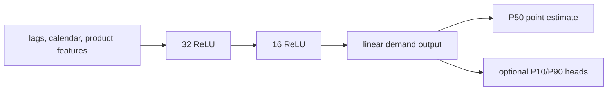

# AI03 - Artificial Neural Networks Study

## 0. Document control

| Field | Value |
|---|---|
| Version | 1.0 |
| Scope | Sprint 2, AI03 |
| Date | 2026-11-10 |
| Status | Assessment deliverable |
| Runtime impact | None |

This study is an engineering assessment. It does not train, deploy, or integrate
an ANN into LaPrizza.

## 1. Executive summary

Two applications were selected for assessment:

1. **Demand forecasting**, to provide a manager-reviewed starting point for
   `ConsumptionForecast` entries.
2. **Stock-related decision support**, to estimate replenishment needs without
   creating purchase orders or changing stock.

Both applications are plausible because the existing Sprint 2 model already
contains forecasts, products, stock, supplier offers, and planning results.
The available Sprint 2 data is small and simulated, so no claim of production
accuracy is made. A seasonal-naive forecast remains the minimum baseline, and
an ANN should only be considered after it consistently beats that baseline on
time-ordered holdout data.

## 2. Context: LaPrizza, Sprint 2, and IARTI

AI01 and AI02 are implemented as deterministic Prolog calculations orchestrated
by the backend. The planning result is read-only: it does not mutate stock and
does not create purchase orders. AI03 complements that work by studying whether
learned predictions could improve future inputs; it is not an alternative
implementation of the Prolog planning engine.

For demand forecasting, a model would predict daily quantities per
`(productSku, pizzaSize)`. For a non-pizza sellable product, `pizzaSize` is
null and `stockUnitsPerSale` remains the domain rule. For pizza components, BOM
expansion remains the responsibility of AI01/AI02.

The study follows the IARTI distinction between AI, machine learning, ANN and
deep learning. An ANN learns parameters from examples; it does not guarantee
causal explanations, safe decisions, or correct behavior outside its training
distribution.

## 3. Methodology

### 3.1. Candidate applications and scoring

Candidates were scored from 1 (weak) to 5 (strong) for business value, data
availability, implementation feasibility, and availability of a meaningful
baseline. The total is the sum of those four scores.

| Candidate | Business value | Data availability | Feasibility | Baseline | Total |
|---|---:|---:|---:|---:|---:|
| Demand forecasting | 5 | 3 | 4 | 4 | 16 |
| Stock-related decision support | 4 | 3 | 3 | 3 | 13 |
| Allergen conflict detection | 3 | 4 | 4 | 3 | 14 |
| Customer churn prediction | 3 | 1 | 3 | 2 | 9 |
| Review sentiment analysis | 2 | 1 | 2 | 1 | 6 |
| Staff scheduling optimisation | 3 | 1 | 1 | 2 | 7 |

### 3.2. Selection rationale

Demand forecasting and stock-related decision support were selected because
they map directly to existing Sprint 2 entities and to AI02's input/output
boundary. Allergen conflict detection was rejected despite its score because a
deterministic domain rule is preferable to a learned model. The remaining
applications lack the required data or fall outside the current product scope.

### 3.3. Data sources and constraints

Potential aggregate inputs are daily consumption history, calendar features,
product catalogue attributes, current stock snapshots, supplier offers, lead
times, supply limits, and manager-confirmed forecasts. Examples in this study
use only synthetic data. No customer records, user records, credentials, or
dietary profiles were used or sent to an AI tool.

The Sprint 2 dataset is intentionally small because the ordering workflow does
not yet provide a large production history. This is a limitation and a result:
real integration should not be recommended until data volume, quality, and
governance are demonstrated.

## 4. Application A - Demand Forecasting

### 4.1. Problem

Managers currently need to author daily forecast entries. An ANN could estimate
future consumption per product and pizza size, reducing manual effort and
providing a starting point for review before a forecast is confirmed.

### 4.2. Inputs

Candidate features are:

- lagged daily quantities and rolling averages;
- day of week, month, and a holiday indicator;
- product category, sellable flag, and component flag;
- optional promotion flags, if a governed source is added later.

The target is a quantity, not a raw ingredient requirement. BOM expansion and
stock-unit conversion remain downstream planning rules.

### 4.3. Outputs

For a forward window such as 14 days, the model would produce a non-negative
point estimate for each `(productSku, pizzaSize)`. A useful future version
should also produce P10, P50, and P90 estimates or another calibrated
prediction interval. The manager must be able to edit or reject the estimates.

### 4.4. Expected benefits

- less repetitive forecast authoring;
- a consistent starting point for manager review;
- earlier visibility of likely peaks and low-demand periods;
- potentially less waste and fewer stock-outs when the estimates are reliable;
- improved quality of the input supplied to AI02.

### 4.5. Limitations

The dataset is small and synthetic, so accuracy is unknown. New products have a
cold-start problem. Promotions or events absent from training data cannot be
reliably extrapolated. ANN explanations are less direct than a seasonal-naive
baseline, and prediction intervals require separate calibration. A model must
not silently replace the manager or the deterministic planning rules.

### 4.6. Proposed ANN architecture

This is a proposal, not a trained model:

Two small hidden layers are appropriate for tabular data and reduce the risk of
overfitting a small dataset. ReLU is a standard hidden-layer activation for
this setting; a linear or non-negative output treatment is appropriate for a
quantity target. The architecture must be compared with simpler models before
being accepted.

### 4.7. Worked example (synthetic data)

Suppose the previous observations for a medium pizza are 12, 14, 11, and 13
units on comparable weekdays. A seasonal-naive baseline predicts 12 units for
the next comparable day. A hypothetical ANN output of P10=9, P50=13, P90=18
would be shown to the manager as an estimate and uncertainty range, not as an
automatic order. The example is illustrative; it is not a measured model
result.

### 4.8. Evaluation criteria and baseline

Evaluation must split data by date, never randomly mix future observations into
training data. The minimum baseline is the quantity from the previous week on
the same weekday.

| Metric | Use | Important caveat |
|---|---|---|
| MAE | Average absolute error | Easy to interpret in units |
| RMSE | Penalises large misses | Sensitive to outliers |
| MAPE | Relative error | Undefined or unstable at zero demand |
| sMAPE | Symmetric relative error | Still needs careful zero handling |
| Bias | Signed mean error | Shows systematic over/under prediction |
| Coverage | Interval reliability | P10/P90 should contain the target near the intended rate |

The ANN is not justified if it does not beat the seasonal-naive baseline on a
held-out period without unacceptable bias.

### 4.9. Evidence from research and industry context

The forecasting literature does not support choosing a neural network solely
because it is more complex. Zhang, Patuwo, and Hu [1] review ANN forecasting
methods and the importance of problem-specific evaluation. Restaurant-specific
work by Tanizaki et al. [2] uses actual store data and machine-learning and
statistical comparisons; it supports validating against local operating data
and simple baselines, rather than assuming that one model transfers to every
restaurant.

DeepAR [3] is a probabilistic recurrent neural network trained across related
time series. Its distributional forecasts are relevant to the P10/P50/P90
goal, but depend on having enough related histories. In food catering,
Rodrigues et al. [4] compare short-term forecasting models using operational
data, including LSTM and tree-based approaches. Their results illustrate how
data-driven forecasts can inform waste decisions, while remaining specific to
the studied services. Chae et al. [5] examine data and ML/DL choices at a large
restaurant chain and report that model value depends on data and operating
conditions. Kim [6] demonstrates menu-level daily forecasting with deep neural
networks and sales/weather features, but does not establish performance on
LaPrizza's smaller, synthetic dataset.

Together, these studies justify evaluation as a future option, not deployment
in Sprint 2. LaPrizza lacks the representative history required to reproduce
those results; chronological holdouts, seasonal-naive comparisons, uncertainty
calibration, and manager review remain prerequisites. Tillster's article on
AI and machine learning in restaurants [7] is included as an industry
reference discussing demand forecasting and inventory planning. It is a vendor source, not a
peer-reviewed article, and is not counted toward the academic minimum.

## 5. Application B - Stock-related Decision Support

### 5.1. Problem

Given a reviewed demand forecast, current stock, supplier lead times, lot
quantities, prices, and supply limits, an ANN could estimate a replenishment
buffer or recommended quantity per product and day. This is decision support,
not an automatic purchase order.

### 5.2. Inputs

Inputs may include:

- reviewed demand forecast and its uncertainty;
- current stock in abstract stock units;
- `stockUnitsPerSale` for directly sold stock-controlled products;
- component consumption configuration for pizza ingredients;
- supplier lead times, lot sizes, prices, and daily limits;
- observed replenishment outcomes, if a governed history becomes available.

The model must not infer a supplier decision from customer identity or other
personal data.

### 5.3. Outputs

The output is a recommended replenishment quantity and confidence band per
product and day. It should also emit a warning when the recommendation exceeds
the daily supply limit of every known offer. AI02 remains responsible for
indivisible lots, delivery dates, supplier selection, unmet needs, and the
read-only planning result.

### 5.4. Expected benefits

- makes safety-stock trade-offs visible;
- reduces repeated manual arithmetic;
- highlights likely stock-out and overstock situations;
- gives the manager a quantitative starting point for scenario analysis.

### 5.5. Limitations

Errors in demand forecasts propagate into replenishment recommendations. The
baseline has no reliable supplier-delay distribution, so it cannot learn
unobserved unreliability. A recommendation may be infeasible because of lots,
limits, lead times, or a confirmed scenario change. AI02 must validate all
domain constraints, and no recommendation may mutate stock or create an order.

### 5.6. Proposed ANN architecture

A small MLP could consume a rolling demand window, stock position, lead-time
features, and supply constraints, with two hidden ReLU layers and outputs for
quantity and uncertainty. A constrained post-processing step would round to
the permitted lot and flag infeasible recommendations. The post-processing
rules are deterministic and remain outside the ANN.

### 5.7. Worked example (synthetic data)

If expected demand over the lead-time window is 30 units, available stock is
18, and the selected scenario offers lots of 8 units, a hypothetical model
could recommend 16 units with a P90 buffer of 24. AI02 would still validate
the offer, delivery date, daily limit, and unmet-needs semantics. The example
does not create a purchase order.

### 5.8. Evaluation criteria and baseline

The primary operational measures are service level (fill rate), stock-out
frequency, holding cost, waste, and recommendation feasibility. Compare the
ANN with a deterministic reorder-point or seasonal-naive demand baseline.
Evaluate chronologically and report the trade-off rather than optimising only
one metric. Any confidence band must be checked for calibration.

## 6. Data quality discussion

- **Volume:** Sprint 2 data is small and synthetic; it cannot establish
  production performance.
- **Granularity:** daily product/size observations preserve useful seasonality;
  aggregating too early hides product and size differences.
- **Missing data:** omitted forecast days mean zero within the forecast period,
  but missing source data must not be silently treated as zero.
- **Outliers:** catering-like spikes and unusual events need annotation or
  robust treatment rather than automatic deletion.
- **Zero-demand imbalance:** many days may have zero demand, which makes MAPE
  misleading and can produce a trivial low-demand model.
- **Leakage:** same-day stock or post-demand information must not be used as a
  feature for a forecast that is intended to precede that demand.
- **Drift:** products, prices, seasons, promotions, and customer habits change;
  residual monitoring is required.

## 7. Risks of unsuitable predictions and mitigations

| Risk | Consequence | Mitigation |
|---|---|---|
| Over-forecast | Waste and holding cost | Manager confirmation, intervals, waste monitoring |
| Under-forecast | Stock-out, lost sales, dissatisfaction | Service-level threshold, P90 review, seasonal fallback |
| Biased forecast | Repeated over- or under-staffing | Signed-bias monitoring and recalibration |
| Model drift | Performance degrades after behaviour changes | Time-based monitoring and periodic retraining |
| Feedback loop | Wrong estimates become future training labels | Preserve source observations and audit corrections |
| Infeasible replenishment | Recommendation violates lot or limit | Deterministic AI02 validation and warning flags |
| False confidence | Manager treats estimate as fact | Display uncertainty, provenance, and human approval |

## 8. Tooling and AI-assisted work disclosure

### 8.1. Tools used

| Tool | Version / date | Task assisted | Output checked how | Incorporated as |
|---|---|---|---|---|
| Claude Sonnet | 2026-10 | Outline for demand-forecasting sections | Cross-referenced with AI03 requirements and KB IARTI §45 | Paraphrased after review |
| ChatGPT GPT-5 | 2026-10 | Candidate application brainstorming | Checked against existing entities and Sprint 2 scope | Starting list only |
| Copilot SDK in VS Code | 2026-11-10 | Document structure and reproducible generator | Requirements traceability, code review, and generator checks | Edited and validated by the team |

No tool received customer records, credentials, or non-public operational
records.

### 8.2. Validation of AI outputs

Every suggestion was checked against the AI03 requirements, the LaPrizza KB,
the IARTI ANN material in content KB §45, and the existing AI01/AI02 contracts.
Claims about runtime behavior were rejected unless they were supported by source
files. The synthetic generator was reviewed and executed with a fixed seed.

### 8.3. Rejected or corrected AI output

An initial outline suggested reporting only a single demand point estimate.
That was corrected to require P10/P50/P90 or another calibrated interval,
because stock-related decisions need uncertainty and risk visibility. The
corrected study also explicitly rejects automatic stock mutation and purchase
orders, which would conflict with Clarification #26 and ADR-012.

### 8.4. PII handling

The dataset contains only date, product SKU, pizza size, and quantity. It does
not contain customer identifiers, account details, contact details, dietary
profiles, credentials, or free-text notes. The generator reads no database and
uses only Python standard-library modules.

## 9. Conclusions

### 9.1. Is ANN integration recommended?

Not in Sprint 2. The applications are promising, but the available data is
too small and simulated to justify a production ANN. A seasonal-naive baseline,
manager review, and deterministic AI02 constraints provide a safer current
approach.

### 9.2. Prerequisites for a future ADR

A future integration would require:

1. a new ADR defining ownership, model lifecycle, interfaces, and rollback;
2. a data-protection review and an approved data-minimisation policy;
3. enough representative, time-stamped data;
4. chronological validation against a seasonal baseline;
5. calibrated intervals, monitoring, drift detection, and a fallback;
6. an immutable snapshot in the style of `PlanningResult`;
7. explicit manager approval and no automatic purchase or stock mutation.

### 9.3. Open questions

- How much real history will Sprint 3 ordering provide?
- Which holidays and promotions have a governed, reliable source?
- What service level and waste cost should guide replenishment?
- Who owns retraining, monitoring, and rollback?
- Which fairness and explainability checks are required before operational use?

## 10. References

1. Zhang, G., Patuwo, B. E., & Hu, M. Y. (1998). Forecasting with artificial
   neural networks: The state of the art. *International Journal of
   Forecasting, 14*(1), 35–62.
   [https://doi.org/10.1016/S0169-2070(97)00044-7](https://doi.org/10.1016/S0169-2070(97)00044-7).
2. Tanizaki, T., Hoshino, T., Shimmura, T., & Takenaka, T. (2019). Demand
   forecasting in restaurants using machine learning and statistical
   analysis. *Procedia CIRP, 79*, 679–683.
   [https://doi.org/10.1016/j.procir.2019.02.042](https://doi.org/10.1016/j.procir.2019.02.042).
3. Salinas, D., Flunkert, V., Gasthaus, J., & Januschowski, T. (2020).
   DeepAR: Probabilistic forecasting with autoregressive recurrent networks.
   *International Journal of Forecasting, 36*(3), 1181–1191.
   [https://doi.org/10.1016/j.ijforecast.2019.07.001](https://doi.org/10.1016/j.ijforecast.2019.07.001).
4. Rodrigues, M., Miguéis, V., Freitas, S., & Machado, T. (2024). Machine
   learning models for short-term demand forecasting in food catering
   services: A solution to reduce food waste. *Journal of Cleaner Production,
   435*, 140265.
   [https://doi.org/10.1016/j.jclepro.2023.140265](https://doi.org/10.1016/j.jclepro.2023.140265).
5. Chae, B. K., Sheu, C., Park, E. O., & Park, E. (2024). The value of data,
   machine learning, and deep learning in restaurant demand forecasting:
   Insights and lessons learned from a large restaurant chain. *Decision
   Support Systems, 184*, 114291.
   [https://doi.org/10.1016/j.dss.2024.114291](https://doi.org/10.1016/j.dss.2024.114291).
6. Kim, S. (2025). Development of an AI-based restaurant menu demand
   prediction model utilizing sales and meteorological data. *Food Science and
   Biotechnology, 34*(15), 3597–3606.
   [https://doi.org/10.1007/s10068-025-01956-2](https://doi.org/10.1007/s10068-025-01956-2).
7. Tillster. (2023, August 2). 10 ways AI & machine learning will shape the
   restaurant industry (industry article; commercial source, not an academic
   paper).
   [https://www.tillster.com/blog/10-ways-ai-amp-machine-learning-will-shape-the-restaurant-industry](https://www.tillster.com/blog/10-ways-ai-amp-machine-learning-will-shape-the-restaurant-industry).
8. [AI03 requirements](../user-stories/AI03/requirements.md).
9. [LaPrizza Knowledge Base](../contents/laprizza-knowledge-base.md), AI
   planning and IARTI sections.
10. [Content Knowledge Base](../contents/content-knowledge-base.md), §40
   (machine learning) and §45 (ANN and deep learning).
11. [ADR-012 - AI planning engine](../sad/03-rationale/ADR-012-ai-planning-engine.md).
12. [ADR-013 - Planning results](../sad/03-rationale/ADR-013-planning-results.md).
13. [GDPR policy](../gdpr-policy.md).

## Appendix A - Synthetic dataset

The committed dataset is [demand-synthetic.csv](datasets/demand-synthetic.csv).
It is generated deterministically by [generate.py](datasets/generate.py) with
seed `20261110`. It is synthetic and not derived from real customers.

## Appendix B - Candidate scoring table

The complete scoring table is in §3.1. The selected applications are demand
forecasting and stock-related decision support; deterministic allergen
conflict detection was intentionally rejected as an ANN use case.

## Appendix C - Redacted prompt log

| Date | Tool | Redacted task |
|---|---|---|
| 2026-10 | Claude Sonnet | “Propose an outline for a demand-forecasting study; do not use private data.” |
| 2026-10 | ChatGPT GPT-5 | “List restaurant-management ANN candidates that can be assessed with aggregate data only.” |
| 2026-11-10 | Copilot SDK in VS Code | “Implement a deterministic synthetic CSV generator and validate the AI03 headings.” |

Prompts were limited to public requirements, project documentation, and
synthetic examples.

