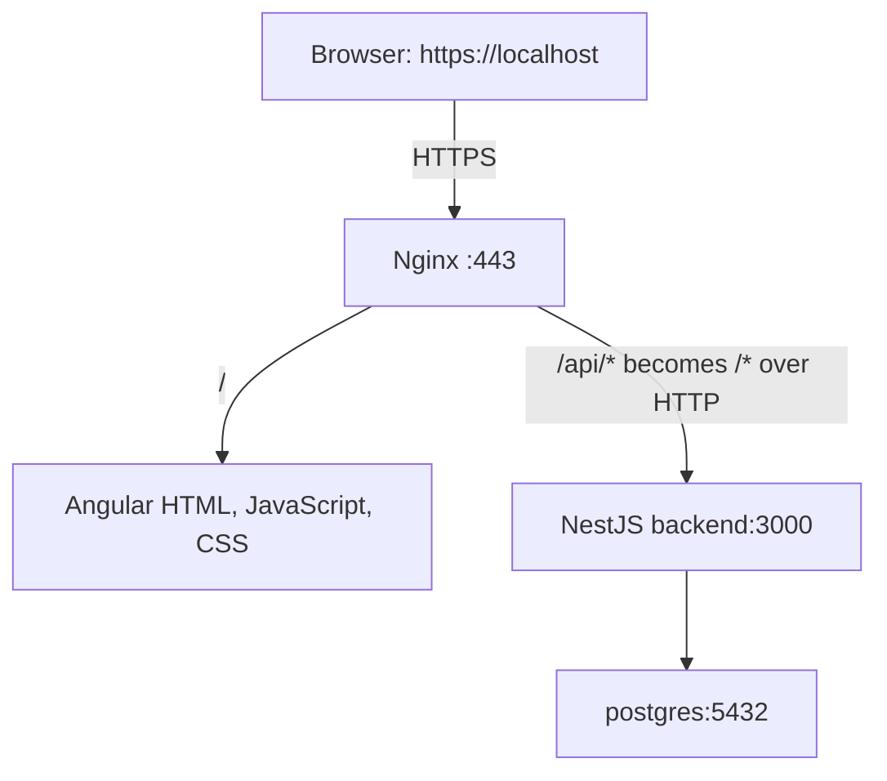

# Setting up Angular, Docker, Nginx, and HTTPS for LaPrizza

This guide implements the direction established by [ADR-009](../sad/03-rationale/ADR-009-frontend-framework.md). Follow steps 1–11 to create a local Angular application served over HTTPS by Nginx. Step 12 adds an HTTPS development server with hot reload. Step 13 explains deployment with a public domain and certificates.

The commands and configuration below are instructions to apply. Adding this guide does not create the Angular application or change the running services.

## 1. Understand the request flow



Nginx has three responsibilities: terminate browser HTTPS, serve Angular's compiled HTML/JavaScript/CSS, and forward API requests to NestJS. Angular executes in the browser after those files download. Node.js compiles Angular during the image build; Nginx serves the resulting files at runtime.

The browser uses one origin for both the application and its API. For example, Angular requests `/api/health`; Nginx forwards that request internally to `http://backend:3000/health`. The existing back-end controllers do **not** have an `/api` prefix, so the proxy must remove it.

HTTPS terminates at Nginx in this setup. Nginx-to-back-end traffic uses HTTP on the Docker network. If your deployment requires encryption between containers as well, that requires an additional back-end TLS configuration.

## 2. Check the required tools

Run from the repository root unless a step explicitly changes directory:

```bash
node --version
npm --version
docker version
docker compose version
```

This guide targets **Angular CLI 22**, **Node.js 24.15 or newer within the 24.x release line**, and Docker Compose v2. Angular 22's Node.js requirements are listed in the official [compatibility table](https://angular.dev/reference/versions). The front-end has its own `package.json` and TypeScript version; it does not inherit the back-end compiler configuration.

If you use nvm:

```bash
nvm install 24
nvm use 24
```

In the workspace inspected when writing this guide, Node.js was available but Docker reported that WSL integration was disabled. If you see the same message, start Docker Desktop, enable its WSL 2 engine and integration for your Linux distribution, then reopen the terminal. Follow the official [Docker Desktop WSL instructions](https://docs.docker.com/desktop/features/wsl/).

Install [mkcert](https://github.com/FiloSottile/mkcert#installation) using its instructions for your operating system. It creates a locally trusted certificate authority and certificates for local development. The trust installation must apply to the operating system running your browser: a Windows browser may need the local CA installed in Windows even when you run project commands in WSL.

## 3. Generate the Angular workspace

From the repository root:

```bash
npx --yes --package @angular/cli@22 ng new laprizza-frontend \
  --directory frontend \
  --routing \
  --style=scss \
  --standalone \
  --strict \
  --zoneless \
  --ssr=false \
  --package-manager=npm \
  --file-name-style-guide=2025 \
  --skip-git \
  --skip-tests \
  --defaults
```

What these options do:

| Option | Purpose |
| --- | --- |
| `--directory frontend` | Keeps the UI separate from the existing `backend/`. |
| `--routing` | Creates the router configuration for application screens. |
| `--style=scss` | Generates SCSS stylesheets. |
| `--standalone` | Uses standalone components rather than an application NgModule. |
| `--strict` | Enables stricter TypeScript and template checking. |
| `--zoneless` | Uses Angular's zoneless change detection; the example below uses signals for changing UI state. |
| `--ssr=false` | Builds a browser SPA that Nginx can serve as static files. |
| `--file-name-style-guide=2025` | Makes generated root filenames match `app.ts`, `app.html`, and `app.scss` in this guide. |
| `--skip-git` | Uses the existing repository. |
| `--skip-tests` | Omits generated starter spec files for this setup exercise; add feature tests as the application grows. |

The CLI installs dependencies and creates `frontend/package-lock.json`. Commit both package manifests so Docker can use `npm ci`. The chosen project name is `laprizza-frontend`, which determines the build output path used below. These options are documented in the [Angular CLI reference](https://angular.dev/cli/new).

After completing the guide, the relevant files will look like this:

```text
LaPrizza/
├── backend/
├── certs/                         # Local certificate files; ignored by Git
├── docker-compose.yml
└── frontend/
    ├── .dockerignore
    ├── Dockerfile
    ├── angular.json
    ├── package.json
    ├── package-lock.json
    ├── proxy.conf.json
    ├── nginx/default.conf
    └── src/
        ├── index.html
        ├── main.ts
        ├── styles.scss
        └── app/
            ├── app.ts
            ├── app.html
            ├── app.scss
            ├── app.config.ts
            ├── app.routes.ts
            ├── core/api/health-api.ts
            └── features/status/
                ├── status.ts
                └── status.html
```

## 4. Create the front-end Dockerfile

Create `frontend/Dockerfile`:

```dockerfile
FROM node:24-alpine AS build

WORKDIR /app

COPY package.json package-lock.json ./
RUN npm ci

COPY . .
RUN npm run build -- --configuration production

FROM nginx:stable-alpine AS runtime

COPY nginx/default.conf /etc/nginx/conf.d/default.conf
COPY --from=build /app/dist/laprizza-frontend/browser/ /usr/share/nginx/html/

EXPOSE 80 443

CMD ["nginx", "-g", "daemon off;"]
```

The first stage installs the locked dependencies and compiles Angular. Copying the manifests before the source allows Docker to reuse the dependency layer when only application code changes.

The second stage contains Nginx and the generated browser files. It does not need the Angular CLI or the build-stage `node_modules`. The `/browser/` directory is the browser output of the CLI's application builder. If you rename the Angular project or customize `outputPath` in `angular.json`, update the `COPY` path accordingly. See [Angular deployment](https://angular.dev/tools/cli/deployment).

The Node image must continue to satisfy step 2's compatibility requirement. Once the team validates its images, pin image digests for reproducible builds.

Create `frontend/.dockerignore`:

```text
node_modules
dist
.angular
.git
coverage
*.log
.env
.env.*
**/*.pem
**/*.key
```

This keeps local dependencies, build output, environment files, and private key material out of the Docker build context. Certificates will be mounted at runtime instead of copied into an image.

## 5. Configure Nginx

Create `frontend/nginx/default.conf`:

```nginx
server {
    listen 80;
    server_name localhost;

    return 308 https://$host$request_uri;
}

server {
    listen 443 ssl;
    server_name localhost;

    ssl_certificate /etc/nginx/certs/site.crt;
    ssl_certificate_key /etc/nginx/certs/site.key;
    ssl_protocols TLSv1.2 TLSv1.3;

    root /usr/share/nginx/html;
    index index.html;

    location = /api {
        return 308 /api/;
    }

    location ^~ /api/ {
        proxy_pass http://backend:3000/;
        proxy_http_version 1.1;
        proxy_set_header Host $host;
        proxy_set_header X-Real-IP $remote_addr;
        proxy_set_header X-Forwarded-For $proxy_add_x_forwarded_for;
        proxy_set_header X-Forwarded-Proto $scheme;
    }

    location = /index.html {
        add_header Cache-Control "no-cache";
    }

    location / {
        try_files $uri $uri/ /index.html;
    }
}
```

How the configuration works:

- Port `80` redirects requests to HTTPS on port `443`; this example assumes those same ports on the host.
- `ssl_certificate` and `ssl_certificate_key` identify files mounted inside the container. Nginx needs them before it can start.
- `backend` is the Compose service name, resolved on the shared Docker network. Inside the Nginx container, `localhost` would refer to Nginx itself. See [Compose networking](https://docs.docker.com/compose/how-tos/networking/).
- The trailing slash in `proxy_pass http://backend:3000/;` replaces the matching `/api/` prefix with `/`. Consequently, `/api/products?name=cheese` becomes `/products?name=cheese`. Removing that slash would preserve `/api/` and break the existing controller routes. See [Nginx proxy_pass](https://nginx.org/en/docs/http/ngx_http_proxy_module.html#proxy_pass).
- The API location passes errors back from NestJS. API requests do not use the Angular HTML fallback.
- `try_files` returns `index.html` for client-side routes such as `/status`, allowing direct navigation and browser refreshes. Angular Router decides which component to display after the application loads.
- The HTML entry point is revalidated rather than retained as a stale application shell.

The browser never needs to call `http://localhost:3000` from the HTTPS application. Relative `/api/...` URLs avoid mixed-content requests and cross-origin calls. The existing `app.enableCors()` in NestJS is not required for this same-origin path, but may still serve your other clients.

Nginx's TLS directives are documented in [Configuring HTTPS servers](https://nginx.org/en/docs/http/configuring_https_servers.html).

## 6. Generate a trusted local HTTPS certificate

From the repository root:

```bash
mkdir -p certs
mkcert -install
mkcert -cert-file certs/site.crt -key-file certs/site.key localhost 127.0.0.1 ::1
chmod 600 certs/site.key
```

`mkcert -install` installs a local CA into the applicable trust stores. The second command creates a certificate covering the listed hostnames and IP addresses. It will be trusted by browsers that trust that CA. These are local development certificates; step 13 uses publicly trusted certificates for a real domain.

Append these entries to the repository's existing `.gitignore`:

```gitignore
# Local TLS and ACME challenge files
/certs/
/acme/

# Angular CLI cache
/frontend/.angular/
```

Keep the certificate private key and mkcert CA private key out of Git. Each developer can generate local certificates on their own machine. For WSL plus a Windows browser, follow mkcert's platform guidance to trust the same CA in Windows; importing a WSL CA into Linux alone may not establish browser trust.

## 7. Add Angular to Docker Compose

First create or edit `.env` **at the repository root** and set a random JWT secret. Generate a value with:

```bash
openssl rand -hex 32
```

Copy the generated value into the root `.env`:

```dotenv
JWT_SECRET=replace_with_the_generated_value
```

Do not replace an existing secret unintentionally: changing it invalidates tokens signed with the previous value. The root `.env` supplies Compose interpolation; `backend/.env` is a different file. The current root `.gitignore` already excludes `.env` files.

Update `docker-compose.yml` to the following. It preserves the existing database name, user, development password, migrations mount, network, and volume while adding the front-end and a back-end readiness check:

```yaml
services:
  postgres:
    image: postgres:16-alpine
    container_name: laprizza_postgres
    restart: unless-stopped
    environment:
      POSTGRES_USER: laprizza_user
      POSTGRES_PASSWORD: laprizza_password
      POSTGRES_DB: laprizza_db
    ports:
      - "127.0.0.1:5432:5432"
    volumes:
      - postgres_data:/var/lib/postgresql/data
      - ./backend/src/infrastructure/persistence/migrations:/docker-entrypoint-initdb.d:ro
    healthcheck:
      test: ["CMD-SHELL", "pg_isready -U laprizza_user -d laprizza_db"]
      interval: 5s
      timeout: 5s
      retries: 5
    networks:
      - laprizza-network

  backend:
    build:
      context: ./backend
      dockerfile: Dockerfile
    container_name: laprizza_backend
    restart: unless-stopped
    depends_on:
      postgres:
        condition: service_healthy
    environment:
      PORT: 3000
      NODE_ENV: production
      DB_HOST: postgres
      DB_PORT: 5432
      DB_USER: laprizza_user
      DB_PASSWORD: laprizza_password
      DB_NAME: laprizza_db
      JWT_SECRET: ${JWT_SECRET:?Set JWT_SECRET in the root .env file}
    ports:
      - "127.0.0.1:3000:3000"
    healthcheck:
      test:
        - CMD
        - node
        - -e
        - "fetch('http://127.0.0.1:3000/health').then(r => process.exit(r.ok ? 0 : 1)).catch(() => process.exit(1))"
      interval: 10s
      timeout: 5s
      retries: 10
      start_period: 20s
    networks:
      - laprizza-network

  frontend:
    build:
      context: ./frontend
      dockerfile: Dockerfile
    restart: unless-stopped
    depends_on:
      backend:
        condition: service_healthy
    ports:
      - "127.0.0.1:80:80"
      - "127.0.0.1:443:443"
    volumes:
      - ./certs:/etc/nginx/certs:ro
    networks:
      - laprizza-network

volumes:
  postgres_data:
    driver: local

networks:
  laprizza-network:
    driver: bridge
```

The front-end waits for `/health` to return success before Nginx starts. This confirms the back-end HTTP process responds; it is not a full database or business-workflow readiness test.

Local host ports bind to `127.0.0.1`, allowing development clients to use the API/database without publishing those ports to other machines. Inter-container traffic still uses `backend:3000` and `postgres:5432`. `:ro` makes the certificate mount read-only.

The old top-level `version: '3.8'` is omitted because Compose v2 uses the current Compose specification.

The existing Makefile uses the Compose project name `laprizza`. The commands below use that same name. If you already run the stack under another project name, retain that name consistently so Compose continues to select the same database volume. Keep the existing volume; the database initialization scripts run only when PostgreSQL initializes an empty data directory.

## 8. Connect Angular to the back-end

Create these directories from the repository root:

```bash
mkdir -p frontend/src/app/core/api
mkdir -p frontend/src/app/features/status
```

Replace `frontend/src/app/app.config.ts` with:

```typescript
import {
  type ApplicationConfig,
  provideBrowserGlobalErrorListeners,
  provideZonelessChangeDetection,
} from '@angular/core';
import { provideHttpClient } from '@angular/common/http';
import { provideRouter } from '@angular/router';
import { routes } from './app.routes';

export const appConfig: ApplicationConfig = {
  providers: [
    provideBrowserGlobalErrorListeners(),
    provideZonelessChangeDetection(),
    provideRouter(routes),
    provideHttpClient(),
  ],
};
```

The providers configure application-wide services. `provideHttpClient()` makes Angular's HTTP client injectable. `provideRouter(routes)` registers the routes in the next step. The explicit zoneless provider matches the chosen setup.

Create `frontend/src/app/core/api/health-api.ts`:

```typescript
import { inject, Injectable } from '@angular/core';
import { HttpClient } from '@angular/common/http';

export interface HealthResponse {
  status: string;
  service: string;
  timestamp: string;
}

@Injectable({ providedIn: 'root' })
export class HealthApi {
  private readonly http = inject(HttpClient);

  getHealth() {
    return this.http.get<HealthResponse>('/api/health');
  }
}
```

This service matches the JSON returned by `backend/src/presentation/http/controllers/HealthController.ts`. It keeps endpoint access outside the HTML and component. The relative URL works with both the Nginx proxy and the development proxy in step 12. The TypeScript interface describes the expected response; it does not perform runtime payload validation.

Create `frontend/src/app/features/status/status.ts`:

```typescript
import { Component, DestroyRef, inject, type OnInit, signal } from '@angular/core';
import { takeUntilDestroyed } from '@angular/core/rxjs-interop';
import { finalize } from 'rxjs';
import { HealthApi, type HealthResponse } from '../../core/api/health-api';

@Component({
  selector: 'app-status',
  standalone: true,
  templateUrl: './status.html',
})
export class Status implements OnInit {
  private readonly api = inject(HealthApi);
  private readonly destroyRef = inject(DestroyRef);

  readonly health = signal<HealthResponse | null>(null);
  readonly loading = signal(false);
  readonly error = signal('');

  ngOnInit(): void {
    this.checkHealth();
  }

  checkHealth(): void {
    this.loading.set(true);
    this.error.set('');
    this.health.set(null);

    this.api.getHealth()
      .pipe(
        takeUntilDestroyed(this.destroyRef),
        finalize(() => this.loading.set(false)),
      )
      .subscribe({
        next: (response) => this.health.set(response),
        error: () => this.error.set('Cannot reach the API. Check the service logs.'),
      });
  }
}
```

The component starts a request when the page opens and stores the result in signals. Signals notify Angular when displayed values change. `finalize` clears the loading state after completion or failure; `takeUntilDestroyed` cancels an active subscription if the user leaves the component. See [Angular subscription cleanup](https://angular.dev/api/core/rxjs-interop/takeUntilDestroyed).

The health endpoint is public, so this first integration does not need a JWT. Add authenticated API services and an interceptor as you implement protected workflows, following ADR-009. Authentication secrets belong on the server, never in Angular source or build-time environment files shipped to browsers.

## 9. Write the HTML and routing

Create `frontend/src/app/features/status/status.html`:

```html
<section aria-labelledby="status-heading">
  <h1 id="status-heading">LaPrizza connection status</h1>
  <p>This page checks the NestJS API through the HTTPS application's proxy.</p>

  <button type="button" (click)="checkHealth()" [disabled]="loading()">
    {{ loading() ? 'Checking…' : 'Check API again' }}
  </button>

  <div aria-live="polite">
    @if (error()) {
      <p role="alert">{{ error() }}</p>
    }

    @if (health(); as result) {
      <dl>
        <dt>Service</dt>
        <dd>{{ result.service }}</dd>
        <dt>Status</dt>
        <dd>{{ result.status }}</dd>
        <dt>Response timestamp</dt>
        <dd><time [attr.datetime]="result.timestamp">{{ result.timestamp }}</time></dd>
      </dl>
    }
  </div>
</section>
```

Angular templates combine ordinary HTML with bindings. `{{ ... }}` inserts values, `(click)` invokes a component method, `[disabled]` sets a property, and `@if` conditionally displays markup. This is the link between the component's TypeScript state and the rendered page.

Replace `frontend/src/app/app.routes.ts`:

```typescript
import type { Routes } from '@angular/router';

export const routes: Routes = [
  { path: '', pathMatch: 'full', redirectTo: 'status' },
  {
    path: 'status',
    loadComponent: () => import('./features/status/status').then(m => m.Status),
  },
  { path: '**', redirectTo: 'status' },
];
```

The router redirects `/` to `/status` and loads the status component when needed. The final wildcard supplies a simple fallback while you build additional screens; later, replace it with a proper not-found page.

Replace `frontend/src/app/app.ts`:

```typescript
import { Component } from '@angular/core';
import { RouterLink, RouterOutlet } from '@angular/router';

@Component({
  selector: 'app-root',
  standalone: true,
  imports: [RouterLink, RouterOutlet],
  templateUrl: './app.html',
  styleUrl: './app.scss',
})
export class App {}
```

Replace `frontend/src/app/app.html`:

```html
<header>
  <nav aria-label="Main navigation">
    <a routerLink="/status">LaPrizza</a>
  </nav>
</header>

<main>
  <router-outlet />
</main>
```

The root component supplies the shared layout. `<router-outlet>` is where Angular renders the active route. `routerLink` changes routes without requesting an entirely new HTML document.

Replace the starter content in `frontend/src/app/app.scss`:

```scss
:host { display: block; }
header { border-bottom: 1px solid #ddd; padding: 1rem 0; }
main { padding: 2rem 0; }
```

Replace `frontend/src/styles.scss`:

```scss
body {
  max-width: 60rem;
  margin: 0 auto;
  padding: 0 1rem;
  font-family: system-ui, sans-serif;
  color: #222;
  background: #fff;
}

button { padding: 0.7rem 1rem; cursor: pointer; }
button:disabled { cursor: wait; }
dt { font-weight: 600; margin-top: 1rem; }
dd { margin-left: 0; overflow-wrap: anywhere; }
```

Replace `frontend/src/index.html`:

```html
<!doctype html>
<html lang="en">
  <head>
    <meta charset="utf-8">
    <title>LaPrizza</title>
    <base href="/">
    <meta name="viewport" content="width=device-width, initial-scale=1">
  </head>
  <body>
    <app-root></app-root>
  </body>
</html>
```

`index.html` is the document Nginx serves. `<app-root>` hosts the Angular application, while `<base href="/">` establishes the application's root URL. The Angular build inserts generated script and stylesheet references automatically.

Keep the generated `frontend/src/main.ts`, which bootstraps `App` using `appConfig`. The complete path is now: `index.html` → `main.ts` → `App` → router → `Status` → `HealthApi` → `/api/health`.

## 10. Build and start the stack

First check the Angular production build:

```bash
cd frontend
npm run build -- --configuration production
cd ..
```

Then validate Compose and start the services:

```bash
docker compose -p laprizza config --quiet
docker compose -p laprizza up -d --build
docker compose -p laprizza ps
docker compose -p laprizza exec frontend nginx -t
```

Open **https://localhost/status**. The page should display the back-end service name, status `ok`, and a response timestamp. Also visit **http://localhost/status** and confirm it redirects to HTTPS.

The current Makefile already supports the new service through its `SERVICE` variable. For example, `make up SERVICE=frontend` builds and starts it with dependencies, and `make logs SERVICE=frontend` follows its logs. Help descriptions that list only the back-end/database can be updated to include the front-end.

This image serves compiled assets. After editing Angular source or the baked-in Nginx configuration, rebuild it:

```bash
docker compose -p laprizza up -d --build frontend
```

If the back-end is recreated with a different container IP, restart the front-end so this simple Nginx configuration resolves the service address again:

```bash
docker compose -p laprizza restart frontend
```

## 11. Verify HTTPS, routing, and the API separately

From the repository root, use the local CA explicitly if your command-line client does not share the browser's trust store:

```bash
curl --cacert "$(mkcert -CAROOT)/rootCA.pem" -I https://localhost/status
curl --cacert "$(mkcert -CAROOT)/rootCA.pem" https://localhost/api/health
curl -I http://localhost/status
```

Expected results are HTTP `200` for the Angular route, JSON with `status: "ok"` for the health request, and HTTP `308` with an HTTPS `Location` header for the HTTP request. Reload `/status` directly to confirm Nginx's SPA fallback.

Check the browser Network panel: the health request must use `https://localhost/api/health`, and its response must be JSON. Receiving HTML usually means the request missed the API proxy. A curl request for `/status` checks HTML delivery; the browser confirms that Angular actually bootstraps and renders the response.

Useful logs:

```bash
docker compose -p laprizza logs --tail=100 frontend backend
```

| Symptom | What to check |
| --- | --- |
| `dependency failed to start: container laprizza_backend has no healthcheck configured` | Add the `healthcheck` block to the `backend` service as shown in step 7, at the same indentation as `ports` and `environment`. The frontend's `service_healthy` condition requires it. Apply the change with `docker compose -p laprizza up -d backend frontend`; restarting alone does not apply a changed container configuration. |
| Certificate not trusted | Install the mkcert CA in the browser's operating system and restart the browser. |
| Certificate name mismatch | Open `localhost` or regenerate the certificate with the actual hostname in its SAN list. |
| Nginx cannot load certificate | Confirm `certs/site.crt`, `certs/site.key`, the volume mount, and readable file permissions. |
| `502 Bad Gateway` | Check back-end health, shared network membership, `backend:3000`, and whether Nginx needs restarting after back-end recreation. |
| API returns `404` | Keep the trailing slash in `proxy_pass`; the back-end expects `/health`, not `/api/health`. |
| Refreshing `/status` returns `404` | Check the `try_files` SPA fallback. |
| Browser reports mixed content | Use relative `/api/...` URLs rather than an HTTP URL in Angular. |
| Port `80` or `443` already allocated | Stop or reconfigure the other local web server; the supplied redirects assume these host ports. |
| Database appears empty | Verify the Compose project name and selected volume before changing any data. |

## 12. Use HTTPS with hot reload during development

For day-to-day Angular work, run its development server on the host and keep the back-end/database in Docker. This avoids rebuilding an image after each HTML edit.

The repository now provides a shortcut from its root:

```bash
make dev
```

This starts PostgreSQL and the back-end in Docker, waits for their health checks, then runs Angular's HTTPS development server on the host through `npm --prefix frontend run dev`. It reuses the existing container images; after changing back-end source, rebuild the back-end with `make up SERVICE=backend`. The Angular development server watches HTML, SCSS, and TypeScript directly, so those changes do not require a container image rebuild.

Open **https://localhost:4200/status** for this workflow. The Nginx-served build at `https://localhost/status` continues to show the compiled image. Press `Ctrl+C` in the `make dev` terminal to stop the Angular development server; the detached back-end/database remain running. Use `make stop` to stop the Compose services when finished.

If port 4200 is already occupied, use the existing development server, stop it before starting another, or select another port with `make dev DEV_PORT=4300` and open `https://localhost:4300/status`.

Create `frontend/proxy.conf.json`:

```json
{
  "/api/**": {
    "target": "http://127.0.0.1:3000",
    "changeOrigin": true,
    "pathRewrite": {
      "^/api": ""
    }
  }
}
```

The proxy repeats the `/api/` removal performed by Nginx. The target is `127.0.0.1` here because the development server runs on your host, using the back-end's published loopback port. The current CLI supports this proxy configuration, including [path rewriting](https://github.com/angular/angular-cli/blob/main/packages/angular/build/src/utils/load-proxy-config.ts).

Run:

```bash
docker compose -p laprizza up -d --build backend
cd frontend
npx ng serve \
  --host localhost \
  --port 4200 \
  --ssl \
  --ssl-cert ../certs/site.crt \
  --ssl-key ../certs/site.key \
  --proxy-config proxy.conf.json
```

Open **https://localhost:4200/status**. Changes to templates, styles, and TypeScript now rebuild automatically. Restart `ng serve` after changing the proxy configuration. Port `4200` uses the Angular development server's TLS; port `443` continues to use Nginx and the compiled Docker build. The development server is for local work, while the Nginx image is the deployment artifact. See [Angular development serving](https://angular.dev/tools/cli/serve) and [serve options](https://angular.dev/cli/serve).

## 13. Configure HTTPS for a public domain

For a deployed server, replace the mkcert certificate with a publicly trusted certificate. The following example uses **Certbot on the Linux host**, with Nginx still running in Docker. Replace `laprizza.example.com` with a domain you control and `/absolute/path/to/LaPrizza` with the deployed repository's real path.

Point the domain's DNS records at the server, allow inbound ports `80` and `443`, and install Certbot using its [official OS-specific instructions](https://certbot.eff.org/instructions?ws=other&os=snap). Any published IPv6 record must also reach this server.

On a public deployment, remove the back-end/database `ports` entries if host access is unnecessary, and replace the sample database credentials with deployment credentials. For an existing database, rotate the database role password as well; changing Compose environment variables alone does not update an initialized PostgreSQL role.

### 13.1. Mount the certificate store and challenge directory

From the deployed repository root:

```bash
mkdir -p acme
```

For the `frontend` service, replace its local `ports` and `volumes` entries with:

```yaml
    ports:
      - "80:80"
      - "443:443"
    volumes:
      - /etc/letsencrypt:/etc/letsencrypt:ro
      - ./acme:/var/www/certbot:ro
      - ./frontend/nginx/default.conf:/etc/nginx/conf.d/default.conf:ro
```

The public ports make Nginx reachable from outside the server. Mounting the entire certificate store preserves Certbot's symlinks from `live/` into `archive/`. Mounting the configuration allows certificate settings to change without rebuilding the Angular bundle.

### 13.2. Start an HTTP-only bootstrap configuration

Nginx cannot start with references to certificates that do not exist yet. Temporarily replace `frontend/nginx/default.conf` on the server with:

```nginx
server {
    listen 80;
    server_name laprizza.example.com;

    location ^~ /.well-known/acme-challenge/ {
        root /var/www/certbot;
    }

    location / {
        return 503;
    }
}
```

Start or recreate the front-end so the changed mounts take effect:

```bash
docker compose -p laprizza up -d --build frontend
```

This temporary server serves only ACME challenge files and returns `503` for application requests. Keeping the redirect inside `location /` in the final configuration below allows certificate validation to remain available over HTTP.

### 13.3. Request the certificate

Run on the Linux host:

```bash
sudo certbot certonly \
  --webroot \
  --webroot-path /absolute/path/to/LaPrizza/acme \
  --cert-name laprizza.example.com \
  -d laprizza.example.com
```

Certbot writes a challenge into the host `acme/` directory. The mounted Nginx directory exposes that same file for the CA to validate. After issuance, the certificate and key are available under `/etc/letsencrypt/live/laprizza.example.com/`. See [Certbot's webroot documentation](https://eff-certbot.readthedocs.io/en/stable/using.html#webroot).

### 13.4. Enable the final HTTPS configuration

Restore the full Nginx configuration from step 5, then make these changes:

1. Set `server_name laprizza.example.com;` in both server blocks.
2. Replace the entire HTTP server block with:

```nginx
server {
    listen 80;
    server_name laprizza.example.com;

    location ^~ /.well-known/acme-challenge/ {
        root /var/www/certbot;
    }

    location / {
        return 308 https://$host$request_uri;
    }
}
```

3. In the HTTPS block, replace the certificate directives with:

```nginx
ssl_certificate /etc/letsencrypt/live/laprizza.example.com/fullchain.pem;
ssl_certificate_key /etc/letsencrypt/live/laprizza.example.com/privkey.pem;
```

Keep the HTTPS block's API proxy, static file root, and Angular route fallback. Validate and reload:

```bash
docker compose -p laprizza exec frontend nginx -t
docker compose -p laprizza exec frontend nginx -s reload
```

Open **https://laprizza.example.com/status** and verify the API response and HTTP redirect again. No Angular API URL change is needed because it still requests `/api/health` on the current origin.

### 13.5. Renew certificates and reload Nginx

Test renewal:

```bash
sudo certbot renew --dry-run
```

Ensure the Certbot installation's automatic renewal timer is enabled. Add a deploy hook, for example `/etc/letsencrypt/renewal-hooks/deploy/reload-laprizza-nginx`, containing:

```sh
#!/bin/sh
set -eu
/usr/bin/docker compose -p laprizza \
  -f /absolute/path/to/LaPrizza/docker-compose.yml \
  --project-directory /absolute/path/to/LaPrizza \
  exec -T frontend nginx -t
/usr/bin/docker compose -p laprizza \
  -f /absolute/path/to/LaPrizza/docker-compose.yml \
  --project-directory /absolute/path/to/LaPrizza \
  exec -T frontend nginx -s reload
```

Use the real absolute Docker path reported by `command -v docker` on the deployment host and make the hook executable with `sudo chmod 750 /etc/letsencrypt/renewal-hooks/deploy/reload-laprizza-nginx`. Test it directly once; you can also use `sudo certbot renew --dry-run --run-deploy-hooks` to exercise the renewal hook.

Renewal replaces certificate files, but Nginx must reload to begin using them. The challenge location remains available for subsequent renewals. Certbot describes timers and deploy hooks in its [renewal documentation](https://eff-certbot.readthedocs.io/en/stable/using.html#renewing-certificates).

## Validation scope of this guide

The examples are based on the repository's current Compose file, public `/health` controller, NestJS entry point, and ADR-009, with current official Angular, Nginx, Docker, mkcert, and Certbot references. Docker was unavailable in the inspected WSL distribution and npm registry access failed, so a complete Angular build and container/HTTPS smoke test could not be executed when writing the guide. Run steps 10–11 in your configured development environment before adopting the setup.
