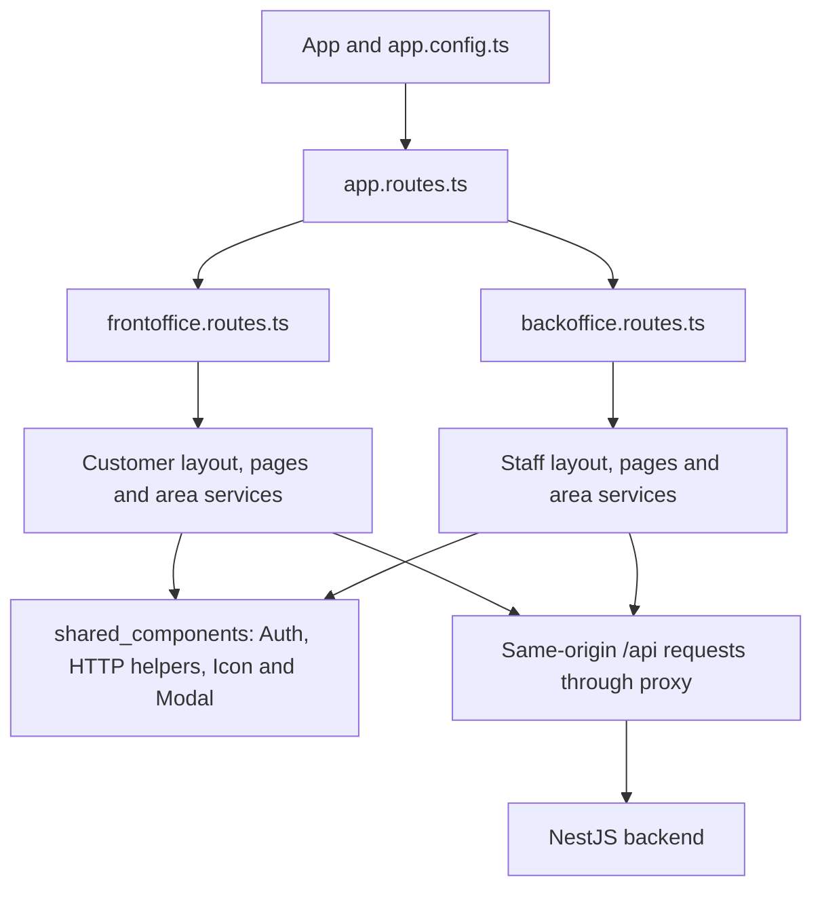

# Frontend implementation, structure and maintenance

**Implementation reference: 3 November 2026.** This document describes the frontend currently implemented in the repository, including its file ownership, runtime behavior, development workflow and extension points.

The source and the [frontend README](../../frontend/README.md) and [component/structure guide](../../frontend/STRUCTURE.md) are the implementation references. [ADR-009](../sad/03-rationale/ADR-009-frontend-framework.md) records the Angular framework decision and intended evolution. In particular, the current forms use `FormsModule`, `ngModel` and template-driven validation; the ADR's typed reactive forms and Three.js kitchen integration are not implemented in these pages.

## 1. Application architecture

LaPrizza uses one Angular 22 single-page application with two presentation areas:

- **Frontoffice:** the customer menu, product customization, draft order, authentication and account pages.
- **Backoffice:** staff authentication and management of products, users, recipes, component configurations and taxonomy resources.

Standalone components, Angular Router, dependency injection and `HttpClient` provide the application infrastructure. Signals hold UI state, computed signals derive displayed data, and RxJS coordinates HTTP operations and subscription lifecycles. SCSS supplies shared controls and area-specific styling. `app.config.ts` enables zoneless change detection, the router and the authentication interceptor.



The [root route collection](../../frontend/src/app/app.routes.ts) composes the backoffice routes first, then the frontoffice routes, and finally the fallback redirect. Each area lazy-loads its page components. `StorefrontLayout` and `Backoffice` contain nested router outlets, so page navigation retains the appropriate shell. Navigation uses `routerLink`; it does not require a separate HTML document for each page.

## 2. File distribution and ownership

Paths in the following tree are relative to `frontend/`:

```text
src/
	main.ts                         Angular bootstrap
	index.html                      SPA HTML entrypoint
	styles.scss                     Imports the three style entrypoints
	app/
		app.ts, app.html, app.scss   Root router outlet and host
		app.config.ts               Providers, router and HTTP interceptor
		app.routes.ts               Composes the two route collections
		frontoffice/
			frontoffice.routes.ts
			pages/
				home/, menu/, order/, account/, login/, register/
			shared_components/
				storefront-layout/, customer-auth-form/, product-card/, ...
			core/
				storefront-api.ts, storefront-models.ts
				cart.ts, customer-profile.ts, auth/guards.ts
			assets/images/
			styles/_frontoffice.scss
		backoffice/
			backoffice.routes.ts
			pages/
				products/, users/, pizzas/, configurations/, orders/
				product-categories/, pizza-components/, pizza-sizes/, allergens/
				login/, register/, access/, status/
			shared_components/
				layout/, staff-auth-form/, resource-management/, data-table/, ...
			core/
				api/backoffice-api.ts, api/health-api.ts, api/models.ts
				auth/guards.ts
			assets/images/
			styles/_backoffice.scss
		shared_components/
			ui/icon/, ui/modal/
			core/
				api/models.ts, api/api-errors.ts, api/resource-lookups.ts
				auth/auth.ts
			styles/_base.scss
e2e/
	frontoffice/storefront.spec.ts
	backoffice/backoffice.spec.ts
public/favicon.ico
angular.json, package.json, package-lock.json
proxy.conf.json, nginx.conf, Dockerfile, playwright.config.ts
README.md, STRUCTURE.md
```

### Placement rules

| Responsibility | Location under `src/app/` |
| --- | --- |
| Component, template, styles and helpers used by one page | `<office>/pages/<page-name>/` |
| Components reusable within one office | `<office>/shared_components/<component-name>/` |
| Visual components used by both offices | `shared_components/ui/<component-name>/` |
| Area-specific HTTP operations, state, DTOs and guards | `<office>/core/` |
| Shared session state, HTTP helpers and DTOs | `shared_components/core/` |
| Area-owned styling and photographs | `<office>/styles/` and `<office>/assets/images/` |

Neither office imports source from the other. Both may depend on the top-level `shared_components`; that shared code must not depend on either office. Promote an abstraction to the shared level when both areas need it. The directory name `shared_components` also contains common nonvisual code, grouped explicitly under `core/` and `styles/`.

Each component directory keeps its TypeScript, template and stylesheet together. Small components may use inline templates/styles. Login and registration have separate page directories but compose one authentication form per office. The four simple taxonomy pages likewise have separate page components and configurations while reusing `Resources`.

## 3. Routes and page entrypoints

### Frontoffice

Routes are defined in [frontoffice.routes.ts](../../frontend/src/app/frontoffice/frontoffice.routes.ts). Page directories below are relative to `frontoffice/pages/`.

| Browser URL | Directory | Page class | Implemented behavior |
| --- | --- | --- | --- |
| `/` | `home/` | `HomePage` | Pizza invitation and menu navigation |
| `/menu` | `menu/` | `MenuPage` | Catalogue, categories/search, availability and customization |
| `/order` | `order/` | `CustomerOrderPage` | Empty-order invitation or locally stored draft summary |
| `/login` | `login/` | `CustomerLoginPage` | Composes the customer login form |
| `/register` | `register/` | `CustomerRegisterPage` | Composes two-step registration |
| `/account` | `account/` | `AccountPage` | Identity, contact editors, allergies and account actions |

`customerGuard` allows an active authenticated session into `/account`; it is not restricted exclusively to the `CUSTOMER` role. Individual account actions still reflect the permissions supported by the backend. Unauthenticated navigation redirects to `/login` with a `returnUrl`.

### Backoffice

Routes are defined in [backoffice.routes.ts](../../frontend/src/app/backoffice/backoffice.routes.ts). Page directories below are relative to `backoffice/pages/`.

| Browser URL | Directory | Page class |
| --- | --- | --- |
| `/backoffice/login` | `login/` | `StaffLoginPage` |
| `/backoffice/register` | `register/` | `StaffRegisterPage` |
| `/backoffice/products` | `products/` | `Products` |
| `/backoffice/users` | `users/` | `Users` |
| `/backoffice/pizzas` | `pizzas/` | `Pizzas` |
| `/backoffice/component-configurations` | `configurations/` | `Configurations` |
| `/backoffice/orders` | `orders/` | `Orders` |
| `/backoffice/product-categories` | `product-categories/` | `ProductCategoriesPage` |
| `/backoffice/pizza-components` | `pizza-components/` | `PizzaComponentsPage` |
| `/backoffice/pizza-sizes` | `pizza-sizes/` | `PizzaSizesPage` |
| `/backoffice/allergens` | `allergens/` | `AllergensPage` |
| `/unauthorized` | `shared_components/pages/unauthorized/` | `UnauthorizedPage` (also the redirect target of `/backoffice/access`) |
| `/status` | `status/` | `Status` |

`staffGuard` requires an active `MANAGER` or `EMPLOYEE` session for the backoffice shell. `managerGuard` protects the management pages within that branch. Employees can use the orders workspace; managers can use the management pages. The backoffice root redirects managers to products and employees to orders. `/status` retains its existing public URL and checks backend health.

Frontend guards control navigation and presentation. The backend remains responsible for token verification and authorization.

## 4. Component catalogue and composition

### Cross-office components and services

| Assigned name | Location under `shared_components/` | Purpose |
| --- | --- | --- |
| `Icon` | `ui/icon/` | Shared SVG icons, selected by `name` |
| `Modal` | `ui/modal/` | Native dialog with focus restoration, Escape handling and scrollable body |
| `Auth` / `authInterceptor` | `core/auth/auth.ts` | Session state, authentication calls and HTTP token handling |
| `ResourceLookups` | `core/api/resource-lookups.ts` | Name-based resource requests and complete lookup pagination |
| `errorMessage()` | `core/api/api-errors.ts` | Formats network and backend errors for display |

`Modal` receives `title`, `description` and `busy`, and emits `(closed)`. Its body is projected content; footer controls use `[modal-actions]`. Instantiate it conditionally with `@if` and let the parent own its visibility. A busy dialog prevents dismissal while the related operation is pending.

### Backoffice reusable components

These directories are under `backoffice/shared_components/`.

| Assigned name | Directory | Responsibility |
| --- | --- | --- |
| `Backoffice` | `layout/` | Sidebar, account controls, breadcrumbs and nested outlet |
| `Brand` | `brand/` | Forno branding |
| `AuthPage` | `staff-auth-form/` | Shared login/registration form selected by route data |
| `PageHeader`, `Panel` | `page-header/`, `panel/` | Page heading, resource panel and projected actions |
| `Badge`, `Tabs` | `badge/`, `tabs/` | Status labels and filter selection |
| `DataTable` | `data-table/` | Generic table with page-provided cell templates |
| `Pagination` | `pagination/` | Page controls emitting the requested page number |
| `Feedback` | `feedback/` | Loading, empty and failure states with retry events |
| `Resources` | `resource-management/` | Reusable name-based CRUD screen driven by `ResourceConfig` |

`DataTable` accepts `columns`, `rows`, `trackKey` and `label`. Its projected `ng-template` receives the row as `$implicit` and the column key as `column`. Set `trackKey` to a unique resource identity. `Panel` projects action controls through `[panel-actions]`. `Tabs` and `Pagination` emit `(changed)`; the parent updates filters or requests another page.

### Frontoffice reusable components

These directories are under `frontoffice/shared_components/`.

| Assigned name | Directory | Responsibility |
| --- | --- | --- |
| `StorefrontLayout` | `storefront-layout/` | Customer navigation, cart count, page outlet and footer |
| `StorefrontBrand`, `StorefrontFooter` | `storefront-brand/`, `storefront-footer/` | LaPrizza identity and CSS checkerboard footer |
| `StorefrontButton` | `storefront-button/` | `[shopButton]` directive; `tone` and `small` select presentation |
| `OrderHero` | `order-hero/` | Reusable home invitation; `/order` has its own empty-cart screen |
| `CustomerAuthPage` | `customer-auth-form/` | Shared customer login and registration form |
| `ProductCard` | `product-card/` | Catalogue item; emits `(added)` and `(customize)` |
| `ProductCustomizer` | `product-customizer/` | Size/ingredient configuration; emits a draft line through `(added)` |
| `MenuFeedback` | `menu-feedback/` | Loading/error/empty menu states and `(retry)` |
| `QuantityControl` | `quantity-control/` | Bounded integer quantity with `(changed)` |
| `AllergenChips` | `allergen-chips/` | Display or selection using `names`, `selected`, `locked` and `(toggled)` |
| `OrderLineItem`, `OrderTotals` | `order-line-item/`, `order-totals/` | Draft lines, quantity/removal events, totals and checkout state |
| `AddressEditor`, `PhoneEditor` | `address-editor/`, `phone-editor/` | API-backed contact updates; emit `(saved)` after confirmation |
| `AllergyEditor` | `allergy-editor/` | Adds new allergies while locking existing entries |
| `PasswordRules` | `password-rules/` | Password requirement feedback and `validPassword()` helper |
| `CredentialEditor` | `credential-editor/` | Password/email dialog with currently disabled saving |
| `ServiceUnavailableDialog` | `service-unavailable-dialog/` | Reusable explanation for unavailable services |

Import standalone components in the consuming component's `imports` array. Pass data through inputs and handle output events in the parent. Presentational components such as `ProductCard` and `OrderLineItem` do not own HTTP requests. The account editors and `ProductCustomizer` are interaction components that coordinate their specific API operations.

## 5. State, forms and request lifecycle

Pages keep loading flags, errors, selected items, filters and dialog visibility in signals. Computed signals derive filtered rows, quantities and totals. Form drafts use ordinary typed fields bound through `ngModel`; submitting calls the page/editor's API operation. No global state library is used.

The usual request lifecycle is:

1. Set the loading/saving signal and clear the previous error.
2. Call the appropriate injectable API service.
3. Use `takeUntilDestroyed` to end subscriptions with the component lifecycle and `finalize` to clear pending state.
4. On success, update confirmed state, close the editor when appropriate and refresh affected data.
5. On failure, display `errorMessage(error)` and retain editable values where retry is meaningful.

Some list pages use `switchMap` to replace an outstanding read when the requested filter/page changes. Preserve this behavior when extending them. Avoid automatic retries of mutations that could apply stock adjustments or other writes twice.

### Pagination

Users are paginated by the server. Generic resource lists support either a complete array or `Page<NamedResource>`; arrays are sliced locally, while paginated responses use server metadata. Products, catalogue items, recipe variants and component configurations currently arrive as complete arrays and are filtered/paginated locally where needed.

`ResourceLookups.all()` requests pages of up to 100 and follows `totalPages` until all lookup options have been collected. Use it for complete form options rather than assuming the first page contains every category or component type.

### Persistence

| Data | Owner | Storage and lifetime |
| --- | --- | --- |
| Shared authenticated session | `Auth` | `forno-session` in session storage, or local storage when “Keep me signed in” is selected |
| Draft order | `Cart` in `frontoffice/core/cart.ts` | `laprizza-cart-v1` in local storage |
| Confirmed address/phone responses | `CustomerProfile` in `frontoffice/core/customer-profile.ts` | Per-user memory and session storage at `laprizza-contact:<username>` |
| Filters, page selection and editor drafts | Individual page/editor | Component lifetime; not persisted globally |

Session restoration ignores malformed or expired stored tokens. This client-side expiry check does not verify a token's signature; the backend verifies requests. Logging out clears the shared session key from both storage types. It does not clear the device's draft cart or per-user contact cache.

## 6. Authentication and supported workflows

The frontend handles token storage, bearer headers, session state, route access checks and role-dependent UI. These checks guide navigation and available controls. The backend remains responsible for validating tokens and enforcing authorization on every protected request; editing browser storage or bypassing an Angular guard cannot grant API permissions.

### Authentication files and responsibilities

| File, relative to `frontend/src/app/` | Responsibility |
| --- | --- |
| [`shared_components/core/auth/auth.ts`](../../frontend/src/app/shared_components/core/auth/auth.ts) | Shared `Auth` service, session persistence/restoration and `authInterceptor` |
| [`shared_components/core/api/models.ts`](../../frontend/src/app/shared_components/core/api/models.ts) | `Session` and `User` response types |
| [`app.config.ts`](../../frontend/src/app/app.config.ts) | Registers the interceptor using `provideHttpClient(withInterceptors([authInterceptor]))` |
| [`frontoffice/core/auth/guards.ts`](../../frontend/src/app/frontoffice/core/auth/guards.ts) | `customerGuard` for account navigation |
| [`backoffice/core/auth/guards.ts`](../../frontend/src/app/backoffice/core/auth/guards.ts) | `staffGuard` and `managerGuard` for staff navigation |
| [`frontoffice/shared_components/customer-auth-form/customer-auth-page.ts`](../../frontend/src/app/frontoffice/shared_components/customer-auth-form/customer-auth-page.ts) | Customer login/registration, optional contact submission and return navigation |
| [`backoffice/shared_components/staff-auth-form/auth-page.ts`](../../frontend/src/app/backoffice/shared_components/staff-auth-form/auth-page.ts) | Staff login/registration, staff eligibility checks and return navigation |

Both offices inject the same root-provided `Auth` service and share one session. Signing in as another user replaces the current session for both areas; there are no independent customer and staff tokens.

### Token acquisition, storage and expiry

`Auth.login()` posts `{ email, password }` to `/api/auth/login`; `Auth.register()` posts `{ firstName, lastName, email, password }` to `/api/auth/register`. A successful response has the shape `{ token: string, user: User }`. The backend issues the JWT. The frontend stores that response and exposes the session through an Angular signal, with computed `user`, `manager` and `staff` values. Passwords are not part of the persisted session.

Before saving a new session, `Auth` clears the previous in-memory session and removes `forno-session` from both browser storage types. It then stores the new session as JSON:

- Normal login and every registration use `sessionStorage`, scoped to the browser tab's session and retained across reloads.
- Login with “Keep me signed in” uses `localStorage`, retained across browser restarts until cleared. This changes persistence only; it does not extend JWT validity.

When `Auth` is instantiated, restoration reads `sessionStorage` first, falling back to `localStorage` if the session key is absent. It requires a token and an array of user roles, decodes the JWT payload, and accepts the session only when `exp * 1000 > Date.now()`. Invalid JSON, undecodable payloads and expired/missing expiry claims result in an anonymous in-memory session. Rejected entries are not removed from storage by restoration itself.

Decoding the JWT in the browser does not verify its signature. UI role/status checks use the stored `session.user` values. The server verifies the signed token independently. Browser storage is accessible to JavaScript running on the application's origin; this implementation does not use an HttpOnly authentication cookie.

There is no refresh-token flow, automatic token renewal, expiry timer or per-navigation expiry recheck. An already loaded session can remain visible after its token expires until a protected API request returns 401, the user logs out, or the application reloads. There is also no storage-event synchronization between open tabs: each loaded tab keeps its own in-memory session until it changes or reloads.

### Sending tokens and handling API errors

Services use Angular `HttpClient`; the registered interceptor adds the header centrally:

```http
Authorization: Bearer <session.token>
```

The interceptor's condition is a relative URL starting with `/api/`, excluding the exact `/api/auth/login` and `/api/auth/register` URLs. When a token exists, it is attached to all other matching requests, including public catalogue requests. This URL condition is not a list of protected backend endpoints. Static images, external URLs and absolute API URLs do not receive the header through this interceptor. Continue using the existing relative API convention when adding services.

If a matching request sent while a token exists returns **401**, the interceptor clears the session and navigates to `/backoffice/login` when the current router URL starts with `/backoffice`, or `/login` otherwise. It passes the current URL in the `returnUrl` query parameter. The error is still rethrown so the calling page can handle it. A **403** from any relative `/api/` request navigates to the shared `/unauthorized` page without clearing the session, including login/registration errors. Other errors and a 401 without a current token are passed to the caller without this redirect behavior. The error still propagates to the caller for cleanup.

The frontend logout operation waits for `POST /api/auth/logout` to confirm revocation before clearing the signal and both `forno-session` entries. A rejected credential (`401`) can also be cleared; network/server failures show an error and allow retry. It also leaves the local draft cart and per-user confirmed-contact cache intact, as described in the persistence table.

### Route authorization and role-dependent UI

| Route or area | Frontend access rule | Navigation when refused |
| --- | --- | --- |
| `/`, `/menu`, `/order`, customer login/registration, staff login/registration and `/status` | Public routes; `/order` is a local draft, not order submission | No authentication redirect |
| `/account` | `customerGuard`: stored user has status `ACTIVE`; it does **not** require the `CUSTOMER` role | `/login?returnUrl=...` |
| `/backoffice` layout and its pages | `staffGuard`: status `ACTIVE` and at least one of `MANAGER` or `EMPLOYEE` | `/backoffice/login?returnUrl=...` |
| Backoffice products, users, pizzas, component configurations, product types, pizza components, sizes and allergens | Additional `managerGuard`: roles include `MANAGER`; active staff access comes from the parent guard | `/unauthorized` |
| Backoffice orders | Parent staff guard; no additional manager guard | Staff login when parent access fails |
| `/unauthorized` | Public shared error page; no API calls | No authentication redirect |

The layout also hides manager-only navigation links using `auth.manager()`. This changes presentation only. The staff authentication form checks `auth.staff()` after login/registration; if the returned account is not active staff, it clears the session and displays an access explanation. The customer account page applies further role checks before loading profile/allergy resources, so an active account passing its route guard does not imply permission for every account action.

Customer return navigation accepts only paths whose portion before `?` is `/account`, `/order`, `/menu` or `/`, and rejects a leading `//`. Otherwise login defaults to `/menu` and registration to `/account`. Staff return navigation accepts a target starting with `/backoffice/`; otherwise managers go to `/backoffice/products` and employees to `/backoffice/orders`. Angular guards still apply to the destination.

The backend's [token service](../../backend/src/infrastructure/security/JwtTokenService.ts) verifies JWTs, while its [global authentication configuration](../../backend/src/presentation/auth.module.ts), role/status guards and endpoint/application rules enforce server access. Frontend role visibility, cached user details and draft prices are never authoritative inputs for granting permissions.

### Maintaining authentication and authorization

For a new protected page, attach the appropriate guard in that office's route file and align its controls with the server's allowed roles. Configure and verify the corresponding backend permission separately. Use the shared `Auth` service and `HttpClient` instead of introducing page-owned token storage or manually attaching authorization headers. Keep the shared session types, login response and restoration logic aligned when changing the authentication contract.

Check anonymous access, active customer/employee/manager access, inactive accounts, reloads, expired/malformed stored sessions, 401 versus 403 behavior, and safe return navigation when changing this flow. Existing browser tests live in `frontend/e2e/frontoffice/storefront.spec.ts` and `frontend/e2e/backoffice/backoffice.spec.ts`. Refresh tokens, HttpOnly-cookie authentication or synchronized cross-tab logout would require additional implementation; they are not current behavior.

### Registration and staff onboarding

Public registration submits first name, last name, email and password. The backend assigns usernames. The UI validates the supported password policy and matching confirmation. Optional phone submission follows account creation as a separate request; if that request fails, the UI retains the created-account state and allows continuation without resubmitting registration.

Staff onboarding uses manager pre-registration followed by registration with the same email. An uninvited registration creates a customer account and does not grant backoffice access.

### Customer catalogue and customization

`MenuPage` loads the catalogue and derives categories/search results. Product availability and prices come from the API. For predefined pizzas, `ProductCustomizer` loads active ingredient products, component types and size configurations. It groups ingredients by assembly order, enforces distinct-ingredient cardinality, and derives the draft price from the selected size price plus ingredient quantity changes. Changing size restores the default recipe. Fixed-price products support quantity selection without invented dip/extra configurations.

`Cart.add()` merges identical product/size/ingredient/price combinations. Different configurations remain separate lines. A draft accepts one currency, and quantities range from 1–99 per line as a frontend limit. Stored entries are checked on restoration. This draft does not reserve stock, establish an accepted price or place an order.

### Account updates

The frontoffice account page reads `GET /api/user/me/contact-details` to load persisted address and phone values, including on a fresh browser session. The endpoint derives identity from authentication and returns the same contact shape as the PUT responses. `CustomerProfile` replaces cached contact values on a successful read and refreshes them after confirmed writes, so stale local values cannot override an authoritative response. The legacy `GET /api/user/:username` remains an identity-only summary.

Allergy changes call an additive endpoint. Existing saved names remain locked; only newly selected names are submitted. Managers may read allergies, but the customer-owned mutation is enabled according to the account's supported role.

### Staff management

`Products` coordinates product details, activation and stock replenishment. Saving details and increasing stock are separate requests. If the details save but stock fails, the dialog reports the partial result, resets the requested increment and refreshes data. Preserve this separation when changing retry behavior.

`Pizzas` displays predefined pizzas by size variant. Its editor changes the shared recipe name, ingredient quantities and complete size selection. The existing model stores one default recipe per product across sizes; listing a variant does not imply an independently editable recipe for that size.

`Configurations` manages ingredient prices and stock consumption per pizza size. `Users` supplies server-paginated role filters, pre-registration and deactivation. `Resources` drives the simpler taxonomy screens through page-owned configuration.

## 7. Backend integration and endpoint placement

Use the implemented HTTP services as the frontend contract reference. The broader [architecture summary](Architecture_summary.md) and framework ADR contain design-stage material that should not be assumed to describe every current URL or implemented feature.

| Change | File under `frontend/src/app/` |
| --- | --- |
| Customer request URLs, verbs, parameters and bodies | `frontoffice/core/storefront-api.ts` |
| Customer DTOs and draft types | `frontoffice/core/storefront-models.ts` |
| Staff request URLs, verbs, parameters and bodies | `backoffice/core/api/backoffice-api.ts` |
| Staff write DTOs, stock and recipe contracts | `backoffice/core/api/models.ts` |
| Shared DTOs | `shared_components/core/api/models.ts` |
| Authentication requests | `shared_components/core/auth/auth.ts` |
| Generic staff resource endpoint suffix | `backoffice/pages/<page>/<page>.config.ts`, field `path` |
| Public name-based lookups | `shared_components/core/api/resource-lookups.ts` |
| Health request | `backoffice/core/api/health-api.ts` |

The shared DTOs are `Page`, `User`, `Session`, `Product`, `NamedResource` and `ComponentConfiguration`. TypeScript interfaces describe expected payloads; they do not validate arbitrary network responses at runtime. Review actual backend DTOs when changing these contracts.

### Request mapping

```text
Page/editor → API service → browser /api/products → proxy → backend /products
```

`proxy.conf.json` targets `http://127.0.0.1:3000` for development. `nginx.conf` forwards `/api/` to `http://backend:3000/` in the existing Docker setup. Both remove the browser's `/api` prefix. Change the appropriate proxy upstream when the backend host/port changes; keep frontend resource URLs relative.

Selected browser-facing requests are:

| Area | Requests used |
| --- | --- |
| Authentication | `POST /api/auth/login`, `POST /api/auth/register` |
| Customer catalogue | `GET /api/catalogue`, `/api/products`, `/api/pizza-component-types`, `/api/component-size-configurations` |
| Customer profile | `GET /api/user/me/contact-details`, `GET /api/user/:username/allergens` |
| Customer updates | `PUT /api/user/me/address`, `PUT /api/user/me/phone-number`, `POST /api/user/:username/allergen` |
| Products/stock | `GET`/`POST /api/products`, `PUT /api/products/:sku`, `PATCH /api/products/:sku/block` or `/activate`, `GET /api/stock`, `POST /api/stock/:sku/adjustments` |
| Staff users | `GET /api/users` or `/api/users/filter/role/:role`, `POST /api/auth/pre_register`, `DELETE /api/user/:username` |
| Recipes/configurations | `GET`/`POST /api/predefined-pizzas`, `GET`/`PUT /api/predefined-pizzas/:sku`; configuration list/create/update/delete under `/api/component-size-configurations` |
| Generic resources | `/api/categories`, `/api/pizza-component-types`, `/api/pizza-sizes`, `/api/allergens` |
| Health | `GET /api/health` |

Use `encodeURIComponent` for dynamic path segments and `HttpClient`'s `params` for query parameters. Add a method only when a matching backend route exists, and make unsupported operations explicit in the UI.

## 8. Running and opening the application

Use Node 24 to match the frontend Docker build and the npm version declared in `frontend/package.json`. Install the locked dependency versions:

```bash
cd frontend
npm ci
npm start -- --proxy-config proxy.conf.json
```

Open `http://localhost:4200/`. Start the NestJS backend and its database using the repository's existing setup; the development proxy expects the backend on port 3000. Static pages can render without it, while catalogue/authentication/account requests display errors until it is available. `/status` helps check connectivity.

For the existing local HTTPS setup:

```bash
npm run dev
```

This command expects `certs/site.crt` and `certs/site.key` relative to the repository root and opens the application on `https://localhost:4200/`. Configure certificates using the existing [Angular/Docker HTTPS guide](../angular-docker-https-setup.md).

Customers can open `/menu`, `/order`, `/login` and `/register`; `/account` requires an active session. Staff enter through `/backoffice/login`. Registration alone does not grant staff privileges.

### Build and hosting

```bash
npm run build
```

The production output is `frontend/dist/laprizza-frontend/browser/`. The Dockerfile builds it with Node and copies it into the Nginx image. Nginx redirects HTTP to HTTPS, proxies API requests, and uses `try_files ... /index.html` so direct SPA URLs work. A different static host must provide the equivalent fallback and API routing. The current Nginx configuration also requires the configured certificate files at runtime.

## 9. Styles, responsiveness and assets

`frontend/src/styles.scss` assembles three files:

1. `frontoffice/styles/_frontoffice.scss`: customer tokens, typography and controls scoped under `.storefront`.
2. `shared_components/styles/_base.scss`: common defaults, native controls, layout helpers and accessibility utilities.
3. `backoffice/styles/_backoffice.scss`: staff-only button, table, feedback and management utilities.

Keep page-specific styles beside their page and component-specific styles beside their component. Change shared tokens for broad visual changes instead of duplicating values across pages. Preserve the customer host class when composing its themed components in another context.

Layouts use responsive grids/flexbox and media queries. Staff navigation becomes a drawer on narrow screens, tables scroll within their panels, and dialogs keep actions visible while the body scrolls. Use native form controls, accessible labels, focus-visible states and reduced-motion rules when extending the UI.

Decorative images belong to each office's `assets/images/`. `angular.json` preserves their public URLs: customer artwork (such as the order hero) is served under `/images/storefront/`, and the staff photograph remains `/images/kitchen.jpg`. The favicon stays in `frontend/public/`. Check these mappings when moving assets; source paths and browser URLs are different concerns.

Product and pizza pictures are not part of the frontend build. They are stored by the backend in the `laprizza-pictures` Docker volume and served by `GET /api/images/{nameOrSku}` (see [ADR-018](../sad/03-rationale/ADR-018-item-pictures-volume.md)). `productImage()` in `storefront-models.ts` only builds that URL from the item's SKU, or its name when no SKU is known. When an item has no picture, the backend returns a default picture saying so, so components never need their own fallback. In the back-office, the product and pizza forms require a picture when creating an item and accept an optional replacement when editing; `BackofficeApi.uploadImage()` sends it as `multipart/form-data` right after the item is saved.

The optional backend development seed supplies eight predefined pizzas with three sizes, four sides, six active, sellable beverages and two desserts, each with a picture in `backend/data/pictures/`. The frontend reads these through the existing catalogue API. [Database seed setup](../../backend/src/bootstrap/seed/README.md) documents initialization, reseeding without a reset, fixture ownership, prices and stock. The seed is separate from the schema migration and preserves existing product/configuration edits, stock and existing recipes.

## 10. Extending and maintaining the code

### Add a dedicated page

1. Choose its office and create `<office>/pages/<page-name>/`.
2. Keep its component, template, styles and page-specific helpers together.
3. Import reusable controls from the office's `shared_components`, or cross-office primitives from the root `shared_components`.
4. Add request/response types to the owning contract file and HTTP operations to the owning API service.
5. Add a lazy route to that office's route collection, with the applicable guard.
6. For staff sidebar navigation, add an entry in `backoffice/shared_components/layout/backoffice.ts`.
7. Extend that office's browser suite and update the implementation guides.

From a backoffice page directory, an area component import follows `../../shared_components/panel/panel`; a cross-office primitive follows `../../../shared_components/ui/modal/modal`. Avoid importing from the opposite office to reach a reusable helper.

### Add a generic resource page

Follow `backoffice/pages/product-categories/`. Its page component imports `Resources` and renders `<app-resources />`. Its configuration is stored in `product-categories.config.ts`:

```ts
import type { ResourceConfig } from '../../shared_components/resource-management/resources';

export const productCategoriesConfig: ResourceConfig = {
	path: 'categories',
	title: 'Product Categories',
	singular: 'Product category',
	description: 'Organise your products into reusable categories.',
	editable: true,
	descriptionField: true,
};
```

The area route imports the configuration and passes it as `data: { resource: productCategoriesConfig }`. `Resources` reads the active page's route data through `ActivatedRoute`.

This shared screen supports name-based records and array or `Page<NamedResource>` lists. `editable: false` hides update actions; `component: true` enables the existing pizza-component order/cardinality fields. Categories use the same name-based requests as other resources; `descriptionField: true` enables their description field. A resource with a different identity, payload or interaction needs a dedicated adapter/page rather than an incompatible configuration.

### Change an API contract

Update the owning interface and API method together, then review all consumers and browser fixtures. Preserve the distinction between full arrays and server-paginated responses. Check partial-success flows before changing sequences of writes. Do not add an apparent success message for an operation that the server has not confirmed.

### Formatting and dependency maintenance

Source indentation uses tabs, single-quoted TypeScript strings and the repository's Prettier configuration. YAML uses spaces; npm maintains lockfile formatting. Use targeted formatting commands when editing files, for example:

```bash
npx prettier --write src/app/frontoffice/pages/menu/menu-page.ts
```

For dependency changes, update `package.json` and `package-lock.json` together. Keep Angular framework/build/compiler packages compatible and validate both office suites after changes to shared infrastructure. Put secrets in server-side configuration rather than browser code.

## 11. Verification and troubleshooting

The existing Playwright suites mock HTTP responses and cover customer/staff access, forms and mutations, partial failures, route changes, resource configuration and responsive layouts at 390, 768 and 1440 pixels. They also check the moved customer artwork loads. They do not verify a live database, deployment certificates or an order-submission service.

Run from `frontend/`:

```bash
npm run build
npm run test:e2e:install
npm test
```

Chromium installation is needed once per environment. To run one area:

```bash
npm test -- e2e/frontoffice
npm test -- e2e/backoffice
```

`playwright.config.ts` starts or reuses a development server at `http://127.0.0.1:4200`, uses two workers, and retains failure traces/screenshots. Responsive tests also capture review images. Inspect `frontend/test-results/`; inspect traces with `npx playwright show-trace <trace.zip>`. An existing reused server should run the same checkout being tested.

For shared UI, session, routing, lookup or style changes, run both office suites. For backend integration changes, also verify the real endpoint and its permissions independently of mocked browser tests. This documentation-only addition does not constitute a fresh execution of those application tests.

| Symptom | First checks |
| --- | --- |
| Menu/profile cannot load | Backend/database running; proxy enabled; browser network response; `/status` |
| API request gets frontend HTML | Missing development proxy, incorrect `/api` path or hosting proxy configuration |
| Refreshing a nested URL returns 404 | Hosting fallback to `index.html` |
| Repeated login redirects | Token expiry/account status; correct customer versus staff form; backend 401/403 response |
| Saved address absent on a fresh browser | Verify `/api/user/me/contact-details` succeeds and returns `address`; rebuild/restart an older backend that lacks this route |
| Pizza variant unavailable | Active size and ingredients, and configurations for every required ingredient/size |
| Missing photograph after a move | Angular asset mapping and browser URL, not a relative component-source path |
| Browser tests cannot launch | Chromium installed and execution environment permits the browser |

## 12. Current implementation boundaries

- Customer checkout, accepted orders and order history have no integrated service. The cart is a local draft; tax and delivery are not calculated and checkout is disabled.
- The staff orders screen shows unavailable states and actual out-of-stock information where permitted; it does not display fabricated orders or live statistics.
- Backoffice name/email/password changes are implemented through self-service PUT endpoints; email/password changes require the current password. See [account update contracts](../api/self-service-account-updates.md). Frontoffice credential editors remain unconnected to these endpoints. Password recovery is implemented in both login layouts through the shared recovery form; social sign-in and allergy removal remain unavailable.
- Custom usernames and dates of birth are not collected because the registration DTO cannot persist them. Product image uploads and restaurant setup are also not supported by current frontend contracts.
- Frontoffice contact reads now use the authenticated self-service contact endpoint. The backoffice profile currently retains its earlier confirmation-cache behavior; the same read endpoint is available for integration there.
- Recipe editing applies one shared default recipe across the selected sizes. Independent recipes per size require a model/API change.
- Client customization prices and quantity limits are draft UI behavior; a future checkout service must confirm authoritative prices and availability.
- The 3D kitchen and the reactive-form approach described in ADR-009 remain future implementation work.

Maintain these boundaries explicitly when adding services: implement the supported API contract, connect the relevant area service and page, replace the unavailable state, and add tests for both success and failure before documenting the feature as available.

## References

- [Frontend README](../../frontend/README.md): startup, routes and service limits.
- [Frontend structure/component guide](../../frontend/STRUCTURE.md): component names, ownership and integration examples.
- [ADR-009 — Angular SPA framework](../sad/03-rationale/ADR-009-frontend-framework.md): architectural decision and intended evolution.
- [Angular/Docker HTTPS setup](../angular-docker-https-setup.md): local hosting and certificate setup.
- [Root route composition](../../frontend/src/app/app.routes.ts), [frontoffice routes](../../frontend/src/app/frontoffice/frontoffice.routes.ts), [backoffice routes](../../frontend/src/app/backoffice/backoffice.routes.ts).
- [StorefrontApi](../../frontend/src/app/frontoffice/core/storefront-api.ts), [BackofficeApi](../../frontend/src/app/backoffice/core/api/backoffice-api.ts), [shared authentication](../../frontend/src/app/shared_components/core/auth/auth.ts).
- [Frontoffice browser suite](../../frontend/e2e/frontoffice/storefront.spec.ts), [backoffice browser suite](../../frontend/e2e/backoffice/backoffice.spec.ts).

### Product category management

`ProductCategoriesPage` in `backoffice/pages/product-categories/` renders the shared `Resources` component using `productCategoriesConfig`. The SPA route remains `/backoffice/product-categories`; `/backoffice/product-types` redirects there. The page route is separate from the API path.

`CategoryController`, registered by `CategoryModule` in `AppModule`, is the sole HTTP controller for product categories. The duplicate `ProductCategoryController` and `/product-categories` API were removed. `ProductCategoryModule` remains a provider-only module for existing service consumers; both category services are unchanged. `CategoryModule` supplies `ProductCategoryService` with a repository adapter over the same `ICategoryRepository` used by `CategoryService`, so creation and subsequent reads/updates/deletes share data in both PostgreSQL and in-memory modes. The frontend now calls `/api/categories` through `BackofficeApi` and `ResourceLookups`.

| Action | Request | Response |
| --- | --- | --- |
| List | `GET /api/categories?page=1&pageSize=8` | `Page` containing `{ name, description }` items |
| Search | `GET /api/categories?search=drinks&page=1&pageSize=8` | Matching categories, then paginated |
| Read one | `GET /api/categories/:name` | `{ name, description }` |
| Create | `POST /api/categories` with `{ categoryName, description? }` | `{ name }`, HTTP 201 |
| Update | `PUT /api/categories/:name` with `{ name, description }` | Updated category |
| Remove | `DELETE /api/categories/:name` | HTTP 200 with `{ message }`; no request body |

All reads are public. Writes require an authenticated manager. Creation requires a string `categoryName`; its description is optional and defaults to an empty string. Update retains its original `{ name, description }` body and requires both fields. Names in URLs are encoded with `encodeURIComponent`. Duplicate names and deletion of referenced categories return 409; the unchanged update method returns 400 when renaming a referenced category; updating a referenced category's description remains supported. Missing categories return 404; invalid bodies or pagination return 400.

With neither pagination parameter, GET returns the existing array response. Supplying either parameter returns a page (defaults: page 1, page size 20; maximum 100). `CategoryController` validates pagination with `PageRequest` and slices the result from the unchanged `CategoryService`; pagination currently loads matching categories before slicing. For large catalogues, move pagination into the repository in a separate service change.

`ResourceConfig.descriptionField` enables the description column and form field (optional on creation, required on update); `NamedResource.description` carries the value. The category configuration enables this flag and Update actions. Other resource forms retain their existing fields. Product category selectors use `allResources('categories')` and follow every result page. `BackofficeApi.saveResource` maps `name` to `categoryName` only for category creation. Updates retain `name`.

Existing API clients must migrate from `/product-categories` to `/categories`, send `{ categoryName, description? }` on creation and `{ name, description }` on update, and put the category name in the DELETE URL. The original `ProductCategoryController.addCategory` creation behavior is retained; read-by-name, update and delete retain their original `CategoryController` implementation. Only listing was extended, as requested, to combine search and pagination. The browser page URL is unchanged.

Regression coverage is in `backend/tests/integration/app.categories.spec.ts`, the existing category controller/service suites and `frontend/e2e/backoffice/backoffice.spec.ts`. Restart/rebuild the backend and frontend after deployment (`docker compose up -d --build backend frontend`).

### Menu category options

`MenuPage` loads `GET /api/catalogue` and derives category buttons from the distinct `categoryName` values in that response. Only the `All` option is fixed. A category appears only when at least one product returned in the catalogue belongs to it; creating an empty category in the database does not add a menu button. The menu does not request `/api/categories`.

Search and Available only filter products without changing the category buttons. The backoffice category management page continues to use `/api/categories` independently.


### Shared access-denied presentation

Every API `403` is handled centrally by the shared HTTP interceptor, which navigates to `/unauthorized` without clearing the session. This covers both offices, public authentication requests, and protected actions. The route is outside office authentication guards and makes no API requests. Manager-only navigation restrictions use the same page. Existing `401` login redirects remain separate. The displayed message is generic; response details, request URLs, and credentials are not copied into the page or its query string.


### Email password recovery

Both login layouts render `shared_components/ui/password-recovery-form/` when **Forgot your password?** is selected. The customer card retains its storefront palette and rounded controls; the staff page retains its story panel and staff form styling. The shared form handles email submission, an existing emailed code, password confirmation, cooldown/expiry/USED-code errors, and return to sign-in without persisting codes or passwords.

The two public password-recovery requests are excluded from bearer attachment and authenticated-401 redirects. This allows invalid reset codes to remain inline without clearing another signed-in session. The backend owns ACTIVE-account eligibility, five-minute validity, the 30-minute request cooldown, one-use consumption, and revocation of the recovered account's existing sessions. See [ADR-016](../sad/03-rationale/ADR-016-password-recovery.md).
