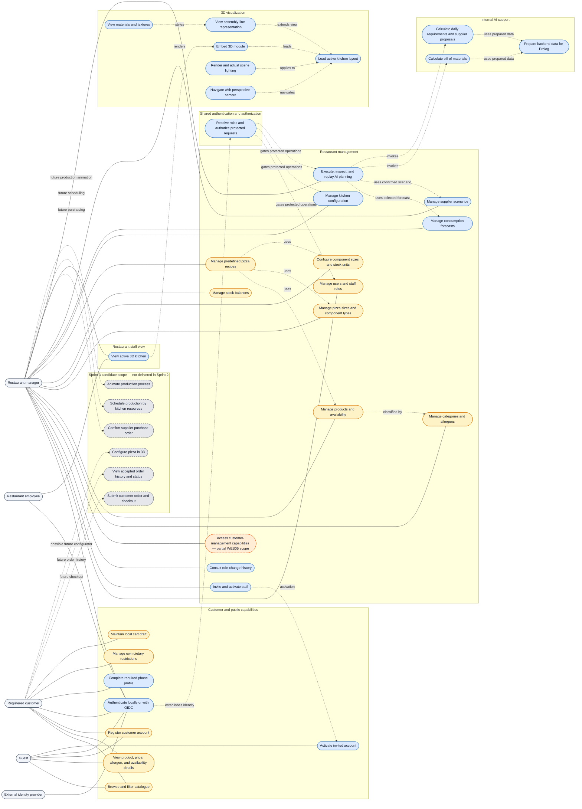

# LaPrizza — Consolidated Use Case Diagram

This is the consolidated view of customer, staff, and manager interactions across the delivered Sprint 1 and Sprint 2 scope, plus clearly marked candidate Sprint 3 capabilities. See [`use_case_diagram_sprint1.md`](use_case_diagram_sprint1.md) for the historical Sprint 1 view and [`use_case_diagram_sprint2.md`](use_case_diagram_sprint2.md) for the detailed Sprint 2 view.

**Status convention:** solid actor links and blue/amber use cases describe delivered application capabilities; grey dotted use cases are future scope and must not be read as implemented. AI03 and AI04 are reports/studies rather than runtime use cases and are intentionally excluded.

## Interpretation and boundaries

- The public catalogue can be browsed without an account. Customer account and phone-profile requirements apply to the protected customer actions described in AA02/AA07.
- “Maintain local cart draft” is not a server-side order. Sprint 2 does not deliver checkout, payment, accepted customer orders, or customer order history.
- Kitchen configuration is manager-managed. Both managers and employees can view the active kitchen visualization; viewing does not grant configuration-write access.
- AI planning is a manager capability. AI01/AI02 are calculations backed by AI05/AI06; Prolog is an internal service, not an end-user actor. A proposal is not a purchase order, and planning does not mutate stock.
- Sprint 3 items are explicit future candidates, not claims about a committed or completed Sprint 3 requirement. In particular, purchase-order confirmation and customer order lifecycle require their own approved requirements.
- “Administrator” in the AA06 story is a functional designation of Manager per Clarification #24. The current code’s `ADMINISTRATOR` role remains an implementation/requirements discrepancy to reconcile; this diagram does not introduce a separate business actor.
- WEB05 customer-management and employee query pages have recorded acceptance-criteria gaps. UC13 is marked partial to avoid representing the whole story as complete.
