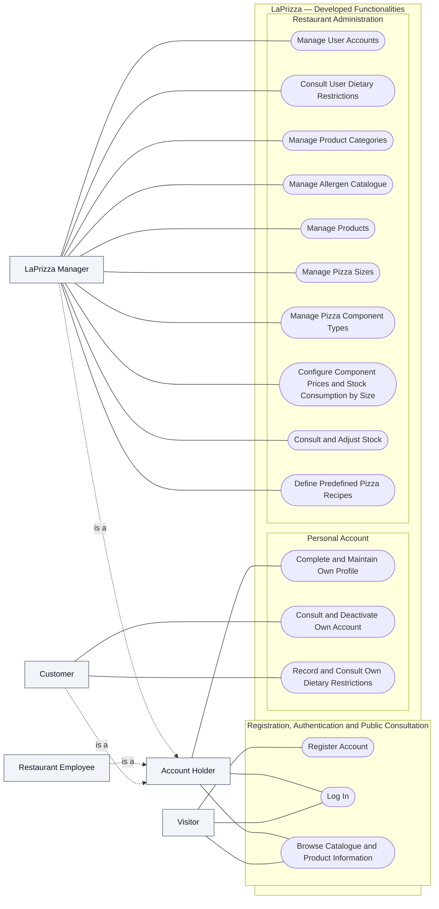

# LaPrizza — Developed Use Cases

# Historical Sprint 1 snapshot

> This file preserves the Sprint 1 use-case view for historical traceability. It is not the current consolidated use-case model and must not be used to infer Sprint 2 scope or current authorization. Consult [`use_case_diagram.md`](use_case_diagram.md) for the consolidated view and [`use_case_diagram_sprint2.md`](use_case_diagram_sprint2.md) for Sprint 2.

