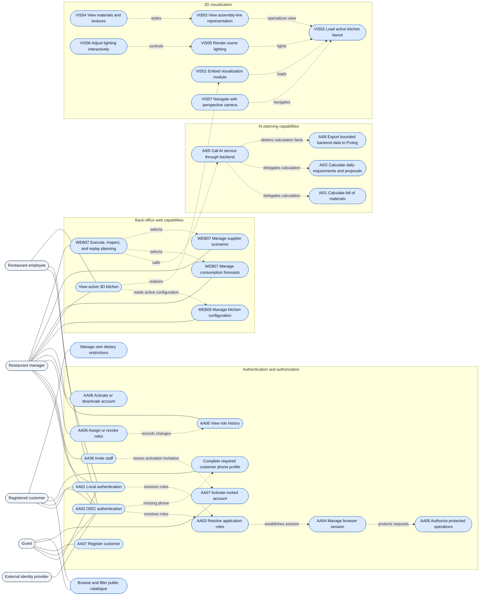

# LaPrizza — Use Cases — Sprint 2

This diagram models the implemented Sprint 2 application use cases and their supporting services. It complements [`use_case_diagram_sprint1.md`](use_case_diagram_sprint1.md) and the [full current/future diagram](use_case_diagram.md).

**Scope:** Sprint 2 adds authentication/authorization stories AA01–AA07, WEB06–WEB07, AI01–AI02/AI05–AI06, and VIS01–VIS07. AI03 and AI04 are academic/report deliverables, so they are intentionally not shown as runtime use cases. Customer checkout, payment, accepted-order lifecycle, and purchase-order creation are not implemented Sprint 2 use cases. AI planning is read-only.

## Reading notes

- A manager manages kitchen configurations; employees may view the active kitchen but do not receive the configuration editor use case.
- AI planning and its supporting endpoints are manager-authorized. Customers do not execute planning.
- OIDC is a sign-in method, not a distinct application user role. The identity provider participates only in the OIDC authentication use case.
- AA06’s user-story language calls the actor “Administrator”, while Clarification #24 defines that as the functional designation of a Manager. The implementation currently also has an `ADMINISTRATOR` role in some account lifecycle operations; this discrepancy is tracked in the story/clarification and is not represented here as an independent business actor.
- AI06 is an internal backend-to-Prolog data preparation capability, not a direct user interaction. Prolog receives bounded JSON over HTTP and has no direct database access.
- `AI02` outputs planning proposals, not purchase orders; planning does not mutate stock. The customer cart remains a draft and no Sprint 2 checkout/order lifecycle is implied.
