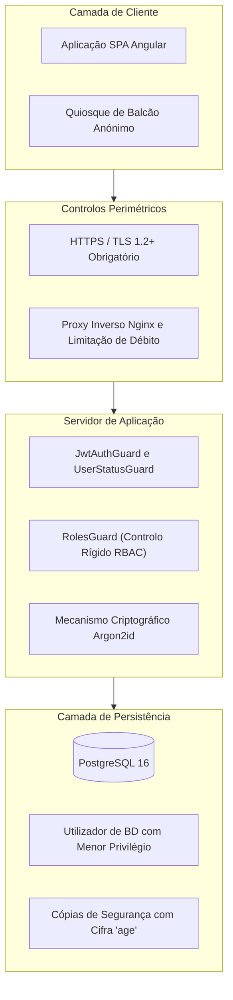

# Sistema de Informação LaPrizza — Política de Conformidade com o Regulamento Geral sobre a Proteção de Dados (RGPD) e Proteção de Dados Pessoais

**Versão:** 2.0 (Linha de base do Sprint 2, alinhada com os conteúdos curriculares de LAPR5)  
**Responsável pelo Tratamento:** Empresa de Restauração LaPrizza (*Data Controller*)  
**Contacto do DPO:** `dpo@laprizza.local` — formalmente designado (§10)  
**Autoridade de Controlo Nacional:** CNPD — Comissão Nacional de Protecção de Dados ([www.cnpd.pt](https://www.cnpd.pt))  
**Edições Linguísticas:** Português de Portugal (esta edição) | Versão em língua inglesa disponível em [gdpr-policy.md](file:///c:/Users/pedro/vsc/LEI-SEM5-PI-2026-27-3DJ-05/docs/gdpr-policy.md)  

**Artefactos Relacionados:**
- `docs/api/openapi.yaml` (v2.0.0) — especificação e implementação ao nível de terminais (*endpoints*) dos direitos e controlos descritos.
- `docs/sad/08-database-structure.md` — tabelas e restrições da base de dados física referenciadas no documento.
- `sys-backup-strategy.md` §8 e §13 — retenção, eliminação e execução de pedidos de apagamento no restauro de cópias de segurança (*backups*).
- `sys-risk-assessment.md` §4 (R-06) — avaliação e mitigação do risco de violação de dados pessoais no âmbito do RGPD.
- `sys-mbco.md` §5.5, §6.1 — detecção durante incidentes e objectivos mínimos de continuidade de negócio (*MBCO*).
- `docs/user-stories/GDP01/requirements.md` — requisitos de tratamento de dados pessoais e registo das actividades de tratamento (Art. 30.º).
- `docs/user-stories/GDP02/requirements.md` — requisitos de responsabilidade pelo tratamento e governação de subcontratantes.
- `docs/user-stories/GDP03/requirements.md` — requisitos de gestão e procedimento de notificação de violações de dados pessoais.
- LaPrizza KB v2.0 Apêndice D — política original substituída pelo presente documento.

---

## 1. Introdução, Âmbito e Enquadramento Jurídico (GDP01 e GDP02)

### 1.1. Finalidade desta Política

O presente documento estabelece as directrizes e regras de conformidade do **Sistema de Informação LaPrizza** com o Regulamento (UE) 2016/679 do Parlamento Europeu e do Conselho, de 27 de Abril de 2016 (Regulamento Geral sobre a Protecção de Dados — RGPD), bem como com a legislação nacional portuguesa complementar.

Aplica-se a todos os utilizadores e perfis do sistema — Gestores (*Managers*), Funcionários (*Employees*), Clientes Registados (*Registered Customers*), Clientes com Autenticação Federada Externa (*External IdP Customers*) e utilizadores anónimos do quiosque de atendimento. O documento formaliza as medidas técnicas e organizativas de segurança, as bases de licitude aplicadas, os direitos conferidos aos titulares, a governação de subcontratantes e o plano de resposta a incidentes de segurança.

Esta política satisfaz integralmente as *user stories* do Sprint 2: **GDP01** (*Tratamento de Dados Pessoais*), **GDP02** (*Responsabilidade pelo Tratamento*) e **GDP03** (*Gestão de Violações de Dados Pessoais*), encontrando-se harmonizada com a unidade curricular de LAPR5 (*Privacidade e Protecção de Dados Pessoais*).

### 1.2. Âmbito do Projecto e Funcionalidades Principais do Sistema (GDP01 AC1)

Para garantir clareza operacional e jurídica, o perímetro de funcionamento do protótipo LaPrizza no Sprint 2 define-se do seguinte modo:

1. **Natureza do Sistema e Capacidades Activas:**
   - O LaPrizza é uma plataforma empresarial integrada de restauração que disponibiliza navegação de ementas e catálogo, autenticação com controlo de acessos baseado em papéis (*Role-Based Access Control* — RBAC), visualizador de cozinha em tempo real e módulos de planeamento por inteligência artificial para previsão de consumos e explosão de listas de materiais (*Bill of Materials* — BOM).
   - Estão estruturados quatro níveis funcionais de acesso autenticado:
     - **Convidado / Anónimo (*Guest*):** Consulta pública do catálogo de produtos e realização de pedidos anónimos no quiosque de autosserviço.
     - **Cliente (*Customer*):** Gestão em autosserviço do perfil pessoal, livro de endereços de entrega, indicação voluntária de restrições alimentares e consulta do histórico de encomendas.
     - **Funcionário (*Employee*):** Operadores de balcão e cozinha com acesso à visualização do progresso dos pedidos e fluxos de confecção, sem permissões administrativas sobre dados de clientes.
     - **Gestor (*Manager*):** Acesso administrativo integral a dados comerciais, gestão de clientes, parametrização de cenários de fornecedores, atribuição de perfis de acesso e execução de planeamentos de IA.
   - **Funcionamento do Quiosque Anónimo:** Os clientes que utilizam o quiosque de autosserviço realizam encomendas sem criação de perfil persistente (sem registo de `Customer`). Os dados da encomenda mantêm-se em memória volátil durante a sessão e são desvinculados de quaisquer credenciais identificativas após a emissão do talão.

2. **Exclusões Explícitas do Âmbito (O que o Protótipo NÃO Realiza):**
   - **Inexistência de Processamento de Pagamentos:** Não são recolhidos, armazenados ou processados dados de cartões de pagamento, contas bancárias ou interfaces de processadores de pagamento no Sprint 2.
   - **Inexistência de Definição de Perfis Automatizada (*Profiling*):** O sistema não executa avaliação preditiva de comportamento, pontuação financeira de clientes nem discriminação comercial algorítmica.
   - **Inexistência de Campanhas de Marketing Directo:** Conquanto a preferência de consentimento de marketing seja registada (`customers.marketing_consent`), o protótipo não efectua disparos automatizados de mensagens promocionais nem utiliza rastreadores de publicidade comportamental.
   - **Inexistência de Compras Automatizadas:** O planeamento por IA gera previsões informativas de reposição destinadas exclusivamente à revisão e validação humana por parte dos Gestores; não são emitidas ordens de compra automáticas a fornecedores.

### 1.3. Natureza Jurídica do RGPD (LAPR5 — Introdução)

O RGPD consubstancia uma **norma jurídica** que se distingue por quatro propriedades fundamentais:

- **Imperatividade:** Impõe comandos vinculativos e proibições categóricas, não se limitando a recomendações de natureza facultativa. O seu cumprimento é obrigatório para todas as actividades abrangidas.
- **Generalidade:** Destina-se a uma categoria indeterminada de sujeitos jurídicos (qualquer responsável pelo tratamento ou subcontratante que trate dados de pessoas singulares na União Europeia), não a destinatários concretos ou nominativos.
- **Abstracção:** Prevê uma hipótese legal tipo aplicável a uma pluralidade indeterminada de casos futuros, em vez de se esgotar na resolução de um litígio particular e irrepetível.
- **Coercibilidade:** A ordem jurídica assegura a sua efectividade através da força legítima do Estado e das instâncias jurisdicionais, facultando à autoridade de controlo e aos tribunais a aplicação de sanções administrativas e coimas que podem ascender a 20 000 000 € ou 4% do volume de negócios mundial total anual (Art. 83.º).

### 1.4. Natureza Híbrida e Transversal do Direito da Protecção de Dados

O direito da protecção de dados reveste natureza **transversal**, interligando três ramos fundamentais da ordem jurídica:

1. **Direitos Fundamentais (Direito Constitucional / Público):** Ancorado no Artigo 8.º da Carta dos Direitos Fundamentais da União Europeia (CDFUE) e nos Artigos 26.º e 35.º da Constituição da República Portuguesa (CRP), consagrando a protecção de dados como um direito de personalidade inviolável.
2. **Poderes Sancionatórios e de Fiscalização (Direito Administrativo / Contra-ordenacional):** Conferindo à autoridade de controlo independente (a CNPD, nos termos dos Artigos 51.º e 58.º) competências regulatórias para auditar sistemas, ordenar a cessação de tratamentos e aplicar coimas de montante substancial.
3. **Relações Contratuais e Responsabilidade Civil (Direito Privado / Civil):** Regulando a celebração obrigatória de contratos de subcontratação (*Data Processing Agreements* — DPA, Art. 28.º), termos de serviço e a obrigação de indemnização por danos materiais ou imateriais sofridos pelos titulares (Art. 82.º).

### 1.5. Precedentes Históricos e Legislativos (LAPR5 — Precedentes Legislativos)

A consagração do direito à protecção de dados resulta de uma maturação legislativa e doutrinária consolidada ao longo de mais de sete décadas:

| Instrumento Jurídico | Ano | Âmbito Territorial / Jurisdição | Norma Relevante e Enquadramento |
|---|---|---|---|
| **Declaração Universal dos Direitos do Homem (DUDH)** | 1948 | Universal (ONU) | Art. 12.º — *"Ninguém sofrerá intromissões arbitrárias na sua vida privada, na sua família, no seu domicílio ou na sua correspondência..."* |
| **Convenção Europeia dos Direitos do Homem (CEDH)** | 1950 | Conselho da Europa | Art. 8.º — Direito ao respeito pela vida privada e familiar, pelo domicílio e pela correspondência. |
| **Convenção 108 do Conselho da Europa** | 1981 | Conselho da Europa | Art. 1.º — Primeiro tratado internacional vinculativo destinado à salvaguarda dos indivíduos face ao tratamento automatizado de dados de carácter pessoal. |
| **Tratado sobre o Funcionamento da União Europeia (TFUE)** | 1992 (rev. Lisboa 2007) | União Europeia | Art. 16.º — Consagração expressa da competência da UE para legislar sobre o direito fundamental à protecção de dados pessoais. |
| **Carta dos Direitos Fundamentais da UE (CDFUE)** | 2000 (eficácia 2009) | União Europeia | Art. 8.º — Direito à protecção dos dados pessoais: tratamento leal, para fins específicos, com base no consentimento ou outra base legítima, sujeito a autoridade independente. |
| **Directiva 95/46/CE** | 1995 | União Europeia | Directiva fundacional que harmonizou a protecção de dados nos Estados-Membros (revogada pelo RGPD). |
| **Lei n.º 67/98** | 1998 | Portugal | Transposição da Directiva 95/46/CE para a ordem interna portuguesa (*Lei de Protecção de Dados Pessoais*, revogada pela Lei n.º 58/2019). |
| **Constituição da República Portuguesa (CRP)** | 1976 (rev. 2005) | Portugal | Art. 13.º (Princípio da igualdade), Art. 26.º (Direito à identidade pessoal e à reserva da intimidade da vida privada), Art. 35.º (Utilização da informática). |
| **Regulamento (UE) 2016/679 (RGPD)** | 2016 (aplicável em 2018) | União Europeia | Regulamento Geral sobre a Protecção de Dados, com eficácia directa em todos os Estados-Membros da UE. |
| **Lei n.º 58/2019** | 2019 | Portugal | Diploma nacional que assegura a execução do RGPD na ordem jurídica portuguesa. |
| **Lei n.º 27/2021 (CPDHED)** | 2021 | Portugal | Carta Portuguesa de Direitos Humanos na Era Digital, garantindo salvaguardas acrescidas contra a discriminação algorítmica e na internet. |

### 1.6. Aplicação Nacional e Autoridade de Controlo Portuguesa

Por operar e ter estabelecimento em território português, a actividade da LaPrizza rege-se cumulativamente pelas normas nacionais complementares:

- **Lei n.º 58/2019, de 8 de Agosto:** Assegura a execução do RGPD na ordem jurídica interna, estatuindo disposições próprias quanto aos dados de colaboradores, consentimento de menores (fixado nos 13 anos para a sociedade de informação, Art. 16.º), regras de videovigilância, prazos de conservação e regime sancionatório nacional.
- **Lei n.º 27/2021, de 17 de Maio (CPDHED):** Reforça os direitos fundamentais no ecossistema digital, garantindo protecção contra a discriminação resultante de mecanismos analíticos e exigindo inteligibilidade nas decisões com recurso a inteligência artificial. Esta lei complementa o RGPD no que diz respeito a salvaguardas contra discriminação algorítmica e direito à explicação de decisões automatizadas, aplicando-se diretamente ao sistema LaPrizza como medida de protecção reforçada.
- **Comissão Nacional de Protecção de Dados (CNPD):** Autoridade administrativa independente com sede na Rua de São Bento, 148, 3.º, 1200-821 Lisboa ([www.cnpd.pt](https://www.cnpd.pt)), competente nos termos do Art. 51.º do RGPD para fiscalizar o cumprimento normativo, receber notificações de violações de dados (Art. 33.º) e apreciar reclamações dos titulares (Art. 77.º).

### 1.7. Âmbito Material e Territorial de Aplicação (Arts. 1.º, 2.º e 3.º do RGPD)

**Âmbito Material (Art. 2.º, n.º 1):**  
A presente política incide sobre todo o tratamento de dados pessoais realizado no sistema LaPrizza:
- Por meios total ou parcialmente automatizados, nas tabelas e serviços de base de dados (`users`, `customers`, `customer_addresses`, `user_dietary_restrictions`, `role_change_logs`, `activation_invitations`, registos de acesso HTTP e ficheiros de auditoria);
- Por meios não automatizados, sempre que os dados integrem ou se destinem a integrar ficheiros estruturados (como listagens de parametrização de fornecedores ou relatórios de auditoria impressos).

**Exclusões Legais da Aplicação (Art. 2.º, n.º 2, alíneas a) a d)):**  
O RGPD determina a sua inaplicabilidade em quatro domínios taxativos:
1. **Actividades Fora do Âmbito do Direito da UE (alínea a)):** Tratamentos executados no exercício de competências que extravasam o direito europeu. *Fundamento:* Sendo o RGPD um regulamento comunitário, carece de competência para impor deveres fora do quadro da União.
2. **Política Externa e de Segurança Comum (alínea b)):** Actividades no âmbito do Título V, Capítulo 2, do Tratado da União Europeia (PESC). *Fundamento:* A defesa e a política externa são matérias de soberania dos Estados-Membros, reguladas por regimes próprios de segurança nacional.
3. **Actividades Exclusivamente Pessoais ou Domésticas (alínea c)):** Tratamentos efectuados por pessoas singulares no exercício de actividades exclusivamente privadas ou domésticas (Considerando 18). *Fundamento:* A lei não visa intervir na vida privada familiar. *Ressalva:* Quem forneça os meios técnicos para esse tratamento (como redes sociais ou prestadores de alojamento em nuvem) mantém-se integralmente adstrito ao cumprimento do RGPD.
4. **Prevenção e Investigação Criminal por Autoridades Competentes (alínea d)):** Actividades de repressão penal e execução de penas por tribunais ou polícias. *Fundamento:* Esta matéria é regulada especificamente pela **Directiva (UE) 2016/680**.

*Conclusão:* A LaPrizza é uma entidade privada que exerce actividade económica de restauração comercial. Nenhuma das exclusões legais se aplica ao projecto.

**Âmbito Territorial (Art. 3.º):**  
- **Art. 3.º, n.º 1 (Estabelecimento):** A LaPrizza possui estabelecimento em Portugal (Estado-Membro da UE), decorrendo o tratamento no contexto das suas actividades, independentemente de os servidores físicos se situarem ou não na UE.
- **Art. 3.º, n.º 2 (Mercado / Destinatários):** A aplicação disponibiliza bens e serviços alimentares a titulares de dados localizados no território da União Europeia.

### 1.8. Identificação dos Actores e Papéis de Governação (GDP02 AC1)

Nos termos dos Artigos 4.º, n.º 7, e 24.º do RGPD, identificam-se as seguintes figuras de governação:

- **Responsável pelo Tratamento (*Data Controller*):**
  - **Entidade Legal:** Empresa de Restauração LaPrizza (Protótipo académico, Turma 3DJ, Grupo 05, Instituto Superior de Engenharia do Porto — ISEP).
  - **Endereço do Estabelecimento:** Rua Dr. António Bernardino de Almeida, 431, 4200-072 Porto, Portugal.
  - **Contacto Institucional:** `geral@laprizza.local`.
  - **Representante na UE (Art. 27.º):** Não aplicável, dado que o Responsável pelo Tratamento se encontra formalmente estabelecido em território da União Europeia.
- **Encarregado da Protecção de Dados (*Data Protection Officer* — DPO):**
  - Designado nos termos dos Artigos 37.º a 39.º; contacto directo: `dpo@laprizza.local`.
  - Depende hierarquicamente da administração de topo, actuando com total autonomia funcional e sem sujeição a ordens relativas à apreciação de conformidade.
- **Subcontratantes (*Data Processors* — Art. 28.º):**
  - Prestadores de infra-estrutura e serviços externos (provedor federado OIDC, serviço de envio transaccional de e-mails SMTP e armazenamento em nuvem para cópias de segurança) actuam estritamente como subcontratantes, ao abrigo de contratos vinculativos de tratamento de dados (§14).
- **Co-responsabilidade pelo Tratamento (Art. 26.º):**
  - Inexistente. A LaPrizza fixa individualmente as finalidades essenciais e os meios técnicos de todas as operações de tratamento.

---

## 2. Definições Jurídicas Fundamentais (Art. 4.º do RGPD)

Em estrita consonância com o Artigo 4.º do RGPD e o léxico leccionado na unidade curricular de LAPR5, aplicam-se as seguintes definições:

| Conceito Jurídico | Norma Legal | Definição Normativa Aplicável |
|---|---|---|
| **Dados Pessoais** | Art. 4.º, n.º 1 | Qualquer informação relativa a uma pessoa singular identificada ou identificável (*titular dos dados*). É identificável a pessoa que possa ser directa ou indirectamente identificada, designadamente por referência a um identificador como nome, número de identificação, dados de localização, identificadores por via electrónica ou a elementos da sua identidade física, fisiológica, genética, mental, económica, cultural ou social. |
| **Tratamento** | Art. 4.º, n.º 2 | Qualquer operação ou conjunto de operações efectuadas sobre dados pessoais ou conjuntos de dados pessoais, por meios automatizados ou não automatizados, tais como a recolha, o registo, a organização, a estruturação, a conservação, a adaptação ou alteração, a recuperação, a consulta, a utilização, a divulgação por transmissão, por difusão ou por qualquer outra forma de disponibilização, a comparação ou interconexão, a limitação, o apagamento ou a destruição. |
| **Titular dos Dados** | Art. 4.º, n.º 1 | A pessoa singular viva a quem os dados pessoais dizem respeito e que é objecto de tratamento. |
| **Responsável pelo Tratamento** | Art. 4.º, n.º 7 | A pessoa singular ou colectiva, autoridade pública, agência ou outro organismo que, individualmente ou em conjunto com outras, determina as finalidades e os meios de tratamento dos dados pessoais. |
| **Subcontratante** | Art. 4.º, n.º 8 | A pessoa singular ou colectiva, autoridade pública, agência ou outro organismo que trata dados pessoais por conta e sob as instruções documentadas do responsável pelo tratamento. |
| **Consentimento** | Art. 4.º, n.º 11 e Art. 7.º | Qualquer manifestação de vontade, livre, específica, informada e inequívoca, pela qual o titular dos dados aceita, mediante declaração ou acto positivo inequívoco, que os dados pessoais que lhe dizem respeito sejam objecto de tratamento. O silêncio, opções pré-validadas ou a inacção não constituem consentimento (Considerando 32). |
| **Pseudonimização** | Art. 4.º, n.º 5 | O tratamento de dados pessoais de tal forma que deixem de poder ser atribuídos a um titular de dados específico sem recorrer a informações suplementares, desde que essas informações suplementares sejam mantidas separadamente e sujeitas a medidas técnicas e organizativas adequadas. |
| **Definição de Perfis (*Profiling*)** | Art. 4.º, n.º 4 | Qualquer forma de tratamento automatizado de dados pessoais que consista em utilizar esses dados para avaliar certos aspectos pessoais de uma pessoa singular, nomeadamente para analisar ou prever o seu desempenho profissional, situação económica, saúde, preferências pessoais, interesses, fiabilidade, comportamento, localização ou deslocações. |
| **Violação de Dados Pessoais** | Art. 4.º, n.º 12 | Uma violação da segurança que provoque, de modo acidental ou ilícito, a destruição, a perda, a alteração, a divulgação ou o acesso, não autorizados, a dados pessoais transmitidos, conservados ou sujeitos a qualquer outro tipo de tratamento. |
| **Ficheiro** | Art. 4.º, n.º 6 | Qualquer conjunto estruturado de dados pessoais, acessíveis segundo critérios determinados, quer seja centralizado, descentralizado ou repartido de modo funcional ou geográfico. |
| **Destinatário** | Art. 4.º, n.º 9 | Uma pessoa singular ou colectiva, autoridade pública, agência ou outro organismo a quem são comunicados dados pessoais, independentemente de se tratar ou não de um terceiro. |
| **Terceiro** | Art. 4.º, n.º 10 | A pessoa singular ou colectiva, autoridade pública, serviço ou organismo que não seja o titular dos dados, o responsável pelo tratamento, o subcontratante e as pessoas que, sob a autoridade directa do responsável ou do subcontratante, estão autorizadas a tratar dados pessoais. |
| **Categorias Especiais de Dados** | Art. 9.º, n.º 1 | Dados pessoais que revelem a origem racial ou étnica, opiniões políticas, convicções religiosas ou filosóficas, ou filiação sindical, dados genéticos, dados biométricos para identificar uma pessoa de forma inequívoca, **dados relativos à saúde** ou dados relativos à vida sexual ou orientação sexual. O seu tratamento é genericamente proibido, salvo excepção do Art. 9.º, n.º 2. |
| **Dados Relativos à Saúde** | Art. 4.º, n.º 15 | Dados pessoais relacionados com a saúde física ou mental de uma pessoa singular, incluindo a prestação de serviços de saúde, que revelem informações sobre o seu estado de saúde. **As restrições alimentares associadas a alergias e intolerâncias (`user_dietary_restrictions`) enquadram-se nesta categoria.** |
| **Dados Genéticos** | Art. 4.º, n.º 13 | Dados pessoais relativos às características genéticas hereditárias ou adquiridas de uma pessoa singular que forneçam informações únicas sobre a fisiologia ou a saúde dessa pessoa (não recolhidos na LaPrizza). |
| **Dados Biométricos** | Art. 4.º, n.º 14 | Dados pessoais resultantes de um tratamento técnico específico relativo às características físicas, fisiológicas ou comportamentais de uma pessoa singular que permitam ou confirmem a sua identificação única (ex.: reconhecimento facial, impressões digitais; não recolhidos na LaPrizza). |
| **Encarregado da Protecção de Dados (DPO)** | Arts. 37.º a 39.º | Perito designado para aconselhar o responsável, controlar a conformidade interna e assegurar a articulação com os titulares dos dados e a autoridade de controlo. |

---

## 3. Princípios Relativos ao Tratamento de Dados (Art. 5.º do RGPD — Os Nove Princípios de LAPR5)

Nos termos do Artigo 5.º, n.º 1, decomposto pela matriz programática da unidade curricular de LAPR5, vigoram **nove princípios estruturantes** aos quais a arquitectura do LaPrizza dá cumprimento rigoroso:

### 3.1. Princípio da Licitude
Todo o tratamento deve fundar-se obrigatoriamente numa das seis bases de licitude do Artigo 6.º, n.º 1, exigindo-se para os dados de saúde das alergias a verificação adicional de uma excepção do Artigo 9.º, n.º 2. Não existem operações de escrita ou persistência na base de dados desprovidas de suporte legal expresso (§4 e §6).

### 3.2. Princípio da Lealdade
O tratamento deve ser efectuado de forma leal, correcta e transparente perante o titular, repudiando o recurso a padrões manipulativos (*dark patterns*) ou opções sub-reptícias. A manifestação de preferência quanto a comunicações de marketing (`customers.marketing_consent`) apresenta-se desvinculada do registo de utilizador, mediante caixa de validação não pré-marcada (*opt-in* voluntário).

### 3.3. Princípio da Transparência
As informações respeitantes ao tratamento são transmitidas de forma acessível e inteligível nos formulários de registo (`/auth/register`) e de gestão de conta. Com o intuito de salvaguardar a segurança do titular sem quebrar a transparência das comunicações, as respostas a falhas de autenticação em `POST /api/v1/auth/login` emitem um código uniforme `401 Unauthorized`, quer o e-mail não conste na base de dados, quer a palavra-passe esteja incorrecta, inviabilizando ataques maliciosos de enumeração de contas (`openapi.yaml`).

### 3.4. Princípio da Finalidade
Os dados pessoais são recolhidos para finalidades determinadas, explícitas e legítimas, não podendo ser tratados posteriormente de forma incompatível com essas finalidades:
- As coordenadas de contacto recolhidas para a gestão da conta e entrega de pedidos não são comunicadas a terceiros nem usadas para publicidade sem consentimento autónomo.
- Os modelos e dados do planeamento de inteligência artificial (Sprint 2) destinam-se exclusivamente ao aprovisionamento e gestão de inventário, não sendo reaproveitados para avaliação comercial ou classificação comportamental dos clientes.
- Tratamentos adicionais para conservação de arquivo ou fins estatísticos cumprem as salvaguardas de despersonalização do Art. 89.º, n.º 1.

### 3.5. Princípio da Minimização dos Dados
A recolha de dados é estritamente limitada ao indispensável perante a finalidade a que se destinam:
- Apenas o primeiro nome, último nome e e-mail são de preenchimento obrigatório para o registo de utilizador.
- Moradas complementares e o número de identificação fiscal (`vat_number`) revestem carácter facultativo.
- A encomenda no quiosque anónimo **não gera qualquer registo persistente na tabela `Customer`** (Esclarecimento n.º 01).
- Os ficheiros e cargas enviadas para o motor de inferência Prolog de planeamento **não contêm dados de identificação pessoal dos clientes** — apenas identificadores de ingredientes, quantidades e restrições de fornecedores.

### 3.6. Princípio da Exactidão
Os dados objecto de tratamento devem ser exactos e actualizados sempre que necessário, adoptando-se medidas razoáveis para que os dados inexactos sejam apagados ou rectificados sem demora:
- O cliente pode actualizar autonomamente os seus endereços e número de telefone através dos terminais `PUT /api/v1/user/me/address` e `PUT /api/v1/user/me/phone-number`.
- O Gestor dispõe do terminal `PUT /api/v1/customers/:email` para rectificação administrativa de anomalias detectadas.
- Os códigos e convites de activação prescrevem num prazo peremptório (`INVITATION_TTL_HOURS`, 48 horas), impedindo utilizações extemporâneas.
- Contas desactivadas são sinalizadas de imediato no repositório de segurança, inviabilizando acessos obsoletos.

### 3.7. Princípio da Limitação da Conservação
Os dados pessoais são conservados de forma a permitir a identificação dos titulares apenas durante o período necessário para as finalidades para as quais são tratados. Os prazos de retenção encontram-se definidos no §12. A remoção de utilizadores recorre a mecanismos de cascata relacional (`ON DELETE CASCADE` e `ON DELETE SET NULL`) para eliminar registos privados garantindo simultaneamente a integridade de relatórios financeiros anonimizados.

### 3.8. Princípio da Integridade e Confidencialidade
Garante-se a segurança adequada dos dados através de medidas técnicas e organizativas que os protegem contra o tratamento não autorizado ou ilícito, perda ou destruição acidental:
- Utilização de cifras robustas: derivação de chaves por **Argon2id** para credenciais, comunicações em **HTTPS/TLS 1.2+**, fichas de autenticação **JWT** assinadas criptograficamente e cópias de segurança protegidas com **age encryption**.
- Integridade estrutural: chaves forasteiras, regras de validação estritas e restrições `ON DELETE RESTRICT` que bloqueiam remoções massivas descontroladas.

### 3.9. Princípio da Responsabilidade (*Accountability*)
O Responsável pelo Tratamento é responsável pelo cumprimento efectivo dos princípios precedentes e deve ser capaz de comprovar documentalmente essa conformidade perante a autoridade de controlo (Art. 5.º, n.º 2). No sistema LaPrizza, essa evidência materializa-se no presente documento, na matriz do Art. 30.º (§6), nas tabelas de auditoria inalteráveis (`role_change_logs`), no invariante de governação que obriga à existência permanente de pelo menos um gestor activo ("≥ 1 active MANAGER") e no registo cronológico de eventos de segurança.

### 3.10. Proteção de Dados desde a Conceição e por Defeito (Art. 25.º do RGPD)
LaPrizza integra a proteção de dados na arquitectura desde as primeiras fases de design (*Privacy by Design*) e garante que as configurações por defeito protejam os dados pessoais (*Privacy by Default*):

- **Proteção de Dados desde a Conceição (Art. 25.º, n.º 1):**
  - **Pseudonimização e Cifragem:** Todos os dados pessoais são armazenados com cifragem forte (PostgreSQL TDE, cópias de segurança com `age encryption`) e em trânsito (TLS 1.2+). Credenciais sensíveis são hasheadas com Argon2id.
  - **Minimização na Origem:** Os formulários de registo recolhem apenas os campos obrigatórios (`first_name`, `last_name`, `email`). Campos facultativos (`vat_number`, detalhes de morada) são claramente assinalados.
  - **Controlos de Acesso por Defeito:** O Controlo de Acessos por Papéis (RBAC) restringe o acesso a dados desde as primeiras linhas de código. `RolesGuard` e `JwtAuthGuard` aplicam a separação de concernimentos.
  - **Salvaguardas Automatizadas:** Os tokens de sessão expiram após 15 minutos. Os tokens de convite têm um TTL estrito de 48 horas. Contas desactivadas são bloqueadas imediatamente por `UserStatusGuard`.

- **Proteção de Dados por Defeito (Art. 25.º, n.º 2):**
  - **Perfis Privados:** Os perfis de cliente não são publicamente acessíveis. Apenas utilizadores autenticados com papéis apropriados podem visualizar dados pessoais.
  - **Consentimento Opt-In:** O consentimento de marketing (`customers.marketing_consent`) tem valor por defeito `false`. Nenhuma caixa pré-marcada; é necessária uma acção positiva explícita.
  - **Sem Pedidos Anónimos Persistentes:** O quiosque de autosserviço não cria um registo `Customer`. Os dados do pedido são efémeros e apagados após a impressão do talão.
  - **Isolamento de IA:** O motor Prolog recebe apenas métricas operacionais anonimizadas — nunca são transmitidos dados pessoais de clientes (ADR-012).

### 3.11. Proteção de Menores (Art. 8.º do RGPD)
A LaPrizza presta serviços da sociedade da informação que podem ser utilizados por menores. Implementam-se as seguintes salvaguardas nos termos do Artigo 8.º do RGPD e da lei nacional portuguesa (Lei n.º 58/2019, Art. 16.º):

- **Idade de Consentimento:** Em Portugal, a idade de consentimento digital é **13 anos**. Menores de 13 anos não podem criar conta sem autorização parental ou do tutor.
- **Verificação do Consentimento Parental:** Para utilizadores com idades entre 13 e 15 anos, exige-se uma acção afirmativa explícita durante o registo. Embora o protótipo do Sprint 2 não implemente mecanismos automáticos de detecção de idade, o formulário de registo inclui uma caixa de declaração de idade claramente visível. Expansões futuras para utilizadores com menos de 13 anos integrarão um fluxo formal de consentimento parental (ex.: autorização por e-mail).
- **Transparência para Crianças:** As avisos de privacidade são redigidos em linguagem clara e simples, adequada a crianças. A interface de registo utiliza terminologia simples e auxílios visuais.
- **Nenhuma Definição de Perfis de Menores:** O sistema não realiza profiling comportamental, publicidade direcionada ou tomada de decisão automatizada que afecte crianças.

---

## 4. Bases de Licitude do Tratamento (Art. 6.º e Art. 9.º do RGPD)

Todas as operações de tratamento de dados pessoais no LaPrizza apoiam-se expressamente numa das condições de licitude do Artigo 6.º, n.º 1, do RGPD:

| Base Legal (Art. 6.º, n.º 1) | Definição Normativa | Âmbito de Aplicação no Sistema LaPrizza |
|---|---|---|
| **(a) Consentimento** | O titular dos dados deu o seu consentimento para o tratamento dos seus dados pessoais para uma ou mais finalidades específicas. | Recepção facultativa de comunicações de marketing e divulgação promocional (`customers.marketing_consent`). |
| **(b) Execução de Contrato** | O tratamento for necessário para a execução de um contrato no qual o titular dos dados é parte, ou para diligências pré-contratuais a pedido do titular. | Criação de conta, autenticação, gestão de perfil, colocação e entrega de encomendas, e registo de moradas de entrega. |
| **(c) Obrigação Jurídica** | O tratamento for necessário para o cumprimento de uma obrigação jurídica a que o responsável pelo tratamento esteja sujeito. | Conservação obrigatória de dados de facturação e transacções fiscais nos termos da legislação tributária portuguesa (CIRC, CIRS e Lei n.º 58/2019). |
| **(d) Interesses Vitais** | O tratamento for necessário para a defesa de interesses vitais do titular dos dados ou de outra pessoa singular. | Situações de emergência médica súbita (não constitui base do fluxo operacional normal). |
| **(e) Interesse Público / Autoridade Pública** | O tratamento for necessário ao exercício de funções de interesse público ou ao exercício da autoridade pública de que está investido o responsável. | Não aplicável à actividade comercial de um restaurante de direito privado. |
| **(f) Interesses Legítimos** | O tratamento for necessário para efeito dos interesses legítimos prosseguidos pelo responsável pelo tratamento ou por terceiros, excepto se prevalecerem os direitos fundamentais do titular. | Rastreabilidade e auditoria de perfis (`role_change_logs`), segurança da infra-estrutura, ficheiros de acesso do servidor HTTP e defesa contra acessos indevidos. |

### 4.1. Base de Licitude para Categorias Especiais de Dados (Art. 9.º, n.º 2, alínea a))

As restrições alimentares do cliente (alergias e intolerâncias registadas na tabela `user_dietary_restrictions`) configuram **dados relativos à saúde** nos termos do Artigo 4.º, n.º 15, recaindo na proibição geral do Artigo 9.º, n.º 1.

A LaPrizza legitima o tratamento dessas restrições com suporte exclusivo no **consentimento explícito** do titular (Artigo 9.º, n.º 2, alínea a)):
- O consentimento é recolhido através de manifestação de vontade expressa aquando do registo de utilizador (`POST /api/v1/auth/register` com preenchimento de `dietaryRestrictions`) ou na edição do perfil.
- O utilizador é esclarecido de que a recolha tem por fim exclusivo sinalizar potenciais alergénios durante a consulta do menu e a submissão de pedidos.
- O consentimento pode ser retirado a qualquer momento com a mesma simplicidade com que foi prestado (Art. 7.º, n.º 3), bastando eliminar a restrição alimentar através do terminal `PUT /api/v1/customers/:email/dietary-restrictions` ou `PUT /api/v1/user/me/dietary-restrictions`.

---

## 5. Direitos dos Titulares dos Dados (Arts. 15.º a 22.º) e Tutela Jurisdicional (Arts. 77.º a 79.º)

O sistema LaPrizza assegura os direitos conferidos pelo RGPD mediante mecanismos de autosserviço na aplicação e terminais específicos de serviço no servidor:

### 5.1. Direito de Acesso (Art. 15.º)
- O titular tem o direito de obter a confirmação sobre se os seus dados são objecto de tratamento e de aceder a uma cópia integral dos mesmos.
- Assegurado em autosserviço através de `GET /api/v1/user/:username` (restrito ao próprio utilizador; o Gestor possui alcance alargado).
- Os Gestores acedem ao histórico comercial dos clientes mediante `GET /api/v1/customers/:email`.

### 5.2. Direito de Rectificação (Art. 16.º)
- O titular pode exigir a rectificação imediata dos dados inexactos ou o completamento de dados incompletos.
- Operacionalizado através dos terminais `PUT /api/v1/user/me/address` e `PUT /api/v1/user/me/phone-number`.
- Correcções de cariz administrativo são efectuadas por Gestores através de `PUT /api/v1/customers/:email`.

### 5.3. Direito ao Apagamento dos Dados / "Direito a ser Esquecido" (Art. 17.º)
- O titular pode requerer a eliminação definitiva dos seus dados. A execução de `DELETE /api/v1/user/:username` despoleta as seguintes operações relacionais:
  - Aplicação de `ON DELETE CASCADE` sobre as tabelas `user_role_assignments`, `user_dietary_restrictions` e `activation_invitations`, eliminando por completo os atributos de identificação e saúde.
  - Aplicação de `ON DELETE SET NULL` na coluna `customers.username`, desvinculando o histórico de compras do indivíduo e anonimizando os registos financeiros da empresa.
  - Conservação das linhas da tabela `role_change_logs` com fundamento em interesse legítimo e cumprimento de deveres de auditoria e prestação de contas (Art. 17.º, n.º 3, alínea b)), retendo apenas nomes de utilizador operacionais e sem quaisquer palavras-passe ou dados sensíveis.
- **Cópias de Segurança (*Backups*):** Nos termos do plano de contingência (`sys-backup-strategy.md` §8 e §13), as cópias de segurança rotativas expiram progressivamente em ciclos diários, semanais e mensais. Em caso de reposição de desastre (*disaster recovery*), o operador de sistemas reaplica os pedidos de apagamento registados antes de reabrir a produção ao público.

### 5.4. Direito à Limitação do Tratamento (Art. 18.º)
- Quando a exactidão dos dados for contestada ou tiver sido deduzida oposição, o tratamento pode ser suspenso temporariamente sem eliminação do registo.
- A transição do estado da conta para `DEACTIVATED` inibe qualquer autenticação. O mecanismo de guarda `UserStatusGuard` rejeita de imediato todas as tentativas de invocação provenientes de contas inactivas (ADR-004).

### 5.5. Direito de Portabilidade dos Dados (Art. 20.º)
- O titular tem o direito de receber os dados pessoais que lhe digam respeito num formato estruturado, de uso corrente e de leitura automática (JSON).
- Disponibilizado mediante invocação própria do terminal `GET /api/v1/user/:username`.
- *Ressalva:* O terminal de sistema `GET /api/v1/products/export` constitui uma funcionalidade interna de extracção do catálogo para a base de conhecimento de IA e **não contém dados de clientes**.

### 5.6. Direito de Oposição (Art. 21.º)
- O titular pode opor-se a qualquer momento a tratamentos alicerçados em interesses legítimos (Art. 6.º, n.º 1, alínea f)) ou para efeitos de marketing directo.
- A oposição ao envio de comunicações promocionais concretiza-se directamente pela desactivação da opção `customers.marketing_consent`.
- A oposição a tratamentos de segurança e auditoria pode ser endereçada ao DPO, cessando o tratamento excepto se forem demonstradas razões imperiosas e legítimas que prevaleçam sobre os interesses do requerente.

### 5.7. Decisões Individuais Automatizadas e Definição de Perfis (Art. 22.º)
- A LaPrizza não submete os titulares a decisões fundadas exclusivamente em tratamentos automatizados que produzam efeitos jurídicos ou que os afectem significativamente.
- O motor de inferência Prolog é restrito ao apoio à decisão de aprovisionamento, exigindo sempre confirmação e intervenção humana por parte dos Gestores (ADR-013, Esclarecimento n.º 26).

### 5.8. Direito de Apresentar Reclamação a uma Autoridade de Controlo (Art. 77.º)
Os titulares dos dados têm o direito de apresentar reclamação perante a autoridade de controlo competente caso considerem violados os preceitos do RGPD. Em Portugal:
- **Entidade:** Comissão Nacional de Protecção de Dados (CNPD).
- **Morada Postal:** Rua de São Bento, 148, 3.º, 1200-821 Lisboa, Portugal.
- **Portal Electrónico:** [https://www.cnpd.pt](https://www.cnpd.pt) | **E-mail:** `geral@cnpd.pt`.

### 5.9. Direito à Acção Judicial Contra o Responsável ou Subcontratante (Art. 79.º)
Sem prejuízo de qualquer via de recurso administrativo perante a CNPD, os titulares têm direito a intentar uma acção judicial efectiva perante os tribunais judiciais portugueses (com competência territorial na Comarca do Porto ou de Lisboa) ou no Estado-Membro em que tenham a sua residência habitual.

---

## 6. Inventário de Dados Pessoais e Mapeamento Técnico (GDP01 e Registo do Art. 30.º)

### 6.1. Informações de Contacto do Responsável pelo Tratamento (Art. 30.º, n.º 1, alínea a))
| Campo | Valor |
|---|---|
| **Nome do Responsável** | Empresa de Restauração LaPrizza (Protótipo académico, Turma 3DJ, Grupo 05, ISEP) |
| **Morada do Estabelecimento** | Rua Dr. António Bernardino de Almeida, 431, 4200-072 Porto, Portugal |
| **Contacto Corporativo** | `geral@laprizza.local` |
| **Contacto do DPO** | `dpo@laprizza.local` |
| **Representante na UE (Art. 27.º)** | Não aplicável — Responsável estabelecido na UE |
| **Autoridade de Controlo** | CNPD (Comissão Nacional de Proteção de Dados, www.cnpd.pt) |

### 6.2. Medidas Gerais de Segurança (Art. 30.º, n.º 1, alínea e))
A LaPrizza implementa os seguintes controlos de segurança transversais (detalhados em §8):
- **Argon2id** para derivação de chaves de credenciais (64 MiB de memória, 3 iterações, paralelismo 1)
- **TLS 1.2/1.3** para cifra de transportes com imposição de HSTS
- **JWT HMAC-SHA256** para fichas de sessão com expiração de 15 minutos
- **Cifra `age`** para cópias de segurança fora do local
- **PostgreSQL 16** com utilizador de menor privilégio e restrições `ON DELETE RESTRICT`
- **RBAC** com middleware `RolesGuard` e `UserStatusGuard`
- **Registo de auditoria imutável** via `role_change_logs` e `auditd`

### 6.3. Registo das Actividades de Tratamento (Art. 30.º, n.ºs 2 e 3)

A tabela seguinte consubstancia o Registo das Actividades de Tratamento (RAT) obrigatório por força do Artigo 30.º do RGPD, estabelecendo a rastreabilidade integral entre o esquema de dados físico e as categorias jurídicas:

| Identificador | Categoria de Dados | Tabela e Colunas da Base de Dados | Finalidade Operacional do Tratamento | Base de Licitude (Art. 6.º / 9.º) | Período de Conservação | Categoria Especial |
|---|---|---|---|---|---|---|
| **PII-01** | Identidade | `users.first_name`, `users.last_name` | Autenticação, identificação no sistema, gestão de colaboradores | Execução de Contrato (Art. 6.º-1-b) | Duração da conta activa + 5 anos em estado inactivo (§12) | Não |
| **PII-02** | Contacto | `users.email` | Identificador de acesso, recuperação de credenciais, notificações de conta | Execução de Contrato (Art. 6.º-1-b) | Idêntico a PII-01 | Não |
| **PII-03** | Credencial | `users.password_hash` | Validação de credenciais de acesso local (cifra Argon2id) | Execução de Contrato (Art. 6.º-1-b) | Idêntico a PII-01 | Não |
| **PII-04** | Identidade Externa | `users.external_idp_subject` | Integração e federação com fornecedores OpenID Connect (ADR-010) | Execução de Contrato (Art. 6.º-1-b) | Idêntico a PII-01 | Não |
| **PII-05** | Contacto | `users.phone_number` | Comunicação directa, avisos operacionais de segurança e encomendas | Execução de Contrato (Art. 6.º-1-b) | Idêntico a PII-01 | Não |
| **PII-06** | Perfil Comercial | `customers.email` | Vinculação comercial de encomendas e comunicações de serviço | Execução de Contrato (Art. 6.º-1-b) | 10 anos após última transacção (fiscal) | Não |
| **PII-07** | Perfil Comercial | `customers.first_name`, `customers.last_name` | Personalização das encomendas e facturação comercial | Execução de Contrato (Art. 6.º-1-b) | Idêntico a PII-06 | Não |
| **PII-08** | Contacto | `customers.phone` | Contacto operacional de entregas e despacho de pedidos | Execução de Contrato (Art. 6.º-1-b) | Idêntico a PII-06 | Não |
| **PII-09** | Fiscal (Facultativo) | `customers.vat_number` | Número de identificação fiscal para cumprimento de requisitos de facturação | Contrato / Obrigação Jurídica (Art. 6.º-1-c) | 10 anos (conservação fiscal portuguesa) | Não |
| **PII-10** | Consentimento | `customers.marketing_consent`, `customers.consent_timestamp` | Registo de preferência de envio de comunicações de marketing | Consentimento (Art. 6.º-1-a) | Até revogação formal do consentimento | Não |
| **PII-11** | Endereço de Entrega | `customer_addresses.street`, `postal_code`, `city`, `extra_details` | Logística e encaminhamento de encomendas ao domicílio | Execução de Contrato (Art. 6.º-1-b) | Idêntico a PII-06 | Não |
| **PII-12** | **Dados de Saúde** | `user_dietary_restrictions.allergen_name` | Segurança alimentar do consumidor (avisos de alergias) | **Consentimento Explícito (Art. 9.º-2-a)** | Associado à conta; revogável a todo o tempo | **SIM** |
| **PII-13** | Convites de Conta | `activation_invitations.token`, `purpose`, `expires_at`, `used_at` | Ciclo de integração de novos utilizadores e validação de chaves | Execução de Contrato (Art. 6.º-1-b) | 48 horas de vida útil; remoção com a conta | Não |
| **PII-14** | Auditoria e Acessos | `role_change_logs.actor_username`, `target_username`, `previous_roles`, `new_roles` | Controlo de privilégios de acesso e rastreabilidade RBAC | Interesse Legítimo (Art. 6.º-1-f) | 5 anos inalteráveis | Não |
| **PII-15** | Planeamento IA | `planning_results.*_snapshot` (formato JSONB) | Explosão de necessidades de materiais e previsão de consumos | Não aplicável (Dados anonimizados, sem PII) | Indeterminado (histórico estatístico) | Não |
| **PII-16** | Registos de Acesso HTTP | Registos de servidor web Nginx (endereço IP, User-Agent, data e hora) | Segurança de rede, detecção de intrusões e combate a abusos | Interesse Legítimo (Art. 6.º-1-f) | 30 dias rotativos | Não |
| **PII-17** | Quiosque Anónimo | Nenhum (Tratamento estritamente efémero em memória) | Processamento de encomendas de balcão sem criação de perfil | Execução de Contrato (Art. 6.º-1-b) | Imediato (eliminado após impressão) | Não |

---

## 7. Categorias Especiais de Dados Pessoais (Art. 9.º do RGPD)

### 7.1. Categorias Objecto de Tratamento no LaPrizza
A única categoria especial de dados pessoais tratada no sistema são os **dados relativos à saúde** (Artigo 4.º, n.º 15), consubstanciados nas alergias, intolerâncias e restrições alimentares declaradas voluntariamente pelos clientes.

Todas as restantes categorias contempladas no Artigo 9.º, n.º 1 — origem racial ou étnica, convicções políticas ou religiosas, filiação sindical, dados genéticos, identificadores biométricos, vida ou orientação sexual — **não são objecto de recolha, registo ou tratamento**.

### 7.2. Salvaguardas Específicas para os Registos de Saúde Alimentar
1. **Regime de Consentimento Explícito:** Tratamento exclusivo com base no Artigo 9.º, n.º 2, alínea a), prestado mediante acção positiva e informada.
2. **Afetação Rígida à Segurança Alimentar:** As restrições alimentares são utilizadas unicamente para exibir alertas preventivos na consulta da ementa e na montagem de pedidos. Tais alertas possuem natureza informativa (Esclarecimento n.º 16), prestando auxílio ao consumidor sem gerar bloqueios artificiais de encomenda.
3. **Isolamento Técnico Face à Inteligência Artificial:** Os dados de alergias **nunca são transferidos para o motor Prolog de planeamento de inventário**, nem partilhados com terceiros prestadores de serviços de marketing.
4. **Facilidade Imediata de Retirada:** O titular pode eliminar qualquer restrição alimentar a qualquer instante através de `PUT /api/v1/user/me/dietary-restrictions`, eliminando-se a linha física da tabela de forma imediata (Art. 7.º, n.º 3).
5. **Apagamento Relacional em Cascata:** A eventual eliminação da conta de utilizador acarreta a eliminação imediata de todos os registos subordinados em `user_dietary_restrictions`.

---

## 8. Medidas Técnicas e Organizativas de Segurança (Art. 32.º do RGPD)

Dando cumprimento ao imperativo de segurança estatuído no Artigo 32.º, o sistema adopta controlos técnicos e organizativos calibrados em função do risco:

### 8.1. Protecções Criptográficas
- **Cifra de Credenciais:** As palavras-passe dos utilizadores locais são cifradas com a função de derivação **Argon2id** (configurada com 64 MiB de consumo de memória, custo temporal de 3 iterações e factor de paralelismo 1, em conformidade com ADR-002 e ADR-004). O sistema não armazena nem regista credenciais em texto claro.
- **Segurança nas Comunicações:** Todas as chamadas de rede externas e internas forçam a utilização de **HTTPS com protocolos TLS 1.2 e TLS 1.3** (`ssl_protocols TLSv1.2 TLSv1.3`), desactivando cifras antigas e activando cabeçalhos rígidos de segurança de transporte (*HSTS*).
- **Fichas de Autenticação Seguras:** A sessão é gerida por fichas JSON Web Tokens (JWT) com assinatura simétrica HMAC-SHA256 e uma janela efémera de expiração de 15 minutos (`LoginResponseDTO.expiresIn: 900`).
- **Códigos de Convite Aleatórios:** Os códigos de verificação e convite de conta (`activation_invitations.token`) são sequências aleatórias criptograficamente seguras com entropia elevada, de uso único e com tempo de vida limitado a 48 horas.

### 8.2. Controlo de Acessos, Higiene de Sessões e Defesa da Base de Dados
- **Controlo de Acessos por Papéis (RBAC):** Privilégios administrativos encontram-se segregados. O papel `MANAGER` detém exclusividade na consulta de registos detalhados de clientes e extracções sensíveis. O papel `EMPLOYEE` está limitado à confecção e despacho de encomendas. A guarda `RolesGuard` verifica em tempo real os perfis atribuídos a cada pedido.
- **Verificação Activa do Estado da Conta:** O mecanismo `UserStatusGuard` avalia o estado de activação em todas as transacções protegidas. Qualquer utilizador transposto para o estado `DEACTIVATED` vê o seu acesso recusado de imediato.
- **Princípio do Menor Privilégio na Base de Dados:** O utilizador de ligação da aplicação não dispõe de privilégios de eliminação de esquemas (`DROP TABLE`). Regras de integridade relacional (`ON DELETE RESTRICT`) impedem a destruição inadvertida de registos operacionais críticos.

### 8.3. Segurança das Cópias de Segurança e Restauro de Contingência
- As cópias de segurança de base de dados geradas periodicamente são cifradas na origem com **age encryption** antes de serem transferidas para o armazenamento de arquivo (`sys-backup-strategy.md` §5.4).
- A política de conservação segue um plano de rotação rigoroso: 7 cópias diárias, 4 semanais e 12 mensais.
- Os procedimentos operacionais de reposição de contingência determinam que, após o restauro de uma imagem antiga, o operador execute a sincronização dos pedidos de apagamento pendentes antes de disponibilizar o serviço aos utilizadores.

### 8.4. Medidas Organizativas de Governação
- **Designação formal e independente de um DPO (§10).**
- **Dever de Sigilo e Confidencialidade:** Todos os membros da equipa de desenvolvimento e operação subscrevem termos de confidencialidade e realizam formação em matéria de protecção de dados.
- **Revisão Periódica de Acessos:** Auditoria trimestral obrigatória à lista de utilizadores com perfil `MANAGER`, formalizada nos registos de `role_change_logs`.
- **Rastreabilidade e Não-Repúdio:** Registos cronológicos inalteráveis de concessão e revogação de acessos administrativos.

---

## 9. Avaliação de Impacto sobre a Protecção de Dados (Art. 35.º do RGPD — AIPD)

### 9.1. Critérios Legais Determinantes de uma AIPD
O Artigo 35.º, n.º 1 e n.º 3, do RGPD impõe a realização prévia de uma Avaliação de Impacto sobre a Protecção de Dados (AIPD / *DPIA*) sempre que o tratamento for susceptível de implicar um elevado risco para os direitos e liberdades das pessoas singulares, designadamente em situações de:
- (a) Avaliação sistemática e exaustiva de aspectos pessoais com base em tratamento automatizado, incluindo a definição de perfis (*profiling*), que sirva de base a decisões com efeitos jurídicos;
- (b) Tratamento em grande escala de categorias especiais de dados (Art. 9.º) ou de dados relativos a condenações penais (Art. 10.º);
- (c) Vigilância sistemática e em grande escala de zonas acessíveis ao público (como circuitos fechados de videovigilância em espaços públicos).

### 9.2. Apreciação Concreta para o LaPrizza (Linha de Base do Sprint 2)
1. **Definição de Perfis:** Inexistente. O sistema não efectua classificação preditiva, atribuição de pontuações de crédito ou decisões individuais automatizadas que afectem a esfera jurídica dos clientes.
2. **Categorias Especiais em Grande Escala:** Inexistente. Conquanto as restrições alimentares integrem o conceito de dados de saúde, o tratamento cinge-se à prevenção individual de alergias no âmbito de uma clientela local circunscrita, não atingindo o patamar de "grande escala" consagrado nas orientações comunitárias do Grupo de Trabalho do Artigo 29.º (WP248).
3. **Vigilância de Espaços Públicos:** Inexistente. O sistema não opera dispositivos de videovigilância óptica nem mecanismos de geolocalização contínua.

**Conclusão:** Não é exigível a realização de uma AIPD formal para o ecossistema arquitectural do Sprint 2.  
*Critério de Revisão Futura:* Caso versões subsequentes introduzam autenticação biométrica, mecanismos preditivos autónomos de consumo ou processamento de meios de pagamento em larga escala, proceder-se-á à elaboração da competente AIPD antes da entrada em produção.

---

## 10. Encarregado da Protecção de Dados (Arts. 37.º a 39.º do RGPD)

### 10.1. Designação e Enquadramento Funcional
Ainda que a LaPrizza não se enquadre na obrigatoriedade estrita do Artigo 37.º, n.º 1 (organismo público, controlo regular e sistemático em grande escala ou tratamento nuclear de dados especiais em larga escala), a entidade opta pela **designação voluntária de um Encarregado da Protecção de Dados (DPO)** como garantia de rigor e prestação de contas:

- **Designação Oficial:** Encarregado da Protecção de Dados (*Data Protection Officer*).
- **Canal Directo de Contacto:** `dpo@laprizza.local`.
- **Posicionamento Organizacional:** Reporta directamente ao órgão executivo de gestão de topo.
- **Garantia de Independência (Art. 38.º, n.º 3):** O DPO exerce as suas competências com total autonomia técnica, não recebendo instruções sobre o modo de avaliação da conformidade legal, nem podendo ser destituído ou penalizado pelo exercício legítimo das suas funções.

### 10.2. Atribuições do DPO (Art. 39.º)
1. Informar e aconselhar o responsável pelo tratamento, os subcontratantes e os colaboradores sobre as obrigações emergentes do RGPD e da legislação nacional.
2. Fiscalizar a conformidade com o RGPD, com as políticas internas de protecção de dados, as acções de sensibilização e as auditorias periódicas.
3. Prestar aconselhamento quanto à necessidade e execução de avaliações de impacto (§9) e verificar a sua concretização.
4. Cooperar com a autoridade de controlo nacional (CNPD).
5. Funcionar como ponto de contacto entre a CNPD e os titulares que pretendam exercer os seus direitos estatutários.
6. Supervisionar a permanente actualização do Registo das Actividades de Tratamento (§6) e do Registo de Incidentes de Segurança (§11).

---

## 11. Gestão de Violações de Dados Pessoais (GDP03 / Arts. 33.º e 34.º do RGPD)

### 11.1. Noção Legal de Violação de Dados (Art. 4.º, n.º 12)
Consiste numa quebra de segurança que provoque, de modo acidental ou ilícito, a destruição, a perda, a alteração, a divulgação ou o acesso não autorizados a dados pessoais transmitidos, conservados ou sujeitos a qualquer outro tipo de tratamento.

### 11.2. Tipologia de Violações de Segurança (Orientações 9/2022 do CEPD)
De harmonia com as directrizes do Comité Europeu para a Protecção de Dados (CEPD), as violações classificam-se em três modalidades fundamentais, ilustradas por riscos do ambiente LaPrizza:

1. **Violação de Confidencialidade:** Divulgação ou acesso não autorizado, acidental ou intencional, a dados pessoais.
   - *Exemplo no Sistema:* Fuga de credenciais de base de dados expondo `users.password_hash`; exibição inadvertida de dados de saúde de alergias (`user_dietary_restrictions`) a terceiros; divulgação da chave privada `age` utilizada para proteger os *backups*.
2. **Violação de Integridade:** Modificação não autorizada ou acidental de dados pessoais.
   - *Exemplo no Sistema:* Adulteração maliciosa dos indicadores de alergénios nas fichas de ingredientes, comprometendo os alertas de segurança alimentar e gerando risco imediato para a integridade física dos consumidores.
3. **Violação de Disponibilidade:** Perda acidental ou ilegítima do acesso ou destruição de dados pessoais.
   - *Exemplo no Sistema:* Infecção por *ransomware* ou destruição involuntária da base de dados sem possibilidade de recuperação, resultando no desaparecimento irreversível do histórico e contas dos clientes.

### 11.3. Conceito de "Tomada de Conhecimento" (*Becomes Aware*)
De acordo com a doutrina do CEPD, considera-se que o responsável pelo tratamento **tomou conhecimento** da violação no momento em que adquire um grau razoável de certeza sobre a ocorrência de um incidente de segurança que comprometeu a integridade, confidencialidade ou disponibilidade de dados pessoais. É nesse instante exacto que se inicia a contagem do prazo legal de 72 horas fixado no Artigo 33.º, n.º 1.

### 11.4. Cronograma Interno de Resposta e Notificação de Incidentes (GDP03 AC4)

```mermaid
gantt
    title Cronograma Interno de Resposta a Incidentes de Segurança
    dateFormat X
    axisFormat T+%s
    section Detecção e Triagem
    Alerta de Incidente e Contacto do DPO (T+0)     :milestone, m1, 0, 0
    Triagem Inicial e Avaliação de Impacto (T+1h)  :active, a1, 0, 1
    section Contenção
    Contenção Técnica e Preservação de Prova (T+4h):crit, a2, 1, 4
    section Notificação
    Elaboração do Rascunho CNPD (T+24h)            :a3, 4, 24
    Revisão Jurídica e Validação do DPO (T+48h)    :a4, 24, 48
    Submissão Formal à CNPD (T+72h)                :milestone, m2, 72, 72
    section Acompanhamento
    Comunicação aos Titulares (se Risco Elevado)   :a5, 72, 168
    Relatório Final e Ajuste de Controlos (T+30d)  :a6, 168, 720
```

- **T+0 (Detecção):** O incidente é detectado via alertas de monitorização, auditoria (`role_change_logs`) ou comunicação anómala. A equipa de piquete contacta imediatamente o DPO.
- **T+1h (Triagem):** O DPO e o responsável técnico avaliam a natureza (C/I/A), categorias de dados visadas, número estimado de pessoas afectadas e a gravidade dos riscos previsíveis.
- **T+4h (Contenção e Preservação Probatória):**
  - Recolha e salvaguarda de evidências forenses (`docker compose ps -a`, `docker inspect`, exportação integral de registos de contentor) **antes** de reiniciar instâncias.
  - Revogação de sessões comprometidas através da regeneração de chaves criptográficas (`make rotate-jwt` gera um novo `JWT_SECRET`). Contas suspeitas são colocadas no estado `DEACTIVATED`.
- **T+24h (Rascunho de Notificação):** Redacção da notificação destinada à CNPD com recurso ao modelo do Art. 33.º.
- **T+48h (Validação Institucional):** Parecer formal do DPO e assinatura da administração.
- **T+72h (Notificação à Autoridade):** Submissão por via electrónica do formulário oficial de notificação junto da CNPD ([www.cnpd.pt](https://www.cnpd.pt)).
- **T+7 Dias (Comunicação aos Titulares):** Caso se confirme um risco elevado, emissão de avisos directos e personalizados aos titulares lesados.
- **T+30 Dias (Encerramento e Lições Aprendidas):** Conclusão do relatório de análise pós-incidente, revisão dos controlos de defesa e arquivo no Registo de Incidentes.

### 11.5. Notificação da Violação à Autoridade de Controlo (Art. 33.º)
1. **Prazo Legal:** A notificação à CNPD deve ser efectuada **no prazo de 72 horas** após o conhecimento do facto.
2. **Conteúdo Obrigatório (Art. 33.º, n.º 3):**
   - Natureza da violação, categorias e número aproximado de titulares e de registos de dados em causa;
   - Nome e contactos directos do Encarregado da Protecção de Dados;
   - Consequências prováveis da quebra de segurança;
   - Medidas adoptadas ou propostas para reparar a violação e atenuar os eventuais efeitos negativos.
3. **Notificação Faseada (Art. 33.º, n.º 4):** Quando não for viável transmitir todas as informações simultaneamente, a comunicação pode ser transmitida por fases sem atrasos injustificados.
4. **Justificação do Atraso:** As notificações enviadas para além das 72 horas devem ser acompanhadas de fundamentação circunstanciada sobre os motivos do atraso verificado.
5. **Dispensa de Notificação (Art. 33.º, n.º 1):** Não é obrigatório notificar a autoridade se for improvável que a violação resulte num risco para os direitos e liberdades dos cidadãos (por exemplo, extravio de suporte de dados cifrado com algoritmo robusto e sem comprometimento da chave de decifra).

### 11.6. Comunicação aos Titulares dos Dados (Art. 34.º)
Sempre que a violação for susceptível de implicar um **risco elevado** para os direitos e liberdades das pessoas singulares (como a exposição de credenciais em claro ou a quebra de sigilo de dados de saúde), o responsável deve comunicar o evento directamente ao titular **sem demora injustificada**.

- **Linguagem:** Clara, concisa e simples, expondo a natureza do incidente, o contacto do DPO, as consequências prováveis e as recomendações práticas de mitigação (como a alteração urgente de palavras-passe).
- **Causas de Isenção (Art. 34.º, n.º 3):**
  - *(a) Aplicação de salvaguardas tecnológicas:* Os dados encontravam-se cifrados de modo a torná-los ininteligíveis para quem não estivesse autorizado a aceder-lhes.
  - *(b) Adopção de medidas de contenção subsequentes:* Acções imediatas que garantiram que o risco elevado já não é susceptível de se materializar.
  - *(c) Esforço desproporcionado:* A notificação individual exigiria um esforço incomportável, procedendo-se antes a uma comunicação pública com eficácia equivalente.

### 11.7. Registo Interno de Violações de Dados Pessoais (Art. 33.º, n.º 5)
O Responsável pelo Tratamento mantém um registo documental sequencial e inalterável com todas as violações de segurança de dados pessoais verificadas — abrangendo inclusive aquelas cuja notificação à CNPD tenha sido dispensada —, discriminando o contexto material, os impactos, a avaliação do risco e as providências de correcção adoptadas.

---

## 12. Prazos de Conservação e Procedimentos de Apagamento (Art. 5.º, n.º 1, alínea e))

Os dados pessoais são conservados exclusivamente durante o período estritamente necessário à prossecução das respectivas finalidades legítimas e legais:

| Categoria de Informação | Prazo de Conservação | Justificação e Suporte Jurídico | Mecanismo de Supressão e Descarte |
|---|---|---|---|
| **Contas de Utilizadores Activos** | Durante a vigência da conta e prestação regular de serviços | Execução de Contrato (Art. 6.º-1-b) | Eliminação completa mediante pedido de encerramento de conta |
| **Contas Desactivadas** | 5 anos a contar da desactivação formal | Interesse legítimo (prescrição de prazos judiciais e auditoria) | Tarefa programada de purga automática na base de dados |
| **Registos Fiscais e Comerciais** | 10 anos após a data da respectiva transacção | Legislação Fiscal Portuguesa (Art. 123.º CIRC, CIRS, Lei 58/2019) | Preservação isolada para auditoria fiscal; desvinculação de contas activas |
| **Restrições Alimentares (Saúde)** | Eliminadas com a conta; revogáveis a todo o tempo | Consentimento Explícito (Art. 9.º-2-a) | `ON DELETE CASCADE` a partir de `users`; eliminação directa pelo titular |
| **Convites de Utilizador** | 48 horas de vida útil (*TTL*) | Execução de Contrato (segurança de admissão) | Expiração automática de validade; eliminação com o utilizador |
| **Registos de Auditoria RBAC** | 5 anos de retenção rotativa contínua | Interesse legítimo e dever de prestação de contas (Art. 5.º-2) | Tabela de escrita sequencial inalterável; purga após 5 anos |
| **Capturas de Planeamento IA** | Indeterminado | Não aplicável — Dados comerciais sem PII | Conservados como indicadores históricos de gestão |
| **Registos de Acesso HTTP** | 30 dias rotativos contínuos | Interesse legítimo (segurança perimétrica e defesa contra ciberataques) | Rotação e purga mensal automatizada via *logrotate* |
| **Cópias de Segurança (*Backups*)** | 7 diárias + 4 semanais + 12 mensais | Obrigação legal e salvaguarda da continuidade de negócio | Cifrados com *age*; substituição cíclica automática de ficheiros |

---

## 13. Inteligência Artificial e Tomada de Decisão Automatizada (Art. 22.º do RGPD)

### 13.1. Enquadramento Técnico da IA no LaPrizza
O sistema incorpora módulos de Inteligência Artificial baseada em lógica formal (bases de conhecimento Prolog AI01 e AI02) vocacionados para a decomposição analítica de listas de materiais (*BOM*) e projecção de aprovisionamento de ingredientes de cozinha.

### 13.2. Salvaguardas Éticas e de Conformidade Legal
1. **Segregação Estrita de Dados Pessoais (ADR-012):** O raciocínio do motor de IA incide exclusivamente sobre indicadores agregados de inventário — existências de armazém, parâmetros técnicos de receitas e metas quantitativas de confecção. Nomes de clientes, e-mails, números de telefone, dados de saúde de alergias ou identificadores externos são integralmente omitidos das mensagens dirigidas ao Prolog.
2. **Supervisão Humana Activa (*Human-in-the-Loop* — ADR-013, Esclarecimento n.º 26):** As conclusões do planeamento são disponibilizadas ao Gestor sob a forma de propostas consultivas de apenas leitura (`PlanningResultResponseDTO`). Não são emitidas ordens de compra nem são alteradas quantidades de inventário de modo autónomo. Qualquer decisão de aprovisionamento carece de escrutínio e aprovação prévia por um Gestor humano.
3. **Auditabilidade e Reprodutibilidade:** As execuções históricas do planeamento são preservadas em formato JSON imutável (`planning_results.*_snapshot`), permitindo auditorias técnicas retrospectivas e reexecuções de validação (`isReplay=true`) isentas de intervenção de dados pessoais.

---

## 14. Subcontratantes e Transferências Internacionais de Dados (Arts. 28.º e 44.º a 50.º do RGPD) (GDP02 AC2 e AC4)

### 14.1. Governação Contratual de Subcontratantes (Art. 28.º)
Sempre que o tratamento for confiado a prestadores de serviços externos, a LaPrizza vincula-os mediante a celebração de um contrato de subcontratação escrito (*Data Processing Agreement* — DPA), contemplando obrigatoriamente:
- Objecto, duração, natureza e finalidade do tratamento;
- Tratamento restrito mediante instruções documentadas do Responsável;
- Compromisso estrito de confidencialidade dos funcionários do subcontratante;
- Adopção das medidas de segurança preconizadas no Artigo 32.º;
- Regime de autorização prévia escrita para recurso a outros subcontratantes;
- Assistência técnica para resposta ao exercício de direitos dos titulares;
- Obrigação de comunicação imediata de qualquer quebra de segurança ao Responsável (Art. 33.º, n.º 2);
- Apagamento definitivo ou devolução dos dados no termo das prestações contratuais.

### 14.2. Registo de Subcontratantes e Mecanismos de Transferência

| Subcontratante | Serviço Prestado | Categorias de Dados Pessoais Tratados | Jurisdição de Alojamento | Instrumento de Salvaguarda de Transferência | Estado do DPA |
|---|---|---|---|---|---|
| **Fornecedor OIDC Federado** (Google / Microsoft) | Verificação de identidade federada (ADR-010) | E-mail do utilizador e identificador único de sujeito (`sub`) | UE / Estados Unidos | Decisão de Adequação da Comissão Europeia (*EU-US Data Privacy Framework*) ou Cláusulas Contratuais-Tipo (CCT) | Formalizado / Obrigatório |
| **Serviço de Correio SMTP** (ex.: SendGrid) | Notificações transaccionais e envio de convites | Endereço de e-mail de destino e código de activação único | UE / Estados Unidos | Cláusulas Contratuais-Tipo da Comissão Europeia (Decisão de Execução (UE) 2021/914) | Formalizado / Obrigatório |
| **Nuvem de Cópias de Segurança** (S3-Compatible) | Armazenamento de segurança fora do local | Cópias de segurança cifradas de PostgreSQL (contêm dados pessoais cifrados) | União Europeia | Alojamento em centros de dados na UE; aplicação prévia de cifra cliente *age* antes do envio | Formalizado / Obrigatório |
| **Infra-estrutura DEI / ISEP** | Alojamento principal de servidores e base de dados | Todas as categorias de dados do sistema | Portugal (UE) | Infra-estrutura Própria do Responsável — Não configura relação de subcontratação | Instalações Próprias |

### 14.3. Proibição Absoluta de Transferência de Dados Especiais
Em circunstância alguma são transferidos dados de categorias especiais (restrições alimentares de saúde dos clientes) para prestadores de publicidade, redes sociais ou entidades terceiras desprovidas de consentimento e enquadramento. Os dados de saúde permanecem circunscritos à base de dados central cifrada.

### 14.4. Mecanismos de Transferência Internacional de Dados (Arts. 44.º a 50.º do RGPD)
A LaPrizza pode transferir dados pessoais para países terceiros (fora do Espaço Económico Europeu) apenas quando existirem salvaguardas adequadas, em estrita conformidade com o Capítulo V do RGPD:

- **Princípio (Art. 44.º):** Qualquer transferência internacional deve manter o nível de protecção garantido pelo RGPD. Nenhuma transferência ocorre sem que exista uma base legal nos termos dos Artigos 45.º a 49.º.
- **Decisões de Adequação (Art. 45.º):** As transferências para países com uma decisão de adequação da UE (ex.: Reino Unido, Japão, Coreia do Sul, Israel) são permitidas sem salvaguardas adicionais. O fornecedor de IdP federado, se estabelecido em tal país, beneficia deste mecanismo.
- **Cláusulas Contratuais-Tipo (Art. 46.º, n.º 2, alínea c)):** Quando não exista uma decisão de adequação, a LaPrizza celebra as Cláusulas Contratuais-Tipo (CCT) da UE (Decisão de Execução (UE) 2021/914 da Comissão) com os subcontratantes. Estas cláusulas são incorporadas em todos os contratos de subcontratação (DPA).
- **Regras Corporativas Vinculativas (Art. 47.º):** Não aplicável — a LaPrizza opera como uma entidade única, sem transferências entre grupos corporativos multinacionais.
- **Derrogações (Art. 49.º):** Transferências excepcionais e não repetitivas podem basear-se no consentimento explícito, na necessidade contratual ou em motivos de interesse público. Estas são documentadas caso a caso e sujeitas a revisão pelo DPO.
- **Registo de Fluxos de Dados:** Todas as transferências internacionais são registadas no Registo de Transferências (`docs/gdpr/transfers.md`) com destinatário, país, categorias de dados, mecanismo de salvaguarda e estado do DPA.
- **Dados de Categoria Especial:** Nenhum dado de categoria especial (restrições alimentares de saúde) é transferido para qualquer país terceiro. Isto é assegurado tecnicamente (isolamento de cargas úteis de IA, regra de apenas tokens SMTP) e contratualmente (proibições nos DPA).

---

## 15. Regime Sancionatório, Responsabilidade e Aplicação (Arts. 82.º e 83.º do RGPD)

### 15.1. Coimas Aplicáveis pela Autoridade de Controlo (Art. 83.º)
A violação culposa ou negligente dos preceitos do RGPD sujeita o infractor à aplicação de coimas pela CNPD:
- **Violação de Deveres Gerais (Art. 83.º, n.º 4):** Infracções aos deveres de segurança (Art. 32.º), procedimentos de notificação de violações (Arts. 33.º e 34.º) ou formalização de contratos com subcontratantes (Art. 28.º) são puníveis com coimas até **10 000 000 € ou 2% do volume de negócios mundial total anual**.
- **Violação de Princípios e Direitos Fundamentais (Art. 83.º, n.º 5):** O incumprimento dos princípios basilares de tratamento (Art. 5.º), das condições de licitude (Art. 6.º), das proibições de dados especiais (Art. 9.º) ou dos direitos dos titulares (Arts. 12.º a 22.º) é punível com coimas até **20 000 000 € ou 4% do volume de negócios mundial total anual**.

### 15.2. Responsabilidade Civil e Direito a Indemnização (Art. 82.º)
Qualquer pessoa que tenha sofrido danos materiais ou imateriais devido a uma violação do RGPD tem o direito de obter do responsável pelo tratamento ou do subcontratante a reparação integral dos prejuízos sofridos junto dos tribunais judiciais competentes.

### 15.3. Aplicação Efectiva ao Projecto LaPrizza
Apesar de desenvolvido num contexto académico de engenharia de software, o sistema adopta integralmente as normas operacionais e arquitecturais exigidas em meio empresarial real. Na eventualidade de transição para exploração comercial, a entidade responsável assume de imediato a plenitude das obrigações e da responsabilidade jurídica perante a CNPD e os cidadãos.

---

## 16. Referências Normativas e Técnicas

### 16.1. Legislação e Doutrina da União Europeia
- **Regulamento (UE) 2016/679 (RGPD):** Regulamento Geral sobre a Protecção de Dados, JO L 119 de 4.5.2016, p. 1–88.
- **Directiva (UE) 2016/680:** Protecção das pessoas singulares no que diz respeito ao tratamento de dados pessoais pelas autoridades competentes para efeitos de prevenção, investigação, detecção ou repressão de infracções penais.
- **Directiva 95/46/CE:** Directiva relativa à protecção das pessoas singulares no que diz respeito ao tratamento de dados pessoais (revogada).
- **Carta dos Direitos Fundamentais da União Europeia (CDFUE):** Artigo 8.º.
- **Tratado sobre o Funcionamento da União Europeia (TFUE):** Artigo 16.º.
- **Orientações do Comité Europeu para a Protecção de Dados (CEPD):** Orientações 9/2022 sobre Notificação de Violações de Dados Pessoais; Orientações 07/2020 sobre os conceitos de responsável pelo tratamento e de subcontratante; Orientações WP248 sobre Avaliação de Impacto sobre a Protecção de Dados.

### 16.2. Legislação Nacional Portuguesa
- **Lei n.º 58/2019, de 8 de Agosto:** Assegura a execução, na ordem jurídica nacional, do Regulamento (UE) 2016/679 do Parlamento Europeu e do Conselho.
- **Lei n.º 27/2021, de 17 de Maio:** Aprova a Carta Portuguesa de Direitos Humanos na Era Digital (CPDHED).
- **Constituição da República Portuguesa (CRP):** Artigos 13.º, 26.º e 35.º.
- **Comissão Nacional de Protecção de Dados (CNPD):** Deliberações, regulamentos e formulários instrutórios ([www.cnpd.pt](https://www.cnpd.pt)).

### 16.3. Artefactos de Engenharia do Projecto
- `docs/api/openapi.yaml` (v2.0.0) — Especificação OpenAPI com contratos de dados dos serviços autenticados.
- `docs/sad/08-database-structure.md` — Estrutura física da base de dados relacional e integridade referencial.
- `sys-backup-strategy.md` — Estratégia de retenção e cifra de cópias de segurança.
- `sys-risk-assessment.md` (R-06) — Identificação e mitigação do risco de violação de dados pessoais.
- `sys-mbco.md` — Procedimentos de contingência e objectivos mínimos de continuidade de negócio.
- Registos de Decisão Arquitectural: ADR-002 e ADR-004 (Autenticação e cifra Argon2id), ADR-010 (Federação OIDC), ADR-012 (Isolamento de IA Prolog), ADR-013 (Imutabilidade de resultados de planeamento).
- Requisitos das Histórias de Utilizador: GDP01 (`requirements.md`), GDP02 (`requirements.md`) e GDP03 (`requirements.md`).

---

**Nota relativa à redacção e ortografia:**  
Este documento foi integralmente redigido em português de Portugal ao abrigo do antigo Acordo Ortográfico (com grafia de consoantes etimológicas mudas: *projecto*, *acção*, *protecção*, *objecto*, *directo*, *adopção*, *infracção*, etc.).
