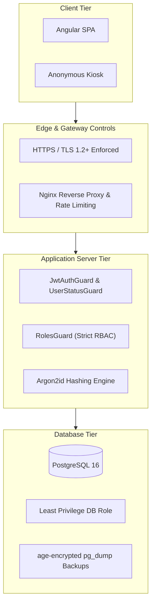

# LaPrizza Information System — General Data Protection Regulation (GDPR) Compliance & Personal Data Policy

> **Team decision pending (Clarification #58, 19 November 2026):** Whether
> dietary restrictions are special-category health data under GDPR Article 9
> is for the team to assess and document after the planned LAPR5 discussion.
> Statements below classifying these records as health data and relying on
> explicit consent are provisional policy assumptions, not a decision supplied
> by the lecturer. The current schema/application must be checked before
> claiming that explicit consent is recorded; the existing restriction table
> does not itself evidence a consent record. Do not infer a schema or legal
> basis change from Clarification #58 alone.

**Version:** 2.0 (Sprint 2 baseline, aligned with LAPR5 curriculum)  
**Owner:** LaPrizza Restaurant Enterprise (Data Controller)  
**Contact (DPO):** `dpo@laprizza.local` — formally designated (§10)  
**Supervisory Authority:** CNPD — National Data Protection Commission (*Comissão Nacional de Proteção de Dados*, www.cnpd.pt)  
**Language Editions:** English (official system baseline) | Portuguese edition available at [gdpr-policy-pt.md](file:///c:/Users/pedro/vsc/LEI-SEM5-PI-2026-27-3DJ-05/docs/gdpr-policy-pt.md)  

**Related Artefacts:**
- `docs/api/openapi.yaml` (v2.0.0) — endpoint-level implementation of the rights and controls described herein.
- `docs/sad/08-database-structure.md` — physical database tables and constraints referenced throughout.
- `sys-backup-strategy.md` §8 and §13 — retention, deletion, and restore-time erasure handling for backups.
- `sys-risk-assessment.md` §4 (R-06) — GDPR breach risk assessment and mitigation.
- `sys-mbco.md` §5.5, §6.1 — incident detection and minimum business continuity objectives.
- `docs/user-stories/GDP01/requirements.md` — personal data handling requirements and Art. 30 inventory.
- `docs/user-stories/GDP02/requirements.md` — data processing responsibility and processor governance.
- `docs/user-stories/GDP03/requirements.md` — personal data breach management and notification playbook.
- LaPrizza KB v2.0 Appendix D — original policy superseded by this document.

---

## 1. Introduction, Scope & Legal Framework (GDP01 & GDP02)

### 1.1. Purpose of this Policy

This document governs the compliance of the **LaPrizza Information System** with Regulation (EU) 2016/679 of the European Parliament and of the Council of 27 April 2016 (General Data Protection Regulation — GDPR), as well as complementary Portuguese national data protection legislation.

It applies to all system actors and user roles — System Managers, Restaurant Employees, Registered Customers, External Identity Provider (IdP) Federated Customers, and Anonymous Kiosk Users. It formalises technical and organisational security measures, established legal bases, guaranteed data subject rights, processor governance, and a mandatory incident response mechanism.

This policy satisfies user stories **GDP01** (*Personal Data Handling*), **GDP02** (*Data Processing Responsibility*), and **GDP03** (*Personal Data Breach Handling*), while directly aligning with the LAPR5 curricular unit (*Privacidade e Proteção de Dados Pessoais*).

### 1.2. Project Scope and System Core Functionalities (GDP01 AC1)

To ensure transparency and contextual clarity, the scope of the LaPrizza system across Sprint 2 is defined as follows:

1. **System Nature and Active Capabilities:**
   - LaPrizza is an integrated restaurant enterprise platform providing menu browsing, user authentication with Role-Based Access Control (RBAC), live kitchen display, and back-office artificial intelligence planning for inventory and bill of materials (BOM).
   - Four distinct authenticated access levels are enforced:
     - **Guest / Anonymous:** Unauthenticated browsing of products and anonymous ordering at self-service kiosks.
     - **Customer:** Authenticated self-service profile management, address book, dietary restrictions configuration, and order history tracking.
     - **Employee:** Operational staff viewing order progression, real-time kitchen status, and execution flows without administrative customer access.
     - **Manager:** Administrative access to commercial records, customer management, inventory scenarios, role assignments, and AI planning runs.
   - **Anonymous Kiosk Execution:** Customers using the self-service kiosk place orders without creating a persistent profile (`Customer` record). In-memory checkout data is severed from identifiable credentials upon order dispatch.

2. **Explicit Non-Scope (What the Prototype Does NOT Do):**
   - **No Payment Processing:** No payment card, bank account, or payment gateway transactions are processed or stored in Sprint 2.
   - **No Automated Profiling:** The system conducts no predictive profiling, behavioural credit scoring, or automated commercial discrimination.
   - **No Direct Marketing Dispatch:** While customer marketing consent preferences are recorded (`customers.marketing_consent`), no unsolicited mass email campaigns or advertising tracking pixels are dispatched.
   - **No Automated Purchase Generation:** AI Planning produces advisory replenishment forecasts reviewed exclusively by human managers; it does not issue automated binding purchase orders to external suppliers.

### 1.3. Legal Nature of the GDPR (LAPR5 — Introduction)

The GDPR is a legal norm (*norma jurídica*) characterised by four fundamental structural properties:

- **Imperativeness (*Imperatividade*):** The Regulation imposes binding commands and prohibitions rather than voluntary guidance. Compliance is mandatory for all covered processing activities.
- **Generality (*Generalidade*):** It addresses an indeterminate category of legal subjects (any data controller or processor handling personal data of EU residents), rather than specific individuals or nominated organisations.
- **Abstraction (*Abstração*):** It regulates an abstract legal hypothesis (*hipótese legal*) applicable to an indefinite number of future factual occurrences, rather than resolving a single concrete dispute.
- **Coercibility (*Coercibilidade*):** The legal order ensures compliance through legitimate State coercion, empowering national supervisory authorities and judicial courts to impose corrective measures and administrative fines of up to €20,000,000 or 4% of total worldwide annual turnover (Art. 83).

### 1.4. Hybrid and Transversal Nature of Data Protection Law

Data protection law is inherently *transversal*, integrating three complementary branches of the legal order:

1. **Fundamental Rights (Constitutional / Public Law):** Grounded in Article 8 of the Charter of Fundamental Rights of the European Union (CFREU) and Articles 26 and 35 of the Constitution of the Portuguese Republic (CRP), treating data protection as an inalienable personal right.
2. **Sanctioning and Supervisory Powers (Administrative Law):** Empowering independent administrative authorities (such as the Portuguese CNPD under Art. 51 and Art. 58) to audit systems, order cessation of processing, and levy regulatory sanctions.
3. **Contractual and Liability Relationships (Private / Civil Law):** Governing data processing agreements (DPAs pursuant to Art. 28) between controllers and processors, commercial terms of service, and civil liability claims for material or non-material damages suffered by data subjects (Art. 82).

### 1.5. Historical and Legal Precedents (LAPR5 — Legislative Precedents)

The right to data protection is the result of continuous legislative evolution over seven decades. The LaPrizza data protection framework rests upon the following chain of normative precedents:

| Legal Instrument | Year | Jurisdiction / Scope | Substantive Provision & Relevance |
|---|---|---|---|
| **Universal Declaration of Human Rights (UDHR)** | 1948 | International (UN) | Art. 12 — *"No one shall be subjected to arbitrary interference with his privacy, family, home or correspondence..."* |
| **European Convention on Human Rights (ECHR)** | 1950 | Council of Europe | Art. 8 — Right to respect for private and family life, home, and correspondence. |
| **Council of Europe Convention 108** | 1981 | Council of Europe | Art. 1 — First binding multilateral instrument protecting individuals against unlawful automated data processing. |
| **Treaty on the Functioning of the European Union (TFEU)** | 1992 (rev. Lisbon 2007) | European Union | Art. 16 — Establishes an explicit autonomous treaty right to the protection of personal data. |
| **Charter of Fundamental Rights of the EU (CFREU)** | 2000 (binding 2009) | European Union | Art. 8 — Right to protection of personal data: fair processing, specified legitimate purpose, consent or legal basis, and independent authority oversight. |
| **Directive 95/46/EC** | 1995 | European Union | Foundational EU data protection directive harmonising national legislation (repealed by the GDPR). |
| **Portuguese Law no. 67/98** | 1998 | Portugal | Transposition of Directive 95/46/EC into domestic law (*Lei de Proteção de Dados Pessoais*, repealed by Law 58/2019). |
| **Constitution of the Portuguese Republic (CRP)** | 1976 (rev. 2005) | Portugal | Art. 13 (Principle of equality), Art. 26 (Right to personal identity, reputation, and privacy), Art. 35 (Protection in the use of information technology and databases). |
| **Regulation (EU) 2016/679 (GDPR)** | 2016 (applicable 2018) | European Union | General Data Protection Regulation directly applicable in all EU Member States. |
| **Portuguese Law no. 58/2019** | 2019 | Portugal | National executing statute ensuring GDPR implementation in the Portuguese domestic legal order. |
| **Portuguese Law no. 27/2021 (CPDHED)** | 2021 | Portugal | Portuguese Charter of Human Rights in the Digital Era, protecting against digital discrimination and algorithmic opacity. |

### 1.6. Portuguese National Implementation & Supervisory Authority

Operating within the territory of Portugal, LaPrizza is subject to Portuguese national enacting legislation:

- **Law no. 58/2019, of 8 August:** Governs domestic execution of the GDPR, establishing specific rules on employee data, minors' consent (valid at age 13 for domestic information society services, Art. 16), video surveillance, retention limits, and the administrative penalty framework.
- **Law no. 27/2021, of 17 May (CPDHED):** Guarantees human rights in digital environments, mandating transparency in automated processing and safeguarding against discriminatory bias.
- **National Supervisory Authority (CNPD):** The *Comissão Nacional de Proteção de Dados* (Rua de São Bento, 148-3º, 1200-821 Lisboa, Portugal; [www.cnpd.pt](https://www.cnpd.pt)) is the sole competent supervisory authority for security breach notifications (Art. 33), DPIA prior consultations (Art. 36), and data subject regulatory complaints (Art. 77).

### 1.7. Material and Territorial Scope (Arts. 1, 2, 3 GDPR)

**Material Scope (Art. 2(1)):**  
This policy governs all personal data processing executed by LaPrizza:
- By wholly or partially automated means within application databases and services (`users`, `customers`, `customer_addresses`, `user_dietary_restrictions`, `role_change_logs`, `activation_invitations`, server access logs, audit trails).
- By non-automated means where personal data forms part of, or is intended to form part of, a structured filing system (such as physical supplier logs or exported managerial compliance records).

**Statutory Exclusions (Art. 2(2), points (a)–(d)):**  
The GDPR excludes four specific processing domains from its material scope:
1. **Activities outside EU Law (point (a)):** Operations falling outside the competency of European Union law. *Rationale:* The Regulation cannot mandate obligations where the Union lacks legislative competence.
2. **Common Foreign and Security Policy (point (b)):** Member State activities under Title V, Chapter 2 of the Treaty on European Union (TEU). *Rationale:* National defence and foreign policy remain within Member State sovereign jurisdiction.
3. **Purely Personal or Household Activity (point (c)):** Data processing performed by a natural person in the course of an exclusively personal, private, or domestic life (Recital 18). *Rationale:* The law does not intrude into private family life. *Caveat:* Service providers providing tools for domestic processing (e.g., social networks or cloud storage providers) remain fully subject to the GDPR.
4. **Competent Law Enforcement Authorities (point (d)):** Prevention, investigation, detection, or prosecution of criminal offences or execution of criminal penalties. *Rationale:* This field is governed independently by **Directive (EU) 2016/680** (Law Enforcement Directive).

*Conclusion:* LaPrizza is a private commercial enterprise processing staff and consumer data for economic activities. None of the statutory exclusions apply.

**Territorial Scope (Art. 3):**  
- **Art. 3(1) (Establishment):** LaPrizza is established in Portugal (an EU Member State), and processing takes place in the context of the activities of that establishment, regardless of whether server hosting physically resides inside or outside the Union.
- **Art. 3(2) (Marketplace / Targeting):** The platform offers restaurant goods and services to data subjects located within the European Union.

### 1.8. Entity Identification and Governance Roles (GDP02 AC1)

Pursuant to GDPR Article 4(7) and Article 24, governance roles are established as follows:

- **Data Controller:**
  - **Legal Entity:** LaPrizza Restaurant Enterprise (Academic prototype, Team 3DJ-05, Instituto Superior de Engenharia do Porto — ISEP).
  - **Establishment Address:** Rua Dr. António Bernardino de Almeida, 431, 4200-072 Porto, Portugal.
  - **Corporate Contact:** `geral@laprizza.local`.
  - **EU Representative (Art. 27):** Not required; the Controller is directly established within the territory of the European Union.
- **Data Protection Officer (DPO):**
  - Designated under Articles 37–39; contact: `dpo@laprizza.local`.
  - Reports directly to top management, operating independently without operational instructions regarding data protection assessments.
- **Data Processors (Art. 28):**
  - Third-party cloud infrastructure providers hosting services or handling ancillary communications (such as external SMTP providers, OIDC federated identity providers, and object backup storage) act strictly as Processors under binding Data Processing Agreements (§14).
- **Joint Controllership (Art. 26):**
  - None. LaPrizza independently determines the purposes and essential means of all data processing operations.

---

## 2. Key Legal Definitions (Art. 4 GDPR)

The following legal definitions apply throughout this policy, corresponding directly to Article 4 of the GDPR and LAPR5 curriculum terminology:

| Legal Term | Statutory Reference | Standard Legal Definition |
|---|---|---|
| **Personal Data** | Art. 4(1) | Any information relating to an identified or identifiable natural person (*data subject*). An identifiable natural person is one who can be identified, directly or indirectly, in particular by reference to an identifier such as a name, an identification number, location data, an online identifier, or one or more factors specific to their physical, physiological, genetic, mental, economic, cultural, or social identity. |
| **Processing** | Art. 4(2) | Any operation or set of operations performed on personal data or sets of personal data, whether or not by automated means, such as collection, recording, organisation, structuring, storage, adaptation, retrieval, consultation, use, disclosure by transmission, dissemination, alignment, combination, restriction, erasure, or destruction. |
| **Data Subject** | Art. 4(1) | The living natural person whose personal data is processed by the controller or processor. |
| **Data Controller** | Art. 4(7) | The natural or legal person, public authority, agency, or other body which, alone or jointly with others, determines the purposes and means of the processing of personal data. |
| **Data Processor** | Art. 4(8) | A natural or legal person, public authority, agency, or other body which processes personal data on behalf of and under the documented instructions of the controller. |
| **Consent** | Art. 4(11), Art. 7 | Any freely given, specific, informed, and unambiguous indication of the data subject's wishes by which he or she, by a statement or by a clear affirmative action, signifies agreement to the processing of personal data relating to him or her. Silence, pre-ticked boxes, or inactivity do not constitute consent (Recital 32). |
| **Pseudonymisation** | Art. 4(5) | The processing of personal data in such a manner that the personal data can no longer be attributed to a specific data subject without the use of additional information, provided that such additional information is kept separately and is subject to technical and organisational measures. |
| **Profiling** | Art. 4(4) | Any form of automated processing of personal data consisting of the use of personal data to evaluate certain personal aspects relating to a natural person, in particular to analyse or predict aspects concerning performance at work, economic situation, health, personal preferences, interests, reliability, behaviour, location, or movements. |
| **Personal Data Breach** | Art. 4(12) | A breach of security leading to the accidental or unlawful destruction, loss, alteration, unauthorised disclosure of, or access to, personal data transmitted, stored, or otherwise processed. |
| **Filing System** | Art. 4(6) | Any structured set of personal data which are accessible according to specific criteria, whether centralised, decentralised, or dispersed on a functional or geographical basis. |
| **Recipient** | Art. 4(9) | A natural or legal person, public authority, agency, or another body, to which the personal data are disclosed, whether a third party or not. |
| **Third Party** | Art. 4(10) | A natural or legal person, public authority, agency, or body other than the data subject, controller, processor, and persons who, under the direct authority of the controller or processor, are authorised to process personal data. |
| **Special Categories of Data** | Art. 9(1) | Personal data revealing racial or ethnic origin, political opinions, religious or philosophical beliefs, or trade union membership, genetic data, biometric data for the purpose of uniquely identifying a natural person, **data concerning health**, or data concerning a natural person's sex life or sexual orientation. Processing is prohibited unless an Article 9(2) exception applies. |
| **Data Concerning Health** | Art. 4(15) | Personal data related to the physical or mental health of a natural person, including the provision of health care services, which reveal information about their health status. **Whether dietary restrictions recorded on `user_dietary_restrictions` meet this classification is a provisional team assessment pending the LAPR5 discussion (Clarification #58).** |
| **Genetic Data** | Art. 4(13) | Personal data relating to the inherited or acquired genetic characteristics of a natural person which give unique information about the physiology or the health of that natural person (not collected by LaPrizza). |
| **Biometric Data** | Art. 4(14) | Personal data resulting from specific technical processing relating to the physical, physiological, or behavioural characteristics of a natural person, allowing or confirming unique identification (e.g., facial recognition, fingerprints; not collected by LaPrizza). |
| **Data Protection Officer (DPO)** | Arts. 37–39 | An expert officer designated to monitor compliance, provide advice on data protection impact assessments, and act as contact point for data subjects and supervisory authorities. |

---

## 3. Data Protection Principles (Art. 5 GDPR — Nine Principles per LAPR5)

Article 5(1) of the GDPR, as systematised in the LAPR5 pedagogical framework, establishes **nine distinct structural principles** governing all processing operations. LaPrizza implements concrete architectural controls for each principle:

### 3.1. Principle of Lawfulness (*Princípio da Licitude*)
Processing must strictly rely upon at least one of the six lawful bases provided in Article 6(1). Special-category health data (allergens) must satisfy an additional derogation under Article 9(2). Every database write operation in the system is mapped to a verified legal basis (§4 and §6).

### 3.2. Principle of Fairness (*Princípio da Lealdade*)
Data processing must be conducted fairly, honestly, and in good faith, avoiding deceitful patterns, hidden telemetry, or manipulative interface mechanics ("dark patterns"). Marketing opt-in (`customers.marketing_consent`) is completely unbundled from account registration, requiring an explicit voluntary choice with unchecked default state.

### 3.3. Principle of Transparency (*Princípio da Transparência*)
Data subjects are informed about how their data is processed prior to or at the moment of collection. Clear privacy notices are displayed during registration (`/auth/register`) and profile access. To preserve system confidentiality without deceiving the user, authentication failure responses are structured symmetrically: `POST /api/v1/auth/login` returns an identical `401 Unauthorized` for both non-existent usernames and invalid passwords, preventing user enumeration attacks (`openapi.yaml`).

### 3.4. Principle of Purpose Limitation (*Princípio da Finalidade*)
Personal data must be collected for specified, explicit, and legitimate purposes and not further processed in a manner incompatible with those initial purposes:
- Customer contact data collected for order fulfilment and dining alerts is never repurposed for marketing without standalone consent.
- Operational artificial intelligence planning data (Sprint 2) is used exclusively for inventory and replenishment calculations; it is never leveraged for customer behavioural profiling or spending score evaluation.
- Compatible archiving, scientific, or statistical processing under Article 89(1) is maintained within anonymised analytical schemas.

### 3.5. Principle of Data Minimisation (*Princípio da Minimização dos Dados*)
Personal data collected must be adequate, relevant, and limited to what is strictly necessary in relation to the purposes for which they are processed:
- Only essential identification fields (`first_name`, `last_name`, `email`) are mandatory for user registration.
- Address attributes (`street`, `city`, `postal_code`, `extra_details`) and tax numbers (`vat_number`) remain completely optional.
- Anonymous kiosk orders generate **no persistent `Customer` record** (Clarification #01).
- AI planning result payloads sent to the Prolog execution engine contain **no customer personal data**—only anonymous product, ingredient, stock, and supplier figures.

### 3.6. Principle of Accuracy (*Princípio da Exatidão*)
Controllers must take every reasonable step to ensure that personal data that are inaccurate, having regard to the purposes for which they are processed, are erased or rectified without delay:
- Authenticated users can modify their profile, phone number, and address details in real-time via `PUT /api/v1/user/me/address` and `PUT /api/v1/user/me/phone-number`.
- Administrative corrections can be executed by Managers via `PUT /api/v1/customers/:email`.
- Stale invitation tokens expire automatically after a strict time-to-live (`INVITATION_TTL_HOURS`, 48 hours).
- Deactivated accounts are flagged immediately in the authentication repository, preventing obsolete session validity.

### 3.7. Principle of Storage Limitation (*Princípio da Limitação da Conservação*)
Personal data must be kept in a form which permits identification of data subjects for no longer than is necessary for the purposes for which the personal data are processed. Data retention schedules are defined in §12. Database schema cascades (`ON DELETE CASCADE` and `ON DELETE SET NULL`) ensure that deleting a user account erases all personal profile attributes while retaining anonymised historical business ledger entries.

### 3.8. Principle of Integrity and Confidentiality (*Princípio da Integridade e Confidencialidade*)
Personal data must be processed in a manner that ensures appropriate security of the personal data, including protection against unauthorised or unlawful processing and against accidental loss, destruction, or damage:
- Industry-standard cryptographic primitives: Argon2id password hashing, TLS 1.2+ transport security, cryptographically signed JSON Web Tokens (JWT), and `age`-encrypted database backups.
- Relational integrity constraints: Foreign keys, strict database schemas, and `ON DELETE RESTRICT` rules preventing accidental mass data eradication.

### 3.9. Principle of Accountability (*Princípio da Responsabilidade*)
Pursuant to Article 5(2), the controller is responsible for, and must be able to demonstrate compliance with, all the principles listed above (*duty of proactive accountability*). Demonstrable evidence in LaPrizza includes this formal policy document, the Article 30 inventory table (§6), the immutable append-only audit trail (`role_change_logs`), the mandatory active manager invariant ("≥ 1 active MANAGER"), and timestamped security logs.

### 3.10. Privacy by Design and by Default (Art. 25 GDPR)
LaPrizza embeds data protection into the system architecture from the earliest design stages (*Privacy by Design*) and ensures that default settings protect personal data (*Privacy by Default*):

- **Data Protection by Design (Art. 25(1)):**
  - **Pseudonymisation & Encryption:** All personal data is stored using strong encryption at rest (PostgreSQL TDE, `age`-encrypted backups) and in transit (TLS 1.2+). Sensitive credentials are hashed with Argon2id.
  - **Minimisation at Source:** Registration forms collect only mandatory fields (`first_name`, `last_name`, `email`). Optional fields (`vat_number`, extra address details) are clearly marked.
  - **Access Controls by Default:** Role-Based Access Control (RBAC) restricts data access from the first line of code. `RolesGuard` and `JwtAuthGuard` enforce separation of concerns.
  - **Automated Safeguards:** Session tokens expire after 15 minutes. Invitation tokens have a strict 48-hour TTL. Deactivated accounts are immediately blocked by `UserStatusGuard`.

- **Data Protection by Default (Art. 25(2)):**
  - **Private Profiles:** Customer profiles are not publicly accessible. Only authenticated users with appropriate roles can view personal data.
  - **Opt-In Consent:** Marketing consent (`customers.marketing_consent`) defaults to `false`. No pre-ticked boxes; explicit affirmative action is required.
  - **No Persistent Anonymous Orders:** The self-service kiosk does not create a `Customer` record. Order data is ephemeral and purged upon ticket printing.
  - **AI Isolation:** The Prolog planning engine receives only anonymised operational metrics—no customer PII is ever transmitted (ADR-012).

### 3.11. Protection of Minors (Art. 8 GDPR)
LaPrizza provides information society services to users, including potential child data subjects. The following safeguards are implemented in accordance with Article 8 and Portuguese national law (Lei n.º 58/2019, Art. 16):

- **Age Threshold:** The age of digital consent in Portugal is **13 years**. Children under 13 years may not create an account without parental or guardian authorisation.
- **Parental Consent Verification:** For children aged 13–15, the system requires an explicit affirmative action during registration. While the current Sprint 2 prototype does not implement automated age-detection mechanisms, the registration form includes a clear age declaration checkbox. Any future expansion targeting users under 13 will integrate a formal parental consent flow (e.g., email-based authorisation).
- **Transparency for Children:** Privacy notices are written in clear, plain language suitable for children. The registration interface uses simple terminology and visual aids.
- **No Profiling of Minors:** The system does not conduct behavioural profiling, targeted advertising, or automated decision-making affecting children.

---

## 4. Legal Bases for Processing (Art. 6 & Art. 9 GDPR)

Every personal data processing operation within LaPrizza is anchored to exactly one primary legal basis under Article 6(1) of the GDPR:

| Legal Basis (Art. 6(1)) | Statutory Definition | System Processing Operational Domain |
|---|---|---|
| **(a) Consent** | The data subject has given consent to the processing of his or her personal data for one or more specific purposes. | Marketing communications opt-in (`customers.marketing_consent`). |
| **(b) Performance of a Contract** | Processing is necessary for the performance of a contract to which the data subject is party or in order to take steps at the request of the data subject prior to entering into a contract. | Account registration, authentication, customer profile management, order placement, and delivery address handling. |
| **(c) Legal Obligation** | Processing is necessary for compliance with a legal obligation to which the controller is subject under European Union or Member State law. | Retention of billing, invoicing, and commercial transaction records under Portuguese fiscal law (CIRS, CIRC, and Law 58/2019). |
| **(d) Vital Interests** | Processing is necessary in order to protect the vital interests of the data subject or of another natural person. | Emergency medical scenarios (not actively used as a planned operational baseline). |
| **(e) Public Interest / Official Authority** | Processing is necessary for the performance of a task carried out in the public interest or in the exercise of official authority vested in the controller. | Not applicable to a private restaurant commercial enterprise. |
| **(f) Legitimate Interests** | Processing is necessary for the purposes of the legitimate interests pursued by the controller or by a third party, except where such interests are overridden by the fundamental rights and freedoms of the data subject. | Administrative audit logging (`role_change_logs`), defensive security event monitoring, HTTP server access logs, and system integrity enforcement ("≥ 1 active MANAGER"). |

### 4.1. Legal Basis for Special Categories of Personal Data (Art. 9(2)(a))

The current policy provisionally treats customer dietary restrictions (allergies and food intolerances recorded in `user_dietary_restrictions`) as **data concerning health** under Article 4(15). The team must confirm or revise this classification after the LAPR5 discussion (Clarification #58). If classified as special-category data, Article 9(1) requires an applicable exception under Article 9(2).

The current policy proposes **explicit consent** (Article 9(2), point (a)) if the team confirms the special-category classification. This is not the team's final legal-basis decision, and current schema evidence does not demonstrate a stored consent record:
- The registration/profile flow accepts dietary restrictions, but the current schema does not evidence a distinct consent record. Verify the user-facing notice and consent capture before claiming that this proposed basis is implemented.
- The user is informed that the data is collected exclusively to display personal allergen conflict warnings during catalogue browsing and order compilation.
- Consent can be withdrawn at any time with the same ease with which it was granted (Art. 7(3)) by removing restrictions via `PUT /api/v1/customers/:email/dietary-restrictions` or `PUT /api/v1/user/me/dietary-restrictions`.

---

## 5. Rights of the Data Subject (Arts. 15–22) and Judicial Remedies (Arts. 77–79)

The LaPrizza platform guarantees all statutory data subject rights through operational interfaces and programmatic backend endpoints:

### 5.1. Right of Access (Art. 15)
- Users have the right to obtain confirmation as to whether their personal data is being processed, and to receive a structured copy of their profile data.
- Implemented via `GET /api/v1/user/:username` (self-scoped for customers, with Manager scope covering all user accounts).
- Managers can review customer commercial files via `GET /api/v1/customers/:email`.

### 5.2. Right to Rectification (Art. 16)
- Data subjects have the right to obtain without undue delay the rectification of inaccurate personal data concerning them.
- Customers can modify their delivery address and telephone contact directly via `PUT /api/v1/user/me/address` and `PUT /api/v1/user/me/phone-number`.
- Administrative updates can be executed by Managers via `PUT /api/v1/customers/:email`.

### 5.3. Right to Erasure / "Right to be Forgotten" (Art. 17)
- Data subjects may request deletion of their personal data. Invocation of `DELETE /api/v1/user/:username` triggers the following automated database operations:
  - `ON DELETE CASCADE` erases corresponding entries in `user_role_assignments`, `user_dietary_restrictions`, and `activation_invitations`.
  - `ON DELETE SET NULL` on `customers.username` severs the link between the deleted natural person and historical transaction records, preserving required business data in an anonymised state.
  - Administrative audit records in `role_change_logs` are retained on the basis of legitimate interests and legal accountability (Art. 17(3)(b)), containing only operational usernames without passwords or sensitive health records.
- **Backup Erasure Lifecycle:** Covered by `sys-backup-strategy.md` §8 and §13. Backups age out across automated rotation cycles (7 daily, 4 weekly, 12 monthly). In the event of a disaster recovery restore, operators re-apply recorded erasure requests before reopening production access.

### 5.4. Right to Restriction of Processing (Art. 18)
- Where the accuracy of data is contested, or an objection is pending, processing can be suspended without deleting the underlying record.
- Setting an account status to `DEACTIVATED` blocks all authentication and transactional operations. The `UserStatusGuard` rejects any inbound token from a deactivated account across all protected endpoints (ADR-004).

### 5.5. Right to Data Portability (Art. 20)
- Data subjects have the right to receive their personal data in a structured, commonly used, and machine-readable format (JSON).
- Self-scoped customer exports are retrieved via `GET /api/v1/user/:username`.
- *Note:* `GET /api/v1/products/export` is an internal administrative export for the Prolog AI knowledge base containing inventory specifications; it contains **no customer personal data**.

### 5.6. Right to Object (Art. 21)
- Data subjects may object at any time to data processing based on legitimate interests (Art. 6(1)(f)) or direct marketing (Art. 6(1)(a)).
- Marketing objection is exercised immediately by clearing `customers.marketing_consent` to `false`.
- Objections to security logging can be submitted to the DPO; processing continues only if compelling legitimate grounds overriding the interests of the data subject are demonstrated.

### 5.7. Automated Individual Decision-Making and Profiling (Art. 22)
- LaPrizza does not subject data subjects to decisions based solely on automated processing producing legal effects or similarly significant effects.
- Artificial intelligence planning (Prolog) is strictly confined to back-office inventory forecasting. All outputs require human review and managerial confirmation before purchase orders are placed (ADR-013, Clarification #26).

### 5.8. Right to Lodge a Complaint with a Supervisory Authority (Art. 77)
Every data subject has the right to lodge a complaint with a supervisory authority, in particular in the Member State of their habitual residence, place of work, or place of the alleged infringement. In Portugal:
- **Authority:** Comissão Nacional de Proteção de Dados (CNPD).
- **Postal Address:** Rua de São Bento, 148, 3º, 1200-821 Lisboa, Portugal.
- **Web Portal:** [https://www.cnpd.pt](https://www.cnpd.pt) | **Email:** `geral@cnpd.pt`.

### 5.9. Right to an Effective Judicial Remedy (Art. 79)
Without prejudice to administrative remedies or complaints before the CNPD, data subjects have the right to an effective judicial remedy before national courts against controllers or processors. Legal proceedings may be initiated before the competent judicial courts of the Portuguese Republic (Comarca do Porto / Comarca de Lisboa) or in the Member State where the data subject has their habitual residence.

---

## 6. Personal Data Inventory and Technical Mapping (GDP01 + Art. 30 Record)

The following table constitutes the formal Register of Processing Activities (RAT) required by Article 30 of the GDPR, establishing an exhaustive mapping between the application database schema and data protection parameters:

### 6.1. Controller Contact Information (Art. 30(1)(a))
| Field | Value |
|---|---|
| **Controller Name** | LaPrizza Restaurant Enterprise (Academic prototype, Team 3DJ-05, ISEP) |
| **Establishment Address** | Rua Dr. António Bernardino de Almeida, 431, 4200-072 Porto, Portugal |
| **Corporate Contact** | `geral@laprizza.local` |
| **DPO Contact** | `dpo@laprizza.local` |
| **EU Representative (Art. 27)** | Not required — Controller established in the EU |
| **Supervisory Authority** | CNPD (Comissão Nacional de Proteção de Dados, www.cnpd.pt) |

### 6.2. General Security Measures (Art. 30(1)(e))
LaPrizza implements the following cross-cutting security controls (detailed in §8):
- **Argon2id** password hashing (64 MiB memory cost, 3 iterations, parallelism 1)
- **TLS 1.2/1.3** transport encryption with HSTS enforcement
- **HMAC-SHA256 JWT** session tokens with 15-minute expiry
- **`age` encryption** for offsite database backups
- **PostgreSQL 16** with least-privilege DB role and `ON DELETE RESTRICT` constraints
- **RBAC** with `RolesGuard` and `UserStatusGuard` middleware
- **Immutable audit logging** via `role_change_logs` and `auditd`

### 6.3. Processing Activities Register (Art. 30(2) & (3))

| ID | Data Category | Database Table & Column | Operational Processing Purpose | Lawful Basis (Art. 6 / Art. 9) | Retention Period | Special Category |
|---|---|---|---|---|---|---|
| **PII-01** | Identity | `users.first_name`, `users.last_name` | User authentication, identity verification, staff management | Contract (Art. 6(1)(b)) | Active duration + 5 years deactivated (§12) | No |
| **PII-02** | Contact | `users.email` | System login, password recovery, transactional notices | Contract (Art. 6(1)(b)) | Same as PII-01 | No |
| **PII-03** | Credential | `users.password_hash` | Local password authentication (Argon2id hashing) | Contract (Art. 6(1)(b)) | Same as PII-01 | No |
| **PII-04** | External Identity | `users.external_idp_subject` | OpenID Connect (OIDC) identity federation (ADR-010) | Contract (Art. 6(1)(b)) | Same as PII-01 | No |
| **PII-05** | Contact | `users.phone_number` | User communication, account security, delivery alerts | Contract (Art. 6(1)(b)) | Same as PII-01 | No |
| **PII-06** | Customer Profile | `customers.email` | Commercial profile identity, order linkage | Contract (Art. 6(1)(b)) | 10 years from last order (fiscal) | No |
| **PII-07** | Customer Profile | `customers.first_name`, `customers.last_name` | Commercial order personalisation | Contract (Art. 6(1)(b)) | Same as PII-06 | No |
| **PII-08** | Contact | `customers.phone` | Order dispatch and delivery coordination | Contract (Art. 6(1)(b)) | Same as PII-06 | No |
| **PII-09** | Financial (Optional) | `customers.vat_number` | Optional tax identification for billing compliance | Contract / Legal obligation (Art. 6(1)(c)) | 10 years (Portuguese fiscal retention) | No |
| **PII-10** | Consent Preference | `customers.marketing_consent`, `customers.consent_timestamp` | Unbundled direct marketing communications | Consent (Art. 6(1)(a)) | Retained until consent is withdrawn | No |
| **PII-11** | Delivery Address | `customer_addresses.street`, `postal_code`, `city`, `extra_details` | Order delivery and logistics routing | Contract (Art. 6(1)(b)) | Same as PII-06 | No |
| **PII-12** | **Dietary restriction (classification pending)** | `user_dietary_restrictions.allergen_name` | Customer dining safety (allergen conflict warnings) | **Pending team decision after LAPR5 discussion (#58)** | Current retention follows parent user; retention/withdrawal implications require review | **Provisional — apply Art. 9 safeguards pending decision** |
| **PII-13** | Account Invitation | `activation_invitations.token`, `purpose`, `expires_at`, `used_at` | Account onboarding and security token verification | Contract (Art. 6(1)(b)) | 48 hours TTL; pruned upon user deletion | No |
| **PII-14** | Audit Log | `role_change_logs.actor_username`, `target_username`, `previous_roles`, `new_roles` | Security accountability, RBAC privilege auditing | Legitimate Interest (Art. 6(1)(f)) | 5 years | No |
| **PII-15** | AI Planning Snapshot | `planning_results.*_snapshot` (JSONB) | Bill of materials and inventory forecasting | N/A (Anonymised data, no personal identifiers) | Indefinite (business historical record) | No |
| **PII-16** | HTTP Access Logs | Nginx web server logs (client IP, User-Agent, request timestamp) | Network defense, intrusion detection, DDoS mitigation | Legitimate Interest (Art. 6(1)(f)) | 30 days maximum | No |
| **PII-17** | Anonymous Kiosk | None (In-memory ephemeral processing) | Self-service dining checkout without user profile | Contract (Art. 6(1)(b)) | Zero retention (purged upon order print) | No |

---

## 7. Special Categories of Personal Data (Art. 9 GDPR)

### 7.1. Special Categories Processed by LaPrizza
The only special-category personal data processed by LaPrizza is **data concerning health** (Article 4(15)), specifically customer dietary restrictions, food allergies, and intolerances.

All other special categories outlined in Article 9(1)—racial or ethnic origin, political opinions, religious or philosophical beliefs, trade-union membership, genetic data, biometric identification data, sex life, or sexual orientation—are **strictly out of scope** and are never requested, recorded, or processed.

### 7.2. Specific Safeguards for Dietary Health Records
To protect customer dietary health data, the system implements the following layered safeguards:
1. **Provisional Article 9 safeguard:** The current policy proposes explicit consent under Article 9(2)(a), pending the team's classification and legal-basis decision (#58). The implementation must be checked for an actual consent record and adequate notice before claiming this safeguard is operational.
2. **Strict Purpose Isolation:** Dietary restrictions are used exclusively to evaluate allergen warnings during catalogue browsing and order generation. Allergen warnings are non-blocking advisory indicators (Clarification #16), ensuring that customer dining choices are assisted without imposing automated refusal.
3. **Engine Isolation (No AI Ingestion):** Dietary data is **never** transmitted to the Prolog AI planning engine, external marketing vendors, or unauthorized third parties.
4. **Restriction removal:** Removing a dietary entry via `PUT /api/v1/user/me/dietary-restrictions` deletes it from the database. Whether this is the applicable consent-withdrawal mechanism depends on the team's pending classification and legal-basis decision (#58).
5. **Relational Cascades:** Deleting a user account cascades to `user_dietary_restrictions`, ensuring complete erasure of health data.

---

## 8. Technical and Organisational Security Measures (Art. 32 GDPR)

In compliance with Article 32, LaPrizza implements technical and organisational measures to ensure a level of security appropriate to the risk:

### 8.1. Cryptographic Security Controls
- **Password Protection:** User passwords are encrypted using the **Argon2id** password hashing algorithm (configured with 64 MiB memory cost, 3 iterations, and parallelism of 1, per ADR-002 and ADR-004). Plaintext passwords are never logged, transmitted in error messages, or stored.
- **Transport Layer Security:** All public and internal API communications enforce **HTTPS/TLS 1.2 and TLS 1.3** (`ssl_protocols TLSv1.2 TLSv1.3`), disabling obsolete cipher suites and enforcing HTTP Strict Transport Security (HSTS).
- **Authentication Tokens:** Session authentication uses JSON Web Tokens (JWT) signed with HMAC-SHA256, carrying an ephemeral 15-minute time-to-live (`expiresIn: 900` seconds).
- **Secure Activation Tokens:** Invitation tokens (`activation_invitations.token`) are cryptographically strong random values generated with high entropy, restricted to single-use validation and enforced by a strict 48-hour TTL.

### 8.2. Access Control, Session Hygiene, and Database Defense
- **Role-Based Access Control (RBAC):** Administrative access is segregated. Only the `MANAGER` role can access customer PII files or initiate sensitive export operations. `EMPLOYEE` permissions are strictly restricted to operational order processing. `RolesGuard` verifies active role claims against the live database on every inbound request.
- **Active Session Validation:** `UserStatusGuard` verifies account state on each request. An account transitioned to `DEACTIVATED` is barred from active endpoints immediately, invalidating active tokens.
- **Database Least Privilege:** The application database user possesses no administrative `DROP TABLE` permissions. Cascades are bounded, and foreign key rules (`ON DELETE RESTRICT`) prevent catastrophic accidental deletions.

### 8.3. Backup Confidentiality and Restoration Lifecycle
- Off-site backups are created via scheduled jobs, encrypted at rest using **age encryption** (`sys-backup-strategy.md` §5.4).
- Backup retention is structured into 7 daily, 4 weekly, and 12 monthly snapshots.
- In the event of a disaster recovery restore, automated restoration scripts cross-reference the deletion log to re-execute data erasure and restriction requests before production traffic is re-established.

### 8.4. Organisational Governance Measures
- **Designation of an Independent DPO (§10).**
- **Strict Staff Confidentiality:** All development and operational personnel complete data protection onboarding before accessing production environments.
- **Access Reviews:** Mandatory quarterly review of managerial credentials and role delegations, documented in `role_change_logs`.
- **Systematic Audit Trails:** Immutable append-only audit logging for role changes, credential modifications, and permission escalations.

---

## 9. Data Protection Impact Assessment (Art. 35 GDPR — DPIA)

### 9.1. Statutory Criteria Mandating a DPIA
Article 35(1) and (3) mandate a formal Data Protection Impact Assessment prior to processing where operations are likely to result in a high risk to the rights and freedoms of natural persons, specifically in cases of:
- (a) Systematic and extensive evaluation of personal aspects based on automated processing, including profiling, on which decisions producing legal effects are based;
- (b) Processing on a large scale of special categories of data (Art. 9) or criminal convictions data (Art. 10);
- (c) Systematic monitoring of a publicly accessible area on a large scale (e.g., public CCTV networks).

### 9.2. Threshold Assessment for LaPrizza (Sprint 2 Baseline)
1. **Automated Profiling:** Not applicable. The system performs no behavioural analysis, commercial scoring, or automated individual decision-making.
2. **Large-Scale Special Categories:** Not applicable on the current small-scale prototype assumptions. The dietary-data classification remains provisional under Clarification #58; reassess this threshold if the team determines the records are special-category data or the processing scope changes.
3. **Public Monitoring:** Not applicable. No optical surveillance, geolocation tracking, or public monitoring systems exist.

**Conclusion:** A mandatory formal DPIA is **not required** for the Sprint 2 baseline architecture.  
*Re-evaluation Trigger:* If future sprints integrate biometric authentication, automated credit evaluation, or third-party payment processing gateways, a full DPIA will be conducted prior to deployment.

---

## 10. Data Protection Officer (Arts. 37–39 GDPR)

### 10.1. Voluntary Formal Designation
While LaPrizza does not meet the mandatory criteria of Article 37(1) (public authority, large-scale core monitoring, or large-scale core special category processing), the enterprise **voluntarily designates a formal Data Protection Officer (DPO)** to ensure rigorous compliance and accountability:

- **Official Position:** Data Protection Officer (*Encarregado da Proteção de Dados*).
- **Official Contact Channel:** `dpo@laprizza.local`.
- **Organizational Position:** Reports directly to executive management.
- **Independence Guarantee (Art. 38(3)):** The DPO operates free from operational instructions regarding data protection evaluations. The DPO may not be dismissed or penalized for executing statutory duties.

### 10.2. Statutory Tasks of the DPO (Art. 39)
1. Inform and advise the controller, processors, and operational staff regarding their obligations under the GDPR and national privacy laws.
2. Monitor compliance with the GDPR, internal data protection policies, staff training programmes, and internal security audits.
3. Provide advice on data protection impact assessments and monitor their performance.
4. Cooperate with the national supervisory authority (CNPD).
5. Act as the primary contact point for the CNPD and for data subjects seeking to exercise their statutory rights.
6. Oversee the maintenance of the Register of Processing Activities (§6) and the Personal Data Breach Register (§11).

---

## 11. Personal Data Breach Handling (GDP03 / Arts. 33–34 GDPR)

### 11.1. Statutory Definition (Art. 4(12))
A personal data breach is a security incident leading to the accidental or unlawful destruction, loss, alteration, unauthorised disclosure of, or access to, personal data transmitted, stored, or otherwise processed.

### 11.2. Breach Classification Taxonomy (EDPB Guidelines 9/2022)
Pursuant to European Data Protection Board (EDPB) Guidelines 9/2022, security breaches are classified into three fundamental categories, illustrated by LaPrizza-specific risk vectors:

1. **Confidentiality Breach:** Unauthorised or accidental disclosure of, or access to, personal data.
   - *System Example:* Compromise of database credentials exposing `users.password_hash`; inadvertent exposure of `user_dietary_restrictions` to unauthorized users; disclosure of the `age` private key used to encrypt database backups.
2. **Integrity Breach:** Unauthorised or accidental alteration of personal data.
   - *System Example:* Malicious alteration of ingredient or stock allergen markers, corrupting dining safety alerts and creating immediate physical health risks for allergic consumers.
3. **Availability Breach:** Accidental or unauthorised loss of access to, or destruction of, personal data.
   - *System Example:* Ransomware encryption or accidental database dropping without recovery availability, permanently destroying customer records and operational histories.

### 11.3. Definition of "Becomes Aware" (EDPB Standard)
Pursuant to EDPB guidelines, the Controller is deemed to have **"become aware"** of a personal data breach at the moment when there is a reasonable degree of certainty that a security incident has occurred that has led to personal data being compromised. This marks the exact starting point of the statutory 72-hour notification clock (Art. 33(1)).

### 11.4. Internal Incident Escalation and Response Timeline (GDP03 AC4)

```mermaid
gantt
    title Internal Security Incident Escalation Timeline
    dateFormat X
    axisFormat T+%s
    section Detection & Triage
    Incident Alert & DPO Notification (T+0)     :milestone, m1, 0, 0
    Initial Triage & Impact Scoping (T+1h)       :active, a1, 0, 1
    section Containment
    Containment & Forensic Snapshot (T+4h)      :crit, a2, 1, 4
    section Reporting
    Draft CNPD Notification Prepared (T+24h)     :a3, 4, 24
    DPO Legal Review & Sign-Off (T+48h)          :a4, 24, 48
    CNPD Statutory Notification Finalised (T+72h):milestone, m2, 72, 72
    section Follow-up
    Data Subject Notification (if High Risk)     :a5, 72, 168
    Final Post-Mortem & Control Updates (T+30d)  :a6, 168, 720
```

- **T+0 (Detection):** Alert triggered via intrusion detection, security audit logs (`role_change_logs`), or operational exception. On-call engineer notifies the DPO immediately.
- **T+1h (Triage):** DPO and engineering lead classify the breach type (C/I/A), affected data categories, estimated number of impacted data subjects, and severity.
- **T+4h (Containment & Evidence Preservation):**
  - Forensic snapshots (`docker compose ps -a`, `docker inspect`, container log exports) are secured **prior** to restarting services.
  - Active sessions are severed by rotating secrets (`make rotate-jwt` regenerates `JWT_SECRET`). Compromised user accounts are shifted to `DEACTIVATED`.
- **T+24h (CNPD Draft):** Formal breach notification draft prepared using the Art. 33 template.
- **T+48h (DPO Sign-Off):** Legal review and managerial sign-off completed.
- **T+72h (CNPD Statutory Notification):** Notification submitted electronically to the CNPD via [www.cnpd.pt](https://www.cnpd.pt).
- **T+7 Days (Data Subject Communication):** If high risk is confirmed, direct communications are transmitted to affected data subjects.
- **T+30 Days (Post-Mortem):** Remediation report finalized, preventative controls integrated, and incident record closed in the breach register.

### 11.5. Supervisory Authority Notification (Art. 33)
1. **Statutory Deadline:** Notification to the CNPD must occur **within 72 hours** after becoming aware of the breach.
2. **Mandatory Content (Art. 33(3)):**
   - The nature of the breach, including the categories and approximate number of data subjects concerned and personal data records concerned.
   - The name and contact details of the Data Protection Officer.
   - The likely consequences of the personal data breach.
   - Measures taken or proposed to address the breach, including mitigation measures.
3. **Phased Notification (Art. 33(4)):** Where it is not possible to provide all information simultaneously, information may be provided in phases without undue further delay.
4. **Justification for Delay:** Notifications submitted after 72 hours must be accompanied by explicit reasons justifying the delay.
5. **Non-Notification Exception (Art. 33(1)):** Notification is not required if the breach is unlikely to result in a risk to the rights and freedoms of natural persons (e.g., theft of a backup securely encrypted with `age` where the private key was not compromised).

### 11.6. Communication to Data Subjects (Art. 34)
When a breach is likely to result in a **high risk** to the rights and freedoms of natural persons (such as exposed plaintext passwords or compromised special-category health data), the Controller must communicate the breach to affected data subjects **without undue delay**.

- **Format:** Clear and plain language describing the nature of the breach, the DPO contact, the likely consequences, and practical steps the user should take (e.g., password reset).
- **Statutory Exemptions (Art. 34(3)):**
  - *(a) Technical Safeguards Applied:* Data was rendered unintelligible through robust encryption (e.g., undamaged ciphertext).
  - *(b) Consequent Safety Ensured:* Subsequent containment actions ensured the high risk is no longer likely to materialise.
  - *(c) Disproportionate Effort:* Individual notice would involve disproportionate effort, in which case an equally effective public communication is issued.

### 11.7. Personal Data Breach Register (Art. 33(5))
The Controller maintains an internal, append-only register documenting all security incidents involving personal data—including incidents not requiring notification to the CNPD. Each entry records the factual context, effects, risk evaluation, and remedial action taken.

---

## 12. Data Retention and Deletion Schedules (Art. 5(1)(e))

Personal data is retained only for the duration strictly necessary to fulfil the operational and statutory purposes for which it was gathered:

| Data Category | Retention Schedule | Statutory / Operational Rationale | Erasure Mechanics |
|---|---|---|---|
| **Active User Accounts** | Maintained while account remains active and in regular use | Contract performance (Art. 6(1)(b)) | Full deletion upon validated account termination |
| **Deactivated Accounts** | 5 years following deactivation date | Legitimate interest (defense of legal claims, audit trail) | Automated purge cron job |
| **Customer Commercial Records** | 10 years following transaction date | Portuguese Fiscal Law (Art. 123 CIRC, CIRS, Law 58/2019) | Retained for tax audit; severed from active profiles |
| **Dietary Restrictions** | Erased upon user profile deletion; revocable at any time | Explicit Consent (Art. 9(2)(a)) | `ON DELETE CASCADE` from `users`; direct user update |
| **Account Invitations** | 48 hours maximum Time-to-Live (TTL) | Contract performance (onboarding security) | Automated expiration check; row pruned on user deletion |
| **Role Change Audit Logs** | 5 years rolling retention | Legitimate interest & statutory accountability (Art. 5(2)) | Immutable append-only log; pruned after 5 years |
| **AI Planning Snapshots** | Indefinite retention | N/A — Anonymised commercial data containing no PII | Retained as operational business telemetry |
| **HTTP Access Logs** | 30 days rolling retention | Legitimate interest (security monitoring, network defense) | Logrotate automated monthly purge |
| **Database Backups** | 7 daily + 4 weekly + 12 monthly snapshots | Legal obligation & business continuity | Age-encrypted offsite; automated rotational expiration |

---

## 13. Artificial Intelligence and Automated Decision-Making (Art. 22 GDPR)

### 13.1. Architectural Scope of System AI
LaPrizza integrates logic-based Artificial Intelligence (Prolog knowledge bases AI01 and AI02) for back-office Bill of Materials (BOM) decomposition and inventory replenishment forecasting.

### 13.2. Ethical and Legal Safeguards
1. **Exclusion of Personal Data (ADR-012):** The AI engine operates strictly upon anonymised operational metrics—raw ingredient stock levels, bill of materials constraints, and aggregate consumption projections. Customer identities, contact coordinates, dietary health records, and user IDs are strictly excluded from AI payloads.
2. **Guaranteed Human-in-the-Loop Oversight (ADR-013, Clarification #26):** AI outputs are rendered strictly as read-only proposals (`PlanningResultResponseDTO`). The system executes no automated supplier purchase orders or autonomous database mutations. A human Manager must evaluate, corroborate, and authorize all planning recommendations.
3. **Auditable Replayability:** Historical planning runs are persisted as immutable JSON snapshots (`planning_results.*_snapshot`), enabling forensic review and reproducibility (`isReplay=true`) without exposing personal identities.

---

## 14. Data Processors and Cross-Border Data Transfers (Arts. 28, 44–50 GDPR) (GDP02 AC2 & AC4)

### 14.1. Processor Governance and DPA Framework (Art. 28)
Where processing is conducted by third-party suppliers, LaPrizza ensures compliance through binding Data Processing Agreements (DPAs) incorporating all mandatory terms of Article 28(3):
- Subject matter, duration, nature, and purpose of processing;
- Strict processing only under documented controller instructions;
- Binding duty of confidentiality for processor personnel;
- Implementation of state-of-the-art Article 32 security measures;
- Prior written authorization for sub-processors;
- Assistance in answering data subject rights requests;
- Mandatory immediate notification of personal data breaches to the Controller (Art. 33(2));
- Secure deletion or return of all personal data upon contract termination.

### 14.2. Processor Register and Safeguards

| Processor Name | Core Service Provided | Personal Data Categories Involved | Hosting Jurisdiction | Transfer Safeguard Mechanism | DPA Status |
|---|---|---|---|---|---|
| **Federated OIDC IdP** (Google / Microsoft) | Federated user authentication (ADR-010) | User email address, IdP unique subject identifier (`sub`) | EU / United States | European Commission Adequacy Decision (EU-US Data Privacy Framework) or Standard Contractual Clauses (SCCs) | Executed / Required |
| **Transactional SMTP Provider** (e.g., SendGrid) | Transactional email dispatch (invitations) | Recipient email address, single-use activation token | EU / United States | Standard Contractual Clauses (Commission Implementing Decision (EU) 2021/914) | Executed / Required |
| **Object Storage Cloud** (S3-Compatible) | Secure offsite backup persistence | Encrypted PostgreSQL database dumps (contains PII) | European Union | Stored strictly in EU regions; client-side `age` encryption prior to transmission | Executed / Required |
| **DEI / ISEP Infrastructure** | Primary application and database hosting | All system personal data categories | Portugal (EU) | Controller's Own Infrastructure — Not a third-party processor relationship | Internal Infrastructure |

### 14.3. Absolute Prohibition on Special-Category Transfers
Under no circumstances are special categories of data (customer dietary health records) transmitted to external marketing platforms, advertising networks, or unauthorized cloud processors. Dietary records remain isolated within the core encrypted PostgreSQL database cluster.

### 14.4. International Data Transfer Mechanisms (Arts. 44–50 GDPR)
LaPrizza may transfer personal data to third countries (outside the European Economic Area) only when adequate safeguards are in place, in strict compliance with Chapter V of the GDPR:

- **Principle (Art. 44):** Any international transfer must maintain the level of protection guaranteed by the GDPR. No transfer occurs unless a lawful basis under Articles 45–49 exists.
- **Adequacy Decisions (Art. 45):** Transfers to countries with an EU adequacy decision (e.g., UK, Japan, South Korea, Israel) are permitted without additional safeguards. The OIDC IdP provider, if established in such a country, benefits from this mechanism.
- **Standard Contractual Clauses (Art. 46(2)(c)):** Where no adequacy decision exists, LaPrizza enters into the EU Standard Contractual Clauses (SCCs) (Commission Implementing Decision (EU) 2021/914) with processors. These clauses are incorporated into every Data Processing Agreement (DPA).
- **Binding Corporate Rules (Art. 47):** Not applicable — LaPrizza operates as a single entity without multinational corporate group transfers.
- **Derogations (Art. 49):** Exceptional, non-repetitive transfers may rely on explicit consent, contract necessity, or public interest grounds. These are documented case-by-case and subject to DPO review.
- **Data Flow Register:** All international transfers are logged in the Transfer Register (`docs/gdpr/transfers.md`) with recipient, country, data categories, safeguard mechanism, and DPA status.
- **Special Category Data:** No special category data (dietary health records) is transferred to any third country. This is enforced technically (AI payload isolation, SMTP token-only rule) and contractually (DPA prohibitions).

---

## 15. Administrative Fines, Liability and Enforcement (Arts. 82 & 83 GDPR)

### 15.1. Regulatory Administrative Fines (Art. 83)
Non-compliance with the GDPR exposes organizations to administrative fines imposed by the CNPD:
- **Infringements of Controller/Processor Obligations (Art. 83(4)):** Violations of security safeguards (Art. 32), breach notification mandates (Arts. 33–34), or processor agreements (Art. 28) are subject to fines of up to **€10,000,000 or 2% of total worldwide annual turnover**.
- **Infringements of Fundamental Principles and Rights (Art. 83(5)):** Violations of core processing principles (Art. 5), lawful processing criteria (Art. 6), special category prohibitions (Art. 9), or data subject rights (Arts. 12–22) are subject to fines of up to **€20,000,000 or 4% of total worldwide annual turnover**.

### 15.2. Right to Compensation and Civil Liability (Art. 82)
Any person who has suffered material or non-material damage as a result of an infringement of the GDPR has the right to receive compensation from the controller or processor for the damage suffered, enforceable before civil courts.

### 15.3. Application to LaPrizza
While LaPrizza is operated in an academic context, this compliance framework is designed to full industrial standards. Should the software transition to commercial deployment, the Controller assumes immediate regulatory liability under CNPD oversight.

---

## 16. Normative and Technical References

### 16.1. European Union Legislation and Judicial Instruments
- **Regulation (EU) 2016/679 (GDPR):** General Data Protection Regulation, OJ L 119, 4.5.2016, p. 1–88.
- **Directive (EU) 2016/680:** Law Enforcement Directive on criminal data processing, OJ L 119, 4.5.2016.
- **Directive 95/46/EC:** European Parliament and Council Directive on the protection of individuals (repealed).
- **Charter of Fundamental Rights of the European Union (CFREU):** 2012/C 326/02, Article 8.
- **Treaty on the Functioning of the European Union (TFEU):** Consolidated version, Article 16.
- **European Board Guidelines:** EDPB Guidelines 9/2022 on Personal Data Breach Notification; Guidelines 07/2020 on the concepts of controller and processor; Guidelines WP248 on Data Protection Impact Assessments.

### 16.2. Portuguese National Legislation
- **Lei n.º 58/2019, de 8 de agosto:** Assegura a execução, na ordem jurídica nacional, do Regulamento (UE) 2016/679 do Parlamento Europeu e do Conselho.
- **Lei n.º 27/2021, de 17 de maio:** Aprova a Carta Portuguesa de Direitos Humanos na Era Digital (CPDHED).
- **Constituição da República Portuguesa (CRP):** Artigos 13.º, 26.º e 35.º.
- **Comissão Nacional de Proteção de Dados (CNPD):** Orientações e deliberações oficiais ([www.cnpd.pt](https://www.cnpd.pt)).

### 16.3. Project Architectural Artefacts
- `docs/api/openapi.yaml` (v2.0.0) — OpenAPI specification of authenticated and customer endpoints.
- `docs/sad/08-database-structure.md` — Physical database schema and relational constraints.
- `sys-backup-strategy.md` — Backup encryption, retention schedules, and restoration guidelines.
- `sys-risk-assessment.md` (R-06) — Risk analysis for personal data breach vulnerabilities.
- `sys-mbco.md` — Minimum business continuity objectives and disaster recovery procedures.
- Architecture Decision Records: ADR-002, ADR-004 (Argon2id & JWT Auth), ADR-010 (OIDC Integration), ADR-012 (Prolog AI Isolation), ADR-013 (PlanningResult Immutability).
- User Stories Requirements: GDP01 (`requirements.md`), GDP02 (`requirements.md`), GDP03 (`requirements.md`).
