# 08 - Database Structure and Physical Relational Model (Sprint 1 + Sprint 2)

## 1. Context, Strategic Rationale, and Architecture Alignment

The persistence tier of the **LaPrizza** information system is designed to fulfill the non-functional quality attributes defined across **ADR-001 (Architectural Style)**, **ADR-002 (Stack Choosing)**, **ADR-003 (Persistence Strategy)**, **ADR-004 (Authentication and Access Control)**, and **ADR-008 (TypeORM & Concurrency)**.

While introductory academic slides demonstrate document stores using MongoDB and Mongoose, the course documentation itself highlights that document stores become problematic when complex referential constraints, financial consistency, and domain rules evolve. LaPrizza's domain exhibits strict relational invariants confirmed by the Product Owner (Paulo Matos) in official project clarifications. The physical schema reflects a strict adherence to **Domain-Driven Design (DDD)**, utilizing **Business Keys** (natural identifiers) rather than technical UUIDs to establish relationships between aggregates. This ensures that the database schema speaks the same Ubiquitous Language as the domain model, maintaining semantic integrity across all joins and foreign key constraints.

### Core Architectural Invariants (Sprint 1 Baseline)
* **Engine-Enforced Referential Integrity (AC5/AC6/AC7):** Critical catalogue entities (Categories, Allergens, Pizza Sizes, Component Types) must never be removed if referenced by active products, recipes, or user dietary profiles (`ON DELETE RESTRICT`).
* **Dynamic Pricing Engine (Clarification #01 Q3/Q4 & Clarification #05):** Predefined pizzas do not store fixed base prices or manual labor surcharges. Their prices are derived dynamically as the sum of their constituent component prices for each target size from `component_size_configurations`.
* **Separate First and Last Names for Staff and Customers:** To support administrative management, staff scheduling, customer correspondence, and operational user profiling, individuals' names are decomposed into distinct, mandatory `first_name` and `last_name` columns.
* **Customer Identity Segregation and Lifecycle Safety (Clarification #01 Q1/Q2, Clarification #02, & ARQSI slide 90):** A `Customer` represents commercial business data requiring mandatory **First Name, Last Name, Phone, and Email**. An anonymous kiosk customer does not persist records in the customer table. Registered users (`users`) link optionally to customer profiles via a 0..1 to 0..1 relationship using the `username` as the linking business key. To prevent privilege escalation attacks on public registration, client input never dictates elevated roles: public registration issues only active `CUSTOMER` accounts, whereas privileged staff (`MANAGER`, `EMPLOYEE`) are provisioned exclusively by a Manager under a `PENDING_REGISTRATION` state until account activation.
* **Product Role Combinations (Clarification #06):** Every product must be at least sellable or a pizza component (`CHECK (is_sellable = TRUE OR is_pizza_component = TRUE)`). No product can exist exclusively for stock tracking.
* **Abstract Stock Unit Invariants (Clarification #01 Q5 & BCK09):** Stock quantities are stored as non-negative integers (`CHECK (current_units >= 0)`). A size is available if and only if each stock-controlled component satisfies \(\text{current\_units} \ge \text{stock\_units\_consumed}\).

### Core Architectural Invariants (Sprint 2 Additions)
* **External Identity (AA02):** The `users` table must support OIDC integration. Therefore, `password_hash` becomes nullable (for external-only users) and a new `external_idp_subject` column maps the OIDC `sub` claim. The internal `username` remains the primary business identifier.
* **Secure Account Activation (AA06/AA07):** Invitations require a dedicated table where the secure, single-use `token` acts as the Primary Key, ensuring uniqueness and allowing direct lookup without technical IDs.
* **Dynamic Kitchen Layouts (WEB06, VIS02):** Kitchen configurations are stored as opaque `JSONB` documents. The `name` of the configuration acts as the Primary Key. A PostgreSQL partial unique index guarantees that exactly one layout can be active at a time.
* **Immutable AI Planning (AI01, AI02, AI06, Clarification #26, #28):** AI Planning results are strictly read-only. They never mutate stock. They capture deep-copied `JSONB` snapshots of the forecast, supplier scenario, and stock at the exact moment of execution to guarantee historical reproducibility and prevent retroactive data mutation. Forecasting and supplier entities are identified by their business `name` and `supplier_code`.
* **Session Inactivity and Per-Device Logout (Clarification #29, #34):** `auth_sessions` tracks `last_activity_at` separately from `expires_at`. Session validity requires **both** `now < expires_at` AND `now − last_activity_at < SESSION_INACTIVITY_MINUTES` (env var). Logout revokes **only** the current session; other sessions of the same account remain valid.
* **Indivisible Purchase Lots and Late Proposals (Clarification #30):** `SupplierOffer.stock_unit_quantity` is an indivisible lot. The plan rounds requirements up to a lot multiple. Each `PurchaseProposal` entry (inside `planning_results.proposals` JSONB) carries `meetsRequiredDate` and `lateByDays`. A late proposal does **not** remove the corresponding `UnmetNeed`.
* **PredefinedPizza Has No Own Stock (Clarification #35):** Predefined pizzas are prepared on demand. Their backing `Product` MUST NOT be `is_stock_controlled = true`. Stock is tracked at the **component** level and deducted on order confirmation (consistent with Clarification #12).
* **Non-Pizza Products in Forecasts (Clarification #36):** `consumption_forecast_entries.pizza_size` is **nullable**. Non-pizza sellable products (drinks, desserts) use `pizza_size = NULL` and are planned via `products.stock_units_per_sale`. No new schema required; already supported by migration 014.

## Authentication sessions (implemented 2026-11-04, extended 2026-11-05)

[ADR-004.2](03-rationale/ADR-004.2-auth.md) records the session revocation and domain encapsulation decision; the original ADR-004 is preserved.

The TypeORM forward migration `AuthSessions1793836800000` and standalone SQL script `015_create_auth_sessions_table.sql` create the same `auth_sessions` table. Migration `017_add_auth_session_last_activity.sql` adds the `last_activity_at` column (Clarifications #29/#34). Both creation paths tolerate the table and index already existing, preserving session data:

| Column | Type | Constraint / purpose |
| --- | --- | --- |
| `id` | UUID | Primary key; unpredictable per-login ID carried in JWT `sid` |
| `username` | VARCHAR | Required FK to `users(username)`, `ON DELETE CASCADE` |
| `last_activity_at` | TIMESTAMPTZ | Required; updated on session refresh; drives inactivity check |
| `expires_at` | TIMESTAMPTZ | Required; hard cap (refresh-token TTL); indexed for cleanup |
| `revoked_at` | TIMESTAMPTZ | Nullable; logout records revocation here |

`AuthSession` in `backend/src/domain/user/AuthSession.ts` encapsulates ownership, expiration, **inactivity check (`recordActivity(Date)` + `isActive(Date)`)**, and irreversible revocation. `AuthSessionMap` maps it to/from the TypeORM `AuthSessionEntity`; the repository persists it without allowing stale saves to undo revocation. Each protected request checks these rules through the domain object. No raw tokens are persisted. Apply the forward migration after baseline adoption where needed; never fake the session migration. Expired rows can be removed by maintenance without making credentials valid again.

**Configuration (env vars, Clarifications #29/#34):**
- `SESSION_INACTIVITY_MINUTES` — inactivity timeout; when `now − last_activity_at ≥ this`, the session is no longer active regardless of token status.
- `JWT_EXPIRES_IN` — access-token lifetime (team-defined per ASIST best practices).

## Unauthorized endpoint attempts (implemented 2026-11-04)

[ADR-015](03-rationale/ADR-015-unauthorized-access-logging.md) records this infrastructure audit decision. There is no corresponding domain entity.

| Column | Type | Constraint / purpose |
| --- | --- | --- |
| `id` | BIGSERIAL | Primary key; distinguishes repeated/concurrent attempts |
| `user` | VARCHAR | FK to `users(username)`; `ON DELETE SET NULL` preserves audit rows after account deletion |
| `timestamp` | TIMESTAMPTZ | Required; generated by PostgreSQL with `DEFAULT NOW()` |
| `endpoint` | TEXT | Required; HTTP method and route pattern, e.g. `GET /user/:username` |

`UnauthorizedAttemptEntity` maps `unauthorized_attempts` in TypeORM. Migration `UnauthorizedAttempts1793836801000` and SQL creation script `016_create_unauthorized_attempts_table.sql` create this table and its `(user, timestamp)` index. The global exception filter records one row per authenticated `403` using the validated username. Requests without a verified identity, `401` responses, and allowed requests are excluded. No query strings, concrete path parameters, credentials, or request bodies are stored. A storage failure preserves the denied response and produces a generic server diagnostic; it does not create a durable row.

## Password recovery utility (implemented 2026-11-05)

[ADR-016](03-rationale/ADR-016-password-recovery.md) records this utility workflow. `PasswordRecoveryEntity` is a TypeORM persistence class; there is no recovery domain entity.

| Column | Type | Constraint / purpose |
| --- | --- | --- |
| `email` | VARCHAR | Required FK to unique `users.email`; cascades email changes and account deletion |
| `timestamp` | TIMESTAMPTZ | Required; generation time, default NOW() |
| `recovery_code` | VARCHAR(64) | Primary key containing the SHA-256 digest of the emailed code |
| `status` | VARCHAR | Required; PENDING or USED, default PENDING |

`018_create_password_recovery_table.sql` and TypeORM migration `PasswordRecovery1793923200000` create the same table and `(email, timestamp)` index. Both tolerate either creation path having run first and preserve existing records. Codes expire five minutes after generation, remain single-use, and impose a 30-minute request cooldown regardless of status. Account-row locks serialize issue/reset operations. Password updates, USED status, and revocation of the account's sessions are atomic. Expired unused records retain PENDING status; their timestamps make them unusable.

## Role assignment history (implemented 2026-11-06)

`roles_assignment` is an infrastructure history table, separate from `user_role_assignments`, which stores current membership. No domain class is added.

| Column | Type | Purpose |
| --- | --- | --- |
| `id` | BIGSERIAL | Per-record primary key, allowing repeated assignments from the same user |
| `assigned_from` | VARCHAR NOT NULL | FK to the assigning administrator's `users.username`; DELETE RESTRICT preserves attribution |
| `role` | VARCHAR NOT NULL | FK to `user_roles.name`, DELETE RESTRICT |
| `assigned_to` | VARCHAR NOT NULL | Recipient email snapshot at assignment time; later email changes do not rewrite history |
| `timestamp` | TIMESTAMPTZ NOT NULL | Database-generated assignment time, default NOW() |

`019_create_roles_assignment_table.sql` and TypeORM migration `RolesAssignment1794009600000` create the same table and `(assigned_from, timestamp)` / `(assigned_to, timestamp)` indexes. Each successful `UserService.setRoles` calls `RolesAssignmentService.recordAssignments` immediately after saving the user. One row is appended per distinct resulting role, using the authenticated actor and target's stored email. Previous rows remain unchanged; another save can record the same role again. This records the resulting assignments, not separate removal events. Account creation and `/auth/invite` do not call this particular hook.

The service awaits history storage and propagates errors. As requested, history is written after the user repository save, in a separate transaction: a history failure returns an error while the role update remains saved. There is no automatic backfill. Historical baseline adoption excludes this forward entity until its migration runs.

## Account status assignment history (implemented 2026-11-06)

`status_assignment` follows the role-history infrastructure pattern. It stores status events separately from the current `users.status`; no domain class is added.

| Column | Type | Purpose |
| --- | --- | --- |
| `id` | BIGSERIAL | Per-event primary key, allowing repeated status changes by one actor |
| `assigned_from` | VARCHAR nullable | FK to the acting user's `users.username`; DELETE SET NULL preserves history after hard deletion |
| `status` | VARCHAR NOT NULL | CHECK: ACTIVE, DEACTIVATED, or PENDING_REGISTRATION |
| `assigned_to` | VARCHAR NOT NULL | Recipient email snapshot at the time of the event |
| `timestamp` | TIMESTAMPTZ NOT NULL | Database-generated event time, default NOW() |

`020_create_status_assignment_table.sql` and migration `StatusAssignment1794009601000` create the same table and actor/time and recipient/time indexes. `StatusAssignmentService` records one row after successful account insertion or a successful status-changing save. Public registration records ACTIVE with the newly created username as actor. Pre-registration and new invitations record PENDING_REGISTRATION with the authenticated inviter as actor. Completion of pending registration records ACTIVE with the registrant's username. Reactivation/deactivation record the authenticated administrator, or the customer themselves for permitted self-deactivation. The actor is supplied by the controller, never selected by body input.

Re-sending an invitation or repeating deactivation on an already DEACTIVATED account does not change status and adds no event. Failed validation, authorization, and account persistence do not produce status history. Seed/import fixtures and existing historical accounts are not backfilled. Role-only edits, password changes and login/logout do not produce status events.

As with role history, the insert is awaited after the account save in a separate transaction. Audit failures propagate to the API but cannot undo the already committed account creation/status update. Records preserve the original email after email changes. Hard-deleting an actor clears only the actor FK and retains the history row; normal deactivation preserves attribution. Baseline adoption excludes this forward entity until migrations run.

## 2. Physical Relational Entity-Relationship Diagram (ERD)

```mermaid
erDiagram
	USERS ||--o{ STATUS_ASSIGNMENT : changes
	STATUS_ASSIGNMENT {
		BIGSERIAL id PK
		VARCHAR assigned_from FK
		VARCHAR status "ACTIVE DEACTIVATED PENDING_REGISTRATION"
		VARCHAR assigned_to "email snapshot"
		TIMESTAMPTZ timestamp
	}

	USERS ||--o{ ROLES_ASSIGNMENT : assigns
	USER_ROLES ||--o{ ROLES_ASSIGNMENT : identifies
	ROLES_ASSIGNMENT {
		BIGSERIAL id PK
		VARCHAR assigned_from FK
		VARCHAR role FK
		VARCHAR assigned_to "email snapshot"
		TIMESTAMPTZ timestamp
	}

	USERS ||--o{ AUTH_SESSIONS : authenticates
	USERS ||--o{ PASSWORD_RECOVERY : recovers
	USERS |o--o{ UNAUTHORIZED_ATTEMPTS : records
	USERS ||--|{ USER_ROLE_ASSIGNMENTS : holds
	USER_ROLES ||--o{ USER_ROLE_ASSIGNMENTS : assigns
	USERS ||--o{ ACTIVATION_INVITATIONS : receives
	USERS |o--o| CUSTOMERS : optionally_links
	CUSTOMERS ||--o{ CUSTOMER_ADDRESSES : maintains
	USERS ||--o{ USER_DIETARY_RESTRICTIONS : records
	ALLERGENS ||--o{ USER_DIETARY_RESTRICTIONS : classifies
	PRODUCT_CATEGORIES ||--o{ PRODUCTS : classifies
	PIZZA_COMPONENT_TYPES |o--o{ PRODUCTS : optionally_types
	PRODUCTS ||--o{ PRODUCT_ALLERGENS : contains
	ALLERGENS ||--o{ PRODUCT_ALLERGENS : identifies
	PRODUCTS ||--o| STOCK_ITEMS : optionally_tracks
	STOCK_ITEMS ||--o{ STOCK_MOVEMENTS : records
	PRODUCTS ||--o{ COMPONENT_SIZE_CONFIGURATIONS : configures
	PIZZA_SIZES ||--o{ COMPONENT_SIZE_CONFIGURATIONS : sizes
	PRODUCTS ||--o| PREDEFINED_PIZZAS : defines
	PREDEFINED_PIZZAS ||--|{ PREDEFINED_PIZZA_RECIPES : contains
	PRODUCTS ||--o{ PREDEFINED_PIZZA_RECIPES : supplies_component
	PIZZA_SIZES ||--o{ PREDEFINED_PIZZA_AVAILABLE_SIZES : defines_size
	PREDEFINED_PIZZAS ||--o{ PREDEFINED_PIZZA_AVAILABLE_SIZES : offered_in
	CUSTOMERS |o--o{ CUSTOMER_ORDERS : optionally_places
	CUSTOMER_ORDERS ||--|{ ORDER_ITEMS : contains
	PRODUCTS |o--o{ ORDER_ITEMS : optionally_identifies
	ORDER_ITEMS ||--o| PERSONALIZED_PIZZA_SNAPSHOTS : preserves
	PREDEFINED_PIZZAS |o--o{ PERSONALIZED_PIZZA_SNAPSHOTS : optionally_sources
	PIZZA_SIZES ||--o{ PERSONALIZED_PIZZA_SNAPSHOTS : sizes
	PERSONALIZED_PIZZA_SNAPSHOTS ||--|{ PIZZA_SNAPSHOT_COMPONENTS : freezes
	PRODUCTS ||--o{ PIZZA_SNAPSHOT_COMPONENTS : identifies_component
	PERSONALIZED_PIZZA_SNAPSHOTS ||--o{ PIZZA_SNAPSHOT_ALLERGENS : freezes
	ALLERGENS ||--o{ PIZZA_SNAPSHOT_ALLERGENS : identifies_allergen
	CUSTOMER_ORDERS ||--o{ PREPARATION_ACTIVITIES : requires
	ORDER_ITEMS ||--o{ PREPARATION_ACTIVITIES : prepares
	KITCHEN_RESOURCES |o--o{ PREPARATION_ACTIVITIES : executes
	PREPARATION_ACTIVITIES ||--o{ ACTIVITY_DEPENDENCIES : has_prerequisite
	PREPARATION_ACTIVITIES ||--o{ ACTIVITY_DEPENDENCIES : is_prerequisite

	CONSUMPTION_FORECASTS ||--|{ CONSUMPTION_FORECAST_ENTRIES : contains
	PRODUCTS |o--o{ CONSUMPTION_FORECAST_ENTRIES : identifies
	PIZZA_SIZES |o--o{ CONSUMPTION_FORECAST_ENTRIES : sizes
	SUPPLIER_SCENARIOS ||--|{ SUPPLIERS : contains
	SUPPLIER_SCENARIOS ||--|{ SUPPLIER_OFFERS : contains
	SUPPLIERS ||--o{ SUPPLIER_OFFERS : provides
	PRODUCTS ||--o{ SUPPLIER_OFFERS : identifies
	PLANNING_RESULTS ||--o{ CONSUMPTION_FORECASTS : snapshots
	PLANNING_RESULTS ||--o{ SUPPLIER_SCENARIOS : snapshots

	USERS {
		VARCHAR username PK
		VARCHAR first_name
		VARCHAR last_name
		VARCHAR email UK
		VARCHAR password_hash "nullable for external IdP"
		VARCHAR external_idp_subject "Sprint 2 OIDC"
		VARCHAR street
		VARCHAR postal_code
		VARCHAR city
		VARCHAR extra_details
		VARCHAR phone_number
		VARCHAR status
		TIMESTAMPTZ created_at
		TIMESTAMPTZ updated_at
	}

	UNAUTHORIZED_ATTEMPTS {
		BIGSERIAL id PK
		VARCHAR user FK "nullable after account deletion"
		TIMESTAMPTZ timestamp
		TEXT endpoint
	}

	PASSWORD_RECOVERY {
		VARCHAR email FK
		TIMESTAMPTZ timestamp
		VARCHAR recovery_code PK "SHA-256 digest"
		VARCHAR status "PENDING or USED"
	}

	AUTH_SESSIONS {
		UUID id PK
		VARCHAR username FK
		TIMESTAMPTZ last_activity_at "Clarif. #29/#34"
		TIMESTAMPTZ expires_at
		TIMESTAMPTZ revoked_at
	}

	USER_ROLES {
		VARCHAR name PK
	}

	USER_ROLE_ASSIGNMENTS {
		VARCHAR username PK, FK
		VARCHAR role_name PK, FK
	}

	ACTIVATION_INVITATIONS {
		VARCHAR token PK
		VARCHAR username FK
		VARCHAR purpose
		TIMESTAMPTZ expires_at
		TIMESTAMPTZ used_at
		TIMESTAMPTZ revoked_at
		TIMESTAMPTZ created_at
	}

	ROLE_CHANGE_LOGS {
		SERIAL log_id PK
		VARCHAR actor_username
		VARCHAR target_username
		JSONB previous_roles
		JSONB new_roles
		VARCHAR reason
		TIMESTAMPTZ changed_at
	}

	CUSTOMERS {
		VARCHAR email PK
		VARCHAR username FK, UK
		VARCHAR first_name
		VARCHAR last_name
		VARCHAR phone
		VARCHAR vat_number
		BOOLEAN marketing_consent
		TIMESTAMPTZ consent_timestamp
		TIMESTAMPTZ created_at
		TIMESTAMPTZ updated_at
	}

	CUSTOMER_ADDRESSES {
		SERIAL address_id PK
		VARCHAR customer_email FK
		VARCHAR street
		VARCHAR postal_code
		VARCHAR city
		VARCHAR extra_details
		BOOLEAN is_default
	}

	USER_DIETARY_RESTRICTIONS {
		VARCHAR username PK, FK
		VARCHAR allergen_name PK, FK
		TIMESTAMPTZ recorded_at
	}

	PRODUCT_CATEGORIES {
		VARCHAR name PK
		TEXT description
	}

	ALLERGENS {
		VARCHAR name PK
		TEXT description
	}

	PIZZA_COMPONENT_TYPES {
		VARCHAR name PK
		INT assembly_order UK
		INT min_cardinality
		INT max_cardinality
	}

	PIZZA_SIZES {
		VARCHAR name PK
		BOOLEAN is_active
	}

	PRODUCTS {
		VARCHAR SKU PK
		VARCHAR name UK
		TEXT description
		VARCHAR category_name FK
		BOOLEAN is_sellable
		BOOLEAN is_pizza_component
		BOOLEAN is_stock_controlled
		VARCHAR component_type_name FK
		NUMERIC direct_selling_price
		VARCHAR direct_price_currency
		INT stock_units_per_sale "Sprint 2 AI"
		BOOLEAN is_active
	}

	PRODUCT_ALLERGENS {
		VARCHAR product_sku PK, FK
		VARCHAR allergen_name PK, FK
	}

	STOCK_ITEMS {
		VARCHAR product_sku PK, FK
		INT current_units
		TIMESTAMPTZ created_at
		TIMESTAMPTZ updated_at
	}

	STOCK_MOVEMENTS {
		SERIAL movement_id PK
		VARCHAR product_sku FK
		VARCHAR type
		INT amount
		TEXT reason
		TIMESTAMPTZ recorded_at
	}

	COMPONENT_SIZE_CONFIGURATIONS {
		VARCHAR product_sku PK, FK
		VARCHAR pizza_size PK, FK
		NUMERIC price
		VARCHAR price_currency
		INT stock_units_consumed
	}

	PREDEFINED_PIZZAS {
		VARCHAR sku PK, FK, UK
		VARCHAR recipe_name
	}

	PREDEFINED_PIZZA_RECIPES {
		VARCHAR pizza_sku PK, FK
		VARCHAR component_product_sku PK, FK
		INT default_quantity
	}

	PREDEFINED_PIZZA_AVAILABLE_SIZES {
		VARCHAR pizza_sku PK, FK
		VARCHAR pizza_size PK, FK
	}

	CUSTOMER_ORDERS {
		UUID id PK
		VARCHAR customer_email FK
		TIMESTAMPTZ order_placement_time
		VARCHAR status
		NUMERIC total_amount
		VARCHAR currency
	}

	ORDER_ITEMS {
		SERIAL order_number PK, FK
		INT line_number PK
		VARCHAR item_type
		VARCHAR catalogue_product_sku FK
		INT quantity
		NUMERIC unit_price
		VARCHAR currency
		VARCHAR fulfillment_status
	}

	PERSONALIZED_PIZZA_SNAPSHOTS {
		SERIAL order_number PK, FK
		INT order_item_line_number PK, FK
		VARCHAR source_predefined_pizza_sku FK
		VARCHAR chosen_pizza_size FK
		NUMERIC computed_price
		VARCHAR currency
	}

	PIZZA_SNAPSHOT_COMPONENTS {
		SERIAL order_number PK, FK
		INT order_item_line_number PK, FK
		VARCHAR component_product_sku PK, FK
		INT quantity
	}

	PIZZA_SNAPSHOT_ALLERGENS {
		SERIAL order_number PK, FK
		INT order_item_line_number PK, FK
		VARCHAR allergen_name PK, FK
	}

	KITCHEN_RESOURCES {
		VARCHAR resource_code PK
		VARCHAR name
		VARCHAR resource_type
		INT capacity_slots
		BOOLEAN operational
	}

	PREPARATION_ACTIVITIES {
		SERIAL activity_id PK
		SERIAL order_number FK
		INT order_item_line_number FK
		VARCHAR activity_type
		INT expected_duration_seconds
		VARCHAR status
		VARCHAR allocated_resource_code FK
	}

	ACTIVITY_DEPENDENCIES {
		SERIAL activity_id PK, FK
		SERIAL depends_on_activity_id PK, FK
	}

	KITCHEN_CONFIGURATIONS {
		VARCHAR name PK
		JSONB json_content
		BOOLEAN is_active
		TIMESTAMPTZ created_at
		TIMESTAMPTZ updated_at
	}

	CONSUMPTION_FORECASTS {
		VARCHAR name PK
		DATE start_date
		DATE end_date
		TIMESTAMPTZ created_at
		TIMESTAMPTZ updated_at
	}

	CONSUMPTION_FORECAST_ENTRIES {
		VARCHAR forecast_name PK, FK
		DATE entry_date PK
		VARCHAR product_sku PK, FK
		VARCHAR pizza_size PK, FK "nullable for non-pizza"
		INT quantity
	}

	SUPPLIER_SCENARIOS {
		VARCHAR name PK
		BOOLEAN is_simulated
		TIMESTAMPTZ confirmed_at
		TIMESTAMPTZ created_at
	}

	SUPPLIERS {
		VARCHAR scenario_name PK, FK
		VARCHAR supplier_code PK
		VARCHAR name
	}

	SUPPLIER_OFFERS {
		VARCHAR scenario_name PK, FK
		VARCHAR supplier_code PK, FK
		VARCHAR product_sku PK, FK
		NUMERIC price_amount
		VARCHAR price_currency
		INT stock_unit_quantity
		INT lead_time_days
		INT daily_supply_limit
	}

	PLANNING_RESULTS {
		SERIAL execution_id PK
		VARCHAR forecast_name FK
		VARCHAR scenario_name FK
		DATE reference_date
		BOOLEAN is_replay
		BOOLEAN is_simulated
		JSONB forecast_snapshot
		JSONB scenario_snapshot
		JSONB stock_snapshot
		JSONB requirements
		JSONB proposals
		JSONB unmet_needs
		TIMESTAMPTZ executed_at
	}
```



---

## 3. Structural Decomposition and Business Invariants

### 3.1. Identity, Access, and Customer Management (BCK01, BCK02, AA01-AA07)

#### `users` Table
Handles credentials, account lifecycle, user identity, and authentication security:
* `username` (`VARCHAR`, PK): Technical identifier. Natural key based on email extraction or staff invitation.
* `first_name` (`VARCHAR(75)`, NOT NULL): User given name.
* `last_name` (`VARCHAR(75)`, NOT NULL): User surname / family name.
* `email` (`VARCHAR(255)`, UNIQUE, NOT NULL): Normalized lowercase authentication address. **Login identifier is `email`, case-insensitive** (Clarification #32).
* `password_hash` (`VARCHAR(255)`, **NULLABLE**): Argon2id hash conforming to OWASP guidelines. Made nullable in Sprint 2 to support users created exclusively via an external Identity Provider (OIDC), who do not possess a local password.
* `external_idp_subject` (`VARCHAR(255)`, **NULLABLE**): Added in Sprint 2. The stable `sub` claim from the OIDC provider (e.g., Google, Auth0). Allows mapping external identities to internal accounts without relying on mutable emails.
* `street`, `postal_code`, `city`, `extra_details`, `phone_number` (`VARCHAR`, NULLABLE): Optional self-service contact details.
* `status` (`VARCHAR(30)`, NOT NULL DEFAULT 'ACTIVE'): Restricted by `CHECK (status IN ('ACTIVE', 'DEACTIVATED', 'PENDING_REGISTRATION'))`. Prevents unactivated staff accounts created by Managers from accessing endpoints prior to completing registration. `PENDING_REGISTRATION` users are blocked from login; a resend-activation flow must be available (Clarification #32).
* `created_at` / `updated_at` (`TIMESTAMPTZ`, NOT NULL): Audit timestamps.

#### `user_roles` & `user_role_assignments` Tables
Enforces normalized Role-Based Access Control (RBAC):
* `user_roles`: Dictionary table containing the fixed roles: `MANAGER`, `EMPLOYEE`, `CUSTOMER`.
* `user_role_assignments`: Composite PK `(username, role_name)`. `username` FK references `users(username)` `ON DELETE CASCADE`.

#### `activation_invitations` Table (Sprint 2 AA06/AA07, reused by AA01 per Clarification #32)
Manages the secure, single-use, time-limited flow for account activation **and password recovery**.
* `token` (`VARCHAR`, PK): Cryptographically secure random token acting as the primary business key.
* `username` (`VARCHAR`, FK `users(username)` ON DELETE CASCADE).
* `purpose` (`VARCHAR`, NOT NULL): `CHECK (purpose IN ('LOCAL_ACCOUNT_ACTIVATION', 'EXTERNAL_IDP_MATCH', 'PASSWORD_RESET'))`. The `PASSWORD_RESET` purpose reuses this table for password recovery (Clarification #32).
* `expires_at` (`TIMESTAMPTZ`): Configured via `INVITATION_TTL_HOURS` env var (activation) or `PASSWORD_RECOVERY_TTL_HOURS` env var (recovery) — both configurable without code change (Clarifications #24, #32).
* `used_at` / `revoked_at` (`TIMESTAMPTZ`, NULLABLE): Ensures single-use and invalidation upon new invitation issuance (Clarification #24).

#### `role_change_logs` Table (Sprint 2 AA06)
Append-only audit trail for authorization changes.
* `log_id` (`SERIAL`, PK): Auto-incrementing identifier for the audit log.
* `actor_username` / `target_username` (`VARCHAR`, NOT NULL).
* `previous_roles` / `new_roles` (`JSONB`, NOT NULL).
* `changed_at` (`TIMESTAMPTZ`).

#### `customers` Table (Clarification #01 Q1 & Clarification #02)
Stores commercial client profiles independently from system accounts.
* `id` (`UUID`, PK): UUIDv4 identity required by BCK02 AC2. This is an aggregate identifier, not a foreign-key target.
* `email` (`VARCHAR`, NOT NULL, UNIQUE): Mandatory, normalized business key and the FK target for customer references. A case-insensitive unique index also protects the key.
* `username` (`VARCHAR`, FK `users(username)` ON DELETE SET NULL, UNIQUE): Nullable. Anonymous kiosk orders bypass this table completely.
* `first_name` (`VARCHAR(75)`, NOT NULL), `last_name` (`VARCHAR(75)`, NOT NULL), `phone` (`VARCHAR`, NOT NULL): **Mandatory Customer Data**.
* `vat_number` (`VARCHAR(20)`): Optional tax identifier.
* `marketing_consent` (`BOOLEAN`, NOT NULL DEFAULT FALSE): Explicit GDPR tracking.

The UUID is exposed as the profile's unique identifier but is deliberately not used by another table's FK. Customer-to-User links use `username`; links from addresses, orders and dietary restrictions use the Customer's `email` business key. Changing the email cascades through those references.

#### `customer_addresses` Table
* `id` (`UUID`, PK): Address identity; it is not used as a foreign-key target.
* `customer_email` (`VARCHAR`, FK `customers(email)` ON DELETE CASCADE).
* `street`, `postal_code`, `city`, `extra_details`, `is_default`.

#### `customer_dietary_restrictions` Table (BCK02 AC6)
* Composite PK: `(customer_email, allergen_name)`.
* `customer_email` (`VARCHAR`, FK `customers(email)` ON UPDATE CASCADE, ON DELETE CASCADE).
* `allergen_name` (`VARCHAR`, FK `allergens(name)` ON DELETE RESTRICT): Natural key of the recognized catalogue allergen.
* `description` (`TEXT`, NOT NULL DEFAULT ''), `recorded_at` (`TIMESTAMPTZ`, NOT NULL DEFAULT NOW()).

This is the commercial Customer's dietary data. It is separate from `user_dietary_restrictions`, which belongs to an authentication User.

#### `user_dietary_restrictions` Table (BCK02 AC6)
Stores dietary restrictions against user accounts independently of customer profiles.
* Composite PK: `(username, allergen_name)`.
* `username` (`VARCHAR`, FK `users(username)` ON DELETE CASCADE).
* `allergen_name` (`VARCHAR`, FK `allergens(name)` ON DELETE RESTRICT): Prevents deleting active allergens that users have registered.
* `recorded_at` (`TIMESTAMPTZ`).

---

### 3.2. Product Taxonomy and Roles (BCK03 - BCK07)

#### `product_categories` Table (BCK03)
* `name` (`VARCHAR`, PK).
* `description` (`TEXT`).

#### `allergens` Table (BCK04)
Maintains recognized allergenic substances.
* `name` (`VARCHAR`, PK).
* `description` (`TEXT`).

#### `pizza_component_types` Table (BCK07)
Classifies the functional roles of products within pizza configurations.
* `name` (`VARCHAR`, PK).
* `assembly_order` (`INT`, UNIQUE, NOT NULL): `CHECK (assembly_order >= 1)`.
* `min_cardinality` (`INT`, NOT NULL DEFAULT 0).
* `max_cardinality` (`INT`): `CHECK (max_cardinality IS NULL OR max_cardinality >= min_cardinality)`.
* Baseline configuration guarantees: Base Dough (1-1), Base Sauce (0-1), Cheese (0-1), Topping (0-NULL).

#### `pizza_sizes` Table (BCK06)
* `name` (`VARCHAR`, PK).
* `is_active` (`BOOLEAN`, NOT NULL DEFAULT TRUE).

#### `products` Table (BCK05 & Clarification #06)
Implements the universal Product Aggregate Root.
* `sku` (`VARCHAR`, PK).
* `name` (`VARCHAR`, UNIQUE, NOT NULL).
* `description` (`TEXT`, NOT NULL).
* `category_name` (`VARCHAR`, NOT NULL, FK `product_categories(name)` ON DELETE RESTRICT).
* Role flags: `is_sellable` (`BOOLEAN`), `is_pizza_component` (`BOOLEAN`), `is_stock_controlled` (`BOOLEAN`).
* `component_type_name` (`VARCHAR`, FK `pizza_component_types(name)` ON DELETE RESTRICT).
* `direct_selling_price` (`NUMERIC(10,2)`): `CHECK (direct_selling_price IS NULL OR direct_selling_price >= 0)`.
* `stock_units_per_sale` (`INT`, **NULLABLE**): Added in Sprint 2. Represents the explicit consumption of stock per unit sold. Required for AI02 planning logic if `isStockControlled ∧ isSellable` (Clarification #28). **Applies to non-pizza sellable products as well** (Clarification #36). If missing during planning, the engine throws a validation error.
* `is_active` (`BOOLEAN`, NOT NULL DEFAULT TRUE).
* **Invariants:**
  * `CHECK (is_sellable = TRUE OR is_pizza_component = TRUE)`
  * `CHECK ((is_pizza_component = TRUE AND component_type_name IS NOT NULL) OR (is_pizza_component = FALSE AND component_type_name IS NULL))`
  * **`PredefinedPizza` products MUST NOT be `is_stock_controlled = true`** (Clarification #35). Enforced at the application layer (`Product` factory rejects the combination; `PredefinedPizzaService` cross-checks). Recommended DB-level `CHECK` via a deferred constraint or via a trigger if strictness is required — application-level enforcement is the primary guard.

#### `product_allergens` Table
* Composite PK: `(product_sku, allergen_name)`.
* `product_sku` (`VARCHAR`, FK `products(sku)` ON DELETE CASCADE).
* `allergen_name` (`VARCHAR`, FK `allergens(name)` ON DELETE RESTRICT).

---

### 3.3. Sizing Configurations and Stock Control (BCK08 & BCK09)

#### `component_size_configurations` Table (BCK08)
Defines size-dependent pricing and inventory consumption.
* Composite PK: `(product_sku, pizza_size)`.
* `product_sku` (`VARCHAR`, NOT NULL, FK `products(sku)` ON DELETE CASCADE).
* `pizza_size` (`VARCHAR`, NOT NULL, FK `pizza_sizes(name)` ON DELETE RESTRICT).
* `price` (`NUMERIC(10,2)`, NOT NULL): `CHECK (price >= 0)`.
* `stock_units_consumed` (`INT`, NOT NULL DEFAULT 1): `CHECK (stock_units_consumed >= 0)`.

#### `stock_items` Table (BCK09)
* `product_sku` (`VARCHAR`, PK, FK `products(sku)` ON DELETE RESTRICT).
* `current_units` (`INT`, NOT NULL DEFAULT 0): `CHECK (current_units >= 0)`.

#### `stock_movements` Table (BCK09)
Audit log tracking every discrete stock adjustment.
* `movement_id` (`SERIAL`, PK).
* `product_sku` (`VARCHAR`, NOT NULL, FK `stock_items(product_sku)` ON DELETE RESTRICT).
* `type` (`VARCHAR(20)`, NOT NULL): `CHECK (type IN ('REPLENISHMENT', 'CONSUMPTION', 'ADJUSTMENT'))`.
* `amount` (`INT`, NOT NULL): `CHECK (amount > 0)`.
* `reason` (`TEXT`).
* `recorded_at` (`TIMESTAMPTZ`).

---

### 3.4. Predefined Pizzas and Recipes (BCK10)

#### `predefined_pizzas` Table
* `sku` (`VARCHAR`, PK, FK `products(sku)` ON DELETE RESTRICT).
* `recipe_name` (`VARCHAR(150)`, NOT NULL).
* *Note:* Predefined pizzas do not store fixed prices.
* **Invariant (Clarification #35):** The backing `products` row MUST NOT have `is_stock_controlled = TRUE`. Predefined pizzas are prepared on demand; stock is tracked at the component level.

#### `predefined_pizza_recipes` Table
Declares default Bill of Materials.
* Composite PK: `(pizza_sku, component_product_sku)`.
* `pizza_sku` (`VARCHAR`, FK `predefined_pizzas(sku)` ON DELETE CASCADE).
* `component_product_sku` (`VARCHAR`, FK `products(sku)` ON DELETE RESTRICT).
* `default_quantity` (`INT`, NOT NULL DEFAULT 1): `CHECK (default_quantity > 0)`.

#### `predefined_pizza_available_sizes` Table
Controls compatible sizes for predefined pizzas.
* Composite PK: `(pizza_sku, pizza_size)`.
* `pizza_sku` (`VARCHAR`, FK `predefined_pizzas(sku)` ON DELETE CASCADE).
* `pizza_size` (`VARCHAR`, FK `pizza_sizes(name)` ON DELETE RESTRICT).

---

### 3.5. Kitchen Configuration (Sprint 2 WEB06, VIS)

#### `kitchen_configurations` Table
Allows the Manager to define and switch between multiple kitchen layouts for the 3D viewer.
* `name` (`VARCHAR`, PK): Business identifier (e.g., "Standard Layout", "Summer Layout").
* `json_content` (`JSONB`, NOT NULL): Opaque layout (dimensions, assets, positions).
* `is_active` (`BOOLEAN`, NOT NULL DEFAULT FALSE): Represents the currently selected layout.
* `created_at` / `updated_at` (`TIMESTAMPTZ`).
* **Invariant:** A partial unique index guarantees that only one configuration can have `is_active = TRUE` at any given time.

---

### 3.6. AI Planning Engine (Sprint 2 WEB07, AI01, AI02, AI06; refined by Clarifications #30, #36)

#### `consumption_forecasts` & `consumption_forecast_entries` Tables
Allows the Manager to input daily expected consumption for products.
* `consumption_forecasts`: Header for a daily forecast. `name` (`VARCHAR`, PK), `start_date`, `end_date`.
* `consumption_forecast_entries`: Composite PK `(forecast_name, entry_date, product_sku, pizza_size)`. FKs reference `consumption_forecasts(name)`, `products(sku)`, and `pizza_sizes(name)`. `quantity` (`CHECK quantity >= 0`). Rejects inactive product/size references at creation (Clarification #28).
* **`pizza_size` is NULLABLE** (migration 014): non-pizza sellable products (drinks, desserts) use `pizza_size = NULL` and are planned via `products.stock_units_per_sale` (Clarification #36).

#### `supplier_scenarios`, `suppliers`, `supplier_offers` Tables
Allows the Manager to define and confirm supplier capabilities.
* `supplier_scenarios`: Groups a set of offers. `name` (`VARCHAR`, PK), `is_simulated`, `confirmed_at`.
* `suppliers`: Represents a vendor entity within the scenario. Composite PK `(scenario_name, supplier_code)`.
* `supplier_offers`: Composite PK `(scenario_name, supplier_code, product_sku)`. Includes `price_amount`, `stock_unit_quantity` (> 0, **indivisible lot** per Clarification #30), `lead_time_days` (>= 0), `daily_supply_limit` (nullable, per-offer per-day).

#### `planning_results` Table
* **Read-Only Artifact:** Captures the output of a Prolog execution. Never mutates stock.
* `execution_id` (`SERIAL`, PK): Auto-incrementing identifier for the execution.
* `forecast_name` (`VARCHAR`, FK), `scenario_name` (`VARCHAR`, FK).
* `forecast_snapshot` / `scenario_snapshot` / `stock_snapshot` (`JSONB`): Deep copies of the inputs at the moment of execution. Guarantees historical reproducibility (Clarification #28).
* `requirements` / `proposals` / `unmet_needs` (`JSONB`): The structured output from Prolog. **Per Clarification #30**, each entry in `proposals` JSONB carries `meetsRequiredDate : boolean` and `lateByDays : integer`. A late proposal does **not** remove the corresponding `unmet_needs` entry.
* `is_replay` (`BOOLEAN`): Flags historical re-runs using original snapshots.

---

## 4. Referential Integrity and Cascade Action Matrix

| Foreign Key | Source Column | Target Column | Delete Action | Reason & Governing Acceptance Criteria |
| --- | --- | --- | --- | --- |
| `fk_activation_invitations_user` | `activation_invitations(username)` | `users(username)` | **CASCADE** | Invitations die with the user. |
| `fk_auth_sessions_user` | `auth_sessions(username)` | `users(username)` | **CASCADE** | Sessions die with the user. |
| `fk_user_roles_user` | `user_role_assignments(username)` | `users(username)` | **CASCADE** | Removing a user removes its role collection. |
| `fk_customers_user` | `customers(username)` | `users(username)` | **SET NULL** | Deleting account credentials preserves customer business history. |
| `fk_user_diet_user` | `user_dietary_restrictions(username)` | `users(username)` | **CASCADE** | Removing a user removes its dietary restrictions. |
| `fk_user_diet_allergen` | `user_dietary_restrictions(allergen_name)` | `allergens(name)` | **RESTRICT** | BCK04 AC6: Allergen referenced by a user dietary profile cannot be deleted. |
| `fk_products_category` | `products(category_name)` | `product_categories(name)` | **RESTRICT** | BCK03 AC5: Category referenced by existing products cannot be removed. |
| `fk_products_comp_type` | `products(component_type_name)` | `pizza_component_types(name)` | **RESTRICT** | BCK07 AC7: Component type referenced by components cannot be deleted. |
| `fk_comp_size_size` | `component_size_configurations(pizza_size)` | `pizza_sizes(name)` | **RESTRICT** | BCK06 AC6: Pizza size in use cannot be removed. |
| `fk_stock_items_prod` | `stock_items(product_sku)` | `products(sku)` | **RESTRICT** | Active inventory records cannot become orphans. |
| `fk_forecast_entries_forecast` | `consumption_forecast_entries(forecast_name)` | `consumption_forecasts(name)` | **CASCADE** | Entries die with the forecast header. |
| `fk_supplier_offers_scenario` | `supplier_offers(scenario_name, supplier_code)` | `suppliers(scenario_name, supplier_code)` | **CASCADE** | Offers die with the supplier scenario. |

---

## 5. Relational Views for Accelerated Querying (BCK11)

### View 1: `v_catalogue_products`
Aggregates sellable products with category name and JSON array of contained allergens.
```sql
CREATE OR REPLACE VIEW v_catalogue_products AS
SELECT
    p.sku,
    p.name,
    p.description,
    p.category_name,
    p.direct_selling_price,
    p.direct_price_currency,
    p.is_sellable,
    p.is_pizza_component,
    p.is_active,
    COALESCE(
        json_agg(json_build_object('name', a.name) ORDER BY a.name)
            FILTER (WHERE a.name IS NOT NULL),
        '[]'::json
    ) AS allergens
FROM products p
LEFT JOIN product_allergens pa ON pa.product_sku = p.sku
LEFT JOIN allergens a ON a.name = pa.allergen_name
WHERE p.is_sellable
GROUP BY p.sku;
```

### View 2: `v_predefined_pizza_details`
Compiles predefined pizza recipes, calculating dynamic prices per size and tracking real-time availability based on component stock.
```sql
CREATE OR REPLACE VIEW v_predefined_pizza_details AS
SELECT
    p.sku AS pizza_sku,
    p.name AS pizza_name,
    p.description,
    p.category_name,
    s.name AS pizza_size,
    SUM(config.price * r.default_quantity) AS calculated_price,
    MIN(config.price_currency) AS price_currency,
    BOOL_AND(
        component.is_active AND component.is_pizza_component
        AND (NOT component.is_stock_controlled
            OR COALESCE(stock.current_units, 0) >= config.stock_units_consumed * r.default_quantity)
    ) AS is_available_in_size
FROM predefined_pizzas pp
JOIN products p ON p.sku = pp.sku
JOIN predefined_pizza_available_sizes available_size ON available_size.pizza_sku = pp.sku
JOIN pizza_sizes s ON s.name = available_size.pizza_size
JOIN predefined_pizza_recipes r ON r.pizza_sku = pp.sku
JOIN products component ON component.sku = r.component_product_sku
LEFT JOIN component_size_configurations config ON config.product_sku = component.sku AND config.pizza_size = available_size.pizza_size
LEFT JOIN stock_items stock ON stock.product_sku = component.sku
WHERE p.is_active AND s.is_active
GROUP BY p.sku, s.name
HAVING COUNT(config.product_sku) = COUNT(*) AND COUNT(DISTINCT config.price_currency) = 1;
```

---

## 6. Indexing and Performance Strategy

1. **Identity & Authentication Lookups:**
   * `CREATE INDEX idx_users_email_lower ON users (LOWER(email));`
   * `CREATE INDEX idx_users_name ON users (last_name, first_name);`
   * `CREATE INDEX idx_role_assignments_role ON user_role_assignments (role_name);`
   * `CREATE INDEX idx_auth_sessions_last_activity ON auth_sessions (last_activity_at);` (Clarification #29/#34 — supports inactivity sweep)
2. **Customer Contact and Lookup Indexing:**
   * `CREATE INDEX idx_customers_name ON customers (last_name, first_name);`
   * `CREATE INDEX idx_customers_email ON customers (LOWER(email));`
   * `CREATE UNIQUE INDEX uq_customer_default_address ON customer_addresses (customer_email) WHERE is_default;`
3. **Product & Catalogue Lookups:**
   * `CREATE INDEX idx_products_name_lower ON products (LOWER(name));`
   * `CREATE INDEX idx_products_category ON products (category_name);`
   * `CREATE INDEX idx_products_component_type ON products (component_type_name);`
4. **Configuration & Sizing Searches:**
   * `CREATE INDEX idx_comp_size_lookup ON component_size_configurations (product_sku, pizza_size);`
5. **Kitchen Configuration (Sprint 2):**
   * `CREATE UNIQUE INDEX idx_active_kitchen_config ON kitchen_configurations (is_active) WHERE is_active = TRUE;`
6. **Forecast Lookup (Sprint 2):**
   * `CREATE INDEX idx_forecast_entries ON consumption_forecast_entries (forecast_name, entry_date);`
7. **Planning Performance (Sprint 2):**
   * `CREATE INDEX idx_planning_results_date ON planning_results (executed_at DESC);`

---

## 7. Configuration Variables (env vars, not schema)

Per Clarifications #29, #32, #34, the following runtime configuration must be documented in `.env.example`:

| Variable | Purpose | Default suggestion |
| --- | --- | --- |
| `SESSION_INACTIVITY_MINUTES` | Inactivity timeout for `AuthSession`; validity requires `now − last_activity_at < this`. | 30 (team-defined per ASIST) |
| `JWT_EXPIRES_IN` | Access-token lifetime. | `15m` (team-defined per ASIST) |
| `INVITATION_TTL_HOURS` | TTL for account-activation invitations. | 48 (per Clarification #24) |
| `PASSWORD_RECOVERY_TTL_HOURS` | TTL for password-reset links. May alias `INVITATION_TTL_HOURS`. | 1 (team-defined) |

These are **configuration**, not schema — no migration required. The application must read them at startup and reject misconfiguration.

---

## 8. Revision History and Specific Modifications Produced

1. **Segregation of First Name and Last Name:** Replaced monolithic name fields with `first_name` and `last_name` in both `users` and `customers`.
2. **Domain Model Parity with Value Object `PersonName`:** Updated Shared Kernel `PersonName` to encapsulate distinct names.
3. **User Lifecycle and Status Domain Alignment:** Maintained `PENDING_REGISTRATION` to support secure staff invitations.
4. **Mandatory Customer Contact Information:** Re-verified mandatory email, phone, and names for customers.
5. **Anonymous Kiosk Multiplicity:** Maintained nullable `username` in `customers` to support anonymous kiosk orders.
6. **Dynamic Pizza Pricing Model:** Eliminated static price columns from predefined pizzas; derived dynamically via aggregation views.
7. **Real-Time Stock Availability Invariant:** Maintained conditional stock verification in the predefined pizza view.
8. **Product Role Invariant Constraints:** Enforced `is_sellable OR is_pizza_component`.
9. **Dietary Restriction Ownership:** Renamed to `user_dietary_restrictions` and linked to `users`.
10. **Sprint 2 External Identity:** Added `external_idp_subject` and made `password_hash` nullable.
11. **Sprint 2 Activation Invitations:** Added `activation_invitations` table. Used `token` as PK.
12. **Sprint 2 Kitchen Configuration:** Added `kitchen_configurations`. Used `name` as PK. Added partial unique index.
13. **Sprint 2 AI Planning:** Added forecasting, supplier scenario, and immutable planning result tables. All relationships use business keys (`name`, `sku`, `supplier_code`). Composite PKs used for entries and offers.
14. **Sprint 2 Product AI Consumption:** Added `stock_units_per_sale` to `products`.
15. **Business Keys for Customer Relationships:** Customer profiles retain a UUIDv4 primary identity to satisfy BCK02 AC2, but no customer relationship uses that UUID as an FK. The email business key is the FK target for addresses, orders and commercial dietary restrictions; username links a Customer to a User. UUIDs remain IDs, not relational keys.
16. **Clarification #29/#34 — Session inactivity and per-device logout:** Added `auth_sessions.last_activity_at` (migration `017_add_auth_session_last_activity.sql`); documented `SESSION_INACTIVITY_MINUTES` and `JWT_EXPIRES_IN` as required env vars; session validity requires both `now < expires_at` and `now − last_activity_at < SESSION_INACTIVITY_MINUTES`.
17. **Clarification #30 — Indivisible purchase lots and late proposals:** Documented that `supplier_offers.stock_unit_quantity` is an indivisible lot; the plan rounds requirements up to a lot multiple. Each entry in `planning_results.proposals` JSONB now carries `meetsRequiredDate : boolean` and `lateByDays : integer`. A late proposal does **not** remove the corresponding `unmet_needs` entry.
18. **Clarification #32 — Email login and password recovery:** Confirmed login identifier is `email` (case-insensitive). Password recovery reuses `activation_invitations` with `purpose = 'PASSWORD_RESET'`; TTL configurable via `PASSWORD_RECOVERY_TTL_HOURS` (or `INVITATION_TTL_HOURS`). `PENDING_REGISTRATION` blocks login; resend-activation flow required. Password policy applies uniformly to create/change/recover.
19. **Clarification #33 — Resource-level authorization:** Application-layer concern (no schema change); documented that `RolesGuard` alone is insufficient and a resource-level policy is required for multi-role users.
20. **Clarification #35 — PredefinedPizza has no own stock:** Enforced invariant `PredefinedPizza ⟹ ¬is_stock_controlled`; stock tracked at the component level. No new columns; enforced at the application layer (recommended DB-level `CHECK` if strictness desired).
21. **Clarification #36 — Non-pizza products in forecasts:** Confirmed that `consumption_forecast_entries.pizza_size` is nullable and non-pizza sellable products use `pizza_size = NULL`; planning uses `products.stock_units_per_sale`. No schema change required (already supported by migration 014).
22. **BCK02 Customer Management:** Added the commercial `customer_dietary_restrictions` child table and exact/case-insensitive unique customer email indexes. Forward migration `024_customer_business_key_relations.sql` converts customer references in addresses, orders and dietary restrictions from UUID FKs to the email business key, preserving existing data and cascade/restrict behavior.


## User invitation persistence

Emailed `/auth/invite` invitations reuse `users` with PENDING_REGISTRATION and its existing role assignments. No new table, ORM class, or migration is required. Before completion the required name fields contain `Invited User`; normal registration replaces these with the recipient's name. Re-inviting replaces the pending account's role without changing its username or status. SMTP failure preserves the pending account for retry. See [ADR-017](03-rationale/ADR-017-user-invitations.md).
