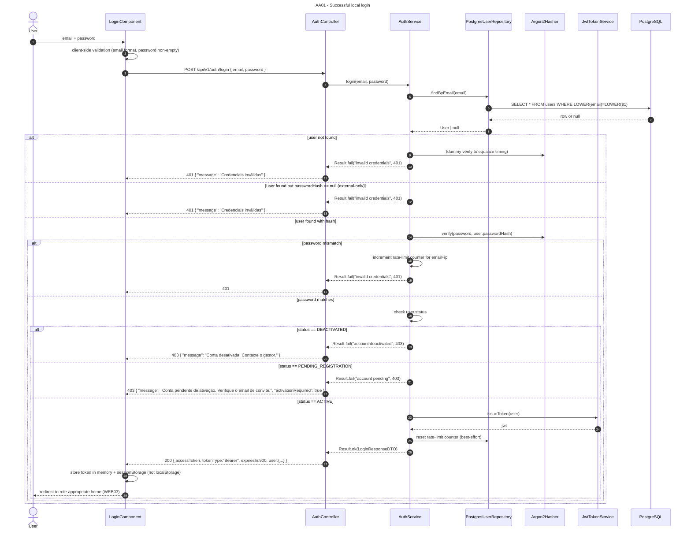
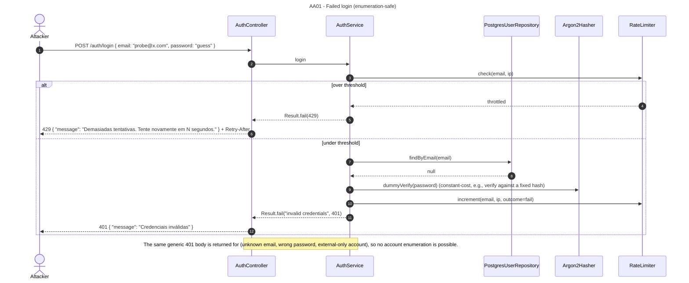
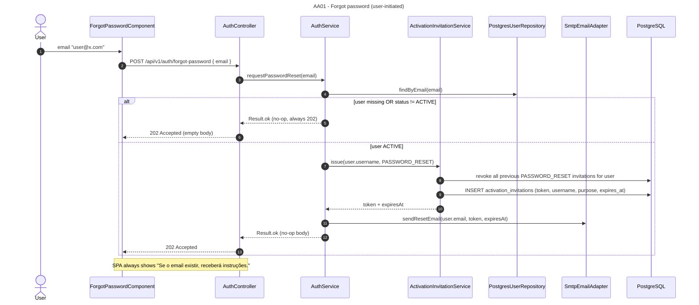
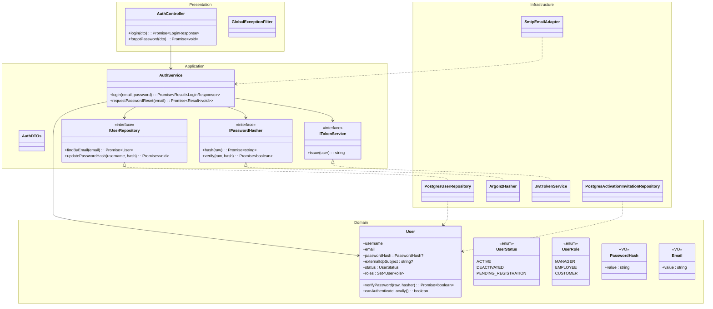

# AA01 — Local Authentication

> **Documentation scope (2026-11-06):** Section 1 preserves the original requirements and proposed design baseline. Section 2 records the implementation inspected in this repository and takes precedence for current paths, roles, flows and completion claims. Differences are documented as remaining work or implementation departures, not as changes to the original specification.

## 1. Requirements Engineering

### 1.1. User Story Description

As a System User, I want to authenticate using a local account, so that I can access the application without using an external identity provider.

### 1.2. Customer Specifications and Clarifications

#### From the specification document
> Extracted from *PART IV — Sprint 2 — User Stories* (AA01, p. 9).

- **Login interface:** must offer local authentication using an account identifier and password.
- **Credential check + active-only:** local credentials verified by the system; **only active accounts** establish a normal authenticated session.
- **Invitation activation preserved:** the limited invitation-based activation process remains available to the intended recipient of an inactive account.
- **One-way password protection:** passwords stored using a suitable one-way mechanism; **never recoverable or displayed in original form**.
- **Confidentiality:** password rules documented; entry, change, and recovery preserve confidentiality.
- **No enumeration:** failed login messages must not disclose whether a particular account exists; repeated failures controlled.
- **Recovery:** time-limited, single-use process that **verifies control of the intended account**.
- **Parity with external:** local accounts follow the same activation, role, logout, and access-control rules as externally authenticated accounts.

#### From project clarifications and ADRs

- **ADR-004 (KB §5):** Stateless JWT with claims `{sub, email, roles, iat, exp}` (15-min default); **Argon2id** password hashing (64 MiB, 3 iters, parallelism 1); guards re-read roles from the repository (immediate revocation, Clarification #24 §3.2).
- **ADR-010 (KB §5):** external-IdP-only users have `passwordHash = NULL`; **they are rejected on local login endpoints** with the same generic response as an unknown account.
- **Clarification #09 + #27:** public registration creates `User + Customer` in `PENDING_REGISTRATION`; Manager-provisioned staff start at `PENDING_REGISTRATION` until invitation activation; **external IdP first login JIT-provisions `ACTIVE` directly** (AA02).
- **Clarification #24 §1.2:** invariant ≥ 1 active `MANAGER` at all times — applies to deactivation (AA06), not to login itself.
- **Clarification #24 §3.2:** role revocation takes effect immediately because the guard reads current state.
- **KB §4.1:** flow of authentication (JWT issuance, guard pipeline).
- **KB §17.1:** `users` table has `password_hash VARCHAR NULL` (nullable after migration 014), `status` with `CHECK (status IN ('ACTIVE','DEACTIVATED','PENDING_REGISTRATION'))`.

### 1.3. Acceptance Criteria (expanded, testable)

#### AC1 — Login interface with local credentials
- AC1.1 `POST /api/v1/auth/login` accepts `{ email, password }` (email is the primary credential; `username` not accepted for login to avoid two lookup paths).
- AC1.2 The SPA login page offers a local login form and (where implemented) a link to the external IdP login (AA02).
- AC1.3 The login page is reachable unauthenticated; it does not leak whether a given email exists (generic "Credenciais inválidas" message).

#### AC2 — Only active accounts establish a session
- AC2.1 If the user's `status = ACTIVE` **and** credentials valid → `200 OK` with `LoginResponseDTO` containing a JWT and the user snapshot.
- AC2.2 If `status = DEACTIVATED` → reject with `403 Forbidden` and message "Conta desativada. Contacte o gestor." (this reveals account status only after credentials were already proven correct — safe).
- AC2.3 If `status = PENDING_REGISTRATION` → reject with `403 Forbidden` and message "Conta pendente de ativação. Verifique o email de convite." + optionally a link "Reenviar convite" (which calls AA07/AA06 mechanisms — the endpoint is out of scope for AA01 but the UX affordance is documented).
- AC2.4 If `password_hash IS NULL` (external-only account) → reject with **generic 401** `{"message": "Credenciais inválidas"}` — do not disclose that an external account exists for that email (ADR-010).

#### AC3 — Password storage and rules
- AC3.1 Passwords are stored as **Argon2id** hashes (`memoryCost=65536 KiB`, `timeCost=3`, `parallelism=1` per ADR-004).
- AC3.2 Password policy is documented in `docs/security/password-policy.md` (minimum length, character classes, forbidden common passwords); enforced on `POST /auth/register` (public) and on invitation activation (AA07).
- AC3.3 Passwords never appear in logs, error responses, or diagnostic records.
- AC3.4 `password_hash` is excluded from every DTO (`LoginResponseDTO`, `UserResponseDTO`, `CustomerResponseDTO`). Verified by unit test asserting serialized output contains no `password`/`hash` field.

#### AC4 — Failed-login behaviour and enumeration prevention
- AC4.1 Invalid credentials (unknown email **or** wrong password **or** external-only account) return the **same** `401 Unauthorized` body: `{"status":401,"error":"Unauthorized","message":"Credenciais inválidas"}`.
- AC4.2 Repeated failures are rate-limited: after N=5 consecutive failures for the same `email` (and/or IP), subsequent attempts within the window return `429 Too Many Requests` with `Retry-After`. The window and N are configurable (`AUTH_LOGIN_MAX_ATTEMPTS`, `AUTH_LOGIN_WINDOW_SECONDS`).
- AC4.3 Rate-limit state is per-email-per-IP (independent windows) to prevent an attacker from either brute-forcing an account or exhausting IP-based buckets.
- AC4.4 A successful login resets the failure counter for that email.
- AC4.5 Rate-limit records never contain the submitted password (only `email`, `ip`, `timestamp`, `outcome`).

#### AC5 — Password recovery
- AC5.1 `POST /api/v1/auth/forgot-password` accepts `{ email }` and **always** returns `202 Accepted` with a generic body, whether the email exists or not (enumeration prevention).
- AC5.2 If the account exists and is `ACTIVE`, the backend issues a `PASSWORD_RESET` `ActivationInvitation` (single-use, TTL from `INVITATION_TTL_HOURS`, default 48h) and sends an email via `SmtpEmailAdapter` containing a link to `<SPA>/auth/reset-password?token=<token>`.
- AC5.3 If the account does not exist, or is `PENDING_REGISTRATION`, or is `DEACTIVATED`, no invitation is issued and no email is sent — but the `202` response is identical to AC5.1.
- AC5.4 The user submits a new password via `POST /api/v1/auth/activate` with `{ token, password }`. The backend validates: invitation exists, `purpose = PASSWORD_RESET`, `expiresAt > now`, `usedAt IS NULL`, `revokedAt IS NULL`; then hashes the password and updates `users.password_hash`, marks invitation `usedAt = now`, and revokes any other `PASSWORD_RESET` invitation for the same user.
- AC5.5 On success, return `200 OK`; the SPA redirects to `/login` and the user may now log in with the new password.
- AC5.6 The reset endpoint is reachable unauthenticated (by design — the token is the proof of control).
- AC5.7 Password rules per AC3.2 apply; weak passwords are rejected with `422`.

> **Extension note:** `/auth/forgot-password` is **not** listed in KB Appendix A. It is required to satisfy AA01 AC "Password recovery must use a time-limited, single-use process that verifies control of the intended account." It must be added to `docs/api/openapi.yaml` and to the RBAC matrix (§23). Alternative (Manager-initiated reset via AA06) is acceptable for staff but insufficient for self-service customers; the user-initiated variant is documented as the accepted decision here.

#### AC6 — Parity with external authentication
- AC6.1 The JWT issued on local login has the same claim shape, lifetime, and signature as the JWT issued on external login (AA02).
- AC6.2 Guards (`JwtAuthGuard`, `RolesGuard`, `UserStatus.guard`) are identical for both paths.
- AC6.3 Logout semantics are identical (AA04).

### 1.4. Found out Dependencies

**Preceding:**
- ARC03 (REST API contract), ADR-004 (JWT + Argon2id), ADR-010 (external-only rejection).
- Migration 001 (`users`, `user_roles`, `user_role_assignments`) + migration 013 (user contact details) + migration 014 (`password_hash` nullable, `external_idp_subject`, `activation_invitations`).
- `Argon2Hasher` and `JwtTokenService` infrastructure adapters.
- `SmtpEmailAdapter` for forgot-password email (AC5.2).

**Succeeding:**
- AA03 (role resolution consumes the login response and the JWT).
- AA04 (session handling consumes JWT + guards).
- WEB03 (role-based nav depends on AA01/AA02 to obtain a token).
- Every protected endpoint in the SPA.

### 1.5. Input and Output Data

#### 1.5.1. DTOs

**LoginRequestDTO:**
```json
{ "email": "manager@laprizza.com", "password": "Secr3tP@ssw0rd!" }
```
- `email`: required, valid email format (RFC 5322), case-insensitive lookup.
- `password`: required, non-empty string; maximum length 256 (reject longer to bound CPU cost).

**LoginResponseDTO** (from KB §24.1):
```json
{
  "accessToken": "eyJhbGciOiJIUzI1NiIsInR5cCI6IkpXVCJ9...",
  "tokenType": "Bearer",
  "expiresIn": 900,
  "user": {
    "username": "manager.01",
    "email": "manager@laprizza.com",
    "status": "ACTIVE",
    "roles": ["MANAGER"]
  }
}
```
- The `user` object is a snapshot from the moment of login. Role changes between login and subsequent requests are handled by guards re-reading from DB (AA04).

**ForgotPasswordRequestDTO:**
```json
{ "email": "manager@laprizza.com" }
```
Response: `202 Accepted` with empty body (always, regardless of existence).

**ActivateInvitationRequestDTO** (from KB §24.1bis, reused for PASSWORD_RESET):
```json
{ "token": "a1b2c3d4e5f6…", "password": "NewSecr3tP@ssw0rd!" }
```
- `token`: required, opaque string.
- `password`: required, subject to password policy (AC3.2).

#### 1.5.2. Endpoint matrix

| Method | Path | Roles | Success | Other |
|---|---|---|---|---|
| POST | `/api/v1/auth/login` | Public | 200 + JWT | 400 (malformed), 401 (invalid credentials / external-only), 403 (deactivated / pending), 429 (rate-limited) |
| POST | `/api/v1/auth/forgot-password` | Public | 202 (always) | 400 (malformed), 429 (rate-limited) |
| POST | `/api/v1/auth/activate` | Public | 200 (invitation consumed) | 400, 404 (token unknown), 410 (token expired/used/revoked), 422 (weak password) |

> **`/auth/activate` scope:** the endpoint accepts any `purpose` (`LOCAL_ACCOUNT_ACTIVATION`, `EXTERNAL_IDP_MATCH`, `PASSWORD_RESET`); the **activation** flow (LOCAL_ACCOUNT_ACTIVATION, EXTERNAL_IDP_MATCH) is documented in **AA07**, while **password reset consumption** is documented here (AA01 AC5.4). The endpoint contract is shared; the behavioral outcomes differ by invitation purpose.

#### 1.5.3. Persistence — relevant tables (KB §17.1 + migration 014 §1)

```sql
-- users (accumulated; migration 001 + 013 + 014)
CREATE TABLE users (
    username VARCHAR(30) PRIMARY KEY,
    first_name VARCHAR(75) NOT NULL,
    last_name  VARCHAR(75) NOT NULL,
    email      VARCHAR(255) NOT NULL UNIQUE,
    password_hash VARCHAR(255) NULL,            -- nullable after migration 014
    external_idp_subject VARCHAR(255) NULL,     -- added by migration 014
    phone_number VARCHAR(30) NULL,
    status VARCHAR(30) NOT NULL DEFAULT 'ACTIVE',
    created_at TIMESTAMPTZ NOT NULL DEFAULT CURRENT_TIMESTAMP,
    updated_at TIMESTAMPTZ NOT NULL DEFAULT CURRENT_TIMESTAMP,
    CONSTRAINT chk_users_status CHECK (status IN ('ACTIVE','DEACTIVATED','PENDING_REGISTRATION'))
    -- NOTE: the domain enforces (password_hash IS NOT NULL OR external_idp_subject IS NOT NULL).
    -- Per KB §17.1 this is expressed as chk_users_credentials; migration 014 does not add it.
    -- If the DB-level check is required, it must be added via a new migration 015_*.sql.
);

-- user_roles + user_role_assignments (migration 001)
CREATE TABLE user_roles (name VARCHAR(30) PRIMARY KEY, CONSTRAINT chk_user_roles_name CHECK (name IN ('MANAGER','EMPLOYEE','CUSTOMER')));
CREATE TABLE user_role_assignments (
    username VARCHAR(30) NOT NULL,
    role_name VARCHAR(30) NOT NULL,
    PRIMARY KEY (username, role_name),
    FOREIGN KEY (username) REFERENCES users(username) ON DELETE CASCADE,
    FOREIGN KEY (role_name) REFERENCES user_roles(name) ON DELETE RESTRICT
);

-- activation_invitations (migration 014)
CREATE TABLE activation_invitations (
    token VARCHAR PRIMARY KEY,
    username VARCHAR NOT NULL REFERENCES users(username) ON DELETE CASCADE,
    purpose VARCHAR NOT NULL CHECK (purpose IN ('LOCAL_ACCOUNT_ACTIVATION','EXTERNAL_IDP_MATCH','PASSWORD_RESET')),
    expires_at TIMESTAMPTZ NOT NULL,
    used_at TIMESTAMPTZ,
    revoked_at TIMESTAMPTZ,
    created_at TIMESTAMPTZ NOT NULL DEFAULT NOW()
);
```

Rate-limit state for AC4 is **not** persisted in PostgreSQL for Sprint 2 baseline; it lives in an in-process store (or Redis if multi-instance). This is documented as an infrastructure decision (no DB table required for the baseline; a `015_*.sql` could add a `login_attempts` table for audit, but it is not required by the spec).

#### 1.5.4. JWT claim shape (per ADR-004, identical across local and external)

```json
{
  "sub": "manager.01",
  "email": "manager@laprizza.com",
  "roles": ["MANAGER"],
  "iat": 1762332000,
  "exp": 1762332900
}
```
- `sub` = `users.username` (business key, not UUID — KB §3.4).
- `roles` are a **snapshot**; guards re-read from DB (AA04).
- `exp` = `iat + 900` (15 min); configurable via `JWT_TTL_SECONDS`.

### 1.6. System Sequence Diagrams (SSD)

#### 1.6.1. Successful login (ACTIVE)



#### 1.6.2. Failed login — enumeration-safe response



#### 1.6.3. Forgot password → reset invitation issued



#### 1.6.4. Reset password → consume invitation

```mermaid
sequenceDiagram
autonumber
title AA01 - Consume password-reset invitation
    actor User
    participant SPA as ResetPasswordComponent
    participant Ctrl as AuthController
    participant Svc as ActivationInvitationService
    participant Repo as PostgresUserRepository
    participant Hash as Argon2Hasher
    participant DB as PostgreSQL

    User->>SPA: click email link → /auth/reset-password?token=…
    SPA->>SPA: read token from URL; ask for new password + confirmation
    User->>SPA: submit { token, password }
    SPA->>Ctrl: POST /api/v1/auth/activate { token, password }
    Ctrl->>Svc: consume(token, password)
    Svc->>DB: SELECT * FROM activation_invitations WHERE token=$1 FOR UPDATE
    alt no row
        Svc-->>Ctrl: Result.fail(404)
        Ctrl-->>SPA: 404 { "message": "Convite inválido" }
    else purpose != PASSWORD_RESET
        Svc-->>Ctrl: Result.fail(422, "Wrong invitation purpose")
        Ctrl-->>SPA: 422
    else expired / used / revoked
        Svc-->>Ctrl: Result.fail(410)
        Ctrl-->>SPA: 410 { "message": "Convite expirado ou já utilizado" }
    else valid
        Svc->>Svc: validate password against policy
        alt weak
            Svc-->>Ctrl: Result.fail(422, "Password does not meet policy")
            Ctrl-->>SPA: 422 { "message": "A password não cumpre os requisitos mínimos" }
        else ok
            Svc->>Hash: hash(password)
            Hash-->>Svc: passwordHash
            Svc->>Repo: updatePasswordHash(username, passwordHash)
            Repo->>DB: UPDATE users SET password_hash=$1, updated_at=NOW() WHERE username=$2
            Svc->>DB: UPDATE activation_invitations SET used_at=NOW() WHERE token=$1
            Svc-->>Ctrl: Result.ok
            Ctrl-->>SPA: 200 { "message": "Password atualizada" }
            SPA-->>User: redirect /login
        end
    end
```

### 1.7. Other Relevant Remarks

#### 1.7.1. Clean Architecture placement



Key rule (ADR-001): `User`, `UserStatus`, `PasswordHash`, `Email` do **not** import NestJS, TypeORM, or HTTP. `Argon2Hasher` and `JwtTokenService` are infrastructure adapters that implement ports defined in the application/domain.

#### 1.7.2. Domain invariant — `User` factory

Per ADR-010, `password_hash` may be null for external-only users. The domain enforces **at least one credential**:

```
User.createCustomer(...)         → passwordHash != null, externalIdpSubject == null
User.createExternalCustomer(...) → passwordHash == null, externalIdpSubject != null
User.inviteStaffMember(...)      → passwordHash == null, status = PENDING_REGISTRATION
User.completeRegistration(hash)  → passwordHash set, status = ACTIVE
```

The invariant `(passwordHash != null) ∨ (externalIdpSubject != null)` is enforced in the `User` constructor / static factory and verified by unit tests. DB-level enforcement (per KB §17.1 `chk_users_credentials`) is **not** added by migration 014; if the DB check is desired, it must be introduced via a `015_*.sql` migration — otherwise rely on domain enforcement.

#### 1.7.3. Error-to-HTTP matrix

| Action | Condition | HTTP | UI feedback |
|---|---|---|---|
| Login | malformed body (missing email/password, wrong types) | 400 | field-level (Joi) |
| Login | unknown email / wrong password / external-only | 401 | generic "Credenciais inválidas" |
| Login | deactivated account (credentials valid) | 403 | "Conta desativada. Contacte o gestor." |
| Login | pending registration (credentials valid) | 403 | "Conta pendente de ativação. Verifique o email de convite." |
| Login | rate-limited | 429 + `Retry-After` | "Demasiadas tentativas. Tente novamente em N segundos." |
| Forgot-password | malformed body | 400 | field-level |
| Forgot-password | any valid email (exists or not) | 202 | generic "Se o email existir, receberá instruções." |
| Forgot-password | rate-limited | 429 | same message |
| Activate (reset) | token unknown | 404 | "Convite inválido" |
| Activate (reset) | wrong purpose | 422 | "Convite inválido para este tipo de operação" |
| Activate (reset) | expired/used/revoked | 410 | "Convite expirado ou já utilizado" |
| Activate (reset) | weak password | 422 | field-level (password policy) |

#### 1.7.4. Verification (automated + demo)

- **Unit (domain):** `User.verifyPassword` with Argon2 hasher; `User.canAuthenticateLocally()` returns false for external-only; `PasswordHash` VO rejects empty; `Email` VO rejects invalid.
- **Unit (application):** `AuthService.login` — 7 cases: success, wrong password, unknown email, external-only, deactivated, pending, rate-limited. Constant-time behavior for the "user not found" case verified by mocking `Argon2Hasher.verify` and asserting it was called once even for unknown emails.
- **Integration (Supertest):** `POST /auth/login` → 200/401/403/429 as above; `POST /auth/forgot-password` → 202 always; `POST /auth/activate` with PASSWORD_RESET → updates hash, revokes siblings, marks invitation used; re-consume → 410.
- **DB suite:** migration 001 + 013 + 014 apply cleanly; `chk_users_status` rejects invalid status; `activation_invitations` PK uniqueness; `ON DELETE CASCADE` from `users` to `activation_invitations`.
- **Security:** Argon2 parameters asserted in `Argon2Hasher` unit test (m=65536, t=3, p=1); `LoginResponseDTO` serialization asserted to exclude `password_hash`; `/auth/login` response body asserted to be identical for unknown email vs wrong password (string-equality of the JSON body).
- **Demo:** login success (Manager, Employee, Customer), login failure (wrong password + unknown email → identical 401), login on pending account (403), forgot-password → email dispatched (SMTP container logs), reset consumed → login with new password.

## 2. Current Implementation — 2026-11-06

### 2.1. Local authentication and registration

Customer login/registration is available at `/login` and `/register`; staff uses `/backoffice/login` and `/backoffice/register`. Both interfaces call the shared `Auth` service with `{email, password}` for login and `{firstName, lastName, email, password}` for registration. The response is `{token, user}`, including current roles and status. Customer registration has two steps, password confirmation and an optional subsequent phone-number save; a phone failure is reported separately from successful account creation.

| Browser endpoint | Current behavior |
|---|---|
| `POST /api/auth/login` | ACTIVE user with matching credentials receives a session; unknown email/wrong password receives `401` |
| `POST /api/auth/register` | New public account becomes ACTIVE CUSTOMER; pending invited account is completed and retains its assigned roles |
| `POST /api/password-recovery` | Requests a recovery code using `{email}`; always returns the same generic `202` response for unknown, inactive, eligible, and cooldown accounts |
| `POST /api/password-recovery/new_pass` | Consumes `{recovery_code, new_password}`; successful reset returns `200` |
| `POST /api/auth/logout` | Revokes the current backend session; successful response is `204` (AA04) |

The current backend checks pending/deactivated status before comparing the login password: pending registration returns `400`, deactivated accounts return `403`, and other invalid credentials return `401`. The SPA displays ordinary login failures inline, but the shared interceptor routes every API `403` to `/unauthorized`. This differs from the status-specific login responses/UX proposed in §1.

### 2.2. Password recovery

The shared `PasswordRecoveryForm` is embedded in both authentication interfaces. It supports requesting a code, entering an existing code, resetting the password and returning to sign-in. The code is entered in the form rather than supplied in a reset-link URL. Successful reset clears the code, password and confirmation fields and does not create an authenticated session.

The implemented backend uses a separate password-recovery store and a 64-character hexadecimal code, with a five-minute lifetime, single-use consumption and a 30-minute request cooldown. The form requires an 8–128 character reset password with uppercase, lowercase, a digit and a symbol, plus matching confirmation. Codes are hashed with SHA-256 before lookup/storage; passwords use the backend password hasher. A successful reset updates the password, marks the code used and revokes existing account sessions in one database transaction.

| Failure | Response / UI behavior |
|---|---|
| Invalid request/password | `400`; inline feedback |
| Invalid code | `401`; inline feedback, without clearing another stored session |
| Inactive/unknown recovery account | Same generic `202` response as eligible accounts; no code is sent |
| Used code | `409`; inline feedback |
| Expired code | `410`; inline feedback and cooldown guidance |
| Cooldown | Same generic `202` response; no additional code is sent during the cooldown |

### 2.3. Coverage and departures from the baseline

Local login, registration, shared recovery UI and logout are implemented. The earlier activation-invitation recovery flow (`/auth/forgot-password` → `/auth/activate`, 48-hour token) is not the implemented flow. Recovery now returns the same generic `202` response for unknown, pending, deactivated, eligible and cooldown accounts; internal cooldown still prevents additional code delivery. Regression coverage is in [PasswordRecoveryService.spec.ts](../../../backend/tests/unit/PasswordRecoveryService.spec.ts). Login rate limiting and external-provider parity are not established by the frontend implementation; no OIDC login flow is present in these forms. Public registration currently activates a new account immediately rather than waiting for AA07 activation.

**Source:** [shared authentication](../../../frontend/src/app/shared_components/core/auth/auth.ts), [customer auth form](../../../frontend/src/app/frontoffice/shared_components/customer-auth-form/customer-auth-page.ts), [staff auth form](../../../frontend/src/app/backoffice/shared_components/staff-auth-form/auth-page.ts), [recovery form](../../../frontend/src/app/shared_components/ui/password-recovery-form/password-recovery-form.ts), [backend authentication](../../../backend/src/application/auth/AuthService.ts), [backend recovery](../../../backend/src/application/auth/PasswordRecoveryService.ts).

**Existing verification:** [password recovery browser tests](../../../frontend/e2e/password-recovery.spec.ts), [storefront tests](../../../frontend/e2e/frontoffice/storefront.spec.ts), [backoffice tests](../../../frontend/e2e/backoffice/backoffice.spec.ts), [backend authentication tests](../../../backend/tests/integration/auth.controller.spec.ts), and [recovery persistence tests](../../../backend/tests/integration/password-recovery.postgres.spec.ts). Test presence is evidence of covered scenarios, not a claim that all original acceptance criteria pass.
