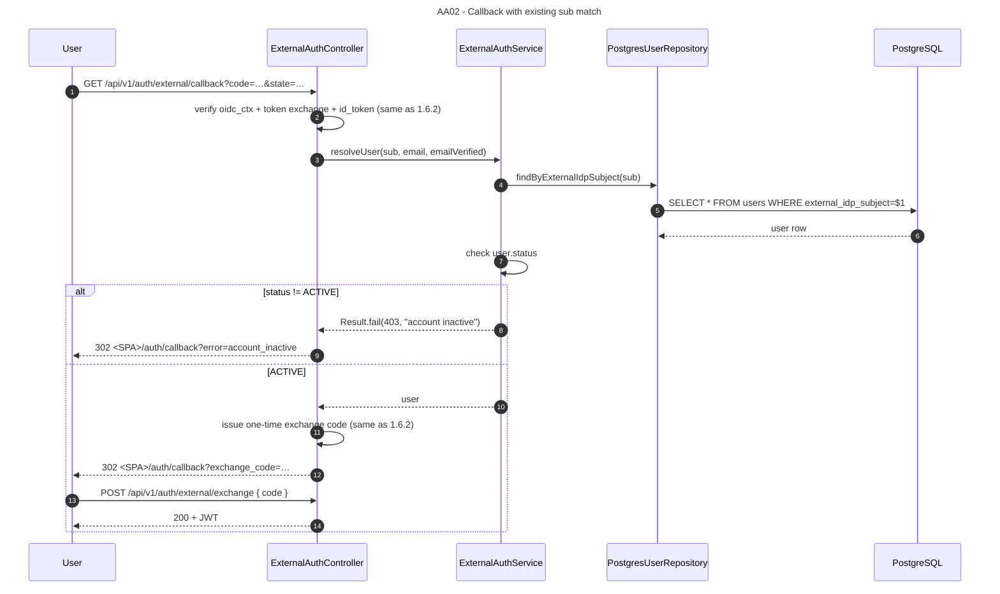
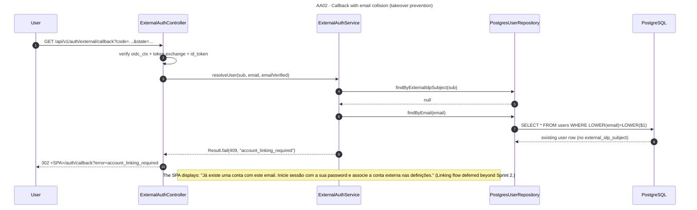
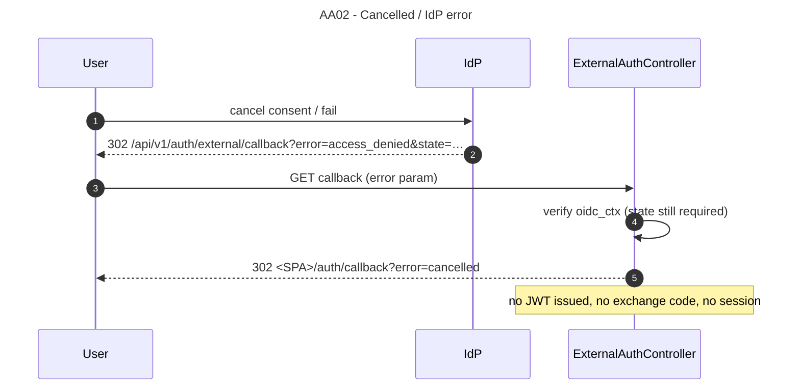
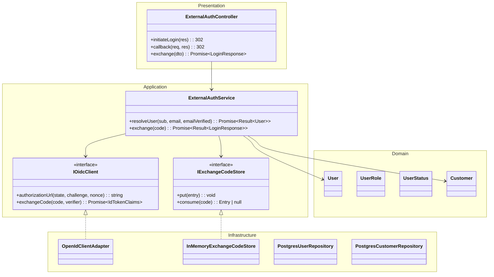

# AA02 — External Identity Provider Integration

> **Implementation update (2026-11-16):** The callback exchange code is now stored in PostgreSQL as a SHA-256 hash with a 60-second TTL and consumed atomically once. The previous in-memory-only store remains available only as a test helper.

## 1. Requirements Engineering

### 1.1. User Story Description

As a System User, I want to authenticate through an external identity provider, so that I can securely access the integrated application.

### 1.2. Customer Specifications and Clarifications

#### From the specification document
> Extracted from *PART IV — Sprint 2 — User Stories* (AA02, p. 9).

- **Choice of auth method:** users must be able to choose external IdP in addition to local authentication.
- **Protocol:** OIDC with OAuth 2.0 (or equivalent supported combination suitable for identifying the user and authorizing service access).
- **Redirect flow:** choosing external auth must direct the user to the provider and return them after successful authentication.
- **Verified identity:** external authentication must establish a **verified identity** before protected functionality becomes available.
- **No password collection:** the application must **not collect or store** the password used at the external provider.
- **Cancelled/failed:** show appropriate feedback and must not grant access.
- **Logout:** users must be able to log out and end their application session.

#### From project clarifications and ADRs

- **ADR-010 (KB §5):** **Authorization Code Flow with PKCE** via `openid-client`; `sub` claim stored in `users.external_idp_subject`; JIT provisioning on first login (`ACTIVE`, `CUSTOMER`, `passwordHash=NULL`, `externalIdpSubject=sub`, plus a `Customer` record — Clarification #27); **account-linking rejection** when an email collision exists without `external_idp_subject` (prevents takeover); issue standard internal JWT.
- **Clarification #25:** any OIDC-compliant IdP (Google, Microsoft, Auth0, Keycloak).
- **Clarification #27:** external first login JIT → `ACTIVE` immediately (no invitation), with `CUSTOMER` role and `Customer` record (since `User` with `CUSTOMER` role must have a `Customer`).
- **KB §4.2:** flow (PKCE, token exchange, ID Token verification, JIT, JWT issuance).
- **AA04 (this batch):** "Session information must not be exposed in application addresses" — this constrains the **callback redirect** design (see §1.7.3).

### 1.3. Acceptance Criteria (expanded, testable)

#### AC1 — External auth option available
- AC1.1 The SPA login page shows a "Entrar com Google/Microsoft/…" button (label reflects the configured provider) alongside the local form.
- AC1.2 The button navigates to `GET /api/v1/auth/external/login` (full-page redirect, not AJAX).

#### AC2 — OIDC Authorization Code Flow with PKCE
- AC2.1 `GET /api/v1/auth/external/login`:
  - Generates a PKCE `code_verifier` (43–128 chars, base64url), `code_challenge` (S256 of verifier), `state` (random 32 bytes base64url), and `nonce` (random 32 bytes base64url).
  - Stores `{ state, code_verifier, nonce, redirect_uri, expiresAt = now + 5 min }` in a **signed HttpOnly cookie** `oidc_ctx` (cookie `Secure`, `SameSite=Lax`, `Path=/api/v1/auth/external`).
  - Returns `302 Found` to the IdP authorization endpoint with `response_type=code`, `client_id`, `redirect_uri`, `scope=openid email profile`, `state`, `code_challenge`, `code_challenge_method=S256`, `nonce`.
- AC2.2 `GET /api/v1/auth/external/callback?code=…&state=…`:
  - Reads and verifies the `oidc_ctx` cookie (signature, `expiresAt`, `state` match). On any failure → `400 Bad Request` and redirect to SPA `/auth/callback?error=invalid_state`.
  - Exchanges `code` + `code_verifier` at the IdP token endpoint.
  - Verifies the **ID Token** signature (JWKS), `iss`, `aud`, `exp`, `nonce`.
  - Extracts `sub` (required) and `email` (required) and `email_verified` (must be true for JIT creation).

#### AC3 — Verified identity → internal session
- AC3.1 After ID Token verification, `ExternalAuthService.resolveUser(sub, email, emailVerified)`:
  - **Case A — existing `external_idp_subject = sub`:** use the existing `User`. If `status != ACTIVE` → reject with `403` (deactivated) or specific pending state.
  - **Case B — no `external_idp_subject` match, but an existing user has the same verified email:** **reject** with `409 Conflict` (`account linking required`). Do **not** auto-link (prevents takeover). The user must authenticate locally and link from inside the application (out of scope for Sprint 2 — documented as a future linking flow).
  - **Case C — neither:** **JIT provision** a new `User` (`username` derived from email local-part + collision suffix; `firstName`/`lastName` from `given_name`/`family_name` claims when present, otherwise `firstName = email local-part`, `lastName = "—"`); `status = ACTIVE`, `role = CUSTOMER`, `passwordHash = NULL`, `externalIdpSubject = sub`. **Also create the associated `Customer`** (Clarification #27) with `email = verified email`, `firstName`, `lastName`, `phone = ""` (to be filled later — `phone` is mandatory per Clarification #01; if missing from IdP, the user is prompted on first login to complete their profile — see AC3.5).
- AC3.2 Issuing the internal JWT uses the **same `JwtTokenService`** as AA01 (identical claims/lifetime/signature) — AA06 parity AC.
- AC3.3 On success, the SPA receives the JWT. **The JWT must not appear in the callback URL** (AA04 AC). See §1.7.3 for the one-time exchange code pattern.
- AC3.4 On cancel/failure from the IdP (`error=access_denied`), the backend redirects the SPA to `/auth/callback?error=cancelled`; no JWT is issued; the SPA shows "Autenticação cancelada".
- AC3.5 If required profile fields are missing from the IdP (e.g., `phone` for `Customer`), the SPA redirects the user to `/profile/complete` after login and blocks non-profile mutations until completion (documented behavior; enforced at application-service level for the `CUSTOMER` self-service endpoints; no change to core auth).

#### AC4 — No external password collection
- AC4.1 The application never sees, stores, or logs the password used at the IdP.
- AC4.2 The only external-identity field persisted is `users.external_idp_subject`; no `access_token` or `refresh_token` is stored (ADR-010 alternatives considered; long-term storage rejected).
- AC4.3 Diagnostic logs redact `code`, `access_token`, `id_token`, `refresh_token` values.

#### AC5 — Logout
- AC5.1 The SPA's logout action is identical to local logout (AA04): drop the internal JWT and clear `sessionStorage`.
- AC5.2 Optionally, the backend `POST /api/v1/auth/external/logout` returns the IdP's `end_session_endpoint` (RP-Initiated Logout) so the SPA can also end the IdP session. This is a **nice-to-have**, not required by the AC; documented as a deferred enhancement.

### 1.4. Found out Dependencies

**Preceding:**
- AA01 (shared `JwtTokenService`, `AuthDTOs`, error envelope).
- ADR-010 (accepted design), `openid-client` dependency.
- Migration 014 §1 (`external_idp_subject`, nullable `password_hash`).
- `Customer` aggregate (BCK02) for JIT-created Customer.
- IdP configuration (issuer URL, client ID, client secret) provided via env (`OIDC_ISSUER_URL`, `OIDC_CLIENT_ID`, `OIDC_CLIENT_SECRET`) — KB §36.

**Succeeding:**
- AA03 (JIT-provisioned `CUSTOMER` role resolution uses this path).
- AA04 (session handling for the internal JWT issued by this flow).
- WEB03 (role-based nav — external users get the same treatment).

### 1.5. Input and Output Data

#### 1.5.1. Configuration (env)

```
OIDC_ISSUER_URL           = https://accounts.google.com  (or Auth0/Keycloak/Microsoft)
OIDC_CLIENT_ID            = <client id>
OIDC_CLIENT_SECRET        = <client secret>            # confidential client
OIDC_REDIRECT_URI         = https://laprizza.local/api/v1/auth/external/callback
OIDC_SCOPES               = openid email profile
OIDC_SESSION_COOKIE_NAME  = oidc_ctx
OIDC_SESSION_COOKIE_SECRET= <random 32 bytes hex>      # signs the cookie
OIDC_SESSION_COOKIE_TTL   = 300                        # seconds
OIDC_EXCHANGE_CODE_TTL    = 60                         # seconds (one-time exchange code)
```

#### 1.5.2. Endpoint matrix

| Method | Path | Roles | Success | Other |
|---|---|---|---|---|
| GET | `/api/v1/auth/external/login` | Public | 302 → IdP | 500 (IdP discovery failure), 503 (IdP unreachable) |
| GET | `/api/v1/auth/external/callback` | Public | 302 → SPA `/auth/callback?exchange_code=…` | 302 → SPA `?error=…`, 400 (invalid state/cookie), 401 (ID token invalid), 409 (email collision — account linking required), 503 (IdP unreachable) |
| POST | `/api/v1/auth/external/exchange` | Public | 200 + JWT | 400 (missing code), 401 (invalid/expired/used code) |
| POST | `/api/v1/auth/external/logout` | Public (returns URL) | 200 `{ endSessionEndpoint?, postLogoutRedirectUri }` | 404 (IdP has no end_session) — nice-to-have |

> **Extension note:** `/auth/external/exchange` is **not** in KB Appendix A. It is required to satisfy AA04 AC "Session information must not be exposed in application addresses". See §1.7.3. It must be added to `docs/api/openapi.yaml`.

#### 1.5.3. Persistence

No new tables are introduced by AA02. Relevant columns (migration 014 §1):
- `users.external_idp_subject VARCHAR NULL` — `sub` claim storage.
- `users.password_hash` — nullable (external-only users).

Relevant `Customer` table (migration 002, for JIT creation — Clarification #27):
- `customers.email PK`, `username` FK to `users(username)` `ON DELETE SET NULL`, `first_name`, `last_name`, `phone`, `created_at`, `updated_at`.

One-time exchange code store: **not** persisted in PostgreSQL for Sprint 2 baseline. It lives in an in-process `Map<code, { username, expiresAt, usedAt }>` with a TTL cleanup timer (60 s). For multi-instance deployments, a Redis-backed adapter is the future option; documented as a deliberate baseline decision.

PKCE state cookie `oidc_ctx`: signed JWT (HS256) with `{ state, code_verifier, nonce, redirect_uri, iat, exp }`, stored in an HttpOnly, Secure, SameSite=Lax cookie with `Path=/api/v1/auth/external`.

#### 1.5.4. JWT claim shape

Identical to AA01 §1.5.4. No additional claims for external users (the internal JWT does not carry `sub` of the IdP; it carries `sub = users.username`, which is the internal business key).

### 1.6. System Sequence Diagrams (SSD)

#### 1.6.1. Login initiation (redirect to IdP)

```mermaid
sequenceDiagram
autonumber
title AA02 - Login initiation (redirect to IdP)
    actor User
    participant SPA as LoginComponent
    participant Ctrl as ExternalAuthController
    participant Oidc as OidcClient (openid-client)
    participant IdP as External IdP
    participant Cookie as oidc_ctx cookie (signed)

    User->>SPA: click "Entrar com Google"
    SPA->>Ctrl: GET /api/v1/auth/external/login (browser navigation)
    Ctrl->>Oidc: generate PKCE verifier + challenge + state + nonce
    Oidc-->>Ctrl: { verifier, challenge, state, nonce }
    Ctrl->>Cookie: Set oidc_ctx = signed({ state, verifier, nonce, redirect_uri, exp }) ; HttpOnly ; Secure ; SameSite=Lax
    Ctrl-->>SPA: 302 Location: <IdP authorize URL>?response_type=code&client_id=…&redirect_uri=…&scope=openid%20email%20profile&state=…&code_challenge=…&code_challenge_method=S256&nonce=…
    SPA->>IdP: follow redirect
    User->>IdP: authenticate + consent
    IdP-->>User: 302 to /api/v1/auth/external/callback?code=…&state=…
```

#### 1.6.2. Callback — JIT (new user)

```mermaid
sequenceDiagram
autonumber
title AA02 - Callback with JIT provisioning (new user)
    participant User
    participant Ctrl as ExternalAuthController
    participant Svc as ExternalAuthService
    participant Oidc as OidcClient
    participant IdP as IdP
    participant UserRepo as PostgresUserRepository
    participant CustRepo as PostgresCustomerRepository
    participant DB as PostgreSQL
    participant CodeStore as ExchangeCodeStore

    User->>Ctrl: GET /api/v1/auth/external/callback?code=…&state=…
    Ctrl->>Ctrl: read oidc_ctx cookie; verify signature + exp + state match
    alt invalid state / expired cookie
        Ctrl-->>User: 302 <SPA>/auth/callback?error=invalid_state
    else valid
        Ctrl->>Oidc: token exchange(code, code_verifier, redirect_uri)
        Oidc->>IdP: POST /token
        IdP-->>Oidc: { id_token, access_token, token_type }
        Oidc->>Oidc: verify id_token (JWKS, iss, aud, exp, nonce)
        Oidc-->>Ctrl: { sub, email, email_verified, given_name?, family_name? }
        Ctrl->>Svc: resolveUser(sub, email, emailVerified)
        Svc->>UserRepo: findByExternalIdpSubject(sub)
        UserRepo->>DB: SELECT * FROM users WHERE external_idp_subject=$1
        DB-->>UserRepo: null
        Svc->>UserRepo: findByEmail(email)
        UserRepo->>DB: SELECT * FROM users WHERE LOWER(email)=LOWER($1)
        DB-->>UserRepo: null
        Note over Svc: Case C - JIT provisioning
        Svc->>Svc: derive unique username from email local-part (append suffix if taken)
        Svc->>UserRepo: createJitUser({ username, email, externalIdpSubject=sub, status=ACTIVE, role=CUSTOMER, passwordHash=null })
        UserRepo->>DB: INSERT users + INSERT user_role_assignments(CUSTOMER)
        Svc->>CustRepo: create({ email, firstName, lastName, phone="" })
        CustRepo->>DB: INSERT customers (username FK)
        Svc-->>Ctrl: user
        Ctrl->>CodeStore: put({ code: randomUUID, username, expiresAt: now+60s })
        Ctrl->>Ctrl: clear oidc_ctx cookie (Max-Age=0)
        Ctrl-->>User: 302 <SPA>/auth/callback?exchange_code=<uuid>
        User->>Ctrl: POST /api/v1/auth/external/exchange { code: <uuid> }
        Ctrl->>CodeStore: consume(<uuid>) -> { username } | null
        alt not found / expired / used
            Ctrl-->>User: 401 { "message": "Código de autenticação inválido ou expirado" }
        else valid
            Ctrl->>Svc: issue JWT for username
            Svc-->>Ctrl: jwt
            Ctrl-->>User: 200 { accessToken, tokenType:"Bearer", expiresIn:900, user:{...} }
            User->>User: SPA stores JWT in sessionStorage + memory (not localStorage)
        end
    end
```

#### 1.6.3. Callback — existing user (matched sub)



#### 1.6.4. Callback — email collision, no sub (account-linking required)



#### 1.6.5. User cancels / IdP error



### 1.7. Other Relevant Remarks

#### 1.7.1. Clean Architecture placement



#### 1.7.2. PKCE + state + nonce — threat model

| Threat | Mitigation |
|---|---|
| Authorization code interception | PKCE (`code_verifier`/`code_challenge` S256) — an intercepted code is useless without the verifier. |
| CSRF on callback | `state` parameter matched against signed cookie. |
| ID Token replay | `nonce` claim matched against cookie value. |
| Open redirect | `redirect_uri` fixed server-side (`OIDC_REDIRECT_URI`), not user-controlled. |
| Session fixation | New PKCE state per login; cookie cleared after callback. |
| IdP compromise → token forgery | JWKS signature verification + `iss`/`aud`/`exp` checks via `openid-client`. |

#### 1.7.3. Session info in URL — decision record

The **AA04 AC** "Session information must not be exposed in application addresses" rules out a naive `302 <SPA>/auth/callback?token=JWT` redirect (which would put the actual session credential in the URL, browser history, and possibly in HTTP logs of the SPA server). **Decision:** the callback redirects to the SPA with a **single-use, short-TTL exchange code** (opaque UUID, 60 s TTL, persisted as a SHA-256 hash in PostgreSQL). The SPA POSTs the code to `/auth/external/exchange` and receives the JWT in the response body, then stores it in `sessionStorage` (not `localStorage`, to reduce XSS persistence).

**Alternatives considered:**
- *JWT in fragment `#token=JWT`*: fragments are not sent to servers and are not typically in proxy logs, but they are in browser history and violate the spirit of the AC. Rejected.
- *HttpOnly cookie for the SPA session*: would require a separate cookie-based auth path, diverging from AA01's Bearer-token approach (ADR-004). Rejected for architectural consistency.
- *One-time exchange code (chosen)*: exchange code is a bootstrap credential, not the session; single-use + 60 s TTL + hashed persistence and atomic consumption. Satisfies the AC and remains resilient across application restarts and workers.

**Extension:** `/auth/external/exchange` must be added to `docs/api/openapi.yaml` and to the RBAC matrix (Appendix A). It is `Public` (the code IS the credential).

#### 1.7.4. Error-to-HTTP matrix

| Action | Condition | HTTP | UI feedback |
|---|---|---|---|
| `/external/login` | IdP discovery fails | 503 | "Serviço de identidade indisponível. Tente novamente." |
| `/external/callback` | missing `code` or `state` | 302 to SPA `?error=invalid_request` | "Pedido inválido" |
| `/external/callback` | state mismatch or missing cookie | 302 to SPA `?error=invalid_state` | "Sessão de autenticação expirada. Tente novamente." |
| `/external/callback` | IdP returns `error=access_denied` | 302 to SPA `?error=cancelled` | "Autenticação cancelada" |
| `/external/callback` | token exchange fails | 302 to SPA `?error=idp_error` | "Falha na autenticação externa. Tente novamente." |
| `/external/callback` | ID token invalid (signature/claims) | 302 to SPA `?error=idp_error` | "Falha na autenticação externa. Tente novamente." |
| `/external/callback` | email collision (no sub) | 302 to SPA `?error=account_linking_required` | "Já existe uma conta com este email. Inicie sessão com a sua password." |
| `/external/callback` | matched user but status != ACTIVE | 302 to SPA `?error=account_inactive` | "Conta inativa. Contacte o gestor." |
| `/external/exchange` | code missing / expired / used | 401 | "Código de autenticação inválido ou expirado." |
| `/external/exchange` | code valid | 200 + JWT | Redirect to role-appropriate home |

#### 1.7.5. Verification (automated + demo)

- **Unit (application):** `ExternalAuthService.resolveUser` — 4 cases (existing sub ACTIVE, existing sub DEACTIVATED, email collision no sub → 409, JIT creation). JIT creation asserts: `status=ACTIVE`, `role=CUSTOMER`, `passwordHash=null`, `externalIdpSubject=sub`, `Customer` record created with matching email.
- **Integration (Supertest, mocked IdP via `nock` or a test IdP):** full callback flow with valid id_token → 302 → exchange → 200 + JWT; invalid state → 302 error; email collision → 302 error; cancelled → 302 error.
- **Security unit:** ID token verifier rejects expired, wrong `aud`, wrong `nonce`, wrong signature; PKCE verifier validated; cookie tampering rejected.
- **Bruno:** `AA02-ExternalAuth` collection — mock the IdP endpoints (Bruno supports pre-request scripts; or run against a local Keycloak container in CI). Document the mock setup.
- **Demo:** real login via the configured IdP (Google or Keycloak local); cancel at IdP → cancel message; second login with the same account → no duplicate `User` (idempotent JIT); simulate an email collision (pre-existing local `User` with the same email) → 302 `?error=account_linking_required`; verify `users.external_idp_subject` is set and `users.password_hash` is `NULL`.