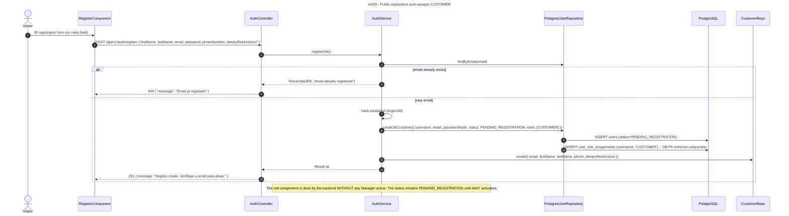
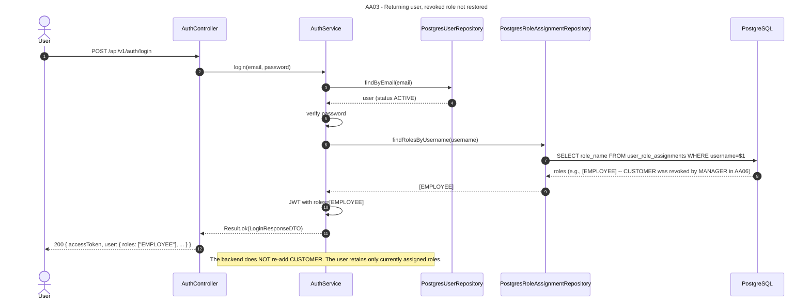
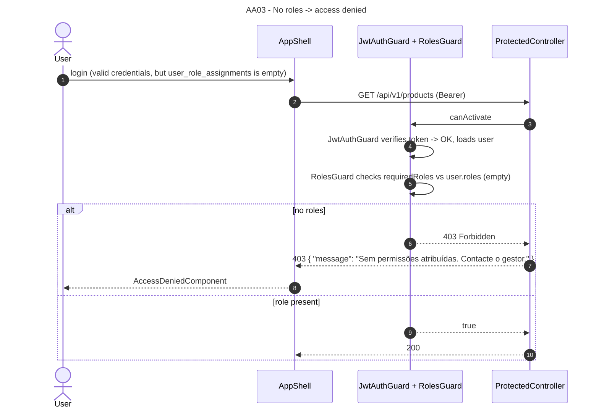
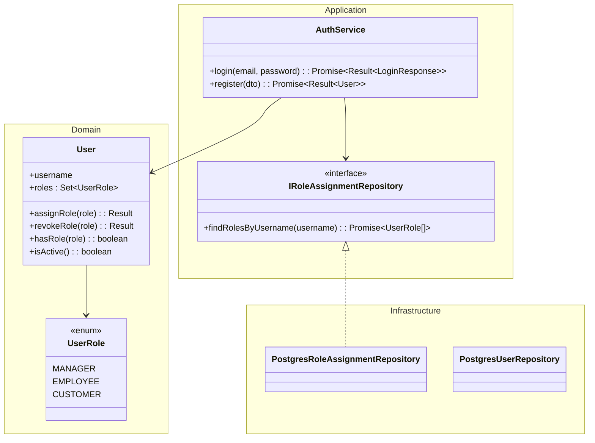
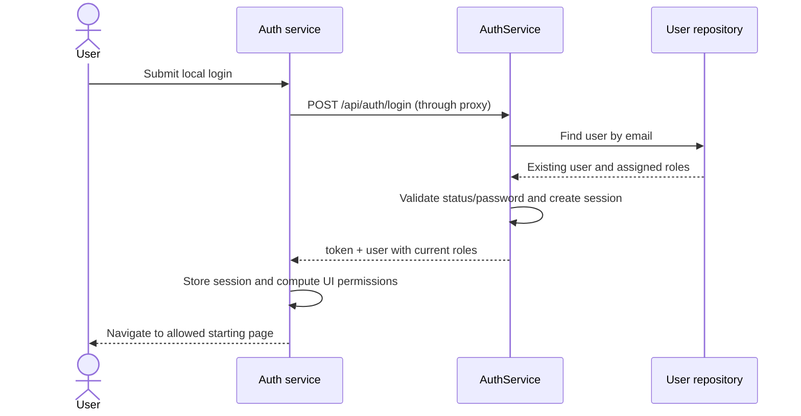

# AA03 — Internal Role Resolution

> **Documentation scope (2026-11-06):** Section 1 preserves the original requirements and proposed design baseline. Section 2 records the implementation inspected in this repository and takes precedence for current paths, roles, flows and completion claims. Differences are documented as remaining work or implementation departures, not as changes to the original specification.
>
> **Implementation update (2026-11-16):** Existing external users are returned with their persisted roles and status unchanged; the explicit unit coverage verifies that revoked roles are not recreated and deactivated accounts are rejected.

## 1. Requirements Engineering

### 1.1. User Story Description

As an authenticated System User, I want new accounts to receive the Customer role automatically and my assigned roles to be loaded after login, so that my access reflects my restaurant responsibilities.

### 1.2. Customer Specifications and Clarifications

#### From the specification document
> Extracted from *PART IV — Sprint 2 — User Stories* (AA03, p. 10).

- **Auto CUSTOMER on new account:** every newly created internal account (local OR external) **automatically receives the Customer role**, performed by the back end **without requiring an Administrator**.
- **No activation via role assignment:** auto-assignment of Customer **must not activate** the account, nor grant staff/Manager/Administrator permissions. Activation and identity-verification requirements continue to apply.
- **Returning users retain roles:** login must not recreate an existing account, **restore a revoked Customer role**, or **reactivate a disabled account**.
- **Roles loaded after login:** after either external or local authentication, the application must **obtain the user's active internal roles from the back end**.
- **Auth alone is insufficient:** authentication alone must not grant access to protected business functionality **without the corresponding internal authorization**.
- **Access denied states:** users with **no active role** or **inactive account** must receive an appropriate access-denied message.
- **Same model:** the same internal role model and permissions apply to both authentication methods.
- **No self-asserted roles:** roles supplied or selected by the user must **not** be accepted as proof of authorization.
- **Fail-closed:** if role information cannot be confirmed, protected functionality must remain unavailable.

#### From project clarifications

- **Clarification #03:** roles = `{MANAGER, EMPLOYEE, CUSTOMER}`; multi-role supported (`Set<UserRole>`).
- **Clarification #24 §1.1:** "Administrator" in Table 1 is a **functional designation of MANAGER**, not a separate role.
- **Clarification #24 §1.2:** invariant "≥ 1 active MANAGER" (applies to role removal/deactivation in AA06, not here).
- **Clarification #24 §3.2:** roles re-read from repository on every protected request (immediate effect).
- **Clarification #25:** Restaurant Staff == `EMPLOYEE`.
- **Clarification #27:** external JIT → `ACTIVE` CUSTOMER immediately; employee with CUSTOMER role requires a `Customer` record.
- **KB §4.1 step 6:** `JwtAuthGuard` loads current user from repository (not just token claims).

### 1.3. Acceptance Criteria (expanded, testable)

#### AC1 — Auto-assignment of CUSTOMER for new accounts
- AC1.1 `POST /api/v1/auth/register` (public) creates a `User` with `roles = {CUSTOMER}` and `status = PENDING_REGISTRATION` (Clarification #27). The role assignment is written to `user_role_assignments` by the `User` aggregate/service **without any Manager action**.
- AC1.2 External JIT (AA02 AC3.1) creates the `User` with `roles = {CUSTOMER}`, `status = ACTIVE`, and an associated `Customer` record.
- AC1.3 Auto-assignment is **idempotent**: re-running the flow (e.g., replaying a callback) never duplicates the assignment; the PK `(username, role_name)` prevents duplication at DB level, and the service treats `ConflictError` on assignment as a no-op.
- AC1.4 Auto-assignment does **not**:
  - Set `status = ACTIVE` (still `PENDING_REGISTRATION` until AA07 activation).
  - Assign `MANAGER` or `EMPLOYEE`.
  - Bypass the invitation requirement for Manager-provisioned staff (`pre_register` assigns roles per the invitation but keeps `PENDING_REGISTRATION`).

#### AC2 — Returning users retain current roles
- AC2.1 Every login (local or external) reads `user_role_assignments` for the user and returns the **current** roles in `LoginResponseDTO.user.roles[]`.
- AC2.2 Login does **not** re-add `CUSTOMER` to a user whose CUSTOMER role was revoked (Clarification #24 §1.2 allows revocation; the invariant ≥1 active MANAGER applies at revocation, not at login).
- AC2.3 Login does **not** reactivate a `DEACTIVATED` user (returns `403` per AA01 AC2.2).
- AC2.4 Login does **not** recreate a deleted user (a `User` that was deleted returns `401` per AA01 AC4.1).

#### AC3 — Roles are loaded after login from the back end
- AC3.1 The SPA uses the `user.roles[]` from `LoginResponseDTO` for UI rendering (WEB03).
- AC3.2 The JWT also carries `roles[]` in its claims, but the SPA and guards **treat the backend as authoritative**: on every protected request, `JwtAuthGuard` + `RolesGuard` re-read from the DB (AA04).
- AC3.3 The SPA refreshes the current user (`GET /api/v1/user/{username}` or equivalent self endpoint) when a `401`/`403` is received, to reflect a role change.

#### AC4 — Authentication ≠ authorization
- AC4.1 An authenticated user with **no roles** (empty `user_role_assignments`) is authenticated (JWT valid) but is rejected from every protected endpoint with `403 Forbidden` and message "Sem permissões atribuídas. Contacte o gestor."
- AC4.2 An authenticated user with `status != ACTIVE` is rejected by `UserStatus.guard` with `403` (parity with AA01 AC2.2/AC2.3, enforced on every protected request, not just login).

#### AC5 — Unified role model
- AC5.1 The same `RolesGuard` enforces the same rules for local and external users.
- AC5.2 No endpoint distinguishes the authentication source after login.

#### AC6 — No self-asserted roles
- AC6.1 `POST /auth/register` and `PUT /user/me/*` **cannot** specify `roles`; any `roles` field in the body is rejected by `stripUnknown: true` in Joi (KB §26) and by the DTO shape (no `roles` field).
- AC6.2 `PUT /users/{username}/roles` (AA06) is `MANAGER`-only and validated against `UserRole` enum + the ≥1-active-MANAGER invariant.
- AC6.3 Any attempt to set roles via JWT manipulation fails signature verification (`JwtAuthGuard`).

#### AC7 — Fail-closed on indeterminate role state
- AC7.1 If the repository query for roles fails (DB unavailable, timeout), the guard rejects the request (`503 Service Unavailable` or `403` — see §1.7.4) rather than falling back to token claims.
- AC7.2 If the user record itself cannot be loaded, `JwtAuthGuard` rejects with `401`.

### 1.4. Found out Dependencies

**Preceding:**
- AA01 (login response shape includes `user.roles`), AA02 (external JIT).
- BCK01 (User aggregate + `user_role_assignments` table), BCK02 (Customer).
- Migration 001 (`user_role_assignments`), 007 (seed: 4 roles).
- AA06 (role assignment endpoint — used for revocation, not for the auto-assignment).

**Succeeding:**
- AA04 (guards implement the re-read behavior).
- WEB03 (role-based nav consumes `user.roles`).

### 1.5. Input and Output Data

#### 1.5.1. Registration and login contract (relevant excerpts)

`POST /api/v1/auth/register` (already defined by BCK01 / Clarification #27):
```json
{
  "firstName": "Maria",
  "lastName": "Silva",
  "email": "maria.silva@email.pt",
  "password": "Secr3tP@ssw0rd!",
  "phoneNumber": "+351912345678",
  "dietaryRestrictions": [{ "allergenName": "Dairy" }]
}
```
**No `roles` field** — the DTO has no such property; `stripUnknown: true` strips any attempt to include one.

Response `LoginResponseDTO.user.roles[]` — always contains exactly `["CUSTOMER"]` for a newly registered user (AA03 AC1.1).

#### 1.5.2. Self-inspection endpoint (used by SPA for refresh)

`GET /api/v1/user/:username` — `MANAGER` / self only. Returns `UserResponseDTO`:
```json
{
  "username": "maria.silva",
  "email": "maria.silva@email.pt",
  "firstName": "Maria",
  "lastName": "Silva",
  "status": "ACTIVE",
  "roles": ["CUSTOMER"]
}
```
No `password_hash`, no `external_idp_subject` (redacted).

#### 1.5.3. Persistence

Relevant tables (migration 001 + 007):
- `user_roles` (name PK; seeded with `MANAGER`, `EMPLOYEE`, `CUSTOMER`).
- `user_role_assignments` (username, role_name) PK, FKs `ON DELETE CASCADE` (user) / `ON DELETE RESTRICT` (role).

Invariant enforced at DB: PK uniqueness on `(username, role_name)`. **No** DB-level check on "at least one CUSTOMER role for customers" — this is a business invariant handled by the registration/JIT services (and by the invariant that a `User` with the `CUSTOMER` role must have a `Customer` record, Clarification #27).

#### 1.5.4. JWT claim shape (parity with AA01 §1.5.4)

Same as AA01. `roles[]` in the JWT is a **snapshot** at login; the **authoritative** roles are re-read by the guard on each request (AA04).

### 1.6. System Sequence Diagrams (SSD)

#### 1.6.1. Public registration → auto CUSTOMER role



#### 1.6.2. External JIT → auto CUSTOMER role (cross-ref AA02)

Already covered in AA02 §1.6.2 (Case C). The relevant outcome for AA03: `roles = {CUSTOMER}`, `status = ACTIVE`, `Customer` record created. No invitation required (Clarification #27).

#### 1.6.3. Returning user — roles loaded, revoked roles NOT restored



#### 1.6.4. Authenticated user with no roles → access denied



### 1.7. Other Relevant Remarks

#### 1.7.1. Clean Architecture placement



#### 1.7.2. Domain invariant — auto-assignment on creation

The `User` static factories set `roles` **explicitly**:

```
User.createCustomer(email, passwordHash, ...)         → roles = {CUSTOMER}, status = PENDING_REGISTRATION
User.createExternalCustomer(email, sub, ...)          → roles = {CUSTOMER}, status = ACTIVE
User.inviteStaffMember(email, roles)                  → roles = roles (from Manager DTO), status = PENDING_REGISTRATION
```

`User.assignRole(...)` and `User.revokeRole(...)` enforce the ≥1-active-MANAGER invariant at the domain level (used by AA06). Login (AA01) and JIT (AA02) only **read** `roles`; they never call `assignRole` for an existing user.

#### 1.7.3. Error-to-HTTP matrix

| Action | Condition | HTTP | UI feedback |
|---|---|---|---|
| Register | email already registered | 409 | "Email já registado" |
| Register | unknown `roles` field | 400 (Joi `stripUnknown: true` actually strips, so no error — but the field is silently ignored) | — |
| Login | user has no roles | 200 (login succeeds, `roles: []`) — subsequent protected calls return 403 | "Sem permissões. Contacte o gestor." (on first 403) |
| Protected endpoint | user has no roles | 403 | "Sem permissões atribuídas. Contacte o gestor." |
| Protected endpoint | user status DEACTIVATED | 403 | "Conta desativada. Contacte o gestor." |
| Protected endpoint | role repository unavailable | 503 | "Serviço temporariamente indisponível. Tente novamente." |
| Any | role assignment in body | silently stripped by Joi | — (no leak) |

#### 1.7.4. Verification (automated + demo)

- **Unit (domain):** `User.createCustomer` sets `roles = {CUSTOMER}` and `status = PENDING_REGISTRATION`; `User.createExternalCustomer` sets `roles = {CUSTOMER}`, `status = ACTIVE`, `passwordHash = null`; `assignRole`/`revokeRole` enforce the ≥1-active-MANAGER invariant.
- **Unit (application):** `AuthService.register` — auto CUSTOMER assigned, status stays PENDING, no Manager required; `AuthService.login` returns current roles (revoked roles not restored); no role field accepted from the DTO.
- **Integration (Supertest):** `POST /auth/register` → 201 + roles `["CUSTOMER"]` in the response (if the response includes the user); subsequent `GET /users/me` shows `CUSTOMER`; revoke CUSTOMER via `PUT /users/{username}/roles` (AA06) → next login `roles = []` and protected request → 403.
- **DB suite:** `user_role_assignments` PK uniqueness prevents duplicate CUSTOMER; `ON DELETE CASCADE` from users.
- **Demo:** register a new customer → login → sees catalogue; login as a `MANAGER`-revoked CUSTOMER → protected page → 403 "Sem permissões"; external JIT → same flow (ACTIVE immediately).

## 2. Current Implementation — 2026-11-06

### 2.1. Role resolution and lifecycle

The implemented role enum contains **ADMINISTRATOR, MANAGER, EMPLOYEE and CUSTOMER**. Administrator is distinct from Manager. New public local registration creates an ACTIVE account with CUSTOMER, while completing an existing PENDING_REGISTRATION account activates it and retains the roles assigned by the invitation. Login reads the existing user and returns its current roles/status without assigning CUSTOMER again or reactivating the account.

Roles are assigned by backend application services; neither authentication form submits a role selection in its public registration request. Manager/Administrator invitations are a separate protected operation using `{email, roleName}`. Role replacement on existing users uses Administrator-only `PUT /api/user/{username}/roles` with `{roles: [...]}`. The Users dialog requires at least one selected role, disables role editing for inactive accounts, and prevents the current Administrator from removing their own Administrator access.

### 2.2. Frontend consumption and current-state enforcement

`Auth.session` stores the backend response. Computed predicates `administrator`, `manager`, `restaurant` and `staff` drive navigation, landing pages and management controls. A user with only CUSTOMER cannot enter the staff workspace. The staff form explains missing staff access and signs out that session; successful staff entry chooses products for Managers, users for Administrators and orders for Employees.

The backend `AuthGuard` verifies the token/session and loads the current User from the repository on each protected request. It places current `roles`, `status`, `username` and `sid` on `request.user`; `RolesGuard` checks these roles. The frontend does not refresh a user endpoint after every login/navigation/403: it initially uses the returned user snapshot. Own-account updates can update the stored snapshot via `Auth.updateUser()`.



### 2.3. Coverage and remaining work

Local role loading and server-side current-role enforcement are implemented. The original claims that public registration starts PENDING, Administrator maps to MANAGER, and the SPA automatically refreshes roles on 401/403 are superseded by the behavior above. A protected API `401` ends the local session; `403` shows shared access denied and retains it. Automatic refresh of externally changed roles in menus remains pending.

No external JIT/OIDC flow is implemented in the inspected frontend, so common behavior across local and external authentication remains unverified. `customerGuard` currently checks ACTIVE identity rather than requiring an explicit CUSTOMER role. Backend routes without role metadata permit an authenticated request subject to other checks; the blanket no-roles rejection described in §1 is not established by `RolesGuard` itself.

**Source:** [role enum](../../../backend/src/application/user/UserRoles.ts), [backend registration/login](../../../backend/src/application/auth/AuthService.ts), [backend AuthGuard](../../../backend/src/presentation/auth.guard.ts), [frontend Auth](../../../frontend/src/app/shared_components/core/auth/auth.ts), [Users controls](../../../frontend/src/app/backoffice/pages/users/users.ts).

**Existing verification:** [role-access browser matrix](../../../frontend/e2e/role-access.spec.ts), [staff registration and role management](../../../frontend/e2e/backoffice/backoffice.spec.ts), [backend auth service tests](../../../backend/tests/unit/application/auth.service.spec.ts), and [role endpoint tests](../../../backend/tests/integration/user.roles.controller.spec.ts).
