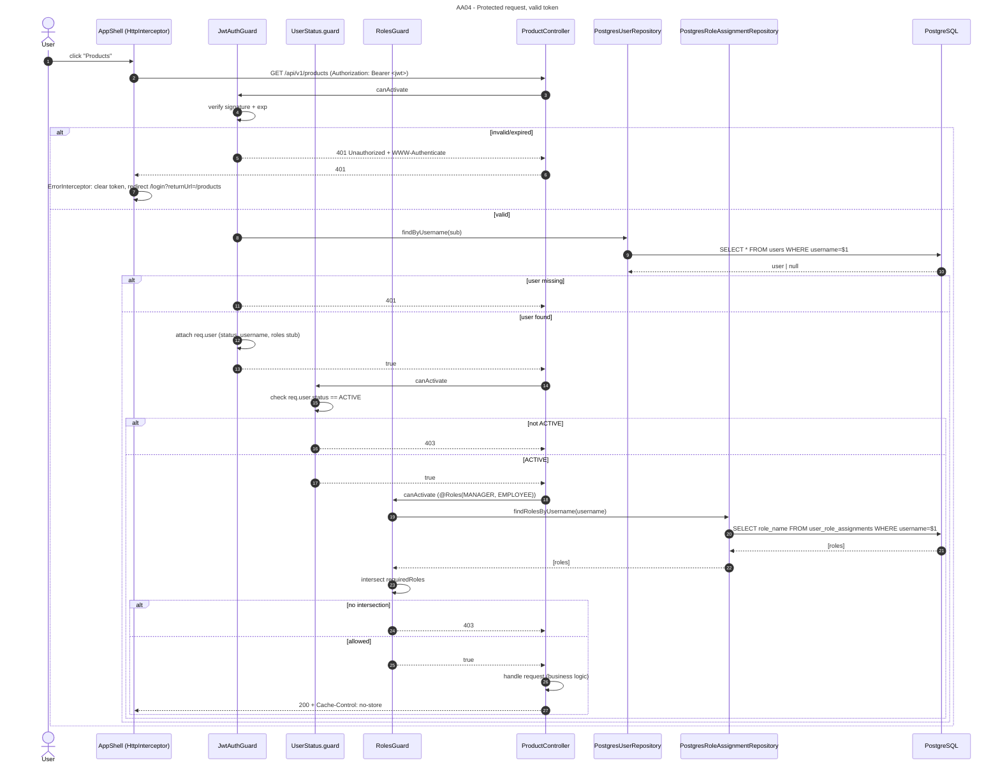
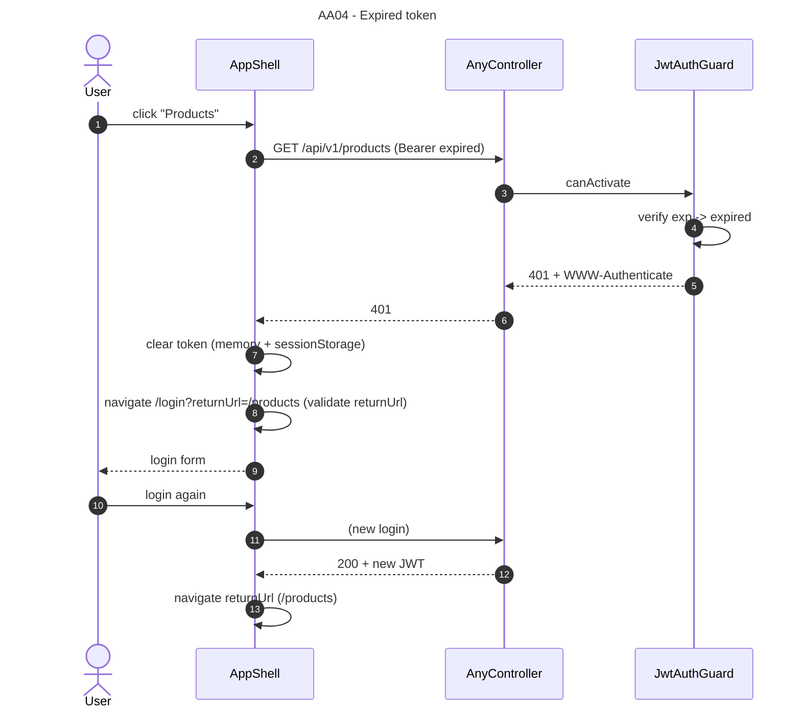
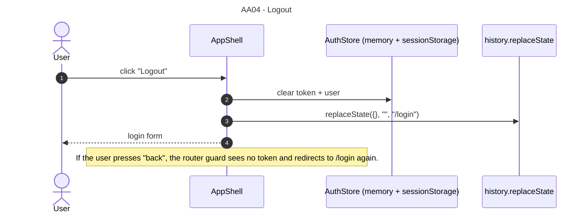
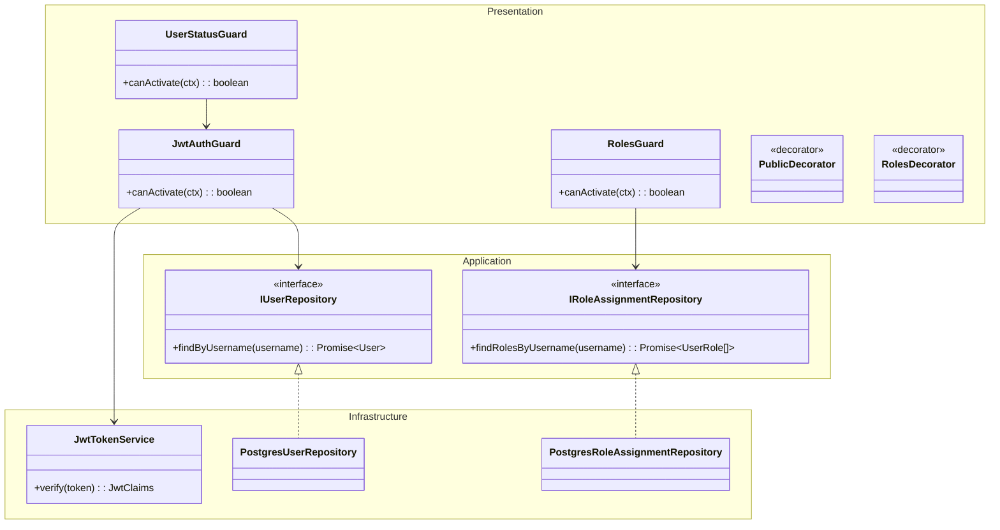
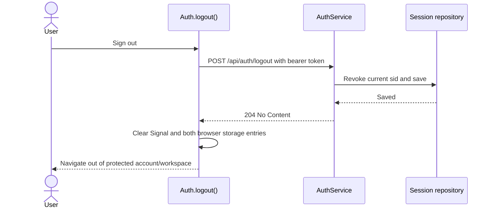

# AA04 — Secure Session Handling

> **Documentation scope (2026-11-06):** Section 1 preserves the original requirements and proposed design baseline. Section 2 records the implementation inspected in this repository and takes precedence for current paths, roles, flows and completion claims. Differences are documented as remaining work or implementation departures, not as changes to the original specification.

> **Current implementation update (2026-11-16):** The hardening implementation adds a persisted, opaque refresh token to the session record. Refresh tokens are stored only as SHA-256 hashes, rotated on every successful `POST /auth/refresh`, and the previous session credential is revoked atomically.


## 1. Requirements Engineering

### 1.1. User Story Description

As a System User, I want my authenticated session to be handled securely, so that I can use protected functionality consistently.

### 1.2. Customer Specifications and Clarifications

#### From the specification document
> Extracted from *PART IV — Sprint 2 — User Stories* (AA04, p. 10).

- **Secure session maintained** while the user works in the application.
- **Protected operations** verify that the session is **valid** and belongs to an **active, authorized user**.
- **Expired/invalid** sessions require **renewal or new login** before protected work continues.
- **Logout** prevents the ended session from being reused to perform protected operations.
- **Parity:** local and external auth must provide equivalent session-protection and authorization behaviour.
- **No session info in URLs/messages/logs.**
- **Back-button after logout** must not reveal protected information.

#### From project clarifications and ADRs

- **ADR-004 (KB §5):** Stateless JWT (`exp` 15 min default); guard pipeline `JwtAuthGuard` → `RolesGuard` → `UserStatus.guard`; guards re-read from DB; delayed token revocation is a known trade-off, mitigated by (a) short TTL, (b) user deactivation → `UserStatus.guard` rejects, (c) role revocation → `RolesGuard` rejects.
- **Clarification #24 §3.2:** role changes take effect immediately because guards re-read from DB.
- **AA02 §1.7.3 (this batch):** the OIDC callback uses a **one-time exchange code** (not JWT in URL) — consistent with AA04's "no session info in URLs".
- **KB §4.1 step 6:** `JwtAuthGuard` loads the current user from repository (not just token claims).

### 1.3. Acceptance Criteria (expanded, testable)

#### AC1 — Session maintained securely
- AC1.1 The JWT is transmitted only in the `Authorization: Bearer <token>` header, **never** in a URL, cookie, or request body.
- AC1.2 The SPA stores the JWT in **memory** and optionally in `sessionStorage` (tab-scoped, cleared on tab close); it does **not** use `localStorage` (reduces XSS persistence) and does **not** use a cookie for the JWT.
- AC1.3 `JwtTokenService` signs with HS256 (or RS256 if a key pair is configured) and a secret of ≥ 32 bytes; secret comes from `JWT_SECRET` env (never hard-coded; KB §36).
- AC1.4 Default `exp` = 900 s; configurable via `JWT_TTL_SECONDS`. The current hardening flow also returns an opaque persisted refresh token; this extends the original Sprint 2 baseline.

#### AC2 — Protected operations verify session validity + active authorized user
- AC2.1 `JwtAuthGuard` runs on every non-public endpoint and:
  - Verifies signature and `exp`.
  - Loads the user by `sub` from the repository.
  - Rejects `401` if the token is missing, malformed, expired, signature-invalid, or the user no longer exists.
- AC2.2 `UserStatus.guard` runs after `JwtAuthGuard` and rejects `403` if `user.status != ACTIVE`.
- AC2.3 `RolesGuard` runs after `UserStatus.guard` and rejects `403` if the user does not hold any of the required roles (re-read from DB, not from the token).
- AC2.4 The guards are registered globally in `AppModule` and applied to every controller; `@Public()` opts out.
- AC2.5 The guard pipeline is identical for local and external users (no branching on authentication source).

#### AC3 — Expired/invalid session behaviour
- AC3.1 `401` responses include `WWW-Authenticate: Bearer realm="laprizza"` (KB §27).
- AC3.2 The SPA's `ErrorInterceptor` on `401`:
  - Clears the stored JWT (memory + sessionStorage).
  - Redirects to `/login?returnUrl=<current path>`.
- AC3.3 The login page, after successful re-login, redirects to `returnUrl` if it is an internal path; open-redirect is prevented by validating that `returnUrl` starts with `/` and does not contain `//` (protocol-relative) or `\`.
- AC3.4 On `403`, the SPA does **not** clear the JWT (the user is authenticated) but shows the access-denied message (WEB03).

#### AC4 — Logout prevents reuse
- AC4.1 The SPA logout action:
  - Calls `POST /api/v1/auth/logout` (optional — see §1.7.4 for the decision).
  - Clears JWT from memory + sessionStorage.
  - Navigates to `/login` and replaces browser history entry (`history.replaceState`) so the back button does not return to the protected page.
- AC4.2 The backend's stateless model means a copied JWT can still be replayed until its `exp` (documented trade-off per ADR-004). Mitigation options (documented, not all required):
  - Short TTL (default 15 min).
  - User deactivation (immediate `403` via `UserStatus.guard`).
  - Role revocation (immediate `403` via `RolesGuard`).
  - **Optional:** server-side token blacklist (deferred; ADR-004 lists it as a future mitigation).
- AC4.3 `POST /api/v1/auth/logout` (if implemented) accepts the current JWT and records the `logout` event in an audit log (not in scope for Sprint 2 baseline; the SPA-only logout is sufficient per AC4.1).

#### AC5 — Parity local/external
- AC5.1 Same guards, same JWT shape, same SPA storage, same logout flow for both paths.
- AC5.2 No endpoint checks how the JWT was obtained (there is no `auth_source` claim).

#### AC6 — No session info in URLs/messages/logs
- AC6.1 The JWT never appears in: URL query strings, URL fragments, HTTP response bodies other than the login/exchange endpoint, error messages, or logs.
- AC6.2 The backend logger redacts `authorization`, `password`, `code`, `access_token`, `id_token`, `refresh_token`.
- AC6.3 The SPA's browser history does **not** contain the JWT (only the current route; `returnUrl` may be in the query but never the token).
- AC6.4 The OIDC callback's **one-time exchange code** is the only auth bootstrap value that appears in a URL; it is single-use, TTL 60 s, in-memory, and is **not** the session credential (AA02 §1.7.3).

#### AC7 — Back-button after logout
- AC7.1 The SPA's route guard rejects navigation to any protected route when the JWT is absent (even if the browser back button is pressed).
- AC7.2 API responses include `Cache-Control: no-store` (implemented via a global interceptor or per-controller header) so that the browser does not serve cached protected payloads after logout.
- AC7.3 The HTML shell (`index.html`) may be cached; the SPA re-bootstraps, finds no token, and redirects to `/login` — no protected data is revealed.

### 1.4. Found out Dependencies

**Preceding:**
- AA01 (JWT issuance), AA02 (external JWT issuance), AA03 (roles in token + DB).
- ADR-004 (JWT + guard pipeline).
- `JwtTokenService` (HS256 signing/verification).

**Succeeding:**
- Every protected controller (BCK01–BCK11, WEB05–WEB07, AI05) depends on the guard pipeline described here.
- WEB03 (role-based nav uses `401`/`403` handling).

### 1.5. Input and Output Data

#### 1.5.1. Guards (NestJS)

- `JwtAuthGuard` (implements `CanActivate`): reads `Authorization`, verifies via `JwtTokenService`, loads user via `IUserRepository`, attaches `req.user` (a minimal `AuthenticatedUser` object). Skips if `@Public()` metadata is present.
- `UserStatus.guard` (implements `CanActivate`): reads `req.user.status`, rejects `403` if `!= ACTIVE`.
- `RolesGuard` (implements `CanActivate`): reads `@Roles(...)` metadata and `req.user.roles`; rejects `403` if no intersection.

#### 1.5.2. Headers and error shapes

`401` response:
```
HTTP/1.1 401 Unauthorized
WWW-Authenticate: Bearer realm="laprizza"
Content-Type: application/json

{ "timestamp":"…","status":401,"error":"Unauthorized","message":"Token inválido ou expirado" }
```

`403` response (access denied):
```
HTTP/1.1 403 Forbidden
Content-Type: application/json

{ "timestamp":"…","status":403,"error":"Forbidden","message":"Sem permissões para esta operação" }
```

#### 1.5.3. Persistence

No new tables for AA04. Guards read `users` (status) and `user_role_assignments` (roles) on every protected request. This is an intentional DB read per request (Clarification #24 §3.2 trades a per-request read for immediate revocation — ADR-004 documents the trade-off).

Optional (deferred) `token_blacklist` table for future per-token revocation: `{ jti PK, username, expires_at, revoked_at }`. Not implemented in Sprint 2 baseline (ADR-004 explicitly defers it).

#### 1.5.4. JWT claim shape

Same as AA01 §1.5.4. Claims are a snapshot; guards re-read the DB.

### 1.6. System Sequence Diagrams (SSD)

#### 1.6.1. Protected request — valid token, active user, required role



#### 1.6.2. Expired token



#### 1.6.3. Logout (client-side)



#### 1.6.4. Back-button after logout

```mermaid
sequenceDiagram
autonumber
title AA04 - Back-button after logout
    actor User
    participant Browser as Browser history
    participant Router as Angular Router
    participant Guard as AuthGuard (frontend)
    participant Store as AuthStore

    User->>Browser: press Back (target: /products)
    Browser->>Router: navigate /products
    Router->>Guard: canActivate(/products)
    Guard->>Store: hasToken()
    alt no token
        Guard-->>Router: redirect /login
        Router-->>User: login form (no protected data)
    else token present (should not happen after logout)
        Guard->>Router: allow (defense in depth; backend will still 401 if token invalid)
    end
```

### 1.7. Other Relevant Remarks

#### 1.7.1. Clean Architecture placement



#### 1.7.2. Guard pipeline order (enforced globally)

1. `JwtAuthGuard` — proves identity (`401` on failure).
2. `UserStatus.guard` — proves active (`403` on failure).
3. `RolesGuard` — proves authorization (`403` on failure).

Order matters: a deactivated user with a valid token must fail at step 2, not step 3 (so the message is "Conta desativada", not "Sem permissões"). The SPA can differentiate based on the error code/message, improving UX.

#### 1.7.3. Token revocation — decision record

- **Baseline (Sprint 2):** no server-side revocation. Mitigation: 15-min TTL + `UserStatus.guard` + `RolesGuard` (both read the DB per request).
- **Alternatives considered:**
  - *Token blacklist (Redis)*: rejected for Sprint 2 baseline (ADR-004 defers it). Adds state; requires Redis in the stack; the 15-min TTL is judged acceptable for an academic prototype.
  - *Refresh token + access token*: rejected for Sprint 2 baseline (ADR-004 doesn't include refresh tokens). Would extend the session length; not required by the ACs.
  - *Server-side sessions (cookie)*: rejected — breaks statelessness and requires CSRF protections; ADR-004 already chose JWT.

#### 1.7.4. Logout endpoint — decision

`POST /api/v1/auth/logout` is **optional** in Sprint 2 baseline. The SPA-side token clearing satisfies AA04 AC4.1 ("Logout must prevent the ended session from being reused"). A backend logout endpoint would need a token blacklist to be meaningful, which is deferred. If implemented, it must be documented as audit-only (`{ username, timestamp }` recorded; no token invalidation effect).

#### 1.7.5. Error-to-HTTP matrix

| Action | Condition | HTTP | UI feedback |
|---|---|---|---|
| Protected request | missing `Authorization` header | 401 + `WWW-Authenticate` | redirect `/login?returnUrl=…` |
| Protected request | malformed token | 401 + `WWW-Authenticate` | same |
| Protected request | expired token | 401 + `WWW-Authenticate` | same |
| Protected request | signature invalid | 401 + `WWW-Authenticate` | same |
| Protected request | user deleted | 401 + `WWW-Authenticate` | same |
| Protected request | user status != ACTIVE | 403 | "Conta desativada. Contacte o gestor." |
| Protected request | user has no required role | 403 | "Sem permissões para esta operação." |
| Protected request | role repository unavailable | 503 | "Serviço temporariamente indisponível." |
| Logout | — | (client-side only in baseline) | redirect `/login` |
| Back-button after logout | no token | SPA redirect | `/login` |

#### 1.7.6. Verification (automated + demo)

- **Unit (guards):** `JwtAuthGuard` — 5 cases: valid, missing, malformed, expired, signature-invalid, user-deleted. `UserStatus.guard` — 2 cases: ACTIVE, DEACTIVATED. `RolesGuard` — 3 cases: required role present, absent, multiple roles present.
- **Integration (Supertest):** each protected controller rejects `401` without token, `401` with bad token, `403` with valid token + wrong role, `200` with valid token + correct role; `UserStatus.guard` rejects a deactivated user on any protected endpoint (simulate via `PUT /users/{username}` deactivation + old token still valid).
- **SPA integration:** `ErrorInterceptor` clears token on `401`; `returnUrl` validation rejects `//evil.com` and `\evil.com`; back-button test via router unit test (no token → redirect).
- **Security:** assert JWT never appears in `console.log` output (mock console and inspect); assert `Authorization` header redacted in request logger; assert `Cache-Control: no-store` on protected responses.
- **Demo:** login → access protected page → wait for token expiry (or reduce `JWT_TTL_SECONDS` in env) → next request triggers `401` → SPA redirects to login with `returnUrl` preserved → re-login → back to the protected page. Logout → back button → login page (no protected data). Revoke a role via `PUT /users/{username}/roles` → next protected request from the same session (still-valid JWT) → `403`.

## 2. Current Implementation — 2026-11-06

### 2.1. Session storage and request handling

Login/registration returns a bearer JWT and user snapshot. The SPA keeps this in a Signal and stores it under `forno-session`: `sessionStorage` by default, or `localStorage` when Remember me is selected. Registration uses session storage. Restoring a session checks token presence, the user-role array and the decoded expiry. This client check does not verify the JWT signature; the backend does that on protected requests. Passwords are not stored in the session object.

The shared `authInterceptor` attaches `Authorization: Bearer ...` to `/api/` requests except the exact login, registration, recovery-request and recovery-reset URLs. Some public business-read requests can therefore carry the token when signed in; the variable named `protectedApi` is an interceptor classification, not the backend route policy.

| API outcome | Implemented SPA behavior |
|---|---|
| `401` on a bearer-attached API request | Clear matching stored session and redirect to `/backoffice/login` or `/login` with `returnUrl` |
| `401` on login/recovery endpoints | Propagate inline error; do not clear a separately stored session |
| Any `/api/` `403` | Navigate to public `/unauthorized` using `replaceUrl`; retain session |
| Logout `401` | Clear already rejected credential; let logout complete without recursive login navigation |
| Logout network/server failure | Retain session, display failure and allow retry |

### 2.2. Server-side revocation and logout

Sessions are persisted in `auth_sessions`; JWTs include a `sid`. `AuthGuard` verifies HS256 signature/expiry, requires a valid active session for the subject, and reloads current user roles/status. The globally registered guard order is **AuthGuard → RolesGuard → StatusGuard**, as configured in `auth.module.ts`. Role/status restrictions depend on route metadata; they are not unconditional ACTIVE checks on every endpoint.

`POST /api/auth/logout` revokes the current server session and returns `204`. The frontend waits for success before clearing local credentials and leaving the account/workspace. An already invalid credential (`401`) is also cleared. Other failures keep the session available for a retry. Thus logout is implemented with server-side invalidation, superseding the optional/audit-only/client-only design in §1.



### 2.3. Limits and verification

Browser storage is the current persistence mechanism, not an HttpOnly-cookie design. There is no silent-refresh or automatic profile/role refresh flow. The restored frontend user snapshot can become stale; current backend session/user checks determine whether subsequent operations succeed. OIDC session parity and the full cache/back-button acceptance criteria are not established by the frontend tests alone.

**Source:** [frontend session/interceptor/logout](../../../frontend/src/app/shared_components/core/auth/auth.ts), [global guard registration](../../../backend/src/presentation/auth.module.ts), [backend AuthGuard](../../../backend/src/presentation/auth.guard.ts), [JWT/session issuance](../../../backend/src/infrastructure/security/JwtTokenService.ts), [backend logout](../../../backend/src/application/auth/AuthService.ts), [session migration](../../../backend/src/infrastructure/persistence/migrations/015_create_auth_sessions_table.sql).

**Existing verification:** [storefront logout success/failure/rejected-token cases](../../../frontend/e2e/frontoffice/storefront.spec.ts), [staff logout and 401 handling](../../../frontend/e2e/backoffice/backoffice.spec.ts), [403 handling](../../../frontend/e2e/authorization.spec.ts), [backend guard tests](../../../backend/tests/unit/presentation/auth.guard.spec.ts), and [backend authentication/session tests](../../../backend/tests/integration/auth.controller.spec.ts).
