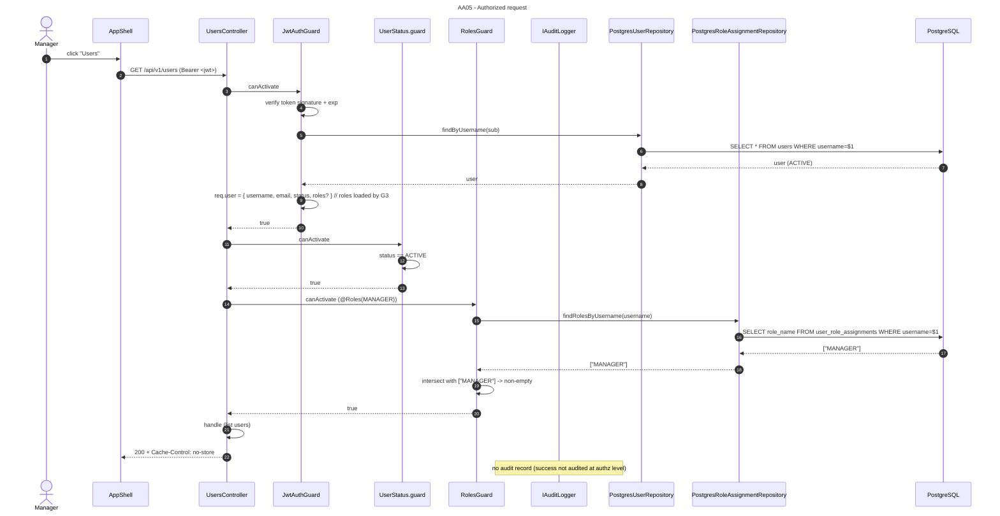
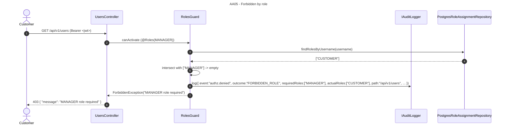
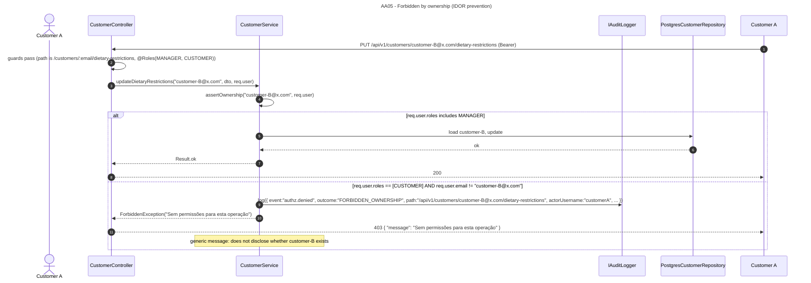
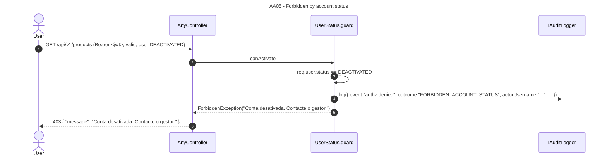
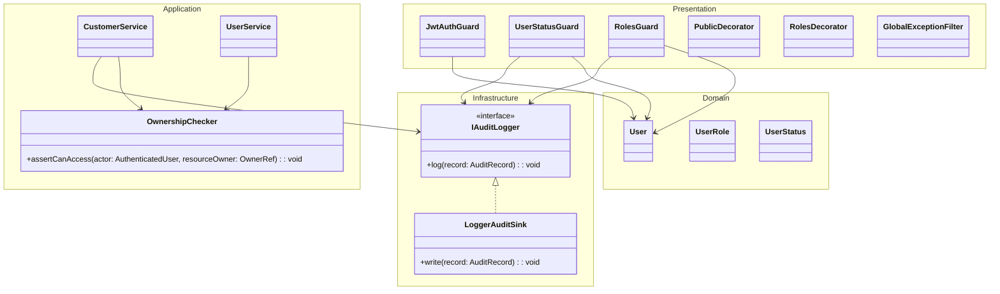
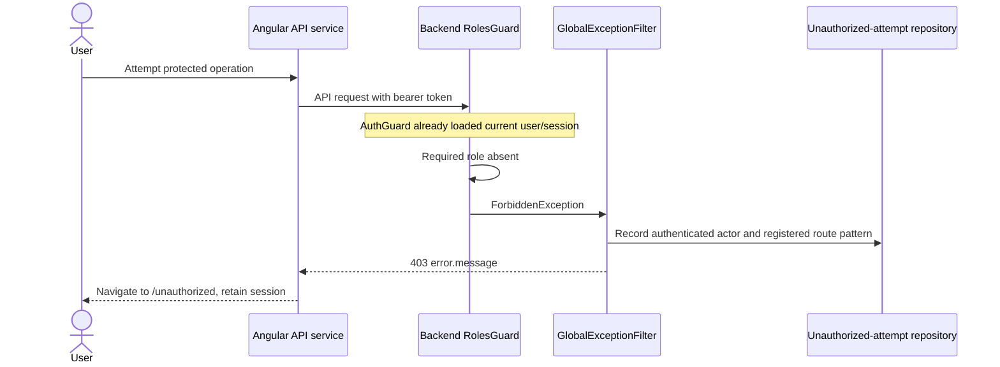

# AA05 — Authorization Enforcement

> **Documentation scope (2026-11-06):** Section 1 preserves the original requirements and proposed design baseline. Section 2 records the implementation inspected in this repository and takes precedence for current paths, roles, flows and completion claims. Differences are documented as remaining work or implementation departures, not as changes to the original specification.
>
> **Implementation update (2026-11-16):** Product mutations explicitly use the authentication, active-status and role guards in addition to the global guard pipeline. The remaining work is evidence for audit filtering, not authorization of these product mutations.

## 1. Requirements Engineering

### 1.1. User Story Description

As a LaPizza Manager, I want access restrictions enforced throughout the system, so that users can perform only permitted operations.

> **Note on the actor label:** the US text says "As a LaPizza Manager", but the ACs are cross-cutting — they are enforced by the system as a whole (Web App + supporting services) and validated by automated checks per base role. The `MANAGER` actor is the one who benefits from the guarantee that no unauthorized action is possible. This is documented here because the acceptance evidence must show **both permitted and denied** operations for **all** base roles, not only `MANAGER`.

### 1.2. Customer Specifications and Clarifications

#### From the specification document
> Extracted from *PART IV — Sprint 2 — User Stories* (AA05, p. 11) and *Table 1* (pp. 11–12).

- **Check on every protected request:** permissions checked whenever protected information or functionality is requested.
- **Both layers:** access to unauthorized sections and actions prevented in both the **Web Application** and the **supporting services**.
- **401 vs 403 distinction:** distinguish authentication failure from lack of permission and return an appropriate response.
- **No IDOR:** users must not access another customer's personal information by changing a record reference or request parameter.
- **Audit:** unauthorized attempts recorded with sufficient information for investigation, **without recording passwords or session secrets**.
- **Base-role table:** permissions follow the base-role table (Table 1) and the least-privilege principle.
- **Automated evidence:** checks must demonstrate both permitted and denied operations for the base roles.

#### From project clarifications (`docs/domain/client-questions.md`)

- **Clarification #24 §3.2:** role revocation takes effect immediately because guards read DB, not token claims.
- **Clarification #24 §1.2:** ≥ 1 active `MANAGER` invariant (enforced on role removal / deactivation, see AA06).
- **Clarification #25:** Restaurant Staff == `EMPLOYEE`; roles fixed `{MANAGER, EMPLOYEE, CUSTOMER}`.
- **Clarification #27:** `User` with `CUSTOMER` role must have an associated `Customer` record.
- **Clarification #23 §1.2:** error messages explain reason + link to dependencies (relevant for `403` explanations where safe).
- **KB §4.1 (steps 6–8):** the guard pipeline (`JwtAuthGuard → RolesGuard → UserStatus.guard` — actually `UserStatus.guard` runs before `RolesGuard` in the implementation; the KB text is not strictly ordered, but the semantics are documented here in the correct order).
- **KB §13.1:** controllers are thin; RBAC is enforced by the guards in the presentation layer, **not** by business rules in the domain — except ownership checks, which are application-service concerns (the domain can't know the current actor).

### 1.3. Acceptance Criteria (expanded, testable)

#### AC1 — Permissions checked on every protected request
- AC1.1 Every non-public controller method has the guard pipeline `JwtAuthGuard → UserStatus.guard → RolesGuard` applied (globally via `APP_GUARD`, opt-out with `@Public()`).
- AC1.2 `@Roles(...)` metadata is declared on every protected route, matching Table 1.
- AC1.3 The guard reads roles and status from the **repository on every request** (AA04 AC2), not from JWT claims.
- AC1.4 The `@Public()` decorator is the **only** way to bypass the guards; a route without `@Roles(...)` and without `@Public()` must be treated as a build-time error (verified by a lint rule / unit test that enumerates controllers and asserts each method is annotated).

#### AC2 — Web App and supporting services both enforce
- AC2.1 **Frontend (SPA):** `RoleGuard` blocks navigation to unauthorized routes; `*ngIf`/`@if` hides mutation controls (WEB03).
- AC2.2 **Backend (NestJS):** `RolesGuard` rejects unauthorized calls with `403` regardless of what the SPA rendered.
- AC2.3 Backend is authoritative: a forged SPA (or direct `curl`) cannot bypass.

#### AC3 — Distinguish authentication failure from lack of permission
- AC3.1 Missing / invalid / expired token → `401 Unauthorized` with `WWW-Authenticate: Bearer realm="laprizza"` (AA04 AC3.1).
- AC3.2 Valid token, insufficient role → `403 Forbidden` with a body that names the missing permission at a **coarse** level (e.g., `"MANAGER role required"`) — see AC6.4 for the granularity decision.
- AC3.3 Valid token, deactivated / pending account → `403 Forbidden` with a message that identifies **account status**, not missing role (so the user knows to contact the Manager, not to request a role).
- AC3.4 The two `403` variants (wrong role vs inactive account) use **distinct `message` values** so the SPA can route the user appropriately (see §1.7.4).

#### AC4 — No IDOR (ownership enforcement)
- AC4.1 Every endpoint whose path identifies a resource (customer email, username, order number, configuration name, etc.) enforces **ownership** at the application service level, not just role.
- AC4.2 The ownership matrix (§1.3.1) is the authoritative reference; deviations require an ADR.

##### 1.3.1. Ownership matrix (resource × actor)

| Resource | Endpoint | MANAGER | EMPLOYEE | CUSTOMER (self) | CUSTOMER (other) | Guest |
|---|---|---|---|---|---|---|
| `Customer` (`/customers/:email`) | GET / PUT / DELETE | ✅ | ❌ (Table 1: Employee does not see customer data) | ❌ (path is `:email`, not "me"; but self-service uses `/user/me/*`) | ❌ | ❌ |
| `Customer` dietary (`/customers/:email/dietary-restrictions`) | PUT | ✅ | ❌ | ✅ **if `:email == req.user.email`** | ❌ | ❌ |
| `User` (`/user/:username`) | GET / DELETE | ✅ | ❌ | ✅ **if `:username == req.user.username`** | ❌ | ❌ |
| `User` own contact (`/user/me/address`, `/user/me/phone-number`) | PUT | ✅ | ✅ | ✅ | — | ❌ |
| `Product` (`/products/:sku`) | GET (public read) / POST / PUT / DELETE / PATCH | ✅ | GET only | GET only | GET only | GET only |
| `ProductCategory`, `Allergen`, `PizzaSize`, `PizzaComponentType` | GET (public) / POST / PUT / DELETE | ✅ | GET only | GET only | GET only | GET only |
| `Stock` (`/stock`, `/stock/:sku/adjustments`) | GET / POST | ✅ | GET only | ❌ | ❌ | ❌ |
| `PredefinedPizza` | GET (public) / POST | ✅ | GET only | GET only | GET only | GET only |
| `Catalogue` (`/catalogue`, `/catalogue/:code`) | GET | ✅ | ✅ | ✅ | ✅ | ✅ (public) |
| `KitchenConfiguration` | GET (list) | ✅ | ✅ (viewer) | ❌ | ❌ | ❌ |
| `KitchenConfiguration` | POST / PUT / DELETE / activate | ✅ | ❌ | ❌ | ❌ | ❌ |
| `ConsumptionForecast`, `SupplierScenario` | all | ✅ | ❌ | ❌ | ❌ | ❌ |
| `PlanningResult` | all | ✅ | ❌ | ❌ | ❌ | ❌ |
| `RoleChangeLog` (`/users/:username/role-history`) | GET | ✅ | ❌ | ❌ | ❌ | ❌ |
| `ProductExport` (`/products/export`) | GET | ✅ | ❌ | ❌ | ❌ | ❌ |

> **"Self"** means the authenticated principal's `username` (or `email`, for `Customer`) equals the path parameter. The application service compares `req.user.username` / `req.user.email` against the loaded resource; on mismatch → `403 Forbidden` with the same body as a role failure (do not leak that the resource exists — see AC6.4).

#### AC5 — Audit of unauthorized attempts
- AC5.1 Every `401` and `403` produced by the guard pipeline is logged with: `timestamp`, `event`, `actorUsername` (or `null` for unauthenticated), `sourceIp`, `method`, `path`, `requiredRoles`, `actualRoles`, `outcome` (`UNAUTHENTICATED` / `FORBIDDEN_ROLE` / `FORBIDDEN_OWNERSHIP` / `FORBIDDEN_ACCOUNT_STATUS`), `correlationId`.
- AC5.2 **No** passwords, tokens, cookies, `Authorization` header values, query strings that may contain tokens, or request bodies are logged.
- AC5.3 A successful `200` is **not** logged at the audit level by default (only access-level logging per KB §16.3, which is out of scope here); only denials are audited.
- AC5.4 Audit records are structured JSON (one line per event) and use the `event` key `"authz.denied"` or `"authz.unauthenticated"`.
- AC5.5 The audit sink is pluggable behind an `IAuditLogger` port; baseline writes to the NestJS `Logger` (stdout); a future adapter may write to a DB table `authz_audit_logs` (see §1.7.6 for the decision record).

#### AC6 — Least privilege and no information leakage
- AC6.1 The base-role table (Table 1) is the **single source of truth** for role-to-permission mapping; any deviation requires an ADR.
- AC6.2 Hiding a menu item is never the only defence (WEB03 AC6 + AC1.2 here).
- AC6.3 Public endpoints (`@Public()`) must be enumerated in `docs/api/openapi.yaml` with `security: []`; a CI check asserts consistency between the code and the contract.
- AC6.4 **Granularity of `403` messages:** the body names the **required role** (e.g., `"MANAGER role required"`) when the endpoint is **role-based** — this helps the user contact the right Manager. For **ownership** violations (`CUSTOMER` accessing another's `:email`), the body must be the **generic** `"Sem permissões para esta operação"` — otherwise the attacker could distinguish "resource exists but I lack ownership" from "resource does not exist", enabling enumeration. The distinction is enforced by the application service, not the guard.

### 1.4. Found out Dependencies

**Preceding:**
- AA01, AA02 (JWT issuance), AA03 (roles + auto-CUSTOMER), AA04 (guard pipeline + re-read).
- BCK01 (User aggregate), BCK02 (Customer aggregate — needed for ownership checks on `/customers/:email`).
- Migration 001 (`user_role_assignments`), 007 (roles seed).

**Succeeding:**
- Every protected controller in the system.
- AA06 (which mutates roles; relies on AA05 re-read behaviour to make revocation immediate).

### 1.5. Input and Output Data

#### 1.5.1. No new DTOs

AA05 adds no endpoints; it enforces the existing ones. The only new artefact is the audit record shape (§1.5.3).

#### 1.5.2. Guard pipeline and `AuthenticatedUser` shape

The `JwtAuthGuard` attaches `req.user` with:
```ts
interface AuthenticatedUser {
  username: string;   // business key
  email: string;
  status: UserStatus;
  roles: UserRole[];  // from repository, not token
}
```

`RolesGuard` reads `@Roles()` metadata and intersects with `req.user.roles`.

`OwnershipCheck` is **not** in the guard — it is a method on the application service (e.g., `CustomerService.assertOwnership(email, req.user)`) that throws `ForbiddenException` with the generic message when the check fails (AC6.4).

#### 1.5.3. Audit record shape

```json
{
  "timestamp": "2026-11-05T14:45:00.123Z",
  "event": "authz.denied",
  "correlationId": "01J8Z9K2-...",
  "actorUsername": "maria.silva",
  "sourceIp": "192.168.1.10",
  "method": "GET",
  "path": "/api/v1/users",
  "requiredRoles": ["MANAGER"],
  "actualRoles": ["CUSTOMER"],
  "outcome": "FORBIDDEN_ROLE",
  "httpStatus": 403
}
```

For unauthenticated attempts, `actorUsername` is `null` and `outcome` is `"UNAUTHENTICATED"`. For ownership violations, `outcome` is `"FORBIDDEN_OWNERSHIP"`.

#### 1.5.4. Persistence

No new tables in the Sprint 2 baseline. The audit sink is stdout; a `authz_audit_logs` table is **documented as an extension** (§1.7.6) with its DDL, to be added if the team decides on persistent audit.

### 1.6. System Sequence Diagrams (SSD)

#### 1.6.1. Authorized request (Manager accessing `/users`)



#### 1.6.2. Unauthorized request — wrong role (Customer → `/users`)



#### 1.6.3. Unauthorized request — ownership violation (Customer → another customer's dietary restrictions)



#### 1.6.4. Unauthorized request — account inactive (valid token, deactivated)



### 1.7. Other Relevant Remarks

#### 1.7.1. Clean Architecture placement



Key rule (ADR-001): guards are **presentation-layer** adapters. They depend on the application's `IUserRepository` / `IRoleAssignmentRepository` ports, not on TypeORM directly. Ownership checks are **application-layer** concerns because they need the current actor — the domain doesn't know who is calling.

#### 1.7.2. Why ownership is not in the guard

A `RolesGuard` cannot decide whether a `CUSTOMER` may act on `/customers/:email` because that requires loading the resource (to know who owns it) and comparing it to the actor. Loading the resource is an application-service concern. The guard can only assert "the actor has some role that might be allowed"; the application service must assert ownership. This is the standard split (guards = coarse RBAC; services = fine-grained authorization). Documented to prevent a common reviewer question.

#### 1.7.3. Audit sink — decision record

**Baseline (Sprint 2):** structured JSON via NestJS `Logger` (stdout), captured by the container runtime. Rationale: the ASIST/SYS layer already captures container logs (KB §36); a DB table would require a migration and adds write load to every denied request without clear value for the Sprint 2 deliverable.

**Alternatives considered:**
- *DB table `authz_audit_logs`*: rejected for the baseline (adds a per-denial write, requires a new migration, and the schema is not yet stabilised). Documented as an extension.
- *Dedicated log file*: rejected (container writes to stdout per 12-factor; volume management adds operational cost).
- *External SIEM*: rejected (out of scope).

**Extension (future):** a `015_*.sql` migration adding:
```sql
CREATE TABLE authz_audit_logs (
    log_id SERIAL PRIMARY KEY,
    actor_username VARCHAR NULL,
    source_ip VARCHAR NOT NULL,
    method VARCHAR NOT NULL,
    path VARCHAR NOT NULL,
    required_roles JSONB NOT NULL,
    actual_roles JSONB NOT NULL,
    outcome VARCHAR NOT NULL CHECK (outcome IN ('UNAUTHENTICATED','FORBIDDEN_ROLE','FORBIDDEN_OWNERSHIP','FORBIDDEN_ACCOUNT_STATUS')),
    http_status INT NOT NULL,
    recorded_at TIMESTAMPTZ NOT NULL DEFAULT NOW()
);
```

#### 1.7.4. Distinguishing `401` vs `403` in the SPA

The SPA's `ErrorInterceptor` (AA04 AC3.2/AC3.4) uses the following rules:
- `401` → clear token, redirect `/login?returnUrl=…`.
- `403` with `message` containing `"role required"` → show "Precisa da permissão `<role>`. Contacte o gestor."
- `403` with `message` containing `"Conta desativada"` or `"Conta pendente"` → show the message + link to logout (so the user can re-login with another account).
- `403` with `message` `"Sem permissões para esta operação"` (ownership) → show generic access-denied (WEB03 AC3), do not disclose reason.

#### 1.7.5. Error-to-HTTP matrix

| Action | Condition | HTTP | Audit `outcome` | UI feedback |
|---|---|---|---|---|
| Any protected | no token / malformed / expired / unknown user | 401 + `WWW-Authenticate` | `UNAUTHENTICATED` | redirect `/login?returnUrl=…` |
| Any protected | account `DEACTIVATED` / `PENDING_REGISTRATION` | 403 | `FORBIDDEN_ACCOUNT_STATUS` | "Conta desativada / pendente" |
| Any protected | role missing | 403 | `FORBIDDEN_ROLE` | "Precisa da permissão `<role>`." |
| `/customers/:email/dietary-restrictions` (PUT) | CUSTOMER on another's email | 403 | `FORBIDDEN_OWNERSHIP` | "Sem permissões para esta operação." |
| `/user/:username` (GET/DELETE) | CUSTOMER on another's username | 403 | `FORBIDDEN_OWNERSHIP` | same |
| `/user/me/*` | unauthenticated | 401 | `UNAUTHENTICATED` | redirect `/login` |
| Public endpoints | — | (allowed) | — | — |

#### 1.7.6. Verification (automated + demo)

**Unit (guards):** `JwtAuthGuard` (valid, missing, malformed, expired, unknown user) — 5 cases; `UserStatus.guard` (ACTIVE, DEACTIVATED, PENDING) — 3 cases; `RolesGuard` (required present, required absent, multiple roles, no roles on user) — 4 cases.

**Unit (ownership):** `OwnershipChecker.assertCanAccess` — MANAGER on any email (✅), CUSTOMER on own email (✅), CUSTOMER on other's email (❌ generic message), EMPLOYEE on any email (❌ because Table 1 excludes Employee from customer data) — 4 cases.

**Integration (Supertest), per base role × per endpoint in §1.3.1:** a generated matrix test that iterates the ownership table and asserts the expected `200`/`401`/`403`. This is the **primary evidence** for AA05 AC "Automated checks must demonstrate both permitted and denied operations for the base roles." A representative subset is checked into the repo as `authz-matrix.spec.ts`; the full enumeration is generated and run in CI.

**Audit assertion:** in the integration tests, mock `IAuditLogger` and assert it was called with the correct `outcome` and that no `password`/`authorization`/`token`/`cookie` field appears in the serialized record.

**Demo:** log in as each base role; attempt one permitted and one denied operation per role; show the `403` messages and the corresponding audit lines in the container logs.

## 2. Current Implementation — 2026-11-06

### 2.1. Enforcement in the SPA and backend

The implemented defense combines role-filtered navigation, guarded routes, role-dependent controls and server-side authorization. The current roles include a distinct ADMINISTRATOR. Managers manage business resources; Administrators manage existing user roles/status; both may list/filter users and issue invitations. Employees enter restaurant workspace routes, while customer/public access uses the storefront. See WEB03 §2 for the actual route matrix.

The backend globally applies **AuthGuard → RolesGuard → StatusGuard**. `AuthGuard` validates the JWT and persisted session, then reloads the current user. `RolesGuard` checks required-role metadata against those current roles. `StatusGuard` enforces configured status metadata and skips public endpoints. The actual classes/order differ from the proposed `JwtAuthGuard → UserStatus.guard → RolesGuard` pipeline above.

Importantly, missing role metadata currently makes `RolesGuard` return true; missing status metadata makes `StatusGuard` return true. Therefore the original requirement to reject unannotated protected routes is not implemented by these guards. Ownership/self-access remains endpoint/application-specific and must be assessed separately from this coarse role check; the full original ownership matrix is not certified by the browser tests.

### 2.2. Denial behavior

| Trigger | Result |
|---|---|
| Unauthorized frontend feature route | Guard redirects to `/unauthorized` without loading the feature page |
| Invalid/expired/revoked backend credential | `401`; authenticated SPA requests clear the session and return to the corresponding login |
| Missing required role or disallowed configured status | `403`; backend guards use a generic permission message |
| Any API `403`, including a public API request | Shared interceptor navigates to `/unauthorized`, preserving the session |

The public access-denied page has brand identification, a generic explanation and home/sign-in recovery links. It supports reload/deep links, and focuses its heading. It does not render backend role/status details or protected resource content. The old `/backoffice/access` URL redirects to this page. There is no message-substring routing for role/status/ownership failures and no automatic role refresh on `403`.



### 2.3. Implemented denial audit

`GlobalExceptionFilter` persists authenticated `403` attempts through `IUnauthorizedAttemptRepository` into `unauthorized_attempts`. It records only when a resolved username and registered route pattern are available, using method plus route pattern rather than the raw URL. It excludes query parameters, headers and bodies. Failure to write the audit record does not allow the denied operation; it logs a persistence error and still returns the denial.

This supersedes the proposed stdout-only `IAuditLogger` baseline and hypothetical `authz_audit_logs` table in §1. The implemented audit does not establish the expanded requirement to log every `401`/`403` with IP, correlation ID, role arrays and detailed outcome codes. The current HTTP error shape is `{error: {message}}`; `401` responses carry `WWW-Authenticate: Bearer`.

### 2.4. Source, verification and remaining gaps

**Source:** [frontend guards](../../../frontend/src/app/backoffice/core/auth/guards.ts), [shared interceptor](../../../frontend/src/app/shared_components/core/auth/auth.ts), [access-denied page](../../../frontend/src/app/shared_components/pages/unauthorized/unauthorized-page.ts), [backend guard registration](../../../backend/src/presentation/auth.module.ts), [RolesGuard](../../../backend/src/presentation/http/middlewares/roles.guard.ts), [StatusGuard](../../../backend/src/presentation/http/middlewares/UserStatus.guard.ts), [exception filter/audit](../../../backend/src/presentation/global_exception.filter.ts).

**Existing verification:** [browser role matrix](../../../frontend/e2e/role-access.spec.ts), [browser API 403 and access-denied cases](../../../frontend/e2e/authorization.spec.ts), [backend guard tests](../../../backend/tests/unit/presentation/auth.guard.spec.ts), [denial-audit tests](../../../backend/tests/integration/unauthorized-attempts.controller.spec.ts), and [Bruno authorization scenarios](../../../backend/tests/bruno/LaPrizza/AA05%20-%20Authorization%20Enforcement/README.md).

These suites provide representative permitted/denied operations. Full endpoint/ownership matrix coverage, rejection of missing permission metadata, OpenAPI/guard consistency checks and the expanded audit fields remain acceptance work; their existence or success must not be inferred from the original proposed test plan.
