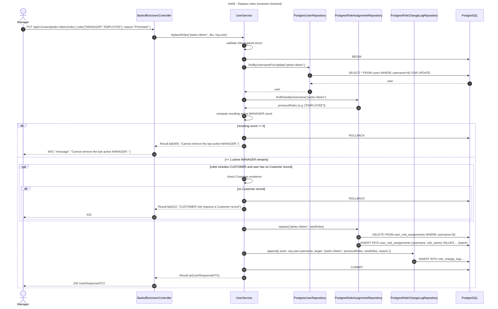
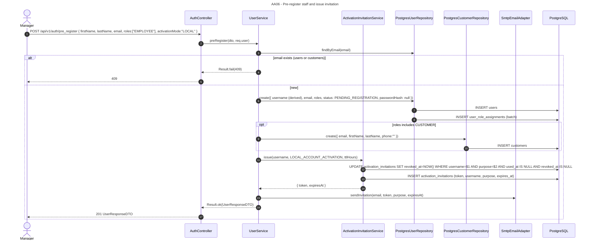
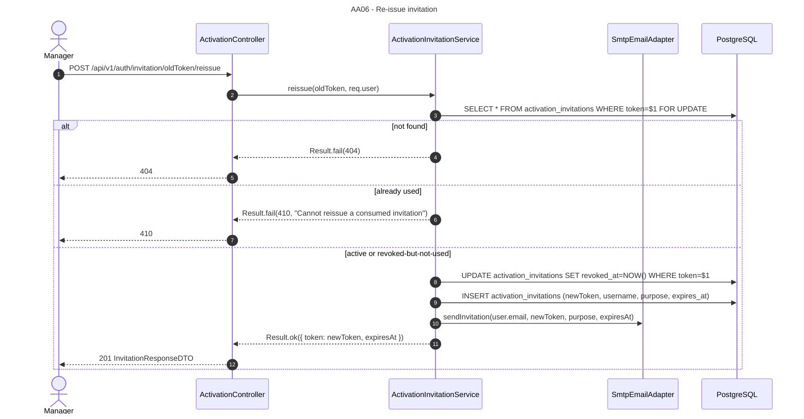
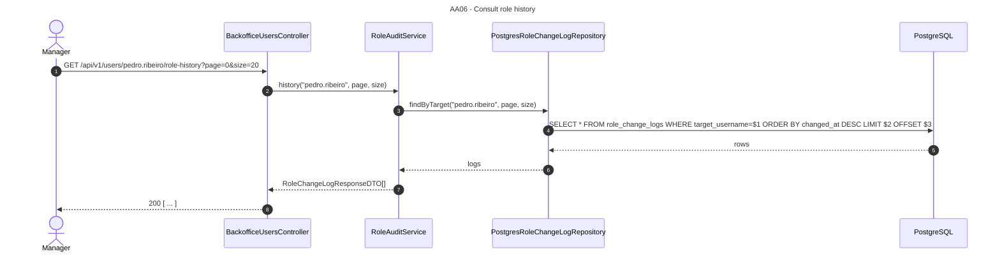
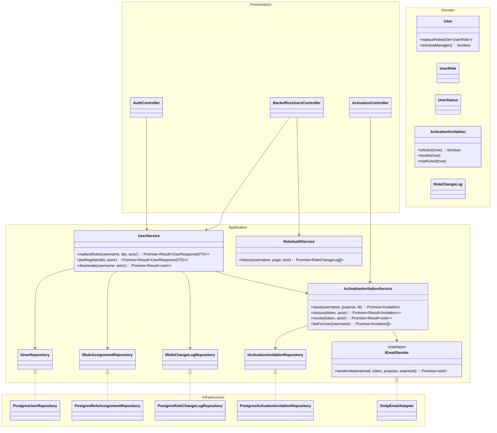

# AA06 — Role Assignment and Activation Invitation

> **Current implementation update (2026-11-16):** Role replacement and role history are implemented under `/users/{username}/roles` and `/users/{username}/role-history` and require `MANAGER`. Account deactivation and reactivation require `ADMINISTRATOR`; role changes are append-only and the last active `MANAGER` cannot be removed or deactivated.

## 1. Requirements Engineering

### 1.1. User Story Description

As an Administrator, I want to assign or update users' internal roles, so that access matches their responsibilities.

> **Actor label note:** "Administrator" here is the **functional designation** of a `MANAGER` (Clarification #24 §1.1). There is no separate `ADMINISTRATOR` role. All endpoints in this US require the `MANAGER` role.

### 1.2. Customer Specifications and Clarifications

#### From the specification document
> Extracted from *PART IV — Sprint 2 — User Stories* (AA06, pp. 11–12).

- **Assign/update/remove roles from Table 1.** Guest access applies automatically to unauthenticated visitors (not assigned).
- **Except for initial auto-CUSTOMER (AA03), role changes limited to authorized administrators.** Assignments and changes record the responsible user **or system process** and the **time** of the change.
- **No privilege escalation via registration / profile / auth method.**
- **New inactive account → unique activation invitation at its intended email.** Auto-CUSTOMER (AA03) does not replace activation.
- **Adding a role to an already active account must not require reactivation.**
- **Invitations expire; become unusable after successful activation; admin can issue a replacement.**
- **Removal of a role or account deactivation prevents subsequent use of withdrawn permissions.**
- **Website permissions independent of infrastructure admin.**

#### From project clarifications (`docs/domain/client-questions.md` — Clarification #24)

- **§1.1:** First admin created at install (no invitation).
- **§1.2:** ≥ 1 active `MANAGER` invariant.
- **§1.3:** roles fixed (no permission editor).
- **§1.4:** role changes audited (`role_change_logs`).
- **§2.2:** invitation TTL configurable (`INVITATION_TTL_HOURS`).
- **§2.3:** previous invitation invalidated on new.
- **§2.4:** duplicate email rejected (on pre-registration).
- **§2.5:** reactivation by admin.
- **§3.2:** immediate role change effect.

#### From KB domain invariants (§10.1)
- **#18:** At most one active `ActivationInvitation` per `(user, purpose)`.
- **#19:** ≥ 1 active `MANAGER` at any time.

### 1.3. Acceptance Criteria (expanded, testable)

#### AC1 — Role replacement endpoint
- AC1.1 `PUT /api/v1/users/{username}/roles` accepts a **full replacement** array `roles: UserRole[]` + optional `reason`.
- AC1.2 Roles are validated against `UserRole` enum; unknown values → `400 Bad Request` (Joi `stripUnknown: true`, explicit `valid(...)`).
- AC1.3 The endpoint requires `MANAGER` role (AA05).
- AC1.4 The endpoint rejects attempts to assign roles that would result in **zero active `MANAGER`s** with `409 Conflict` (AC2).
- AC1.5 The endpoint rejects attempts to assign the `CUSTOMER` role to a user **without a linked `Customer` record** with `422 Unprocessable` — the service must **not** auto-create the `Customer` (see §1.7.3 for the rationale; auto-create is a documented alternative).
- AC1.6 The response body is `UserResponseDTO` reflecting the new role set (no `password_hash`, no `external_idp_subject`).
- AC1.7 Idempotency: replacing roles with the same set is a no-op for the user but still emits a `RoleChangeLog` row with identical `previous_roles` and `new_roles` (audit fidelity — every call is recorded).

#### AC2 — ≥ 1 active MANAGER invariant
- AC2.1 "Active MANAGER" = a user with the `MANAGER` role **and** `status = ACTIVE`.
- AC2.2 The invariant is checked **after** the proposed role set is applied; if the resulting active-MANAGER count would be `0`, reject with `409 Conflict` and message `"Cannot remove the last active MANAGER."`.
- AC2.3 The invariant is also enforced by `UserService.deactivate(username)` (called from `DELETE /user/:username`); deactivating the last active `MANAGER` returns `409 Conflict` with the same message.
- AC2.4 The check is performed inside a transaction (`SELECT ... FOR UPDATE` on the target user + a count query on `users JOIN user_role_assignments` filtered by `MANAGER` and `ACTIVE`); this prevents a TOCTOU race between two concurrent requests.

#### AC3 — Audit of role changes
- AC3.1 Every `PUT /users/{username}/roles` writes a `RoleChangeLog` row (migration 014) with: `actor_username`, `target_username`, `previous_roles` (JSONB array), `new_roles` (JSONB array), `reason` (nullable), `changed_at`.
- AC3.2 `GET /api/v1/users/{username}/role-history` returns the paginated history (newest first), `MANAGER`-only.
- AC3.3 The `RoleChangeLog` is **append-only**; no update/delete endpoint exists (constraint by absence, documented in §1.7.6).

#### AC4 — Pre-registration and invitation creation
- AC4.1 `POST /api/v1/auth/pre_register` accepts `{ firstName, lastName, email, roles }`, `MANAGER`-only.
- AC4.2 The service creates a `User` with `status = PENDING_REGISTRATION`, the requested `roles` (validated per AC1.2), and `passwordHash = null`. **No** auto-`CUSTOMER` is added here — roles are exactly what the Manager requested (this is the manager-provisioned path; it differs from public registration per Clarification #27).
- AC4.3 If `roles` includes `CUSTOMER`, the service also creates the associated `Customer` record (Clarification #27: "Employee with CUSTOMER role requires Customer record").
- AC4.4 If the email already exists (`users.email` or `customers.email`) → `409 Conflict` (Clarification #24 §2.4).
- AC4.5 On success, the service issues an `ActivationInvitation` with `purpose = LOCAL_ACCOUNT_ACTIVATION` (local staff) or `EXTERNAL_IDP_MATCH` (if the Manager chooses external activation; see AC5) and sends an email via `SmtpEmailAdapter`. Response: `201 Created` with `UserResponseDTO` + the email is dispatched (not returned in the body).
- AC4.6 `INVITATION_TTL_HOURS` env var (default 48) controls `expiresAt`.
- AC4.7 Invitation issuance revokes any previous active invitation for `(username, LOCAL_ACCOUNT_ACTIVATION)` (AC6.2).

#### AC5 — Invitation lifecycle
- AC5.1 **Expiration:** at consumption time, `expires_at <= now` → `410 Gone`.
- AC5.2 **Single-use:** after successful consumption, `used_at` is set; subsequent attempts → `410 Gone`.
- AC5.3 **Invalidation on new:** issuing a new invitation for the same `(username, purpose)` sets `revoked_at = now` on all previous active ones.
- AC5.4 **Re-issue endpoint:** `POST /api/v1/auth/invitation/{token}/reissue` (or `POST /api/v1/users/{username}/invitations/{purpose}/reissue` — see §1.5.2 for the decision) — `MANAGER`-only; revokes the given token (if still active) and issues a new one; sends a new email; response `201 Created` with `{ token, expiresAt }` (the token is returned to the Manager **only** for troubleshooting; the email is the primary delivery).
- AC5.5 **Revoke endpoint:** `DELETE /api/v1/auth/invitation/{token}` — `MANAGER`-only; sets `revoked_at = now`; idempotent (revoking an already-revoked invitation returns `204`).
- AC5.6 **Listing:** `GET /api/v1/users/{username}/invitations` — `MANAGER`-only; returns active and historical invitations (`token` masked, `purpose`, `createdAt`, `expiresAt`, `usedAt`, `revokedAt`).

> **Extensions:** AC5.4 (`reissue`), AC5.5 (`revoke`), AC5.6 (`list`) are **not** in KB Appendix A. They are required to satisfy AA06 AC "an authorized administrator must be able to issue a replacement" and to make the invitation lifecycle manageable. They must be added to `docs/api/openapi.yaml` and to §23.

#### AC6 — No privilege escalation via public surfaces
- AC6.1 `POST /auth/register`, `PUT /user/me/*`, `PUT /customers/:email/*` **never** accept a `roles` field (AA03 AC6.1).
- AC6.2 `PUT /users/{username}/roles` is the **only** endpoint that mutates roles, and it is `MANAGER`-only.
- AC6.3 The JWT never carries a writable `roles` claim path — claims are read-only for the SPA; the JWT signature prevents client-side mutation.

#### AC7 — Immediate effect of removal / deactivation
- AC7.1 Role removal takes effect on the **next protected request** (guards re-read from DB — AA04 AC2). No caching layer between the guard and the repository in the baseline.
- AC7.2 Deactivation (`DELETE /user/:username`, which sets `status = DEACTIVATED` per BCK01) takes effect on the next request via `UserStatus.guard` (AA04 AC2.2).
- AC7.3 Both are demonstrated in the integration tests (see §1.7.7).

#### AC8 — Independence from infrastructure administration
- AC8.1 Documented (not code-enforced): infrastructure admin (sysadmin, root, Docker access) is **not** a website role and grants no website permissions. The `MANAGER` role is the only website-level administrative role. This note satisfies the AC's "website permissions must be assigned independently of any responsibility for infrastructure administration."

### 1.4. Found out Dependencies

**Preceding:**
- AA01 (login response with roles), AA03 (auto-CUSTOMER context), AA04 (guards re-read).
- AA05 (endpoint authorization).
- BCK01 (`POST /auth/pre_register` base), BCK02 (`Customer` creation for `CUSTOMER`-role staff).
- Migration 001 (`users`, `user_roles`, `user_role_assignments`), 014 (`activation_invitations`, `role_change_logs`).
- `SmtpEmailAdapter` for invitation emails.

**Succeeding:**
- AA07 (consumes the invitations created here).
- Every downstream feature that depends on role revocation being effective (WEB03, WEB05–WEB07).

### 1.5. Input and Output Data

#### 1.5.1. DTOs

**ReplaceUserRolesRequestDTO** (from KB §24.1bis):
```json
{
  "roles": ["MANAGER", "EMPLOYEE"],
  "reason": "Promoted to assistant manager after six-month review"
}
```
- `roles`: required, array of `UserRole` (deduplicated; empty array allowed **only** if the invariant ≥1 active MANAGER is preserved — i.e., removing all roles from a non-last-MANAGER user is allowed).
- `reason`: optional, ≤ 500 chars.

**RoleChangeLogResponseDTO:**
```json
{
  "logId": 42,
  "actorUsername": "manager.01",
  "targetUsername": "pedro.ribeiro",
  "previousRoles": ["EMPLOYEE"],
  "newRoles": ["MANAGER", "EMPLOYEE"],
  "reason": "Promoted to assistant manager",
  "changedAt": "2026-11-05T14:30:00Z"
}
```

**PreRegisterStaffRequestDTO** (from KB §24.1bis):
```json
{
  "firstName": "Pedro",
  "lastName": "Ribeiro",
  "email": "pedro.ribeiro@laprizza.com",
  "roles": ["EMPLOYEE"],
  "activationMode": "LOCAL"    // "LOCAL" | "EXTERNAL"
}
```
- `activationMode`: optional, defaults to `"LOCAL"`. `"EXTERNAL"` creates an `EXTERNAL_IDP_MATCH` invitation instead of `LOCAL_ACCOUNT_ACTIVATION`.

**InvitationResponseDTO (for list / reissue):**
```json
{
  "token": "a1b2c3d4e5f6…",         // masked in list: "a1b2c3d4…f6"
  "purpose": "LOCAL_ACCOUNT_ACTIVATION",
  "createdAt": "2026-11-05T10:00:00Z",
  "expiresAt": "2026-11-07T10:00:00Z",
  "usedAt": null,
  "revokedAt": null,
  "status": "ACTIVE"                // derived: ACTIVE | USED | REVOKED | EXPIRED
}
```

#### 1.5.2. Endpoint matrix

| Method | Path | Roles | Success | Other |
|---|---|---|---|---|
| PUT | `/api/v1/users/{username}/roles` | MANAGER | 200 + `UserResponseDTO` | 400 (invalid role), 401, 403, 404, 409 (last MANAGER), 422 (CUSTOMER without Customer record) |
| GET | `/api/v1/users/{username}/role-history` | MANAGER | 200 + `RoleChangeLogResponseDTO[]` (paginated) | 401, 403, 404 |
| POST | `/api/v1/auth/pre_register` | MANAGER | 201 + `UserResponseDTO` (invitation emailed) | 400, 401, 403, 409 (email exists), 422 (invalid role combination) |
| POST | `/api/v1/auth/invitation/{token}/reissue` | MANAGER | 201 + `InvitationResponseDTO` | 400 (invalid token format), 401, 403, 404, 410 (token already used — cannot reissue a consumed invitation) |
| DELETE | `/api/v1/auth/invitation/{token}` | MANAGER | 204 | 400, 401, 403, 404, 204 (idempotent if already revoked) |
| GET | `/api/v1/users/{username}/invitations` | MANAGER | 200 + `InvitationResponseDTO[]` | 401, 403, 404 |

> **Extension:** `GET /api/v1/users/{username}/invitations` and `POST /api/v1/auth/invitation/{token}/reissue` and `DELETE /api/v1/auth/invitation/{token}` are **not** in Appendix A. They are required to satisfy AA06 AC5. They must be added to `docs/api/openapi.yaml` and to §23.

#### 1.5.3. Persistence

Relevant tables (migration 001 + 014):

```sql
-- role_change_logs (migration 014)
CREATE TABLE role_change_logs (
    log_id SERIAL PRIMARY KEY,
    actor_username VARCHAR NOT NULL,
    target_username VARCHAR NOT NULL,
    previous_roles JSONB NOT NULL DEFAULT '[]'::jsonb,
    new_roles JSONB NOT NULL DEFAULT '[]'::jsonb,
    reason VARCHAR,
    changed_at TIMESTAMPTZ NOT NULL DEFAULT NOW()
    -- No FK on actor/target by design (audit survives user deletion).
);

-- activation_invitations (migration 014)
CREATE TABLE activation_invitations (
    token VARCHAR PRIMARY KEY,
    username VARCHAR NOT NULL REFERENCES users(username) ON DELETE CASCADE,
    purpose VARCHAR NOT NULL CHECK (purpose IN ('LOCAL_ACCOUNT_ACTIVATION','EXTERNAL_IDP_MATCH','PASSWORD_RESET')),
    expires_at TIMESTAMPTZ NOT NULL,
    used_at TIMESTAMPTZ,
    revoked_at TIMESTAMPTZ,
    created_at TIMESTAMPTZ NOT NULL DEFAULT NOW()
);
```

**Invariant #18** (at most one active invitation per `(username, purpose)`) is enforced at the **service level** in `issueInvitation` (revoke-then-insert inside a transaction). The DB does not express it as a partial unique index because the "active" definition is `used_at IS NULL AND revoked_at IS NULL AND expires_at > now()`, which a partial index cannot express with `expires_at > now()` (non-immutable). A `015_*.sql` could add `CREATE UNIQUE INDEX uq_active_invitation ON activation_invitations (username, purpose) WHERE used_at IS NULL AND revoked_at IS NULL;` — this covers "not used and not revoked" but **not** expired-but-unconsumed; the service must still check `expires_at > now()` on consumption. Decision: add the partial unique index in a future `015_*.sql` if the team wants the extra safety net; baseline relies on the service transaction.

#### 1.5.4. Guard pipeline

Same as AA04/AA05: `JwtAuthGuard → UserStatus.guard → RolesGuard(@Roles(MANAGER))`.

### 1.6. System Sequence Diagrams (SSD)

#### 1.6.1. Replace roles on an active user (with ≥ 1 MANAGER invariant)



#### 1.6.2. Deactivate the last active MANAGER → 409

```mermaid
sequenceDiagram
autonumber
title AA06 - Deactivate last active MANAGER (blocked)
    actor Manager
    participant Ctrl as UserController
    participant Svc as UserService
    participant UserRepo as PostgresUserRepository
    participant DB as PostgreSQL

    Administrator->>Ctrl: DELETE /api/v1/user/manager.01
    Ctrl->>Svc: deactivate("manager.01", req.user)
    Svc->>DB: BEGIN
    Svc->>UserRepo: findByUsernameForUpdate("manager.01")
    UserRepo-->>Svc: user (roles: ["MANAGER"], status: ACTIVE)
    Svc->>Svc: count other active MANAGERs
    alt count == 0
        Svc->>DB: ROLLBACK
        Svc-->>Ctrl: Result.fail(409, "Cannot remove the last active MANAGER.")
        Ctrl-->>Manager: 409
    else count >= 1
        Svc->>UserRepo: setStatus("manager.01", DEACTIVATED)
        UserRepo->>DB: UPDATE users SET status='DEACTIVATED' WHERE username=$1
        Svc->>DB: COMMIT
        Svc-->>Ctrl: Result.ok
        Ctrl-->>Manager: 200
        Note over Svc: also emits a RoleChangeLog? (see §1.7.3 - decision: deactivation is NOT a role change; only `PUT /roles` writes RoleChangeLog. The status change is audited separately via the standard audit logger.)
    end
```

#### 1.6.3. Pre-register staff → invitation issued



#### 1.6.4. Re-issue invitation



#### 1.6.5. Role history



### 1.7. Other Relevant Remarks

#### 1.7.1. Clean Architecture placement



#### 1.7.2. Domain invariant — ≥ 1 active MANAGER (transaction-safe)

The check is **not** a pure domain invariant (it needs a count query across the aggregate boundary — `User` cannot see other `User`s). It is an **application-service** invariant implemented as:

```ts
// Pseudocode inside UserService.replaceRoles / deactivate, inside the transaction:
const targetUser = await userRepo.findByUsernameForUpdate(username);
const previousRoles = await roleRepo.findRolesByUsername(username);
const resultingRoles = applyReplacement(previousRoles, newRoles);
const resultingIsActiveManager =
  resultingRoles.includes(MANAGER) && targetUser.status === ACTIVE;
const otherActiveManagers = await roleRepo.countActiveUsersWithRole(MANAGER, { excludeUsername: username });
if (!resultingIsActiveManager && otherActiveManagers === 0) {
  throw new ConflictError("Cannot remove the last active MANAGER.");
}
```

The `FOR UPDATE` on the target user serialises concurrent attempts on the same target. Two concurrent attempts on **different** targets are serialised by the count query taking a row lock on the `MANAGER` role assignments (or by a serialisable transaction — see §1.7.5).

#### 1.7.3. Decisions recorded in this US

1. **Deactivation vs role change:** `DELETE /user/:username` (deactivation) does **not** write a `RoleChangeLog` row, because it does not change roles. The status change is audited via the standard audit logger (AA05). If the team wants a unified audit, a `UserStatusChangeLog` table would be a `015_*.sql` extension — documented, not implemented in baseline.
2. **Auto-create Customer for `CUSTOMER`-role staff:** rejected. Reason: creating a `Customer` requires `firstName`, `lastName`, `phone`, `email` (mandatory per Clarification #01). Auto-creating from `User` data is possible (name + email available) but `phone` is not (unless the Manager supplies it). Decision: `POST /auth/pre_register` requires the Manager to include a `phoneNumber` field **only when** `roles` includes `CUSTOMER`, and the service creates the `Customer` in the same transaction; otherwise, the request is rejected with `422` ("phoneNumber required when CUSTOMER role is assigned"). This keeps the invariant (Clarification #27) without silently creating incomplete `Customer`s.
   - Update AC1.5 / AC4.3 accordingly: the Manager supplies `phoneNumber` in the `PreRegisterStaffRequestDTO` when `roles` includes `CUSTOMER`; `PUT /users/{username}/roles` adding `CUSTOMER` to an existing user requires the user to already have a `Customer` record, otherwise `422`.
3. **`reason` on `PUT /users/{username}/roles`:** optional, recorded verbatim (≤ 500 chars); UI prompts for it on any role change (recommended for audit clarity, not enforced).
4. **Invitation token format:** opaque, cryptographically random 32 bytes (base64url, 43 chars), generated via `crypto.randomBytes(32).toString('base64url')`. Not a JWT (no claims needed; single-use + DB row is enough).
5. **Email delivery:** invitation email contains `<SPA_URL>/auth/activate?token=<token>` (local) or `<SPA_URL>/auth/activate-external?token=<token>` (external). Passwords are **never** included (AA07 AC).
6. **Email content:** subject and body per `docs/security/email-templates.md`; no PII beyond the recipient's name and the link.

#### 1.7.4. Error-to-HTTP matrix

| Action | Condition | HTTP | UI feedback |
|---|---|---|---|
| Replace roles | invalid role value | 400 | inline on `roles` |
| Replace roles | unknown user | 404 | "Utilizador não encontrado" |
| Replace roles | would leave zero active MANAGER | 409 | "Não é possível remover o último gestor ativo." |
| Replace roles | adding CUSTOMER without Customer record | 422 | "O utilizador não tem registo de cliente associado." |
| Replace roles | success | 200 | toast + refetch role history |
| Deactivate user | would leave zero active MANAGER | 409 | same as above |
| Deactivate user | success | 200 | toast + refetch |
| Pre-register | duplicate email | 409 | inline on `email` |
| Pre-register | CUSTOMER role without `phoneNumber` | 422 | inline on `phoneNumber` |
| Pre-register | invalid role combination | 400/422 | inline on `roles` |
| Pre-register | success | 201 | toast + "Convite enviado para `<email>`" |
| Reissue | token not found | 404 | "Convite não encontrado" |
| Reissue | token already used | 410 | "Convite já utilizado; não pode ser reemitido." |
| Reissue | success | 201 | toast + "Novo convite enviado" |
| Revoke | token not found | 404 | — |
| Revoke | success (or already revoked) | 204 | toast |
| Role history | unknown user | 404 | — |
| Role history | success | 200 | render timeline |

#### 1.7.5. Concurrency and transaction boundaries

- `replaceRoles` runs in a single transaction with `BEGIN ... COMMIT`; the target user is locked with `SELECT ... FOR UPDATE`.
- The ≥1-active-MANAGER count is read **inside** the transaction after the target is locked. Under PostgreSQL default `READ COMMITTED`, a concurrent transaction could still insert/remove a role on a **different** user; to prevent the TOCTOU, the count query takes a `SHARE` lock on `user_role_assignments` rows for the `MANAGER` role (`SELECT ... FROM user_role_assignments WHERE role_name='MANAGER' AND username IN (SELECT username FROM users WHERE status='ACTIVE') FOR SHARE`), forcing the second transaction to serialise. If `SERIALIZABLE` is preferred, the transaction can be declared as such; the baseline uses `FOR SHARE` for predictability.
- `preRegister` runs in a single transaction; duplicate email is caught by the `UNIQUE` on `users.email` (and `customers.email` PK) — the service returns `409` on `23505`.
- `issueInvitation` (inside `preRegister` and `reissue`) runs its revoke-then-insert as a unit; concurrent issuance for the same user serialises on the `users` row (`FOR UPDATE`) — the service explicitly locks the target user first.

#### 1.7.6. Append-only `RoleChangeLog`

- No `UPDATE` / `DELETE` endpoint exists for `role_change_logs`; the repository interface exposes only `append` and `findByTarget`.
- A future `015_*.sql` could add a DB-level `REVOKE` on the app role for `UPDATE`/`DELETE` — documented as a hardening option, not baseline.

#### 1.7.7. Verification (automated + demo)

- **Unit (service):** `UserService.replaceRoles` — 8 cases: success, invalid role, unknown user, last-MANAGER block, add CUSTOMER without Customer, idempotent replacement (same set → still logs), multiple roles, remove all roles from a non-MANAGER (allowed).
- **Unit (invitation):** `ActivationInvitationService.issue` revokes previous; `reissue` rejects used; `reissue` sets `revoked_at` on the previous; `revoke` is idempotent.
- **Integration (Supertest):**
  - `PUT /users/{username}/roles` as MANAGER → 200 + history entry; as CUSTOMER → 403; on last MANAGER → 409; on add CUSTOMER without Customer → 422.
  - `DELETE /user/manager.01` (last MANAGER) → 409.
  - `POST /auth/pre_register` → 201, invitation created, email sent (mock SMTP), duplicate email → 409.
  - `POST /auth/invitation/{token}/reissue` → 201, old token `revoked_at` set; on used token → 410.
  - `DELETE /auth/invitation/{token}` → 204; second call → 204 (idempotent).
  - `GET /users/{username}/role-history` → 200 with entries (newest first).
- **Concurrency (DB suite):** two concurrent `PUT /users/{u1}/roles` and `PUT /users/{u2}/roles` that would together leave zero MANAGERs → exactly one succeeds, the other returns 409 (serialised via `FOR SHARE` or `SERIALIZABLE`).
- **Demo:** pre-register an Employee → invitation email arrives (SMTP container logs) → promote to Manager → role history shows the change → attempt to demote the last Manager → 409 → re-issue invitation → new email → revoke → 204.