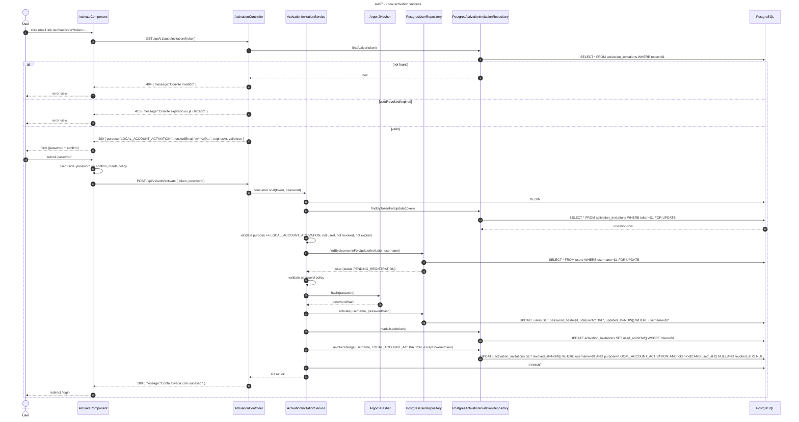
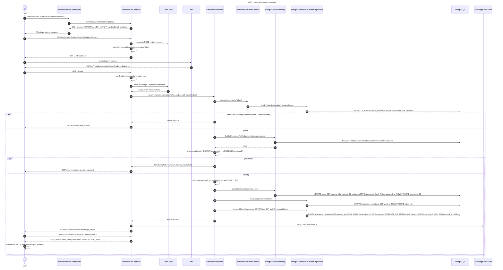
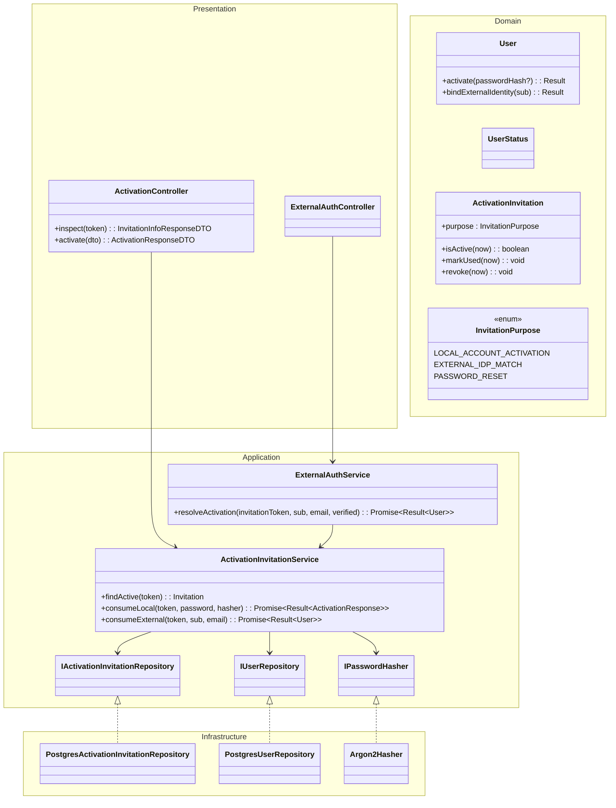

# AA07 — Secure Account Activation

## 1. Requirements Engineering

### 1.1. User Story Description

As an invited System User, I want to complete account activation securely, so that my account is enabled only for the intended identity.

### 1.2. Customer Specifications and Clarifications

#### From the specification document
> Extracted from *PART IV — Sprint 2 — User Stories* (AA07, p. 13).

- **Local account:** a valid invitation allows the intended recipient to **establish a password and activate the account before the first normal login**. The limited activation process **must not require an already active local session** nor grant access to protected business functionality.
- **External account:** the invitation guides the user through the IdP and **verifies that the authenticated identity matches the intended recipient** before activation.
- **Password handling:** local users establish their own password securely; passwords **must not be sent in invitation emails**.
- **Invalid/expired/used/mismatched invitations:** show an error and **must not enable access**.
- **Successful activation enables only the internal roles assigned to the account.**
- **No automatic consent:** activation and authentication must **not** automatically grant optional marketing consent.

#### From project clarifications and ADRs
- **Clarification #24 §2.2 / §2.3:** invitation TTL configurable (`INVITATION_TTL_HOURS`); previous invitation invalidated on new.
- **Clarification #27:** public registration → `PENDING_REGISTRATION` until email confirmation; external JIT → `ACTIVE` immediately (already handled in AA02; not re-activated here).
- **ADR-010 (KB §5):** external activation must verify the `sub` and bind it to `users.external_idp_subject`; account-linking rejection for email collisions (already documented in AA02; AA07 reuses the same `ExternalAuthService.resolveUser` for the authenticated identity).
- **KB §10.1 #17:** `User` has `passwordHash` **or** `externalIdpSubject` (domain invariant).
- **KB §10.1 #18:** at most one active `ActivationInvitation` per `(user, purpose)`.

### 1.3. Acceptance Criteria (expanded, testable)

#### AC1 — Local activation flow
- AC1.1 The invitation email contains a link to `<SPA_URL>/auth/activate?token=<token>`. The SPA route is `@Public()` (no session required).
- AC1.2 The SPA calls `GET /api/v1/auth/invitation/{token}` (Public) to display: `purpose`, `maskedEmail`, `expiresAt`, `valid`. If the invitation is invalid/expired/used/revoked, the SPA shows the reason and blocks the form.
- AC1.3 For `purpose = LOCAL_ACCOUNT_ACTIVATION`, the SPA shows a form with `password` + `confirmPassword`. On submit → `POST /api/v1/auth/activate` with `{ token, password }`.
- AC1.4 On success, the backend:
  - Validates the invitation (existence, purpose, `expires_at > now()`, `used_at IS NULL`, `revoked_at IS NULL`).
  - Validates the password against the policy (AA01 AC3.2).
  - Hashes the password (Argon2id, ADR-004).
  - Sets `users.password_hash` and `users.status = ACTIVE`.
  - Marks the invitation `used_at = now()`.
  - Revokes any other `LOCAL_ACCOUNT_ACTIVATION` invitations for the same user.
  - Returns `200 OK` with `{ message: "Conta ativada com sucesso." }`.
- AC1.5 The activation endpoint is **Public** (the token is the credential) and does not require an active session.
- AC1.6 After success, the SPA redirects to `/login` (not auto-login; the user logs in explicitly, which exercises the normal login path and simplifies audit).

#### AC2 — External activation flow
- AC2.1 The invitation email for `purpose = EXTERNAL_IDP_MATCH` contains a link to `<SPA_URL>/auth/activate-external?token=<token>`.
- AC2.2 The SPA calls `GET /api/v1/auth/invitation/{token}` to display the purpose and masked email; if valid, shows a "Continuar com o provedor" button.
- AC2.3 The button navigates to `GET /api/v1/auth/external/login?invitationToken=<token>` (browser navigation). The backend:
  - Stores the `invitationToken` in the `oidc_ctx` signed cookie alongside `state`/`nonce`/`code_verifier`.
  - Proceeds with the normal OIDC Authorization Code + PKCE flow (AA02).
- AC2.4 On callback, the backend:
  - Verifies the ID token (AA02 AC2.2).
  - Extracts `sub`, `email`, `email_verified`.
  - If `invitationToken` is present in the cookie, the backend **must** route through the activation path (not the JIT path).
  - Loads the invitation by token; validates existence, `purpose = EXTERNAL_IDP_MATCH`, `expires_at > now()`, `used_at IS NULL`, `revoked_at IS NULL`.
  - Loads the `User` by `username` (from the invitation).
  - **Identity match check:** the ID token's verified `email` must equal `users.email` (case-insensitive) of the target user. If not → `302 <SPA>/auth/callback?error=invitation_identity_mismatch`, no activation.
  - On match: sets `users.external_idp_subject = sub` (if not already set; if already set and equal, no-op; if already set and different → error, see AC2.6), sets `users.password_hash = NULL` (defensive; staff pre-registered via `EXTERNAL` mode never had one), sets `status = ACTIVE`, marks the invitation `used_at = now()`, revokes other `EXTERNAL_IDP_MATCH` invitations for the same user.
  - Issues the internal JWT via the same `JwtTokenService`, returns it via the one-time exchange code pattern (AA02 §1.7.3).
- AC2.5 The SPA receives the JWT via `/auth/external/exchange` and proceeds to the role-appropriate home.
- AC2.6 If `users.external_idp_subject` is already set and differs from the presented `sub` → `302 ?error=idp_subject_mismatch` and no activation (prevents an attacker who controls a different IdP account but the same email from binding their sub to an existing externally-bound account). Note: this can only occur if the account was already activated via a different IdP identity — should not happen in normal flows; documented as a defensive check.
- AC2.7 If the invitation is not bound to the presented email (e.g., the user authenticates with a different IdP account), AC2.4's identity check fails → `error=invitation_identity_mismatch`.
- AC2.8 `EXTERNAL_IDP_MATCH` invitations **do not** accept a `password` (no local credential is established); the SPA must not present a password form for this purpose.

#### AC3 — Invalid / expired / used / mismatched invitation
- AC3.1 `GET /api/v1/auth/invitation/{token}` returns:
  - `404 Not Found` if the token does not exist.
  - `410 Gone` if `used_at IS NOT NULL` or `revoked_at IS NOT NULL` or `expires_at <= now()`.
  - `200 OK` with `{ purpose, maskedEmail, expiresAt, valid: true }` otherwise.
- AC3.2 `POST /api/v1/auth/activate` (local) returns:
  - `404` if the token does not exist.
  - `410` if used/revoked/expired.
  - `422` if the invitation purpose is `EXTERNAL_IDP_MATCH` (must use the external flow, not the password form).
  - `422` if the password does not meet the policy.
  - `409` if the user is already `ACTIVE` (defensive; e.g., a race with another activation).
- AC3.3 In all failure cases, `users.status` and `users.password_hash` are **unchanged**.
- AC3.4 The SPA renders a distinct message per HTTP status, without disclosing the target user's email beyond the masked form (see AC4.3).

#### AC4 — Successful activation enables only assigned roles
- AC4.1 The roles assigned to the `User` at pre-registration time (via `POST /auth/pre_register` / public registration) are **preserved** by activation. Activation does not add or remove roles.
- AC4.2 If the `User` has **zero roles** at activation time (should not happen, since public registration auto-assigns `CUSTOMER` and staff pre-registration assigns at least one role), activation still succeeds but the account will be rejected by `RolesGuard` on the next request (AA03 AC4.1). The service logs a warning; no role is invented.
- AC4.3 The `maskedEmail` displayed is derived from `users.email` with the local-part masked (e.g., `m***a@laprizza.com`) — this is a UX aid for the invited user to recognise the account, not a disclosure (the invitation token is the credential; masking limits accidental leakage in shared screenshots).

#### AC5 — No automatic marketing consent
- AC5.1 Activation does **not** set `customers.marketing_consent = true`. The field remains at its existing value (`false` for newly created `Customer`s).
- AC5.2 If the activation form (local) includes an optional "Quero receber comunicações" checkbox, it must be **unchecked by default** and its submission routes to `PUT /api/v1/customers/{email}/...` (or `PUT /user/me/...`) as a **separate** explicit consent action — not part of the activation call.
- AC5.3 Activation and authentication never touch `consent_timestamp` unless the user explicitly opts in.

### 1.4. Found out Dependencies

**Preceding:**
- AA01 (password policy, Argon2 hasher, `POST /auth/activate` contract for PASSWORD_RESET — the same endpoint, different purpose).
- AA02 (external auth pipeline, `ExternalAuthService`, `openid-client`, exchange code pattern).
- AA06 (invitation creation, TTL, revocation).
- Migration 001 (`users`), 014 (`activation_invitations`, nullable `password_hash`, `external_idp_subject`).
- `SmtpEmailAdapter` (email dispatch — happens in AA06, not AA07).

**Succeeding:**
- Normal login path (AA01, AA02) after activation.
- AA03 (roles preserved by activation are consumed by guards).

### 1.5. Input and Output Data

#### 1.5.1. DTOs

**InvitationInfoResponseDTO** (for `GET /api/v1/auth/invitation/{token}` — **extension**, §1.5.2):
```json
{
  "purpose": "LOCAL_ACCOUNT_ACTIVATION",
  "maskedEmail": "m***a@laprizza.com",
  "expiresAt": "2026-11-07T10:00:00Z",
  "valid": true
}
```

**ActivateInvitationRequestDTO** (from KB §24.1bis):
```json
{ "token": "a1b2c3d4e5f6…", "password": "NewSecr3tP@ssw0rd!" }
```
Used by:
- `LOCAL_ACCOUNT_ACTIVATION` — **this US (AA07)**.
- `PASSWORD_RESET` — **AA01 AC5.4**.
- `EXTERNAL_IDP_MATCH` — **not used** (external flow uses the IdP, no password).

**ActivateInvitationResponseDTO:**
```json
{ "message": "Conta ativada com sucesso." }
```

#### 1.5.2. Endpoint matrix

| Method | Path | Roles | Purpose | Success | Other |
|---|---|---|---|---|---|
| GET | `/api/v1/auth/invitation/{token}` | Public | Inspect invitation before rendering the form | 200 `InvitationInfoResponseDTO` | 400 (malformed token), 404, 410 |
| POST | `/api/v1/auth/activate` | Public | Consume `LOCAL_ACCOUNT_ACTIVATION` or `PASSWORD_RESET` invitation | 200 | 400, 404, 409, 410, 422 (purpose mismatch / weak password) |
| GET | `/api/v1/auth/external/login?invitationToken=…` | Public | Initiate external activation | 302 → IdP | 400 (malformed token / unknown invitation), 410 |
| GET | `/api/v1/auth/external/callback?code=…&state=…` | Public | Callback for external activation | 302 → SPA `?exchange_code=…` | 302 → SPA `?error=…`; 400, 409, 410 |

> **Extension:** `GET /api/v1/auth/invitation/{token}` is **not** in Appendix A. Required to satisfy AA07 AC3 (clear error UX before showing the password form) and to avoid presenting a password form to an invalid token. Must be added to `docs/api/openapi.yaml` and to §23.

#### 1.5.3. Persistence

Relevant state transitions on `users` and `activation_invitations`:

| Transition | Table | Before | After |
|---|---|---|---|
| Local activation success | `users` | `status=PENDING_REGISTRATION`, `password_hash=NULL` | `status=ACTIVE`, `password_hash=<Argon2id>` |
| Local activation success | `activation_invitations` | `used_at=NULL` | `used_at=NOW()` |
| Local activation success | `activation_invitations` (siblings) | `used_at=NULL, revoked_at=NULL` | `revoked_at=NOW()` |
| External activation success | `users` | `status=PENDING_REGISTRATION`, `external_idp_subject=NULL` | `status=ACTIVE`, `external_idp_subject=<sub>`, `password_hash=NULL` |
| External activation success | `activation_invitations` | `used_at=NULL` | `used_at=NOW()` |
| Password reset (AA01) | `users` | `password_hash=<old>` | `password_hash=<new>` (status unchanged) |

All transitions run inside a **single transaction** per request (`BEGIN ... COMMIT`), with the invitation row locked (`SELECT ... FOR UPDATE`) to prevent double-consumption races.

#### 1.5.4. `oidc_ctx` cookie extension for external activation

The signed cookie (AA02 §1.5.3) gains an **optional** `invitationToken` claim:
```json
{ "state": "...", "code_verifier": "...", "nonce": "...", "redirect_uri": "...", "invitationToken": "a1b2…", "iat": ..., "exp": ... }
```
If `invitationToken` is present, the callback routes through the activation path (AC2.4); otherwise it follows the AA02 JIT/existing-user path.

### 1.6. System Sequence Diagrams (SSD)

#### 1.6.1. Local activation — success



#### 1.6.2. Local activation — failure modes (invalid/expired/used/wrong purpose)

```mermaid
sequenceDiagram
autonumber
title AA07 - Local activation failure modes
    actor User
    participant SPA as ActivateComponent
    participant Ctrl as ActivationController
    participant Svc as ActivationInvitationService
    participant DB as PostgreSQL

    User->>SPA: submit { token, password }
    SPA->>Ctrl: POST /api/v1/auth/activate
    Ctrl->>Svc: consumeLocal(token, password)
    Svc->>DB: SELECT * FROM activation_invitations WHERE token=$1 FOR UPDATE
    alt token not found
        Svc-->>Ctrl: Result.fail(404)
        Ctrl-->>SPA: 404 { message:"Convite inválido" }
    else purpose != LOCAL_ACCOUNT_ACTIVATION
        Svc-->>Ctrl: Result.fail(422, "Wrong invitation purpose")
        Ctrl-->>SPA: 422 { message:"Este convite deve ser ativado através do provedor de identidade." }
    else used_at / revoked_at / expired
        Svc-->>Ctrl: Result.fail(410)
        Ctrl-->>SPA: 410 { message:"Convite expirado ou já utilizado" }
    else user.status == ACTIVE (race)
        Svc-->>Ctrl: Result.fail(409)
        Ctrl-->>SPA: 409 { message:"Conta já ativada." }
    else password weak
        Svc-->>Ctrl: Result.fail(422, "Password does not meet policy")
        Ctrl-->>SPA: 422 { message:"A password não cumpre os requisitos mínimos." }
    end
    Note over Svc,DB: In all failure cases, no UPDATE is performed; users.status and users.password_hash are unchanged.
```

#### 1.6.3. External activation — success



#### 1.6.4. External activation — identity mismatch

```mermaid
sequenceDiagram
autonumber
title AA07 - External activation identity mismatch
    actor Attacker
    participant Ctrl as ExternalAuthController
    participant Svc as ExternalAuthService
    participant UserRepo as PostgresUserRepository
    participant DB as PostgreSQL

    Attacker->>Ctrl: GET callback with a valid invitationToken but authenticating as attacker@x.com
    Ctrl->>Ctrl: verify oidc_ctx + token exchange + ID token
    Ctrl->>Svc: resolveActivation(invitationToken, sub=attacker, email=attacker@x.com, true)
    Svc->>DB: load invitation (username=maria.silva, purpose=EXTERNAL_IDP_MATCH)
    Svc->>UserRepo: findByUsernameForUpdate("maria.silva")
    UserRepo-->>Svc: user.email = "maria.silva@x.com"
    Svc->>Svc: compare LOWER(user.email) vs LOWER("attacker@x.com")
    alt mismatch
        Svc-->>Ctrl: Result.fail("invitation_identity_mismatch")
        Ctrl-->>Attacker: 302 <SPA>/auth/callback?error=invitation_identity_mismatch
        Note over Svc: no UPDATE; maria.silva remains PENDING_REGISTRATION; invitation remains unused
    end
```

### 1.7. Other Relevant Remarks

#### 1.7.1. Clean Architecture placement



#### 1.7.2. Decisions recorded in this US

1. **No auto-login after activation.** Rationale: keeps the activation endpoint pure (no JWT issued) and forces the normal login path (AA01/AA02), which exercises the guard pipeline. The user is redirected to `/login` with the email pre-filled (optional UX sugar).
2. **External activation reuses the AA02 OIDC pipeline** with `invitationToken` in the `oidc_ctx` cookie. Rationale: avoids a second OIDC implementation; keeps the PKCE/state/nonce protections. Alternative (a dedicated callback endpoint for activation) rejected to avoid duplication.
3. **Identity match by verified email + sub binding:** the invitation is bound to the **target user's email** (from `users.email`), and the external identity is bound to `sub`. The check is `LOWER(idToken.email) == LOWER(users.email)` AND `email_verified == true`. Rationale: prevents an attacker who controls a different IdP account (with a different email) from consuming the invitation; prevents an attacker who controls an IdP account **with the same email** from binding their `sub` (the `sub` is bound to the target user, not created fresh). This is stricter than AA02's JIT path (which auto-provisions a new user), and correctly so: activation is for a **specific intended recipient**, not for whoever shows up.
4. **`users.password_hash = NULL` on external activation:** defensive no-op for staff pre-registered via `EXTERNAL` mode (they never had a hash). If a local registration somehow exists for the same user, this ensures the account is not simultaneously local+external without the account-linking flow (AA02). The domain invariant `(passwordHash != null) ∨ (externalIdpSubject != null)` holds.
5. **No consent change:** activation never touches `customers.marketing_consent` or `consent_timestamp` (AC5).
6. **Invitation info endpoint masking:** `maskedEmail` shows first char + last char of local part + domain. Rationale: helps the intended recipient recognise the account without exposing the full email in shared screenshots; the token is the credential, not the email.

#### 1.7.3. Interaction with AA02 — decision table

| Scenario | Invitation present | `external_idp_subject` on user | Same email? | Outcome |
|---|---|---|---|---|
| New user, no invitation | ❌ | n/a | n/a | AA02 JIT (ACTIVE, CUSTOMER) |
| Existing external user | ❌ | set | matches (by sub) | AA02 existing-user login |
| Existing local user, no invitation | ❌ | null | matches (email collision) | AA02 rejects (account linking required) |
| Pre-registered staff, `EXTERNAL` mode | ✅ `EXTERNAL_IDP_MATCH` | null | matches | **AA07 external activation** |
| Pre-registered staff, `EXTERNAL` mode | ✅ `EXTERNAL_IDP_MATCH` | set (by previous attempt) | matches | **AA07 external activation** (no-op on sub) |
| Pre-registered staff, `EXTERNAL` mode | ✅ `EXTERNAL_IDP_MATCH` | n/a | **mismatches** | AA07 rejects (identity mismatch) |
| Pre-registered staff, `LOCAL` mode | ✅ `LOCAL_ACCOUNT_ACTIVATION` | null | n/a | **AA07 local activation** (password) |

#### 1.7.4. Error-to-HTTP matrix

| Action | Condition | HTTP | UI feedback |
|---|---|---|---|
| `GET /auth/invitation/{token}` | token not found | 404 | "Convite inválido" |
| `GET /auth/invitation/{token}` | used/revoked/expired | 410 | "Convite expirado ou já utilizado" |
| `GET /auth/invitation/{token}` | valid | 200 | render form |
| `POST /auth/activate` | token not found | 404 | "Convite inválido" |
| `POST /auth/activate` | used/revoked/expired | 410 | "Convite expirado ou já utilizado" |
| `POST /auth/activate` | wrong purpose (external) | 422 | "Este convite deve ser ativado através do provedor de identidade." |
| `POST /auth/activate` | user already ACTIVE | 409 | "Conta já ativada." |
| `POST /auth/activate` | weak password | 422 | field-level (policy) |
| `GET /external/login?invitationToken=` | token invalid | 400 | "Convite inválido" |
| `GET /external/callback` (activation) | invitation invalid/expired/used | 302 `?error=invitation_invalid` | "Convite expirado ou inválido." |
| `GET /external/callback` (activation) | identity mismatch | 302 `?error=invitation_identity_mismatch` | "A identidade autenticada não corresponde ao destinatário do convite." |
| `GET /external/callback` (activation) | `external_idp_subject` already set differently | 302 `?error=idp_subject_mismatch` | "Esta conta já está associada a outra identidade." |

#### 1.7.5. Verification (automated + demo)

- **Unit (domain):** `ActivationInvitation.isActive(now)` — 4 cases (active, used, revoked, expired); `User.activate(passwordHash)` — sets `status=ACTIVE` and `password_hash`; `User.bindExternalIdentity(sub)` — sets `external_idp_subject`, nulls `password_hash` (defensive), status ACTIVE; `User.bindExternalIdentity` on a user with an existing different `sub` → `Result.fail`.
- **Unit (application):** `ActivationInvitationService.consumeLocal` — 6 cases: success, not found, wrong purpose, expired, used, weak password; `consumeExternal` — 5 cases: success, mismatch, already-sub-different, invitation invalid, invitation wrong purpose.
- **Integration (Supertest, mocked SMTP + mocked IdP):**
  - `GET /auth/invitation/{token}` — 200/404/410.
  - `POST /auth/activate` (LOCAL) — 200 → user ACTIVE, password_hash set, invitation used, siblings revoked; `POST /auth/login` with the new password → 200.
  - `POST /auth/activate` (EXTERNAL purpose) → 422.
  - `GET /auth/external/login?invitationToken=…` → 302; mocked callback with matching email → 302 `exchange_code`; exchange → 200 + JWT with roles preserved; user ACTIVE, `external_idp_subject` set, `password_hash` null.
  - Mocked callback with mismatched email → 302 `?error=invitation_identity_mismatch`; user still PENDING; invitation still active.
  - Second use of the same token → 410 (sibling revoke also covered).
- **DB suite:** the `activation_invitations` partial-state check (used/revoked/expired) — no DB constraint but the service behaviour is asserted; the `SELECT ... FOR UPDATE` prevents double-consume under concurrency (test with two parallel `POST /auth/activate` → exactly one 200, one 410).
- **Demo:** pre-register a local Employee → email arrives → click link → form → set password → login → Employee view accessible. Pre-register another staff with `activationMode=EXTERNAL` → email arrives → click link → IdP login → exchange → login with the same email as the target → activated → Employee view accessible. Try to use an expired/used token → 410. Try to activate an external invitation as a different email → mismatch error.

## 2. Verification status and reproducible test procedure

The local activation path has been validated against the Docker PostgreSQL
environment: activation returned `200`, the account changed to `ACTIVE`, the
password hash was populated, normal login succeeded, and a second use of the
same token was rejected with `410 Gone`.

The Bruno collection
[`backend/tests/bruno/LaPrizza/AA07 Account Activation`](../../../backend/tests/bruno/LaPrizza/AA07%20Account%20Activation/README.md)
covers the public inspection and negative local-activation cases:

- valid invitation inspection (`200`);
- unknown token (`404`);
- used invitation (`410`);
- weak password (`422`);
- local activation attempted with an external invitation (`422`).

The collection receives tokens through the Bruno environment and never stores
them in the repository. See its README for the required variables and the
role/consent SQL check.

External activation reuses the OIDC provider and callback pipeline validated
by AA02. The AA07-specific invitation token is carried through that existing
flow and routed to the activation path; no second identity-provider
implementation is required.

For an integrated demonstration, use the real OIDC provider configured in the
local environment:

1. Create a staff invitation with external activation mode.
2. Obtain the token from the controlled test mailbox or the local database.
3. Open `<FRONTEND_URL>/auth/activate-external?token=<token>`.
4. Select the provider and authenticate with the exact email invited.
5. Confirm the callback reaches `/auth/callback`, the account is `ACTIVE`, the
   invitation is consumed, `external_idp_subject` is set, and no password hash
   is created.
6. Repeat with a different verified email. The UI must report an identity
   mismatch; the account must remain `PENDING_REGISTRATION` and the invitation
   must remain unused.

Activation must preserve the pre-existing role list and must not create
marketing consent. For staff accounts without a customer record, the absence
of a `customers` row is the expected result.