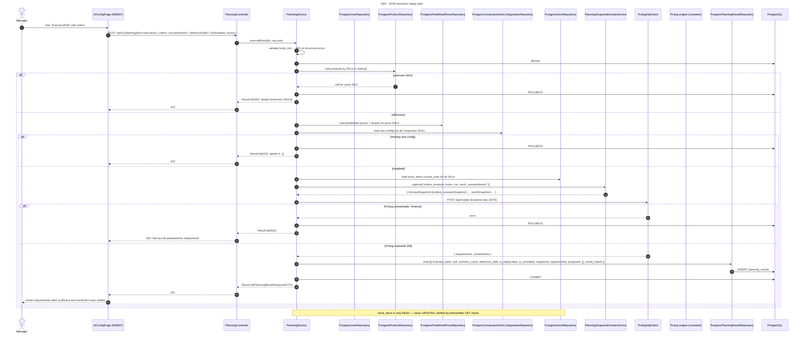
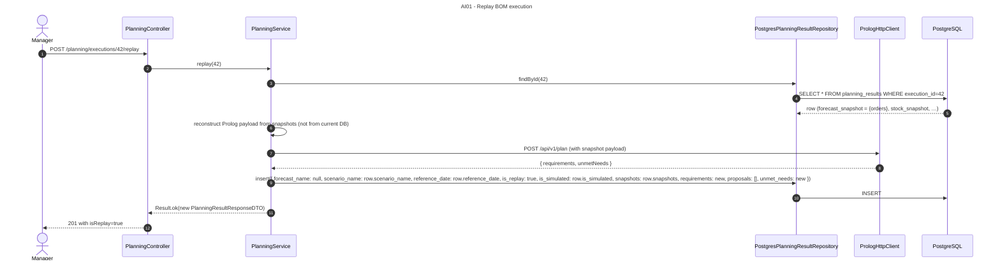
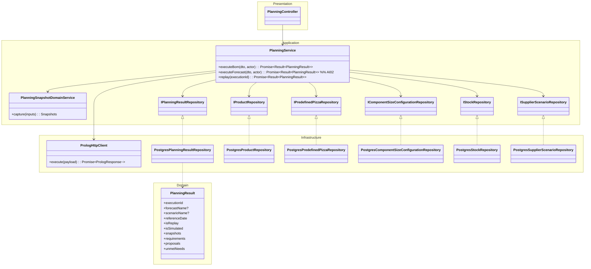

# AI01 — Prolog Bill of Materials and Stock Requirements

## 1. Requirements Engineering

### 1.1. User Story Description

As a LaPizza Manager, I want a Prolog Bill of Materials module based on ordered pizzas, using actual or simulated information supplied by the back end, so that stock availability and replenishment needs can be determined and demonstrated before all operational data is available.

### 1.2. Customer Specifications and Clarifications

#### From the specification document
> Extracted from *PART IV — Sprint 2 — User Stories* (AI01, pp. 16–17) and *PART II — System Specification* (§II.3.4, p. 14).

- **BOM in Prolog**, accessible through the AI service (AI05). Obtain ordered pizza quantities, sizes, BOM definitions, products, aggregates, and stock from back-end endpoints as defined in AI06.
- **Simulated orders** may be predefined or generated by the back end; **implementing a complete ordering workflow is not required**.
- **Calculation content:** raw-material and aggregate quantities required for the ordered pizzas, respecting sizes, recipes, consumption values, and abstract stock units.
- **Aggregate handling:** use available aggregate stock first; **expand only the remaining demand into ingredients** when the aggregate is produced internally; **replenish purchased aggregates directly**. Use the back-end production-or-purchase classification. **Avoid double counting** an aggregate and the ingredients it represents.
- **Reporting:** required quantities, available stock, **hypothetical remaining stock**, replenishment needs. **Identify shortages without reporting negative remaining stock.**
- **Separation from operational consumption:** only explicitly confirmed consumption may update stock through the back end. Simulations must **never** change stored stock, including scenario input stock. Hypothetical balances remain results only.
- **Error clarity:** report unknown items, invalid quantities, and incomplete or cyclic recipes clearly instead of returning an apparently valid result.
- **Simulation labelling:** identify the scenario and any simulated inputs. Actual and simulated inputs follow the same business rules and interfaces.
- **Demonstration:** sufficient and insufficient stock, including an aggregate partly available in stock. Document initial data and expected results. Simulated scenarios must be reproducible or resettable.

#### From project clarifications (`docs/domain/client-questions.md`)
- **Clarification #26:** planning is **read-only**; no `PurchaseOrder` aggregate; `PlanningResult` is read-only; no stock mutation.
- **Clarification #28 §1:** only pizzas have BOM; non-pizza products are not expanded.
- **Clarification #28 §2:** `stockUnitsPerSale` is required iff `isStockControlled ∧ isSellable`; missing → hard error, no silent default. This affects AI02 more than AI01 (AI01 consumes pizza components; `stockUnitsPerSale` applies to directly sold non-pizza products, which AI01 does not model). Documented here for completeness.

#### From ADRs and the asset/report artefacts
- **ADR-012 (KB §5):** Prolog runs as a **separate container** inside the LaPrizza boundary; backend calls `POST /api/v1/plan` via `PrologHttpClient`; payload is business-key-only (no UUIDs); no direct DB access from Prolog.
- **ADR-013 (KB §5):** `PlanningResult` stores deep-copied JSON snapshots (`forecast_snapshot`, `scenario_snapshot`, `stock_snapshot`) plus outputs (`requirements`, `proposals`, `unmet_needs`). FK `forecast_name`/`scenario_name` `ON DELETE SET NULL`.
- **KB §24.9 / §24.10:** `PlanningExecutionRequestDTO` (forecast-based) and `PlanningResultResponseDTO` shapes. AI01 **extends** this with an order-based request (see §1.5).
- **`docs/resources/pizza-BOM.pl.txt`:** reference Prolog BOM for a briefcase (parts/setp/stock/manage_stock). The AI01 KB adapts the same predicate family to pizzas (`pizza/3`, `part/1`, `setp/2`, `stock/2`, `order/3`).

### 1.3. Acceptance Criteria (expanded, testable)

#### AC1 — Prolog BOM accessible through AI05
- AC1.1 The backend exposes `POST /api/v1/planning/bom-executions` (AI05 endpoint, documented in §1.5.2). It orchestrates the AI01 computation via `PrologHttpClient`.
- AC1.2 The Prolog container accepts `POST /api/v1/plan` with a JSON payload whose top-level shape matches §1.5.4, executes the top-level predicate `bom_execution/2`, and returns JSON.
- AC1.3 The backend persists the result in `planning_results` (reused table) with `forecast_name = NULL`, `requirements` JSONB populated, `proposals = []::jsonb`, `unmet_needs` JSONB populated only for hard failures (unknown items, invalid quantities, incomplete/cyclic recipe).

#### AC2 — Obtain inputs from back-end endpoints (AI06)
- AC2.1 `PlanningService` loads, inside one transaction-scoped read at execution start:
  - ordered pizzas (from the request body — simulated inputs in Sprint 2, since there is no `CustomerOrder` aggregate yet);
  - BOM definitions (`predefined_pizzas` + `predefined_pizza_recipes`);
  - product metadata (flags, `stockUnitsPerSale`, `componentTypeName`, `isActive`);
  - `stock_items.current_units`;
  - production-or-purchase classification, derived from `Product.isPizzaComponent` + the parent aggregate membership (see AC4).
- AC2.2 The data is passed to Prolog in the business-key-only JSON shape (§1.5.4). No UUIDs, no PII.
- AC2.3 If any required input is unavailable (e.g., a product in the request does not exist, a pizza has no recipe, a recipe has a cycle), the backend rejects the request with `422 Unprocessable Entity` and `details[]` naming the offending SKUs, **before** calling Prolog — no apparently valid result is returned (AC9).

#### AC3 — Calculation respects size, recipe, consumption, stock units
- AC3.1 For each ordered `(productSku, pizzaSize, quantity)` where the product is a `PredefinedPizza`, Prolog expands the default recipe: for each `RecipeLine {componentSku, defaultQuantity}`, the required units of `componentSku` at `pizzaSize` are `defaultQuantity × quantity × csc.stockUnitsConsumed(componentSku, pizzaSize)`, where `csc` is the `ComponentSizeConfiguration`. This is the ADR-013/KB §4.5 pricing-and-consumption model applied to BOM.
- AC3.2 For each ordered `(productSku, pizzaSize, quantity)` where the product is **not** a pizza, it is not expanded (Clarification #28 §1); it appears in the output only as a direct line item if it is a `isStockControlled ∧ isSellable` product with a `stockUnitsPerSale` value (this is AI02's territory, but AI01 accepts it for non-pizza stock-controlled items too — see §1.7.3).
- AC3.3 `stockUnitsConsumed` is read from `component_size_configurations` (per-size, integer). Missing configuration for a required `(component, size)` → `422` (AC2.3).

#### AC4 — Aggregate handling without double counting
- AC4.1 For every ordered pizza component that is an **aggregate** (e.g., `dough` is composed of flour + water + yeast + salt + oil + sugar), the KB marks it as `aggregate(componentSku)`. Aggregates have a **composition** declared in the export (`boms[].lines` for the component itself is not exposed — see §1.7.2 for the modelling constraint: Sprint 2 exposes **pizza BOMs only**; aggregates are expanded via the pizza recipe depth-1, not recursively through sub-BOMs).
- AC4.2 **Use aggregate stock first:** for an aggregate `A`, `usedFromStock(A) = min(required(A), currentStock(A))`. The remaining demand `remaining(A) = required(A) − usedFromStock(A)`.
- AC4.3 **Expansion is depth-1** (pizza → components). A component is either produced internally (and its ingredients are not tracked by AI01) or purchased directly. This matches the clarification that only pizzas have BOM: aggregate composition beyond depth-1 is not part of the AI01 scope. The `pizza-BOM.pl.txt` reference uses a two-level structure (`setp(briefcase, [bottom, lid, steel_bar])` + `setp(bottom, [...])`); the LaPrizza baseline **does not recurse** to level 2 for purchased components. If a component is itself produced internally and the team wants depth-2 expansion, the export must be extended (documented as `$defs` addition) — out of scope for baseline.
- AC4.4 **Purchased aggregates:** replenishment for a purchased aggregate `P` is `replenishment(P) = max(0, remaining(P))`. No expansion.
- AC4.5 **Internally produced aggregates:** the recipe already lists the produced aggregate (e.g., `dough`). Its stock contributes first; any remaining demand is expanded into its ingredients **only if the export declares them** — which is not the case in baseline (§1.7.2). Consequence: in baseline, remaining demand of an internally produced aggregate is reported as `replenishment(aggregate)` without double-counting the ingredients (the "avoid counting both an aggregate and the ingredients" rule is satisfied vacuously — the ingredients are not in the model).
- AC4.6 **No double counting:** a SKU appears **once** in `requirements[]` and `proposals[]`. Aggregates and their ingredients never both appear as separate required lines.

#### AC5 — Reporting shape
- AC5.1 `requirements[]` contains one entry per distinct SKU:
  ```json
  { "productSku": "...", "requiredUnits": N, "availableUnits": M, "hypotheticalRemainingUnits": R, "replenishmentUnits": P }
  ```
- AC5.2 `R = M − required_from_stock` where `required_from_stock = min(N, M)`; **R ≥ 0 always**. Shortfalls appear as `replenishmentUnits > 0`, **never** as `R < 0`.
- AC5.3 If `N > M`, `P = N − M` and `R = 0`; if `N ≤ M`, `P = 0` and `R = M − N`.
- AC5.4 `proposals = []` for AI01 (no supplier selection — that is AI02). The `planning_results.proposals` column stores `[]::jsonb`.

#### AC6 — Separation from operational consumption
- AC6.1 `POST /planning/bom-executions` **never** issues `UPDATE stock_items` or `INSERT stock_movements`. The `stock_snapshot` JSONB captures the balances read at the start of the execution; the balances are identical before and after.
- AC6.2 The demo asserts via `GET /api/v1/stock` (before) and `GET /api/v1/stock` (after) that all `currentBalance` values are identical.
- AC6.3 Any hypothetical balance shown in `requirements[].hypotheticalRemainingUnits` is **result-only**; it is not written to `stock_items`.

#### AC7 — Simulation labelling
- AC7.1 The `BomExecutionRequestDTO` carries `isSimulated: true` when the `orders[]` come from a simulated source. The backend sets `planning_results.is_simulated = true`.
- AC7.2 If the request references a `scenarioName`, the backend checks that the scenario exists; the scenario itself has its own `is_simulated` flag (WEB07 AC6.7). Any simulated input makes the overall result `is_simulated = true`.
- AC7.3 The response `PlanningResultResponseDTO.isSimulated` reflects the OR of the two flags.

#### AC8 — Reproducibility and reset
- AC8.1 Two executions with the same `orders[]` and the same `stock_snapshot` produce the same `requirements[]`. Verified by running the same payload twice and diffing the `requirements` field (excluding `executedAt` and `executionId`).
- AC8.2 A BOM execution's snapshots can be replayed via `POST /planning/executions/{executionId}/replay` (existing endpoint; for AI01, `forecast_snapshot` holds the `orders[]` payload, `scenario_snapshot` holds `null` or the scenario if referenced, `stock_snapshot` holds the balances). The replay is a new `planning_results` row with `is_replay = true`.
- AC8.3 The reset of a simulated scenario is out of scope for AI01 (the input is the request body, not a persisted state) — the "reproducible or resettable" property is satisfied by re-sending the same request.

#### AC9 — Clear error reporting
- AC9.1 Unknown `productSku` in `orders[]` → `422` with `details[]` listing the unknown SKUs.
- AC9.2 Pizza with no `PredefinedPizza` record or no `defaultRecipeLines` → `422` with details.
- AC9.3 Non-integer or negative `quantity` → `400` (Joi).
- AC9.4 Cyclic recipe (should not occur since only pizzas have recipes — Clarification #28 §1 — but defensive) → Prolog returns `unmet_needs: [{ reason: "cyclic_recipe", productSku }]`; backend persists the result with `unmet_needs` populated and returns `201` (the result is meaningful even if incomplete, and the Manager sees the error in the UI).
- AC9.5 Missing `ComponentSizeConfiguration` for a required `(component, size)` → `422` (AC2.3).

### 1.4. Found out Dependencies

**Preceding:**
- WEB07 (the Manager UI initiates the execution; the demo runs through it).
- AI05 (endpoint + auth + error mapping).
- AI06 (export payload, stock snapshot, product metadata).
- ADR-012 (Prolog container), ADR-013 (`PlanningResult` snapshots).
- Migration 014 §4 (`planning_results` table — reused).
- `docs/resources/pizza-BOM.pl.txt` as the reference for the Prolog predicate family.

**Succeeding:**
- AI04 (IARTI technical report documents the Prolog predicates and the demo evidence).
- Sprint 3 food-preparation scheduling (separate from BOM — not in AI01 scope).

### 1.5. Input and Output Data

#### 1.5.1. DTOs

**BomExecutionRequestDTO** (extension — see §1.7.3):
```json
{
  "orders": [
    { "productSku": "PRD-PIZZA-MARG", "pizzaSize": "Medium", "quantity": 12 },
    { "productSku": "PRD-PIZZA-MARG", "pizzaSize": "Large",  "quantity": 5 },
    { "productSku": "PRD-PIZZA-QUATTRO", "pizzaSize": "Small", "quantity": 3 }
  ],
  "scenarioName": "Autumn-Scenario",   // optional; null → stock-only BOM
  "referenceDate": "2026-11-05",       // optional; defaults to today
  "isSimulated": true,                  // explicit; backend ORs with scenario's flag
  "source": "simulated"                 // "simulated" | "fromForecast" (future)
}
```

- `orders`: required, minItems 1; each item requires `productSku` (must exist and be a `PredefinedPizza` for expansion, or a stock-controlled product for direct lines), `pizzaSize` (required when the product is a pizza — validated against `pizza_sizes`), `quantity` (positive integer).
- `scenarioName`: optional; if provided, must reference a `SupplierScenario` and be used only for labelling (AI01 does not select suppliers).
- `referenceDate`: optional; used for labelling and for the `planning_results.reference_date` column.
- `isSimulated`/`source`: required boolean/string.

**BomResultResponseDTO** — reuses `PlanningResultResponseDTO` with `forecastName: null`, `proposals: []`, `requirements` and `unmetNeeds` populated (§1.5.2).

#### 1.5.2. Endpoint matrix

| Method | Path | Roles | Success | Other |
|---|---|---|---|---|
| POST | `/api/v1/planning/bom-executions` | MANAGER | 201 + `PlanningResultResponseDTO` | 400 (invalid body), 401, 403, 422 (unknown SKU, missing recipe, missing size config, invalid quantity), 502 (Prolog unavailable) |
| GET | `/api/v1/planning/executions` (existing) | MANAGER | 200 + list | — (BOM results appear in the list with `forecastName = null`) |
| GET | `/api/v1/planning/executions/{executionId}` (existing) | MANAGER | 200 + `PlanningResultResponseDTO` | — |
| POST | `/api/v1/planning/executions/{executionId}/replay` (existing) | MANAGER | 201 + `PlanningResultResponseDTO` with `isReplay=true` | 502 |

> **Extension:** `/planning/bom-executions` is not in `openapi.yaml` v2.1.0. It must be added (see §1.7.3).

#### 1.5.3. Persistence

`planning_results` (migration 014 §4, **reused** — no new table):

```sql
-- existing columns relevant to AI01 (no schema change)
CREATE TABLE planning_results (
    execution_id SERIAL PRIMARY KEY,
    forecast_name VARCHAR REFERENCES consumption_forecasts(name) ON DELETE SET NULL,  -- NULL for AI01
    scenario_name VARCHAR REFERENCES supplier_scenarios(name) ON DELETE SET NULL,    -- optional for AI01
    reference_date DATE NOT NULL,
    is_replay BOOLEAN NOT NULL DEFAULT FALSE,
    is_simulated BOOLEAN NOT NULL DEFAULT FALSE,
    forecast_snapshot JSONB NOT NULL,   -- for AI01: { orders: [...] } (no forecast)
    scenario_snapshot JSONB NOT NULL,   -- for AI01: { scenarioName, suppliers, offers } or 'null'
    stock_snapshot JSONB NOT NULL,      -- for AI01: { capturedAt, quantities: {sku: units} }
    requirements JSONB NOT NULL,        -- AI01 output (see §1.5.4)
    proposals JSONB NOT NULL,           -- '[]'::jsonb for AI01
    unmet_needs JSONB NOT NULL,         -- '[]'::jsonb or error list
    executed_at TIMESTAMPTZ NOT NULL DEFAULT NOW()
);
```

`forecast_name IS NULL` is the **baseline heuristic** for "this is a BOM execution". A `015_*.sql` adding `execution_type VARCHAR NOT NULL CHECK (execution_type IN ('BOM','REQUIREMENTS_PLANNING'))` is a documented hardening option.

#### 1.5.4. Prolog payload and response (business-key JSON over HTTP)

**Request to Prolog** (backend → `POST /api/v1/plan`):

```json
{
  "executionType": "BOM",
  "referenceDate": "2026-11-05",
  "isSimulated": true,
  "orders": [
    { "productSku": "PRD-PIZZA-MARG", "pizzaSize": "Medium", "quantity": 12 },
    { "productSku": "PRD-PIZZA-MARG", "pizzaSize": "Large",  "quantity": 5 }
  ],
  "products": [
    { "sku": "PRD-PIZZA-MARG", "name": "Margherita", "category": "Pizzas", "isPizzaComponent": false, "isStockControlled": false, "isSellable": true, "componentTypeName": null, "stockUnitsPerSale": null, "currentStock": 0, "isActive": true },
    { "sku": "PRD-DOUGH-TRAD", "name": "Traditional Dough", "category": "Doughs", "isPizzaComponent": true, "isStockControlled": true, "isSellable": false, "componentTypeName": "Base Dough", "stockUnitsPerSale": null, "currentStock": 40, "isActive": true },
    { "sku": "PRD-MOZZ-01", "name": "Mozzarella", "category": "Cheese", "isPizzaComponent": true, "isStockControlled": true, "isSellable": false, "componentTypeName": "Cheese", "stockUnitsPerSale": null, "currentStock": 25, "isActive": true }
  ],
  "componentSizeConfigurations": [
    { "componentSku": "PRD-DOUGH-TRAD", "pizzaSize": "Medium", "stockUnitsConsumed": 1 },
    { "componentSku": "PRD-MOZZ-01",    "pizzaSize": "Medium", "stockUnitsConsumed": 2 }
  ],
  "boms": [
    { "pizzaSku": "PRD-PIZZA-MARG", "recipeName": "Margherita Classica", "lines": [
      { "componentSku": "PRD-DOUGH-TRAD", "defaultQuantity": 1 },
      { "componentSku": "PRD-MOZZ-01", "defaultQuantity": 1 }
    ]}
  ]
}
```

**Response from Prolog**:

```json
{
  "requirements": [
    { "productSku": "PRD-DOUGH-TRAD", "requiredUnits": 17, "availableUnits": 40, "hypotheticalRemainingUnits": 23, "replenishmentUnits": 0 },
    { "productSku": "PRD-MOZZ-01",    "requiredUnits": 34, "availableUnits": 25, "hypotheticalRemainingUnits": 0,  "replenishmentUnits": 9 }
  ],
  "unmetNeeds": []
}
```

On hard failure (e.g., cyclic recipe — defensive), Prolog returns:
```json
{ "requirements": [], "unmetNeeds": [{ "productSku": "PRD-PIZZA-X", "reason": "cyclic_recipe", "detail": "..." }] }
```
and the backend persists it as a meaningful (if incomplete) result.

### 1.6. System Sequence Diagrams (SSD)

#### 1.6.1. Happy path — BOM execution with sufficient and insufficient stock



#### 1.6.2. Replay of a BOM execution



### 1.7. Other Relevant Remarks

#### 1.7.1. Component architecture



#### 1.7.2. Decision record — depth-1 expansion and "aggregate" classification

The spec's "aggregate" language ("aggregate partly available in stock", "use available aggregate stock first", "expand only the remaining demand into ingredients") assumes the BOM has **at least two levels**: pizza → aggregate → ingredients. The Sprint 2 model, per Clarification #28 §1 ("only pizzas have BOM"), exposes only **pizza-level** BOMs. There is no recursive sub-BOM in the baseline.

**Decision:** AI01 operates on a **depth-1 BOM** (pizza → components). "Aggregate" is interpreted as **any pizza component that is itself stock-controlled** (e.g., `dough`, `sauce`). The "expansion into ingredients" path is **not exercised** because the model does not expose component-level sub-BOMs; the remaining demand of a component is reported as `replenishmentUnits` for that component (no double counting, since ingredients do not appear).

**Consequences:**
- The BOM demonstration in the demo shows sufficient and insufficient stock on **components** (e.g., mozzarella), which satisfies AI01 AC "Sufficient and insufficient stock, including an aggregate partly available in stock" by interpretation: an "aggregate" is a stock-controlled component.
- The reference `pizza-BOM.pl.txt`'s two-level briefcase BOM is not a target; the AI04 report documents the modelling choice and its justification against Clarification #28 §1.

**Alternatives considered:**
- *Extend the export to expose component sub-BOMs*: rejected — the baseline product model does not have a "recipe for aggregates" concept; adding one requires a new aggregate/table and is out of scope for Sprint 2.
- *Treat every product as a "component" and skip the aggregate distinction*: rejected — the AC explicitly mentions "aggregate partly available in stock"; ignoring it would be a visible gap.

#### 1.7.3. Decision record — new endpoint vs. extending `/planning/executions`

The openapi v2.1.0 declares `POST /planning/executions` with a body of `{ forecastName, scenarioName, referenceDate? }`. AI01 needs an **order-based** body, not a forecast-based one. Three options:

1. **Extend `/planning/executions`** with an optional `orders[]` field, mutually exclusive with `forecastName`. Rejected: complicates the contract (a runtime `oneOf` at the body level), and mixes two US's inputs in one schema.
2. **Overload `/planning/executions`** with a `type` discriminator. Rejected: still one endpoint with two shapes; the openapi `additionalProperties: false` (if enforced) would reject the AI01 shape.
3. **Add `POST /planning/bom-executions`** (chosen). Keeps AI01 and AI02 contracts separated, allows independent versioning, and lets the SPA call the right endpoint without a discriminator. Additive to openapi; no breaking change.

**Consequence:** `openapi.yaml` must be bumped to v2.2.0 with the new path + `BomExecutionRequestDTO`. Both `BomResultResponseDTO` and `PlanningResultResponseDTO` are the same schema (aliased for clarity, or simply reuse `PlanningResultResponseDTO`).

#### 1.7.4. Decision record — `forecast_name IS NULL` heuristic

Since `planning_results` is reused for AI01, the historical list must distinguish BOM results from forecast results. The baseline heuristic is `forecast_name IS NULL` → BOM. A `015_*.sql` adding `execution_type` is documented as a hardening option; not baseline.

**Consequences of the heuristic:**
- `GET /planning/executions` (existing) returns both types interleaved; the SPA can filter by `forecastName === null` to show BOM history.
- A `planning_results` row with `forecast_name = NULL` due to `ON DELETE SET NULL` (forecast deleted after a forecast execution) is **indistinguishable** from a BOM row. The `015_*.sql` column resolves this ambiguity. Documented, not baseline.

#### 1.7.5. Error-to-HTTP matrix

| Action | Condition | HTTP | UI feedback |
|---|---|---|---|
| BOM execution | invalid body (Joi) | 400 | field-level |
| BOM execution | unknown `productSku` in `orders[]` | 422 | details[] listing unknown SKUs |
| BOM execution | unknown `pizzaSize` | 422 | details[] |
| BOM execution | product exists but is not a `PredefinedPizza` and has no direct-stock path | 422 | details[] |
| BOM execution | pizza with no `defaultRecipeLines` | 422 | details[] |
| BOM execution | missing `ComponentSizeConfiguration` for `(component, size)` | 422 | details[] listing `(sku, size)` |
| BOM execution | Prolog unreachable / timeout | 502 | "Serviço de planeamento indisponível. Tente novamente." |
| BOM execution | cyclic recipe (defensive) | 201 with `unmetNeeds[]` populated | inline warning per offending SKU |
| BOM execution | success | 201 | render `requirements[]` + `unmetNeeds[]` |
| Replay | unknown `executionId` | 404 | toast |
| Replay | Prolog unreachable | 502 | toast + retry |
| Any | no token / expired | 401 | redirect `/login` |
| Any | not MANAGER | 403 | `/forbidden` |

#### 1.7.6. Verification (automated + demo)

- **Unit (application):** `PlanningService.executeBom` — 8 cases: success, unknown SKU, missing recipe, missing size config, Prolog 502, Prolog 200 with `unmetNeeds`, empty `orders[]` rejected upstream by Joi, non-pizza stock-controlled product appears as direct line. Assert that `stock_items` is not mutated (spy on `IStockRepository` — only `find` methods called, no `update`).
- **Unit (snapshot):** `PlanningSnapshotDomainService.capture` deep-copies; mutating the source objects after capture does not affect the snapshot.
- **Integration (Supertest + mocked Prolog):** the full 201/422/502 matrix; the resulting `planning_results` row has `forecast_name = null`, `proposals = []`, `requirements` JSONB matching the Prolog mock's output.
- **DB suite:** the `planning_results` row is persisted; `GET /api/v1/stock` returns identical balances before and after the request.
- **Bruno:** `WEB07-AIPlanning` collection (KB §28.3) gets a `POST /planning/bom-executions` request mirroring §1.5.1, plus a `.bru` asserting `forecastName === null` and `proposals.length === 0`.
- **Demo:** two orders — one with sufficient stock (Margherita Medium × 12, mozzarella current stock 25 vs required 24 → sufficient) and one with insufficient (Margherita Large × 5, mozzarella required 15 vs current 25 − 24 = 1 → insufficient, replenishment 14). Screenshot before/after `GET /stock`. Replay the same execution → new row with `isReplay=true` and identical `requirements`.