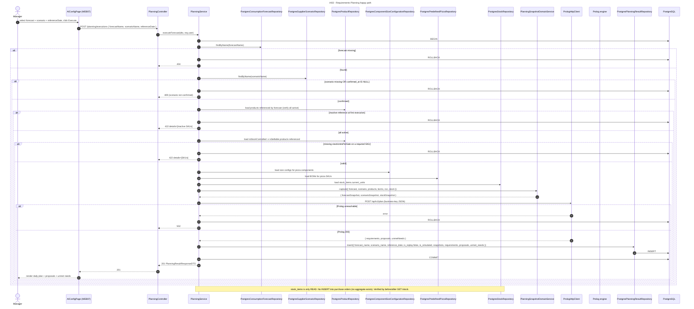
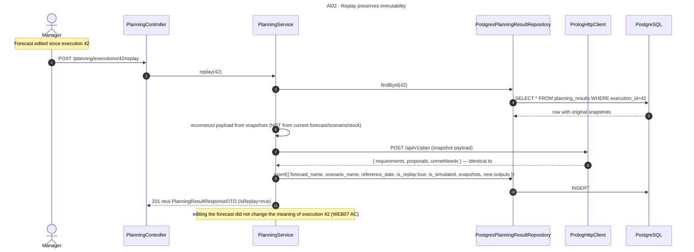

# AI02 — Prolog Requirements Planning and Supplier Selection

## 1. Requirements Engineering

### 1.1. User Story Description

As a LaPizza Manager, I want a Prolog Requirements Planning module using daily forecast sellable-product consumption over a specified period, so that suitable suppliers and replenishment plans can be proposed for review.

### 1.2. Customer Specifications and Clarifications

#### From the specification document
> Extracted from *PART IV — Sprint 2 — User Stories* (AI02, pp. 17–18) and *PART II — System Specification* (§II.3.4, p. 14).

- **Requirements Planning in Prolog**, exposed through AI05.
- **Accept daily forecast** of sellable-product consumption (including pizzas and sizes) with dates/quantities/validation per WEB07.
- **Derive daily pizza material requirements** from back-end BOM definitions. For **directly sold stock-controlled products**, use their **stock-consumption rules** (`stockUnitsPerSale`). Calculate replenishment for raw materials, purchased aggregates, and directly sold products **without double counting**.
- **Carry hypothetical remaining stock and planned deliveries forward between days** without changing stored stock. **No operational purchase orders**; any operational order requires a separate explicit confirmation through the back end. **Repeated requests must not create duplicate orders** (trivially satisfied — none are created).
- **Select suppliers from the confirmed supplier scenario.** Document and justify **selection criteria** (cost + delivery timing). **Compare prices in EUR on a common stock-unit basis**; **flag incompatible units**; currency conversion is not required.
- **Planning reference date** defaults to execution date. **Proposed order dates must not precede it.** **Daily requirements are due at the start of that day.** **Lead times in calendar days.** **Report late or unmet requirements.** Historical simulations may use an explicit `referenceDate` recorded with the results.
- **Supply limits** only when provided. Document assumptions about missing capacity information; do not interpret it as zero or verified unlimited. Show **daily plan** with required items and quantities, suppliers, order-placement dates, expected delivery dates, unmet needs. Period totals may supplement.
- **Missing data or unsuitable suppliers** must be **explained** rather than presented as a complete plan.
- **Use forecasts and supplier scenarios** from WEB07 and AI06.
- **Any simulated input** must be labelled; results must not change stored stock or create POs.

#### From project clarifications (`docs/domain/client-questions.md`)
- **Clarification #26:** planning is read-only; no `PurchaseOrder` aggregate; `PlanningResult` is read-only; no stock mutation.
- **Clarification #28 §1:** only pizzas have BOM; non-pizza stock-controlled products use `stockUnitsPerSale`.
- **Clarification #28 §2:** `stockUnitsPerSale` required iff `isStockControlled ∧ isSellable`; missing → **hard error** (no silent default of 1).
- **Clarification #28 §3:** inactive references rejected for **new** forecasts and **first execution**; historical replays use original snapshots.
- **Clarification #28 §4:** lead times = whole days (integer ≥ 0).
- **Clarification #28 §5 (follow-up):** supply limits per-offer, per-day (not shared across a supplier's products); missing limit = unlimited; `0` is a valid limit (never supplies), distinguishable from `NULL`.

#### From ADRs and KB
- **ADR-012:** Prolog container inside boundary; business-key payload; no DB access from Prolog.
- **ADR-013:** `PlanningResult` snapshots + read-only.
- **KB §24.9 / §24.10:** `PlanningExecutionRequestDTO` (this US's canonical request) and `PlanningResultResponseDTO`.

### 1.3. Acceptance Criteria (expanded, testable)

#### AC1 — Prolog Requirements Planning through AI05
- AC1.1 `POST /api/v1/planning/executions` (existing openapi path) orchestrates the Prolog call. The Prolog container executes `requirements_planning/2` and returns JSON.
- AC1.2 The backend persists the result in `planning_results` with `forecast_name NOT NULL`, `proposals` populated, `requirements` and `unmet_needs` populated.

#### AC2 — Forecast input validation
- AC2.1 The request body is `{ forecastName, scenarioName, referenceDate? }`. The forecast must exist and be a `ConsumptionForecast` aggregate (WEB07). The scenario must exist, be a `SupplierScenario`, and be **confirmed** (`confirmed_at IS NOT NULL`).
- AC2.2 Forecast entries (`consumption_forecast_entries`) have already passed WEB07's validation: `date ∈ [startDate, endDate]`, product exists and is sellable, `pizzaSize` compatible, `quantity ≥ 0`, composite key unique. AI02 does **not** re-implement these rules (defensive: if any are violated, the backend rejects with `422` citing the offending entries, since the state may have been edited after WEB07's checks — WEB07 AC3.7).
- AC2.3 **Inactive references at first execution:** if a forecast entry references a product that became **inactive** since forecast creation, the first execution rejects with `422` and `details[]` listing the inactive SKUs (Clarification #28 §3). A **replay** (AC7) uses the snapshot and is not subject to this check.

#### AC3 — Daily requirement derivation
- AC3.1 For each forecast day `d` in `[startDate, endDate]` and each entry `(productSku, pizzaSize, quantity)`:
  - if `productSku` is a `PredefinedPizza`, expand its recipe: `required(component, d) += defaultQuantity(component) × quantity × csc.stockUnitsConsumed(component, pizzaSize)` (depth-1, as in AI01 AC4.3).
  - if `productSku` is a directly sold stock-controlled product (`isStockControlled ∧ isSellable`), `required(productSku, d) += quantity × stockUnitsPerSale` (Clarification #28 §2). If `stockUnitsPerSale` is `NULL`, **hard error** `422` (Clarification #28 §2).
  - else (sellable, non-stock-controlled, non-pizza): no requirement is generated for stock; the line is not in `requirements` (it is demand-only).
- AC3.2 Daily requirements are **due at the start of day `d`** (spec).
- AC3.3 No double counting: a SKU appears once per day in the daily plan; aggregates and their ingredients do not both appear (same rule as AI01 AC4.6).

#### AC4 — Forward carry of hypothetical stock and planned deliveries
- AC4.1 For each SKU and day `d`:
  - `hypotheticalStock(sku, 0) = currentStock(sku)` (from the stock snapshot at execution start).
  - `hypotheticalStock(sku, d) = hypotheticalStock(sku, d-1) − required(sku, d) + delivered(sku, d)`, where `delivered(sku, d)` is the sum of quantities whose `expectedDelivery == d` from previously placed (in the plan) proposals.
- AC4.2 If `hypotheticalStock(sku, d) < 0`, the deficit is converted into a **proposal** (order) on the appropriate **order date** such that the delivery arrives **on or before `d`** (taking lead time into account). The deficit is not "consumed" — the proposal is the replenishment.
- AC4.3 **No stored stock is mutated.** `stock_items.current_units` is unchanged. The `stock_snapshot` JSONB captures the initial balances; all subsequent balances are computations inside the Prolog run.
- AC4.4 **No purchase orders are created** (no `PurchaseOrder` aggregate — Clarification #26). Repeated identical requests produce identical `proposals` (deterministic) and do not create duplicate orders (vacuously true).

#### AC5 — Supplier selection criteria
- AC5.1 For each proposal `(sku, quantity, deliveryDueDate)`, Prolog selects an offer from the **confirmed scenario**:
  - Filter offers by `product_sku == sku` and `stock_unit_quantity >= quantity` (single-offer fulfilment — see §1.7.3 for the splitting decision).
  - Among valid offers, prefer the one that **arrives on time** (`orderDate + leadTimeDays ≤ deliveryDueDate`). If none arrives on time, pick the one with the **earliest delivery** and flag the requirement as **late** (`unmetNeed.reason = "late"`).
  - Among on-time offers, prefer the **lowest `price_amount` per `stock_unit_quantity`** (unit price in EUR), then the shortest lead time, then `supplierCode` alphabetically for determinism.
- AC5.2 The selection rationale is **persisted in the result** (or derivable from `proposals[]` + the scenario snapshot). For the AI04 report, the demo shows a scenario where the two criteria (cost vs. delivery) yield different choices and the algorithm's choice is explained.
- AC5.3 **Currency:** all `price_amount` are in EUR (`price_currency = 'EUR'` in the schema). No currency conversion. If a future offer uses a non-EUR currency (would require a schema change), the backend rejects it at WEB07 creation time.
- AC5.4 **Unit compatibility:** the schema mandates `stock_unit_quantity` in abstract stock units (integer). If a proposal's `quantity` cannot be expressed in the offer's stock units (i.e., `quantity` is not an integer multiple — not applicable in baseline since both are integers), flag as `unmetNeed.reason = "unit_incompatible"`. Documented as defensive.

#### AC6 — Supply limits
- AC6.1 If `supplier_offers.daily_supply_limit` is `NULL`, the offer is unlimited for that day (Clarification #28 §5).
- AC6.2 If a limit is set, the offer can supply at most `daily_supply_limit` units **per day** for that offer (per product per day). If a proposal's daily demand exceeds the limit, the excess is either covered by another offer (if available) or reported as `unmetNeed.reason = "daily_limit"`.
- AC6.3 The limit is **per offer per day**, not shared across a supplier's products (Clarification #28 §5). Multiple proposals to the same supplier for different products on the same day are each bounded by their own offer's limit.
- AC6.4 `daily_supply_limit = 0` means "never supplies on that day"; the offer is filtered out.

#### AC7 — Replay
- AC7.1 `POST /planning/executions/{executionId}/replay` re-runs using the **snapshots** (`forecast_snapshot`, `scenario_snapshot`, `stock_snapshot`) captured at the original execution, **not** the current forecast/scenario/stock.
- AC7.2 The replay is a new `planning_results` row with `is_replay = true` and the same `forecast_name`/`scenario_name` (which may now be `NULL` if the originals were deleted — ADR-013 `ON DELETE SET NULL`).
- AC7.3 The demo shows: create forecast, execute, edit forecast, replay the old execution → identical result (proving immutability).

#### AC8 — Output shape
- AC8.1 `requirements[]` (daily plan): one entry per `(date, sku)`:
  ```json
  { "date": "2026-11-05", "productSku": "PRD-MOZZ-01", "requiredUnits": 34, "availableUnits": 25, "hypotheticalRemainingUnits": 0, "replenishmentUnits": 9 }
  ```
- AC8.2 `proposals[]`: one entry per selected offer:
  ```json
  { "supplierCode": "SUP-A", "productSku": "PRD-MOZZ-01", "quantity": 9, "orderDate": "2026-11-04", "expectedDelivery": "2026-11-06", "priceEur": 18.90 }
  ```
- AC8.3 `unmetNeeds[]`: one entry per requirement that cannot be met (no offer, daily limit, unit incompatible, late-but-no-on-time-alternative):
  ```json
  { "date": "2026-11-06", "productSku": "PRD-MOZZ-01", "shortfallUnits": 5, "reason": "no_offer" }
  ```
- AC8.4 The result is **not** presented as "complete" if any `unmetNeeds` exists — the UI (WEB07) surfaces them explicitly.

#### AC9 — Reference date semantics
- AC9.1 `referenceDate` defaults to the execution date (`now().date`).
- AC9.2 No `proposal.orderDate` is earlier than `referenceDate`.
- AC9.3 The result persists `reference_date` (migration 014 column) so historical simulations record the explicit reference date.

### 1.4. Found out Dependencies

**Preceding:**
- WEB07 (forecast + scenario CRUD, `confirm` flow).
- AI05 (endpoint), AI06 (export payload, supplier scenario snapshot).
- `stockUnitsPerSale` populated for every `isStockControlled ∧ isSellable` product (Clarification #28 §2). WEB05's product form must enforce this.
- Migration 014 §4 (`consumption_forecasts`, `supplier_scenarios`, `suppliers`, `supplier_offers`, `planning_results`).
- ADR-012, ADR-013.

**Succeeding:**
- AI04 (IARTI report documents the selection criteria and demo evidence).
- Sprint 3 food-preparation scheduling (separate concern).

### 1.5. Input and Output Data

#### 1.5.1. DTOs

**PlanningExecutionRequestDTO** (already in openapi.yaml):
```json
{ "forecastName": "Week-45-Forecast", "scenarioName": "Autumn-Scenario", "referenceDate": "2026-11-05" }
```

**PlanningResultResponseDTO** (already in openapi.yaml):
```json
{
  "executionId": 42,
  "forecastName": "Week-45-Forecast",
  "scenarioName": "Autumn-Scenario",
  "referenceDate": "2026-11-05",
  "isReplay": false,
  "isSimulated": false,
  "executedAt": "2026-11-05T14:30:00Z",
  "requirements": [
    { "date": "2026-11-05", "productSku": "PRD-MOZZ-01", "requiredUnits": 34, "availableUnits": 25, "hypotheticalRemainingUnits": 0, "replenishmentUnits": 9 }
  ],
  "proposals": [
    { "supplierCode": "SUP-A", "productSku": "PRD-MOZZ-01", "quantity": 9, "orderDate": "2026-11-04", "expectedDelivery": "2026-11-06", "priceEur": 18.90 }
  ],
  "unmetNeeds": []
}
```

#### 1.5.2. Endpoint matrix

| Method | Path | Roles | Success | Other |
|---|---|---|---|---|
| POST | `/api/v1/planning/executions` | MANAGER | 201 + `PlanningResultResponseDTO` | 400, 401, 403, 404 (forecast/scenario not found), 409 (scenario not confirmed / inactive reference), 422 (missing `stockUnitsPerSale`, invalid forecast entry), 502 (Prolog unavailable) |
| GET | `/api/v1/planning/executions` | MANAGER | 200 (existing) | — |
| GET | `/api/v1/planning/executions/{executionId}` | MANAGER | 200 (existing) | 404 |
| POST | `/api/v1/planning/executions/{executionId}/replay` | MANAGER | 201 (existing) | 404, 502 |

No new endpoints for AI02 — the openapi contract is already correct.

#### 1.5.3. Persistence

Same `planning_results` table (migration 014 §4). For AI02: `forecast_name NOT NULL`, `scenario_name NOT NULL`, `proposals` populated. The `snapshots` JSONBs hold the input deep copies.

Relevant FKs (already in migration 014): `planning_results.forecast_name → consumption_forecasts(name) ON DELETE SET NULL`; `planning_results.scenario_name → supplier_scenarios(name) ON DELETE SET NULL`.

#### 1.5.4. Prolog payload and response (excerpt)

**Request to Prolog** (backend → `POST /api/v1/plan`):
```json
{
  "executionType": "REQUIREMENTS_PLANNING",
  "referenceDate": "2026-11-05",
  "isSimulated": false,
  "forecast": {
    "name": "Week-45-Forecast",
    "entries": [
      { "date": "2026-11-05", "productSku": "PRD-PIZZA-MARG", "pizzaSize": "Medium", "quantity": 12 },
      { "date": "2026-11-05", "productSku": "PRD-COKE-01", "pizzaSize": null, "quantity": 40 }
    ]
  },
  "scenario": {
    "name": "Autumn-Scenario",
    "suppliers": [{ "supplierCode": "SUP-A", "name": "Mozzarella Co." }],
    "offers": [
      { "supplierCode": "SUP-A", "productSku": "PRD-MOZZ-01", "priceEur": 2.10, "stockUnitQuantity": 100, "leadTimeDays": 2, "dailySupplyLimit": 60 }
    ]
  },
  "products": [ { "sku": "PRD-COKE-01", "isStockControlled": true, "isSellable": true, "stockUnitsPerSale": 1, "currentStock": 200, … } ],
  "componentSizeConfigurations": [ … ],
  "boms": [ … ]
}
```

**Response from Prolog**: the `requirements`, `proposals`, `unmetNeeds` triple (§1.5.1).

### 1.6. System Sequence Diagrams (SSD)

#### 1.6.1. Happy path with supplier selection and daily plan



#### 1.6.2. First execution rejects an inactive reference

```mermaid
sequenceDiagram
autonumber
title AI02 - First execution rejects inactive reference
    actor Manager
    participant Ctrl as PlanningController
    participant Svc as PlanningService
    participant ProdRepo as PostgresProductRepository

    Manager->>Ctrl: POST /planning/executions { forecastName, scenarioName }
    Ctrl->>Svc: executeForecast
    Svc->>ProdRepo: load products referenced by forecast entries
    ProdRepo-->>Svc: [{ sku: "PRD-TOMATO-01", isActive: false }, …]
    Svc-->>Ctrl: Result.fail(422, details=["PRD-TOMATO-01 is inactive"])
    Ctrl-->>Manager: 422 with actionable message
    Note over Svc: forecast/scenario/stock unchanged; no planning_results row
```

#### 1.6.3. Replay preserves immutability



### 1.7. Other Relevant Remarks

#### 1.7.1. Component architecture

Shared with AI01 (see §1.7.1 of AI01) — the `PlanningService` holds both `executeBom` (AI01) and `executeForecast` (AI02). Only the request/response types and the input loaders differ; the persistence path and snapshot mechanism are identical.

#### 1.7.2. Decision record — selection algorithm

**Chosen algorithm (documented and justified per AI02 AC5.2):**

1. For each daily requirement `(sku, day, qty)`:
   - Compute `deficit = required − (hypotheticalStock(sku, day-1) + scheduledDeliveries(sku, day))`.
   - If `deficit > 0`, create a proposal with `deliveryDueDate = day`.
2. For each proposal:
   - Filter offers of the confirmed scenario for `sku` where `daily_supply_limit IS NULL OR daily_supply_limit >= qty` (per-offer, per-day — §1.7.3).
   - Among filtered, split into **on-time** (`orderDate + leadTimeDays ≤ deliveryDueDate`) and **late** (else).
   - If on-time set non-empty: pick minimum `price_amount / stock_unit_quantity`; tie-break by `leadTimeDays` asc, then `supplierCode` asc.
   - Else: pick from late set with same tie-break; emit `unmetNeeds` entry `{ reason: "late", shortfall: qty }`.
   - `orderDate = deliveryDueDate − leadTimeDays`, but never earlier than `referenceDate`; if that would be earlier, the requirement is **late** and `orderDate = referenceDate`.

**Alternatives considered:**
- *Cheapest supplier only*: rejected — ignores delivery timing, which the spec explicitly mentions.
- *Single global supplier per product*: rejected — splits the plan unnecessarily and ignores supply limits.
- *Splitting a requirement across multiple offers to cover supply limits*: considered, but rejected for baseline as it complicates the plan and the `proposals[]` semantics; documented as **follow-up** (§1.7.3).

#### 1.7.3. Decision record — no splitting across offers

A proposal is satisfied by **one** offer. If the cheapest offer cannot cover the full quantity (supply limit), the algorithm either:
- picks the next-cheapest offer that covers it, or
- reports `unmetNeeds` with `reason = "daily_limit"` for the uncovered portion.

**Rationale:** the spec allows supply limits but does not require splitting. A single-offer-per-proposal plan is simpler to review, and `unmetNeeds` correctly surfaces what cannot be covered. Multi-offer splitting is documented as a follow-up (would add a `quantity` field per offer per requirement).

**Consequence for the demo:** scenarios where the cheapest offer has a low `daily_supply_limit` are demonstrated (WEB07 import with `dailySupplyLimit: 5` on the cheapest offer) to show that the algorithm either moves to the next offer or reports the shortfall.

#### 1.7.4. Decision record — `unit_incompatible` defensive check

`stock_unit_quantity` is an integer (schema). `quantity` in a proposal is an integer. Division is exact. The `unit_incompatible` reason is therefore **defensive only** and is exercised by an artificial test in the DB suite (feeding a fractional quantity directly into the Prolog payload via the snapshot), not by the UI.

#### 1.7.5. Error-to-HTTP matrix

| Action | Condition | HTTP | UI |
|---|---|---|---|
| Execute | forecast not found | 404 | "Previsão não encontrada." |
| Execute | scenario not found | 404 | "Cenário não encontrado." |
| Execute | scenario not confirmed | 409 | "Confirme o cenário antes de executar." + link to WEB07 |
| Execute | inactive reference at first execution | 422 | details[] listing inactive SKUs + link to `/products?sku=…` |
| Execute | missing `stockUnitsPerSale` | 422 | details[] listing SKUs + link to `/products/{sku}` |
| Execute | invalid forecast entry (defensive) | 422 | details[] |
| Execute | Prolog unreachable | 502 | "Serviço de planeamento indisponível." + retry |
| Execute | Prolog 200 with `unmetNeeds` | 201 | render daily plan + unmet needs banner |
| Replay | execution not found | 404 | toast |
| Replay | Prolog unreachable | 502 | toast + retry |
| Any | no token / expired | 401 | `/login` redirect |
| Any | not MANAGER | 403 | `/forbidden` |

#### 1.7.6. Verification (automated + demo)

- **Unit (application):** `PlanningService.executeForecast` — 9 cases: success, forecast 404, scenario 404, scenario not confirmed 409, inactive reference 422, missing `stockUnitsPerSale` 422, invalid forecast entry 422, Prolog 502, Prolog 200 with unmet needs. Assert no `UPDATE stock_items` and no `INSERT` into any purchase-order table (spy).
- **Unit (snapshot):** assert that editing the forecast after `capture()` does not mutate `forecastSnapshot`; replay yields identical outputs.
- **Integration (Supertest + mocked Prolog):** the full 201/404/409/422/502 matrix. Assert `planning_results` row has `proposals` populated; `GET /stock` returns identical balances before/after.
- **DB suite:** `planning_results.forecast_name` FK `ON DELETE SET NULL` — delete the forecast → the result row has `forecast_name = NULL` and snapshots intact.
- **Selection algorithm (unit, in TS side if computed there, or in Prolog's own test suite if computed there):** 5 scenarios — cheapest on-time wins, only-late wins with `unmetNeeds`, supply-limit-exceeded picks next offer, no offer → `unmetNeeds no_offer`, `daily_supply_limit = 0` filter-out. **Note:** the selection is executed in **Prolog** (ADR-012); the TS side has no selection logic. The 5 scenarios are therefore Prolog unit tests in the AI04 report, not Jest tests. Documented.
- **Demo:** two forecasts with pizza consumption varying over ≥2 days (WEB07 AC8.1); scenario with two offers for one product (WEB07 AC8.2), one with a low daily limit; execute; verify `proposals` chooses the cheapest on-time offer; verify a low-limit case produces either an alternative offer or an `unmetNeeds` entry; edit the forecast; replay the original execution → identical outputs; before/after `GET /stock` identical.