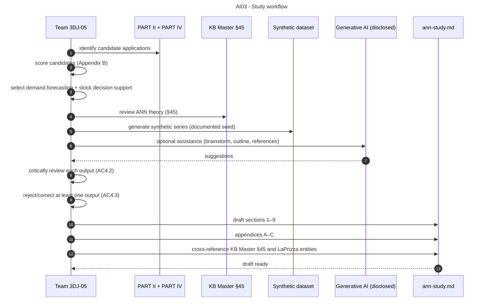
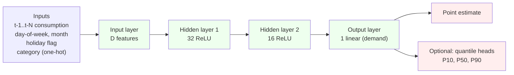
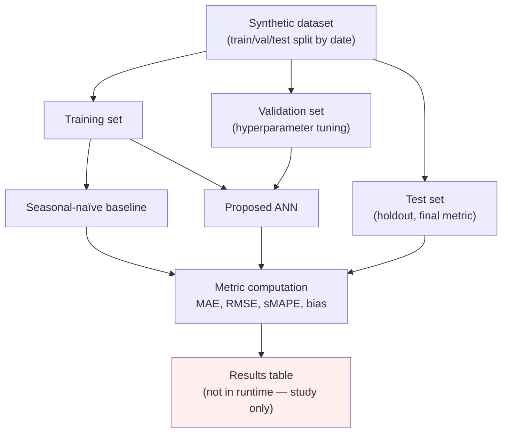
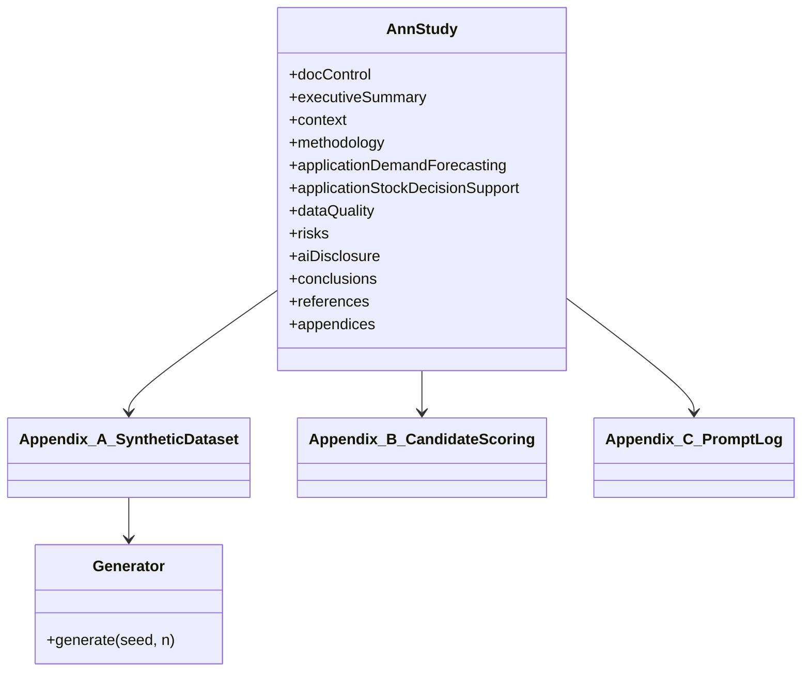

# AI03 — Artificial Neural Networks Study

## 1. Requirements Engineering

### 1.1. User Story Description

As a LaPizza Manager, I want a study of artificial neural networks for useful restaurant-management activities, so that their potential application can be assessed.

### 1.2. Customer Specifications and Clarifications

#### From the specification document
> Extracted from *PART IV — Sprint 2 — User Stories* (AI03, p. 17) and *PART II — System Specification* (§II.3.4, p. 14).

- **Useful restaurant-management applications** — explain the problem, inputs, outputs, expected benefits, and limitations.
- **Discuss** data quality, evaluation criteria, and **risks of unsuitable predictions**.
- **Generative AI and LLMs may be used** — identify any tools used and explain how their outputs were **checked and incorporated** into the team's work.
- **Use data appropriate to the study** and **avoid exposing identifiable customer information** in examples or AI tools.
- **Relevant applications** may include **demand forecasting** or **stock-related decision support**.
- The study **does not require training or deploying a neural network** — it is an assessment of potential.

#### From project clarifications and ADRs
- **Clarification #26:** planning is read-only; no `PurchaseOrder` aggregate. AI03's study must not imply that ANN predictions auto-apply to stock — they are decision-support inputs, consistent with AI05 AC6.
- **Clarification #28 §2:** `stockUnitsPerSale` is the per-product consumption rule; a demand-forecasting ANN would produce forecast quantities that map to `stockUnitsPerSale` for stock-controlled items, not to raw ingredient quantities (that is Prolog's job).
- **GDPR policy (`docs/gdpr-policy.md` v2.0, KB Appendix D):** personal data must not be sent to external AI services unless explicitly permitted. This constrains what data may be shared with an LLM during the study (aggregate sales, no `customers.*`, no `user_dietary_restrictions.*`).
- **ADR-012 (KB §5):** the Prolog engine is the operational planning engine; ANN is **studied**, not integrated. The study must not claim ANN is in the LaPrizza runtime — it is a Sprint-2 assessment, and any future integration would require an ADR (documented as out-of-scope for Sprint 2).

### 1.3. Acceptance Criteria (expanded, testable)

#### AC1 — Study useful restaurant-management applications
- AC1.1 The study identifies **at least two** useful restaurant-management applications of artificial neural networks, with a documented selection rationale (why these, not others).
- AC1.2 The two applications are chosen from a broader candidate list (at least 4 candidates scored); the scoring criteria are stated.
- AC1.3 Each application is discussed at a level deep enough to answer: **what problem it solves**, **what inputs** it needs, **what outputs** it produces, **what benefits** it brings, **what limitations** it has. Each of the five items is present as a labelled subsection.
- AC1.4 The two selected applications are **demand forecasting** (primary) and **stock-related decision support** (secondary) — the two named in the spec's "Relevant applications" comment. The rationale is that they map to LaPrizza's existing entities (`ConsumptionForecast`, `StockItem`, `SupplierScenario`) and do not require an `Order` aggregate (Sprint 3).

#### AC2 — Problem / inputs / outputs / benefits / limitations per application
- AC2.1 **Demand forecasting** application:
  - **Problem:** predict daily sellable-product consumption (per product, per size) to feed `ConsumptionForecast` creation, reduce forecast-entry fatigue, and improve the quality of AI02's input.
  - **Inputs:** historical consumption (aggregated from `consumption_forecast_entries` and — where available — `stock_movements` with `type = CONSUMPTION`), calendar features (day of week, month, holiday indicator), product features (`categoryName`, `isPizzaComponent`, `isSellable`), and optionally promotion flags (not in baseline — documented as a limitation).
  - **Outputs:** a daily quantity per `(productSku, pizzaSize)` for a forward window (e.g., 14 days), with a point estimate and a prediction interval.
  - **Benefits:** reduces manual forecast authoring, gives the Manager a starting point (still validated by the Manager before confirming the forecast), improves AI02 plan quality, potentially reduces overstock and food waste.
  - **Limitations:** small and simulated dataset in Sprint 2 (see §1.7.2); cold-start for new products; the model cannot extrapolate to promotions never seen; prediction intervals must be validated before use; ANN's black-box nature makes explanations harder than, e.g., a seasonal-naïve baseline.
- AC2.2 **Stock-related decision support** application:
  - **Problem:** recommend a replenishment quantity per product per day, given a demand forecast, current stock, and supplier lead times — a *decision-support* input to the Manager, not an automatic order.
  - **Inputs:** demand forecast (from the previous application), current `stock_items.current_units`, `supplier_offers` (`leadTimeDays`, `dailySupplyLimit`, `priceEur`), `stockUnitsPerSale` for directly sold products, `ComponentSizeConfiguration` for pizza components.
  - **Outputs:** a recommended replenishment quantity per product per day, with a confidence band, and a *flag* when the recommended quantity exceeds the `dailySupplyLimit` of all known offers.
  - **Benefits:** reduces under- and over-ordering, makes the trade-off between stock-out risk and holding cost explicit.
  - **Limitations:** depends on the demand forecast's accuracy (error propagation); does not replace AI02 (which selects suppliers and produces the plan); cannot model supplier unreliability unless lead-time variance data exists (not in baseline); must not be wired to auto-apply (`Clarification #26`).

#### AC3 — Data quality, evaluation criteria, and risks of unsuitable predictions
- AC3.1 **Data quality discussion** covers: volume (small in Sprint 2), granularity (daily per product/size vs. aggregate), missing data (Sprint 2 forecast entries are sparse — omissions mean zero, per WEB07), outliers (e.g., a large catering order), class imbalance (many zero-demand days), and leakage risks (e.g., using current stock as a feature for the same-day forecast).
- AC3.2 **Evaluation criteria** table: MAE, RMSE, MAPE (with the caveat that MAPE is undefined for zero-demand days), sMAPE, bias (signed error), and — for the stock application — service level (fill rate) and holding cost. A naïve seasonal baseline (previous week same day) is the **minimum bar** the ANN must beat; if it does not, the study must say so.
- AC3.3 **Risks of unsuitable predictions** discussion covers: overstock → food waste and holding cost; stock-out → lost sales and customer dissatisfaction; biased forecasts → under- or over-staffing; model drift when consumption patterns change; feedback loops if the forecast is fed back as training data without correction.
- AC3.4 Each risk is paired with a **mitigation** (human-in-the-loop confirmation, prediction intervals, monitoring of residuals, periodic retraining, seasonal-naïve fallback).

#### AC4 — Generative AI / LLM usage disclosed and validated
- AC4.1 The study includes a **Tools used** subsection listing each generative AI tool (e.g., ChatGPT, Claude, Copilot), the specific prompts or tasks it assisted with, and the date/version.
- AC4.2 For each use, the study explains **how the output was checked** (e.g., cross-referenced against `scikit-learn` docs, against the KB Master §45, against the team's own calculations) and **how it was incorporated** (verbatim, paraphrased, or used only as a starting point).
- AC4.3 At least one concrete example of **an AI output that was corrected or rejected** is included (this proves the "critically reviewed" claim, not just the "used" claim).
- AC4.4 The tools used are named, but **no personal data, credentials, or non-public customer data** were shared with them (AC5.2 verifies this by construction).

#### AC5 — Appropriate data, no identifiable customer information
- AC5.1 The study's examples use **aggregated or synthetic data only**: either the reference layout's sample data, or a synthetic time series that the team generated and committed to `docs/ai/datasets/`. No real customer record is quoted.
- AC5.2 **No `customers.*`, `users.*`, `user_dietary_restrictions.*`**, or any field that could re-identify a person, appears in the study or was sent to any LLM. Verified by a grep over `docs/ai/` for the PII column names (a CI check).
- AC5.3 The synthetic dataset is documented as synthetic in the study (§1.7.4) and in the file header (`# SYNTHETIC — not derived from real customers`).

#### AC6 — Study is assessment, not implementation
- AC6.1 The study **does not train or deploy** an ANN. If the team ran a small experiment (optional), the study documents it as **exploratory**, not part of the LaPrizza runtime, and does not claim production integration.
- AC6.2 The study's conclusions explicitly state that ANN is **not integrated** in Sprint 2, and that any future integration would require: an ADR, a data-protection review, and a `PlanningResult`-style immutable snapshot (consistent with ADR-013).
- AC6.3 No code under `backend/` or `prolog/` implements ANN. The only AI artefacts in the Sprint 2 runtime are the Prolog modules (AI01/AI02) and the backend orchestration (AI05/AI06).

### 1.4. Found out Dependencies

**Preceding:**
- AI01, AI02 (the operational planning context the study must respect — read-only, no auto-apply).
- AI05, AI06 (the data sources the ANN study references).
- `docs/gdpr-policy.md` v2.0 (PII constraints).
- KB Master §45 (ANN/DL theory) as the reference.

**Succeeding:**
- AI04 (the IARTI report embeds and summarises the study).
- Sprint 3 (if the team chooses to explore ANN integration, a new ADR is needed — out of scope).

### 1.5. Input and Output Data

#### 1.5.1. Deliverable structure (`docs/ai/ann-study.md`)

```
ann-study.md
├── 0. Document control (version, authors, dates, changes)
├── 1. Executive summary
├── 2. Context: LaPrizza, Sprint 2, IARTI
├── 3. Methodology
│   ├── 3.1. Candidate applications and scoring
│   ├── 3.2. Selection rationale
│   └── 3.3. Data sources and constraints (GDPR, baseline size)
├── 4. Application A — Demand Forecasting
│   ├── 4.1. Problem
│   ├── 4.2. Inputs
│   ├── 4.3. Outputs
│   ├── 4.4. Expected benefits
│   ├── 4.5. Limitations
│   ├── 4.6. Proposed ANN architecture (input/hidden/output, not trained)
│   ├── 4.7. Worked example (synthetic data)
│   └── 4.8. Evaluation criteria and baseline (seasonal-naïve)
├── 5. Application B — Stock-related Decision Support
│   ├── 5.1–5.8 (same subsections as §4)
├── 6. Data quality discussion
├── 7. Risks of unsuitable predictions and mitigations
├── 8. Tooling and AI-assisted work disclosure
│   ├── 8.1. Tools used
│   ├── 8.2. Validation of AI outputs
│   ├── 8.3. Rejected or corrected AI output (concrete example)
│   └── 8.4. PII handling (no customer data shared)
├── 9. Conclusions
│   ├── 9.1. Is ANN integration recommended?
│   ├── 9.2. Prerequisites for a future ADR
│   └── 9.3. Open questions
├── 10. References
└── A. Appendix — synthetic dataset
    B. Appendix — candidate scoring table
    C. Appendix — prompt log (redacted)
```

#### 1.5.2. Synthetic dataset (`docs/ai/datasets/demand-synthetic.csv`)

```
# SYNTHETIC — not derived from real customers
date,productSku,pizzaSize,quantity
2026-01-01,PRD-PIZZA-MARG,Medium,12
2026-01-01,PRD-PIZZA-MARG,Large,5
2026-01-02,PRD-PIZZA-MARG,Medium,14
2026-01-02,PRD-PIZZA-MARG,Large,6
2026-01-08,PRD-PIZZA-MARG,Medium,11
2026-01-08,PRD-PIZZA-MARG,Large,4
...
```

Generated by a documented process (seasonal pattern + weekly effect + noise + a documented random seed) in `docs/ai/datasets/generate.py`. The generator is committed so the dataset is reproducible. **No real customer data**.

#### 1.5.3. Candidate scoring table (Appendix B)

| Candidate | Business value | Data availability | Implementation effort | Baseline comparison available | Total |
|---|---|---|---|---|---|
| Demand forecasting | 5 | 3 | 4 | 4 | 16 |
| Stock-related decision support | 4 | 3 | 3 | 3 | 13 |
| Customer churn prediction | 3 | 1 (no churn data) | 3 | 2 | 9 |
| Sentiment analysis of reviews | 2 | 1 (no reviews data) | 2 | 1 | 6 |
| Allergen conflict detection | 3 | 4 (allergen data exists) | 4 | 3 | 14 |
| Staff scheduling optimisation | 3 | 1 (no shift data) | 1 | 2 | 7 |

Chosen: demand forecasting + stock-related decision support, with the *allergen conflict detection* documented as a plausible third candidate rejected for Sprint 2 scope (it is deterministically solvable with the existing `dietary_restrictions` + `product_allergens` joins — no ANN needed; this rejection is itself a valid engineering judgement documented in the study).

#### 1.5.4. Persistence / runtime

None. AI03 introduces no tables, no endpoints, no runtime code. The only artefacts are Markdown + CSV + generator script under `docs/ai/`.

### 1.6. Deliverable-Structure Diagram (replaces SSD)

#### 1.6.1. Study workflow (methodology)



#### 1.6.2. Proposed ANN architecture (not trained — documented in §4.6/§5.6)



The diagram is a **documented proposal**, not a trained model. The study explains the choice of two hidden layers (small dataset → low capacity), ReLU (standard for tabular), and linear/quantile output heads (point vs. interval).

#### 1.6.3. Evaluation pipeline (documented, not executed in the runtime)



The study documents the *intended* pipeline; if the team runs a small experiment, the results are reported here and explicitly labelled as exploratory (AC6.1).

### 1.7. Other Relevant Remarks

#### 1.7.1. Deliverable architecture (document-level)



#### 1.7.2. Data quality discussion — the honest baseline

The Sprint 2 dataset is **simulated** and **small** (Sprint 2 does not have an `Order` aggregate; production consumption data does not exist yet). The study must say this explicitly, and must state that **any ANN recommendation is contingent on real data volume** once Sprint 3's ordering workflow produces it. This is not a weakness of the study; it is a finding. The study's conclusion (`§9.1`) explicitly conditions the recommendation on data availability.

**Alternatives considered:**
- *Pretend the simulated data is real*: rejected — dishonest and would mislead the reviewer.
- *Skip the study because the data is not there*: rejected — the US requires the study; the honest framing is the correct deliverable.

#### 1.7.3. PII constraint — enforced by construction

The synthetic dataset contains **only** `(date, productSku, pizzaSize, quantity)` — no customer, no user, no dietary field. The `generate.py` script imports only Python stdlib + `numpy` (documented); no access to any LaPrizza DB. A CI grep over `docs/ai/` for the strings `password`, `email`, `phone`, `address`, `dietary`, `external_idp_subject`, `vat` fails the build if found (with the exception of the GDPR-discussion section, which quotes the *field names* as part of the analysis — this exception is documented and the grep pattern is tightened accordingly, e.g., only fails when the field name is followed by `:` and a value, not when it appears in prose about policy).

#### 1.7.4. AI tooling disclosure — table (in §8.1)

| Tool | Version / date | Task assisted | Output checked how | Incorporated as |
|---|---|---|---|---|
| Claude (Sonnet) | 2026-10 | Outline of §4 (demand forecasting) | Cross-referenced against KB Master §45 and the sprint US text | Paraphrased; no verbatim paragraphs |
| ChatGPT (GPT-5) | 2026-10 | Brainstorm of candidate applications (Appendix B) | Each candidate validated against LaPrizza entities (`Product`, `StockItem`, `ConsumptionForecast`) | Used as a starting list; 2 candidates added by the team, 1 dropped |
| Copilot | 2026-10 | `generate.py` boilerplate (numpy array manipulation) | Unit-tested against expected shapes; reviewed line by line | Adopted after review |

**§8.3 — Rejected or corrected AI output (concrete example):** the first draft of §4.3 (outputs) from Claude proposed a point estimate only; the team **added** the prediction-interval requirement (P10/P50/P90), because the stock application's risk analysis depends on it. This correction is quoted in the study with the original vs. revised text.

#### 1.7.5. Error / status matrix (deliverable-level)

| Condition | How it is caught | Resolution |
|---|---|---|
| Missing required section (§4.1–§4.5, §5.1–§5.5) | `make validate-ai-docs` checks headings | fail build |
| No candidate scoring table | heading check | fail build |
| AI tools used but not disclosed | manual review + `grep "ChatGPT\|Claude\|Copilot"` in §8.1 vs. commit history | fail review |
| PII field name with a value in examples | CI grep with the documented exception | fail build |
| Study claims ANN is integrated | manual review (contradicts §9.1) | fail review |
| Synthetic dataset not committed | `make validate-ai-docs` checks `docs/ai/datasets/demand-synthetic.csv` exists | fail build |

#### 1.7.6. Verification (automated + review)

- **`make validate-ai-docs`** (new Makefile target):
  1. Parses `docs/ai/ann-study.md` and asserts all required headings (§1.5.1) are present.
  2. Asserts `docs/ai/datasets/demand-synthetic.csv` exists and its header matches the documented schema.
  3. Runs the PII grep with the documented exception.
  4. Asserts `docs/ai/datasets/generate.py` exists and references a seed.
  5. Asserts the "Tools used" table has ≥ 1 row (or explicitly says "no generative AI used", which would still satisfy AC4.1).
- **Manual review:** the SGRAI/IARTI instructor checks §8.3 (a concrete rejected/corrected output) and §9.1 (honest conclusion about integration).
- **Demo:** the study is presented in the Sprint 2 defense; the reviewer is shown the synthetic dataset and the generator; the reviewer is shown the tooling table and one prompt from the redacted prompt log (Appendix C).

#### 1.7.7. Traceability (AC → section)

| AC | Section |
|---|---|
| AC1.1 | §3.1 + Appendix B |
| AC1.2 | Appendix B (scoring table) |
| AC1.3 | §4.1–§4.5, §5.1–§5.5 |
| AC2.1 | §4.1–§4.5 |
| AC2.2 | §5.1–§5.5 |
| AC3.1 | §6 |
| AC3.2 | §4.8, §5.8 (evaluation criteria table) |
| AC3.3 | §7 (risks) |
| AC3.4 | §7 (mitigations column) |
| AC4.1 | §8.1 |
| AC4.2 | §8.2 |
| AC4.3 | §8.3 |
| AC4.4 | §8.4 |
| AC5.1 | §3.3 + Appendix A |
| AC5.2 | §8.4 + CI grep |
| AC5.3 | Appendix A header + `generate.py` header |
| AC6.1 | §9.1 |
| AC6.2 | §9.2 |
| AC6.3 | §9.3 (open questions) + absence of ANN code (verified by `grep -r "tensorflow\|torch\|keras" backend/ prolog/` returns empty) |