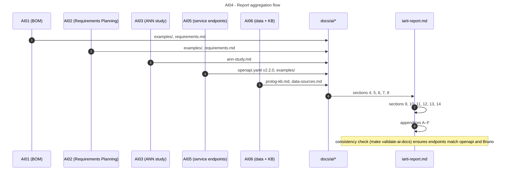
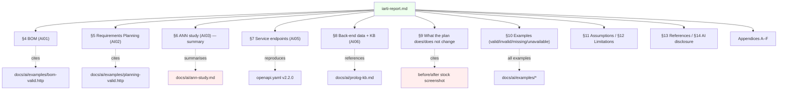
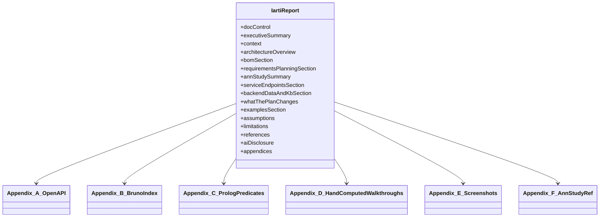

# AI04 — IARTI Technical Report

## 1. Requirements Engineering

### 1.1. User Story Description

As a Project Manager, I want a report on the IARTI work, so that the modules and neural-network study are documented.

### 1.2. Customer Specifications and Clarifications

#### From the specification document
> Extracted from *PART IV — Sprint 2 — User Stories* (AI04, pp. 18–19).

- **Describe the Bill of Materials work** (AI01), **the Requirements Planning work** (AI02), **and the artificial neural networks study** (AI03).
- **Document the service endpoints** (AI05), **back-end data sources** (AI06), **and construction and refresh of the Prolog knowledge base** (AI06).
- **Examples must include:** valid requests, invalid inputs, **missing data**, and **unavailable-service scenarios**.
- **Distinguish calculations, stock changes, and the confirmation of purchase orders.**
- **The report should include:** assumptions, Prolog execution examples, calculation evidence, supplier-selection rationale, limitations, references, and information about the use and validation of AI-generated content.

#### From project clarifications, ADRs, and the KB
- **Clarification #26:** plans are read-only; no `PurchaseOrder` aggregate. The report must state this explicitly when discussing "the confirmation of purchase orders" (the US text mentions it; the baseline does not have the aggregate, so the report must distinguish: **calculations** (AI01/AI02) ≠ **stock changes** (a separate future explicit action) ≠ **purchase-order confirmation** (does not exist in baseline).
- **Clarification #28:** BOM scope (only pizzas), `stockUnitsPerSale`, lead times, supply limits, inactive references, replay.
- **ADR-012, ADR-013:** Prolog is a separate container; results are immutable snapshots; the backend owns state.
- **AI01/AI02/AI05/AI06 deliverables:** each of those documents (and their `docs/ai/*.md` examples) is **evidence** for the AI04 report. The report aggregates them.
- **AI03 deliverable** (`docs/ai/ann-study.md`): summarised in the report; the full study is referenced.

### 1.3. Acceptance Criteria (expanded, testable)

#### AC1 — Report describes AI01 (BOM), AI02 (Requirements Planning), AI03 (ANN study)
- AC1.1 **BOM section** describes: the problem, the Prolog predicate family (`bom_execution/2`, `part/1`, `setp/2`, `stock/2`, `order/3` — adapted from `pizza-BOM.pl.txt`), the input payload (AI06), the output shape (`requirements[]`, `unmetNeeds[]`), the depth-1 interpretation (AI01 §1.7.2), and the worked example from AI01 §1.7.6. It cites the Bruno capture that proves the runtime behaviour.
- AC1.2 **Requirements Planning section** describes: the problem, the Prolog predicate family (`requirements_planning/2`), the input payload (forecast + scenario + BOM + stock), the output shape (`requirements[]`, `proposals[]`, `unmetNeeds[]`), the supplier-selection algorithm (AI02 §1.7.2), the daily carry-forward, the supply limits, the reference-date semantics, and the worked example.
- AC1.3 **ANN study section** summarises `docs/ai/ann-study.md`: the two applications, the data-quality discussion, the evaluation criteria, the risks, and the AI-tool disclosure. It references the full study and does not duplicate it verbatim (a summary of ≤ 2 pages is expected).
- AC1.4 Each of the three sections ends with a **traceability block**: which US, which AC, which artefact (Bruno capture, Prolog predicate, screenshot, `docs/ai/*.md` section) proves the claim.

#### AC2 — Report documents AI05 (service endpoints), AI06 (data sources and KB refresh)
- AC2.1 **Service endpoints section** reproduces the endpoint matrix (AI05 §1.5.1) with the request/response shapes and the error envelope. It includes the OpenAPI v2.2.0 snapshot (link or appendix).
- AC2.2 **Back-end data sources section** lists, per input, the repository / table and the read method:
  - `products` ← `PostgresProductRepository.findAllActive` + referenced SKUs.
  - `predefined_pizzas` + `predefined_pizza_recipes` ← `PostgresPredefinedPizzaRepository.findAll`.
  - `component_size_configurations` ← `PostgresComponentSizeConfigurationRepository.findAll`.
  - `stock_items` ← `PostgresStockRepository.findAll`.
  - `consumption_forecasts` + `consumption_forecast_entries` ← `PostgresConsumptionForecastRepository.findByName`.
  - `supplier_scenarios` + `suppliers` + `supplier_offers` ← `PostgresSupplierScenarioRepository.findByName`.
- AC2.3 **Prolog KB construction and refresh** section states: per-request construction, transaction-scoped read, no cache, business-key mapping, and the `READ COMMITTED` vs. `REPEATABLE READ` decision (AI06 §1.7.4). It includes the KB-mapping table (JSON field → Prolog predicate).
- AC2.4 The section cross-references the `docs/ai/prolog-kb.md` mapping file (AI06 AC3.3).

#### AC3 — Examples cover valid / invalid / missing / unavailable
- AC3.1 **Valid request** — one complete `POST /planning/executions` (AI02) with a full response, annotated. Plus one `POST /planning/bom-executions` (AI01).
- AC3.2 **Invalid input** — one `400 Bad Request` example (Joi failure) and one `422 Unprocessable Entity` (e.g., missing `stockUnitsPerSale`, inactive reference, missing `ComponentSizeConfiguration`). Each with the exact request body and response body.
- AC3.3 **Missing data** — one example where the scenario is confirmed but an offer for a required SKU is absent; the response is `201` with `unmetNeeds: [{ reason: "no_offer" }]`. Also one example where the forecast is missing (404) and where the scenario is unconfirmed (409).
- AC3.4 **Unavailable service** — one `502 Bad Gateway` example with the Prolog container stopped (screenshot of `docker compose stop prolog`, then the request, then `docker compose start prolog`). The report includes the exact response body and the retry behaviour.
- AC3.5 Each example is stored under `docs/ai/examples/` as a `.http` or `.bru` file (for reuse) and quoted (request + response) in the report.

#### AC4 — Distinguish calculation / stock change / PO confirmation
- AC4.1 A dedicated section (**"What the plan does and does not change"**) explicitly states:
  - **Calculation:** performed by Prolog, returns `requirements`/`proposals`/`unmetNeeds`; no side effects.
  - **Stock change:** not performed by planning; would require a separate `POST /stock/adjustments` (or a future explicit endpoint) with its own authorization and idempotency; not in Sprint 2 scope.
  - **Purchase-order confirmation:** the `PurchaseOrder` aggregate does not exist in the baseline (Clarification #26); any `proposals[]` returned by AI02 are **recommendations**, not orders; a future operational order would require a new endpoint + a new aggregate + an ADR.
- AC4.2 The section is **backed by evidence**: the before/after `GET /stock` capture (identical), and the absence of a `purchase_orders` table in the schema (link to migration inventory).
- AC4.3 The report explicitly reconciles the US text ("the confirmation of purchase orders") with the baseline reality (no such aggregate) — this is a **finding of the report**, not a gap.

#### AC5 — Assumptions, execution examples, calculation evidence, selection rationale, limitations, references, AI disclosure
- AC5.1 **Assumptions** section: depth-1 BOM, `forecast_name IS NULL` heuristic for BOM executions, no splitting across offers, `READ COMMITTED`, `CUSTOMER`/`Employee` do not access planning, Prolog is a separate container.
- AC5.2 **Prolog execution examples** section: 2–3 actual Prolog runs, with the query, the KB excerpt, and the result; annotated.
- AC5.3 **Calculation evidence** section: a **hand-computed** walkthrough of AI01's BOM for one pizza, and AI02's daily carry-forward for one product over 3 days, cross-checked against the Prolog output.
- AC5.4 **Supplier-selection rationale** section: the algorithm, the tie-break rules, and a worked example where the cheapest and the fastest offers diverge; the report shows the choice and explains why.
- AC5.5 **Limitations** section: small dataset (AI03), depth-1 BOM (AI01), no PII (AI06), no PO aggregate (Clarification #26), no splitting across offers (AI02), no refresh cache (AI06).
- AC5.6 **References** section: KB Master §40–§49 (IARTI), ADR-012, ADR-013, `pizza-BOM.pl.txt`, OpenAPI v2.2.0, Bruno collection, `docs/ai/ann-study.md`, the 28 client clarifications, the Sprint 2 US PDF.
- AC5.7 **AI-generated content disclosure** section: tools used, tasks, validation, incorporated vs. rejected; cross-references `docs/ai/ann-study.md` §8.

#### AC6 — The report is the artefact, and it is consistent with the code
- AC6.1 The report lives at `docs/ai/iarti-report.md` and is exported to `docs/ai/iarti-report.pdf`. Both are committed under `sprint-2-submission`.
- AC6.2 Every claim about the code is **verifiable**: the report cites the endpoint, the repository method, the Prolog predicate, or the Bruno file. Claims that cannot be verified are moved to "Assumptions" or removed.
- AC6.3 The report is **versioned**: `docs/ai/iarti-report.md` has a document-control table; the PDF export matches the Markdown at the submission tag.
- AC6.4 The report does **not** contradict AI01/AI02/AI03/AI05/AI06's `requirements.md` or their `docs/ai/*.md` examples. A `make validate-ai-docs` target cross-checks the endpoints listed in the report against `openapi.yaml` and against the Bruno collection.

### 1.4. Found out Dependencies

**Preceding:**
- AI01, AI02, AI03, AI05, AI06 (all their deliverables must exist).
- `openapi.yaml` v2.2.0 (the report reproduces its endpoint matrix).
- The Bruno collection (`WEB07-AIPlanning` + `AI01-BOM`) — the captures are the evidence.
- The Prolog container (for the execution examples and the 502 capture).
- `docs/ai/prolog-kb.md` (AI06).
- `docs/ai/ann-study.md` (AI03).

**Succeeding:**
- The Sprint 2 submission (`sprint-2-submission` tag).
- The Sprint 3 IARTI work (the report is a baseline the Sprint 3 team can extend).

### 1.5. Input and Output Data

#### 1.5.1. Deliverable structure (`docs/ai/iarti-report.md`)

```
iarti-report.md
├── 0. Document control (version, authors, dates, changes)
├── 1. Executive summary
├── 2. Context: LaPrizza, Sprint 2, IARTI
├── 3. Architecture overview
│   ├── 3.1. Backend ↔ Prolog (ADR-012)
│   ├── 3.2. Data ownership (backend owns stock; planning is read-only)
│   └── 3.3. Immutable snapshots (ADR-013)
├── 4. Bill of Materials (AI01)
│   ├── 4.1. Problem
│   ├── 4.2. Prolog predicates
│   ├── 4.3. Inputs and outputs
│   ├── 4.4. Aggregates and depth-1 interpretation
│   ├── 4.5. Worked example + hand-computed evidence
│   ├── 4.6. Replay
│   └── 4.7. Traceability (US/AC → artefact)
├── 5. Requirements Planning (AI02)
│   ├── 5.1. Problem
│   ├── 5.2. Prolog predicates
│   ├── 5.3. Daily carry-forward
│   ├── 5.4. Supplier selection rationale + worked example
│   ├── 5.5. Supply limits, lead times, reference date
│   ├── 5.6. Worked example + hand-computed evidence
│   ├── 5.7. Replay and immutability
│   └── 5.8. Traceability
├── 6. Artificial Neural Networks study (AI03) — summary
│   ├── 6.1. Applications and rationale
│   ├── 6.2. Data quality and evaluation criteria
│   ├── 6.3. Risks and mitigations
│   ├── 6.4. AI tool disclosure
│   └── 6.5. Reference to docs/ai/ann-study.md
├── 7. Service endpoints (AI05)
│   ├── 7.1. Endpoint matrix
│   ├── 7.2. Error envelope
│   ├── 7.3. RBAC
│   └── 7.4. OpenAPI v2.2.0 reference
├── 8. Back-end data and Prolog KB (AI06)
│   ├── 8.1. Data sources per input
│   ├── 8.2. KB construction and refresh policy
│   ├── 8.3. Business-key mapping (JSON → Prolog)
│   ├── 8.4. PII exclusion
│   └── 8.5. Reference to docs/ai/prolog-kb.md
├── 9. What the plan does and does not change
│   ├── 9.1. Calculations vs. stock changes vs. PO confirmation
│   ├── 9.2. Evidence (before/after stock, absent purchase_orders table)
│   └── 9.3. Future explicit-confirmation endpoint (out of scope)
├── 10. Examples (valid / invalid / missing / unavailable)
│   ├── 10.1. Valid — BOM execution
│   ├── 10.2. Valid — Requirements Planning
│   ├── 10.3. Invalid input — 400
│   ├── 10.4. Invalid input — 422 (missing stockUnitsPerSale / inactive / missing size config)
│   ├── 10.5. Missing data — 201 with unmetNeeds, 404 forecast, 409 unconfirmed scenario
│   └── 10.6. Unavailable service — 502 (Prolog down, with screenshots)
├── 11. Assumptions
├── 12. Limitations
├── 13. References
├── 14. AI-generated content disclosure
└── Appendices
    A. OpenAPI v2.2.0 snapshot (the AI-relevant paths)
    B. Bruno collection index for AI
    C. Full Prolog predicate listing
    D. Hand-computed calculation walkthroughs
    E. Screenshots (Swagger UI, Prolog execution, before/after stock, 502)
    F. Reference to docs/ai/ann-study.md (full study)
```

#### 1.5.2. Examples to capture (`docs/ai/examples/`)

| File | Content | Captured from |
|---|---|---|
| `bom-valid.http` / `.bru` | Complete `POST /planning/bom-executions` (2 pizzas, sufficient + insufficient stock) | Bruno `AI01-BOM` |
| `planning-valid.http` | Complete `POST /planning/executions` (forecast + scenario) | Bruno `WEB07-AIPlanning` |
| `bom-invalid-400.http` | Missing `orders[]` | Supertest / Bruno |
| `planning-invalid-422-missing-stock-units.http` | `stockUnitsPerSale = null` on a stock-controlled sellable product | Supertest |
| `planning-invalid-422-inactive.http` | Forecast references an inactive product | Supertest |
| `planning-invalid-422-missing-size-config.http` | Pizza component without a size config for the requested size | Supertest |
| `planning-missing-offer.http` | Confirmed scenario without offers for a required SKU → 201 with `unmetNeeds` | Bruno |
| `planning-404-forecast.http` | Unknown forecast name | Bruno |
| `planning-409-unconfirmed.http` | Scenario not confirmed | Bruno |
| `planning-502-prolog-down.http` | Prolog container stopped → 502 | Manual (screenshot + body) |
| `replay.http` | Replay after editing the forecast → identical outputs | Bruno |

#### 1.5.3. Persistence / runtime

None. AI04 introduces no runtime code. The `make validate-ai-docs` target is a Makefile addition (no `backend/` change).

### 1.6. Deliverable-Structure Diagram (replaces SSD)

#### 1.6.1. Report aggregation flow



#### 1.6.2. Report structure diagram (visual overview)



### 1.7. Other Relevant Remarks

#### 1.7.1. Document-level architecture



#### 1.7.2. Traceability matrix (US/AC → report section → evidence)

| US | AC | Report section | Evidence artefact |
|---|---|---|---|
| AI01 | AC1.1–AC1.3 | §4.1–§4.7 | `docs/ai/examples/bom-valid.http`, Prolog predicate listing (App. C) |
| AI01 | AC2.1–AC2.3 | §4.3, §8.1 | `docs/ai/examples/bom-valid.http`; `docs/ai/prolog-kb.md` |
| AI01 | AC3.1–AC3.3 | §4.3, §4.5 | Hand-computed walkthrough (App. D) |
| AI01 | AC4.1–AC4.6 | §4.4 | AI01 §1.7.2 decision quoted |
| AI01 | AC5.1–AC5.4 | §4.5, §10.1 | `docs/ai/examples/bom-valid.http` |
| AI01 | AC6.1–AC6.3 | §9 | Before/after `GET /stock` screenshot (App. E) |
| AI01 | AC7.1–AC7.3 | §4.6 | Replay example (App. E) |
| AI01 | AC8.1–AC8.3 | §4.6 | Replay example (App. E) |
| AI01 | AC9.1–AC9.5 | §10.3–§10.5 | Error examples (App. E) |
| AI02 | AC1.1–AC1.2 | §5.1–§5.2 | `docs/ai/examples/planning-valid.http` |
| AI02 | AC2.1–AC2.3 | §5.3, §5.8 | Bruno captures |
| AI02 | AC3.1–AC3.3 | §5.3, §5.6 | Hand-computed walkthrough (App. D) |
| AI02 | AC4.1–AC4.4 | §5.3 | Hand-computed walkthrough (App. D) |
| AI02 | AC5.1–AC5.4 | §5.4 | Worked example where criteria diverge |
| AI02 | AC6.1–AC6.4 | §5.5 | Bruno capture with `dailySupplyLimit` |
| AI02 | AC7.1–AC7.3 | §5.7 | Replay after edit (App. E) |
| AI02 | AC8.1–AC8.4 | §5.6, §10.2 | Example (App. E) |
| AI02 | AC9.1–AC9.3 | §5.5 | Reference-date example |
| AI03 | (all) | §6 (summary) + `docs/ai/ann-study.md` | The study itself |
| AI05 | AC1.1–AC1.4 | §7.1–§7.4 | OpenAPI v2.2.0 (App. A) |
| AI05 | AC2.1–AC2.3 | §7.1 | Business keys visible in examples |
| AI05 | AC3.1–AC3.4 | §7.3 | RBAC matrix + guard tests |
| AI05 | AC4.1–AC4.5 | §10.1–§10.6 | All examples |
| AI05 | AC5.1–AC5.3 | §7.3 | Same |
| AI05 | AC6.1–AC6.3 | §9 | Before/after stock; no `purchase_orders` table |
| AI05 | AC7.1–AC7.3 | §7.4, §13 | `docs/ai/examples/` index (App. B) |
| AI06 | AC1.1–AC1.3 | §8.1 | `docs/ai/prolog-kb.md` |
| AI06 | AC2.1–AC2.3 | §8.2 | Per-request KB description |
| AI06 | AC3.1–AC3.3 | §8.3 | KB-mapping table |
| AI06 | AC4.1–AC4.3 | §8.1 | Supplier offer fields in the payload example |
| AI06 | AC5.1–AC5.5 | §10.4–§10.5 | Error examples |
| AI06 | AC6.1–AC6.3 | §9 | Evidence |
| AI06 | AC7.1–AC7.3 | §8.4 | PII grep + whitelist description |
| AI06 | AC8.1–AC8.3 | §9 | Before/after stock; snapshots |
| AI06 | AC9.1–AC9.2 | §9.3 | Future endpoint documented as out of scope |

#### 1.7.3. Examples matrix (US → example → file)

The `docs/ai/examples/` index maps every report example (§10) to a file. A CI check (`make validate-ai-docs`) asserts that every file listed in the index exists and every `.http`/`.bru` in the folder is referenced in the report. This prevents "example drift" (a file changes but the report still quotes the old body).

#### 1.7.4. Decision record — how the report reconciles "confirmation of purchase orders"

The US text mentions "the confirmation of purchase orders" as something the report must distinguish. The baseline has **no** `PurchaseOrder` aggregate (Clarification #26). The report's §9 handles this explicitly:

- **Calculation:** AI01/AI02 return `requirements`/`proposals`/`unmetNeeds`; no side effect. Evidence: before/after `GET /stock`.
- **Stock change:** not performed; would require `POST /stock/adjustments` (existing, authorized, idempotent at the movement level) or a future explicit endpoint. Evidence: no `stock_movements` rows are inserted by any planning endpoint (Bruno assertion).
- **Purchase-order confirmation:** the `purchase_orders` table does not exist (link to migration inventory, which goes up to 014 and has no such table). A `proposals[]` entry is a **recommendation**, not an order. A future operational order would require: a new aggregate, a new endpoint, an ADR, and a separate confirmation step. Documented as future work.

This reconciliation is itself a **finding** of the report, quoted in the executive summary. It shows the team understood the US text and did not pretend to implement what the baseline does not have.

#### 1.7.5. Decision record — Markdown + PDF, not Word

**Decision:** the report is authored as Markdown (`docs/ai/iarti-report.md`) and exported to PDF (`docs/ai/iarti-report.pdf`) via `pandoc` (or a documented alternative). Both files are committed at `sprint-2-submission`.

**Rationale:**
- Markdown diffs cleanly in git and is reviewable in PRs.
- The PDF is the artefact the Moodle submission expects for a "report".
- Pandoc ensures the PDF is a mechanical export — no divergence between the source and the submitted artefact.

**Alternatives considered:**
- *Word only*: rejected — binary diffs, no PR review.
- *Markdown only*: rejected — the Moodle submission for a "report" expects a formatted artefact; the PDF is provided.
- *LaTeX*: rejected — heavier toolchain; pandoc + a template is sufficient.

#### 1.7.6. Consistency checks (`make validate-ai-docs`)

The Make target runs `python docs/ai/datasets/generate.py --check`. It currently automates:

1. Required AI03 study headings and the synthetic dataset's existence, declaration and CSV header.
2. A guard against claiming TensorFlow/PyTorch as runtime dependencies.
3. Static patterns for accidental personal-data values across AI Markdown, CSV and Python files.
4. Required AI04 report headings, presence of the two planning endpoint paths, the AI06 mapping file, and the examples directory.
5. Each `.http` example's presence in both the examples index and the report, and at least one HTTP request in the examples.
6. The AI04 semantic distinction that proposals are recommendations and planning does not confirm purchase orders; the baseline's missing purchase-order model/table is stated when referenced.

This script does **not** currently compare the endpoint matrix with OpenAPI, validate AC-to-section traceability, inspect Prolog predicates, verify disclosure-table content, or resolve every Markdown link. Those are manual review items, not automated checks. The purchase-order check is intentionally semantic and limited to the explicit statements above; it does not verify runtime behavior or database migrations.

#### 1.7.7. Verification (automated + review)

- **`make validate-ai-docs`** — runs the automated checks listed in §1.7.6. CI triggers must be verified in the repository workflow; this requirement does not assert a particular path filter.
- **Manual review** by the IARTI instructor — focuses on §4–§5 (technical accuracy of the Prolog sections), §9 (the "does not change" distinction), §10 (example completeness), §14 (AI disclosure).
- **Demo:** the report is presented in the Sprint 2 defense; the reviewer is shown (a) the Swagger UI, (b) one Bruno capture, (c) the Prolog container logs for one execution, (d) the before/after stock screenshot, (e) the 502 capture with the container stopped, (f) the report's §9 section explaining what the plan does not change.

#### 1.7.8. Error / status matrix (deliverable-level)

| Condition | Caught by | Resolution |
|---|---|---|
| Missing section | heading check | fail build |
| Example file missing | index check | fail build |
| Report endpoint path is missing | required-path check (not OpenAPI equivalence) | fail build |
| Traceability row points to nonexistent section | manual review | fail review |
| PII-like value matches a static pattern | static scan (not a complete privacy audit) | fail build |
| Predicate in §4.2 not in Appendix C | manual review | fail review |
| AI disclosure missing or inaccurate | manual review | fail review |
| Broken cross-reference | manual review | fail review |
| Report claims stock mutation | manual review (§9 evidence contradicts) | fail review |
| PDF does not match Markdown at submission tag | `pandoc` reproducibility + a CI diff | fail review |
