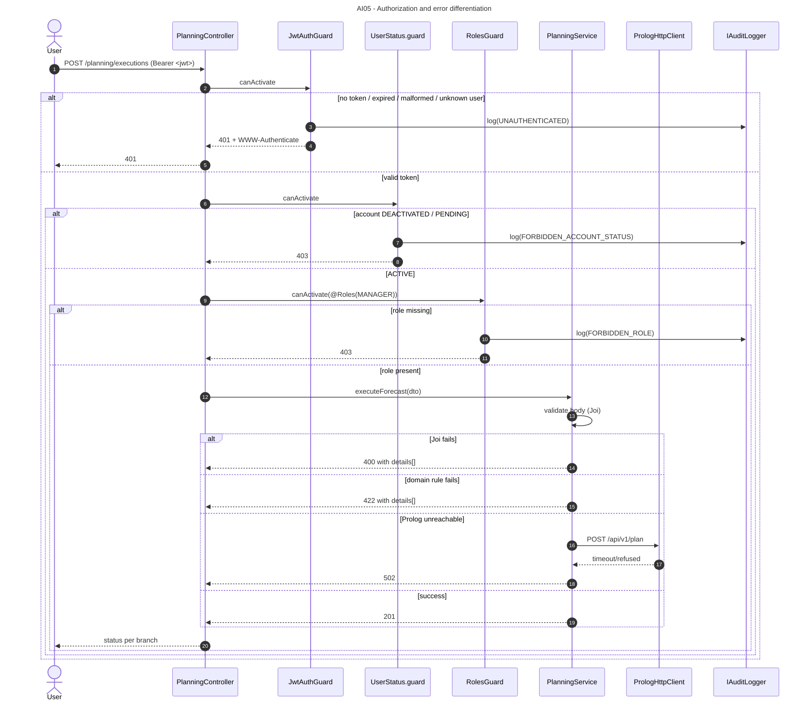
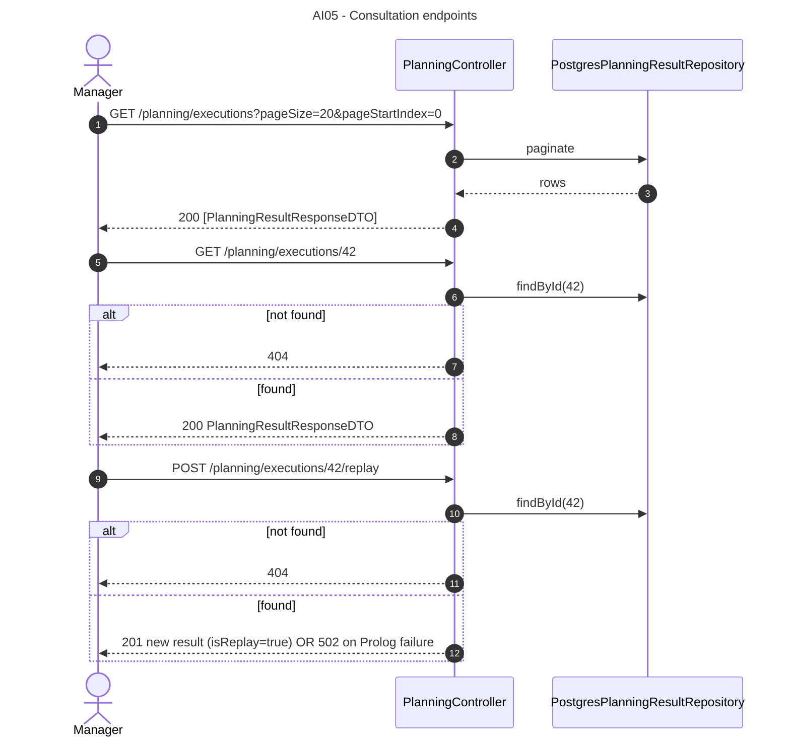
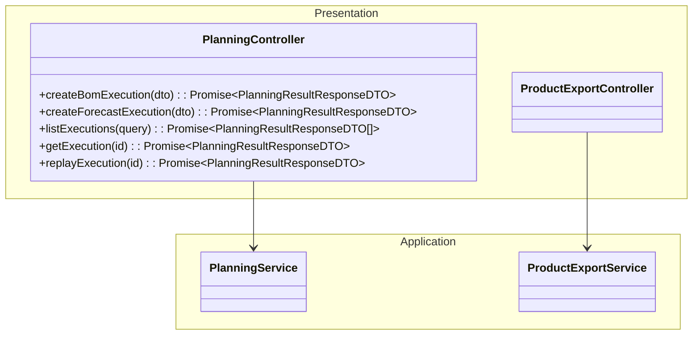

# AI05 — Artificial Intelligence Service Access

## 1. Requirements Engineering

### 1.1. User Story Description

As a Development Team, I want service endpoints for the Prolog functionality, so that the Web Application and other authorized components can request planning results.

### 1.2. Customer Specifications and Clarifications

#### From the specification document
> Extracted from *PART IV — Sprint 2 — User Stories* (AI05, p. 18) and *PART II — System Specification* (§II.3.4).

- **Documented REST endpoints** for **Bill of Materials** (AI01) **and Requirements Planning** (AI02).
- Requests and results use **JSON** and **identifiers consistent with the back end** (business keys — no UUIDs).
- **Authorized users** able to initiate calculations via the SPA and **consult the resulting quantities, suppliers, and warnings**.
- Interface **validates required information** and clearly distinguishes:
  - successful calculation,
  - invalid input,
  - missing information,
  - service unavailability.
- **Access restricted** to the appropriate roles or **authorized service identities**; unauthorized users denied.
- Calculation requests **must not silently change stock or register purchase orders**; any requested changes must be explicit and applied through the responsible back-end functionality.
- **Interface documentation** includes representative requests, responses, error cases; **demonstrable in the common solution**.

#### From ADRs and the openapi contract
- **ADR-005 (KB §5):** Richardson Level 2; versioned base `/api/v1`; uniform error envelope `{timestamp, status, error, message, details?}`.
- **ADR-012 (KB §5):** Prolog runs as a separate container; backend calls it via `PrologHttpClient`.
- **OpenAPI `openapi.yaml` v2.1.0:** `POST /planning/executions`, `GET /planning/executions`, `GET /planning/executions/{executionId}`, `POST /planning/executions/{executionId}/replay`, `GET /products/export` all exist. AI01's `POST /planning/bom-executions` is the extension (§1.7.3 of AI01).
- **RBAC (KB §23 / Table 1):** planning endpoints are `MANAGER`-only.

### 1.3. Acceptance Criteria (expanded, testable)

#### AC1 — Documented REST endpoints for both US
- AC1.1 The OpenAPI contract (`docs/api/openapi.yaml`) declares:
  - `POST /planning/bom-executions` (AI01, new — extension).
  - `POST /planning/executions` (AI02, existing).
  - `GET /planning/executions` (history for both).
  - `GET /planning/executions/{executionId}`.
  - `POST /planning/executions/{executionId}/replay`.
  - `GET /products/export` (AI06).
- AC1.2 Each endpoint has a request schema, a response schema, and every error case documented (`400`, `401`, `403`, `404`, `409`, `422`, `502`).
- AC1.3 Representative examples are in `docs/api/examples/` (or inline `examples:` in the OpenAPI), covering at least: one success, one `422`, one `502` per endpoint.
- AC1.4 `GET /api/docs` (Swagger UI / ReDoc, KB §27) renders the full contract.

#### AC2 — JSON with business identifiers
- AC2.1 All request/response bodies use `camelCase` JSON attributes (ADR-005, KB §22.1).
- AC2.2 All references use business keys (`username`, `sku`, `name`, `supplierCode`, `forecastName`, `scenarioName`) — **never** UUIDs or serial IDs (except `executionId`, which is a system-assigned SERIAL — the only allowed exception per KB §16.2).
- AC2.3 The contract is verified by `GET /products/export` returning `products[].sku` and `boms[].pizzaSku` (business keys) — no UUIDs.

#### AC3 — Authorized initiation and consultation
- AC3.1 Every planning endpoint is `@Roles(MANAGER)` and Bearer-authenticated (AA05 guard pipeline).
- AC3.2 `401` for missing/invalid/expired token; `403` for authenticated non-MANAGER.
- AC3.3 The SPA's `AIConfigPage` (WEB07) is reachable only by MANAGER (WEB03 route guard); the backend is authoritative.
- AC3.4 "Authorized service identities" is interpreted for the baseline as **the backend itself** (calling Prolog via `PrologHttpClient`); there is no external service that calls the planning endpoints in Sprint 2. If a future service needs to call them, a service token (client credentials / mTLS) must be added — documented as extension, not baseline.

#### AC4 — Interface distinguishes success / invalid input / missing info / unavailability
- AC4.1 **Success:** `201 Created` with a `PlanningResultResponseDTO` (or `200 OK` for `GET` / `POST /replay` returns `201` per openapi).
- AC4.2 **Invalid input:** `400 Bad Request` for structural/schema errors (Joi); `422 Unprocessable Entity` for domain rule violations (unknown SKU, missing recipe, inactive reference, missing `stockUnitsPerSale`, etc.). The body's `details[]` names the offending business keys.
- AC4.3 **Missing information:** `422` with `details[]` (distinct from `400` — the shape is valid but references are incomplete) OR `404 Not Found` when the referenced aggregate does not exist at all (e.g., forecast name not found).
- AC4.4 **Service unavailability:** `502 Bad Gateway` when `PrologHttpClient` fails (timeout, connection refused, non-2xx response). The body's `message` names the upstream ("Serviço de planeamento indisponível").
- AC4.5 The SPA maps these to distinct UX (WEB04 AC8): success → plan rendering; `400`/`422` → inline field errors + details list; `404` → "not found" toast; `502` → retry affordance.

#### AC5 — Access restricted
- AC5.1 The guards (AA04/AA05) enforce MANAGER on every planning endpoint. A `CUSTOMER` token receives `403` before the controller runs.
- AC5.2 `@Public()` is not used on any planning endpoint.
- AC5.3 The audit log (AA05 AC5) records unauthorized attempts (`FORBIDDEN_ROLE`).

#### AC6 — No silent stock mutation or purchase-order creation
- AC6.1 Planning endpoints (`POST /planning/bom-executions`, `POST /planning/executions`, `POST /planning/executions/{id}/replay`) **do not** write to `stock_items`, `stock_movements`, or any purchase-order table (no such table exists in baseline — Clarification #26).
- AC6.2 Verified by the before/after `GET /stock` assertion in the AI01/AI02 verification specs.
- AC6.3 Any future "apply this plan" operation must be a **separate endpoint** (e.g., `POST /stock/adjustments` for stock, a future `POST /purchase-orders` for POs) with its own authorization and idempotency guarantees. Documented as non-scope for AI05.

#### AC7 — Interface documentation
- AC7.1 `openapi.yaml` includes `examples:` for every planning endpoint, covering the AC4.2–AC4.4 cases.
- AC7.2 A `docs/ai/` folder contains:
  - `docs/ai/bom-execution-examples.md` — 3 request/response examples (success, 422, 502) for AI01.
  - `docs/ai/requirements-planning-examples.md` — 3 examples (success, 422, 502) for AI02.
  - `docs/ai/replay-examples.md` — success + 502.
- AC7.3 These documents are referenced from AI04's IARTI report.

### 1.4. Found out Dependencies

**Preceding:**
- ADR-005 (REST style), ADR-012 (Prolog), ADR-013 (read-only).
- AA04/AA05 (guards), AI01/AI02 (the computations), AI06 (input payload).
- `openapi.yaml` v2.1.0 (extension needed for AI01).

**Succeeding:**
- WEB07 (consumes the endpoints).
- AI04 (IARTI report references the docs).
- Sprint 3 scheduling (will use the same access pattern).

### 1.5. Input and Output Data

#### 1.5.1. Endpoint matrix (consolidated)

| Method | Path | Roles | Request | Success | Errors |
|---|---|---|---|---|---|
| POST | `/api/v1/planning/bom-executions` | MANAGER | `BomExecutionRequestDTO` | `201` `PlanningResultResponseDTO` | `400`, `401`, `403`, `422`, `502` |
| POST | `/api/v1/planning/executions` | MANAGER | `PlanningExecutionRequestDTO` | `201` `PlanningResultResponseDTO` | `400`, `401`, `403`, `404`, `409`, `422`, `502` |
| GET | `/api/v1/planning/executions` | MANAGER | query: `forecastName?`, `scenarioName?`, `pageSize`, `pageStartIndex` | `200` array | `401`, `403` |
| GET | `/api/v1/planning/executions/{executionId}` | MANAGER | path | `200` | `401`, `403`, `404` |
| POST | `/api/v1/planning/executions/{executionId}/replay` | MANAGER | path | `201` | `401`, `403`, `404`, `502` |
| GET | `/api/v1/products/export` | MANAGER | — | `200` `ProductExportDTO` | `401`, `403` |

#### 1.5.2. Error envelope (per ADR-005)

All errors use:
```json
{
  "timestamp": "2026-11-05T14:30:00.123Z",
  "status": 422,
  "error": "Unprocessable Entity",
  "message": "Referências inativas impedem a execução do planeamento.",
  "details": ["PRD-TOMATO-01 is inactive", "PRD-MOZZ-02 is inactive"]
}
```

#### 1.5.3. Persistence

No new tables. `planning_results` (migration 014) backs all four endpoints.

### 1.6. System Sequence Diagrams (SSD)

#### 1.6.1. Authorization + differentiation (401 / 403 / 400 / 422 / 502 / 201)



#### 1.6.2. Consultation endpoints



### 1.7. Other Relevant Remarks

#### 1.7.1. Controller architecture



`PlanningController` is a thin adapter (ADR-001): HTTP in, `PlanningService` call, DTO out. No business logic. Guards applied globally (AA04) + `@Roles(MANAGER)` per method.

#### 1.7.2. Decision record — OpenAPI extension (v2.1.0 → v2.2.0)

The current `openapi.yaml` (v2.1.0) does not include `/planning/bom-executions`. AI01 needs it (§1.7.3 of AI01). AI05 is the US that **owns** the "documented endpoints" requirement, so this is where the extension is recorded.

**Changes for v2.2.0:**
1. New path `POST /planning/bom-executions` with `BomExecutionRequestDTO`.
2. New schema `BomExecutionRequestDTO` (see AI01 §1.5.1).
3. `PlanningResultResponseDTO` reused (no change) — `forecastName` is nullable (already declared nullable in v2.1.0).
4. `GET /planning/executions` gains an optional `executionType` query parameter (`BOM | REQUIREMENTS_PLANNING`) — a small enhancement enabled by the `forecast_name IS NULL` heuristic; documented as a query-side filter, not a schema change.
5. Examples added for every endpoint (§1.3 AC7).

**Semantic version:** minor bump (additive, no breaking changes).

#### 1.7.3. Decision record — "authorized service identities"

The spec says "Authorized users must be able to initiate calculations through the SPA... Access must be restricted to the appropriate roles or authorized service identities". The baseline satisfies:
- **Human roles:** MANAGER (via Bearer JWT + `@Roles(MANAGER)`).
- **Service identities:** the **backend itself** calling Prolog — the backend is the only client of `POST /api/v1/plan` (on the Prolog container), and `PrologHttpClient` is the only caller of that URL. Prolog has no independent client.

There is **no** external consumer of the LaPrizza planning endpoints in Sprint 2 (the SPA is the only consumer). If a future external service needs access, a client-credentials / mTLS flow must be added (extension, out of scope for Sprint 2). Documented here to answer the reviewer's "where are the service identities?" question honestly.

#### 1.7.4. Error-to-HTTP matrix (consolidated — see also AI01/AI02)

| Endpoint | Status | When | Body |
|---|---|---|---|
| All | 401 | missing/invalid/expired token, unknown user | `{ error: "Unauthorized", message: "Token inválido ou expirado" }` + `WWW-Authenticate: Bearer realm="laprizza"` |
| All | 403 | authenticated non-MANAGER / inactive account | `{ error: "Forbidden", message: "MANAGER role required" }` or `{ message: "Conta desativada" }` |
| POST execution | 400 | Joi validation fails | `details[]` |
| POST execution | 404 | forecast/scenario not found | `{ message: "Previsão não encontrada" }` |
| POST execution | 409 | scenario not confirmed | `{ message: "Confirme o cenário antes de executar" }` |
| POST execution | 422 | domain rule fails (unknown SKU, missing recipe, missing size config, inactive reference, missing `stockUnitsPerSale`) | `{ message: "…", details: [...] }` |
| POST execution | 502 | Prolog unreachable / timeout / non-2xx | `{ message: "Serviço de planeamento indisponível" }` |
| GET list | 200 | always (empty array if none) | `[]` |
| GET by id | 404 | not found | `{ message: "Execução não encontrada" }` |
| POST replay | 404 | not found | same |
| POST replay | 502 | Prolog unreachable | same |
| GET export | 200 | always | `ProductExportDTO` |

#### 1.7.5. Verification (automated + demo)

- **Contract test (Supertest + `openapi.yaml`):** every documented endpoint is exercised and the response shape matches the schema; `additionalProperties: false` (or `stripUnknown: true`) rejects unknown fields.
- **Guard test:** each endpoint returns `401` without token, `401` with malformed token, `403` with CUSTOMER token.
- **Error distinction test:** for `POST /planning/executions` with a valid body referencing an unknown forecast → `404`; with a valid forecast + unconfirmed scenario → `409`; with a valid forecast + scenario but missing `stockUnitsPerSale` → `422` with details; with Prolog down (mocked) → `502`. All five paths asserted.
- **Read-only test:** before/after `GET /stock` on every successful execution — balances unchanged.
- **Documentation test:** `openapi.yaml` validates against the OAS 3.0 schema (e.g., `npx @redocly/cli lint openapi.yaml`); `GET /api/docs` renders.
- **Demo:** show Swagger UI at `/api/docs`; execute a success (from WEB07), a `422` (missing `stockUnitsPerSale`), a `502` (stop the Prolog container, retry, restart); consult history; replay; export products.