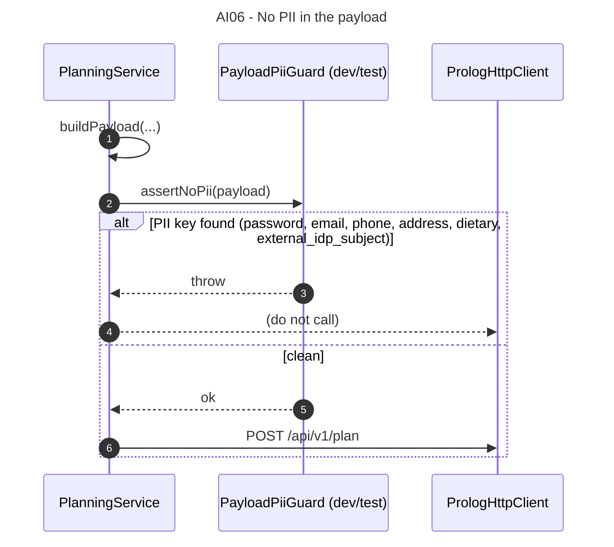
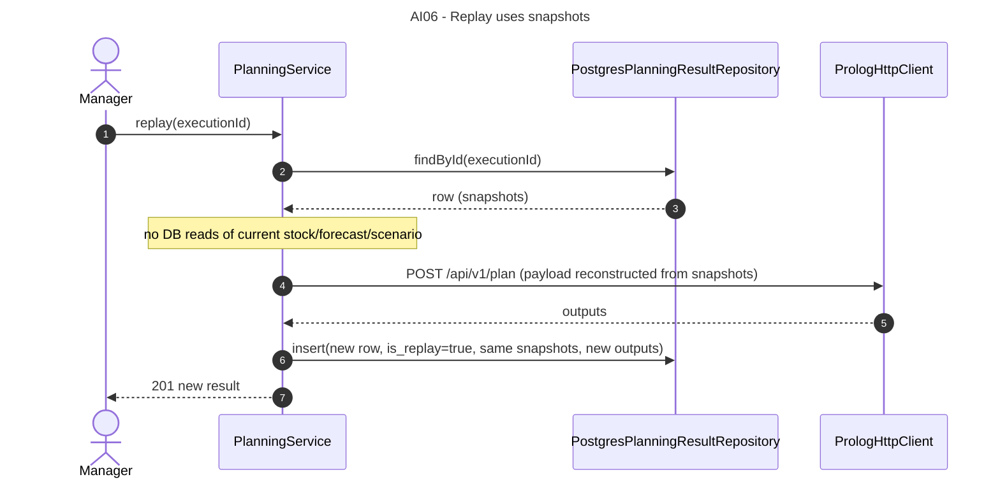

# AI06 — Back-End Data and Prolog Knowledge Base

> **Current precedence:** Client Clarification #55 supersedes the earlier push-payload flow described in this file and ADR-012. The required flow is backend → Prolog with execution/scheduling metadata, followed by authenticated Prolog → backend reads of business data. Prolog constructs its fresh per-execution KB. The current code still implements the superseded flow and is therefore not yet conformant with AI06/#55.

## 1. Requirements Engineering

### 1.1. User Story Description

As a Development Team, I want the Artificial Intelligence module to obtain business data from back-end endpoints, so that its knowledge base reflects consistent restaurant information for the selected operational or demonstration scenario.

### 1.2. Customer Specifications and Clarifications

#### From the specification document
> Extracted from *PART IV — Sprint 2 — User Stories* (AI06, pp. 18–19).

- **Retrieve pizza BOM definitions** from documented back-end endpoints. For each pizza and applicable size: products, aggregates, quantities in abstract stock units, and the aggregate composition + **production-or-purchase classification** needed for expansion. **Prolog remains responsible for expanding these definitions and calculating requirements.**
- **Retrieve the other inputs:** product and stock-consumption information, orders or daily forecasts, stock snapshots, supplier offers. Include scenarios confirmed through WEB07. Implement or extend endpoints where needed.
- **Construct the Prolog KB** with consistent business identifiers, relationships, and stock units.
- **Preserve each supplier offer's** product reference, price in EUR, quoted stock-unit quantity, delivery lead time.
- **Report missing or invalid required data** instead of inventing defaults.
- **Combine actual + simulated inputs** with consistent references; record each selected scenario + origin + version/retrieval time of inputs. **Any simulated input makes the calculation a simulation.**
- **Refresh data** for each calculation or follow a documented refresh policy. **Use a consistent input set;** unavailable data or incomplete refreshes must **not silently mix old and new versions.**
- **Obtain business data through authorized service access**, without direct DB access or a separate authoritative copy. **Request only planning information**, excluding customer names/contacts/dietary profiles.
- **Clarification #55:** the backend invokes the appropriate Prolog predicate with execution/scheduling information; Prolog contacts documented backend API endpoints using authorized service access to retrieve business data and constructs the KB. The backend must not send the full business dataset in the invocation, and Prolog must not connect directly to the application database.
- **Back end owns persistent stock and purchase-order records.** Calculations must never apply predicted stock changes. **Simulations must not alter actual or scenario input stock**, replace operational data, or create operational POs. **Operational changes require a separate explicit confirmation and back-end validation.**

#### From ADRs
- **ADR-012:** JSON over HTTP and a separate Prolog container remain applicable. Clarification #55 supersedes ADR-012's former backend-push data flow; service-authenticated Prolog pulls are required.
- **ADR-013:** immutable snapshots (`forecast_snapshot`, `scenario_snapshot`, `stock_snapshot`); replay uses snapshots.

#### From the openapi contract
- **`GET /products/export`** exists as a manager-authorized product/BOM export. It does not by itself satisfy #55's Prolog service-access contract.
- The planning endpoints (AI05) accept manager requests and return results. The backend invokes Prolog with execution metadata; Prolog must retrieve the business inputs from documented, service-authorized backend endpoints.
- **This US defines the data API and the Prolog-owned per-run KB construction**, while preserving consistent inputs, provenance, privacy, and replay.

### 1.3. Acceptance Criteria (expanded, testable)

#### AC1 — Backend exposes authorized data endpoints for Prolog
- AC1.1 Documented backend endpoints make available to the Prolog service the required product, stock, BOM/size configuration, forecast, pending-delivery, supplier and offer data. Exact endpoint paths and the service-authentication mechanism are to be selected in ADR-012/OpenAPI; the client has not prescribed their names or credential technology.
- AC1.2 The existing manager-facing `GET /api/v1/products/export` remains a diagnostic/export capability and is not, by itself, the service-access contract required by #55. The Prolog service's documented read endpoint(s) must expose the product, stock, BOM/size, forecast, delivery, supplier and offer data it needs. The exact endpoint shape is an implementation decision recorded in ADR-012/OpenAPI; it must support coherent per-execution inputs.
- AC1.3 The existing manager-facing export remains manager-authorized. The Prolog service endpoints require a distinct service identity and read-only scope; user roles or client-supplied user tokens do not authorize service reads.
- AC1.4 Each endpoint returns a complete response for its documented resource or fails; missing/partial required data must not be silently represented as defaults.

#### AC2 — Prolog builds a fresh KB for each calculation
- AC2.1 The backend invokes Prolog with only the execution type and scheduling/request metadata needed to select the data (for example, forecast name, scenario name, reference date, and AI01 orders). It does not send the complete product/stock/BOM/offer dataset.
- AC2.2 Prolog obtains the required inputs from the authenticated backend endpoints and builds a fresh in-memory KB for each execution. It must not reuse facts from another execution.
- AC2.3 All inputs used by one calculation must be coherent and traceable to the exact data used in its `PlanningResult`. The endpoint/snapshot design must detect or prevent mixed revisions; a failed or incomplete refresh fails the calculation rather than mixing old and new data.
- AC2.4 Refresh policy is per execution. No stale KB cache is allowed unless a later ADR defines invalidation and freshness guarantees.

#### AC3 — Business keys throughout
- AC3.1 Every identifier in the payload is a business key (`sku`, `supplierCode`, `forecastName`, `scenarioName`, `pizzaSize` name). No UUIDs, no SERIAL IDs (except `executionId` in responses, which is system-assigned and not part of the KB).
- AC3.2 The `pizza-BOM.pl.txt` reference uses Prolog atoms; the LaPrizza KB uses the same style (`pizza('PRD-PIZZA-MARG', 'Margherita Classica', [...])`, `stock('PRD-MOZZ-01', 25)`, etc.). SKUs are quoted atoms (they contain hyphens).
- AC3.3 The mapping from JSON keys to Prolog predicates is documented in `docs/ai/prolog-kb.md` (AI04 report references it).

#### AC4 — Preserve supplier offer data
- AC4.1 For each offer in a confirmed scenario, the payload includes: `supplierCode`, `productSku`, `priceEur`, `stockUnitQuantity`, `leadTimeDays`, `dailySupplyLimit` (nullable). No field is dropped or defaulted.
- AC4.2 The scenario's `isSimulated` flag is carried into the payload; the overall execution `is_simulated` is `OR(scenario.isSimulated, request.isSimulated)` (Clarification #28 §3).
- AC4.3 The scenario must be **confirmed** at execution time (AI02 AC2.1). If not, `409`.

#### AC5 — Report missing or invalid data, never invent defaults
- AC5.1 Missing `stockUnitsPerSale` for a `isStockControlled ∧ isSellable` product → `422`, not a default of `1` (Clarification #28 §2).
- AC5.2 Missing `ComponentSizeConfiguration` for a required `(component, size)` → `422`.
- AC5.3 Missing `PredefinedPizza` / `defaultRecipeLines` for a pizza in the request/forecast → `422`.
- AC5.4 Empty `supplier_offers` for a confirmed scenario with a required SKU → the Prolog run reports `unmetNeeds` with `reason = "no_offer"`; the backend persists the result (AC6.3). The scenario is not "invalid" — it is merely insufficient, and the plan reflects it.
- AC5.5 Invalid `daily_supply_limit` (negative) → rejected at WEB07 creation time; not possible in the payload.

#### AC6 — No direct DB access from Prolog, no authoritative copy
- AC6.1 Prolog has **no database credentials**. Its only business-data source is the backend API through authenticated, read-only service endpoints.
- AC6.2 Prolog does not persist anything to the database. It returns JSON; the backend persists `PlanningResult`.
- AC6.3 The backend's persistent state (`stock_items`, `predefined_pizzas`, `component_size_configurations`, `consumption_forecasts`, `supplier_scenarios`, etc.) remains the **single authoritative copy**. The Prolog KB is a per-request ephemeral view constructed from API reads.

#### AC7 — Only planning information, no PII
- AC7.1 The payload excludes: `users.*` (names, emails, phones, password hashes, `external_idp_subject`), `customers.*` (names, emails, phones, VAT, addresses), `user_dietary_restrictions.*`, and `activation_invitations.*`.
- AC7.2 Verified by a payload-schema test (assert no `password`, `email`, `phone`, `address`, `dietary`, `external_idp_subject` key appears anywhere in the JSON).
- AC7.3 The `supplier.name` field (nullable in `supplier_offers`' parent `suppliers`) is allowed (it is a commercial entity name, not personal data) — documented as an explicit exception.

#### AC8 — Stock snapshot and immutability
- AC8.1 The result records the exact stock values and other input data used by Prolog, including capture/provenance metadata, so the recorded snapshot corresponds to the calculation rather than an independent later read.
- AC8.2 The Prolog run never mutates stock. The backend never applies the Prolog output to `stock_items`. The result's `hypotheticalRemainingUnits` are result-only.
- AC8.3 The `PlanningResult` row persists the snapshots (ADR-013); replay uses them instead of re-reading the DB.

#### AC9 — Operational changes are explicit and separate
- AC9.1 The planning endpoints return a **plan** (requirements/proposals/unmetNeeds). There is no `POST /planning/executions/{id}/apply` endpoint in baseline. Any operational stock/purchase change is a **separate** future endpoint with its own authorization and idempotency (Clarification #26).
- AC9.2 Documented in AI04's report: the plan is a decision-support artefact, not an order.

### 1.4. Found out Dependencies

**Preceding:**
- All the Sprint 1 repositories (`PostgresProductRepository`, `PostgresPredefinedPizzaRepository`, `PostgresComponentSizeConfigurationRepository`, `PostgresStockRepository`, `PostgresConsumptionForecastRepository`, `PostgresSupplierScenarioRepository`).
- Migration 001–014 (the whole Sprint 1 + Sprint 2 schema).
- ADR-012, ADR-013.
- `PrologHttpClient` (infrastructure).

**Succeeding:**
- AI01, AI02 (consume the KB).
- AI05 (owns the endpoint contracts).
- AI04 (report).

### 1.5. Input and Output Data

> **Historical implementation detail:** The payload DTO examples, current
> class/sequence diagrams, and decisions in §§1.5–1.7.7 below describe the
> superseded backend-push implementation. Clarification #55 changes the
> business-data source to authenticated Prolog→backend API reads. Keep the
> business-key mapping, PII exclusion, per-run freshness and immutable replay
> requirements; revise the wire DTOs/diagrams when the endpoint and invocation
> contracts are designed. Do not treat the former full-payload examples as the
> required backend→Prolog invocation.

#### 1.5.1. `ProductExportDTO` (openapi.yaml, extended — §1.7.3)

```json
{
  "exportedAt": "2026-11-05T14:30:00Z",
  "products": [
    { "sku": "PRD-PIZZA-MARG", "name": "Margherita", "categoryName": "Pizzas", "isSellable": true, "isPizzaComponent": false, "isStockControlled": false, "componentTypeName": null, "stockUnitsPerSale": null, "currentStock": 0, "isActive": true },
    { "sku": "PRD-DOUGH-TRAD", "name": "Traditional Dough", "categoryName": "Doughs", "isSellable": false, "isPizzaComponent": true, "isStockControlled": true, "componentTypeName": "Base Dough", "stockUnitsPerSale": null, "currentStock": 40, "isActive": true },
    { "sku": "PRD-COKE-01", "name": "Coca-Cola 33cl", "categoryName": "Beverages", "isSellable": true, "isPizzaComponent": false, "isStockControlled": true, "componentTypeName": null, "stockUnitsPerSale": 1, "currentStock": 200, "isActive": true }
  ],
  "boms": [
    { "pizzaSku": "PRD-PIZZA-MARG", "recipeName": "Margherita Classica", "availableSizes": ["Small","Medium","Large"], "lines": [
      { "componentSku": "PRD-DOUGH-TRAD", "defaultQuantity": 1 },
      { "componentSku": "PRD-MOZZ-01", "defaultQuantity": 1 }
    ]}
  ],
  "componentSizeConfigurations": [
    { "componentSku": "PRD-DOUGH-TRAD", "pizzaSize": "Medium", "stockUnitsConsumed": 1 },
    { "componentSku": "PRD-MOZZ-01",    "pizzaSize": "Medium", "stockUnitsConsumed": 2 }
  ]
}
```

> **Extension:** `componentSizeConfigurations[]` is **added** to `ProductExportDTO` in v2.2.0. The v2.1.0 schema exposes only `products[]` and `boms[]`; without size-dependent consumption, neither AI01 nor AI02 can compute `required(component, day)` (AI02 AC3.1). The backend *could* also inline `stockUnitsConsumed` per component per available size inside `boms[].lines[]`, but the flat array is closer to the domain (`ComponentSizeConfiguration` is an aggregate root per KB §8.1) and easier for the Prolog KB builder. Documented as the chosen representation.

#### 1.5.2. Service invocation and Prolog data acquisition

The backend → Prolog invocation carries execution/scheduling metadata, not the full KB. Prolog then uses service-authorized backend endpoints to pull the required business data and constructs the KB. The exact API path set, service credential, revision/snapshot token mechanism, and replay retrieval contract are architectural decisions that must be recorded in ADR-012 and OpenAPI before implementation. Do not treat the earlier full `PrologRequestDTO` payload examples below as the target AI06 interface; they describe the superseded implementation.

#### 1.5.3. Persistence

`planning_results` (migration 014). Its existing snapshot JSONB fields remain the persistent record of the exact input set used. Any temporary mechanism used to expose a consistent run snapshot to Prolog must not become a second authoritative business database and must have a documented lifecycle.

### 1.6. System Sequence Diagrams (SSD)

> **Historical diagrams:** the sequences below depict the former backend-push implementation and are superseded by Clarification #55. They must be replaced with backend metadata invocation → authenticated Prolog pulls → Prolog KB construction, including the agreed consistency and replay flow, before AI06 is declared complete.

#### 1.6.1. Per-request KB construction (transaction-scoped read)

```mermaid
sequenceDiagram
autonumber
title AI06 - Per-request KB construction
    participant Svc as PlanningService
    participant ProdRepo as PostgresProductRepository
    participant BomRepo as PostgresPredefinedPizzaRepository
    participant CscRepo as PostgresComponentSizeConfigurationRepository
    participant StockRepo as PostgresStockRepository
    participant FCRepo as PostgresConsumptionForecastRepository
    participant SSRepo as PostgresSupplierScenarioRepository
    participant Snap as PlanningSnapshotDomainService
    participant PrologHttp as PrologHttpClient
    participant DB as PostgreSQL

    Svc->>DB: BEGIN
    Svc->>ProdRepo: findAllActive() + referenced SKUs
    ProdRepo->>DB: SELECT … WHERE is_active = TRUE OR sku IN (referenced)
    ProdRepo-->>Svc: products[]
    Svc->>BomRepo: findAll() (pizza-level BOMs)
    BomRepo->>DB: SELECT pp.* + ppr.* FROM predefined_pizzas …
    BomRepo-->>Svc: boms[]
    Svc->>CscRepo: findAll()
    CscRepo->>DB: SELECT * FROM component_size_configurations
    CscRepo-->>Svc: csc[]
    Svc->>StockRepo: findAll()
    StockRepo->>DB: SELECT * FROM stock_items
    StockRepo-->>Svc: stock[]
    Svc->>FCRepo: findByName(forecastName) -- AI02 only
    FCRepo->>DB: SELECT cf.* + cfe.* FROM consumption_forecasts …
    FCRepo-->>Svc: forecast
    Svc->>SSRepo: findByName(scenarioName) -- AI02 only
    SSRepo->>DB: SELECT ss.* + sup.* + so.* FROM supplier_scenarios …
    SSRepo-->>Svc: scenario
    alt any read fails / partial
        Svc->>DB: ROLLBACK
        Svc-->>PrologHttp: (do not call)
    else all reads succeeded
        Svc->>Snap: capture({ products, boms, csc, stock, forecast?, scenario?, orders? })
        Snap-->>Svc: snapshots
        Svc->>DB: COMMIT (reads are read-only; COMMIT releases the snapshot)
        Svc->>PrologHttp: POST /api/v1/plan (business-key payload)
    end
```

**Note:** because reads are read-only, `COMMIT` after the snapshot is equivalent to `ROLLBACK` for isolation purposes; the transaction is used to guarantee a **consistent snapshot** (PostgreSQL `READ COMMITTED` per statement, but all reads happen back-to-back before the snapshot is frozen; if strict snapshot isolation is required, `REPEATABLE READ` on this transaction is documented as an option — see §1.7.4).

#### 1.6.2. No PII in the payload (defense in depth)



`PayloadPiiGuard` is a development-time assertion (a `Pure Fabrication`) that runs in test environments (`NODE_ENV !== 'production'`); in production it is skipped (the payload is built from explicit field whitelists, not from `SELECT *`).

#### 1.6.3. Replay uses snapshots, not fresh reads



### 1.7. Other Relevant Remarks

#### 1.7.1. Component architecture

```mermaid
classDiagram
    namespace Application {
        class PlanningService {
            +executeBom(dto, actor)
            +executeForecast(dto, actor)
            +replay(id)
            -buildPayload(inputs): PrologPayload
        }
        class ProductExportService {
            +export(): ProductExportDTO
        }
        class PlanningSnapshotDomainService {
            +capture(inputs): Snapshots
        }
        class IPlanningResultRepository
        class IProductRepository
        class IPredefinedPizzaRepository
        class IComponentSizeConfigurationRepository
        class IStockRepository
        class IConsumptionForecastRepository
        class ISupplierScenarioRepository
    }
    namespace Infrastructure {
        class PrologHttpClient {
            +execute(payload): Promise~PrologResponse~
        }
        class PostgresProductRepository
        class PostgresPredefinedPizzaRepository
        class PostgresComponentSizeConfigurationRepository
        class PostgresStockRepository
        class PostgresConsumptionForecastRepository
        class PostgresSupplierScenarioRepository
        class PostgresPlanningResultRepository
    }
    namespace Domain {
        class PlanningResult
    }

    PlanningService --> PlanningSnapshotDomainService
    PlanningService --> IPlanningResultRepository
    PlanningService --> IProductRepository
    PlanningService --> IPredefinedPizzaRepository
    PlanningService --> IComponentSizeConfigurationRepository
    PlanningService --> IStockRepository
    PlanningService --> IConsumptionForecastRepository
    PlanningService --> ISupplierScenarioRepository
    PlanningService --> PrologHttpClient
    ProductExportService --> IProductRepository
    ProductExportService --> IPredefinedPizzaRepository
    ProductExportService --> IComponentSizeConfigurationRepository
    ProductExportService --> IStockRepository
```



#### 1.7.2. Decision record — per-request KB vs. cached KB

**Decision:** per-request KB construction (no cache).

**Rationale:**
- The spec explicitly says "Refresh data for each calculation or follow a documented refresh policy." Per-request is the simplest and strongest guarantee.
- The data volume is small (tens of products, tens of BOM lines, a handful of scenarios). The cost is a few hundred KB over the loopback network per call.
- Any cache would need invalidation hooks on every stock/product/forecast/scenario mutation, which is fragile.

**Alternatives considered:**
- *TTL cache (e.g., 60 s)*: rejected — risks mixing old and new data (spec AC: "must not silently mix old and new versions").
- *Materialised view refreshed on demand*: rejected — adds a second source of truth; the spec also says "without ... a separate authoritative copy".

#### 1.7.3. Decision record — `componentSizeConfigurations[]` addition to `ProductExportDTO`

The openapi v2.1.0 `ProductExportDTO` has `products[]` and `boms[]` but not size configurations. Without `(component, size) → stockUnitsConsumed`, neither AI01 nor AI02 can compute required units (they would have no per-size multiplier). This is a **functional gap**, not a stylistic choice.

**Decision:** add `componentSizeConfigurations[]` to `ProductExportDTO` (v2.2.0).

**Alternatives considered:**
- *Inline `stockUnitsConsumed` per component per available size inside `boms[].lines[]`*: would produce a nested structure (`lines[].consumptionPerSize.{Small: 1, Medium: 1, Large: 2}`); workable but conflates two aggregates. Rejected for clarity.
- *A separate endpoint `GET /component-size-configurations`*: rejected — extra round trip; the export is consumed as one snapshot (AC1.2 all-or-nothing).

#### 1.7.4. Decision record — `READ COMMITTED` vs. `REPEATABLE READ` on the KB read transaction

The `PlanningService` opens a transaction for the KB reads, then commits before calling Prolog (so the DB connection is not held during the Prolog call). Under PostgreSQL default `READ COMMITTED`, each `SELECT` sees the latest committed state, so a mutation between two reads could theoretically produce a mixed snapshot. In practice, the reads are back-to-back (microseconds apart) and the risk is negligible for an academic prototype.

**Decision:** baseline uses `READ COMMITTED` (default). A `REPEATABLE READ` transaction (or a `pg_dump`-style consistent snapshot) is documented as an **option** for production hardening. Not baseline.

#### 1.7.5. Payload schema (excerpt)

```json
{
  "executionType": "REQUIREMENTS_PLANNING",
  "referenceDate": "2026-11-05",
  "isSimulated": false,
  "forecast": { "name": "...", "entries": [ … ] },
  "scenario": { "name": "...", "suppliers": [ … ], "offers": [ … ] },
  "products": [ … ],
  "componentSizeConfigurations": [ … ],
  "boms": [ … ]
}
```

`PrologHttpClient` sends exactly this. The Prolog container builds its KB from it and returns `{ requirements, proposals, unmetNeeds }`.

#### 1.7.6. Error-to-HTTP matrix (KB-related subset)

| Condition | HTTP | Where |
|---|---|---|
| `GET /products/export` — DB read fails | 500 | export controller |
| Planning — a read fails | 502 | planning (Prolog not called) |
| Planning — missing `stockUnitsPerSale` | 422 | planning |
| Planning — missing `ComponentSizeConfiguration` | 422 | planning |
| Planning — no `PredefinedPizza` for a pizza SKU | 422 | planning |
| Planning — confirmed scenario has no offers for a required SKU | 201 with `unmetNeeds reason=no_offer` | planning (meaningful result) |
| Replay — snapshot malformed (should not happen) | 500 | planning |
| Replay — Prolog unreachable | 502 | planning |

#### 1.7.7. Verification (automated + demo)

- **Unit:** `PlanningService.buildPayload` — 6 cases: full payload includes all required sections; missing `stockUnitsPerSale` → 422; missing size config → 422; inactive reference at first execution → 422; scenario unconfirmed → 409; payload has no PII (AC7.2 assertion).
- **Unit (snapshot):** `PlanningSnapshotDomainService.capture` deep-copies; later mutation of the source does not affect the snapshot.
- **Integration (Supertest + mocked Prolog):** `GET /products/export` returns the extended DTO; the planning endpoints' payload sent to the mocked `PrologHttpClient` contains `componentSizeConfigurations[]`, `boms[]`, `products[]`, and no PII.
- **DB suite:** `GET /products/export` is all-or-nothing (mock a failing `CscRepo` → 500, no partial body).
- **Read-only:** before/after `GET /stock` — identical.
- **Demo:** `GET /products/export` via Swagger; inspect the payload (size configs present, no PII); execute a plan (mocked or real Prolog); assert Prolog container received the business-key payload (logs); replay; verify the payload used for replay is the snapshot, not current data (edit the forecast between executions, replay old, outputs identical).
