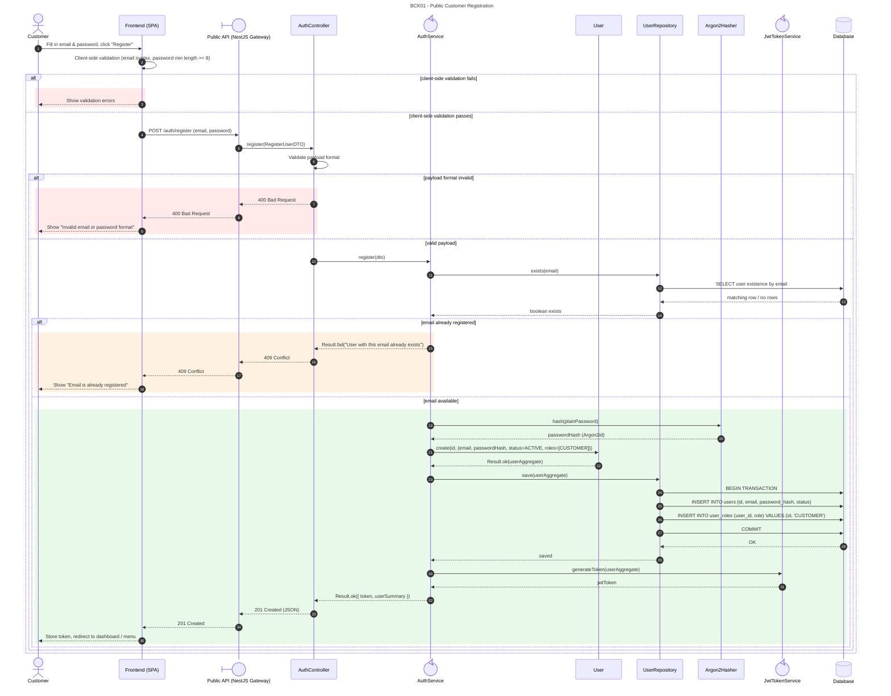
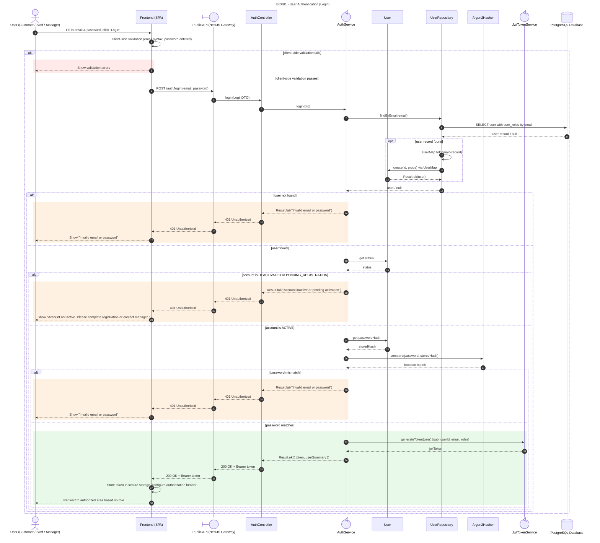
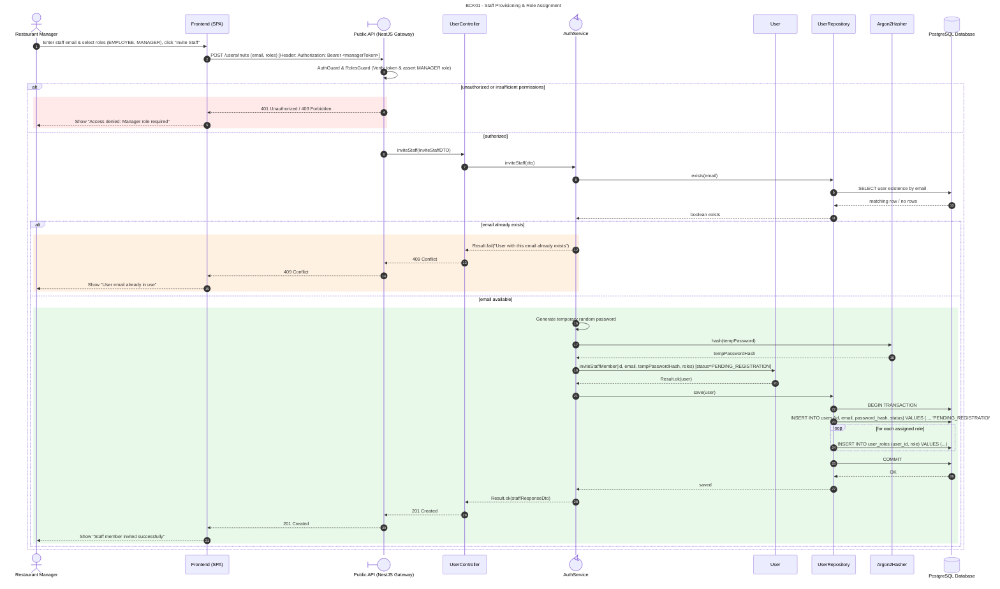

# BCK01 - As a LaPrizza Manager, I want the system to maintain users and roles and authenticate registered users.

## 1. Requirements Engineering

### 1.1. User Story Description
As a LaPrizza Manager, I want the system to maintain users and roles and authenticate registered users, so that access to protected operations can be associated with an identified and authorized user.

### 1.2. Customer Specifications and Clarifications

#### From the specification document
> Requirements extracted from *PART III – Sprint 1 – User Stories* (Section BCK01, p. 5) and *PART II – System Specification* (Section II.3.1, "Business Overview", and Section II.3.2, "Identity and Access Management").

#### From Customer / Product Owner Q&A Log
- **User Roles Taxonomy (Clarification #03):** The system must support at least three standard roles: `MANAGER`, `EMPLOYEE`, and `CUSTOMER`. A user can accumulate multiple roles simultaneously (`Set<UserRole>`).
- **Administrative Governance (Clarification #04):** There is no separate `ADMINISTRATOR` role. User provisioning and role assignment are governed by users with the `MANAGER` role.
- **Account Segregation (Clarifications #01 & #02):** A `User` is an authentication account (credentials, password hash, status, roles) and is conceptually distinct from a `Customer` profile (commercial persona). Anonymous kiosk orders do not create or require a `User` entity.
- **Privilege Escalation Prevention (ARQSI Slide 90):** Public registration (`POST /auth/register`) strictly assigns the `CUSTOMER` role with `ACTIVE` status. Elevated staff accounts (`EMPLOYEE`, `MANAGER`) are created exclusively by Managers in a `PENDING_REGISTRATION` state until completed by the user.
- **Stateless Tokens (ADR-002 & ADR-004):** Authentication produces signed JSON Web Tokens (JWT) with embedded subject and role claims. Tokens are stateless and not stored in the database.
- **Password Hardening (ADR-002):** Passwords are salted and hashed using **Argon2id** (memory-hard, resistant to GPU brute-force attacks).

### 1.3. Acceptance Criteria

- **AC1:** The system must support the registration and management of the users required to access protected system functionality.
- **AC2:** Each user must have a unique identifier and appropriate authentication credentials (unique email and password).
- **AC3:** The system must support the roles required to distinguish responsibilities (`MANAGER`, `EMPLOYEE`, `CUSTOMER`), allowing multi-role assignments.
- **AC4:** Registered users must be able to authenticate using their credentials.
- **AC5:** Successful authentication must establish the identity and role context of the user via a signed, stateless JWT token for subsequent protected operations.
- **AC6:** Invalid authentication attempts must be rejected with generic credentials errors (HTTP 401 Unauthorized) without leaking specific user existence details.
- **AC7:** Authentication credentials must be hashed and stored using Argon2id conforming to OWASP guidelines.
- **AC8:** Unactivated accounts (`PENDING_REGISTRATION`) or deactivated accounts (`DEACTIVATED`) must not be granted access to protected functionality.

### 1.4. Found out Dependencies

- **Preceding Dependencies:** None. This is the foundational identity provider for the entire system.
- **Succeeding Dependencies:** All protected operations across Sprint 1 (`BCK02` through `BCK10`) rely on the JWT token verification and Role-Based Access Control (`RolesGuard`) established here.

### 1.5. Input and Output Data

#### Inputs:
- **Public Registration:**
  - `email`: string (valid email format, unique, mandatory)
  - `password`: string (minimum 8 characters, mandatory)
- **Staff Provisioning / Invite (Manager only):**
  - `email`: string (valid email format, unique, mandatory)
  - `roles`: array of UserRoles (`MANAGER`, `EMPLOYEE`, mandatory)
- **Authentication / Login:**
  - `email`: string (mandatory)
  - `password`: string (mandatory)

#### Outputs:
- **Registration Success:** HTTP 201 Created + JWT token + user summary (`id`, `email`, `roles`, `status`).
- **Staff Provisioning Success:** HTTP 201 Created + user record with `status: PENDING_REGISTRATION`.
- **Login Success:** HTTP 200 OK + JWT bearer token + user summary (`id`, `email`, `roles`, `status`).
- **Failure Statuses:** HTTP 400 Bad Request, HTTP 401 Unauthorized, HTTP 403 Forbidden, HTTP 409 Conflict.

---

### 1.6. HTTP API

The paths below are relative to the application's configured API prefix. This section describes the current authentication and user controllers. In particular, staff provisioning uses `/auth/pre_register`; `/users/invite` in the SSD below and `/auth/users` in the OpenAPI document are not the implemented route.

| Method | Path | Access | Success | Other outcomes |
| --- | --- | --- | --- | --- |
| POST | `/auth/register` | Public | 201, JWT token and user summary | 400 invalid email, password or user details; 409 email already registered outside pending registration |
| POST | `/auth/login` | Public | 200, JWT token and user summary | 400 pending registration; 401 invalid credentials; 403 deactivated account |
| POST | `/auth/pre_register` | Active Manager | 201, user record with pending registration status | 400 invalid email, role or user details; 401/403 access denied; 409 duplicate email |
| GET | `/users?page=1&pageSize=20` | Active Manager | 200, paginated users | 400 invalid pagination; 401/403 access denied |
| GET | `/users/filter/creation-date/:date` | Active Manager | 200, paginated users created on the given UTC date | 400 invalid date or pagination; 401/403 access denied |
| GET | `/users/filter/role/:role` | Active Manager | 200, paginated users with the given role | 400 invalid role or pagination; 401/403 access denied |
| GET | `/users/filter/status/:status` | Active Manager | 200, paginated users with the given status | 400 invalid status or pagination; 401/403 access denied |
| GET | `/user/:username` | Active Manager or Customer reading their own account | 200, user record | 400 malformed identifier; 401/403 access denied; 404 missing user |
| DELETE | `/user/:username` | Active Manager or Customer deactivating their own account | 200, empty body; account deactivated | 400 malformed identifier; 401 unauthorized or Customer targeting another account; 403 role/status denied; 404 missing user |

Registration accepts `firstName`, `lastName`, `email` and `password`. Passwords require at least eight characters, including uppercase and lowercase letters, a number and a special character. Login accepts `email` and `password`. Both successful responses contain `{ "token": "...", "user": { ... } }`; the user summary includes `id`, `firstName`, `lastName`, `createdAt`, `updatedAt`, `email`, `roles` and `status`.

Example staff provisioning:

```json
{
  "firstName": "Ana",
  "lastName": "Silva",
  "email": "ana.silva@laprizza.com",
  "roleName": "EMPLOYEE"
}
```

The provisioning payload uses a single `roleName`, rather than the `roles` array shown in the earlier requirements. The current service accepts the standard roles `MANAGER`, `EMPLOYEE` and `CUSTOMER`. Registration can complete a pending account; the service retains its assigned roles and also includes `CUSTOMER`.

Protected requests use `Authorization: Bearer <token>`. Filter routes accept optional `page` and `pageSize` query parameters, defaulting to 1 and 20; both must be positive integers and `pageSize` cannot exceed 100. Dates use `YYYY-MM-DD`; role and status filters use the enum values listed above. Collection responses contain `items`, `total`, `page`, `pageSize` and `totalPages`. Individual user reads omit `updatedAt` from the authentication summary fields.

Deletion deactivates the authentication account. Errors use the existing global exception filter's `{ "error": { "message": "..." } }` shape. Unexpected infrastructure failures return 500.

---

### 1.7. System Sequence Diagrams (SSD)

#### 1.7.1. Public User Registration (Self-Service Customer)



#### 1.7.2. User Authentication (Login)



#### 1.7.3. Privileged Staff Provisioning (Manager Only)



---

### 1.8. Other Relevant Remarks

* **Security & Password Storage Compliance:** Implements Argon2id with memory cost 64 MB ($2^{16}$) and 3 iterations, fulfilling OWASP Application Security Verification Standards (ASVS) and ADR-002.
* **Relational Integrity Guarantees (ADR-003 & 08-database-structure.md):** The physical schema enforces:
```sql
CREATE TABLE users (
    id UUID PRIMARY KEY,
    email VARCHAR(255) NOT NULL UNIQUE,
    password_hash VARCHAR(255) NOT NULL,
    status VARCHAR(30) NOT NULL DEFAULT 'ACTIVE' CHECK (status IN ('ACTIVE', 'DEACTIVATED', 'PENDING_REGISTRATION')),
    created_at TIMESTAMPTZ NOT NULL DEFAULT NOW(),
    updated_at TIMESTAMPTZ NOT NULL DEFAULT NOW()
);

CREATE TABLE user_roles (
    user_id UUID NOT NULL REFERENCES users(id) ON DELETE CASCADE,
    role VARCHAR(30) NOT NULL CHECK (role IN ('MANAGER', 'EMPLOYEE', 'CUSTOMER')),
    PRIMARY KEY (user_id, role)
);

```


* **Boundary Cleanliness:** Address registration and dietary restrictions are completely decoupled from this User Story and handled strictly under **BCK02** (`Customer Management`).
