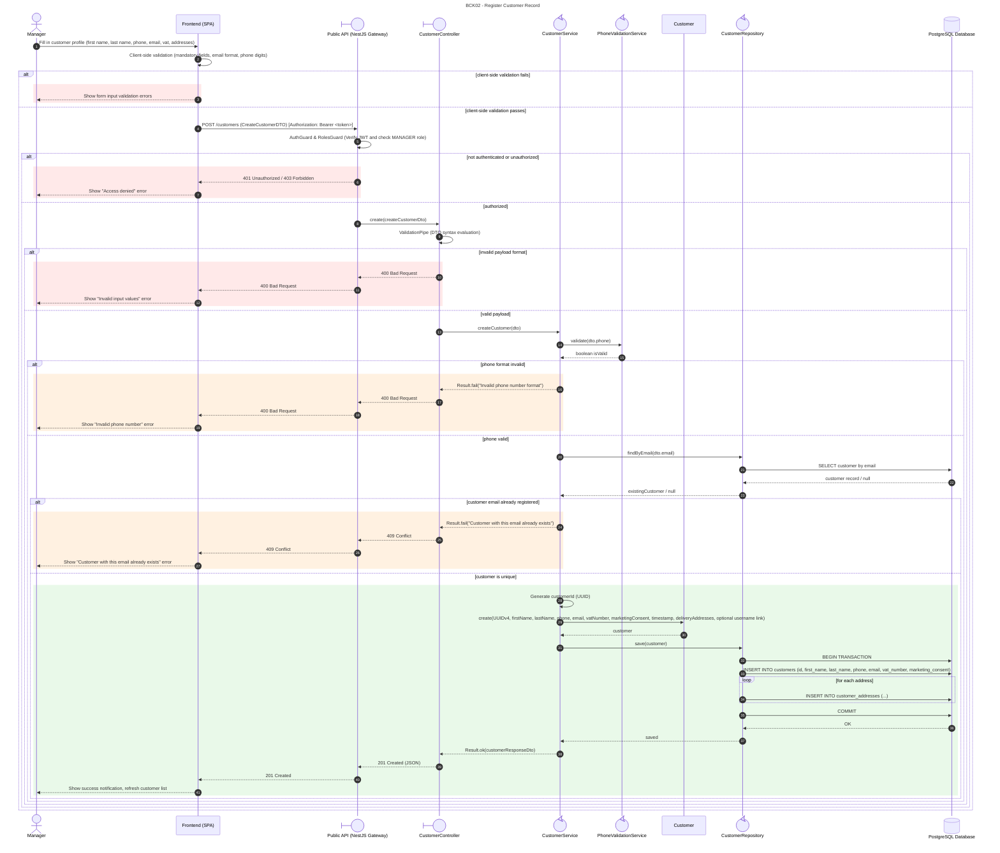
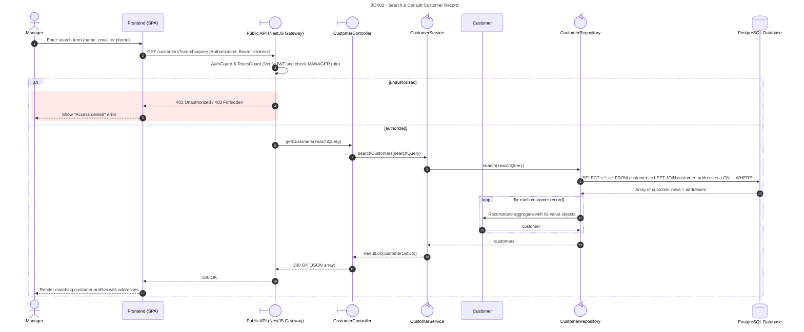
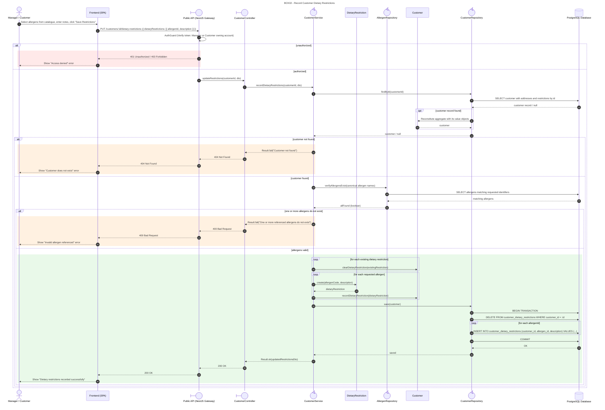
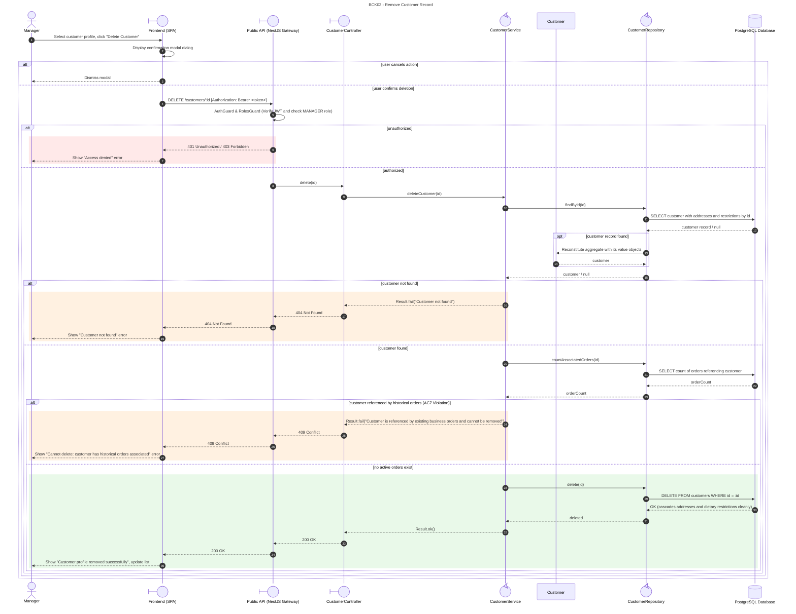

# BCK02 - As a LaPrizza Manager, I want to register and manage customers.

## 1. Requirements Engineering

### 1.1. User Story Description

As a LaPrizza Manager, I want to register and manage customers, so that the restaurant can maintain the information required to provide its services to them.

### 1.2. Customer Specifications and Clarifications

#### From the specification document

> Extracted directly from *PART III – Sprint 1 – User Stories* (Section BCK02, p. 6) and *PART II – System Specification* (Section II.3.1.1 Customers and Food Intolerances, p. 3).
>
>

* **Customer Information Scope:** Customer information supports ordering, delivery, and personal dietary management. It comprises identity/contact channels, delivery addresses, dietary restrictions, and optional tax data.


* **Data Protection & GDPR:** Customer records constitute personal data and must comply with applicable regulations (e.g., explicit marketing consent).


* **Referential Integrity:** Customer information actively referenced by other business records (such as confirmed orders) must never be purged in a way that creates orphan data or corrupts history.


#### From Customer / Product Owner Q&A Log

* **Mandatory Customer Attributes (Clarification #01 Q1):** The mandatory baseline attributes of a customer profile are strictly **First Name, Last Name, Phone Number, and Email**.


* **Customer vs. User Separation (Clarifications #01 Q2 & #02):** A `Customer` represents a commercial business entity, whereas a `User` represents an authentication account. They are connected via an optional `0..1 : 0..1` relationship (`user_id` is nullable in `customers`). A registered customer may exist without web login credentials (e.g., registered over the phone by a Manager).


* **Kiosk Anonymous Mode (Clarification #01 Q2):** Kiosk customers place orders anonymously. No persistent `Customer` record is created for kiosk interactions.


* **Phone Number Validation (AC4):** Contact phone numbers must follow international E.164 formatting (or be validated via syntax checks / external validation providers).


* **Dietary Restrictions & Allergens (AC6 & Clarification #01 Q9):** Dietary restrictions are modeled in the domain through associations with recognized catalogue allergens (`allergens` table).


### 1.3. Acceptance Criteria

* **AC1:** The system must support the creation and update of customer records.


* **AC2:** Each customer must have a unique identifier (UUIDv4).


* **AC3:** Customer information must include, at least, the customer's first name, last name, phone number, and email address.


* **AC4:** Data used to uniquely identify or contact customers (email, phone, tax identifier) must be appropriately validated.


* **AC5:** Customers must be searchable using relevant identifying information (e.g., email, phone number, name, or VAT number).


* **AC6:** The solution must allow relevant dietary restrictions associated with a customer to be represented and linked to recognized allergens.


* **AC7:** Customer information that is referenced by existing business information (e.g., historical orders) must not be removed in a manner that compromises data consistency (enforced via database `ON DELETE RESTRICT`).


* **AC8:** An authenticated active user must be able to set or replace their own optional delivery address (street, postal code, city and extra details), without supplying a user identifier. The change updates the User aggregate's modification timestamp.


* **AC9:** An authenticated active user must be able to set or replace their own optional phone number using E.164 syntax, without supplying a user identifier. The change updates the User aggregate's modification timestamp.


### 1.4. Found out Dependencies

* **Preceding Dependencies:**
* **BCK01 (User and Authentication Management):** Creating, updating, or deleting customer records is a privileged operation restricted to authenticated users holding the `MANAGER` role (enforced via `AuthGuard` and `RolesGuard`). An optional `UserId` link can connect a customer to a `User` account.


* **BCK04 (Allergen Management):** Dietary restrictions record references to valid allergens maintained in the allergen catalogue.


* **Succeeding Dependencies:**
* **Orders and Billing (Sprint 2/3):** Confirmed customer orders link directly to `CustomerId` to associate order history and verify allergen conflicts.


### 1.5. Input and Output Data

#### Inputs:

* `firstName`: string (mandatory, 2–75 characters)


* `lastName`: string (mandatory, 2–75 characters)


* `phone`: string (mandatory, validated E.164 syntax)


* `email`: string (mandatory, valid email format)


* `vatNumber`: string (optional, valid tax format)


* `marketingConsent`: boolean (optional, default: false)


* `username`: string (optional, link to an existing authentication account; must belong to a User whose email matches the commercial Customer email)


* `deliveryAddresses`: array of objects (street, postalCode, city, extraDetails, isDefault)


* `dietaryRestrictions`: array of objects (allergenId, description)


* Self-service address update: `street`, `postalCode` and `city` (non-empty strings); `extraDetails` (optional string, defaults to empty). This is a single optional address on `User`, separate from customer-profile delivery addresses.


* Self-service phone update: `phoneNumber` (string in E.164 format, e.g., `+351912345678`). User contact details remain optional until set.


* Search query parameters (e.g., `?search=silva` or `?email=pedro@example.com`)


#### Outputs:

* Created/updated Customer Record (UUID, names, contacts, addresses, restrictions, GDPR  timestamps)


* Self-service contact updates return the existing user summary fields (`username`, `firstName`, `lastName`, `createdAt`, `email`, `roles`, `status`) plus `address` and `phoneNumber` when set. Credentials are never returned.


* List of Customers matching search criteria


* Standard HTTP responses: 200 OK, 201 Created, 400 Bad Request, 401 Unauthorized, 403 Forbidden, 404 Not Found, 409 Conflict.

---

### 1.6. HTTP API

The paths below are relative to the application's configured API prefix. Commercial customer profiles are separate from authentication `User` accounts and are managed by an active Manager. New customer IDs are UUIDv4 values to satisfy AC2, but the UUID is not used as a relational FK. Customer-to-User references use `username`; address, order and dietary-restriction references use the normalized customer `email` business key. The optional account link is accepted only when the account's email matches the commercial profile. Migrations `023` and `024` establish these tables, keys and relationships.

| Method | Path | Access | Success | Other outcomes |
| --- | --- | --- | --- | --- |
| GET | `/customers?search=&page=1&pageSize=12` | Active Manager | 200, paginated commercial customer summaries; search matches name, email, phone or VAT | 400 invalid search/pagination; 401/403 access denied |
| POST | `/customers` | Active Manager | 201, created commercial customer; account link and addresses/restrictions optional | 400 invalid profile/address/restriction; 401/403 access denied; 404 linked user/allergen not found; 409 duplicate email or invalid account link |
| GET | `/customers/:id` | Active Manager | 200, commercial customer details including addresses and dietary restrictions | 400 invalid UUID; 401/403 access denied; 404 customer not found |
| PUT | `/customers/:id` | Active Manager | 200, updated customer contact, name, VAT and optional marketing consent | 400 invalid profile; 401/403 access denied; 404 customer not found; 409 duplicate email or mismatch with linked account |
| DELETE | `/customers/:id` | Active Manager | 204, removes an unreferenced customer | 400 invalid UUID; 401/403 access denied; 404 customer not found; 409 customer has historical orders |
| PUT | `/customers/:id/user` | Active Manager | 200, links a matching existing user, or unlinks with `{ "username": null }` | 400 invalid body/UUID; 401/403 access denied; 404 customer/user not found; 409 email mismatch or user already linked |
| PUT | `/customers/:id/dietary-restrictions` | Active Manager | 200, replaces restrictions linked to known catalogue allergens | 400 invalid/duplicate restrictions; 401/403 access denied; 404 customer/allergen not found |
| POST/PUT/DELETE | `/customers/:id/addresses[/:addressId]` | Active Manager | 200 customer details for create/update/delete; address default can be selected in the body | 400 invalid body/UUID; 401/403 access denied; 404 customer/address not found |
| GET | `/users?page=1&pageSize=20` | Active Manager | 200, paginated users | 400 invalid pagination; 401/403 access denied |
| GET | `/users/filter/creation-date/:date` | Active Manager | 200, paginated users created on the given UTC date | 400 invalid date or pagination; 401/403 access denied |
| GET | `/users/filter/role/:role` | Active Manager | 200, paginated users with the given role | 400 invalid role or pagination; 401/403 access denied |
| GET | `/users/filter/status/:status` | Active Manager | 200, paginated users with the given status | 400 invalid status or pagination; 401/403 access denied |
| POST | `/user/:username/allergen` | Active Customer relating their own dietary restrictions | 201, associates the catalogue allergen names supplied in `{ "allergens": ["Gluten", "Lactose"] }`; empty response body | 400 empty allergen list, invalid allergen name or unregistered allergen; 401 unauthenticated; 403 inactive account, insufficient role or another user's username; 404 user not found |
| PUT | `/user/me/address` | Authenticated active user, own account only | 200, updated user summary with optional contact details; accepts `{ "street": "Rua Nova", "postalCode": "1000-001", "city": "Lisbon", "extraDetails": "Floor 2" }` | 400 invalid address or unsupported body fields; 401 missing/invalid authentication or account no longer exists; 403 inactive account; 404 user disappears after authentication |
| PUT | `/user/me/phone-number` | Authenticated active user, own account only | 200, updated user summary with optional contact details; accepts `{ "phoneNumber": "+351912345678" }` | 400 invalid E.164 phone number or unsupported body fields; 401 missing/invalid authentication or account no longer exists; 403 inactive account; 404 user disappears after authentication |


The two self-service PUT endpoints are implemented by `UserController` and use `@CurrentUser` to identify the account; they accept no username or ID in the route, query or body. Address updates replace the full address; phone updates replace the phone number. Neither changes the other contact value. Existing users retain null database columns until they set contact details. The corresponding migration is `013_user_contact_details.sql` and must be applied separately before deployment.

The new fields are confined to the self-service update response DTO. **Open point:** `GET /user/:username` shares its response with manager access, so adding contact fields there requires a separate contract decision; existing endpoint responses remain unchanged.

Protected requests use `Authorization: Bearer <token>`. The commercial profile's dietary restrictions are Manager-managed; the existing self-service dietary operations remain on the linked `User` flow. Customer creation does not require an authentication account for the customer.

Example creation:

```json
{
  "firstName": "Carlos",
  "lastName": "Santos",
  "phone": "+351912345678",
  "email": "carlos.santos@example.com",
  "marketingConsent": false,
  "deliveryAddresses": [],
  "dietaryRestrictions": []
}
```

Creation generates a UUIDv4 customer ID. Responses expose the customer identifier and profile fields described in section 1.5. Search returns a page (`items`, `total`, `page`, `pageSize`, `totalPages`) and matches identifying information such as name, email, phone or VAT number. Dietary restriction replacement accepts `{ "dietaryRestrictions": [{ "allergenId": "Gluten", "description": "..." }] }`; `allergenId` carries the catalogue's canonical allergen name because allergens use natural business keys, and the service validates each reference before saving.

Deletion must preserve existing business references and return 409 when removal would compromise consistency. Errors follow the application's global exception filter shape, `{ "error": { "message": "..." } }`. Unexpected infrastructure failures return 500.

---

### 1.7. System Sequence Diagrams (SSD)

#### 1.7.1. Register Customer Profile (Manager Only)



#### 1.7.2. Search / Consult Customer Records



#### 1.7.3. Record / Update Customer Dietary Restrictions (Intolerances & Allergies)



#### 1.7.4. Remove Customer Record (Consistency & AC7 Guard)



---

### 1.8. Other Relevant Remarks

* **Relational Integrity Guarantees (`08-database-structure.md`):**
* The table `customers` maps mandatory fields with non-null constraints:
```sql
CREATE TABLE customers (
    id UUID PRIMARY KEY,
    user_id UUID UNIQUE REFERENCES users(id) ON DELETE SET NULL,
    first_name VARCHAR(75) NOT NULL,
    last_name VARCHAR(75) NOT NULL,
    phone VARCHAR(30) NOT NULL,
    email VARCHAR(255) NOT NULL,
    vat_number VARCHAR(20),
    marketing_consent BOOLEAN NOT NULL DEFAULT FALSE,
    created_at TIMESTAMPTZ NOT NULL DEFAULT NOW(),
    updated_at TIMESTAMPTZ NOT NULL DEFAULT NOW()
);

```


* `user_id` is set to `ON DELETE SET NULL`, preserving commercial customer records even if the authentication account is purged.


* Cascade configuration: `customer_addresses` and `customer_dietary_restrictions` are children of the customer aggregate and use `ON DELETE CASCADE` when the parent customer is legally deleted.


* Foreign key references from future order tables to `customers(id)` enforce `ON DELETE RESTRICT`, strictly upholding **AC7**.


* **Dietary Safety & Allergen Cross-Checking:** Associating dietary restrictions directly with recognized allergen entities enables automated conflict detection when simulating or assembling pizza configurations (Section II.3.1.2).
