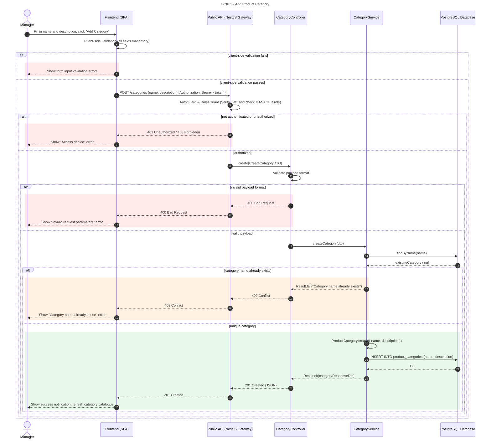
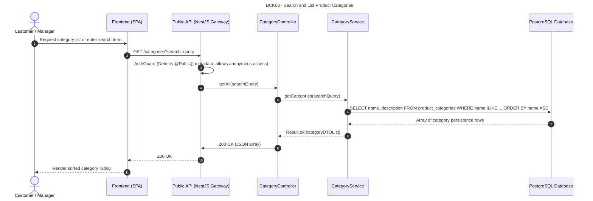
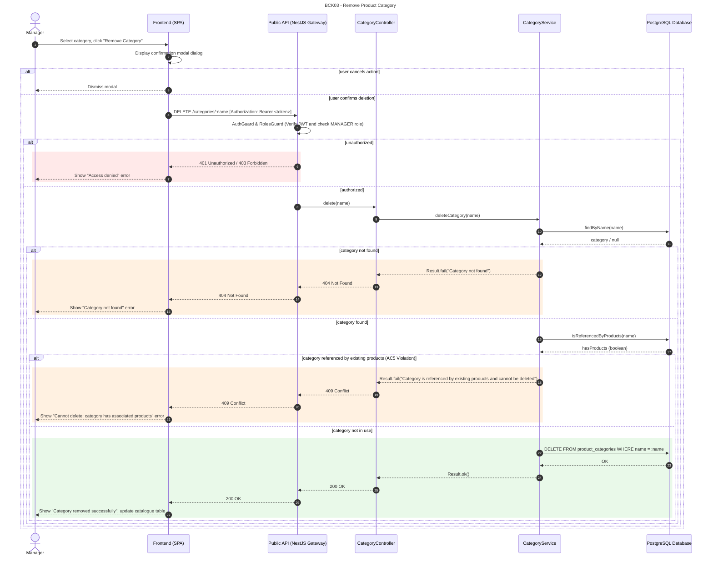

# BCK03 - As a LaPrizza Manager, I want to maintain product categories.

## 1. Requirements Engineering

### 1.1. User Story Description

As a LaPrizza Manager, I want to maintain product categories, so that the products managed by the restaurant can be appropriately classified.

### 1.2. Customer Specifications and Clarifications

#### From the specification document

> Requirements extracted directly from *PART III – Sprint 1 – User Stories* (Section BCK03, p. 6) and *PART II – System Specification* (Section II.3.1.2 Products and Allergens, pp. 3–4).

* **Category Taxonomy:** Products are classified into categories (e.g., *Pizzas*, *Beverages*, *Desserts*) to structure the commercial catalogue and kitchen operations.
* **Identification & Natural Key Representation:** In strict alignment with Domain-Driven Design (DDD) and the updated domain model (`domain-model.puml`), each product category is identified by a natural business key (`CategoryName`, e.g., `"Pizzas"`, `"Beverages"`), accompanied by a description. Surrogate database row UUIDs or separate technical codes are omitted in favor of clean natural business keys.
* **Integrity Invariant (AC5):** A category referenced by existing products must not be removed. The persistence engine enforces referential consistency via foreign keys configured with `ON DELETE RESTRICT` (returning `409 Conflict`).
* **Access Policies:** Modification operations (create, update, delete) are restricted to authenticated users holding the `MANAGER` role, whereas consultation/search endpoints are publicly accessible to allow menu browsing.

### 1.3. Acceptance Criteria

* **AC1:** The system must maintain a catalogue of Product Categories.
* **AC2:** Each Product Category must have a unique natural business identifier (`CategoryName`) and a description.
* **AC3:** Products must be associable with an appropriate Product Category via its name.
* **AC4:** Product Categories must be searchable and listable using relevant identifying information or search terms.
* **AC5:** A Product Category referenced by existing products must not be removed in a manner that compromises the consistency of the corresponding business information (enforced at service level and via database `ON DELETE RESTRICT`).

### 1.4. Found out Dependencies

* **Preceding Dependencies:**
* **BCK01 (User and Authentication Management):** Mutating category operations are protected and require an authenticated user with the `MANAGER` role (validated via `AuthGuard` and `RolesGuard`).


* **Succeeding Dependencies:**
* **BCK05 (Product Management):** Products depend directly on `ProductCategory`, as every product must reference an existing category name.
* **BCK11 (Product Catalogue):** Public menu display and filtering aggregate products grouped by their category.


### 1.5. Input and Output Data

#### Inputs:

* **Creation Payload (`CreateCategoryDTO`):**
* `name`: string (mandatory, unique category designation, e.g., `"Beverages"`)
* `description`: string (mandatory, descriptive summary)


* **Update Payload (`UpdateCategoryDTO`):**
* `name`: string (path parameter identifying the category by its natural key)
* `description`: string (mandatory)


* **Search Criteria:**
* `search`: string query parameter (optional text filtering category names)


* **Deletion:**
* `name`: string (path parameter identifying the category by its natural key)


#### Outputs:

* **Category Record (`CategoryResponseDTO`):** JSON object containing `name` and `description`.
* **Category Collection:** Array of Category Records matching search criteria.
* **HTTP Status Codes:** 200 OK, 201 Created, 400 Bad Request, 401 Unauthorized, 403 Forbidden, 404 Not Found, 409 Conflict.

---

### 1.6. System Sequence Diagrams (SSD)

#### 1.6.1. Add Product Category (Manager Only)



#### 1.6.2. Search and List Product Categories (Public Access)



#### 1.6.3. Remove Product Category (Manager Only & AC5 Guard)



---

### 1.7. Other Relevant Remarks

* **Relational Integrity Protection (`08-database-structure.md`):** The physical schema utilizes natural business keys as primary keys and foreign keys, enforcing referential consistency at the database engine level:

```sql
CREATE TABLE product_categories (
    name VARCHAR PRIMARY KEY,
    description TEXT NOT NULL DEFAULT ''
);

-- Constraint enforced in products table (BCK05):
-- category_name VARCHAR NOT NULL REFERENCES product_categories(name) ON DELETE RESTRICT

```

* **API Boundary & Role Verification:** Mutating endpoints rely on NestJS `@UseGuards(RolesGuard)` with metadata `@Roles(UserRole.MANAGER)`. The global `AuthGuard` automatically inspects incoming Bearer tokens, while `@Public()` explicitly exposes read routes (`GET /categories`) to unauthenticated clients.