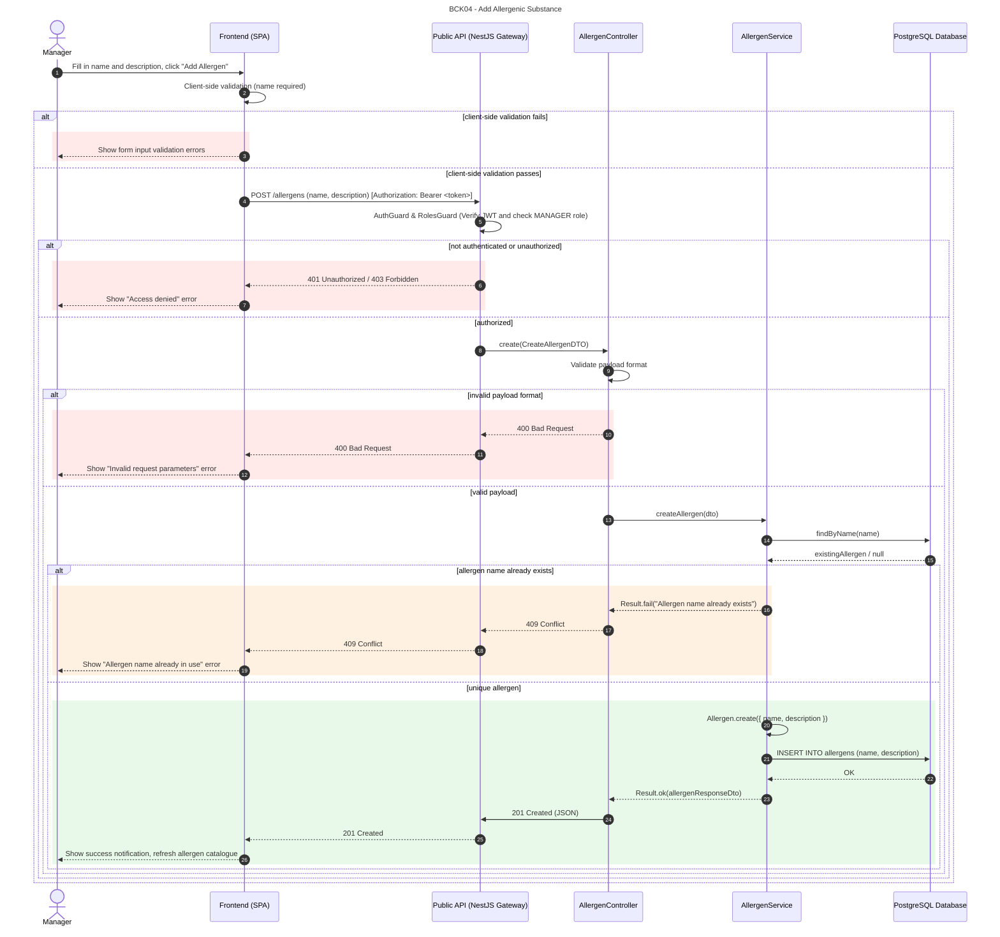
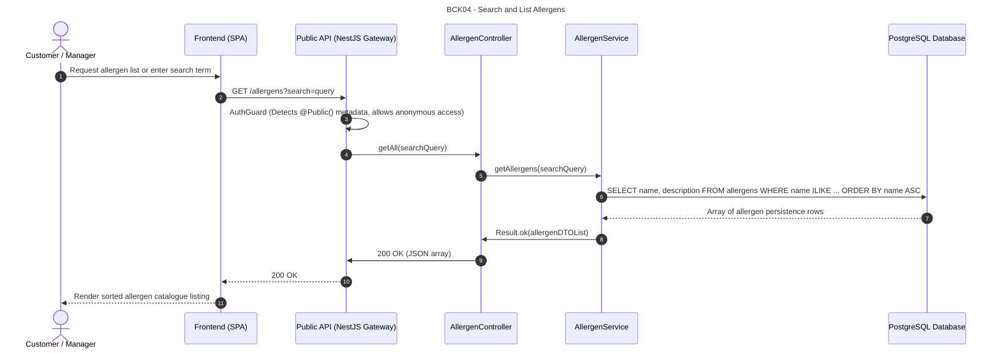
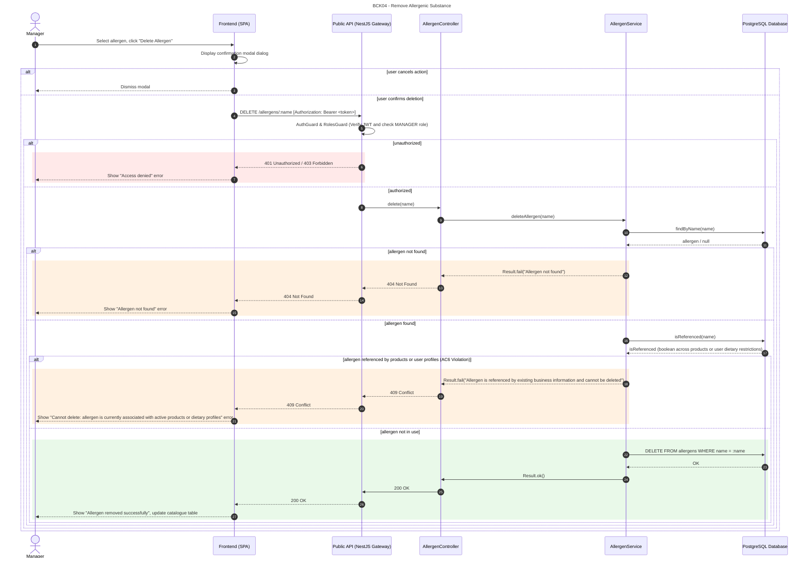

# BCK04 - As a LaPrizza Manager, I want to maintain the allergens recognized by the restaurant.

## 1. Requirements Engineering

### 1.1. User Story Description

As a LaPrizza Manager, I want to maintain the allergens recognized by the restaurant, so that products can be associated with appropriate allergen information.

### 1.2. Customer Specifications and Clarifications

#### From the specification document

> Requirements extracted directly from *PART III – Sprint 1 – User Stories* (Section BCK04, p. 7) and *PART II – System Specification* (Section II.3.1.2 Products and Allergens, pp. 3–4).

* **Food Safety & Compliance:** Maintaining recognized allergenic substances (e.g., Gluten, Lactose, Crustaceans) is mandatory under food information regulations (EU Regulation 1169/2011) to inform consumers and staff.
* **Identification & Natural Key Representation:** In strict alignment with Domain-Driven Design (DDD) and the updated domain model (`domain-model.puml`), each allergen is uniquely identified by its natural business name (`AllergenName`, e.g., `"Gluten"`, `"Lactose"`), accompanied by a description. Surrogate database row UUIDs and separate technical codes are omitted in favor of clean natural business keys.
* **Integrity Invariant & Absence of Deactivation (AC6 & Clarification #17):** An allergen referenced by existing products or registered user dietary restrictions must never be removed (`409 Conflict`). The physical database schema enforces this via foreign keys configured with `ON DELETE RESTRICT`. Deactivation/reactivation mechanisms are not required for allergens.
* **Access Policies:** Modification actions (create, update, delete) are restricted to authenticated users holding the `MANAGER` role, whereas consultation and search endpoints are publicly accessible.

### 1.3. Acceptance Criteria

* **AC1:** The system must maintain a catalogue of recognized allergens.
* **AC2:** Each allergen must have a unique natural business identifier (`AllergenName`) and a descriptive summary.
* **AC3:** Allergens must be available for association with food products and ingredients via their `AllergenName`.
* **AC4:** A product may be associated with zero, one, or multiple allergens.
* **AC5:** Allergens must be searchable and listable using relevant identifying information (name).
* **AC6:** An allergen referenced by existing business information (products or user dietary restrictions) must not be removed in a manner that compromises data consistency (enforced via application checks and database `ON DELETE RESTRICT`).

### 1.4. Found out Dependencies

* **Preceding Dependencies:**
* **BCK01 (User and Authentication Management):** Mutating allergen operations require an authenticated user with the `MANAGER` role (validated via `AuthGuard` and `RolesGuard`).


* **Succeeding Dependencies:**
* **BCK05 (Product Management):** Products depend directly on `Allergen`, as food items can be linked to multiple allergenic substances by `allergenName`.
* **BCK02 (User / Customer Management):** User dietary restrictions map directly to recognized allergens (`allergenName`) to support allergy alerts during ordering.


### 1.5. Input and Output Data

#### Inputs:

* **Creation Payload (`CreateAllergenDTO`):**
* `name`: string (mandatory, unique natural key designation, e.g., `"Gluten"`)
* `description`: string (optional/mandatory descriptive details)


* **Update Payload (`UpdateAllergenDTO`):**
* `name`: string (path parameter identifying the allergen by its natural key, and updated name in body)
* `description`: string (descriptive details)


* **Search Criteria:**
* `search`: string query parameter (optional case-insensitive text filtering by name)


* **Deletion:**
* `name`: string (path parameter identifying the allergen by its natural key)


#### Outputs:

* **Allergen Record (`AllergenResponseDTO`):** JSON object containing `name` and `description`.
* **Allergen Collection:** Array of Allergen Records matching search criteria.
* **HTTP Status Codes:** 200 OK, 201 Created, 400 Bad Request, 401 Unauthorized, 403 Forbidden, 404 Not Found, 409 Conflict.

---

### 1.6. System Sequence Diagrams (SSD)

#### 1.6.1. Add Allergenic Substance (Manager Only)



#### 1.6.2. Search and List Allergens (Public Access)



#### 1.6.3. Remove Allergenic Substance (Manager Only & AC6 Guard)



---

### 1.7. Other Relevant Remarks

* **Relational Integrity Protection (`08-database-structure.md`):** The physical schema guarantees at the database engine level that no allergen can be deleted if referenced by products or user dietary restrictions, using its natural business key (`name`):

```sql
CREATE TABLE allergens (
    name VARCHAR PRIMARY KEY,
    description TEXT NOT NULL DEFAULT ''
);

-- Constraints enforced in junction tables:
-- product_allergens (allergen_name VARCHAR NOT NULL REFERENCES allergens(name) ON DELETE RESTRICT)
-- user_dietary_restrictions (allergen_name VARCHAR NOT NULL REFERENCES allergens(name) ON DELETE RESTRICT)

```

* **API Boundary & Role Verification:** Mutating endpoints rely on NestJS `@UseGuards(RolesGuard)` with metadata `@Roles(UserRole.MANAGER)`. The global `AuthGuard` automatically inspects incoming Bearer tokens, while `@Public()` explicitly exposes read routes (`GET /allergens`) to unauthenticated clients.