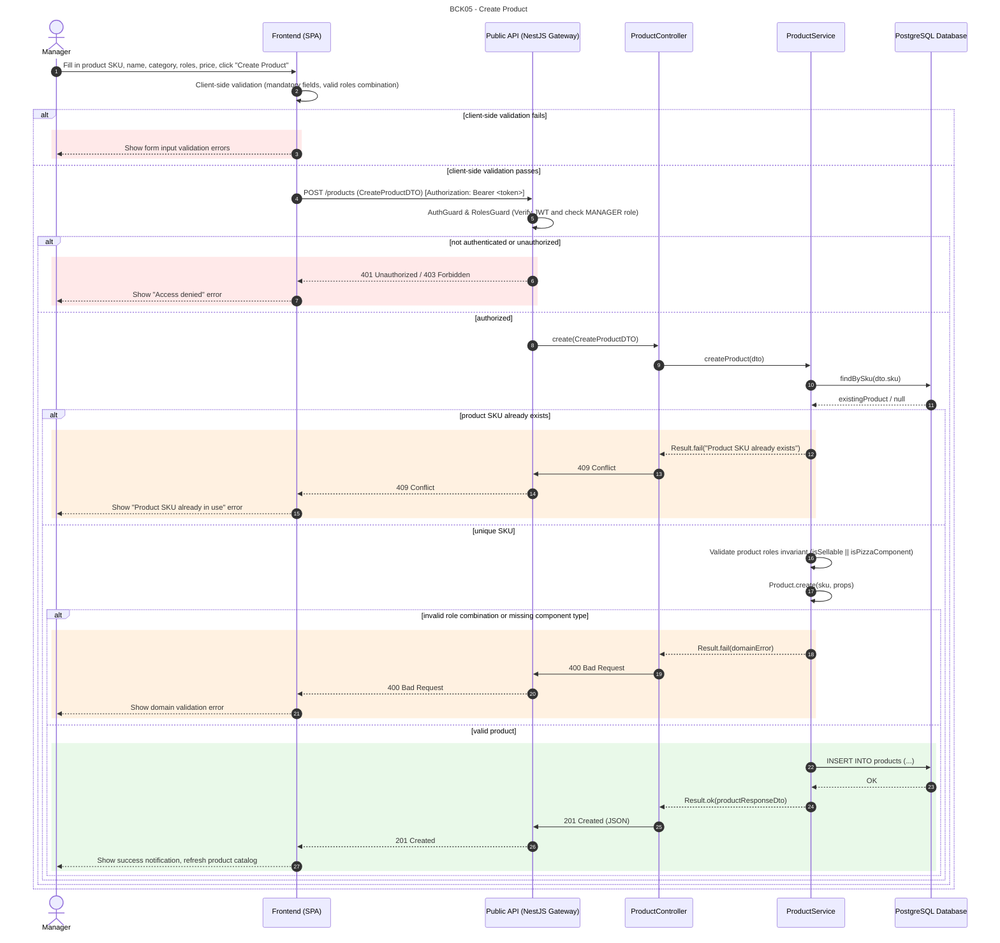
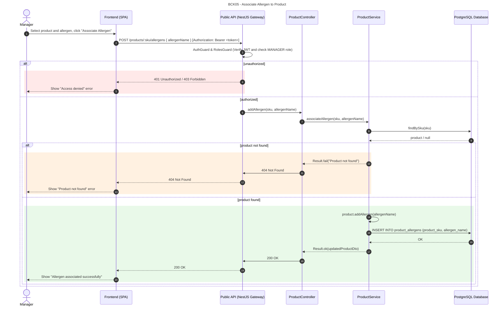
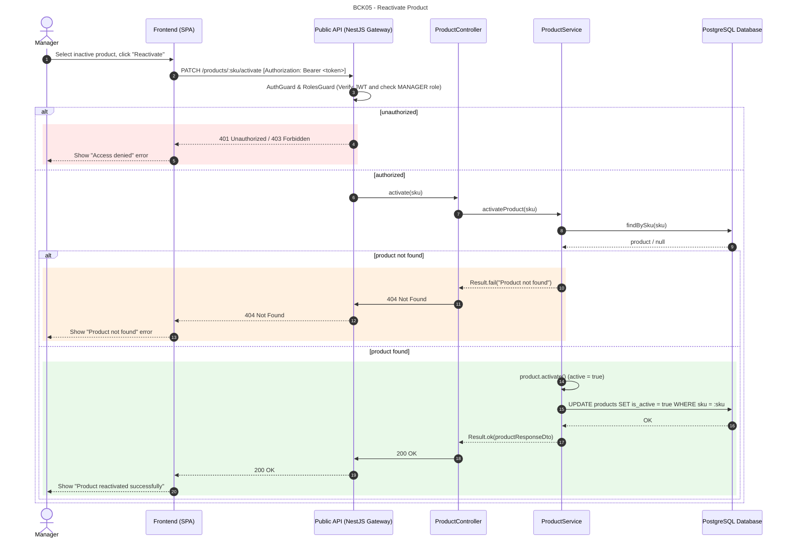
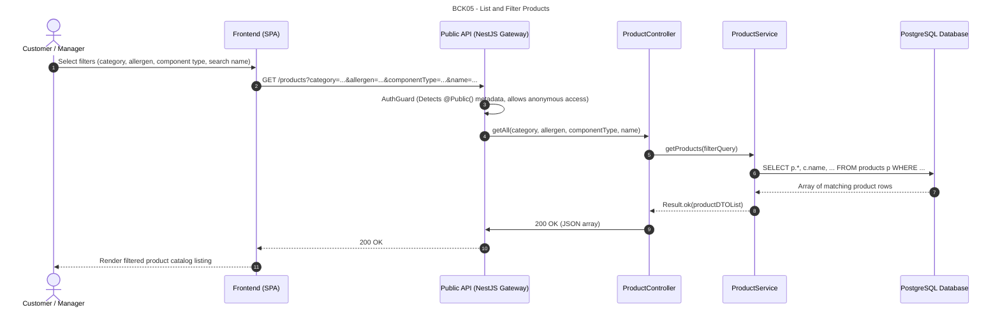

# BCK05 - As a LaPrizza Manager, I want to register and manage products.

## 1. Requirements Engineering

### 1.1. User Story Description
As a LaPrizza Manager, I want to register and manage products, so that the restaurant can maintain the items relevant to its business operation.

### 1.2. Customer Specifications and Clarifications

#### From the specification document
> Requirements extracted directly from *PART III – Sprint 1 – User Stories* (Section BCK05, p. 8) and *PART II – System Specification* (Section II.3.1.2 Products and Allergens, pp. 3–4).

* **Product Concept & Multi-Role Typology:** Being a product does not imply that the item is necessarily sold directly to customers. A product must have at least one valid type: *Sellable*, *Pizza Component*, or both (Clarifications #06 and #08). A product cannot exist without a type or be exclusively stock-controlled.
* **Orthogonal Stock Characteristic:** Stock control (`isStockControlled`) is an independent operational characteristic that can be combined with any product type.
* **Mandatory Category Association:** Every product belongs to exactly one `ProductCategory` (identified by its natural key `CategoryName`), mandatory from the moment of creation (Clarifications #08 and #12).
* **Pizza Component Invariant:** A product designated as a Pizza Component (`isPizzaComponent: true`) must be associated with exactly one `ComponentTypeName` (AC5). Non-component products cannot have a component type.
* **Commercial Information & Pricing Semantics:** Sellable products (`isSellable: true`) require a direct selling price for standard items (Clarification #08). Direct selling prices can be zero (`0.00 €`, e.g., complimentary items), but must never be negative (Clarification #11). Component-only products support nullable direct selling prices (`null`).
* **Allergen Associations:** Products may be associated with zero, one, or multiple recognized allergens (`AllergenName`) to ensure consumer safety and dietary filtering.
* **Lifecycle Control (Soft Deactivation & Reactivation):** Products that should no longer be actively used can be deactivated (`active: false`) administratively without compromising historical orders and recipes (AC9). Deactivated products can be consulted, updated, have their stock adjusted, and reactivated (`active: true`) by the Manager (Clarifications #08, #10, #19).

### 1.3. Acceptance Criteria

* **AC1:** The system must support the creation and update of products.
* **AC2:** Each product must have a unique natural business identifier (`Sku`), a name (`ProductName`), and a description.
* **AC3:** A product must be associable with an appropriate Product Category (`CategoryName`).
* **AC4:** A product may be designated as sellable, subject to stock control, suitable for use as a Pizza Component, or any applicable combination of these characteristics, provided it has at least one primary role (`isSellable || isPizzaComponent`).
* **AC5:** A product designated as a Pizza Component must be associated with exactly one Pizza Component Type (`ComponentTypeName`).
* **AC6:** Sellable products must provide the commercial information required to make them available for sale.
* **AC7:** Products may be associated with one or more recognized allergens (`AllergenName`).
* **AC8:** Products must be searchable and filterable using relevant information (category name, allergen name, component type name, and partial name matching).
* **AC9:** The system must allow products that should no longer be actively used to be distinguished (soft deactivation) without compromising historically relevant information, while allowing future reactivation.
* **AC10:** Changes to product information must preserve the consistency of existing relationships with other business concepts.

### 1.4. Found out Dependencies

* **Preceding Dependencies:**
  * **BCK01 (User and Authentication Management):** All mutating product operations require authentication with the `MANAGER` role (enforced via `AuthGuard` and `RolesGuard`).
  * **BCK03 (Product Category Management):** Every product requires an existing category reference (`CategoryName`).
  * **BCK04 (Allergen Management):** Allergen associations reference valid allergens from the master catalogue (`AllergenName`).
  * **BCK07 (Pizza Component Type Management):** Pizza component products reference valid component types (`ComponentTypeName`).
* **Succeeding Dependencies:**
  * **BCK08 (Pizza Component Configuration):** Defines size-dependent pricing and stock consumption for component products.
  * **BCK09 (Stock Information Management):** Manages inventory balances for stock-controlled products.
  * **BCK10 (Predefined Pizza Management):** Uses sellable products as recipes and component products as ingredients.
  * **BCK11 (Product Catalogue):** Public menu display and customer filtering.

### 1.5. Input and Output Data

#### Inputs:

* **Creation Payload (`CreateProductDTO`):**
  * `sku`: string (mandatory, unique alphanumeric SKU, 2–30 chars, e.g., "PRD-COKE")
  * `name`: string (mandatory, descriptive designation)
  * `description`: string (mandatory)
  * `categoryName`: string (mandatory, references existing category natural key)
  * `isSellable`: boolean (mandatory)
  * `isPizzaComponent`: boolean (mandatory)
  * `isStockControlled`: boolean (mandatory)
  * `componentTypeName`: string (optional; mandatory if `isPizzaComponent: true`)
  * `directSellingPrice`: number | null (optional; required for direct sellable items, $\ge 0.00$)
* **Update Payload (`UpdateProductDTO`):**
  * `name`: string (mandatory)
  * `description`: string (mandatory)
  * `categoryName`: string (optional)
  * `isSellable`: boolean (optional)
  * `isPizzaComponent`: boolean (optional)
  * `isStockControlled`: boolean (optional)
  * `componentTypeName`: string (optional)
  * `directSellingPrice`: number | null (optional)
  * `active`: boolean (optional)
* **Allergen Association Payload:**
  * `sku`: string (path parameter)
  * `allergenName`: string (body payload, mandatory)
* **Search / Filter Query Parameters (`GET /products`):**
  * `category`: string (optional category name filter)
  * `allergen`: string (optional allergen name filter)
  * `componentType`: string (optional component type name filter)
  * `name`: string (optional partial case-insensitive text match)

#### Outputs:

* **Product Record (`ProductResponseDTO`):** JSON object containing `sku`, `name`, `description`, `categoryName`, `isSellable`, `isPizzaComponent`, `isStockControlled`, `componentTypeName`, `directSellingPrice`, `active`, and `associatedAllergens` array.
* **Product Collection:** Array of Product Records matching filter criteria.
* **HTTP Status Codes:** 200 OK, 201 Created, 400 Bad Request, 401 Unauthorized, 403 Forbidden, 404 Not Found, 409 Conflict.

---

### 1.6. System Sequence Diagrams (SSD)

#### 1.6.1. Create Product (Manager Only)



#### 1.6.2. Associate Allergen to Product (Manager Only)



#### 1.6.3. Block / Deactivate Product (Soft Deactivation)


#### 1.6.4. Reactivate Product (Manager Only)



#### 1.6.5. List and Multi-Criteria Filter Products (Public Access)



---

### 1.7. Other Relevant Remarks

* **Relational Schema Constraints (`08-database-structure.md`):**

```sql
CREATE TABLE products (
    sku VARCHAR(30) PRIMARY KEY,
    name VARCHAR(100) NOT NULL UNIQUE,
    description TEXT NOT NULL,
    category_name VARCHAR NOT NULL REFERENCES product_categories(name) ON DELETE RESTRICT,
    is_sellable BOOLEAN NOT NULL,
    is_pizza_component BOOLEAN NOT NULL,
    is_stock_controlled BOOLEAN NOT NULL,
    component_type_name VARCHAR REFERENCES pizza_component_types(name) ON DELETE RESTRICT,
    direct_selling_price NUMERIC(10,2),
    direct_price_currency VARCHAR(10),
    is_active BOOLEAN NOT NULL DEFAULT TRUE,
    created_at TIMESTAMPTZ NOT NULL DEFAULT NOW(),
    updated_at TIMESTAMPTZ NOT NULL DEFAULT NOW(),
    CONSTRAINT chk_products_mandatory_type CHECK (is_sellable = TRUE OR is_pizza_component = TRUE),
    CONSTRAINT chk_products_component_role CHECK (
        (is_pizza_component = TRUE AND component_type_name IS NOT NULL) OR
        (is_pizza_component = FALSE AND component_type_name IS NULL)
    ),
    CONSTRAINT chk_products_price_non_negative CHECK (
        direct_selling_price IS NULL OR direct_selling_price >= 0.00
    )
);

```

* **Zero-Price Semantics:** In accordance with Clarification #11, products can be created with `directSellingPrice: 0.00` (e.g., promotional items or free table water), but negative values are blocked at both Domain and Database levels.
* **Separation of Concerns:** Product role validation and administrative updates ensure that domain consistency is maintained across catalog and pricing services without relying on surrogate UUIDs.