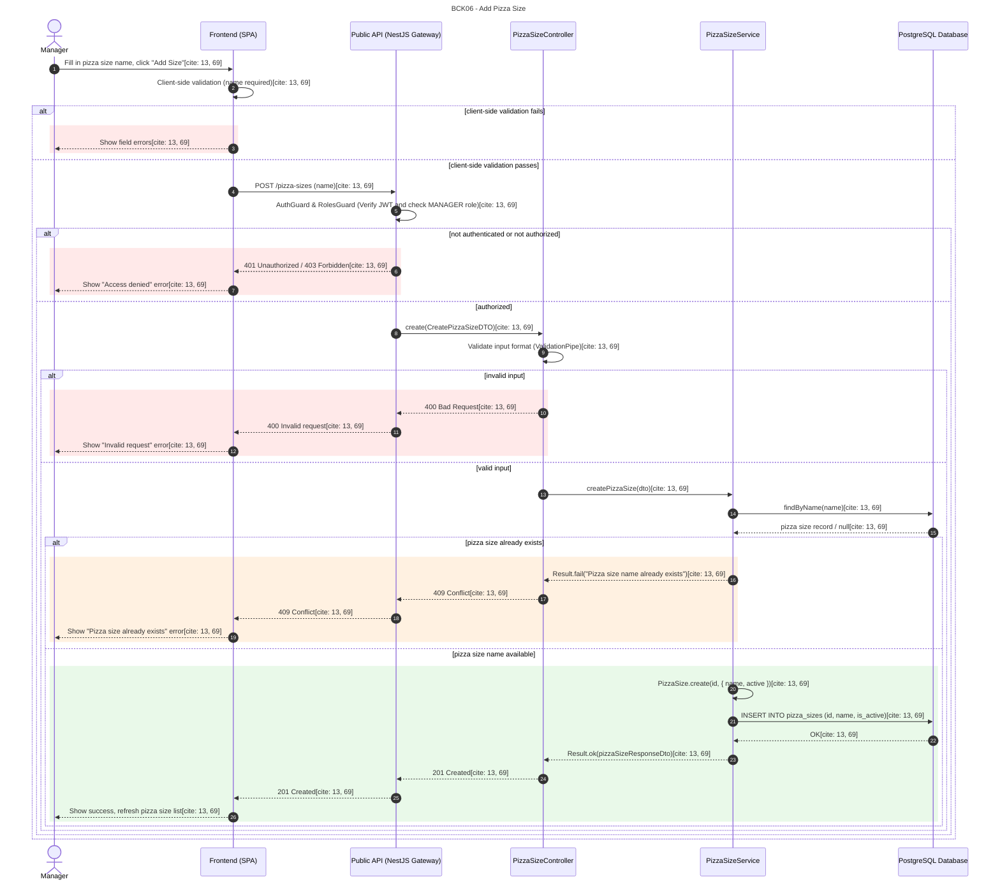
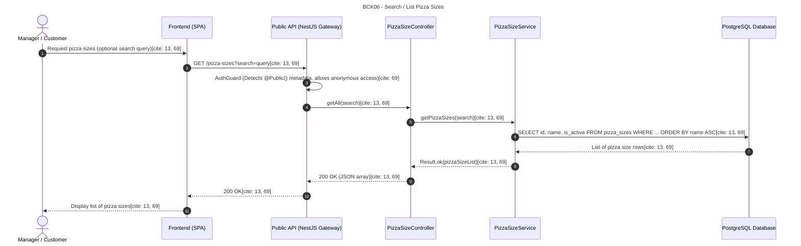
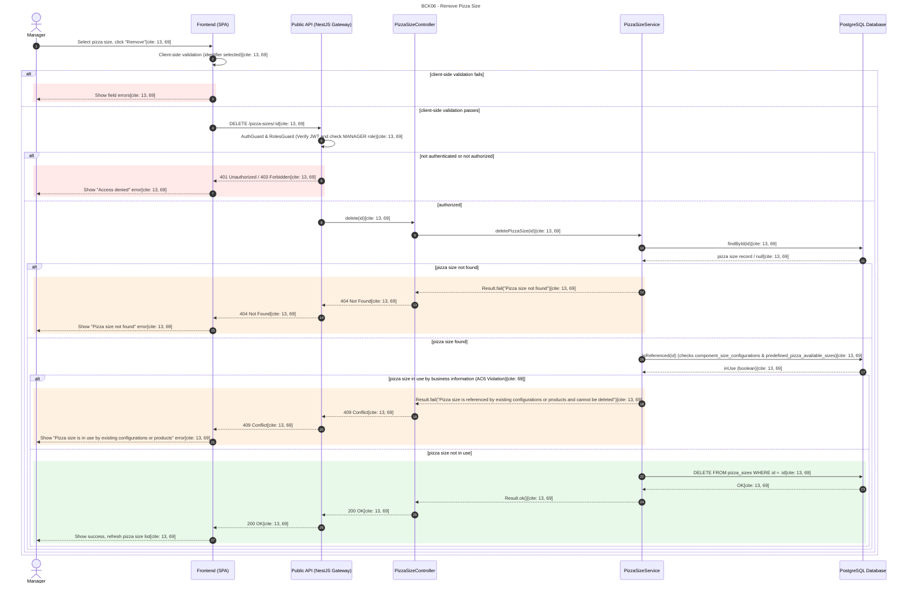

# BCK06 - As a LaPrizza Manager, I want to maintain the pizza sizes offered by the restaurant

## 1. Requirements Engineering

### 1.1. User Story Description

As a LaPrizza Manager, I want to maintain the pizza sizes offered by the restaurant, so that pizza configurations and size-dependent information can refer to a consistent set of available sizes.

### 1.2. Customer Specifications and Clarifications

#### From the specification document

> Extracted directly from *PART III – Sprint 1 – User Stories* (Section BCK06, p. 8) and *PART II – System Specification* (Section II.3.1.3 Pizzas, Sizes, and Components, pp. 4–5).
> 
> 

* A **Pizza Size** characterizes the commercial size of a pizza (e.g., *Small*, *Medium*, *Large*, *Family*) and establishes the baseline for pricing and ingredient consumption.

* Pizza sizes and component types are independent concepts. A pizza size establishes the size of the pizza being configured.

* The size-dependent characteristics of a pizza component are linked to a Pizza Size through a *Component Size Configuration* (BCK08).

* Predefined pizzas and customer-configured pizzas are made available in specific Pizza Sizes.

* The set of available Pizza Sizes must be able to evolve over time without breaking or corrupting existing business information.

### 1.3. Acceptance Criteria

* **AC1:** The system must maintain the Pizza Sizes recognized by LaPrizza.

* **AC2:** Each Pizza Size must have a unique identifier and a descriptive name.

* **AC3:** Pizza Sizes must be available for use in pizza-related configurations.

* **AC4:** Pizza Sizes must be searchable using relevant identifying information.

* **AC5:** The system must allow the set of available Pizza Sizes to evolve without compromising existing business information.

* **AC6:** A Pizza Size referenced by existing business information (e.g., component size configurations, predefined pizzas, historical orders) must not be removed in a manner that compromises its consistency.

### 1.4. Found out Dependencies

* **Preceding Dependencies:**
* **BCK01 (User and Authentication Management):** All creation, update, and removal operations on Pizza Sizes are protected operations restricted to an authenticated LaPrizza Manager holding the `MANAGER` role (enforced via `AuthGuard` and `RolesGuard`).

* **Succeeding Dependencies:**
* **BCK08 (Pizza Component Configuration):** Associates a Pizza Component with a Pizza Size.

* **BCK10 (Predefined Pizza Management):** Determines the Pizza Sizes in which a Predefined Pizza can be offered.

* **BCK11 (Product Catalogue):** Presents available Pizza Sizes to customers.

### 1.5. Input and Output Data

#### Inputs:

* `name`: string (mandatory, unique designation using value object `Designation`, e.g., "Small", "Medium", "Large")

* `search`: string query parameter (optional text filtering)

* `id`: UUID (path parameter for update/delete operations)

#### Outputs:

* **Pizza Size Record:** JSON object containing `id` (UUID), `name`, and `active` status.

* **Pizza Size Collection:** Array of Pizza Size records matching search criteria.

* **HTTP Status Codes:** 200 OK, 201 Created, 400 Bad Request, 401 Unauthorized, 403 Forbidden, 404 Not Found, 409 Conflict.

---

### 1.6. System Sequence Diagrams (SSD)

#### 1.6.1. Add Pizza Size (Manager Only)

#### 1.6.2. Search / List Pizza Sizes (Public Access)

#### 1.6.3. Remove Pizza Size (Manager Only & AC6 Guard)

---

### 1.7. Other Relevant Remarks

* **Relational Integrity Guarantees (`08-database-structure.md`):** Business information referencing a Pizza Size (such as `component_size_configurations` or `predefined_pizza_available_sizes`) is protected from corruption. Foreign keys enforce `ON DELETE RESTRICT` at the PostgreSQL engine level, complementing the application-level check (`isReferenced`).

* **Scope Distinction:** BCK06 manages the **catalogue of Pizza Sizes**. Sizing prices and stock consumption for individual ingredients are configured in **BCK08** (*Pizza Component Configuration*), and component cardinalities/roles belong to **BCK07** (*Pizza Component Type Management*).