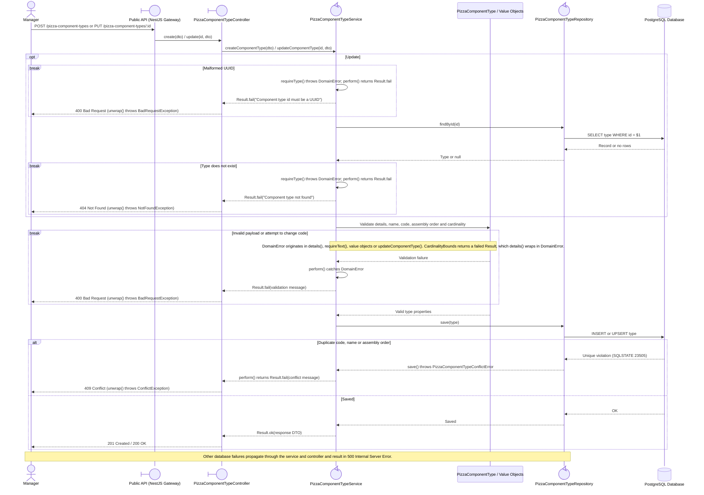
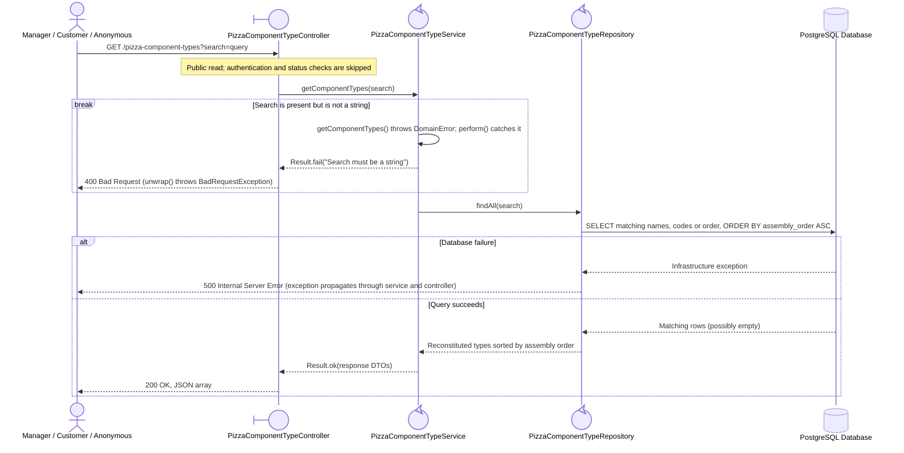
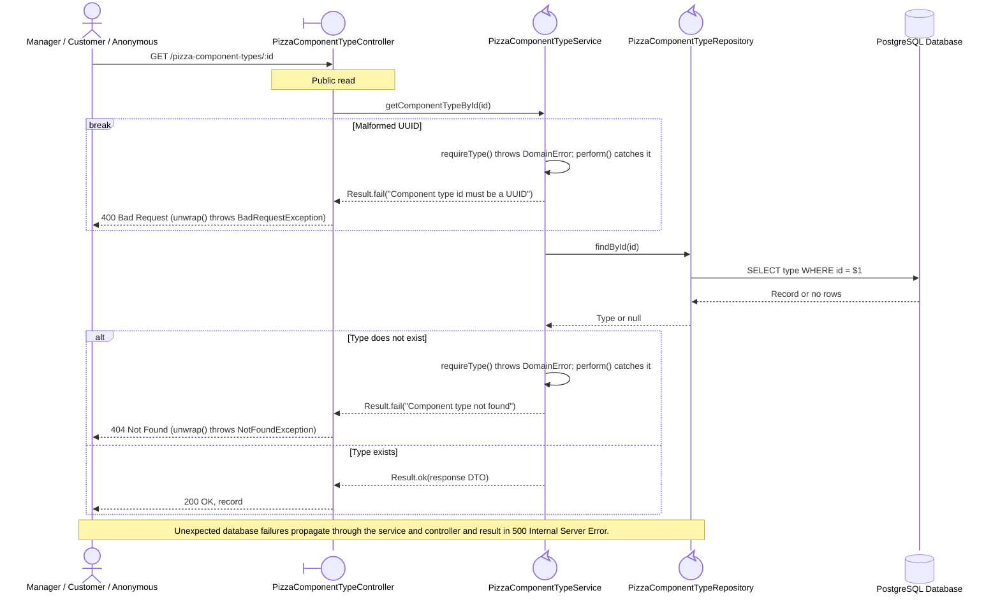
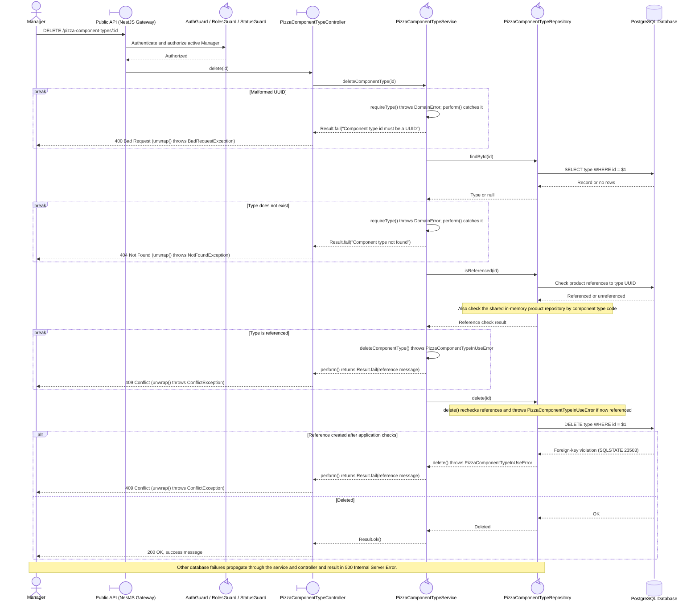

# BCK07 — Maintain Pizza Component Types

## 1. Requirements Engineering

### 1.1. User Story Description

As a LaPrizza Manager, I want to maintain Pizza Component Types, so that products suitable for use in pizzas can be classified according to the role they play in a pizza configuration.

### 1.2. Customer Specifications and Clarifications

Source: *PART III – Sprint 1 – User Stories*, BCK07, and *PART II – System Specification*, section II.3.1.3 (Pizzas, Sizes, and Components).

- Pizza components are products classified by a functional component type.
- Each type has a unique relative assembly position, starting at 1. Positions need not be contiguous.
- Each type defines minimum and maximum selection counts. An explicit `null` maximum means unbounded.
- Managers can add types and change their names, ordering and cardinalities at runtime. Baseline types are initial data, not fixed rules in pizza validation.
- A type referenced by a product cannot be deleted, even if that product is inactive. Recipes and size configurations refer to component products, so retaining those products' type references also protects these dependencies.
- The existing product domain identifies types by `componentTypeCode`, while database relationships and API paths use UUIDs. Each type therefore exposes both a UUID `id` and a unique, immutable business `code`.

### 1.3. Acceptance Criteria

- **AC1 — Catalog maintenance:** Managers can create, read, update and delete Pizza Component Types. Creation generates a UUID; the code is mandatory and immutable. Names and codes are unique without regard to case.
- **AC2 — Assembly order uniqueness:** `assemblyOrder` is a positive integer, unique across all types. An update can retain its own position. Conflicts return 409 without changing stored state.
- **AC3 — Cardinality configuration:** `minCardinality` is an integer >= 0. `maxCardinality` is an integer >= the minimum, or explicit `null` for an unbounded maximum. Both fields are mandatory on creation and replacement.
- **AC4 — Dynamic configuration:** Types and their editable properties are stored in repositories; business rules do not hardcode the four baseline roles or their limits.
- **AC5 — Baseline seed:** Initial configuration contains at least the following records. Managers may subsequently maintain these records through the same API.

| Code | Name | Assembly order | Minimum | Maximum |
| --- | --- | --- | --- | --- |
| PCT-DOUGH | Base Dough | 1 | 1 | 1 |
| PCT-SAUCE | Base Sauce | 2 | 0 | 1 |
| PCT-CHEESE | Cheese | 3 | 0 | 1 |
| PCT-TOPPING | Topping | 4 | 0 | `null` |

- **AC6 — Searchability:** Public reads support lookup by UUID and optional case-insensitive substring search by name or code, or an exact assembly position. Collections are sorted by assembly order ascending. A search with no matches returns an empty array.
- **AC7 — Referential consistency:** Deleting a referenced type returns 409. PostgreSQL enforces `ON DELETE RESTRICT` on product references, including references created between the application check and deletion. The current product module uses in-memory storage; both component-type repository implementations also consult that shared product repository.
- **AC8 — Authorization and validation:** Writes require an authenticated, active Manager using the existing authentication, status and role guards. Reads allow anonymous access. Invalid payloads and malformed UUID path parameters return 400; missing UUID records return 404. Infrastructure failures remain server errors.

### 1.4. Dependencies

- **BCK01:** Authentication, active-user status and Manager authorization for writes.
- **BCK05:** Component products identify their type using its immutable business code. Product references prevent deletion.
- **BCK08:** Size configurations refer to products classified under these types.
- **BCK10:** Predefined pizza composition uses the configurable cardinality limits.
- **SGRAI / IART:** Assembly positions support component rendering and assembly planning.

### 1.5. Input and Output Data

| Field | Contract |
| --- | --- |
| `id` | Generated UUID; path parameter for lookup, update and deletion |
| `code` | Required on POST; non-empty string, trimmed and normalized to uppercase, at most 30 characters; unique and immutable |
| `name` | Required on POST/PUT; non-empty trimmed string, at most 50 characters; unique without regard to case |
| `assemblyOrder` | Required on POST/PUT; positive integer, unique |
| `minCardinality` | Required on POST/PUT; non-negative integer |
| `maxCardinality` | Required on POST/PUT; integer >= minimum or explicit `null` |
| `search` | Optional string query parameter; whitespace is trimmed; empty text lists all records |

Numeric strings, fractional counts, missing bounds and negative counts are invalid. UUIDs and codes cannot be changed by an update. PUT requires all four editable fields; an echoed unchanged code is accepted, but attempting to replace the code returns 400.

A component type response contains `id`, `code`, `name`, `assemblyOrder`, `minCardinality` and `maxCardinality`. Collection responses are JSON arrays of these records.

### 1.6. HTTP API

The paths below are relative to the application's configured API prefix.

| Method | Path | Access | Success | Other outcomes |
| --- | --- | --- | --- | --- |
| POST | `/pizza-component-types` | Manager | 201, created record | 400 invalid data; 401/403 access denied; 409 duplicate code/name/order |
| GET | `/pizza-component-types?search=...` | Public | 200, sorted array | 400 invalid search value |
| GET | `/pizza-component-types/:id` | Public | 200, record | 400 malformed UUID; 404 missing record |
| PUT | `/pizza-component-types/:id` | Manager | 200, updated record | 400 invalid data/UUID or code change; 401/403; 404; 409 duplicate name/order |
| DELETE | `/pizza-component-types/:id` | Manager | 200, success message | 400 malformed UUID; 401/403; 404; 409 referenced type |

Example creation:

```json
{
  "code": "PCT-EXTRA",
  "name": "Extra topping",
  "assemblyOrder": 5,
  "minCardinality": 0,
  "maxCardinality": null
}
```

Deletion returns `{ "message": "Pizza component type removed successfully" }`. Errors use the existing global exception filter's `{ "error": { "message": "..." } }` shape.

### 1.7. System Sequence Diagrams

Participants use `boundary` for HTTP entry points, `control` for guards, services, repositories and exception handling, and `database` for PostgreSQL. Domain entities and value objects remain ordinary participants. The database interactions describe the PostgreSQL repository; the in-memory repository enforces uniqueness in its own store and checks the shared product repository for references.

Guards run before controller methods. Domain and repository business exceptions are caught by `PizzaComponentTypeService.perform()` and returned as `Result.fail(message)`. `PizzaComponentTypeController.unwrap()` then throws the HTTP exception. `GlobalExceptionFilter` formats the response. Unexpected infrastructure exceptions bypass this Result conversion and reach the filter as 500 errors.


#### 1.7.1. Create or update



#### 1.7.2. Search or list



#### 1.7.3. Read by UUID



#### 1.7.4. Remove



#### 1.7.5. Error origins and HTTP translation

| Condition | Error and where it originates | Translation and HTTP response |
| --- | --- | --- |
| Missing credentials, invalid/expired token, invalid token subject or user no longer exists | `AuthGuard.canActivate()` throws `UnauthorizedException` | `GlobalExceptionFilter.catch()` returns **401** before the controller method runs |
| Authenticated user is not a Manager | `RolesGuard.canActivate()` throws `ForbiddenException` | `GlobalExceptionFilter.catch()` returns **403** before the controller method runs |
| Manager is deactivated or pending registration | `StatusGuard.canActivate()` throws `ForbiddenException` because the controller requires `UserStatus.ACTIVE` | `GlobalExceptionFilter.catch()` returns **403** before the controller method runs |
| Missing/non-object details | `PizzaComponentTypeService.details()` throws `DomainError('Component type details are required')` | `perform()` returns `Result.fail`; controller `unwrap()` throws `BadRequestException`; filter returns **400** |
| Invalid name or code | `ComponentTypeName.create()` delegates to `requireText()`; `createComponentType()` also calls `requireText()` for the code. The guard function throws `DomainError` for a non-string, blank or overly long value | `perform()` returns `Result.fail`; `unwrap()` throws `BadRequestException`; filter returns **400** |
| Invalid assembly order | `AssemblyOrder.create()` calls `requirePositiveInteger()`, which throws `DomainError` for a non-number, fractional or non-positive value | `perform()` returns `Result.fail`; `unwrap()` throws `BadRequestException`; filter returns **400** |
| Invalid minimum/maximum cardinality | `CardinalityBounds.create()` returns `Result.fail`; `PizzaComponentTypeService.details()` throws `DomainError(bounds.getError())` | `perform()` returns `Result.fail`; `unwrap()` throws `BadRequestException`; filter returns **400** |
| Attempt to change business code | `PizzaComponentTypeService.updateComponentType()` throws `DomainError('Component type code cannot be changed')` | `perform()` returns `Result.fail`; `unwrap()` throws `BadRequestException`; filter returns **400** |
| Invalid search value | `PizzaComponentTypeService.getComponentTypes()` throws `DomainError('Search must be a string')` | `perform()` returns `Result.fail`; `unwrap()` throws `BadRequestException`; filter returns **400** |
| Malformed UUID for GET/PUT/DELETE | `PizzaComponentTypeService.requireType()` throws `DomainError('Component type id must be a UUID')` before querying the repository | `perform()` returns `Result.fail`; `unwrap()` throws `BadRequestException`; filter returns **400** |
| Valid UUID with no corresponding record | `PizzaComponentTypeService.requireType()` throws `DomainError('Component type not found')` after `findById()` returns `null` | `perform()` returns `Result.fail`; `unwrap()` throws `NotFoundException`; filter returns **404** |
| Duplicate code, name or assembly order | `InMemoryPizzaComponentTypeRepository.save()` throws `PizzaComponentTypeConflictError` after checking stored types; `PostgresPizzaComponentTypeRepository.save()` throws the same error when PostgreSQL reports `23505` | `perform()` returns `Result.fail('Component type code, name or assembly order already exists')`; `unwrap()` throws `ConflictException`; filter returns **409** |
| Type is referenced by business information | `PizzaComponentTypeService.deleteComponentType()` throws `PizzaComponentTypeInUseError` after the initial reference check; both repository `delete()` methods throw it on their own reference recheck; the PostgreSQL repository also throws it when DELETE reports `23503` | `perform()` returns `Result.fail('Component type is referenced by products or configurations and cannot be deleted')`; `unwrap()` throws `ConflictException`; filter returns **409** |
| Incomplete domain entity properties | The `PizzaComponentType` constructor throws `DomainError('Component type requires an id, code, name, assembly order and cardinality')` when an internal caller supplies missing properties | When raised inside an application operation, `perform()` returns `Result.fail`; `unwrap()` throws `BadRequestException`; filter returns **400** |
| Unexpected infrastructure failure | PostgreSQL/pool operations throw; repository methods rethrow errors other than the handled uniqueness/FK violations. `perform()` rethrows non-`DomainError` exceptions | The exception propagates through the controller; `GlobalExceptionFilter.toHttpError()` logs it and returns **500** with `Internal Server Error` |

### 1.8. Persistence and Deployment

- `pizza_component_types` is created by migration 003 with a UUID primary key, unique code, unique name, unique positive assembly order and cardinality check constraints. The maximum is nullable.
- Migration 007 seeds the four baseline records on initial database creation.
- Migration 010 adds unique indexes on `LOWER(name)` and `UPPER(code)` to enforce the same name/code uniqueness as the API, including concurrent requests. Existing databases must apply this migration without resetting their data. If legacy names or codes differ only by case, reconcile them before applying the indexes.
- `products.component_type_id` references the type UUID with `ON DELETE RESTRICT`. Recipe and size-configuration references are indirect through products.
- The module uses PostgreSQL by default. `USE_IN_MEMORY_REPO=true` selects an isolated process-local repository initialized with the same baseline configuration. This mode is temporary storage for tests/development; restarting loses edits.
- Persistence SQL uses bound parameters. PostgreSQL uniqueness and foreign-key violations are translated into business conflicts; other database errors propagate as infrastructure failures.

### 1.9. Verification

Automated tests cover the seeded catalog, full maintenance workflow, public reads, authorization on all write endpoints, invalid payloads and UUIDs, duplicate code/name/order, concurrent conflicting creates, failed-update isolation, sorted search, immutable codes, deletion of unreferenced records and protection of referenced types (including inactive products). PostgreSQL repository unit tests cover mapping, bound parameters, writes, reference checks, uniqueness/FK error translation and infrastructure error propagation. These repository tests use a mocked pool; they do not replace running the migrations against PostgreSQL.
