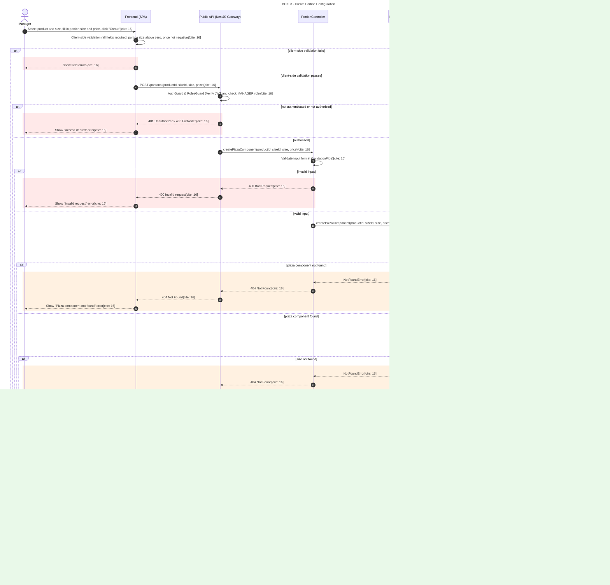
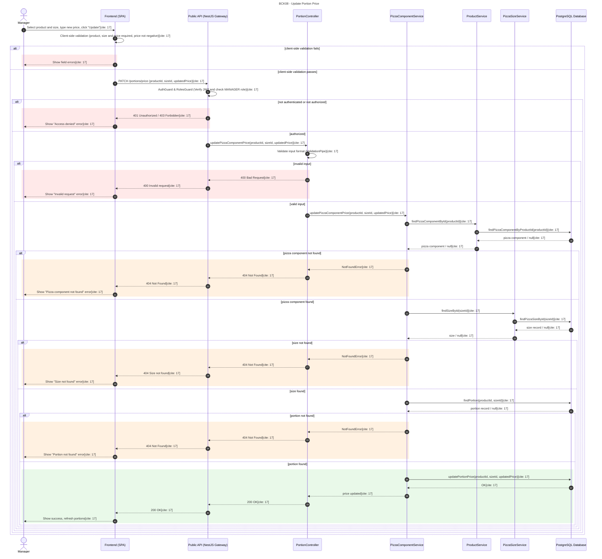
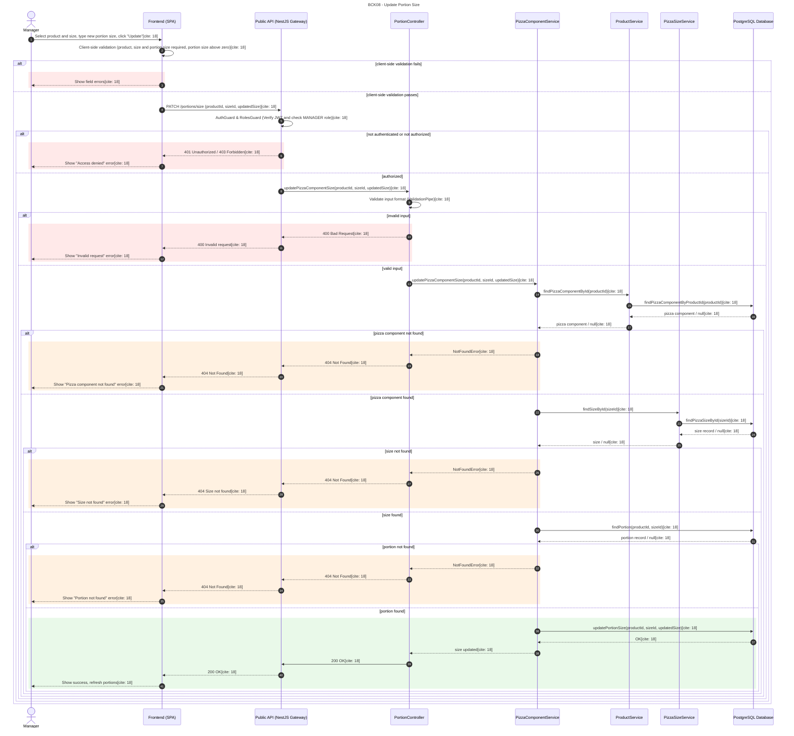

# BCK08 - As a LaPrizza Manager, I want to configure the size-dependent characteristics of products used as pizza components.

## 1. Requirements Engineering

### 1.1. User Story Description

As a LaPrizza Manager, I want to configure the size-dependent characteristics of products used as pizza components, so that the system can determine the information applicable when a component is used in a pizza of a particular size.

### 1.2. Customer Specifications and Clarifications

#### From the specification document

> Extracted directly from *PART III – Sprint 1 – User Stories* (Section BCK08, p. 9) and *PART II – System Specification* (Section II.3.1.3 Pizzas, Sizes, and Components, pp. 4–5).

* **Component Size Configuration Concept:** Stock-unit consumption and prices vary independently per Pizza Size; a larger pizza may consume more abstract stock units of a topping without necessarily following a linear ratio.


* **Entity Structure & Domain Model Alignment:** In alignment with the DDD domain model and relational database schema (`component_size_configurations`), each entry represents a `PizzaComponent` (or portion configuration) characterized by a `productId`, a `sizeId`, a specific portion size quantity, and a computed or explicitly set price.


* **Pricing & Multipliers:** Prices can be issued by a mathematical expression based on standard price multipliers or custom-edited by management.


* **Referential Integrity Invariant:** Changes or deletions must preserve the consistency of existing relationships across product inventories and sizing matrices.


### 1.3. Acceptance Criteria

* **AC1:** Only products designated for use as Pizza Components may have Component Size Configurations.


* **AC2:** A Component Size Configuration must associate a Pizza Component with a Pizza Size.


* **AC3:** For a given Pizza Component and Pizza Size, at most one applicable Component Size Configuration may exist.


* **AC4:** A Component Size Configuration must define the price applicable to the component when used in a pizza of the corresponding size.


* **AC5:** When the corresponding product is subject to stock control, the Component Size Configuration must allow the number of abstract stock units consumed for that Pizza Size to be represented.


* **AC6:** Prices and stock-consumption values must satisfy corresponding business validation rules (non-negative price, positive quantity size).


* **AC7:** The system must allow the size-dependent configurations of a Pizza Component to be consulted.


* **AC8:** Changes to Component Size Configurations must preserve the consistency of existing business information.


### 1.4. Found out Dependencies

* **Preceding Dependencies:**
* **BCK01 (User and Authentication Management):** Administrative mutations are protected and restricted to authenticated users holding the `MANAGER` role (enforced via `AuthGuard` and `RolesGuard`).


* **BCK05 (Product Management):** Only products designated as Pizza Components can possess a size configuration.


* **BCK06 (Pizza Size Management):** Each configuration is bound to a recognized `PizzaSize`.


* **Succeeding Dependencies:**
* **BCK10 (Predefined Pizza Management):** A Predefined Pizza may only be offered in Pizza Sizes for which all its component parts possess a valid Component Size Configuration.


### 1.5. Input and Output Data

#### Inputs:

* `productId`: UUID (reference to an existing component product)


* `sizeId`: UUID (reference to an existing pizza size)


* `size` (portion size / stock units consumed): number ($\ge 0$)


* `price` / `updatedPrice`: number ($\ge 0$)


#### Outputs:

* Created or updated Component Size Configuration record


* List of size-dependent configurations for a given component


* Standard HTTP status codes: 200 OK, 201 Created, 400 Bad Request, 401 Unauthorized, 403 Forbidden, 404 Not Found, 409 Conflict


---

### 1.6. System Sequence Diagrams (SSD)

#### 1.6.1. Create Portion (Component Size Configuration)



#### 1.6.2. Update Portion Price



#### 1.6.3. Update Portion Size (Stock Units Consumed)



---

### 1.7. Other Relevant Remarks

* **Relational Integrity Guarantees (`08-database-structure.md`):** Component size configurations link products and sizes via composite foreign keys:
```sql
CREATE TABLE component_size_configurations (
    product_id UUID REFERENCES products(id) ON DELETE RESTRICT,
    size_id UUID REFERENCES pizza_sizes(id) ON DELETE RESTRICT,
    portion_size NUMERIC(10, 2) NOT NULL CHECK (portion_size > 0),
    price NUMERIC(10, 2) NOT NULL CHECK (price >= 0),
    PRIMARY KEY (product_id, size_id)
);

```


* **Independent Size Scaling:** Stock consumption and pricing vary per pizza size to support non-linear recipe economics.