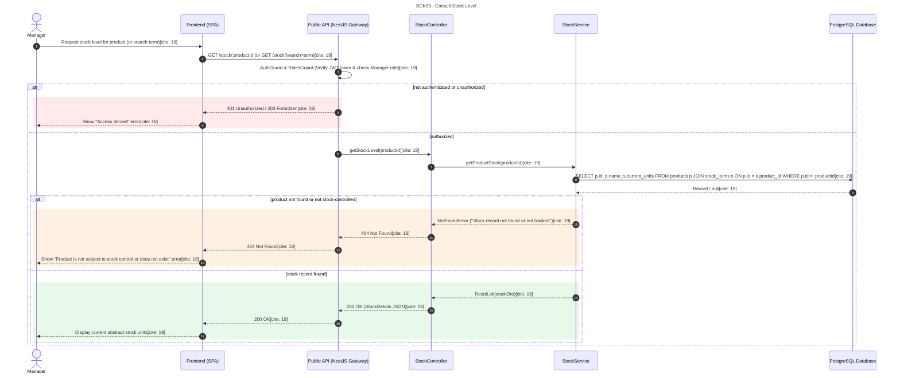
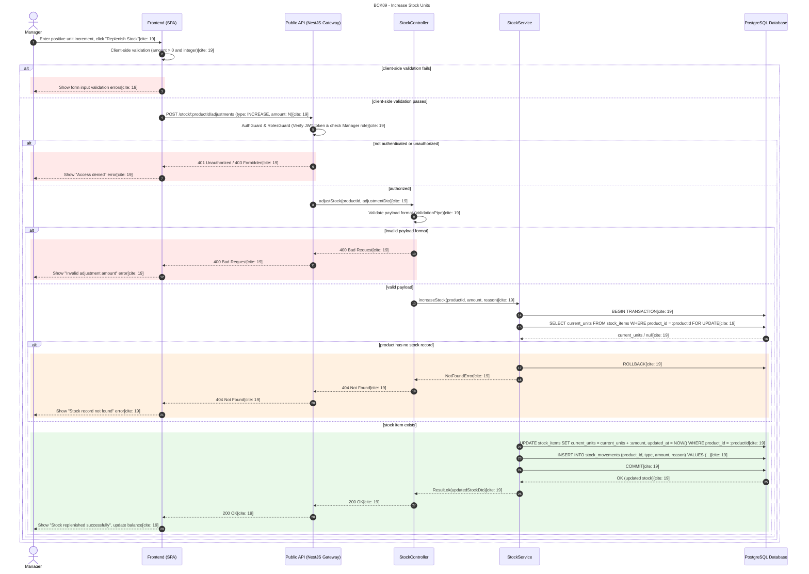
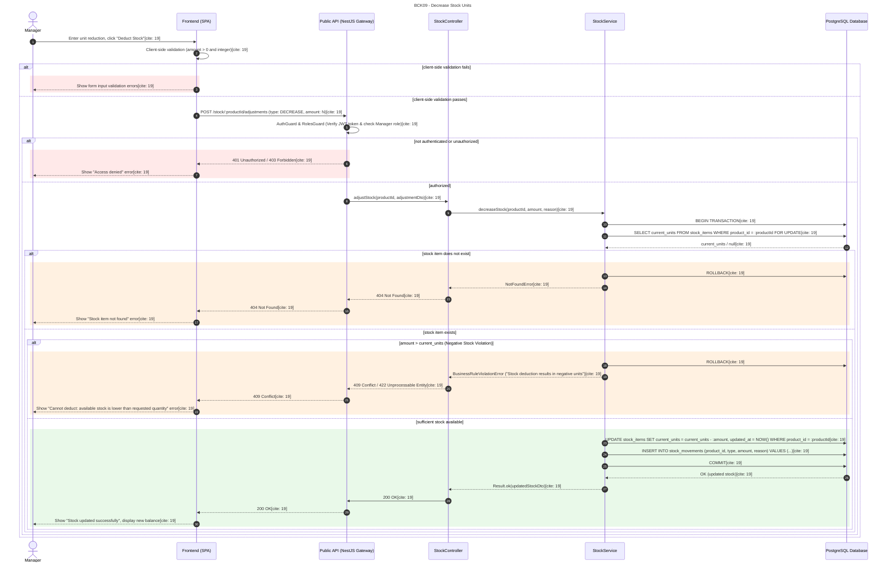

# BCK09 - As a LaPrizza Manager, I want to maintain stock information for products subject to stock control.

## 1. Requirements Engineering

### 1.1. User Story Description

As a LaPrizza Manager, I want to maintain stock information for products subject to stock control, so that the restaurant knows the quantity currently available for each applicable product.

### 1.2. Customer Specifications and Clarifications

#### From the specification document

> Extracted directly from *PART III – Sprint 1 – User Stories* (Section BCK09, pp. 9–10) and *PART II – System Specification* (Section II.3.1.4 Stock Control, pp. 6–7).
> 
> 

* **Abstract Stock Units:** Stock is maintained using normalized abstract stock units, deliberately avoiding physical measurements (e.g., kilograms, litres, packages) or unit conversion complexities.


* **Applicability by Product Designation:** Stock control applies strictly to products explicitly designated as subject to stock control (e.g., beverages, raw ingredients, and pizza components). Items produced on demand (such as pizzas) do not maintain inventory records.


* **Non-Negative Invariant:** Stock quantities are represented as non-negative integer numbers of units ($stock \ge 0$). A stock reduction must never result in a negative stock quantity.


* **Atomic Operations:** The system provides atomic operations to increase (replenishment) or decrease (operational adjustment/consumption) the stock level by a discrete number of units.


* **Operational Foundation:** The stock model serves as the operational baseline for downstream ordering, component availability checking, and kitchen preparation workflows.


### 1.3. Acceptance Criteria

* **AC1: Applicability Filtering:** Stock information must only be maintained for products designated as subject to stock control.


* **AC2: Identifiable Quantity:** Each stock-controlled product must have an identifiable current stock quantity.


* **AC3: Abstract Unit Model:** Stock quantities must be represented using the abstract stock-unit model defined in the System Specification.


* **AC4: Non-Negative Integer Representation:** Stock quantities must be represented as non-negative integer numbers of abstract stock units.


* **AC5: Individual Consultation:** The system must allow the current stock level of an individual stock-controlled product to be consulted.


* **AC6: Search and Filter Capabilities:** Stock information must be searchable using relevant product information (e.g., product name, category, or stock threshold).


* **AC7: Discrete Adjustments:** The system must provide operations for increasing or decreasing the current stock quantity by a specified number of abstract stock units.


* **AC8: Non-Negative Invariant Enforcement:** A stock reduction must not result in a negative stock quantity under any circumstances.


* **AC9: Validation and State Consistency:** Operations that change stock quantities must validate the requested change and preserve the consistency of the resulting stock information.


* **AC10: Extensibility:** The stock model must provide an appropriate foundation for the ordering and operational functionality introduced in subsequent sprints.


### 1.4. Found out Dependencies

* **Preceding Dependencies:**
* **BCK01 (User and Authentication Management):** All stock consultations and adjustment operations require an authenticated user with the `MANAGER` role, verified via JWT Bearer tokens and NestJS `RolesGuard`.


* **BCK05 (Product Management):** Stock records are directly associated with products that have the `subjectToStockControl` flag set to true.


* **Succeeding Dependencies:**
* **BCK08 (Pizza Component Configuration):** Defines the number of abstract stock units consumed by a pizza component for each pizza size.


* **Order Processing & Kitchen Workflows:** Confirmed orders and preparation steps trigger automated stock reductions based on recipe consumptions.


### 1.5. Input and Output Data

#### Inputs:

* Product Identifier (UUIDv4)


* Stock Adjustment Payload:
* `adjustmentType`: enum (`INCREASE`, `DECREASE`)


* `amount`: positive integer ($\ge 1$)


* `reason`: string (optional audit description, e.g., "Supplier delivery", "Spoilage")


* Search and query parameters (e.g., `?search=mozzarella&lowStock=true`)


#### Outputs:

* Stock Information Record:
* `productId`: UUIDv4


* `productName`: string


* `currentUnits`: integer ($\ge 0$)


* `updatedAt`: ISO timestamp


* Search Results: Array of matching stock information records


* Standard HTTP status payloads: 200, 400, 401, 403, 404, 409, 422


---

### 1.6. System Sequence Diagrams (SSD)

#### 1.6.1. Consult Stock Information (Search / Individual Query)



#### 1.6.2. Adjust Stock Level (Increase / Replenish)



#### 1.6.3. Adjust Stock Level (Decrease / Consume)



---

### 1.7. Other Relevant Remarks

* **Domain Model Invariants (DDD):**
* An individual `StockItem` entity is modeled with an explicit `StockUnits` Value Object that enforces the invariant: $currentUnits \in \mathbb{N}_0$ ($currentUnits \ge 0$).


* Deduction methods perform domain invariant checks, returning a failing `Result` before persisting.


* **Relational Integrity and Concurrency Guarantees (ADR-002 / ADR-003):**
* Concurrency is managed via pessimistic row locking (`SELECT ... FOR UPDATE`) inside atomic PostgreSQL transactions (`BEGIN ... COMMIT`) to prevent race conditions during simultaneous order deductions or manual replenishments.


* PostgreSQL Table Definitions:
```sql
CREATE TABLE stock_items (
    product_id UUID PRIMARY KEY REFERENCES products(id) ON DELETE RESTRICT,
    current_units INT NOT NULL DEFAULT 0 CHECK (current_units >= 0),
    created_at TIMESTAMPTZ NOT NULL DEFAULT NOW(),
    updated_at TIMESTAMPTZ NOT NULL DEFAULT NOW()
);

CREATE TABLE stock_movements (
    id UUID PRIMARY KEY DEFAULT gen_random_uuid(),
    product_id UUID NOT NULL REFERENCES stock_items(product_id) ON DELETE RESTRICT,
    type VARCHAR(10) NOT NULL CHECK (type IN ('INCREASE', 'DECREASE')),
    amount INT NOT NULL CHECK (amount > 0),
    reason TEXT,
    created_at TIMESTAMPTZ NOT NULL DEFAULT NOW()
);
```[cite: 19]

```


* The `CHECK (current_units >= 0)` constraint guarantees at the database storage engine level that negative stock values cannot occur, satisfying AC8 and AC9.