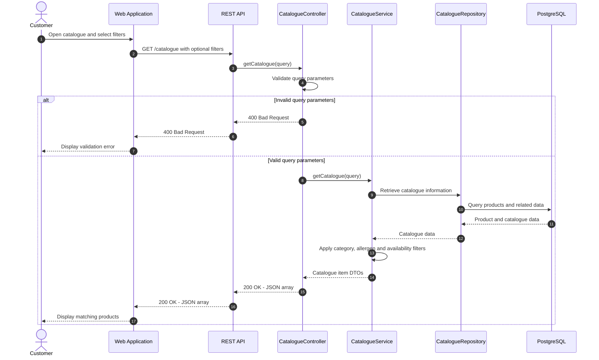
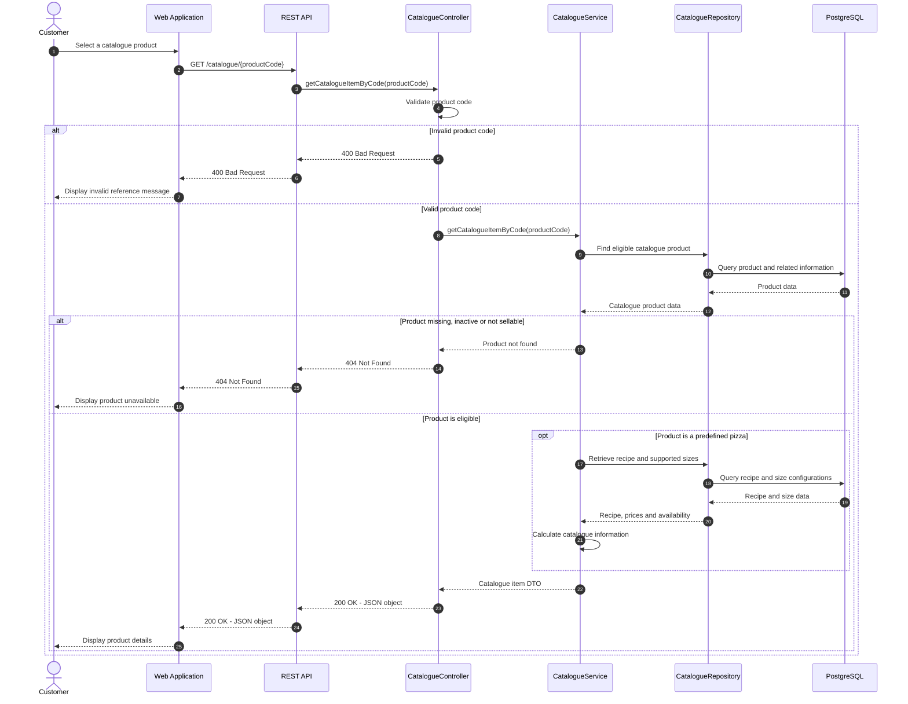

# BCK11 --- Product Catalogue and Product Information

## 1. Requirements Engineering

### 1.1. User Story Description

As a Customer, I want to consult the products offered by LaPrizza, so that I can understand the available options, their pricing, and other relevant product information.

### 1.2. Customer Specifications and Clarifications

#### From the specification document

- **Customer-facing catalogue:** The catalogue exposes products currently offered for sale by LaPrizza. A `Product` may have several business roles; being a product does not automatically mean that it is sold directly to customers.
- **Catalogue information:** Each sellable product should expose the information relevant to a customer's choice, including its name, description, category, applicable pricing information, and associated allergens where applicable.
- **Individual product details:** A customer must be able to retrieve the details of one sellable catalogue product, in addition to consulting a collection of products.
- **Predefined pizza information:** A predefined pizza is represented by a sellable product and has a default configuration maintained by BCK10. The catalogue representation must expose that configuration and the Pizza Sizes for which the configuration is supported.
- **Allergen information:** Products may be associated with one or more allergens. For a predefined pizza, its relevant allergen information is derived from the products used in its default configuration. The catalogue must use the allergen associations maintained by the system rather than duplicate or independently maintain them.
- **Business-data consistency:** The information returned by the catalogue must reflect the corresponding product, category, allergen, pizza configuration, size, component-configuration, and stock information maintained by the system.

#### From project clarifications and existing technical documentation

- **Catalogue eligibility:** The domain model distinguishes `isSellable` from the product's `active` status. Interpreting “currently offered for sale” against these fields means that public catalogue results include products that are sellable and active; inactive or non-sellable products must not be exposed as customer-facing catalogue items. This is an interpretation based on the existing product model, not a separate sentence in the formal BCK11 acceptance criteria.
- **Predefined pizza pricing:** The project clarification recorded in `docs/domain/client-questions.md` (Clarification #05) confirms that the price of a predefined pizza is calculated by summing the applicable size-dependent prices of its default recipe components multiplied by each line's `defaultQuantity`. No additional base price or labour charge is added. The price for an ordinary sellable product, where applicable, is its direct selling price.
- **Size support versus stock availability:** The set of sizes supported by a predefined pizza comes from its BCK10 configuration. Stock availability is a separate, time-dependent property. The project clarification says that the catalogue should continue to show a predefined pizza when a supported size is out of stock, and should expose availability per size. A component that is not stock-controlled does not make a size unavailable.
- **Availability rule:** A supported size is currently available when every stock-controlled component in its default recipe has sufficient stock for the abstract units consumed at that size, taking `defaultQuantity` into account. This availability indicator must be recalculated from maintained stock and component-size configuration information rather than treated as a permanent property of the pizza.
- **Public read operations:** The existing OpenAPI contract marks `GET /catalogue` and `GET /catalogue/{productCode}` as public operations. BCK11 adds consultation functionality; it does not introduce product creation, update, or deletion operations.
- **Search and filtering:** The current OpenAPI contract documents `category`, `excludeAllergens`, and `availableOnly` as optional catalogue query parameters. The customer clarification in `docs/domain/client-questions.md` also calls for ingredient searching to cover both products and the Pizza Components used by pizzas. The ingredient-search query parameter and its exact syntax are not yet described by the current OpenAPI contract and must be aligned with it before implementation is considered complete.

### 1.3. Acceptance Criteria

The following criteria map the formal BCK11 acceptance criteria to individually verifiable behaviour. Clarified project behaviour is identified separately in AC6.

- **AC1 --- Public Catalogue:** The system must provide public access to the products currently offered for sale by LaPrizza. Only products designated as sellable and currently active are included in the customer-facing catalogue.
- **AC2 --- Relevant Product Information:** A catalogue entry must provide, where applicable, the product code, name, description, category, pricing information, and associated allergen information. Products without associated allergens must still be representable without inventing allergen data.
- **AC3 --- Individual Product Details:** A customer must be able to consult the detailed catalogue representation of an individual sellable product. A product that does not exist or is not eligible for the public catalogue must not be returned as a sellable catalogue item.
- **AC4 --- Predefined Pizza Configuration and Sizes:** For a predefined pizza, the catalogue must expose its default configuration and the Pizza Sizes supported by that configuration according to BCK10. The configuration must identify the component products and their default quantities.
- **AC5 --- Consistency with Business Information:** Catalogue data must be obtained from, or derived consistently from, the maintained business information. In particular, product descriptions and categories, allergen associations, default recipe lines, supported sizes, size-dependent prices, and stock-based availability must not contradict their corresponding records.
- **AC6 --- Clarified Search, Filtering, and Availability:** Where the corresponding filters are supplied, the catalogue must apply category and allergen-exclusion criteria consistently. Ingredient searching must consider both directly sellable products and the components of predefined pizzas. If `availableOnly` is enabled, the result must respect the current availability rules; a predefined pizza with some unavailable sizes should remain visible unless the requested filter explicitly excludes it.

### 1.4. Found Dependencies

#### Preceding dependencies

- **BCK03 --- Product Category Management:** Catalogue entries refer to the category information associated with each product.
- **BCK04 --- Allergen Management:** The catalogue presents the allergen associations maintained for products and uses them when presenting predefined pizzas.
- **BCK05 --- Product Management:** Supplies product identity, name, description, category, sellable role, active status, direct selling price, and allergen associations. BCK11 is a customer-facing read model and must not be confused with the administrative product-management API.
- **BCK06 --- Pizza Size Management:** Supplies the size identifiers and names used by predefined-pizza size variants.
- **BCK08 --- Pizza Component Configuration:** Supplies the applicable price and abstract stock consumption for each component and supported Pizza Size.
- **BCK09 --- Stock Information Management:** Supplies current stock balances required to calculate size-specific availability for stock-controlled components.
- **BCK10 --- Predefined Pizza Management:** Supplies each predefined pizza's default recipe lines and supported sizes. BCK11 presents that information; it does not redefine the recipe or its validation rules.
- **ARC03 --- REST API:** The public catalogue must follow the project's REST conventions and remain documented in the machine-readable API contract.
- **ARC04 / ARC05 --- Persistence and Automated Testing:** Catalogue results must preserve the consistency of persisted business information and its behaviour must be covered by repeatable tests.

#### Succeeding dependencies

- **Web Application / Customer Kiosk:** Uses the catalogue to display products and their relevant information before an order is placed.
- **3D Visualization and Interaction:** Can use predefined-pizza recipes, sizes, pricing, and allergens as input when presenting or customizing a pizza.
- **Future customization and ordering workflows:** The catalogue provides the starting information for selecting a predefined pizza and size. Creating a personalized pizza, simulating an order, and processing an order are outside the direct BCK11 scope unless introduced by a later User Story.

### 1.5. Input and Output Data

BCK11 is a read-only, public-facing API. It has no creation or update payload.

#### Inputs

- **Catalogue collection request:** `GET /catalogue`.
- **Optional category filter:** `category` query parameter, as documented in `docs/api/openapi.yaml`.
- **Optional allergen exclusion filter:** `excludeAllergens` query parameter, as documented in `docs/api/openapi.yaml`. The accepted encoding for multiple allergen values must follow the final OpenAPI contract.
- **Optional availability filter:** `availableOnly` Boolean query parameter, documented with a default of `false` in the current OpenAPI contract.
- **Optional ingredient/text search:** A query parameter is required to satisfy the recorded customer clarification for searching product names and, for predefined pizzas, their component products. Its name and encoding must be added to `docs/api/openapi.yaml`; it is not currently defined there.
- **Individual catalogue item request:** `GET /catalogue/{productCode}`, where `productCode` is the unique business code of the sellable product.
- **Authentication:** None. Both catalogue operations are public read operations.

#### Outputs

- **Catalogue collection:** A JSON array of catalogue item representations matching the request filters. An empty result is represented by an empty array with `200 OK`.
- **Catalogue item:** A JSON representation containing, where applicable:
  - `productCode`, `name`, `description`, and `categoryCode`;
  - `allergens`, represented using the allergen identifiers maintained by the system;
  - `directPrice` for a directly priced sellable product, where applicable;
  - `isPredefinedPizza`, distinguishing predefined pizzas from other sellable products;
  - `defaultRecipeLines` for a predefined pizza, with at least `componentProductCode` and `defaultQuantity` for each line;
  - `sizeVariants` for a predefined pizza, with `sizeId`, `sizeName`, the applicable `computedPrice`, and an `isAvailable` flag for each supported size.
- **Pricing:** A direct-sale product uses its maintained direct selling price, where one exists. A predefined pizza's price for size `S` is the sum of `componentPrice(component, S) * defaultQuantity` over its default recipe lines. Prices are non-negative monetary values and must be represented consistently with the existing `MoneyDTO` contract.
- **Availability:** `isAvailable` is evaluated for each supported predefined-pizza size using current stock balances and the relevant component-size stock-consumption values. Unavailable sizes are returned with `isAvailable: false`; they are not silently removed from the size list.
- **HTTP status codes:** `200 OK` for a successful collection or detail request, `400 Bad Request` for invalid query values, and `404 Not Found` when the requested code does not identify a public catalogue item. The implementation must remain consistent with the project's global error-response conventions.

### 1.6. System Sequence Diagrams (SSD)

> **Design note:** The diagrams use the resource names from `docs/api/openapi.yaml`. The current NestJS bootstrap does not configure the `/api/v1` global prefix declared by the OpenAPI server URL; the runtime base path and the published contract must be aligned. `CatalogueController` and `CatalogueService` below are proposed participants for BCK11, not existing classes in the inspected project archive.

#### 1.6.1. Consult and Filter the Public Catalogue

#### 1.6.2. Consult an Individual Catalogue Product

### 1.7. Other Relevant Remarks

- **Formal scope versus project clarifications:** AC1–AC5 express the five formal BCK11 acceptance criteria in individually testable form. AC6 captures the additional search/filter behaviour recorded in the project clarifications and existing API documentation; it should remain traceable to those sources rather than be mistaken for a verbatim criterion from PART III.
- **OpenAPI contract gap:** `docs/api/openapi.yaml` already declares `GET /catalogue` and `GET /catalogue/{productCode}` and defines `CatalogueItemResponseDTO`. However, that schema currently has no `defaultRecipeLines` field even though formal BCK11 requires the default configuration to be returned. The schema and runtime DTO must be checked together. The implementation currently exposes recipe lines through the catalogue DTO; retain the actual field names from the runtime DTO rather than the proposed names in §1.5.
- **Search contract gap:** The current OpenAPI operations document `category`, `excludeAllergens`, and `availableOnly`, but not the ingredient/text search required by the customer clarification. Ingredient/text search remains a follow-up requirement. Before it is considered implemented, define its query name, encoding, matching rules, and whether matching a component returns its containing predefined pizzas.
- **Implementation alignment (archive reviewed):** The archive contains catalogue application/persistence code and catalogue unit/integration tests. Do not state that the BCK11 service or tests are absent. The catalogue combines product information with predefined-pizza recipe, size pricing, and availability data. Keep route/controller naming aligned with the actual API and do not describe the separate product and predefined-pizza endpoints as the only catalogue implementation.
- **Existing persistence support:** Migration `006_create_views.sql` defines `v_catalogue_products` and `v_predefined_pizza_details` for catalogue product data, allergen aggregation, component-derived prices, and size availability. The query/adapter used by BCK11 must still enforce the customer-facing rule that only active, sellable products are exposed.
- **Availability-filter scope:** The formal BCK11 requirements and customer clarification explicitly describe stock-based availability per predefined-pizza size. The existing OpenAPI `availableOnly` filter is broader, but the contract does not clearly define the item-level availability representation for ordinary stock-controlled products. Keep this distinction explicit when finalizing the filter implementation.
- **Recommended later Bruno coverage:** public access without a token; collection and detail success; empty result and unknown/non-sellable/inactive product; category and allergen filters; ingredient search through a pizza component; predefined-pizza recipe and supported sizes; price calculation for each size; stock-controlled and non-stock-controlled components; one available and one unavailable size; and consistency of allergens with the default recipe.

### 1.8. Implementation alignment notes (archive reviewed)

- Implemented catalogue filters are category, allergen exclusion, and availability. Ingredient/text search across products and pizza components is not currently implemented; keep it explicitly marked as a follow-up rather than claiming the current service satisfies it.
- Catalogue DTOs and endpoint paths are the source of truth for field names. The conceptual output in §1.5 must not be read as an exact OpenAPI schema unless the names and fields match the runtime DTO.
- Catalogue integration and unit tests are present in the archive. Bruno scenarios listed in §1.7 are recommendations for additional coverage, not evidence that each scenario currently exists or has been executed.
- Availability is reported per size for predefined pizzas. `availableOnly` should filter using the implemented availability rule; it must not be described as stock reservation or order-time validation.
