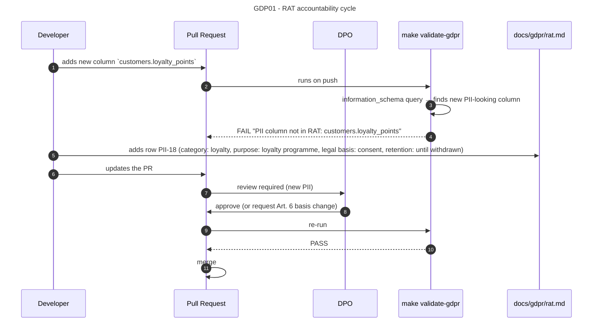

# GDP01 — Personal Data Handling

## 1. Requirements Engineering

### 1.1. User Story Description

As a LaPrizza Representative, I want to ensure that the team knows how the project handles personal data, so that all data operations comply with applicable data-protection laws.

### 1.2. Customer Specifications and Clarifications

#### From the specification document
> Extracted from *PART IV — Sprint 2 — User Stories* (GDP01, p. 23).

- The team must **clearly explain the project scope and its core functionalities** clearly and concisely.
- The team must **identify which personal data will be processed**.
- The team must **describe how** the identified personal data will be processed.

#### From `docs/gdpr-policy.md` v2.0 (per KB Appendix D)
- §1 Introduction & Legal Framework (LAPR5 precedents, Lei 58/2019, CPDHED, CNPD, scope).
- §2 Key Legal Definitions (Art. 4, full table).
- §3 Data Protection Principles (Art. 5 — 9 principles).
- §4 Legal Bases (Art. 6 — 6 bases mapped per processing).
- §5 Rights of the Data Subject (Art. 15–22) + Judicial Remedies (Art. 77–79).
- §6 Personal Data Inventory & Art. 30 Record.
- §7 Special Categories (Art. 9) — health data via dietary restrictions.
- §8 Security Measures (Art. 32).
- §9 DPIA (Art. 35) — concluded no DPIA required for the Sprint 2 baseline.
- §10 DPO (Art. 37–39).
- §11 Breach Handling (Art. 33–34) — 72h CNPD.
- §12 Retention.
- §13 AI and Automated Decision Making (Art. 22).
- §14 Cross-Border Transfers (Art. 44–50).
- §15 Penalties (Art. 83).
- §16 References.

#### From KB Appendix D
- **9 principles** (Art. 5(1)(a–i) + §2), with **Lawfulness, Fairness, Transparency** unmerged (the v1.1 merge is corrected in v2.0).
- **Legal bases** (§D.4): consent (marketing), contract (registration/orders/auth), legal obligation (billing), legitimate interest (audit/security).
- **Special categories** (§D.4): dietary restrictions = health data (Art. 4(15)), processed on **explicit consent** (Art. 9(2)(a)), revocable via `PUT /customers/{email}/dietary-restrictions`.
- **Art. 30 record** (§D.6): table with `Data Category | DB Table & Column | Purpose | Legal Basis | Retention`.
- **Art. 32** (§D.7): Argon2id, JWT, HTTPS, RBAC, `ON DELETE RESTRICT`, `age`-encrypted backups, `auditd`.
- **DPIA** (§D.8): not required for Sprint 2 baseline; reassess if Sprint 3 adds payment.
- **AI and automated decisions** (§D.11): no profiling, no legal effect, human oversight.
- **Transfers** (§D.12): OIDC IdP, SMTP, S3; adequacy or SCCs only; **no special-category data** to any processor.

### 1.3. Acceptance Criteria (expanded, testable)

#### AC1 — Clear, concise explanation of project scope and core functionalities
- AC1.1 A **1-page plain-language summary** exists at `docs/gdpr/summary.md` (or the first section of `gdpr-policy.md`), explaining: what LaPrizza is (Sprint 2 prototype), what it does (catalogue browsing, auth, kitchen viewer, planning), and what it **does not** do (no order placement in Sprint 2, no payment processing, no marketing dispatch, no profiling of customers).
- AC1.2 The summary names the **four access levels** (Guest, Customer, Employee, Manager) and the **anonymous kiosk** case in one sentence each.
- AC1.3 The summary is ≤ 800 words, has no legal jargon without a one-line gloss, and is **understandable by a non-lawyer** (a reviewer with no GDPR background can follow it).
- AC1.4 The summary is **reproducible from the repository** — no external link is required to understand it (links to the full policy are fine, but the summary stands alone).

#### AC2 — Identify which personal data is processed
- AC2.1 The **Art. 30 record (RAT)** exists in a machine-checkable form (a Markdown table with a fixed schema) at `docs/gdpr/rat.md` — extracted from `gdpr-policy.md §6`.
- AC2.2 Every row has the columns: `id | data_category | db_table | db_column | purpose | legal_basis | retention | special_category (Y/N)`.
- AC2.3 The RAT covers, at minimum, the categories from KB §D.6:
  - Identity: `users.first_name`, `users.last_name`
  - Contact: `users.email`, `users.phone_number`, `customers.email`, `customers.phone`
  - Credential: `users.password_hash`
  - External identity: `users.external_idp_subject`
  - Customer profile: `customers.first_name`, `customers.last_name`
  - Financial (optional): `customers.vat_number`
  - Consent: `customers.marketing_consent`, `customers.consent_timestamp`
  - Delivery: `customer_addresses.street`, `.postal_code`, `.city`, `.extra_details`
  - **Special category (health):** `user_dietary_restrictions.allergen_name`
  - Invitation: `activation_invitations.token`, `.purpose`, `.expires_at`, `.used_at`, `.revoked_at`
  - Audit: `role_change_logs.actor_username`, `.target_username`, `.previous_roles`, `.new_roles`, `.reason`, `.changed_at`
  - Planning: `planning_results.*` — explicitly marked **no PII** (§13)
  - HTTP access logs (host-level, 30 days)
- AC2.4 A **CI check** (`make validate-gdpr`) compares the RAT against `information_schema.columns` (queried from the test DB) and fails if a column with a name matching the PII pattern (`first_name|last_name|email|phone|password|address|dietary|vat|consent`) is **not** in the RAT.
- AC2.5 The **anonymous kiosk** case is explicitly noted in the RAT: "Kiosk customers — no persistent record — N/A".
- AC2.6 The **AI planning** case is explicitly noted: "planning_results.* — no PII (anonymised snapshots) — N/A".

#### AC3 — Describe how the identified data is processed
- AC3.1 A **data flow diagram** exists at `docs/gdpr/data-flows.md` (Mermaid) showing:
  - User → SPA → Backend → DB.
  - User → SPA → IdP (email + sub only).
  - Backend → SMTP (email + invitation token only).
  - Backend → S3 (encrypted backups).
  - Backend → Prolog (no PII — planning payloads only).
  - Backend → DEI host (access logs).
- AC3.2 Each flow is annotated with: **what data**, **legal basis**, **recipient**, **Art. 32 safeguards** (TLS, encryption, `age`, redaction).
- AC3.3 The **special categories** flow (dietary restrictions) is called out: collected at registration or via `PUT /customers/{email}/dietary-restrictions`; stored on explicit consent; used only for allergen conflict warnings (never as a blocking rule — Clarification #16); **never sent to Prolog, SMTP, IdP, or S3** (except inside the encrypted backup, which is a controller-only artefact).
- AC3.4 The **Art. 22 automated-decision** flow is called out: `POST /planning/executions` produces `PlanningResult` (read-only, human-reviewed, no effect on data subjects — KB §D.11).
- AC3.5 The **Art. 32 security measures** section maps each control to the SYS-* deliverable that implements it:
  - Argon2id hashing → ADR-004
  - JWT + RBAC → AA04 / AA05
  - HTTPS/TLS 1.2+ → SYS01 / KB §39.3
  - `ON DELETE RESTRICT` → KB §10.2
  - `age`-encrypted backups → SYS08
  - `auditd` + `ssh-alerts.log` → SYS05
  - Network restriction → SYS02 / SYS03

#### AC4 — Accountability for the RAT
- AC4.1 The RAT has an **owner**: the DPO (`dpo@laprizza.local`, per §10).
- AC4.2 The RAT has an **update cadence**: reviewed at the start of each sprint and whenever a new table/column with PII is added (a `pre-commit` check or a CI check flags new columns).
- AC4.3 The RAT has a **version history** at the top: `v1 (Sprint 2 baseline) — <date> — created; v1.1 — <date> — added column X` (append-only).
- AC4.4 The change process is documented: a new PII column requires a PR that (a) adds the row to the RAT, (b) updates the data-flow diagram if the processing changes, (c) is reviewed by the DPO.

### 1.4. Found out Dependencies

**Preceding:**
- All Sprint 1 + Sprint 2 schema (migrations 001–014) — the RAT must match the real columns.
- The RBAC matrix (KB §23) — the RAT's "purpose" and "legal basis" depend on who accesses the data.
- SYS02/SYS03/SYS05/SYS08 — the Art. 32 safeguards.
- `docs/gdpr-policy.md` v2.0 — the source of the RAT.

**Succeeding:**
- GDP02 (controller identification references the RAT).
- GDP03 (breach classification references the data categories and their sensitivity).
- SYS06 R-06 (GDPR breach risk references the RAT).

### 1.5. Input and Output Data

#### 1.5.1. Deliverables

| File | Status | Purpose |
|---|---|---|
| `docs/gdpr-policy.md` v2.0 | **exists** (16 sections) | Full policy |
| `docs/gdpr/summary.md` | **new (gap G1)** | 1-page plain-language summary (AC1) |
| `docs/gdpr/rat.md` | **new (gap G2)** | Machine-checkable Art. 30 record (AC2) |
| `docs/gdpr/data-flows.md` | **new (gap G3)** | Data-flow diagram + annotations (AC3) |
| `docs/gdpr/special-categories.md` | **new (gap G4)** | Art. 9 explicit consent mechanism, linked to the API |
| `docs/gdpr/security-measures.md` | **new (gap G5)** | Art. 32 controls mapped to SYS-* deliverables |
| `Makefile` target `validate-gdpr` | **new (gap G2)** | CI check: RAT vs. `information_schema` |

#### 1.5.2. RAT schema (excerpt)

```markdown
| id | data_category | db_table | db_column | purpose | legal_basis | retention | special_category |
|----|---------------|----------|-----------|---------|-------------|-----------|------------------|
| PII-01 | Identity | users | first_name | Authentication, staff management | Contract (Art. 6(1)(b)) | Active + 5 years deactivated | N |
| PII-02 | Contact | users | email | Authentication, communication | Contract | Same as identity | N |
| PII-03 | Credential | users | password_hash | Local authentication (Argon2id) | Contract | Same as identity | N |
| PII-04 | External identity | users | external_idp_subject | OIDC (ADR-010) | Contract | Same as identity | N |
| PII-05 | Contact | users | phone_number | Contact (self-service) | Contract | Same as identity | N |
| PII-06 | Customer profile | customers | email | Customer identification, communication | Contract | 10 years from last transaction | N |
| PII-07 | Customer profile | customers | first_name, last_name | Customer identification | Contract | Same as PII-06 | N |
| PII-08 | Contact | customers | phone | Order updates (Sprint 3) | Contract | Same as PII-06 | N |
| PII-09 | Financial (optional) | customers | vat_number | Invoicing (optional) | Contract | 10 years (fiscal) | N |
| PII-10 | Consent | customers | marketing_consent, consent_timestamp | Marketing (opt-in) | Consent (Art. 6(1)(a)) | Until withdrawn | N |
| PII-11 | Delivery | customer_addresses | street, postal_code, city, extra_details | Delivery (Sprint 3) | Contract | Same as PII-06 | N |
| PII-12 | **Health** | user_dietary_restrictions | allergen_name | Customer safety (allergen warnings) | **Explicit consent (Art. 9(2)(a))** | Same as identity; revocable | **Y** |
| PII-13 | Invitation | activation_invitations | token, purpose, expires_at, used_at, revoked_at | Account activation | Contract | 48h TTL + cascade | N |
| PII-14 | Audit | role_change_logs | actor_username, target_username, previous_roles, new_roles, reason, changed_at | Security audit | Legitimate interest (Art. 6(1)(f)) | 5 years | N |
| PII-15 | Planning (no PII) | planning_results | (all columns) | AI planning | N/A | Indefinite (business artefact) | N |
| PII-16 | Access logs | (host) | (IP, timestamp, path) | Security monitoring | Legitimate interest | 30 days | N |
| PII-17 | Kiosk | (no table) | N/A | Anonymous | N/A | N/A | N |
```

#### 1.5.3. `make validate-gdpr`

```bash
#!/bin/bash
# CI check: every PII-looking column must appear in the RAT.
set -euo pipefail
PSQL="psql -h ${DB_HOST} -U ${DB_USER} -d laprizza_db -At"
PII_PATTERN='(first_name|last_name|email|phone|password_hash|street|postal_code|city|extra_details|vat_number|allergen_name|token|actor_username|target_username|reason)'

$PSQL -c "
  SELECT table_name || '.' || column_name
  FROM information_schema.columns
  WHERE table_schema = 'public'
    AND column_name ~ '${PII_PATTERN}'
" > /tmp/pii-columns.txt

# Every PII column must be present in docs/gdpr/rat.md
while read -r col; do
  if ! grep -qF "$col" docs/gdpr/rat.md; then
    echo "GDPR: PII column not in RAT: $col" >&2
    exit 1
  fi
done < /tmp/pii-columns.txt

echo "GDPR: RAT is complete (all PII columns covered)"
```

The pattern is **exhaustive by construction** (it matches the actual column names used in migrations 001–014). A new column added in Sprint 3 with a PII-looking name will **fail** the build until the RAT is updated — this is the enforcement of AC2.4.

### 1.6. System Sequence Diagrams (SSD)

#### 1.6.1. Special-category data flow (dietary restrictions — Art. 9)

```mermaid
sequenceDiagram
autonumber
title GDP01 - Special category (dietary) flow
    actor Customer
    participant SPA as SPA (Profile)
    participant Ctrl as CustomerController
    participant DB as PostgreSQL
    participant API as AllergenConflictService (future)
    participant Prolog as Prolog (planning)
    participant SMTP as SMTP
    participant S3 as S3 (backup)

    Customer->>SPA: opt-in to share dietary restrictions (explicit consent)
    SPA->>Ctrl: PUT /customers/{email}/dietary-restrictions { allergenName, consent: true }
    Ctrl->>DB: INSERT user_dietary_restrictions (allergen_name, recorded_at)
    Ctrl->>DB: UPDATE customers SET consent_timestamp = NOW() (explicit consent record)
    Note over DB: stored on Art. 9(2)(a) explicit consent
    Note over API: used only for allergen warnings on the customer's own orders (Clarification #16)
    Note over Prolog: NOT sent — planning payload excludes dietary (AI06 AC7)
    Note over SMTP: NOT sent — invitations contain only email + token
    Note over S3: only inside the encrypted backup (controller-only artefact, age-encrypted)

    Customer->>SPA: revoke consent
    SPA->>Ctrl: DELETE /customers/{email}/dietary-restrictions (or PUT with empty list)
    Ctrl->>DB: DELETE user_dietary_restrictions WHERE username = …
    Note over DB: withdrawal is immediate; the data is removed from the live DB
    Note over S3: backups retain the pre-withdrawal data for up to 90 days<br/>restore event re-applies withdrawal (SYS08 §13, gap G4)
```

#### 1.6.2. Accountability cycle for the RAT



### 1.7. Other Relevant Remarks

#### 1.7.1. Gap analysis vs `docs/gdpr-policy.md` v2.0

| # | AC | Current state | Gap | Severity | Remediation |
|---|---|---|---|---|---|
| G1 | AC1 — 1-page plain-language summary | §1 is "Introduction & Legal Framework" (16 sections, ~30 pages total) | **No 1-page summary**; a reader cannot get the scope in 5 minutes | High | Add `docs/gdpr/summary.md` (≤ 800 words) |
| G2 | AC2 — machine-checkable RAT | §6 has an Art. 30 record as a table | **No CI check** that the RAT matches the schema; the table is prose-embedded in a large document | High | Extract to `docs/gdpr/rat.md` with fixed schema; add `make validate-gdpr` |
| G3 | AC3 — data flow diagram | §3–§8 describe the flows in prose; §14 lists transfers | **No diagram**; the reader has to reconstruct the flows | High | Add `docs/gdpr/data-flows.md` (Mermaid) |
| G4 | AC3.3 — Art. 9 consent linked to API | §7 documents the explicit consent; §D.4 references `PUT /customers/{email}/dietary-restrictions` | **Consent withdrawal behaviour not linked to the API** and not tested | Medium | Add `docs/gdpr/special-categories.md`; add a unit test asserting `PUT … dietary-restrictions {[]}` clears the rows and updates `consent_timestamp` |
| G5 | AC3.5 — Art. 32 mapped to SYS-* | §8 lists the controls (Argon2id, JWT, HTTPS, RBAC, backups) | **No cross-reference to the SYS-* deliverables** that implement them | Medium | Add `docs/gdpr/security-measures.md` with a "Control → SYS-* → Evidence" table |
| G6 | AC4 — RAT accountability | §10 names the DPO; §6 is the RAT | **No owner/update cadence/version history for the RAT** | Medium | Add §0 "Document control" to `rat.md` (owner: DPO; cadence: per-sprint + on schema change; version table) |
| G7 | AC1.1 — "what the project does NOT do" | The policy is silent on the non-scope (no payment, no marketing dispatch, no profiling) | **A reader might assume the prototype does more than it does** | Low | Add a "Non-scope" paragraph to `summary.md` |

**Net effect:** the policy's **content** is complete (9 principles, all Art. bases, all rights, all controls). The gaps are about **operational evidence** (a summary, a machine-checkable RAT, a diagram, a per-control mapping, an accountability cycle) — all **additive**, none requires a policy rewrite.

#### 1.7.2. Decision record — policy-as-Markdown + evidence artefacts

**Decision:** `gdpr-policy.md` remains the **narrative policy**; the RAT, data flows, special categories, and security-measures mapping are **extracted into separate files** under `docs/gdpr/`.

**Rationale:**
- The policy is the **legal** artefact; the extracted files are the **operational** artefacts. They serve different audiences (RUC/legal vs. DPO/engineer).
- The extraction makes the RAT **machine-checkable** (AC2.4) without coupling the CI check to a large prose file.
- The extracted files can be reviewed in PRs independently of the whole policy.

**Alternatives considered:**
- *Keep everything in `gdpr-policy.md`*: rejected — the CI check would grep a 30-page document; a partial match could pass.
- *YAML/JSON RAT*: considered; rejected because the RAT is reviewed by humans (DPO/RUC), and Markdown reads better. The CI check works on Markdown with a fixed schema.

#### 1.7.3. Verification matrix (AC → check → evidence)

| AC | Check | Evidence |
|---|---|---|
| AC1.1–AC1.4 | `docs/gdpr/summary.md` exists, ≤ 800 words, no jargon | `wc -w docs/gdpr/summary.md` + manual review |
| AC2.1–AC2.2 | RAT file + schema | `docs/gdpr/rat.md` |
| AC2.3 | All categories present | `grep` coverage vs. `information_schema` |
| AC2.4 | `make validate-gdpr` passes | CI run |
| AC2.5–AC2.6 | Kiosk + Planning rows | `rat.md` rows PII-15, PII-17 |
| AC3.1–AC3.2 | Data flow diagram + annotations | `docs/gdpr/data-flows.md` |
| AC3.3 | Art. 9 flow + API link | `docs/gdpr/special-categories.md` + `PUT /customers/…` |
| AC3.4 | Art. 22 flow | `data-flows.md` planning sub-diagram |
| AC3.5 | Art. 32 → SYS-* mapping | `docs/gdpr/security-measures.md` |
| AC4.1–AC4.4 | RAT owner, cadence, version, PR process | `rat.md` header + CI check |