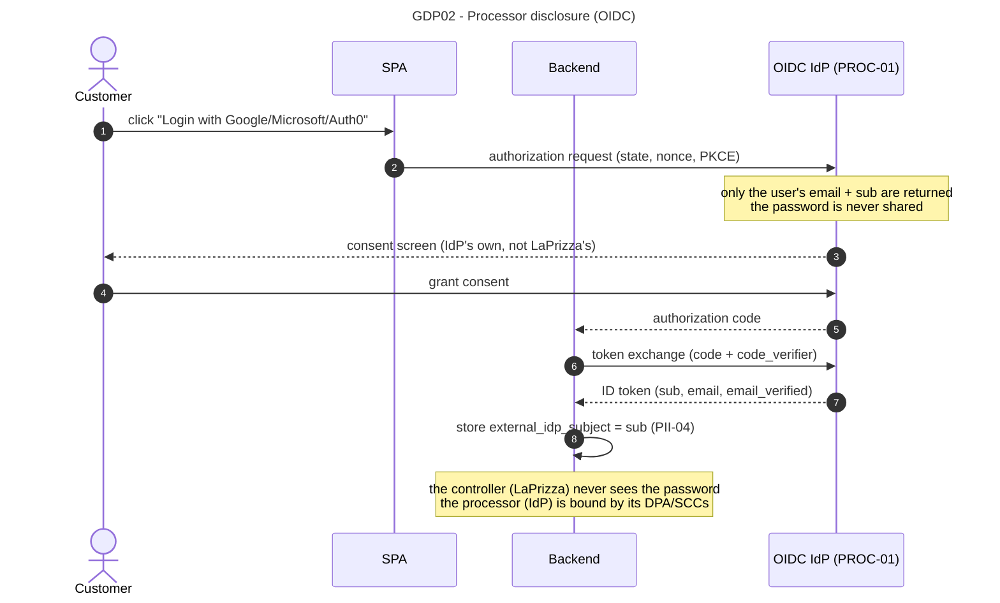
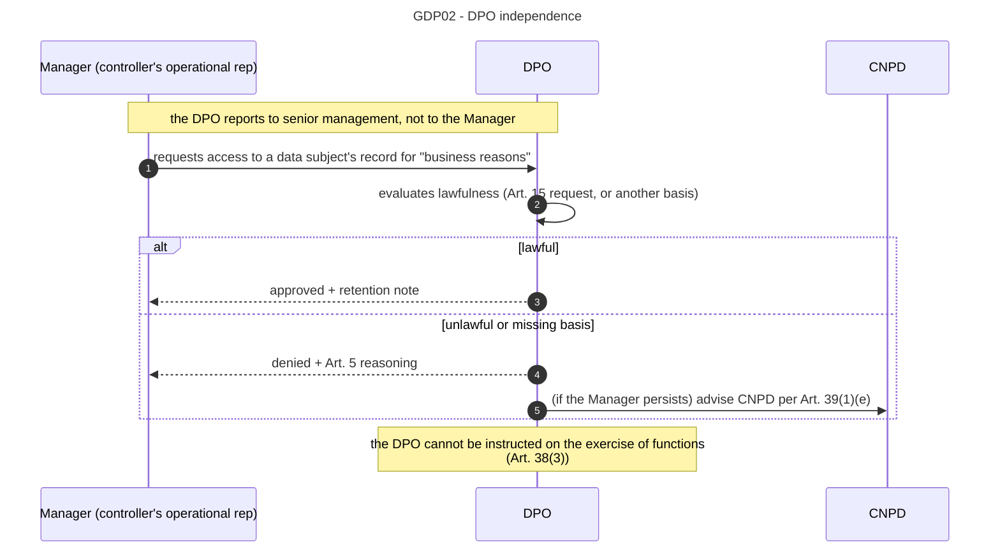

# GDP02 — Data Processing Responsibility

## 1. Requirements Engineering

### 1.1. User Story Description

As a LaPrizza Representative, I want to understand who is liable for data processing, so that the roles and responsibilities of the parties involved are clearly identified.

### 1.2. Customer Specifications and Clarifications

#### From the specification document
> Extracted from *PART IV — Sprint 2 — User Stories* (GDP02, p. 24).

- The team must be able to **identify who is the entity responsible for personal data processing (controller)**.

#### From `docs/gdpr-policy.md` v2.0
- §1 names the controller as "LaPrizza restaurant entity".
- §10 names the DPO (`dpo@laprizza.local`).
- §14 lists the cross-border transfers.
- §2 defines "controller" per Art. 4(7).

#### From KB Appendix D
- §D.2: "Controller: LaPrizza restaurant entity."
- §D.9: "DPO: dpo@laprizza.local; reports to senior management; tasks per Art. 39."
- §D.12: "Transfers may occur via OIDC IdP (only the user's email and `sub`), SMTP provider (email + invitation token), S3-compatible backup bucket (age-encrypted). Only IdPs with adequacy (Art. 45) or SCCs (Art. 46) accepted. **No special-category data transferred**."

#### From the Sprint 2 US text
- The US is deliberately **short** (one AC), but the **scope is deep**: identifying the controller is not just naming it, it is clarifying the **responsibility boundaries** between the controller, the DPO, the processors, and any joint controllers.

### 1.3. Acceptance Criteria (expanded, testable)

#### AC1 — Identify the controller explicitly
- AC1.1 The controller is named with: **legal name** ("LaPrizza — academic prototype, Team 3DJ-05, ISEP"), **establishment** (Portugal — ISEP, Rua Dr. António Bernardino de Almeida, 431, 4200-072 Porto), **contact** (`dpo@laprizza.local` for DPO, `geral@laprizza.local` for general).
- AC1.2 The controller's **EU establishment** is stated — Portugal. Since the controller is established in the EU, **no Art. 27 representative is required** (documented explicitly).
- AC1.3 The **legal framework** applicable is stated: **GDPR (Regulation (EU) 2016/679)**, **Lei 58/2019** (Portuguese implementing law), **CPDHED (Lei 27/2021)** — per KB Appendix D.
- AC1.4 The **DPO** is named with contact (`dpo@laprizza.local`) and reporting line (senior management).

#### AC2 — Identify the processors and any joint controllers
- AC2.1 A **processor register** exists at `docs/gdpr/processors.md` with one row per processor:
  - **OIDC IdP** (Google / Microsoft / Auth0 / Keycloak) — purpose: identity verification; data: user's email + `sub` (on user's explicit action); transfer basis: adequacy or SCCs (per §14).
  - **SMTP provider** (e.g., SendGrid) — purpose: transactional email dispatch; data: recipient email + invitation token; transfer basis: adequacy or SCCs.
  - **S3-compatible bucket** — purpose: off-site backups; data: encrypted `pg_dump` (contains PII); transfer basis: adequacy or SCCs; safeguard: `age` encryption + SSE-S3.
  - **DEI infrastructure** — **not** a processor: it is the controller's own hosting (the DEI/ISEP IT department acts on the controller's instructions; this is documented as "own infrastructure", not a processor relationship).
- AC2.2 Each processor row has: `name | purpose | data categories | transfer mechanism | DPA status | last-reviewed`.
- AC2.3 **No joint controllers** — the policy states this explicitly (`joint_controllers: none`). The OIDC IdP is not a joint controller because the restaurant determines the purposes and means; the IdP only authenticates.
- AC2.4 Each processor has a **DPA (Data Processing Agreement, Art. 28) status**:
  - `executed` — for production.
  - `required-not-executed` — for the academic prototype (documented gap).
  - `not-required` — for the DEI infrastructure.
- AC2.5 The policy includes a **DPA checklist** (Art. 28(3)) with the mandatory clauses: subject-matter, duration, nature/purpose, type of personal data, categories of data subjects, obligations of the processor, confidentiality, security, sub-processor rules, assistance, deletion/return, audit.

#### AC3 — Responsibilities matrix (RACI)
- AC3.1 A RACI table at `docs/gdpr/raci.md` maps each **personal-data category** (from the RAT, GDP01) to the **role** (Controller, DPO, Manager, Processor, Data Subject) with `R / A / C / I`.
- AC3.2 Rows cover at minimum: data collection, storage, use, disclosure to processor, retention, deletion, breach handling, subject rights requests.
- AC3.3 The **Manager** role is the controller's operational representative for **Art. 15–17 requests** (access, rectification, erasure) — documented in the RBAC matrix (KB §23) and in the RACI.
- AC3.4 The **DPO** is independent (Art. 38(3)) — the RACI reflects this (DPO is `C` on operational decisions, not `A`; `A` is the controller).
- AC3.5 The **Data Subject** is `I` on most rows but `R` on requests (they initiate the request).

#### AC4 — Cross-border transfers
- AC4.1 A **transfers table** exists at `docs/gdpr/transfers.md` with one row per recipient: `recipient | country | data | safeguard | adequacy/SCC reference`.
- AC4.2 Each row's safeguard is one of: **adequacy decision (Art. 45)** — e.g., UK, Switzerland, Japan, South Korea; **SCCs (Art. 46(2)(c))** — EU Standard Contractual Clauses 2021/914; **BCRs (Art. 47)** — for intra-group; **Art. 49 derogations** — exceptional.
- AC4.3 The policy states that **no special-category data** (dietary restrictions) is transferred to any processor — this is enforced by the AI06 AC7 (payload excludes PII) and by the SMTP-only-email-and-token rule.
- AC4.4 The chosen IdP for the demo (e.g., Keycloak local, or Google) is documented with its transfer basis. **If the chosen IdP has no adequacy and no SCCs, it must be replaced** — a `make validate-gdpr` check on `processors.md` flags it.

#### AC5 — Documented responsibility for the breach notification
- AC5.1 The controller (LaPrizza) is the **notifying party** to CNPD (GDP03 AC2.3).
- AC5.2 The DPO **prepares** the notification; the **Manager** in the system is the **operational point of contact**.
- AC5.3 The processor's **Art. 33(2) obligation** to notify the controller "without undue delay" is documented in the DPA checklist (AC2.5).

### 1.4. Found out Dependencies

**Preceding:**
- GDP01 (the RAT — the RACI maps the same data categories).
- `docs/gdpr-policy.md` v2.0 (§1, §10, §14).
- The OIDC configuration (which IdP is chosen determines the transfer basis).

**Succeeding:**
- GDP03 (the controller is the notifying party).
- SYS06 R-06 (the controller is the risk owner for GDPR).
- The Sprint 2 defense (the RUC may ask "who is the controller?").

### 1.5. Input and Output Data

#### 1.5.1. Deliverables

| File | Status | Purpose |
|---|---|---|
| `docs/gdpr-policy.md` v2.0 | **exists** (§1, §10, §14) | Full policy |
| `docs/gdpr/controller.md` | **new (gap G1)** | Controller identification with establishment, contact, legal framework |
| `docs/gdpr/processors.md` | **new (gap G2)** | Processor register + DPA status + DPA checklist |
| `docs/gdpr/transfers.md` | **new (gap G3)** | Cross-border transfers with safeguards |
| `docs/gdpr/raci.md` | **new (gap G4)** | RACI matrix per data category |
| `Makefile` target `validate-gdpr` (extended) | **exists** (GDP01 G2) | Add checks for processors, transfers, RACI |

#### 1.5.2. Controller identification (excerpt)

```markdown
# Controller identification (Art. 4(7))

| Field | Value |
|---|---|
| Legal name | LaPrizza — academic prototype (Team 3DJ-05, ISEP LEI 2026/2027) |
| Establishment | Portugal — ISEP, Rua Dr. António Bernardino de Almeida, 431, 4200-072 Porto |
| EU representative (Art. 27) | Not required — controller established in the EU |
| Contact | geral@laprizza.local |
| DPO | dpo@laprizza.local (reports to senior management; Art. 37–39) |
| Legal framework | GDPR (Reg. EU 2016/679), Lei 58/2019, CPDHED (Lei 27/2021) |
| Supervisory authority | CNPD (www.cnpd.pt) — Art. 51 |
| Joint controllers | None |
| Processors | See `processors.md` |
| Transfers | See `transfers.md` |
```

#### 1.5.3. Processor register (excerpt)

```markdown
# Processor register (Art. 28)

| id | name | purpose | data categories | transfer mechanism | DPA status | last reviewed |
|----|------|---------|-----------------|--------------------|------------|----------------|
| PROC-01 | OIDC IdP (configured provider) | Identity verification (ADR-010) | `users.email`, `external_idp_subject` | Adequacy / SCCs (see `transfers.md`) | required-not-executed (academic) | 2026-11-11 |
| PROC-02 | SMTP provider (configured) | Transactional email (activation) | recipient email, invitation token | Adequacy / SCCs | required-not-executed (academic) | 2026-11-11 |
| PROC-03 | S3-compatible bucket | Off-site backups (SYS08) | encrypted `pg_dump` (contains PII) | Adequacy / SCCs | required-not-executed (academic) | 2026-11-11 |
| PROC-04 | DEI infrastructure | Hosting | all | not applicable | not-required (own infra) | 2026-11-11 |

**No joint controllers.**

**DPA checklist (Art. 28(3))** — required clauses:
- [x] Subject-matter and duration
- [x] Nature and purpose of processing
- [x] Type of personal data and categories of data subjects
- [x] Processor obligations (confidentiality, security, sub-processors, assistance, deletion/return, audit)
- [x] Art. 33(2) — processor notifies controller without undue delay
```

#### 1.5.4. `make validate-gdpr` (GDP02 extensions)

1. `processors.md` exists and every processor has a `DPA status`.
2. `transfers.md` exists and every row has a `safeguard` (adequacy / SCCs / BCRs / Art. 49).
3. **No processor row** has `data categories` containing `allergen_name`, `dietary`, or any special-category name — special-category data must **never** be transferred (KB §D.12). Fails the build otherwise.
4. `raci.md` exists and every RAT data category (PII-01…PII-17) has a row.

### 1.6. System Sequence Diagrams (SSD)

#### 1.6.1. Processor data disclosure (OIDC example)



#### 1.6.2. DPO independence (Art. 38(3))



### 1.7. Other Relevant Remarks

#### 1.7.1. Gap analysis vs `docs/gdpr-policy.md` v2.0

| # | AC | Current state | Gap | Severity | Remediation |
|---|---|---|---|---|---|
| G1 | AC1 — controller identification | §1 says "LaPrizza restaurant entity" | **No establishment address, no contact, no EU representative statement** | High | Add `docs/gdpr/controller.md` with the full table |
| G2 | AC2 — processor register | §14 lists the transfers (OIDC, SMTP, S3) but no register, no DPA status, no DPA checklist | **No register; DPAs not documented** | High | Add `docs/gdpr/processors.md` + DPA checklist + `make validate-gdpr` checks |
| G3 | AC4 — transfers table | §14 is prose | **No table with safeguard per recipient** | High | Add `docs/gdpr/transfers.md` |
| G4 | AC3 — RACI | Not present | **No responsibility matrix** | Medium | Add `docs/gdpr/raci.md` |
| G5 | AC2.4 — "DEI is not a processor" | Not stated | **Reader might assume DEI is a processor** | Low | Add the explicit statement in `processors.md` |
| G6 | AC1.3 — legal framework | §1 cites GDPR, Lei 58/2019, CPDHED | ✓ | — | — |
| G7 | AC5 — breach notification responsibility | §11 mentions 72h, §10 mentions DPO | **Not linked to the controller/processor Art. 33(2) obligation** | Medium | Add the "controller is the notifying party; processor notifies controller under Art. 33(2)" paragraph to `processors.md` and cross-reference `gdpr-policy.md §11` |

**Net effect:** the **controller is named** (§1, §D.2), the **DPO is named** (§10, §D.9), and the **transfers are listed** (§14, §D.12). What is missing is the **formal register** (processors, transfers, RACI) and the **DPA checklist** — additive artefacts, not a policy rewrite.

#### 1.7.2. Decision record — controller/processor vs. joint controllers

**Decision:** the OIDC IdP, SMTP, and S3 are **processors**, not joint controllers. No joint controllers exist.

**Rationale:**
- The controller (LaPrizza) determines the **purposes** (auth, communication, backup) and the **essential means** (which data, retention, security). The processors act on the controller's documented instructions — the defining test of a processor relationship (Art. 4(8)).
- The OIDC IdP is not a joint controller because it does not determine the purposes of the LaPrizza processing; it authenticates the user on the controller's request. The IdP has its own controller obligations for its own purposes (which are outside LaPrizza's responsibility).
- The SMTP provider is a processor because it only delivers what the controller sends.
- The S3 bucket is a processor because it only stores what the controller uploads.

**Alternatives considered:**
- *OIDC IdP as joint controller*: rejected — the EDPB Guidelines 07/2020 on joint controllers require joint determination of purposes/means; the IdP does not determine the restaurant's purposes.
- *DEI as a processor*: rejected — the DEI infrastructure hosts the controller's own systems; this is "own infrastructure" (like a private cloud), not a processor relationship. Documented.

#### 1.7.3. Verification matrix (AC → check → evidence)

| AC | Check | Evidence |
|---|---|---|
| AC1.1–AC1.2 | controller.md exists | `docs/gdpr/controller.md` |
| AC1.3 | Legal framework | same file |
| AC1.4 | DPO named | same file |
| AC2.1–AC2.2 | processors.md + each row complete | `docs/gdpr/processors.md` |
| AC2.3 | No joint controllers | same file |
| AC2.4 | DPA status | same file |
| AC2.5 | DPA checklist | same file |
| AC3.1–AC3.5 | RACI table | `docs/gdpr/raci.md` |
| AC4.1–AC4.4 | transfers.md + safeguard per row | `docs/gdpr/transfers.md` + `make validate-gdpr` |
| AC5.1–AC5.3 | Art. 33(2) paragraph | `processors.md` + `gdpr-policy.md §11` |