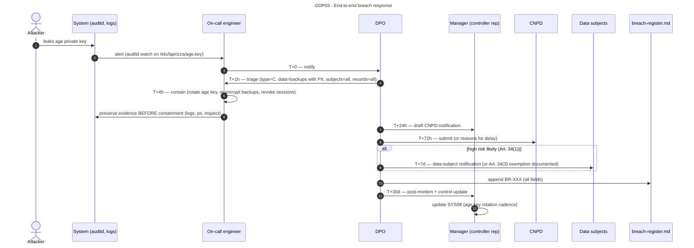
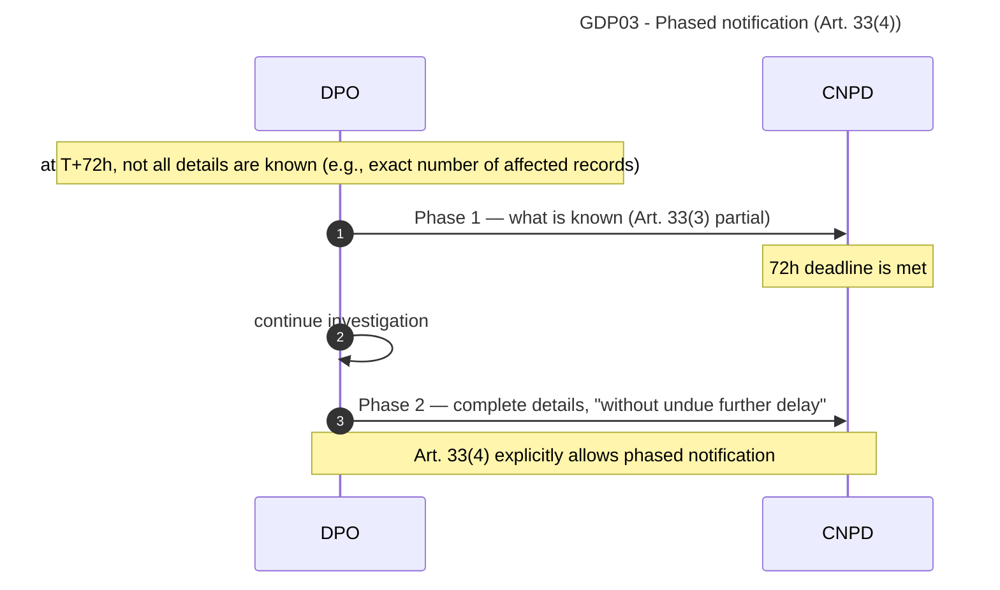

# GDP03 — Personal Data Breach Handling

## 1. Requirements Engineering

### 1.1. User Story Description

As a LaPrizza Representative, I want the team to understand how to respond to a personal data breach that is likely to pose a high risk to customers' rights and freedoms, so that the incident is handled promptly and appropriately.

### 1.2. Customer Specifications and Clarifications

#### From the specification document
> Extracted from *PART IV — Sprint 2 — User Stories* (GDP03, p. 24).

- The team must **define what constitutes a personal data breach**.
- The team must **understand and explain its notification obligations** in the event of a personal data breach as described above, **to whom those notifications must be addressed** and **what information they must contain**.
- The team must **identify the deadline** for notifying the data breach described above.

#### From `docs/gdpr-policy.md` v2.0 §11 (Breach Handling)
- Art. 33/34.
- 72h CNPD notification.
- The policy states: "**Notification to CNPD (Art. 33) — within 72h** — nature, categories/numbers, DPO contact, consequences, measures; reasons if delayed; CNPD electronic form."
- "**Communication to data subjects (Art. 34)** — if high risk, without undue delay; describe breach and mitigation."
- "**Documentation (Art. 33(5))** — every breach documented (even if not notified)."

#### From KB Appendix D.10
- "Breach Handling (GDP03 / Arts. 33–34): 1. Detection & Containment; 2. Assessment; 3. Notification to CNPD (Art. 33) — **within 72h**; 4. Communication to data subjects (Art. 34); 5. Documentation (Art. 33(5))."

#### From SYS06 R-06 and SYS07 §9
- R-06 identifies the GDPR breach as a High risk (P=2, I=5, R=10) with a mitigation that includes the 72h playbook.
- SYS07 §9 statement 6: "No GDPR-mandated notification delayed beyond 72 hours."

### 1.3. Acceptance Criteria (expanded, testable)

#### AC1 — Define what constitutes a personal data breach
- AC1.1 The policy defines a breach per **Art. 4(12)**: *"a breach of security leading to the accidental or unlawful destruction, loss, alteration, unauthorised disclosure of, or access to, personal data transmitted, stored or otherwise processed."*
- AC1.2 The policy classifies breaches by **type** (per EDPB Guidelines 9/2022 on personal data breach notification):
  - **Confidentiality breach** — unauthorised or accidental disclosure of, or access to, personal data.
  - **Integrity breach** — unauthorised or accidental alteration of personal data.
  - **Availability breach** — accidental or unauthorised loss of access to, or destruction of, personal data.
- AC1.3 The policy gives **LaPrizza-specific examples** for each type:
  - **Confidentiality:** `users.password_hash` leaked via SQL injection; `user_dietary_restrictions` exposed to the wrong customer (Art. 9 special category); backup `age` key leaked; OIDC client secret leaked.
  - **Integrity:** `stock_movements` tampered with — an integrity breach that affects **customer safety** because allergen conflicts depend on stock.
  - **Availability:** `customers.*` rows accidentally deleted without backup; DB corruption.
- AC1.4 The policy states that **all three types are notifiable** if they meet the Art. 33(1) risk threshold, and that the **Art. 9 special category** (dietary) raises the risk to **high** in almost all cases (Art. 34 likely triggered).
- AC1.5 The policy states that **any** incident is documented in the breach register (Art. 33(5)) — even if not notifiable — with the reasoning.

#### AC2 — Notification obligations (Art. 33 — CNPD)
- AC2.1 **Deadline:** 72 hours from the moment the controller becomes aware (Art. 33(1)).
- AC2.2 **"Becomes aware"** is defined per EDPB Guidelines 9/2022: *"the moment the controller has a reasonable degree of certainty that a security incident has occurred that has led to personal data being compromised"* — not the moment of the breach, and not the moment of suspicion.
- AC2.3 **Content (Art. 33(3)):** the notification must include, at minimum:
  - the **nature** of the breach, including, where possible, the **categories and approximate number of data subjects** concerned and the **categories and approximate number of personal data records** concerned;
  - the **name and contact details of the DPO** or other contact point;
  - the **likely consequences** of the breach;
  - the **measures taken or proposed** to address the breach, including, where appropriate, measures to mitigate its possible adverse effects.
- AC2.4 **Phased notification (Art. 33(4)):** if it is not possible to provide all the information at the same time, the notification may be made **in phases** without undue further delay, with a first notification within 72h containing what is known and a subsequent one completing it.
- AC2.5 **Reasons for delay:** if the 72h deadline is missed, the notification must be accompanied by **the reasons for the delay** (Art. 33(1), last sentence).
- AC2.6 **Recipient:** the **CNPD** (Comissão Nacional de Proteção de Dados), Portugal — `www.cnpd.pt`, electronic form. The address and the form URL are documented in the policy.
- AC2.7 **Not notifiable (Art. 33(1) exception):** if the breach is **unlikely to result in a risk** to rights and freedoms, notification is not required — but the breach is still **documented** with the reasoning (Art. 33(5)). Examples that may be non-notifiable: a lost device with full-disk encryption where the key is not compromised; a backup tape that is encrypted with `age` and the private key is not on the same device.

#### AC3 — Communication to data subjects (Art. 34)
- AC3.1 **Trigger:** when the breach is likely to result in **high risk** to the rights and freedoms of natural persons (Art. 34(1)).
- AC3.2 **Content:** a **clear and plain language** description of the nature of the breach, the **DPO's contact**, the **likely consequences**, and the **measures taken or proposed** (Art. 34(2)).
- AC3.3 **Recipients:** the affected **data subjects** — `users` and `customers` whose records are in the breach scope. The notification is sent via **email** (from `users.email` / `customers.email`).
- AC3.4 **Exemptions (Art. 34(3)):**
  - (a) the controller has implemented **appropriate technical and organisational protection measures** (e.g., encryption) and those measures were applied to the data affected by the breach — in particular, measures that render the personal data unintelligible to any person who is not authorised to access it (e.g., `age`-encrypted backups where the private key is not compromised);
  - (b) the controller has taken **subsequent measures** that ensure the high risk is no longer likely to materialise;
  - (c) it would involve **disproportionate effort** — in which case a **public communication** or similar measure is used instead.
- AC3.5 **Art. 34(4):** if the controller decides **not** to notify data subjects, the **supervisory authority (CNPD)** may require it, after considering the likelihood of the high risk materialising.
- AC3.6 **Timing:** "without undue delay" — the policy commits to **within 7 days** of the CNPD notification, subject to the exemptions. This is stricter than the regulation's "without undue delay" but is a documented, auditable commitment.

#### AC4 — Escalation timeline (internal)
- AC4.1 The policy has an **internal timeline** stricter than the 72h deadline:
  - **T+0** — detection → DPO notified.
  - **T+1h** — initial triage: what, who, how many, which data categories.
  - **T+4h** — containment decision (revoke sessions, deactivate accounts, isolate host, rotate secrets).
  - **T+24h** — draft CNPD notification (Art. 33(3) content, as complete as possible).
  - **T+48h** — DPO review + legal sign-off.
  - **T+72h** — CNPD notification submitted (or documented reasoning for non-notification).
  - **T+7d** — Art. 34 notification to data subjects (if required).
  - **T+30d** — post-mortem + control update.
- AC4.2 The timeline is **enforced** by the DPO; if a step slips, the DPO documents the slip in the breach register.

#### AC5 — Breach response playbook
- AC5.1 A playbook exists at `docs/gdpr/breach-playbook.md` with:
  - **Detection sources:** `authz_audit_logs` (if implemented), `role_change_logs`, `/var/log/ufw.log`, `ssh-alerts.log`, application error logs, external report (email, DPO, user).
  - **Containment actions per breach type:**
    - Confidentiality (JWT leak): `make rotate-jwt`, re-authenticate all users.
    - Confidentiality (OIDC client secret): rotate the secret at the IdP, update `.env`, restart backend.
    - Confidentiality (`age` key leak): rotate the `age` key, re-encrypt all backups with the new key, invalidate the old key.
    - Integrity: restore from backup (SYS08 §7), verify `entity-schema-parity.spec.ts`.
    - Availability: restore from backup, verify.
  - **Evidence preservation:** before containment, snapshot logs (`docker compose logs > breach-YYYYMMDD.log`), `docker compose ps -a`, `docker inspect` of the affected container, filesystem state (`auditd` output) — do **not** restart before preserving.
  - **Communication:** who (DPO + Manager), what channel (email + phone), what template (CNPD template + data-subject template).
- AC5.2 The playbook is **cross-referenced** from `sys-risk-assessment.md` R-06 and `sys-mbco.md` §6.3 R-06.

#### AC6 — Notification templates
- AC6.1 The **CNPD notification template** exists at `docs/gdpr/templates/cnpd-notification.md` with placeholders for the Art. 33(3) content. The template is **pre-filled** with LaPrizza-specific context (controller name, DPO contact, CNPD form URL).
- AC6.2 The **data-subject notification template** exists at `docs/gdpr/templates/data-subject-notification.md` with the Art. 34(2) content (clear and plain language).
- AC6.3 The templates are **reviewed** by the DPO and **versioned** (a template change is a PR).

#### AC7 — Breach register (Art. 33(5))
- AC7.1 A **breach register** exists at `docs/gdpr/breach-register.md` — append-only.
- AC7.2 Each row has: `id | date_detected | date_aware | type (C/I/A) | data_categories | approx_subjects | approx_records | notifiable (Y/N) | cnpd_notified (date) | subjects_notified (date) | reason_if_not_notified | playbook_ref | post_mortem_ref`.
- AC7.3 The register is **reviewed** at each sprint retrospective (the DPO confirms it is up to date).
- AC7.4 The register is **not** PII — it contains only the **categories** and **counts**, not the actual records. A breach register entry is not itself a PII processing operation.
- AC7.5 **Retention:** the register is kept for **5 years** (aligned with the `role_change_logs` retention), then archived to cold storage.

#### AC8 — Tabletop exercise
- AC8.1 A **tabletop exercise** is executed once during Sprint 2, documented at `docs/gdpr/tabletop-2026-11-XX.md`.
- AC8.2 The exercise simulates **one scenario** (recommended: "backup `age` private key leaked") and walks through:
  - Detection (how do we know? `auditd`, a report, a monitoring alert).
  - T+0 to T+4h (triage and containment).
  - Draft CNPD notification (using the template).
  - Decide Art. 34 (is high risk likely? yes — backups contain PII).
  - Draft data-subject notification.
  - Post-mortem.
- AC8.3 The exercise produces **lessons learned** and at least **one control improvement** (e.g., "add `auditd` watch on the age key file", "add a monthly key-usage review").
- AC8.4 The exercise is **timed** and the elapsed time is compared with the T+4h / T+24h / T+72h targets.

### 1.4. Found out Dependencies

**Preceding:**
- GDP01 (RAT — the data categories and their sensitivity).
- GDP02 (controller + DPO — the notifying party and the DPO contact).
- SYS05 (`ssh-alerts.log`, `auditd` — detection sources).
- SYS08 (`age` key — the recommended tabletop scenario).
- AA05 (`authz_audit_logs` — detection source).
- `docs/gdpr-policy.md` v2.0 §11.

**Succeeding:**
- SYS06 R-06 (references GDP03).
- SYS07 §9 (72h MBCO statement).
- Sprint 2 defense.

### 1.5. Input and Output Data

#### 1.5.1. Deliverables

| File | Status | Purpose |
|---|---|---|
| `docs/gdpr-policy.md` v2.0 §11 | **exists** (5-step process) | Base breach policy |
| `docs/gdpr/breach-policy.md` | **new (gap G1)** | Expanded §11 with Art. 33(3) content, Art. 34(3) exemptions, "becomes aware" definition, T+0…T+30d timeline |
| `docs/gdpr/breach-playbook.md` | **new (gap G2)** | Detection, containment, evidence preservation, communication |
| `docs/gdpr/templates/cnpd-notification.md` | **new (gap G3)** | CNPD notification template |
| `docs/gdpr/templates/data-subject-notification.md` | **new (gap G4)** | Data-subject notification template |
| `docs/gdpr/breach-register.md` | **new (gap G5)** | Append-only register |
| `docs/gdpr/tabletop-2026-11-XX.md` | **new (gap G6)** | Tabletop exercise record |
| `Makefile` target `validate-gdpr` (extended) | **exists** (GDP01 G2) | Add check for the register and templates |

#### 1.5.2. Timeline (excerpt)

```markdown
# Breach response timeline (internal)

| When | Action | Owner | Evidence |
|---|---|---|---|
| T+0 | Detection → DPO notified | on-call | email/Slack |
| T+1h | Initial triage: type, data categories, approx. subjects/records | DPO + on-call | triage note |
| T+4h | Containment decision (revoke sessions, deactivate, isolate, rotate secrets) | on-call | playbook action log |
| T+24h | Draft CNPD notification (Art. 33(3) content) | DPO | `templates/cnpd-notification.md` draft |
| T+48h | DPO review + legal sign-off | DPO | sign-off note |
| T+72h | CNPD notification submitted (or documented reasoning for non-notification) | DPO | CNPD submission receipt |
| T+7d | Art. 34 notification to data subjects (if required and not exempt) | DPO | email template sent |
| T+30d | Post-mortem + control update | team lead | `post-mortem-YYYYMMDD.md` |
```

#### 1.5.3. Breach register schema

```markdown
| id | date_detected | date_aware | type | data_categories | approx_subjects | approx_records | notifiable | cnpd_notified | subjects_notified | reason_if_not_notified | playbook_ref | post_mortem_ref |
|----|---------------|------------|------|-----------------|-----------------|-----------------|------------|---------------|-------------------|------------------------|--------------|------------------|
| BR-001 | 2026-11-20 | 2026-11-20 | C | users.password_hash | 0 (hashed) | 0 | N | — | — | hashes are Argon2id, key not compromised; risk unlikely (Art. 33(1)) | — | — |
| BR-002 | 2026-12-01 | 2026-12-01 | C | users.email, external_idp_subject | 42 | 84 | Y | 2026-12-03 | 2026-12-05 | — | playbook §C-1 | post-mortem-20261201 |
```

#### 1.5.4. `make validate-gdpr` (GDP03 extensions)

1. `breach-playbook.md` exists and covers the three breach types.
2. `templates/cnpd-notification.md` exists and contains all four Art. 33(3) bullets.
3. `templates/data-subject-notification.md` exists and contains all four Art. 34(2) bullets.
4. `breach-register.md` exists with the documented schema (header row matches).
5. The tabletop exercise file exists and is dated.

### 1.6. System Sequence Diagrams (SSD)

#### 1.6.1. End-to-end breach response



#### 1.6.2. 72h timeline (visual)

```mermaid
gantt
    title GDPR breach 72h timeline
    dateFormat HH:mm
    axisFormat %H:%M

    section Detection
    Alert fires           :milestone, t0, 00:00, 0m
    DPO notified          :t1, 00:00, 15m

    section Triage
    Initial triage        :t2, 00:15, 45m
    Type/categories/counts :t3, 01:00, 2h

    section Containment
    Containment decision  :t4, 04:00, 1h
    Execute containment   :t5, 05:00, 3h

    section Notification
    Draft CNPD            :t6, 24:00, 8h
    DPO review + sign-off :t7, 48:00, 4h
    CNPD submission       :milestone, t8, 72:00, 0m

    section Follow-up
    Data subjects (Art. 34):t9, 7d, 1d
    Post-mortem           :t10, 30d, 1d
```

#### 1.6.3. Art. 33(4) phased notification



### 1.7. Other Relevant Remarks

#### 1.7.1. Gap analysis vs `docs/gdpr-policy.md` v2.0 §11

| # | AC | Current state | Gap | Severity | Remediation |
|---|---|---|---|---|---|
| G1 | AC1 — definition + types + examples | §11 defines a breach per Art. 4(12); **no type classification**, **no LaPrizza-specific examples** | **The 3 types (C/I/A) are not distinguished**; the reader must infer from the Art. 4(12) definition | Medium | Add `docs/gdpr/breach-policy.md` with the C/I/A taxonomy + LaPrizza examples |
| G2 | AC2.3 — Art. 33(3) content | §11 says "nature, categories/numbers, DPO contact, consequences, measures" | **The four bullets are paraphrased but not enumerated**; no template | High | Add the enumeration + `templates/cnpd-notification.md` |
| G3 | AC2.5 — reasons for delay | Not present | **No "reasons for delay" requirement** | High | Add to `breach-policy.md` and to the CNPD template |
| G4 | AC3.4 — Art. 34(3) exemptions | §11 says "if high risk, without undue delay; describe breach and mitigation" | **The three exemptions (a/b/c) are not mentioned** | High | Add to `breach-policy.md` |
| G5 | AC4 — internal escalation timeline | Not present | **No T+0…T+30d timeline** | High | Add the timeline (§1.5.2) |
| G6 | AC5 — playbook | Not present | **No detection sources, no containment actions per type** | High | Add `docs/gdpr/breach-playbook.md` |
| G7 | AC6 — templates | Not present | **No CNPD or data-subject template** | High | Add both templates |
| G8 | AC7 — register | Not present | **No append-only breach register** | **Critical** | Add `docs/gdpr/breach-register.md` |
| G9 | AC8 — tabletop | Not present | **No tabletop exercise** | **Critical** | Execute one tabletop in Sprint 2; record at `docs/gdpr/tabletop-2026-11-XX.md` |
| G10 | AC2.2 — "becomes aware" definition | §11 says "within 72h" but does not define the start | **The reader must assume the start** | Medium | Add the EDPB definition |
| G11 | AC3.6 — timing of Art. 34 | §11 says "without undue delay" | **No internal commitment** | Low | Add "within 7 days" commitment |

**Net effect:** the current §11 satisfies the **high-level 5-step process** (detection, assessment, notification, communication, documentation) and the **72h deadline**. It does **not** satisfy the **operational detail** (C/I/A taxonomy, Art. 33(3) content, Art. 34(3) exemptions, timeline, playbook, templates, register, tabletop). These are the artefacts that turn a policy into an **auditable process**.

#### 1.7.2. Decision record — register + tabletop as the evidence

**Decision:** the two **Critical** gaps (register, tabletop) are the evidence the reviewer will look for, and are the minimum to demonstrate that the team **understands** the breach process (not just parrots the 72h deadline).

**Rationale:**
- The US says "the team must **understand and explain** its notification obligations". A register + a tabletop are the only artefacts that demonstrate **understanding** (not just a quote).
- The register enforces Art. 33(5) (documentation of every breach, even if not notifiable).
- The tabletop is the **only** way to test the T+0…T+72h timeline before a real breach.
- The templates make the process **repeatable** (no drafting from scratch under pressure).

**Alternatives considered:**
- *Only the policy*: rejected — the current state; the gaps above are the proof it is not enough.
- *Only a tabletop, no register*: rejected — Art. 33(5) is mandatory; the register is the legal artefact.
- *Only a register, no tabletop*: rejected — the US asks for "understand and explain"; the register alone does not demonstrate understanding, only record-keeping.

#### 1.7.3. Verification matrix (AC → check → evidence)

| AC | Check | Evidence |
|---|---|---|
| AC1.1–AC1.5 | `breach-policy.md` §1 (definition + types + examples) | `docs/gdpr/breach-policy.md` |
| AC2.1–AC2.2 | Timeline + "becomes aware" definition | same file |
| AC2.3–AC2.4 | Art. 33(3) content + phased | same file + CNPD template |
| AC2.5 | Reasons for delay | same file |
| AC2.6 | CNPD address + form | same file |
| AC2.7 | Art. 33(1) exception | same file |
| AC3.1–AC3.6 | Art. 34 content, exemptions, timing | same file + data-subject template |
| AC4.1–AC4.2 | Escalation timeline | `breach-policy.md` §2 |
| AC5.1–AC5.2 | Playbook + cross-references | `breach-playbook.md` + SYS06 R-06 + SYS07 §9 |
| AC6.1–AC6.3 | Templates | `templates/*.md` |
| AC7.1–AC7.5 | Register schema, append-only, 5y retention | `breach-register.md` |
| AC8.1–AC8.4 | Tabletop file, scenario, lessons learned | `tabletop-2026-11-XX.md` |