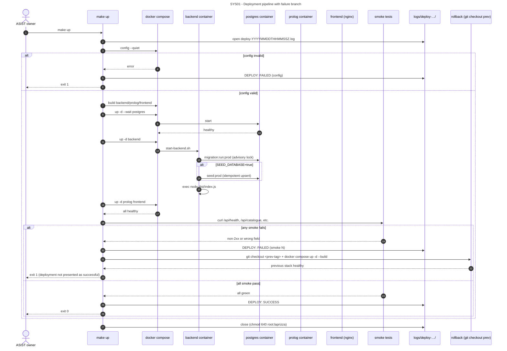
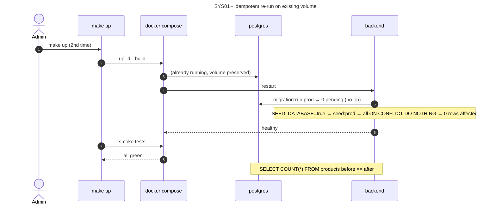

# SYS01 — Automated Deployment and Validation

## 1. Requirements Engineering

### 1.1. User Story Description

As a System Administrator, I want a repeatable deployment pipeline for a system module in a controlled environment of the Department of Informatics Engineering (DEI), so that deployments can be validated regularly.

### 1.2. Customer Specifications and Clarifications

#### From the specification document
> Extracted from *PART IV — Sprint 2 — User Stories* (SYS01, p. 20).

- Deploy **at least one module** through an **automated pipeline** to a **reproducible, isolated environment** suitable for the selected module.
- **Execute validation** based on the project test plan.
- **Archive deployment logs and test results.**
- Make the **deployment schedule configurable**.
- **A failed validation must prevent a deployment from being presented as successful.**
- The **deployed version and configuration must be identifiable**, and a **documented procedure must allow recovery to a previously working version**.
- **Sensitive configuration must be managed separately from published source and deployment logs.**

#### From `sys-deployment.md` (deliverable)
- §1 scope: the full Compose stack (`postgres`, `backend`, `prolog`, `frontend`).
- §3 prerequisites: Docker 24+, Compose 2.20, 4 GB RAM, 20 GB disk, port 443/80 free.
- §4 environment: mandatory (`JWT_SECRET`, `DB_PASSWORD`, `OIDC_*`) and optional (`SEED_DATABASE`, `INVITATION_TTL_HOURS`, `PROLOG_URL`, `ALLOWED_SOURCE_CIDRS`).
- §5 stages 1–7: pre-flight → build → start postgres → backend (migrate + optional seed + start) → prolog → frontend → smoke.
- §6 idempotency at 3 levels (migrations with advisory lock, seed upsert, `make up` re-run).
- §7 smoke tests (health, catalogue, taxonomy, SPA, redirect).
- §8 rollback (git tag + rebuild, with migration caveat).
- §9 monitoring (`/health`, Docker healthchecks, structured logs).
- §10 security alignment (SYS02/SYS03/SYS05).
- §11 backup integration (by container name, not ID).
- §12 verification checklist (10 checks).
- §13 references.

#### From KB
- **KB §37:** CI pipeline `.github/workflows/ci.yml` currently `workflow_dispatch` only (disabled); enabling it in Sprint 2 is the AC's "automated pipeline".
- **KB §38:** Makefile targets (`make up`, `make build`, `make logs`, `make ps`, `make fclean`, `make re`, `make config`, etc.).
- **ADR-008a:** `migration:run:prod` is idempotent via `pg_advisory_lock`.
- **KB §36.4:** `start-backend.sh` runs migrations → seed (conditional) → `exec node dist/index.js`.

### 1.3. Acceptance Criteria (expanded, testable)

#### AC1 — At least one module deployed via automated pipeline to a reproducible, isolated environment
- AC1.1 The Compose stack is started by `make up` (single command) on any host satisfying §3 of the deliverable.
- AC1.2 The environment is **isolated**: the Compose project name is `laprizza`, volumes are prefixed `laprizza_`, containers are prefixed `laprizza_`. No collision with a second stack.
- AC1.3 The environment is **reproducible**: `make build` from the same git tag produces images with identical `sha256` per layer (verified by `docker image inspect --format '{{.Id}}'` twice, or at least identical `docker images` digest for `laprizza_backend:latest` and `laprizza_frontend:latest`).
- AC1.4 The pipeline covers **all four modules** (`postgres`, `backend`, `prolog`, `frontend`), not just one — exceeds the "at least one" requirement.

#### AC2 — Validation based on the project test plan
- AC2.1 Smoke tests (§7 of the deliverable) execute after Stage 6 (frontend healthy). They cover: health, catalogue (BCK03–BCK11 surface), taxonomy (allergens seed), SPA (Nginx `try_files`), redirect (HTTP→HTTPS).
- AC2.2 `make test-db` (DB suite) and `make test` (unit + integration) can be run as part of the pipeline before starting the stack, or after for the target module. The chosen placement is documented.
- AC2.3 The CI pipeline (`.github/workflows/ci.yml` **enabled** in Sprint 2) runs the same validation on every PR to `main`/`develop` (KB §37.1).

#### AC3 — Archive deployment logs and test results
- AC3.1 **Logs.** The pipeline writes each run to `logs/deploy-YYYYMMDDTHHMMSSZ.log` under a volume mounted in the host (`/var/log/laprizza/deploy/`), not only to stdout. The file is `chmod 640 root:laprizza` (readable by the team).
- AC3.2 **Test results.** `make test` and `make test-db` produce JUnit XML (`test-results/*.xml`). The pipeline copies them to `logs/deploy-…/test-results/`.
- AC3.3 **Archive retention.** Logs and results kept for 90 days (aligned with SYS08 config snapshot retention), purged by a cron job (§6 below).
- AC3.4 The `sprint-2-submission` tag includes at least one `logs/deploy-*/` directory showing a green run (a `README` points to it; the log contents are not bloated into git, but the archive is referenced and reproducible).

#### AC4 — Configurable deployment schedule
- AC4.1 The deployment schedule is **not** hard-coded in the pipeline; it is configured in `config/deploy-schedule.yml` (or equivalent) with cron expressions, and executed by either:
  - a **GitHub Actions `schedule:` cron** (for CI validation), and/or
  - a **host cron** (`/etc/cron.d/laprizza-deploy`) for periodic staging redeploys.
- AC4.2 Changing the schedule requires only a config change (no code change), audited in git history.
- AC4.3 The schedule is documented in `sys-deployment.md §5` (currently not present — see gap below).

#### AC5 — Failed validation prevents success
- AC5.1 Any smoke-test failure (`curl` non-2xx, wrong JSON field) causes the pipeline to exit **non-zero**.
- AC5.2 A non-zero exit causes the Docker Compose stack to be **left stopped** (or rolled back to the previous tag) — it is never reported as "deployed".
- AC5.3 The deployment log clearly shows `DEPLOY: FAILED (smoke test N failed)` at the end.
- AC5.4 The evidence in `logs/deploy-…/` shows at least one failing run and its outcome (regression test — the pipeline is deliberately run with one smoke test disabled to produce the failure, then re-enabled).

#### AC6 — Deployed version and configuration identifiable; rollback documented
- AC6.1 `GET /health` returns `version` (from `package.json`), `timestamp`, and `dependencies` (postgres/prolog/idp) — the **deployed version is queryable**.
- AC6.2 The Compose project's **configuration** is queryable via `docker compose -p laprizza config` (the `--quiet` validation and the full output are both reproducible). The current `.env` (without secrets) is archived in the deployment log.
- AC6.3 Rollback is documented (§8 of the deliverable): `git checkout <prev-tag>` → `docker compose up -d --build` → smoke tests. The migration caveat is explicit.
- AC6.4 The rollback procedure is **tested** at least once in Sprint 2 (a demo runs the rollback on a staging tag and shows `/health` returning the previous version).

#### AC7 — Sensitive configuration separated from source and logs
- AC7.1 `.env` is in `.gitignore`. `.env.example` lists **names only**.
- AC7.2 `make check-secrets` runs `gitleaks` locally; `gitleaks` runs as a pre-push hook and in CI (KB §37).
- AC7.3 Logs redact secrets: `gitleaks` output is not committed; `global_exception.filter.ts` redacts the `Authorization` header and any `password`/`token` fields.
- AC7.4 The deployment log records `docker compose config --quiet` (no values) and `env | grep -E '^(JWT_SECRET|DB_PASSWORD|OIDC_)' | wc -l` (counts only, no values).

### 1.4. Found out Dependencies

**Preceding:** `sys-network-config.md` (SYS02/SYS03/SYS05 must be in place for the perimeter to be meaningful), `sys-backup-strategy.md` (SYS08 provides the backup volume that survives redeploy), `sys-shared-folder.md` (SYS04 provides the shared folder the frontend serves), `sys-mbco.md` (SYS07 uses the deployment's `/health`). All Sprint 1 + Sprint 2 migrations.

**Succeeding:** Every other SYS US depends on a working deployment. SYS06's risk assessment references deployment risks (R-01, R-02, R-04).

### 1.5. Input and Output Data

#### 1.5.1. Configuration files

| File | Purpose |
|---|---|
| `.env` (git-ignored) | All environment variables (§4 of the deliverable) |
| `.env.example` | Names only, no values |
| `docker-compose.yml` | Container runtime contract |
| `Makefile` | Canonical interface (`make up`, `make test`, `make test-db`, `make logs`, `make fclean`, `make rotate-jwt`, `make check-secrets`) |
| `backend/start-backend.sh` | Single entrypoint (migrate → optional seed → start) |
| `config/deploy-schedule.yml` (new — gap G1) | Cron expressions for scheduled deploys |
| `.github/workflows/ci.yml` (enable — gap G2) | Pipeline validation |

#### 1.5.2. Evidence artefacts (`sprint-2-submission`)

| Evidence | Location |
|---|---|
| Deployment log (green) | `logs/deploy-YYYYMMDDTHHMMSSZ/deploy.log` |
| Test results | `logs/deploy-…/test-results/*.xml` |
| Failed-run evidence | `logs/deploy-…-fail/deploy.log` |
| Rollback transcript | `docs/asist/evidence/sys01-rollback.md` |
| `docker compose config` snapshot (redacted) | `logs/deploy-…/compose-config.txt` |
| `.env` names count | `logs/deploy-…/env-summary.txt` |

#### 1.5.3. Persistence

No new tables. The deployment itself does not store data in PostgreSQL; it is the pipeline that runs the migrations that create the schema.

### 1.6. System Sequence Diagrams (SSD)

#### 1.6.1. Deployment pipeline with failure rollback

#### 1.6.2. Idempotent re-run

### 1.7. Other Relevant Remarks

#### 1.7.1. Gap analysis vs `sys-deployment.md`

| # | AC | Current state | Gap | Severity | Remediation |
|---|---|---|---|---|---|
| G1 | AC4 — configurable deployment schedule | §5.2 shows commands; no `schedule:` cron and no `config/deploy-schedule.yml` | **Schedule is not configurable**; it is invoked manually or via Makefile | Medium | Add `config/deploy-schedule.yml`; wire it to a GitHub Actions `schedule:` and a host `/etc/cron.d/laprizza-deploy`; document in `sys-deployment.md §5.4` |
| G2 | AC2.3 — CI validation | KB §37: `ci.yml` is `workflow_dispatch` only | **Automated pipeline not active** | Medium | Enable `on: [push, pull_request]` in `ci.yml`; add `gitleaks`, `npm audit`, `make test`; document |
| G3 | AC3 — archive logs | §9 says "structured logs to stdout" | **No archival** of deployment logs or test results | High | Add `logs/deploy-…/` to the pipeline; add `make logs:archive`; cron purge > 90 days |
| G4 | AC6 — rollback tested | §8 documents the procedure | **No evidence** of an executed rollback | Medium | Run a rollback on staging; commit transcript to `docs/asist/evidence/sys01-rollback.md` |
| G5 | AC7 — secrets in logs | §10 mentions `gitleaks` | **gitleaks not wired to pre-push / CI** | High | Add `.pre-commit-config.yaml` with `gitleaks` hook; add `make check-secrets`; run in CI |
| G6 | AC1.3 — reproducible build | §5.1 builds but no digest check | **Reproducibility not demonstrated** | Low | Add `make verify-repro` that builds twice and diffs `docker image inspect` digests |

All 6 gaps are **additive to `sys-deployment.md`** — the document's technical content is correct; the gaps are about the ACs' *evidence*, *automation*, and *audit trail*.

#### 1.7.2. Verification matrix (AC → check → evidence)

| AC | Check | Evidence |
|---|---|---|
| AC1.1 | `make up` on fresh host | `logs/deploy-…/deploy.log` line "all healthy" |
| AC1.2 | `docker compose -p laprizza ps` shows `laprizza_*` | `logs/deploy-…/ps.txt` |
| AC1.3 | `make verify-repro` | `logs/deploy-…/repro.txt` |
| AC2.1 | Smoke tests in §7 | `logs/deploy-…/smoke.txt` |
| AC2.2 | `make test` and `make test-db` in pipeline | `logs/deploy-…/test-results/*.xml` |
| AC2.3 | `.github/workflows/ci.yml` runs on push | CI run URL in `docs/asist/evidence/sys01-ci.md` |
| AC3.1 | `ls logs/deploy-*` | Log file exists, `chmod 640` |
| AC3.2 | JUnit XML present | `test-results/` directory |
| AC3.3 | Cron purge > 90 days | `crontab -l` + `find logs/ -mtime +90` empty |
| AC4.1 | `config/deploy-schedule.yml` exists | `cat config/deploy-schedule.yml` |
| AC4.2 | Schedule change requires only config | git log on `deploy-schedule.yml` |
| AC5.1 | Failing smoke exits non-zero | `logs/deploy-…-fail/` |
| AC5.2 | Stack stopped or rolled back | `docker compose ps` empty or previous tag |
| AC5.3 | Log shows `DEPLOY: FAILED` | tail of `deploy-…-fail/deploy.log` |
| AC6.1 | `curl /health` shows `version` | `smoke.txt` |
| AC6.2 | `docker compose config` snapshot | `compose-config.txt` |
| AC6.3 | `sys-deployment.md §8` | doc reference |
| AC6.4 | `sys01-rollback.md` transcript | evidence file |
| AC7.1–AC7.3 | `gitleaks` + `.gitignore` + redaction | `.pre-commit-config.yaml`, `global_exception.filter.ts` |