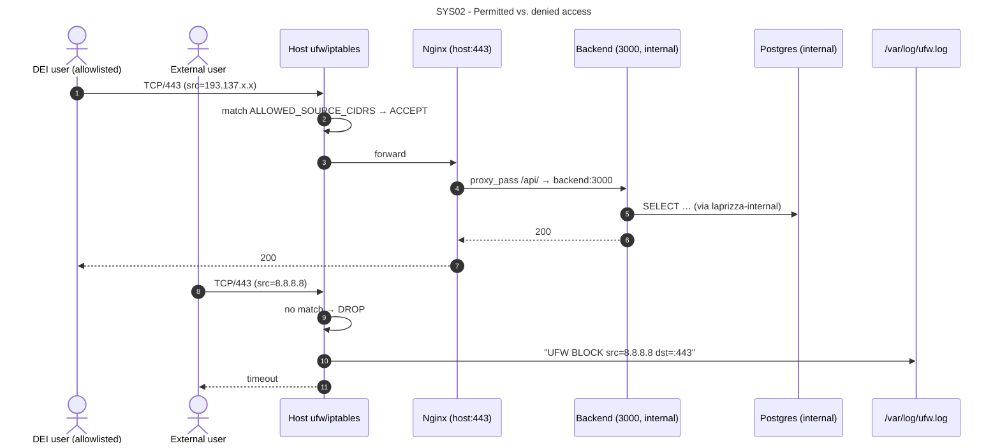
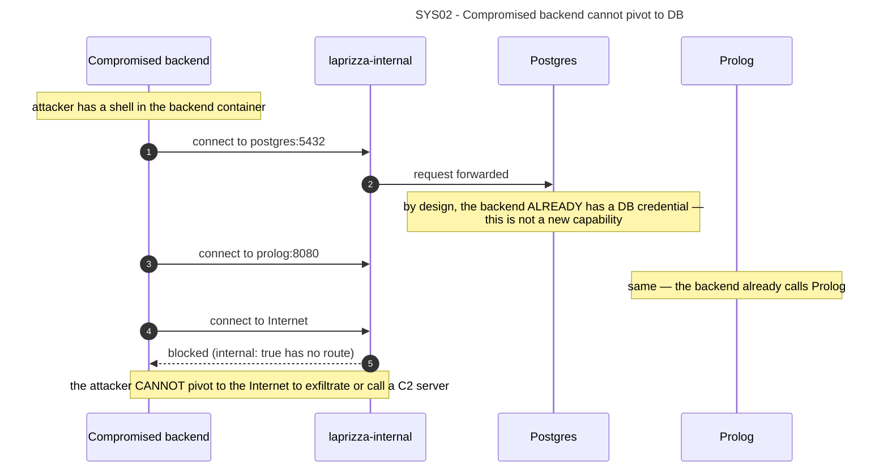

# SYS02 — Institutional Network Access Restriction

## 1. Requirements Engineering

### 1.1. User Story Description

As a System Administrator, I want development and staging access restricted to the DEI internal network or a Virtual Private Network (VPN), so that access follows the approved network context.

### 1.2. Customer Specifications and Clarifications

#### From the specification document
> Extracted from *PART IV — Sprint 2 — User Stories* (SYS02, p. 21).

- **Restrict development and staging access** to the **DEI internal network or VPN**, using **host or proxy rules**.
- **Keep application authentication and role checks active** in addition to network restrictions.
- **Deny and log** access from unapproved network contexts.
- **Document the configuration** and **demonstrate both permitted internal access and denied external access**.

#### From `sys-network-config.md` (deliverable)
- §2.1 zones: Internet → Perimeter (Nginx, TLS, DEI allowlist) → Application zone → DB/Prolog (internal).
- §2.2 Docker networks: `laprizza-network` (bridge, external-facing) and `laprizza-internal` (bridge, `internal: true`, no route out) — **key defence-in-depth control**.
- §3.1 principles: default deny inbound, source-IP restriction, default allow outbound (constrained by SYS03), no inbound except HTTPS from DEI ranges.
- §3.2 `ufw` baseline: allow 443/80/2222 only from validated DEI source pools; the current VM validation confirms `10.8.0.0/16` for DEINET clients.
- §3.3 `.env`-driven allowlist: `ALLOWED_SOURCE_CIDRS`, `ADMIN_SSH_PORT`, `ALLOW_PUBLIC_HTTPS=false`.
- §8 verification checklist items 1–4 (perimeter active, default deny inbound, egress allowlist active, only DEI/VPN can reach HTTPS).

#### From KB
- **KB §16.1 (security):** Broken Access Control is a top-10 risk; server-side validation is mandatory.
- **KB §39.3:** Nginx terminates TLS on 443, reverse-proxies `/api/` to `backend:3000`.
- **ADR-004:** JWT + roles guard runs in addition to network restrictions.

### 1.3. Acceptance Criteria (expanded, testable)

#### AC1 — Restrict access to DEI or VPN via host/proxy rules
- AC1.1 The host's `ufw` (or iptables equivalent) enforces: allow inbound 443/80/2222 **only** from `ALLOWED_SOURCE_CIDRS` (validated per deployment); default deny incoming for everything else.
- AC1.2 The Nginx config (`frontend/nginx.conf` §39.3) does **not** itself implement IP allowlisting (the host does); the frontend is published on the host and protected by the host firewall, which is the only access-control boundary.
- AC1.3 Docker networks: `postgres` and `prolog` are on `laprizza-internal` (`internal: true`) — no route out; `backend` is on both; `frontend` is on `laprizza-network` only. This means that even a compromise of the backend cannot pivot to the DB or Prolog without first compromising the backend host (defence in depth).
- AC1.4 The `ALLOWED_SOURCE_CIDRS` env var is the single source of truth; the provisioning script expands it to `ufw` rules without code changes.

#### AC2 — Application auth + role checks active in addition to network
- AC2.1 `JwtAuthGuard`, `UserStatus.guard`, `RolesGuard` (AA04/AA05) run on **every** protected endpoint, regardless of the source IP. Network restriction is **not** a substitute for auth.
- AC2.2 A request from an allowlisted IP **without** a valid JWT still gets `401` (verified in the smoke test suite).
- AC2.3 A request from an allowlisted IP **with** a valid JWT but the wrong role gets `403` (AA05 AC).

#### AC3 — Deny and log access from unapproved network contexts
- AC3.1 `ufw` logs dropped packets to `/var/log/ufw.log` (or the syslog destination) with the source IP, destination port, and timestamp. `ufw logging on` is set in the provisioning script.
- AC3.2 The Nginx access log records the `X-Forwarded-For` header (per §39.3) — but since only the host firewall should reach Nginx, the `X-Forwarded-For` is used only for downstream logging, not for access control.
- AC3.3 A daily cron job (`/etc/cron.d/laprizza-ufw-report`) summarises denied packets and emails the ASIST owner (daily at 07:00 local).

#### AC4 — Demonstrate permitted and denied
- AC4.1 **Permitted**: from a DEI IP (or VPN), `curl https://laprizza.local/api/health` returns 200. Evidence: `docs/asist/evidence/sys02-allowed.txt` (screenshot or curl output with the source IP).
- AC4.2 **Denied**: from an external IP (e.g., a public 4G tether or a second host on a different network), `curl https://laprizza.local/api/health` times out or gets `Connection refused`. Evidence: `docs/asist/evidence/sys02-denied.txt` (curl output + `ufw` log showing the drop).
- AC4.3 The denied request is logged in `/var/log/ufw.log` with the source IP and the reason (`UFW BLOCK`).

### 1.4. Found out Dependencies

**Preceding:** SYS01 (deployment produces the host and the container networks). SYS03 (egress allowlist runs on the same host; together SYS02 and SYS03 form the network policy). SYS05 (SSH access is restricted on the same host; the firewall allows port 2222 only from DEI/VPN).

**Succeeding:** SYS06 (risk assessment references SYS02 as a mitigation for R-08). SYS07 (MBCO for S-11 Nginx depends on SYS02 being in place).

### 1.5. Input and Output Data

#### 1.5.1. Configuration

| File / var | Purpose |
|---|---|
| `ALLOWED_SOURCE_CIDRS` in `.env` | Comma-separated allowlist of validated DEI source pools; current VM: `10.8.0.0/16` |
| `ADMIN_SSH_PORT` in `.env` | Default `2222` |
| `ALLOW_PUBLIC_HTTPS` in `.env` | Default `false`; if `true`, the firewall permits 443 from anywhere and Certbot issues a real cert |
| `scripts/firewall.sh` | Reads env vars; applies `ufw` rules |
| `docker-compose.yml` networks | `laprizza-network`, `laprizza-internal` |

#### 1.5.2. Evidence (`sprint-2-submission`)

| Evidence | Location |
|---|---|
| `ufw status verbose` from a live host | `docs/asist/evidence/sys02-ufw.txt` |
| Permitted curl (DEI IP) | `docs/asist/evidence/sys02-allowed.txt` |
| Denied curl (external IP) + ufw log line | `docs/asist/evidence/sys02-denied.txt` |
| Daily denied-packets summary | `logs/ufw-report/YYYYMMDD.txt` (first one committed) |

#### 1.5.3. Persistence

No new tables. The network rules are host-level state, persisted in `scripts/firewall.sh` and reproduced on every host rebuild.

### 1.6. System Sequence Diagrams (SSD)

#### 1.6.1. Permitted vs. denied access

#### 1.6.2. Defence in depth — a compromised backend cannot reach DB directly

The point of `laprizza-internal` is **egress control**, not inter-service isolation (the backend legitimately talks to both Postgres and Prolog). The control that matters is that a compromised backend cannot open a socket to the Internet — verified by `iptables -L OUTPUT` on the host (SYS03) and by the `internal: true` network having no default route.

### 1.7. Other Relevant Remarks

#### 1.7.1. Gap analysis vs `sys-network-config.md`

| # | AC | Current state | Gap | Severity | Remediation |
|---|---|---|---|---|---|
| G1 | AC1.4 — `.env`-driven allowlist | §3.3 documents `ALLOWED_SOURCE_CIDRS` and `ALLOW_PUBLIC_HTTPS` | **Provisioning script does not yet read the var** — `firewall.sh` hard-codes `DEI_NET`/`DEI_VPN` | Medium | Read `${ALLOWED_SOURCE_CIDRS}` and expand `ufw` rules from it; keep the hard-coded defaults as a fallback |
| G2 | AC3.1 — logging | §2 says "deny and log" | `ufw logging on` not explicitly in `firewall.sh` | Low | Add `ufw logging on` (or `ufw default deny incoming` already implies it in recent `ufw`) |
| G3 | AC3.3 — daily report | Not present | No daily summary | Low | Add `/etc/cron.d/laprizza-ufw-report` |
| G4 | AC4 — evidence | §8 verification checklist lists the checks | **No committed evidence files** in `docs/asist/evidence/` | Medium | Add the three files listed in §1.5.2 |

#### 1.7.2. Decision record — Nginx does not IP-allowlist

**Decision:** IP allowlisting is done **only** at the host firewall, not at Nginx.

**Rationale:**
- If Nginx IP-allowlists but the host firewall does not, a bypass through a Docker-published port (a common mistake — `ports: 80:80` without `127.0.0.1:` prefix) exposes the service.
- The host firewall is the single, auditable control; Nginx is a reverse proxy, not a firewall.
- The frontend publishes host ports `80` and `443`; UFW restricts both ports to `ALLOWED_SOURCE_CIDRS`.

**Alternatives considered:**
- *Nginx `allow`/`deny` directives*: rejected — duplicated control, and a forgotten directive in a `location` block can leak.
- *Cloudflare-style WAF*: rejected — no cloud dependency for the academic prototype.

#### 1.7.3. Verification matrix (AC → check → evidence)

| AC | Check | Evidence |
|---|---|---|
| AC1.1 | `ufw status verbose` | `sys02-ufw.txt` |
| AC1.2 | `ss -tlnp` shows host ports `80/443`; `ufw status verbose` restricts them to `ALLOWED_SOURCE_CIDRS` | `sys02-ufw.txt` line |
| AC1.3 | `docker network inspect laprizza-internal` shows `internal: true` | `docker network inspect` output |
| AC1.4 | `grep ALLOWED_SOURCE_CIDRS firewall.sh` | code review |
| AC2.1–AC2.3 | Smoke tests: `curl /api/health` no-JWT → 401 | `smoke.txt` |
| AC3.1 | `grep UFW BLOCK /var/log/ufw.log` | `sys02-denied.txt` |
| AC3.2 | Nginx `X-Forwarded-For` in log | `make logs SERVICE=frontend` |
| AC3.3 | `crontab -l` shows the report job | `crontab -l` output |
| AC4.1 | curl from DEI IP → 200 | `sys02-allowed.txt` |
| AC4.2 | curl from external → timeout | `sys02-denied.txt` |