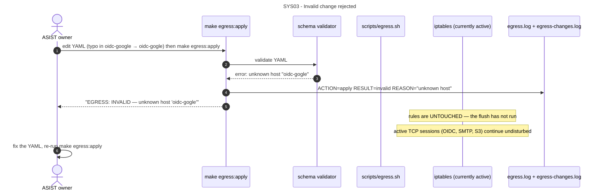

# SYS03 — Configurable Allowed Endpoints

## 1. Requirements Engineering

### 1.1. User Story Description

As a System Administrator, I want a simple configuration file for allowed client endpoints, so that network access rules can be maintained easily.

### 1.2. Customer Specifications and Clarifications

#### From the specification document
> Extracted from *PART IV — Sprint 2 — User Stories* (SYS03, p. 21).

- Document a **simple configuration-file format** for allowed client endpoints and **apply valid changes without restarting the system**.
- **Detect and log invalid changes, keeping the last valid configuration active.**
- **Allow only authorized administrators to change the configuration and record those changes.**

#### From `sys-network-config.md` (deliverable)
- §4.1 format: `config/allowed-endpoints.yml` with `version`, `metadata`, `defaults` (`action: deny`, `log: true`), and `endpoints[]` (each with `name`, `protocol`, `port`/`ports`, `destinations[]`, `purpose`, `sprint`, optional `internal_only`).
- §4.2 enforcement: `scripts/egress.sh` translates YAML to `iptables`, `default deny OUTPUT`, per-endpoint ACCEPT rules, log denied egress.
- §4.3 dynamic: DNS re-resolution every 6 hours; unknown destinations logged; PR to the YAML required for new endpoints.
- §8 verification checklist items 3, 9, 10 (egress allowlist active, DB/Prolog not exposed).

#### From KB
- **KB §16.1:** least privilege, defence in depth.
- **KB §35 (Linux firewalls):** `iptables`, `-A` (append), `-I` (insert), `-F` (flush), `-P` (policy).
- **KB §31 (firewall types):** stateful inspection is the baseline.

### 1.3. Acceptance Criteria (expanded, testable)

#### AC1 — Simple configuration file format documented and applied without restart
- AC1.1 The format is documented in `sys-network-config.md §4.1` and is a single YAML file (`config/allowed-endpoints.yml`) with a `version` field for forward compatibility.
- AC1.2 Applying a valid change runs `scripts/egress.sh` (or `make egress:apply`), which:
  - **flushes** the `OUTPUT` chain (`iptables -F OUTPUT`),
  - **re-applies** the default policy and every rule from the current YAML,
  - **does not restart** any container, the host, or the Docker daemon.
- AC1.3 The applied rules can be verified with `iptables -L OUTPUT -n --line-numbers` and match the YAML (1:1 mapping).
- AC1.4 The script is idempotent: running it twice produces the same rule set (no duplicate ACCEPTs).
- AC1.5 A `systemd` timer (`laprizza-egress.timer`) runs `/bin/bash /opt/laprizza/scripts/egress.sh` every 6 hours to refresh DNS-resolved IPs (§4.3 of the deliverable), producing identical rules when the YAML has not changed. Installation is performed with `make egress-timer`; no manual drop-in override is required.
- AC1.6 The generated policy allows UDP/TCP port 53 only to the IPv4 nameservers listed in `/etc/resolv.conf`, so DNS re-resolution continues to work after `OUTPUT DROP`.
- AC1.7 Applying SYS03 preserves `INPUT`, `FORWARD`, UFW chains, and Docker chains; only the `OUTPUT` chain is replaced.
- AC1.8 The generated `OUTPUT` policy explicitly permits TCP replies from SSH port 2222 to the validated DEINET VPN pool (`10.8.0.0/16`), preserving the active administration session while retaining default-deny egress.

#### AC2 — Detect and log invalid changes, keep last valid configuration
- AC2.1 `scripts/egress.sh` validates the YAML against a **JSON Schema** (`config/allowed-endpoints.schema.json`) before applying. On validation failure:
  - the script exits non-zero,
  - the script logs the failure to `/var/log/laprizza/egress.log` with the pointer and reason,
  - the **previously applied iptables rules are left untouched** (no `iptables -F` before validation succeeds).
- AC2.2 A semantic check rejects unknown destination hosts that do not resolve (to prevent "typo locks out the DB"), unknown `protocol`, invalid `port`, `internal_only: true` on a public destination.
- AC2.3 The `systemd` timer runs the same validation; a failure leaves the previous rules active and pages the ASIST owner.
- AC2.4 `make egress:apply` **never** silently succeeds on an invalid YAML — it prints `EGRESS: INVALID` and the reason.

#### AC3 — Only authorized administrators can change; record changes
- AC3.1 The YAML file is owned `root:laprizza`, mode `0640`. Only users in `laprizza` group (SSH admin accounts — SYS05) can edit it.
- AC3.2 The YAML lives in git (`config/allowed-endpoints.yml`); every change is a PR reviewed by the ASIST owner (documented in `sys-network-config.md §4.2`).
- AC3.3 Every `make egress:apply` (manual or via the timer) appends to `/var/log/laprizza/egress-changes.log`:
  ```
  TS=<utc> ACTOR=<user> ACTION=apply RESULT=success|invalid RULES=<count> SHA256=<yaml-sha> SRC=<git-commit-or-"uncommitted">
  ```
- AC3.4 The log is rotated by `logrotate` (daily, 90-day retention) and is not world-readable (`chmod 640 root:laprizza`).
- AC3.5 The `ufw` / `iptables` rules are **not** editable by non-root users — the enforcement of AC3.1–AC3.4 is the primary control; the shell access restriction (SYS05) is the secondary.

### 1.4. Found out Dependencies

**Preceding:** SYS01 (host + containers). SYS02 (perimeter rules; SYS03 handles egress). SYS05 (SSH admin accounts — the only identities that can edit the YAML).

**Succeeding:** SYS06 (risk assessment references SYS03 as a mitigation for R-08 and R-09). SYS07 (MBCO assumes egress is allowlisted for IdP, SMTP, S3).

### 1.5. Input and Output Data

#### 1.5.1. Format (excerpt)

```yaml
version: 1
metadata:
  owner: team-3dj-05
  last_updated: 2026-11-11
defaults:
  action: deny
  log: true
endpoints:
  - name: oidc-google
    protocol: tcp
    port: 443
    destinations: [accounts.google.com, oauth2.googleapis.com]
    purpose: "External identity provider"
    sprint: 2
  - name: prolog
    protocol: tcp
    port: 8080
    destinations: [prolog]
    internal_only: true
```

Schema at `config/allowed-endpoints.schema.json`:
- `version`: integer, required, `= 1`.
- `endpoints[]`: array, `minItems: 1`.
  - `name`: string, `uniqueItems` enforced by an external check (not in schema).
  - `protocol`: enum `tcp|udp|icmp`.
  - `port` xor `ports[]` (one of them, not both); integers `1..65535`.
  - `destinations[]`: array of strings; each is either a DNS name or a CIDR.
  - `purpose`: string, `minLength: 5`.
  - `sprint`: integer `1..3`.
  - `internal_only`: boolean (default false).

#### 1.5.2. Evidence (`sprint-2-submission`)

| Evidence | Location |
|---|---|
| `iptables -L OUTPUT -n` (applied rules) | `docs/asist/evidence/sys03-rules.txt` |
| `make egress:apply` on valid YAML | `logs/deploy-…/egress.log` |
| `make egress:apply` on invalid YAML (rejected) | `docs/asist/evidence/sys03-invalid.txt` |
| Last-valid preserved (iptables diff before/after invalid) | same file |
| Change audit log | `logs/egress-changes/` (first entry committed) |
| `systemd` timer status | `systemctl status laprizza-egress.timer` |

#### 1.5.3. Persistence

No new tables. The YAML is in git; the audit log is on the host's filesystem.

### 1.6. System Sequence Diagrams (SSD)

#### 1.6.1. Valid change applied without restart

```mermaid
sequenceDiagram
autonumber
title SYS03 - Valid change applied without restart
    actor Admin as ASIST owner
    participant Make as make egress:apply
    participant Schema as allowed-endpoints.schema.json
    participant Script as scripts/egress.sh
    participant IPT as iptables
    participant Log as egress-changes.log

    Admin->>Make: edit YAML (add new endpoint) then make egress:apply
    Make->>Schema: validate YAML
    alt schema invalid
        Schema-->>Make: errors[]
        Make->>Log: ACTION=apply RESULT=invalid
        Make-->>Admin: exit 1 (rules untouched)
    else schema valid
        Schema-->>Make: ok
        Make->>Script: apply
        Script->>IPT: -F OUTPUT (flush)
        Script->>IPT: -P OUTPUT DROP (default deny)
        Script->>IPT: -A OUTPUT -m state --state ESTABLISHED,RELATED -j ACCEPT
        Script->>IPT: -A OUTPUT -o lo -j ACCEPT
        Script->>IPT: -A OUTPUT -d 172.16.0.0/12 -j ACCEPT (docker networks)
        loop endpoints in YAML
            Script->>IPT: -A OUTPUT -d <resolved IP> -p tcp --dport <port> -j ACCEPT
        end
        Script->>IPT: -A OUTPUT -j LOG --log-prefix "EGRESS-DENY:"
        IPT-->>Script: rules active (no restart)
        Script->>Log: ACTION=apply RESULT=success RULES=<n> SHA256=<yaml>
        Make-->>Admin: exit 0
        Note over IPT: containers are NOT restarted; existing TCP sessions are preserved (ESTABLISHED rule)
    end
```

#### 1.6.2. Invalid change rejected, last valid preserved



### 1.7. Other Relevant Remarks

#### 1.7.1. Gap analysis vs `sys-network-config.md`

| # | AC | Current state | Gap | Severity | Remediation |
|---|---|---|---|---|---|
| G1 | AC1.2 — apply without restart | §4.2 script uses `iptables -A` (append) | **`egress.sh` is not idempotent** — re-running accumulates rules; worse, it does not flush, so an endpoint **removed** from the YAML is still allowed | **High** | Rewrite `egress.sh`: `iptables -F OUTPUT` **after** validation succeeds; then `-P OUTPUT DROP`; then re-apply all rules. Add a `--dry-run` mode. |
| G2 | AC2.1 — validation before apply | §4.2 script resolves `destinations` but does not validate the whole YAML against a schema | **Invalid change applies and locks the system out** (the current flush-free approach partially hides this, but the append-only rules are silently wrong) | **High** | Add `config/allowed-endpoints.schema.json`; validate first, apply only on success |
| G3 | AC2.2 — semantic check | Not present | **Typo in a hostname silently drops the DNS resolution to empty → no ACCEPT for that endpoint → silent outage** | **High** | Reject empty resolution; warn if a "known" host resolves to zero IPs |
| G4 | AC2.4 — never silently succeed | §4.2 script exits 0 on iptables success | **No failure path for invalid YAML** | High | Same as G2 |
| G5 | AC3.3 — change audit | §4.2 mentions PR review but no runtime log | **No log of who applied what and when** | Medium | Add `/var/log/laprizza/egress-changes.log` with `TS ACTOR ACTION RESULT RULES SHA256 SRC` |
| G6 | AC3.4 — log access control | Not present | Log permissions not specified | Low | `chmod 640 root:laprizza`; `logrotate` daily |
| G7 | AC1.5 — timer | §4.3 mentions "systemd timer every 6 h" | **Timer not present in the repo** | Medium | Add `systemd/laprizza-egress.{service,timer}` |

**Net effect:** as written, the current `sys-network-config.md §4` documents the *intent* but the `egress.sh` sketch (which is illustrative, not the actual implementation) does not satisfy AC1.2, AC2.1, AC2.2, or AC3.3. The rewrite is small (≈ 40 lines of bash) but mandatory for the ACs.

#### 1.7.2. Decision record — YAML vs. iptables-restore file

**Decision:** YAML is the source of truth; `iptables-restore` is generated by the script and applied with `iptables-restore`.

**Rationale:**
- `iptables-restore` is **atomic** (either the whole file applies or none of it), which is strictly better than the current `-A` sequence.
- The YAML is human-editable and version-controlled.
- The generated `iptables.restore` file is committed **only in CI artefacts**, not in git (it contains environment-specific IPs).

**Alternatives considered:**
- *`iptables-save` / `iptables-restore` directly from a shell script with `-A`*: current approach; rejected because it is not idempotent and not atomic.
- *`nftables`*: rejected — Ubuntu 22.04 ships with `nftables`, but the team's `ufw` and `iptables` baseline is already in place; migrating is not worth it.
- *FirewallD*: rejected — not the team's platform.

#### 1.7.3. Verification matrix (AC → check → evidence)

| AC | Check | Evidence |
|---|---|---|
| AC1.1 | YAML + schema exist | `cat config/allowed-endpoints.{yml,schema.json}` |
| AC1.2 | Apply without restart: `systemctl status docker` unchanged, `docker ps` unchanged, `iptables -L OUTPUT` updated | `sys03-rules.txt` + `docker ps` before/after |
| AC1.3 | `iptables -L OUTPUT` matches YAML 1:1 | `sys03-rules.txt` |
| AC1.4 | `make egress:apply` twice → same `iptables -L OUTPUT` | diff of two runs |
| AC1.5 | `systemctl status laprizza-egress.timer` | timer status |
| AC2.1 | Invalid YAML → `EGRESS: INVALID`; rules unchanged | `sys03-invalid.txt` + `iptables -L` before/after |
| AC2.2 | Typo hostname → error | `sys03-invalid.txt` |
| AC2.3 | Timer runs same validation | `journalctl -u laprizza-egress` |
| AC2.4 | Exit code on invalid | `echo $?` after `make egress:apply` |
| AC3.1 | File permissions | `ls -la config/allowed-endpoints.yml` |
| AC3.2 | git log on the YAML | `git log -- config/allowed-endpoints.yml` |
| AC3.3 | Change log entries | `tail /var/log/laprizza/egress-changes.log` |
| AC3.4 | `logrotate` config | `cat /etc/logrotate.d/laprizza-egress` |
| AC3.5 | Non-root cannot `iptables -F` | `sudo -u laprizza-lead iptables -F` → permission denied |