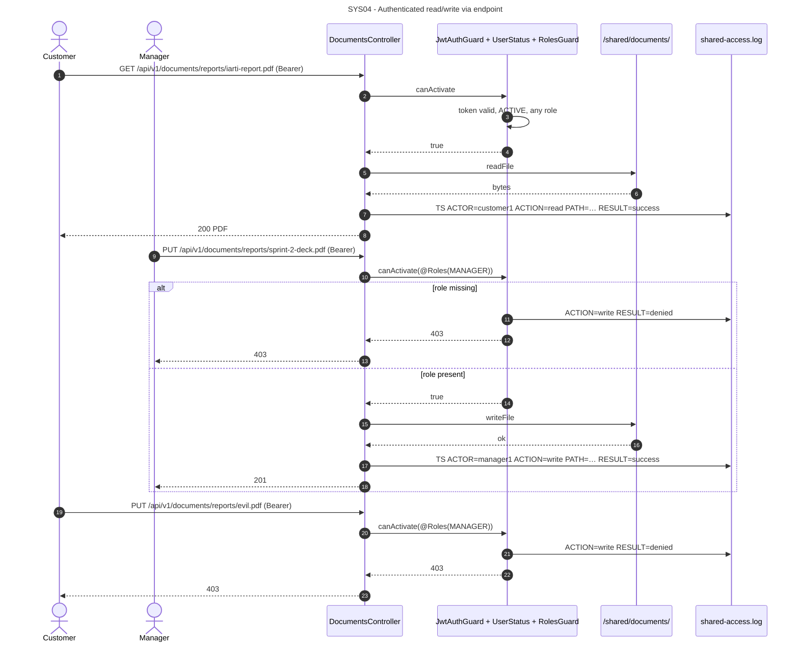
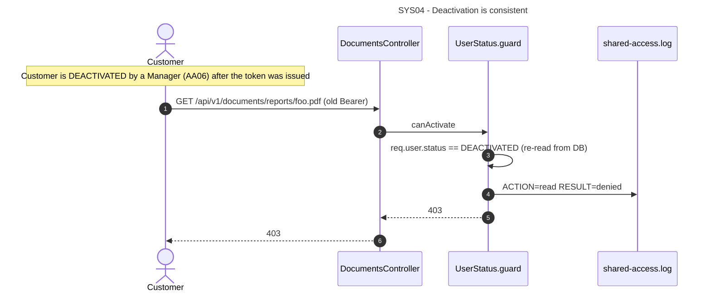

# SYS04 — Shared Resource Folder

## 1. Requirements Engineering

### 1.1. User Story Description

As a System Administrator, I want a shared folder for registered users, so that restaurant documents can be distributed with controlled access.

### 1.2. Customer Specifications and Clarifications

#### From the specification document
> Extracted from *PART IV — Sprint 2 — User Stories* (SYS04, p. 21).

- **All authenticated users can read** shared restaurant resources, such as **operational documents and project reports**.
- **Only authorized administrators can write** to the folder.
- **Document the folder location and permissions, and audit access.**
- **Customer records, dietary profiles, credentials, backup contents, and other restricted information must not be placed in the shared folder.**
- **Access must require an active authenticated account**, and **withdrawn permissions must take effect consistently**.

#### From `sys-shared-folder.md` (deliverable)
- §2 distinguishes shared folder from backups.
- §3 physical definition: Docker volume `laprizza-shared` bind-mounted at `/var/lib/laprizza/shared`.
- §4 directory structure: `3d-assets/`, `kitchen-schemas/`, `planning-inputs/`, `planning-outputs/`, `exports/`, `tmp/`.
- §5 ownership and POSIX modes: `laprizza:laprizza` `0750` on `/shared`, `0755` on served subfolders, `1777` on `tmp/` (sticky).
- §5.2 extended ACLs for the SGRAI group.
- §6 retention per subfolder (cron).
- §7 relationship with backups (opt-in `BACKUP_SHARED`).
- §8 GDPR: no PII in the folder.
- §9 verification checklist (8 items).

#### From KB
- **KB §27 (users, groups, permissions):** POSIX model, sticky bit, extended ACLs.
- **KB §34.5 (backup strategies):** mirroring vs. backup — the shared folder is neither.

### 1.3. Acceptance Criteria (expanded, testable)

#### AC1 — All authenticated users can read; only admins can write
- AC1.1 The shared folder exposes a **served** subfolder (`/shared/documents/`) that is reachable by **any authenticated user** (Customer, Employee, Manager) via an authenticated endpoint. *(Gap — see §1.7.1 G1.)*
- AC1.2 The endpoint requires `JwtAuthGuard` + `UserStatus.guard` (AA04). A `401` is returned without a valid token; a `403` for `DEACTIVATED`/`PENDING_REGISTRATION`.
- AC1.3 Writes to `/shared/documents/` are restricted to `MANAGER` (Table 1: only the Manager can administer restaurant resources).
- AC1.4 The container-level mount mode is `rw` for `backend`, `ro` for `frontend` and `prolog` — already in `sys-shared-folder.md §3`.
- AC1.5 A `CUSTOMER` attempting to write to `/shared/documents/` via the endpoint gets `403`.

#### AC2 — Location and permissions documented; access audited
- AC2.1 §3–§5 of the deliverable document the location, mount mode, POSIX modes, and ACLs — already satisfied.
- AC2.2 Every read and write to `/shared/documents/` via the endpoint is logged to an **access audit log** with:
  ```
  TS=<utc> ACTOR=<username> ACTION=read|write PATH=<relative-path> RESULT=success|denied SRC=<ip>
  ```
- AC2.3 The audit log is `chmod 640 root:laprizza`, rotated by `logrotate` with 90-day retention.
- AC2.4 Direct filesystem reads (e.g., via SSH) are also auditable — `auditd` watch on `/shared/documents/` (`-w /shared/documents -p rwa -k shared-docs`). *(Gap — see §1.7.1 G2.)*

#### AC3 — No customer records, dietary, credentials, backups
- AC3.1 The folder contains **only** the subfolders in §4 of the deliverable. There is **no** `customers/`, `users/`, `dietary/`, `credentials/`, `backups/` subfolder.
- AC3.2 A pre-commit / pre-deploy check greps the folder for PII patterns (emails, phone numbers, dietary allergen names) and fails if found. *(Gap — see §1.7.1 G3.)*
- AC3.3 The `sys-shared-folder.md §8` statement ("contains no personal data") is verified by this check.

#### AC4 — Access requires active authenticated account; withdrawals take effect consistently
- AC4.1 A `DEACTIVATED` user cannot read or write — `UserStatus.guard` enforces on every request (AA04).
- AC4.2 A user whose `MANAGER` role was revoked loses write access on the **next** request — `RolesGuard` re-reads from DB (AA05).
- AC4.3 Removal of a user from the `laprizza` group removes filesystem access; the effect is **consistent** with the endpoint because the endpoint re-reads `req.user` from the DB on every request (no token caching of the user's roles — AA04 AC2).

### 1.4. Found out Dependencies

**Preceding:** SYS01 (deployment). SYS02 (network restrictions — the endpoint is reachable only from allowed IPs). SYS05 (SSH access — the only direct filesystem path for admins). AA04/AA05 (guard pipeline). KB §27 (POSIX).

**Succeeding:** SYS06 (risk assessment references the shared folder as a potential PII leak — R-06). SYS08 (backup integration).

### 1.5. Input and Output Data

#### 1.5.1. Folder layout (extended from `sys-shared-folder.md §4`)

```
/shared/
├── 3d-assets/         # served read-only (VIS02–VIS07) — no auth on the file path (public catalogue-style)
├── kitchen-schemas/   # served read-only (WEB06 validation)
├── documents/         # NEW — served via authenticated endpoint (SYS04 AC1)
│   ├── reports/       # project reports (e.g., IARTI report PDF, sprint decks)
│   └── operations/    # operational documents (e.g., onboarding checklist)
├── planning-inputs/   # transient (7 days)
├── planning-outputs/  # transient (7 days)
├── exports/           # transient (30 days)
└── tmp/               # sticky 1777
```

**Note on `3d-assets/` and `kitchen-schemas/`:** these are served by Nginx at `/assets/...` **without authentication** (they are required for the public catalogue and the authenticated viewer respectively). The `documents/` subfolder is the one that must be **authenticated** per SYS04 AC1.

#### 1.5.2. Endpoint (`GET /api/v1/documents/{path}`)

| Method | Path | Roles | Response |
|---|---|---|---|
| GET | `/api/v1/documents/{path}` | any authenticated | 200 `application/octet-stream` (or 404) |
| PUT/POST | `/api/v1/documents/{path}` | MANAGER | 201/200 |
| DELETE | `/api/v1/documents/{path}` | MANAGER | 204 |

The endpoint is **new** — extension to `openapi.yaml` v2.2.0. Must be added to §23 RBAC matrix.

#### 1.5.3. Persistence

No new tables. The folder is on the host's filesystem (`/var/lib/laprizza/shared/documents/`). Access log is a file.

#### 1.5.4. Evidence (`sprint-2-submission`)

| Evidence | Location |
|---|---|
| Directory structure | `docs/asist/evidence/sys04-tree.txt` (`tree /shared`) |
| POSIX modes + ACLs | `docs/asist/evidence/sys04-perms.txt` (`find … -printf '%m %u:%g %p\n'` + `getfacl`) |
| Access log sample | `logs/shared-access/YYYYMMDD.log` (first entry committed) |
| `auditd` watch | `docs/asist/evidence/sys04-auditd.txt` |
| PII grep (clean) | `logs/deploy-…/pii-check.txt` |

### 1.6. System Sequence Diagrams (SSD)

#### 1.6.1. Authenticated read/write via endpoint



#### 1.6.2. Deactivation takes effect on the next request



### 1.7. Other Relevant Remarks

#### 1.7.1. Gap analysis vs `sys-shared-folder.md`

| # | AC | Current state | Gap | Severity | Remediation |
|---|---|---|---|---|---|
| G1 | AC1.1 — all authenticated users can read | §4 lists `3d-assets/`, `kitchen-schemas/`, `planning-*`, `exports/`, `tmp/` — **no `documents/`**, no authenticated endpoint | **The deliverable satisfies the container-mount semantics but NOT the US's "shared folder for registered users"** | **High** | Add `/shared/documents/{reports,operations}/`; add `GET/PUT/DELETE /api/v1/documents/{path}` with `JwtAuthGuard` + `RolesGuard`; add to `openapi.yaml` v2.2.0; add to §23 |
| G2 | AC2.2 — audit access | §6 has cron cleanup; §9 has `stat` checks | **No access log**; no `auditd` watch | **High** | Add `shared-access.log` (structured) + `auditd` rule `-w /shared/documents -p rwa -k shared-docs` |
| G3 | AC3.2 — PII grep | §8 asserts "no personal data" | **Assertion not automated** | Medium | Add a pre-deploy script that greps the folder for `@`, `+351`, allergen names; fail on match |
| G4 | AC4.3 — withdrawals consistent | Not applicable to the current doc (no endpoint) | Fixed by G1 | — | (covered by G1) |

**Net effect:** the current `sys-shared-folder.md` documents a **container-internal shared folder** (asset exchange between `backend`, `prolog`, `frontend`). The Sprint 2 US SYS04 uses "shared folder for registered users" — a **different, user-facing** requirement. The two are compatible (they can coexist under `/shared/`), but the user-facing `documents/` subfolder and its authenticated endpoint are **missing** and must be added.

#### 1.7.2. Decision record — authenticated endpoint vs. Nginx `auth_request`

**Decision:** a NestJS endpoint (`DocumentsController`) serves the files, not Nginx `auth_request`.

**Rationale:**
- The endpoint can reuse the existing guard pipeline (AA04/AA05), the audit logger (AA05), and the error envelope (ADR-005) — no new security mechanism.
- Nginx `auth_request` would require a new Nginx-to-backend sub-request per file, adding complexity for no functional gain.
- The file sizes are small (reports, operation checklists); streaming through NestJS is fine.

**Alternatives considered:**
- *Nginx `auth_request` + `X-Accel-Redirect`*: rejected — adds operational complexity for a performance gain that is not needed.
- *Signed URLs*: rejected — the SPA's JWT is already the authentication mechanism; signed URLs would duplicate it.

#### 1.7.3. Verification matrix (AC → check → evidence)

| AC | Check | Evidence |
|---|---|---|
| AC1.1 | `curl /api/v1/documents/reports/…` as Customer → 200 | `sys04-allowed.txt` |
| AC1.2 | No token → 401; deactivated → 403 | `sys04-unauth.txt` |
| AC1.3 | PUT as Customer → 403; as Manager → 201 | `sys04-write.txt` |
| AC1.4 | `docker exec laprizza_prolog touch /shared/x` → fails | `sys04-perms.txt` |
| AC1.5 | same as AC1.3 | same |
| AC2.1 | `sys-shared-folder.md §3–§5` | doc reference |
| AC2.2 | Access log lines | `logs/shared-access/YYYYMMDD.log` |
| AC2.3 | `ls -la` + `logrotate` config | `sys04-perms.txt` |
| AC2.4 | `auditctl -l` shows the watch | `sys04-auditd.txt` |
| AC3.1 | `tree /shared/documents` has only `reports/`, `operations/` | `sys04-tree.txt` |
| AC3.2 | `grep -r '@' /shared/documents` empty | `pii-check.txt` |
| AC4.1 | deactivated → 403 | `sys04-unauth.txt` |
| AC4.2 | role revoke → next request 403 | `sys04-unauth.txt` |
| AC4.3 | same | same |