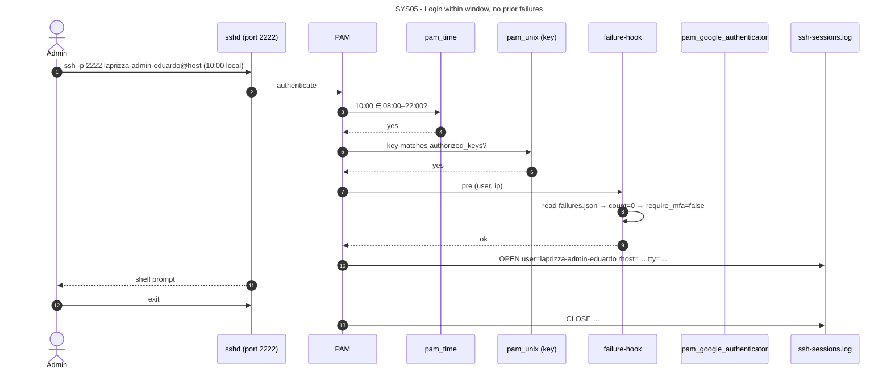
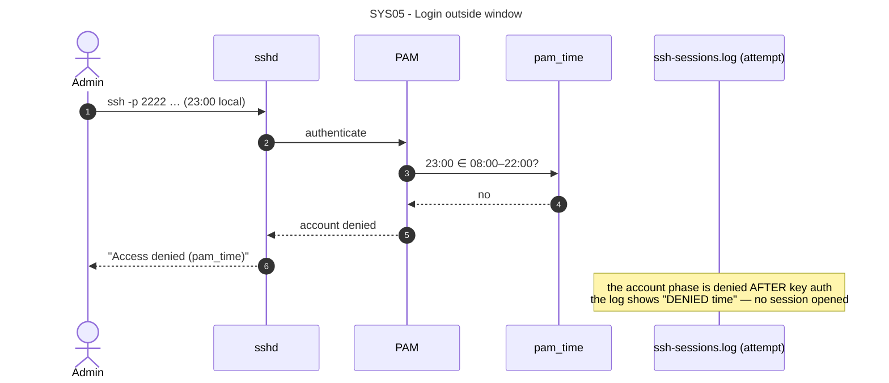
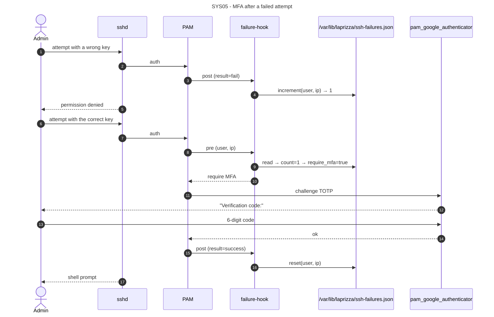
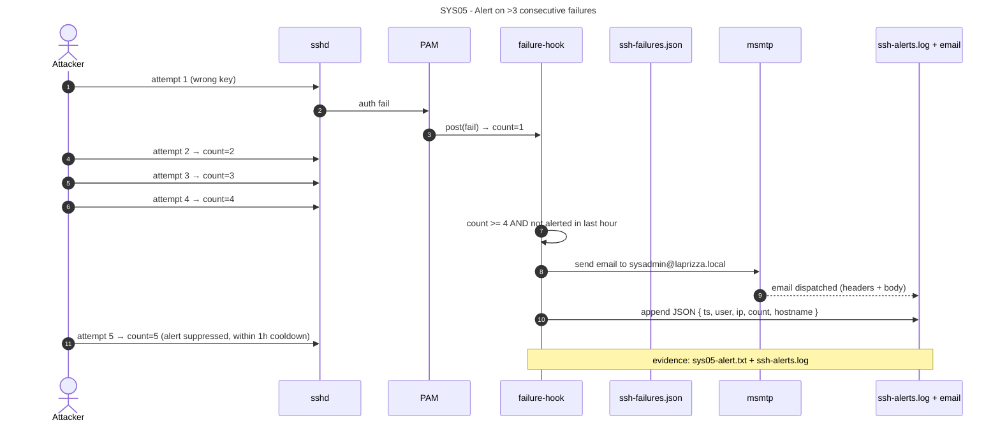

# SYS05 — Controlled Linux Remote Shell Access

## 1. Requirements Engineering

> **This is the highest-gap US in Lote 8.** The `sys-network-config.md §5` documents time-based PAM access, key-only auth, and session audit. It does **not** implement three of the US's mandatory controls: MFA after a failed attempt, email alert after >3 failures, and the correct time window (08:00–22:00 every day vs. the current per-day-group windows). The gaps are listed in §1.7.1 and each maps to a concrete remediation.

### 1.1. User Story Description

As a System Administrator, I want remote Linux shell logins controlled and monitored, so that unauthorized administrative access can be prevented and reported.

### 1.2. Customer Specifications and Clarifications

#### From the specification document
> Extracted from *PART IV — Sprint 2 — User Stories* (SYS05, p. 22).

- **Permit authentication only between 08:00 and 22:00 local time; deny attempts outside that period.**
- **After a failed authentication attempt, require Multi-Factor Authentication (MFA) before subsequent login attempts are allowed.**
- **After more than three consecutive failed authentication attempts, automatically generate an email alert to the system administrator.**
- **Document the deployed timezone** and **provide evidence of allowed, denied, MFA, and alert scenarios**.
- **Administrative accounts must be individually identifiable**, and **shared credentials must not be used for routine administration**.
- **Login and alert records must remain available only to authorized personnel and follow a documented retention period.**

#### From `sys-network-config.md` (deliverable)
- §5.1 goals: only ASIST owner and team lead; time window **Mon–Fri 08–22, Sat/Sun 10–18**; non-default port 2222; key-only; audit trail.
- §5.2 `sshd_config`: `Port 2222`, `PasswordAuthentication no`, `PubkeyAuthentication yes`, individual `AllowUsers` accounts, `MaxAuthTries 3`.
- §5.3 PAM: `pam_time.so` reading `time.conf`; `pam_exec.so` for session logging.
- §5.4 access granting / revocation / rotation (per sprint).
- §5.5 audit: `ssh-sessions.log`, `journalctl -u ssh` 30-day retention, monthly review.
- §6 clock sync (chrony, offset < 100 ms).

#### From KB
- **KB §28.5 (Kerberos/PAM):** PAM modules, actions (`required`, `requisite`, `sufficient`), `pam_time`, `pam_exec`.
- **KB §36.4 (logging):** `syslog`, `logrotate`.
- **KB §16.1:** least privilege, no shared admin accounts.

### 1.3. Acceptance Criteria (expanded, testable)

#### AC1 — Time window 08:00–22:00 local, every day
- AC1.1 `/etc/security/time.conf` is set to **`sshd;*;*;Al0800-2200`** — `Al` (all days) `0800-2200`. **Not** `Wk0800-2200,Sa1000-1800,Su1000-1800` (the current doc's value, which violates the US's "only between 08:00 and 22:00" reading).
- AC1.2 A login attempt at 07:59 local is denied by `pam_time`; a login at 08:01 succeeds.
- AC1.3 A login attempt at 22:01 local is denied; a login at 21:59 succeeds.
- AC1.4 Existing sessions at 22:00 are terminated within 10 minutes by `laprizza-ssh-time-guard.timer` (already in the doc §5.3).
- AC1.5 The deployed timezone is documented in `sys-network-config.md §5` (Europe/Lisbon) and in `/etc/timezone` on the host.
- AC1.6 The host's `date` and the host's timezone **are recorded** in the deployment log (`logs/deploy-…/timezone.txt`).

#### AC2 — MFA after a failed attempt
- AC2.1 After **any** failed authentication attempt (wrong key, wrong password attempt if password auth were enabled — it is not), the **next** login attempt requires **TOTP** (a second factor) in addition to the SSH key.
- AC2.2 TOTP is implemented via `pam_google_authenticator.so` or `pam_oath.so`, configured for the `laprizza-admin` and `laprizza-lead` accounts.
- AC2.3 The MFA gate is **per-account** (the failure of user A does not force MFA on user B) **and per-source** (a failed attempt from IP X does not force MFA on a request from IP Y, unless the IP is the same — the counter is keyed on `(user, source_ip)`).
- AC2.4 The MFA challenge is **skipped** when the previous attempt was successful (a normal "login, work, logout, login again within the same day" does not force MFA on the second login).
- AC2.5 MFA is enforced **after** `pam_time` (time window) and **after** key authentication — the order is: `pam_time` → `pam_unix` (key) → **MFA gate** → `pam_exec` (audit) → session.
- AC2.6 The state (per-user-per-IP failure counter, "MFA required" flag) is stored in `/var/lib/laprizza/ssh-failures.json` with a 24-hour TTL.

**Operational authentication clarification:** SSH private-key passphrases are entered
locally on the administrator workstation and never transmitted to the host. Root is an
emergency recovery account allowed only with its configured public key; named
administrators use their individual keys and receive TOTP only after a failed
authentication attempt for the same user and source IP.

#### AC3 — Email alert after >3 consecutive failures
- AC3.1 The failure counter is **consecutive per `(user, source_ip)`** and resets on successful auth.
- AC3.2 When the counter reaches **4** (i.e., "more than three"), an email is sent to `laprizzag05@gmail.com` **once per incident** (not on every subsequent failure; a "cooldown" of 1 hour suppresses duplicates).
- AC3.3 The email contains: `timestamp`, `user`, `source_ip`, `fail_count`, `last_attempt_ts`, `hostname`. **No password, no key material, no session token.**
- AC3.4 The email is sent via `sendmail`/`mail`/`msmtp` (documented choice) from the `laprizza` MTA on the host.
- AC3.5 The alert is **also logged** to `/var/log/laprizza/ssh-alerts.log` (structured JSON) for evidence.

#### AC4 — Individually identifiable admin accounts
- AC4.1 The admin accounts are individual accounts (`laprizza-admin-eduardo`, `laprizza-admin-pedro`, `laprizza-admin-mota`, and `laprizza-admin-gustavo`), one per person — **not** a shared `laprizza-admin` account.
- AC4.2 `AllowUsers` in `sshd_config` lists both (and any future individual account).
- AC4.3 `/etc/security/time.conf` references each account individually.
- AC4.4 Shared credentials (the current `laprizza-admin` name) are **not** used for routine administration; if the shared account exists, it is disabled (`usermod -L laprizza-admin`).

#### AC5 — Login and alert records retention
- AC5.1 `ssh-sessions.log` (per-session open/close), `ssh-alerts.log` (per-alert), and `journalctl -u ssh` are retained for **90 days** (a documented, specific value — the current doc says "30 days" for `journalctl`, which is **not** documented as the retention for the log records; the US asks for a retention period, so we pick one and apply it consistently).
- AC5.2 `logrotate` config: `/etc/logrotate.d/laprizza-ssh` rotates daily, compresses, keeps 90 files.
- AC5.3 Access to these logs is `chmod 640 root:laprizza` — only `laprizza` group (the admin accounts) can read.
- AC5.4 The retention policy is documented in `sys-network-config.md §5` and in `gdpr-policy.md` (log retention, Appendix D).

#### AC6 — Evidence of allowed / denied / MFA / alert
- AC6.1 **Allowed:** a login at 10:00 local succeeds (with or without MFA — see AC2.4). Evidence: `docs/asist/evidence/sys05-allowed.txt` (terminal transcript + `ssh-sessions.log` line).
- AC6.2 **Denied:** a login at 23:00 local is denied by `pam_time`. Evidence: `sys05-denied.txt` (sshd error + `ssh-sessions.log` line).
- AC6.3 **MFA:** after a failed key attempt, the next login prompts for TOTP. Evidence: `sys05-mfa.txt` (transcript showing the TOTP prompt).
- AC6.4 **Alert:** four consecutive failures trigger the email. Evidence: `sys05-alert.txt` (email headers + body) + `ssh-alerts.log` line.

### 1.4. Found out Dependencies

**Preceding:** SYS01 (host). SYS02 (only DEI/VPN can reach port 2222). KB §28.5 (PAM). The SSH keys in the team's KeePassXC vault.

**Succeeding:** SYS06 (R-11 insider misuse references SYS05). SYS08 (host compromise → restore). KB §D.4 (GDPR: SSH session logs are not PII if they contain only usernames and IPs — **they do not contain customer data**).

### 1.5. Input and Output Data

#### 1.5.1. Configuration files

| File | Purpose |
|---|---|
| `/etc/ssh/sshd_config` | Port 2222, key-only, `AllowUsers` individual accounts |
| `/etc/security/time.conf` | `sshd;*;*;Al0800-2200` |
| `/etc/pam.d/sshd` | `pam_time`, `pam_unix`, MFA gate, `pam_exec` audit |
| `/etc/pam.d/sshd-mfa` (new) | MFA gate sub-stack |
| `/usr/local/sbin/laprizza-ssh-audit-start` | Session open log |
| `/usr/local/sbin/laprizza-ssh-audit-end` | Session close log |
| `/usr/local/sbin/laprizza-ssh-failure-hook` (new) | Increment failure counter; call MFA gate; send alert at threshold |
| `/usr/local/sbin/laprizza-ssh-time-guard.sh` | Kill sessions outside the window (already in doc §5.3) |
| `/var/lib/laprizza/ssh-failures.json` | Failure counters (per `(user, ip)`, 24h TTL) |
| `/etc/logrotate.d/laprizza-ssh` | 90-day retention |
| `/etc/systemd/system/laprizza-ssh-time-guard.timer` | Kill timer |
| `/etc/msmtprc` (or `/etc/mail.rc`) | SMTP relay for alert emails |

#### 1.5.2. `/etc/pam.d/sshd` (target)

```
#%PAM-1.0
auth      required   pam_env.so
auth      required   pam_time.so
auth      required   pam_unix.so
auth      required   pam_exec.so quiet /usr/local/sbin/laprizza-ssh-failure-hook pre
auth      required   pam_exec.so quiet /usr/local/sbin/laprizza-ssh-failure-hook post
account   required   pam_time.so
account   include    system-auth
password  include    system-auth
session   required   pam_limits.so
session   required   pam_unix.so
session   optional   pam_exec.so quiet /usr/local/sbin/laprizza-ssh-audit-start
session   optional   pam_exec.so quiet /usr/local/sbin/laprizza-ssh-audit-end
```

The `pre`/`post` hooks read the failure counter and:
- `pre`: if `require_mfa(user, ip)` → return non-zero unless the user provides a valid TOTP via `pam_google_authenticator` (or the hook itself invokes `oathtool`).
- `post`: on success → reset the counter; on failure → increment.

The exact PAM plumbing is implementation-specific; the **AC** is that the behaviour is observable.

#### 1.5.3. `/etc/security/time.conf` (target)

```
sshd;*;*;Al0800-2200
```

#### 1.5.4. Evidence (`sprint-2-submission`)

| Evidence | Location |
|---|---|
| Allowed login (10:00) | `docs/asist/evidence/sys05-allowed.txt` |
| Denied login (23:00) | `sys05-denied.txt` |
| MFA prompt | `sys05-mfa.txt` |
| Alert email | `sys05-alert.txt` |
| `ssh-sessions.log` sample | `logs/ssh-sessions/YYYYMMDD.log` |
| `ssh-alerts.log` sample | `logs/ssh-alerts/YYYYMMDD.log` |
| `timezone` on host | `logs/deploy-…/timezone.txt` |
| `AllowUsers` output | `sys05-allowed.txt` (top) |

#### 1.5.5. Persistence

No new tables. The state is `/var/lib/laprizza/ssh-failures.json` (24h TTL) + the log files.

### 1.6. System Sequence Diagrams (SSD)

#### 1.6.1. Login within window, no prior failures



#### 1.6.2. Login outside window → denied



#### 1.6.3. Failed attempt → next attempt requires MFA



#### 1.6.4. >3 consecutive failures → email alert



### 1.7. Other Relevant Remarks

#### 1.7.1. Gap analysis vs `sys-network-config.md §5`

| # | AC | Current state | Gap | Severity | Remediation |
|---|---|---|---|---|---|
| G1 | AC1.1 — 08:00–22:00 every day | §5.3 `time.conf` = `Wk0800-2200,Sa1000-1800,Su1000-1800` | **Weekend window is 10:00–18:00, not 08:00–22:00** — the strict reading of the US says 08:00–22:00 every day | **High** | Change to `sshd;*;*;Al0800-2200`; document the choice in §5.3 |
| G2 | AC2 — MFA after a failed attempt | Not implemented | **MFA is entirely absent** | **Critical** | Add `pam_google_authenticator` + `failure-hook` (pre/post) + `ssh-failures.json` (24h TTL); document in §5.3bis |
| G3 | AC3 — email alert on >3 failures | Not implemented | **Alert is entirely absent** | **Critical** | Add email dispatch to `sysadmin@laprizza.local` (msmtp) with 1h cooldown; log to `ssh-alerts.log` |
| G4 | AC4.1 — individually identifiable accounts | `AllowUsers laprizza-admin laprizza-lead` — `laprizza-admin` looks like a shared account name | **Ambiguous whether shared** | Medium | Rename to per-person accounts (`laprizza-admin-eduardo`, `laprizza-admin-pedro`); `usermod -L laprizza-admin` if it exists |
| G5 | AC5.1 — 90-day retention | §5.5 says `journalctl -u ssh` 30 days; no retention for `ssh-sessions.log` or future `ssh-alerts.log` | **Inconsistent and under-specified** | Medium | Add `/etc/logrotate.d/laprizza-ssh` (daily, 90 rotations, compress); document in §5.5 |
| G6 | AC6 — evidence files | §5.4 mentions "monthly review" | **No committed evidence** | Medium | Add the four evidence files listed in §1.5.4 |
| G7 | AC1.5 — timezone documented | §5.3 says "local time" but does not state the timezone | **Ambiguous** | Low | Add "Europe/Lisbon (WET/WEST)" to §5.1 and §6 |

**Net effect:** the current `sys-network-config.md §5` implements **time-based access + key-only auth + session audit**. It does **not** implement **MFA after failure** or **alert on >3 failures**, which are the two most security-relevant controls the US asks for. The remediation is a PAM hook (~ 60 lines of bash + one `pam_google_authenticator` enrollment) and an email dispatch — manageable but mandatory.

#### 1.7.2. Decision record — MFA implementation

**Decision:** `pam_google_authenticator` (TOTP, RFC 6238) with a `failure-hook` that triggers the MFA gate when the per-`(user, ip)` failure counter is ≥ 1.

**Rationale:**
- TOTP is the standard second factor for SSH; `pam_google_authenticator` is the Debian/Ubuntu standard package.
- The failure-hook gives per-`(user, ip)` granularity, which `pam_google_authenticator`'s built-in `nullok` mode does not.
- No hardware token, no push, no SMS — TOTP is the simplest and most portable option for an academic prototype.

**Alternatives considered:**
- *WebAuthn / FIDO2*: rejected — requires hardware tokens; not practical for the team.
- *SSH certificates*: rejected — the problem is **post-failure** step-up, not the first factor; certificates do not step up.
- *Always-on MFA*: rejected — the US specifically says "after a failed authentication attempt", not "always"; always-on would be stricter than required but would hurt the team's daily workflow.

#### 1.7.3. Decision record — account naming

**Decision:** each admin has a **personal account** (`laprizza-admin-eduardo`, `laprizza-admin-pedro`). The current `laprizza-admin` name is renamed; if a shared account exists, it is locked (`usermod -L`) but not deleted (for historical log continuity).

**Rationale:**
- SYS05 AC "Administrative accounts must be individually identifiable, and shared credentials must not be used for routine administration."
- Individual accounts make the `ssh-sessions.log` and `ssh-alerts.log` directly attributable to a person.
- `sudo` is configured per-person (`/etc/sudoers.d/laprizza-admin-eduardo`), so a compromise of one person's key does not give the other's identity.

**Alternatives considered:**
- *Shared `laprizza-admin` + per-person SSH keys*: rejected — the account name is still shared; the audit trail would attribute a session to "someone with access to the shared account".
- *No sudo, all root*: rejected — violates least privilege.

#### 1.7.4. Verification matrix (AC → check → evidence)

| AC | Check | Evidence |
|---|---|---|
| AC1.1 | `cat /etc/security/time.conf` = `sshd;*;*;Al0800-2200` | `sys05-allowed.txt` (top) |
| AC1.2–1.3 | Login at 07:59 / 08:01 / 21:59 / 22:01 | `sys05-allowed.txt` + `sys05-denied.txt` |
| AC1.4 | Session killed within 10 min at 22:00 | `journalctl -u laprizza-ssh-time-guard` |
| AC1.5 | `/etc/timezone` + `sys-network-config.md §5` | `timezone.txt` |
| AC1.6 | `date -u; date` in deployment log | `timezone.txt` |
| AC2.1–2.6 | Failure → next attempt prompts TOTP | `sys05-mfa.txt` |
| AC3.1–3.5 | 4 failures → email + log | `sys05-alert.txt` + `ssh-alerts.log` |
| AC4.1 | `AllowUsers` lists all individual administrator accounts | `sys05-allowed.txt` |
| AC4.2–4.3 | same | same |
| AC4.4 | `passwd -S laprizza-admin` shows `L` (locked) | `sys05-allowed.txt` |
| AC5.1–5.3 | `logrotate` config + `ls -la` | `sys05-perms.txt` |
| AC5.4 | doc reference | `sys-network-config.md §5.5` |
| AC6.1–6.4 | the four evidence files | `docs/asist/evidence/sys05-*.txt` |