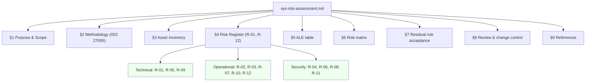

---

# SYS06 — Operational Risk Assessment

## 1. Requirements Engineering

### 1.1. User Story Description

As a System Administrator, I want the solution's risks identified and quantified, so that appropriate mitigation measures can be proposed.

### 1.2. Customer Specifications and Clarifications

#### From the specification document
> Extracted from *PART IV — Sprint 2 — User Stories* (SYS06, p. 22).

- Identify **between two and six relevant risks in each category: technical, operational, and security**. Include risks to **personal-data confidentiality, integrity, and availability**.
- For each risk: **affected services or information**, **likelihood**, **impact**, **responsible person**, and **supporting evidence**.
- **Propose mitigation measures and assess the remaining risk.**

#### From `sys-risk-assessment.md` (deliverable)
- §1 scope, §2 methodology (P × I, thresholds, ALE), §3 asset inventory (9 assets), §4 risk register (R-01 to R-12), §5 ALE table, §6 matrix, §7 residual acceptance, §8 review & change control, §9 references.
- Risk categories in the register:
  - **Technical**: R-01 (DB unavailability), R-05 (integrity), R-09 (dependencies)
  - **Operational**: R-02 (Prolog), R-03 (IdP), R-07 (backups), R-10 (DoS), R-12 (clock drift)
  - **Security**: R-04 (JWT), R-06 (GDPR), R-08 (ransomware), R-11 (insider)
- ALE table: 5 assets with SLE, ARO, ALE.
- Residual risk table: 12 risks with residual level + accepted by.

#### From KB
- **KB §34.2:** risk = impact × probability; MTPD, MTD, MBCO, BIA, RA, BCP, DRP.
- **KB §34.6:** SLE = AV × EF; ALE = SLE × ARO.
- **KB §34.7:** backup tools, cost-benefit.

### 1.3. Acceptance Criteria (expanded, testable)

#### AC1 — 2–6 risks per category (technical, operational, security)
- AC1.1 The register contains **at least 2 and at most 6** risks in each of the three categories.
- AC1.2 **Technical** (currently 3 — R-01, R-05, R-09). ✓
- AC1.3 **Operational** (currently 5 — R-02, R-03, R-07, R-10, R-12). ✓
- AC1.4 **Security** (currently 4 — R-04, R-06, R-08, R-11). ✓
- AC1.5 The category for each risk is stated explicitly and grouped in the §4.0 category summary.
- AC1.6 The register includes risks to **confidentiality** (R-04, R-06, R-08), **integrity** (R-05), and **availability** (R-01, R-02, R-07). ✓

#### AC2 — Per-risk fields: affected, likelihood, impact, responsible, evidence
- AC2.1 **Affected services or information:** §4.0.1 lists the concrete services or information affected by each risk, alongside the asset ID.
- AC2.2 **Likelihood:** the "Probability" field with the 1–4 scale. ✓
- AC2.3 **Impact:** the "Impact" field with the 1–5 scale. ✓
- AC2.4 **Responsible person:** the "Owner" field. ✓ (except R-08, R-09, R-10, R-12 which say "ASIST owner" or "Team lead" — acceptable, but a named person is preferred; the review at each sprint confirms the current holder.)
- AC2.5 **Supporting evidence:** §4.0.1 cites the artefact supporting each risk's likelihood and impact.

#### AC3 — Mitigations and residual risk
- AC3.1 Every risk has a **Mitigation** field with concrete measures. ✓
- AC3.2 Every risk has a **Residual Risk** level (1–5 range, not 1–25). ✓
- AC3.3 The **residual risk** must be ≤ Medium (≤ 7 on the P×I scale, or the qualitative equivalent). Two residual risks are Medium (R-02, R-09); the rest are Low. ✓
- AC3.4 No residual risk in the Critical or High band. ✓
- AC3.5 The acceptance table (§7 of the deliverable) names the accepting authority for each risk. ✓

#### AC4 — Quantitative evaluation
- AC4.1 The ALE table (§5) is present, with AV, EF, SLE, ARO, ALE per asset. ✓
- AC4.2 The total ALE is documented and justified. ✓
- AC4.3 No unsubstantiated percentage reduction is claimed; the document explicitly states that post-mitigation ALE is not quantified.

### 1.4. Found out Dependencies

**Preceding:** all the other SYS deliverables (SYS01–SYS05, SYS07, SYS08) — the risks reference their controls. The 12 ADRs (the mitigations reference ADR-004, ADR-008b, ADR-011, ADR-012, ADR-013). The GDPR policy (R-06).

**Succeeding:** SYS07 (MBCO aligns with identified risks). The Sprint 2 defense (the risk register is reviewed by the instructor).

### 1.5. Input and Output Data

#### 1.5.1. Structure (from the deliverable §1–§9)

Already complete. The **gap is content**, not structure.

#### 1.5.2. Required additions

- **§4.0 Category summary**: a table with `Category | Count | Risks` showing Technical 3, Operational 5, Security 4 (satisfies AC1.5).
- **§4.x Evidence column**: a 6th column "Evidence" for each risk, pointing to the test / ADR / log / screenshot that backs the stated likelihood and impact.
- **§5.x Derivation of the 70% reduction**: either a second ALE column "ALE after mitigation" or a footnote that says "estimate, not derived".

#### 1.5.3. Evidence (`sprint-2-submission`)

| Evidence | Location |
|---|---|
| Risk register as a file | `docs/asist/sys-risk-assessment.md` (already exists) |
| Category summary table | §4.0 of the deliverable |
| Evidence citations | per-risk "Evidence" column |
| ALE derivation | §5 of the deliverable |

### 1.6. Deliverable Structure Diagram (replaces SSD)

### 1.7. Other Relevant Remarks

#### 1.7.1. Gap analysis vs `sys-risk-assessment.md`

| # | AC | Current state | Gap | Severity | Remediation |
|---|---|---|---|---|---|
| G1 | AC1.5 — category grouping | Resolved in §4.0 | Closed | Low | Category summary lists all three categories and their risk IDs |
| G2 | AC2.1 — affected services | Resolved in §4.0.1 | Closed | Low | Services/information are listed for every risk |
| G3 | AC2.5 — supporting evidence | Resolved in §4.0.1 | Closed | High | Supporting evidence is listed for every risk |
| G4 | AC4.3 — 70% reduction claim | Resolved in §5 | Closed | Medium | No unsubstantiated percentage reduction is claimed |
| G5 | AC2.4 — responsible person | Four risks say "ASIST owner" / "Team lead" | **Not a named person** | Low | Keep the role but add the current holder in parentheses (`ASIST owner — Pedro Ribeiro`) |

#### 1.7.2. Decision record — ISO 27005 vs. ISO 31000 vs. NIST 800-30

**Decision:** ISO/IEC 27005:2022 as the risk assessment methodology, ISO 31000:2018 as the umbrella, NIST SP 800-123 as the server-hardening reference.

**Rationale:**
- ISO 27005 is the ASIST course reference (KB §34.2).
- ISO 31000 provides the "risk = P × I" framing the deliverable uses.
- NIST 800-123 is referenced for the OS hardening controls (SSH, firewall, backups) that are the mitigations.

**Alternatives considered:**
- *NIST 800-30 only*: rejected — the deliverable's 4×5 matrix and ALE table are ISO-style.
- *FAIR only*: rejected — too quantitative for a 14-week prototype.

#### 1.7.3. Verification matrix (AC → check → evidence)

| AC | Check | Evidence |
|---|---|---|
| AC1.1 | 3 categories, each 2–6 | §4.0 summary table |
| AC1.2–1.4 | counts | same |
| AC1.5 | grouping | §4.0 |
| AC1.6 | R-04, R-05, R-06, R-08 cover CIA | §4 |
| AC2.1 | affected services named | §4 per risk |
| AC2.2–2.4 | P, I, Owner present | §4 |
| AC2.5 | Evidence column | §4 |
| AC3.1–3.5 | mitigation + residual + acceptance | §4, §7 |
| AC4.1–4.2 | ALE table | §5 |
| AC4.3 | 70% claim honest | §5 (reworded or derived) |