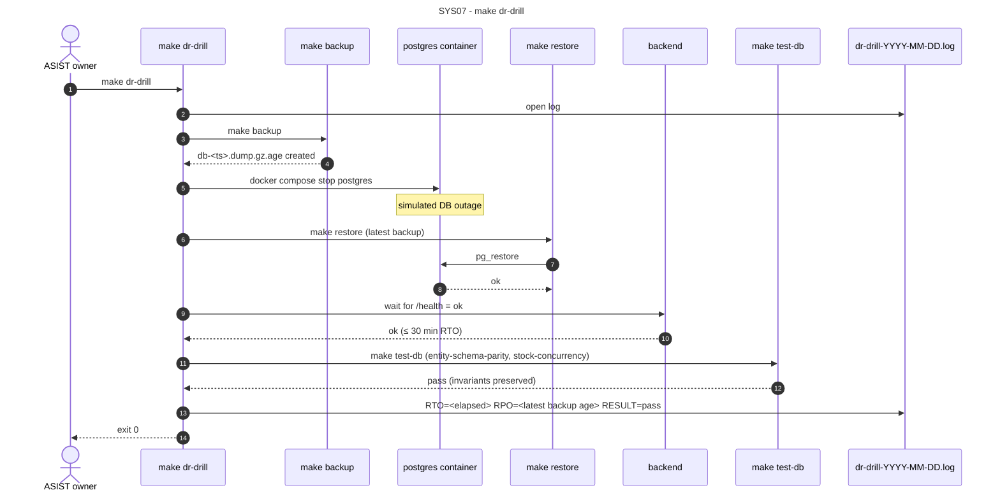

# SYS07 — Minimum Business Continuity Objective (MBCO)

## 1. Requirements Engineering

### 1.1. User Story Description

As a System Administrator, I want a measurable Minimum Business Continuity Objective (MBCO) proposed to stakeholders, so that acceptable service degradation and downtime can be agreed.

### 1.2. Customer Specifications and Clarifications

#### From the specification document
> Extracted from *PART IV — Sprint 2 — User Stories* (SYS07, p. 22).

- Define **measurable minimum service capacity**, **capabilities available during degraded operation**, and **maximum acceptable downtime**.
- Align the MBCO with identified risks and backup/recovery capabilities.
- **Use recovery exercises** to demonstrate whether the targets can be met and identify any shortfalls.
- **Submit the MBCO for stakeholder review and approval, distinguishing proposed targets from approved ones.**

#### From `sys-mbco.md` (deliverable)
- §1 purpose (ISO 22301:2019).
- §2 business context (actors + Sprint 2 review as critical event).
- §3 terminology (MTPD, MTD, MBCO, RTO, RPO, WRT, BIA, BCP, DRP).
- §4 BIA (13 services S-01..S-13 classified Critical/High/Medium; impact curve per service).
- §5 MBCO per service (MTPD, MTD, MBCO, RTO, RPO per service; §5.6 summary table).
- §6 continuity strategies (detection, response, recovery R-01..R-12, on-call rotation).
- §7 testing (monthly `make dr-drill`, acceptance criteria).
- §8 PDCA cycle.
- §9 reference table of the 6 executive MBCO statements.
- §10 references.

#### From KB
- **KB §34.2:** MTPD, MTD, MBCO, BIA, RA, BCP, DRP.
- **KB §34.3:** fault tolerance levels (Full Fault Tolerant, Graceful Degradation, Fail Soft, Fail Safe).
- **KB §34.4:** RTO, RPO, WRT.
- **KB §34.5:** backup strategies.
- **ISO 22301:2019 §8.2** (BIA) and §8.3 (risk assessment), §8.4 (BC strategies), §8.5 (BC plans).

### 1.3. Acceptance Criteria (expanded, testable)

#### AC1 — Measurable minimum service capacity, degraded capabilities, maximum downtime
- AC1.1 Every service has an explicit **MBCO** statement — a capability that is preserved during disruption. ✓ (13 services, S-01..S-13)
- AC1.2 Every service has an explicit **MTD** (max tolerable downtime) and **MTPD** (max tolerable period of disruption). ✓
- AC1.3 Every service has an explicit **RTO** and **RPO**. ✓
- AC1.4 **Measurability:** RTO and RPO are given in time units (min/h), not vague descriptors. ✓
- AC1.5 **Degraded capabilities** are listed per service (e.g., S-03 "adjustments paused" during degraded mode). ✓

#### AC2 — Aligned with risks and backup/recovery capabilities
- AC2.1 The RTO/RPO targets are consistent with `sys-backup-strategy.md §2` (RPO ≤ 24 h, RTO ≤ 30 min for the DB). ✓
- AC2.2 The risks from `sys-risk-assessment.md` are referenced in the recovery procedures (§6.3 R-01..R-12 map to R-01..R-12 in the risk register). ✓
- AC2.3 The continuity strategies reference the fault tolerance levels (Graceful Degradation for High services, Full Fault Tolerant only where the infra allows). ✓

#### AC3 — Recovery exercises demonstrate targets
- AC3.1 `make dr-drill` (§7.1) exists and produces `dr-drill-YYYY-MM-DD.log`. **The deliverable shows the script, but not an executed log.** *(Gap — see §1.7.1 G1.)*
- AC3.2 The drill validates: RTO ≤ 30 min, RPO ≤ 24 h, invariants preserved (`entity-schema-parity.spec.ts`), auth operational, catalogue operational. ✓
- AC3.3 The drill result is committed to `docs/asist/evidence/dr-drill-*.log` in the `sprint-2-submission` tag. *(Gap — see §1.7.1 G2.)*
- AC3.4 Shortfalls are documented — if any target is missed, the drill log states it and a remediation is proposed. *(Implicit; not enforced by the deliverable.)*

#### AC4 — Distinguish proposed from approved targets
- AC4.1 Each target has an **approval status**: `proposed`, `approved`, or `not-approved-with-reason`. *(Gap — see §1.7.1 G3.)*
- AC4.2 The approval is signed by the stakeholder (the team lead + the LAPR5 RUC or the professor). *(Gap — same.)*
- AC4.3 The Sprint 2 submission includes a **signed approval page** (PDF or a markdown sign-off) at the end of `sys-mbco.md` or as a separate `docs/asist/mbco-approval.md`. *(Gap — same.)*

### 1.4. Found out Dependencies

**Preceding:** SYS06 (risk register), SYS08 (backup strategy — RTO/RPO derive from it), SYS01 (deployment — the `/health` endpoint the monitoring uses), SYS02/SYS03/SYS05 (network and access controls that affect the impact of a compromise).

**Succeeding:** The Sprint 2 defense (the instructor reviews the MBCO); SYS08's `make dr-drill` target (the drill references the MBCO acceptance criteria).

### 1.5. Input and Output Data

#### 1.5.1. Structure (from the deliverable §1–§10)

Already complete. The **gap is approval status**, not structure.

#### 1.5.2. Required additions

- **§5.x Approval status per target:** a column in the summary table (`§5.6`) or a dedicated `§5.7` table with `Target | Value | Proposed by | Approved by | Status`.
- **§7.2 Executed drill log:** a reference to `docs/asist/evidence/dr-drill-YYYY-MM-DD.log` with the actual RTO and RPO.
- **§11 Approval sign-off:** a section at the end with the team lead's and the RUC's signatures (or a markdown sign-off).

#### 1.5.3. Evidence (`sprint-2-submission`)

| Evidence | Location |
|---|---|
| MBCO document | `docs/asist/sys-mbco.md` (already exists) |
| Executed drill log | `docs/asist/evidence/dr-drill-*.log` (new) |
| Approval sign-off | `docs/asist/mbco-approval.md` (new) |
| Target status table | §5.7 of `sys-mbco.md` (new) |

### 1.6. System Sequence Diagrams (SSD)

#### 1.6.1. `make dr-drill` flow



#### 1.6.2. Approval workflow

```mermaid
sequenceDiagram
autonumber
title SYS07 - Approval workflow
    participant Team as Team 3DJ-05
    participant Lead as Team lead
    participant RUC as LAPR5 RUC / Professor
    participant Doc as mbco-approval.md

    Team->>Doc: write proposed targets (status = proposed)
    Team->>Lead: submit for review
    Lead->>Doc: review; add "approved by Lead" + date
    Lead->>RUC: forward for final approval
    RUC->>Doc: sign off (or request changes)
    alt changes requested
        RUC-->>Team: revise (status = not-approved, reason)
        Team->>Doc: update targets, re-submit
    else approved
        RUC->>Doc: status = approved + date + signature
        Team->>Doc: commit to sprint-2-submission
    end
```

### 1.7. Other Relevant Remarks

#### 1.7.1. Gap analysis vs `sys-mbco.md`

| # | AC | Current state | Gap | Severity | Remediation |
|---|---|---|---|---|---|
| G1 | AC3.1 — executed drill log | §7.1 shows the `make dr-drill` script | **No executed log** committed | High | Run `make dr-drill` once; commit the log to `docs/asist/evidence/dr-drill-2026-11-XX.log` |
| G2 | AC3.3 — evidence in submission | Not present | **The log is not in the submission** | High | Same as G1 |
| G3 | AC4.1–4.3 — proposed vs. approved | §5 lists targets; §7 says "the team commits to"; no explicit approval status | **No "proposed" vs "approved" distinction** | **High** | Add `§5.7` with status per target; add `mbco-approval.md` with signatures |
| G4 | AC3.4 — shortfall documentation | The drill script prints "RTO satisfied: yes/no" | **If "no", no remediation is proposed** | Medium | Add a `§7.3` that says "if any target is missed, the drill log includes a remediation note" |
| G5 | AC1.5 — degraded capabilities | §5.x lists "may degrade to" per service | ✓ | — | — |

#### 1.7.2. Decision record — 6 executive statements vs. 13 detailed MBCOs

**Decision:** §9 has 6 executive statements (the minimum guarantees); §5 has 13 per-service MBCOs (the full picture). Both are needed:
- The 6 statements are what the **stakeholder approves** (they are the "acceptable degradation and downtime" the US asks for).
- The 13 detailed rows are what the **engineering team uses** to verify (they are specific enough to test).

**Alternatives considered:**
- *Only the 13*: rejected — too granular for a stakeholder sign-off.
- *Only the 6*: rejected — does not cover S-04 (Kitchen), S-06 (Users), S-08 (Diagnostics), S-13 (SMTP), which are needed for the drill to test all services.

#### 1.7.3. Verification matrix (AC → check → evidence)

| AC | Check | Evidence |
|---|---|---|
| AC1.1 | §5.x MBCO per service | `sys-mbco.md §5` |
| AC1.2 | MTPD / MTD per service | §5.x |
| AC1.3 | RTO / RPO per service | §5.x |
| AC1.4 | Time units | §5.x |
| AC1.5 | Degraded mode | §5.x |
| AC2.1 | RPO ≤ 24h, RTO ≤ 30min | `sys-backup-strategy.md §2` |
| AC2.2 | R-01..R-12 map | §6.3 |
| AC2.3 | Fault tolerance levels | §6 |
| AC3.1 | `make dr-drill` | §7.1 |
| AC3.2 | Drill validates targets | §7 |
| AC3.3 | Executed log | `docs/asist/evidence/dr-drill-*.log` |
| AC3.4 | Shortfall documented | §7.3 (new) |
| AC4.1 | Status per target | `sys-mbco.md §5.7` |
| AC4.2 | Approval signatures | `mbco-approval.md` (new) |
| AC4.3 | Sign-off in submission | same |