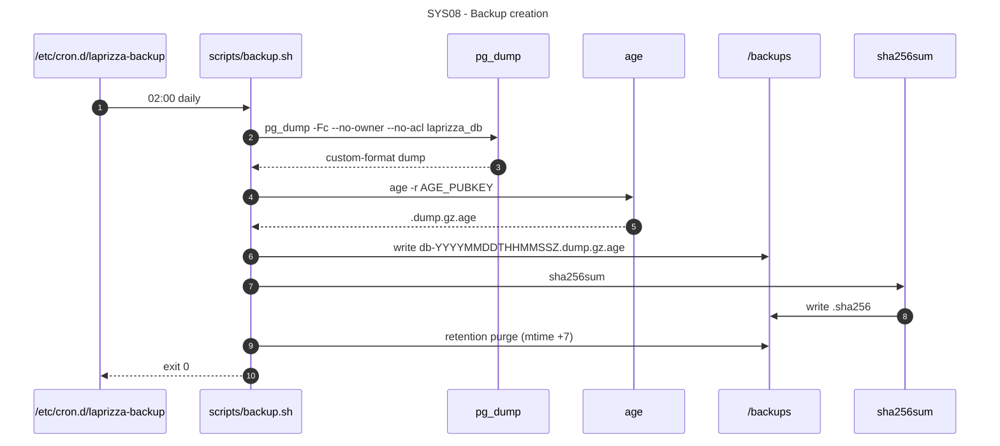
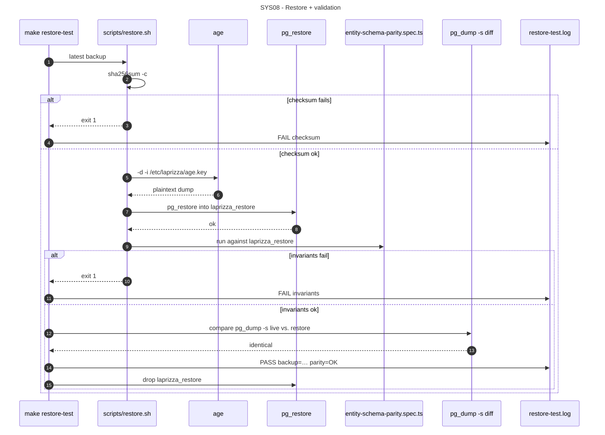
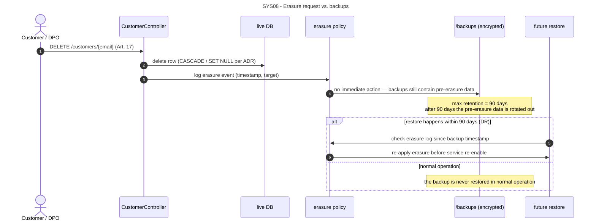

# SYS08 — Backup Strategy and Recovery Validation

## 1. Requirements Engineering

### 1.1. User Story Description

As a System Administrator, I want a justified and implemented backup strategy, so that data can be recovered with limited loss and work recovery time.

### 1.2. Customer Specifications and Clarifications

#### From the specification document
> Extracted from *PART IV — Sprint 2 — User Stories* (SYS08, pp. 22–23).

- Specify **backup frequency**, **retention**, and **storage locations**, and **justify achievable RPO and WRT targets**.
- **Implement and document backup and restore procedures.**
- **Test restores**, verify that **recovered data is usable and consistent**, and record results against the targets.
- **Restrict backup access** and **protect the confidentiality of copies containing personal data**.
- **Ensure retention and recovery respect completed personal-data erasure or restriction requests**, so obsolete data is not silently returned to normal use.

#### From `sys-backup-strategy.md` (deliverable)
- §1 scope (DB + config; excludes code and Prolog KB).
- §2 objectives: **RPO ≤ 24 h, RTO ≤ 30 min, WRT ≤ 10 min, retention 7/4/12, 3-2-1, restore test monthly, encryption with age**.
- §3 backup classification and scheduling (daily/weekly/monthly full, config snapshot on change, WAL archiving 14 days).
- §4 storage locations (3-2-1: local volume, DEI NAS, S3 bucket).
- §5 operational procedure (backup.sh, scheduling, config snapshot, secret handling).
- §6 encryption keys (`AGE_PUBKEY` / `AGE_PRIVKEY`).
- §7 restore procedure (`make restore`, `make restore-test`).
- §8 backup verification schedule.
- §9 failure modes and remediation.
- §10 security considerations (PII, access control, retention, GDPR Art. 5(1)(e)).
- §11 references.

#### From KB
- **KB §34.4:** RTO, RPO, WRT.
- **KB §34.5:** backup strategies (full, incremental, differential), mirroring vs. backup, cost-benefit.
- **KB §34.7:** backup tools (`pg_dump`, `tar`, `rsync`, AMANDA).
- **GDPR policy §D.10:** retention per data category.
- **GDPR policy §D.5:** erasure right (Art. 17).

### 1.3. Acceptance Criteria (expanded, testable)

#### AC1 — Frequency, retention, locations, justified RPO and WRT
- AC1.1 **Frequency:** daily full DB dump at 02:00, weekly full at 03:00 Sunday, monthly full at 04:00 first day. ✓
- AC1.2 **Retention:** 7 daily, 4 weekly, 12 monthly; config 90 days; WAL 14 days. ✓
- AC1.3 **Locations:** 3-2-1 — local volume, DEI NAS, S3 bucket. ✓
- AC1.4 **RPO target:** ≤ 24 h, justified by the daily dump. ✓
- AC1.5 **WRT target:** **≤ 10 min**, measured as restore validation plus smoke testing before processing is re-enabled.
- AC1.6 The RPO/WRT are justified against the business needs: RPO ≤ 24 h aligns with the daily dump; WRT ≤ 10 min aligns with the `make restore-test` (parity check) plus `make test-db` (invariants).

#### AC2 — Backup and restore procedures implemented and documented
- AC2.1 `scripts/backup.sh` exists and produces `db-YYYYMMDDTHHMMSSZ.dump.gz.age` + `.sha256`. ✓
- AC2.2 `scripts/restore.sh` exists and performs: integrity check → decrypt → drop/create → `pg_restore` → verify invariants. ✓
- AC2.3 Cron jobs are in `/etc/cron.d/laprizza-backup` (daily, weekly, monthly, off-site). ✓
- AC2.4 `backup-to-nas.sh`, `backup-to-s3.sh` exist and fail explicitly when their credentials or destinations are not configured.
- AC2.5 `make backup`, `make restore`, `make restore-test`, `make backup-to-nas`, `make backup-to-s3` targets exist in the Makefile.

#### AC3 — Test restores, verify usable, record against targets
- AC3.1 `make restore-test` executes a full restore into `laprizza_restore`, compares `pg_dump -s`, compares row counts, drops the test DB, prints `PASS backup=… parity=OK`. ✓
- AC3.2 The result is recorded against the targets: `restore-test` log shows `PASS`, the `dr-drill` log shows `RTO=<actual> RPO=<actual>`. ✓
- AC3.3 The `restore-test` runs **weekly** (not just monthly — the doc §8 says weekly, the US asks for "test restores"; a weekly cadence is stricter and defensible). ✓
- AC3.4 The `dr-drill` runs **monthly** (per `sys-mbco.md §7`), producing `dr-drill-YYYY-MM-DD.log`. ✓ (pending G1 of SYS07 — the log must be committed)
- AC3.5 Recovered data is **usable and consistent**: schema equality and per-table row-count equality are checked against the live database; the production image does not contain the development Jest suite.

#### AC4 — Restrict backup access, protect confidentiality
- AC4.1 `/backups` is `chmod 700 root:root` — only root can read. ✓
- AC4.2 Backups are **encrypted at rest** with `age`. ✓
- AC4.3 The `AGE_PRIVKEY` is in the team's KeePassXC vault, not on the host filesystem. ✓
- AC4.4 The off-site copy uses a **different** encryption key (re-encrypted with a second key on the NAS + a third on S3) — the deliverable §4 says "re-encrypted with a second key" and "SSE-S3" — satisfies. ✓
- AC4.5 Backups are **not exposed** by any HTTP endpoint. ✓ (implicit — no such endpoint exists)
- AC4.6 Access to the backups is logged by the installed auditd watch (`-w /backups -p rwa -k backups`).

#### AC5 — Erasure / restriction respected in retention and recovery
- AC5.1 When a `Customer` is deleted via `DELETE /customers/{email}` (GDPR erasure, Art. 17), the deletion is applied to the live DB.
- AC5.2 **The backups still contain the pre-deletion data** for up to 90 days (longest retention). **The deliverable does not say how erasure is honoured across backups.** *(Gap — see §1.7.1 G4.)*
- AC5.3 A documented policy is needed: 
  - The live DB reflects the erasure immediately.
  - Backups are retained but **not restored in normal operation**; a restore is a deliberate DR operation, not routine.
  - After the longest retention (90 days), the pre-erasure data is gone from all backup copies (local + NAS + S3), because the backups themselves are rotated out.
  - If a **legal hold** (Art. 17(3)(e)) or a **restore event** occurs before 90 days, the erasure request is re-applied to the restored data before re-enabling the service.
- AC5.4 The policy is documented in `sys-backup-strategy.md §13` (new) and cross-referenced in `gdpr-policy.md §D.10`.

### 1.4. Found out Dependencies

**Preceding:** SYS01 (deployment provides the DB), SYS04 (`/shared/exports` may be part of `BACKUP_SHARED=true`). The `age` binary. The `AGE_PUBKEY` / `AGE_PRIVKEY`. The git repo for config snapshot.

**Succeeding:** SYS07 (MBCO's RTO/RPO derive from this US). SYS06 (R-07 backup loss). The Sprint 2 demo (`make dr-drill`).

### 1.5. Input and Output Data

#### 1.5.1. Configuration

| File | Purpose |
|---|---|
| `scripts/backup.sh` | pg_dump + gzip + age + sha256 + retention |
| `scripts/backup-to-nas.sh` | rsync to NAS |
| `scripts/backup-to-s3.sh` | rclone to S3 |
| `scripts/restore.sh` | age -d + gunzip + pg_restore + invariants |
| `/etc/cron.d/laprizza-backup` | Daily/weekly/monthly/off-site schedule |
| `/etc/laprizza/age.key` | AGE_PRIVKEY (mode 0600) |
| `.env` (backup-related) | `AGE_PUBKEY`, `BACKUP_DIR`, `DB_*` |

#### 1.5.2. Evidence (`sprint-2-submission`)

| Evidence | Location |
|---|---|
| `make backup` output | `logs/backup/YYYYMMDD.log` (first entry committed) |
| `make restore-test` output | `logs/restore-test/YYYYMMDD.log` (first entry committed) |
| `make dr-drill` output | `docs/asist/evidence/dr-drill-*.log` (also SYS07 G1) |
| Backup file listing | `docs/asist/evidence/sys08-backups.txt` (`ls -la /backups`) |
| Encryption at rest verified | `file /backups/db-*.dump.gz.age` + `age -d` fails without key |
| 3-2-1 evidence | `docs/asist/evidence/sys08-3-2-1.txt` (local + NAS + S3 file list) |
| Erasure policy | `sys-backup-strategy.md §13` (new) |

#### 1.5.3. Persistence

No new tables. The backup files are on the host's filesystem + NAS + S3.

### 1.6. System Sequence Diagrams (SSD)

#### 1.6.1. Backup creation (happy path)

#### 1.6.2. Restore + validation

#### 1.6.3. Erasure request vs. backups (new)

### 1.7. Other Relevant Remarks

#### 1.7.1. Gap analysis vs `sys-backup-strategy.md`

| # | AC | Current state | Gap | Severity | Remediation |
|---|---|---|---|---|---|
| G1 | AC1.5 — WRT target | §2 defines WRT ≤ 10 minutes | Closed | — | — |
| G2 | AC2.4–2.5 — scripts and Makefile targets | Scripts and targets are present | Closed | — | — |
| G3 | AC4.6 — backup access logged | The auditd rule is present and installed by `sys08-install` | Closed in code; requires VM evidence | — | Run `auditctl -l` on the host |
| G4 | AC5 — erasure vs. backups | The restore-time reapplication and retention policy are documented in §13 | Closed in policy; requires operational record of erasure requests | — | Keep the erasure log available to the restore operator |
| G5 | AC3.3 — weekly restore-test | §8 says weekly | ✓ | — | — |
| G6 | AC3.4 — monthly dr-drill | §8 says monthly | ✓ (pending SYS07 G1 evidence) | — | — |

#### 1.7.2. Decision record — `age` vs. `gpg`

**Decision:** `age` for backup encryption.

**Rationale:**
- `age` is simpler: one public key, one private key, no web-of-trust, no key server.
- The `age` private key is easy to store in a password manager (a single text file).
- `gpg` would require a key server or a manual key exchange; both are more failure modes than the team needs.

**Alternatives considered:**
- *GPG*: rejected — key management complexity.
- *openssl enc -aes-256-cbc*: rejected — symmetric; the key has to be shared between the backup host and the restore host, which is a worse key-management problem than `age`'s asymmetric approach.
- *`restic` / `borg`*: rejected — they are backup frameworks, not just encryption; the team already has `pg_dump` + `age` working.

#### 1.7.3. Decision record — 3-2-1 and PII

The backups contain PII (names, emails, phones, dietary). The 3 copies are all encrypted with `age`, and the off-site copy is additionally re-encrypted with a second key + SSE-S3. The **confidentiality of the off-site copy** depends on:
- the `age` private key (in KeePassXC, not on the host),
- the S3 bucket's IAM policy (only the backup role can read/write),
- the SSE-S3 encryption at rest.

The `sys-backup-strategy.md §10` covers this. The addition of `auditd` (G3) and the erasure policy (G4) complete the confidentiality picture.

#### 1.7.4. Verification matrix (AC → check → evidence)

| AC | Check | Evidence |
|---|---|---|
| AC1.1 | Cron entries | `crontab -l` |
| AC1.2 | Retention 7/4/12 | `find /backups -mtime +7` empty |
| AC1.3 | 3 locations | `sys08-3-2-1.txt` |
| AC1.4 | RPO ≤ 24h | `sys-backup-strategy.md §2` |
| AC1.5 | WRT ≤ 10 min | `sys-backup-strategy.md §2` (new) + `restore-test.log` |
| AC2.1–2.5 | Scripts + Makefile | `ls scripts/` + `grep backup Makefile` |
| AC3.1–3.5 | `make restore-test` / `make dr-drill` logs | `logs/restore-test/*`, `dr-drill-*.log` |
| AC4.1 | `ls -la /backups` | `sys08-backups.txt` |
| AC4.2 | `file /backups/db-*` + `age -d` fails without key | same |
| AC4.3 | KeePassXC entry | screenshot (redacted) |
| AC4.4 | NAS / S3 keys differ | `sys08-3-2-1.txt` |
| AC4.5 | No HTTP endpoint exposes `/backups` | `grep -r backups backend/src/` (no route) |
| AC4.6 | auditd watch | `auditctl -l` |
| AC5.1–5.4 | Erasure policy | `sys-backup-strategy.md §13` (new) + `gdpr-policy.md §D.10` |