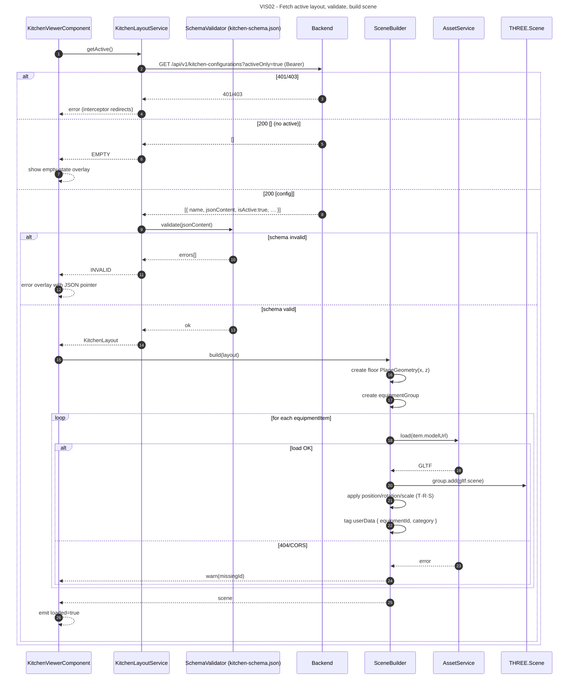
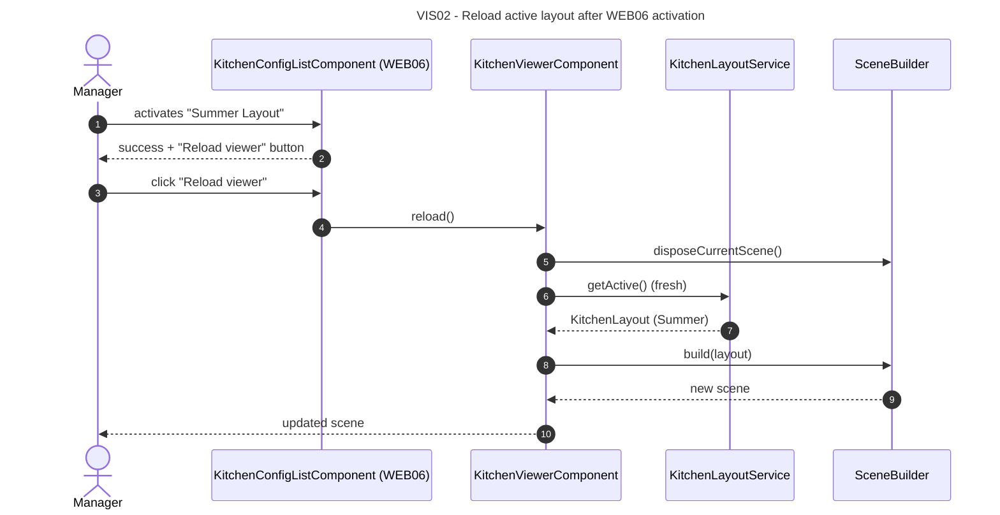

# VIS02 — Kitchen Layout and Equipment

## 1. Requirements Engineering

### 1.1. User Story Description

As a LaPizza Manager, I want a 3D representation of the restaurant kitchen, so that I can visualize its physical layout.

### 1.2. Customer Specifications and Clarifications

#### From the specification document
> Extracted from *PART IV — Sprint 2 — User Stories* (VIS02, p. 14) and *PART II — System Specification* (§II.3.3.2, p. 13).

- **Source of truth:** retrieve kitchen dimensions and the position, orientation, and scale of equipment and tools from the **back end as JSON**.
- **Equipment coverage:** models may be procedural or imported, and **must represent equipment such as** tables, counters, a stone/dome wood-fired oven, deep fryer, griddle, grill, refrigerator, dishwasher, exhaust hood, and cooking tools.
- **Imported models:** retrieve model URLs from the back end as JSON.
- **Active configuration binding:** the layout must correspond to the configuration selected as **active** on the Kitchen Configuration page (WEB06).

#### From `kitchen-schema.json`, `kitchen-layout-example.json`, `3d-assets-guide.md`

- **Schema (draft 2020-12) is authoritative.** Required top-level: `schemaVersion`, `dimensions`, `equipment`, `lights`. Optional: `metadata`, `animationTriggers`.
- **`additionalProperties: false`** at every level — unknown properties are rejected before the backend persists, and the viewer must reject them too (defense in depth).
- **`dimensions`:** `x` ∈ (0, 100], `y` ∈ (0, 10], `z` ∈ (0, 100], metres.
- **`equipment[]`:** `minItems: 1`; each item requires `id`, `modelUrl`, `position`, `rotation`, `scale`; `id` matches `^[a-z][a-z0-9-]{1,62}[a-z0-9]$` and is **unique** across the array (uniqueness is not expressible in JSON Schema — it is enforced by `KitchenConfigValidationService` and by the viewer's defensive check).
- **`modelUrl`:** matches `^/assets/3d/models/[A-Za-z0-9_\-/]+\.glb$` (relative, GLB only — ADR-014).
- **`position`, `rotation`:** `[x,y,z]`, rotation in radians (Euler XYZ, Three.js default).
- **`scale`:** `[x,y,z]`, components ∈ (0, 100], strictly positive.
- **`category`:** enum `{counter, receiving_platform, oven, conveyor, robot_arm, dispenser, fridge, sink, storage, other}`.
- **Reference layout (`kitchen-layout-example.json`):** 6 equipment items — `receiving-platform`, `counter-main`, `conveyor-main`, `arm-pizza-01`, `dispenser-cheese`, `oven-main` — with the oven rotated `[0, -1.5708, 0]` (≈ -π/2 around Y, facing the conveyor). The viewer must honour arbitrary rotations, not just this one.
- **Asset hosting (guide §3):** served by the same Nginx that serves the SPA; `modelUrl` is **always relative** (`/assets/3d/models/...`), never an absolute `http://backend:...` URL.
- **Format:** GLB only (ADR-014); `AssetService.load()` wraps `GLTFLoader`.
- **Sprint 2 performance budget (guide §6):** total ≤ 15 MB, per-GLB ≤ 5 MB, ≤ 40 draw calls, ≤ 250k triangles.

### 1.3. Acceptance Criteria (expanded, testable)

#### AC1 — Fetch dimensions and equipment placements from the back end
- AC1.1 The viewer issues `GET /api/v1/kitchen-configurations?activeOnly=true` on init (or `GET /api/v1/kitchen-configurations/{name}` if `configName` is bound — see VIS01 AC4.2).
- AC1.2 The response `jsonContent` is treated as the authoritative layout. The SPA bundle contains **zero** hard-coded kitchen dimensions or equipment lists.
- AC1.3 The `KitchenLayoutService` re-validates the payload against `docs/sg/kitchen-schema.json` (bundled in the SPA assets) using Ajv — defense in depth per WEB06 AC5 and KB ADR-011 §Consequences.
- AC1.4 If validation fails, the viewer renders the empty/error overlay (VIS01 AC5.1 style) and does **not** proceed to load any model.

#### AC2 — Dimensions drive the scene bounds
- AC2.1 A `PlaneGeometry(dimensions.x, dimensions.z)` is created as the floor, rotated `-π/2` around X to lie on the XZ plane, positioned at `y = 0`.
- AC2.2 The floor's UV repeat is set to `dimensions.x / 2` × `dimensions.z / 2` (a 2 m tile grid) — gives the reviewer a visual reference for the dimensions.
- AC2.3 The renderer's `camera.far` is set to `max(dimensions.x, dimensions.y, dimensions.z) × 4` to avoid z-fighting and clipping.
- AC2.4 The `CameraController` (VIS07) initial target is computed from `dimensions` — see VIS07 AC1.

#### AC3 — Equipment items are rendered with the correct transform
- AC3.1 For each `equipment[]` item, the viewer calls `AssetService.load(item.modelUrl)`, then applies `position`, `rotation`, `scale` **in that order** (T·R·S) to `gltf.scene`.
- AC3.2 Rotation is applied as `Euler(x, y, z, 'XYZ')` (Three.js default order), not quaternion directly — matches the schema's stated convention.
- AC3.3 The loaded `gltf.scene` is added to a per-item `Group` tagged with `userData.equipmentId = item.id` and `userData.category = item.category`, so VIS03 (assembly line identification) and VIS06 (light folders) can query it.
- AC3.4 All equipment is added to a single `equipmentGroup` container; the group is added to the scene root.

#### AC4 — Model sources
- AC4.1 Only `.glb` model URLs matching `^/assets/3d/models/[A-Za-z0-9_\-/]+\.glb$` are loaded. Any other URL (absolute, OBJ, MTL, FBX) is a schema violation surfaced by AC1.3.
- AC4.2 The reference layout's 6 GLBs must be present under `frontend/public/assets/3d/models/` and served at `/assets/3d/models/<file>.glb`.
- AC4.3 Procedural models are permitted (spec: "may be procedural or imported") but, if used, the layout JSON must still declare an `equipmentItem` with a schema-valid `modelUrl` — the current deployment ships GLBs, not procedural fallbacks, and this is the accepted baseline.

#### AC5 — Failure modes
- AC5.1 Missing active config (`[]`): empty-state overlay (VIS01 AC5.1); no GLB is fetched.
- AC5.2 Schema-invalid `jsonContent`: error overlay; no GLB is fetched.
- AC5.3 Per-asset 404/CORS: the failing GLB is logged to the `error` output with a per-item key; the rest of the scene renders; a small inline warning lists the missing `equipmentId`s (does not tear down the canvas).
- AC5.4 Duplicate `equipment[].id`: rejected at validation time (`KitchenConfigValidationService`), so the viewer never receives duplicates; if it does (defense in depth), the second occurrence is skipped and a warning is surfaced.

#### AC6 — Reference layout matches the specification's equipment categories
- AC6.1 The reviewer can see, with the reference layout, at least: a **counter**, a **receiving platform** on the left, a **conveyor** connecting them, **robotic arms**, a **dispenser**, and a **wood-fired oven** on the right — the exact set required by VIS03 and the spec's equipment list.
- AC6.2 If the reference layout is extended to include `fridge`, `sink`, `storage`, those categories render without code changes (category enum drives grouping, not switch-casing).

### 1.4. Found out Dependencies

**Preceding:**
- VIS01 (module + renderer + lifecycle).
- WEB06 (endpoint exists + seed/reference layout).
- ADR-011 (`GET /kitchen-configurations`), ADR-014 (GLB).
- `frontend/public/assets/3d/models/*.glb` present.

**Succeeding:**
- VIS03 (uses the loaded equipment for the assembly line inspection).
- VIS05/VIS06 (light creation uses scene bounds from `dimensions`).
- VIS07 (camera target uses `dimensions`).

### 1.5. Input and Output Data

#### 1.5.1. Types (frontend)

```ts
// kitchen-layout.types.ts
export interface KitchenLayout {
  schemaVersion: string;
  metadata?: { name: string; description?: string; author?: string; createdAt?: string };
  dimensions: { x: number; y: number; z: number };
  equipment: EquipmentItem[];
  lights: LightDef[];
  animationTriggers: AnimationTrigger[];
}
export interface EquipmentItem {
  id: string;
  label?: string;
  category?: EquipmentCategory;
  modelUrl: string;
  position: [number, number, number];
  rotation: [number, number, number];
  scale: [number, number, number];
}
```

#### 1.5.2. Reference `equipment[]` (from `kitchen-layout-example.json`, abridged)

| `id` | `category` | `modelUrl` | `position` | `rotation` |
|---|---|---|---|---|
| `receiving-platform` | `receiving_platform` | `/assets/3d/models/receiving_platform.glb` | `[0.75, 0.9, 2.0]` | `[0,0,0]` |
| `counter-main` | `counter` | `/assets/3d/models/counter_main.glb` | `[3.5, 0, 2.0]` | `[0,0,0]` |
| `conveyor-main` | `conveyor` | `/assets/3d/models/conveyor_main.glb` | `[4.0, 1.1, 2.0]` | `[0,0,0]` |
| `arm-pizza-01` | `robot_arm` | `/assets/3d/models/arm_articulated.glb` | `[5.5, 1.8, 2.0]` | `[0,0,0]` |
| `dispenser-cheese` | `dispenser` | `/assets/3d/models/dispenser_cheese.glb` | `[5.5, 2.5, 2.0]` | `[0,0,0]` |
| `oven-main` | `oven` | `/assets/3d/models/oven_woodfired.glb` | `[8.5, 0, 4.0]` | `[0,-1.5708,0]` |

#### 1.5.3. Endpoint matrix

Same as VIS01 §1.5.2. No mutation endpoints are used by VIS02.

#### 1.5.4. Persistence

`kitchen_configurations.json_content` (migration 014 §3). No mutation.

### 1.6. System Sequence Diagrams (SSD)

#### 1.6.1. Fetch active layout → validate → build scene



#### 1.6.2. Reload after WEB06 activation



### 1.7. Other Relevant Remarks

#### 1.7.1. Render order

The equipment is added in the order declared in `equipment[]`. The renderer does **not** sort by category or by `id`; deterministic iteration is preserved so that screenshots and replay (Sprint 3) are stable. If a category-based grouping is needed (for VIS06 light folders or VIS03 assembly-line queries), it happens via `userData.category` queries, not by reordering the scene graph.

#### 1.7.2. Error-to-HTTP matrix

| Condition | HTTP / source | UI |
|---|---|---|
| No active config | 200 `[]` | empty-state overlay |
| Schema invalid (client) | n/a (Ajv) | error overlay with JSON pointer |
| Schema invalid (server) | 422 | error overlay ("Configuração inválida no servidor. Contacte o gestor.") |
| Backend 401 | 401 | redirect `/login` |
| Backend 403 | 403 | redirect `/forbidden` |
| GLB 404 (per item) | 404 | per-item warning, other models render |
| GLB CORS | n/a | per-item warning + DevTools hint |
| WebGL2 unavailable | n/a | fallback message (VIS01 AC5.2) |

#### 1.7.3. Verification

- **Unit:** `SceneBuilder.build` creates exactly `layout.equipment.length + 1` root children (equipment + floor); each mesh's `userData.equipmentId` matches the input; applying `position/rotation/scale` produces the expected world matrix (compare against a reference computed with `new THREE.Matrix4().compose(...)`).
- **Schema:** feed `kitchen-layout-example.json` (valid) and 5 variants (missing `dimensions`, `scale: [0,1,1]`, `modelUrl` = `http://x/y.glb`, `id` uppercase, duplicate `id`) — assert Ajv rejections.
- **Integration:** run against a live backend seeded with the reference layout; assert `renderer.info.render.calls ≤ 40` and `triangles ≤ 250_000` on the reference layout.
- **Demo:** open `/kitchen-viewer` as Manager; confirm 6 equipment items placed as per the reference layout; block one GLB URL → see per-item warning and other 5 items still render; delete the active config via WEB06 → reload → empty-state overlay.