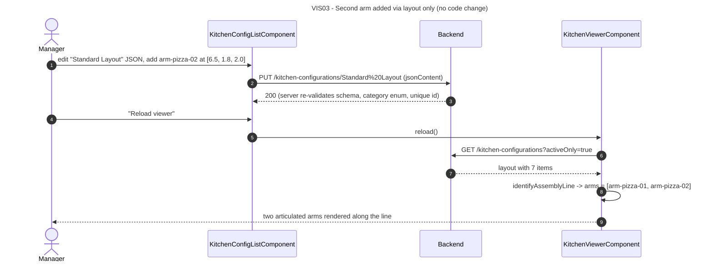
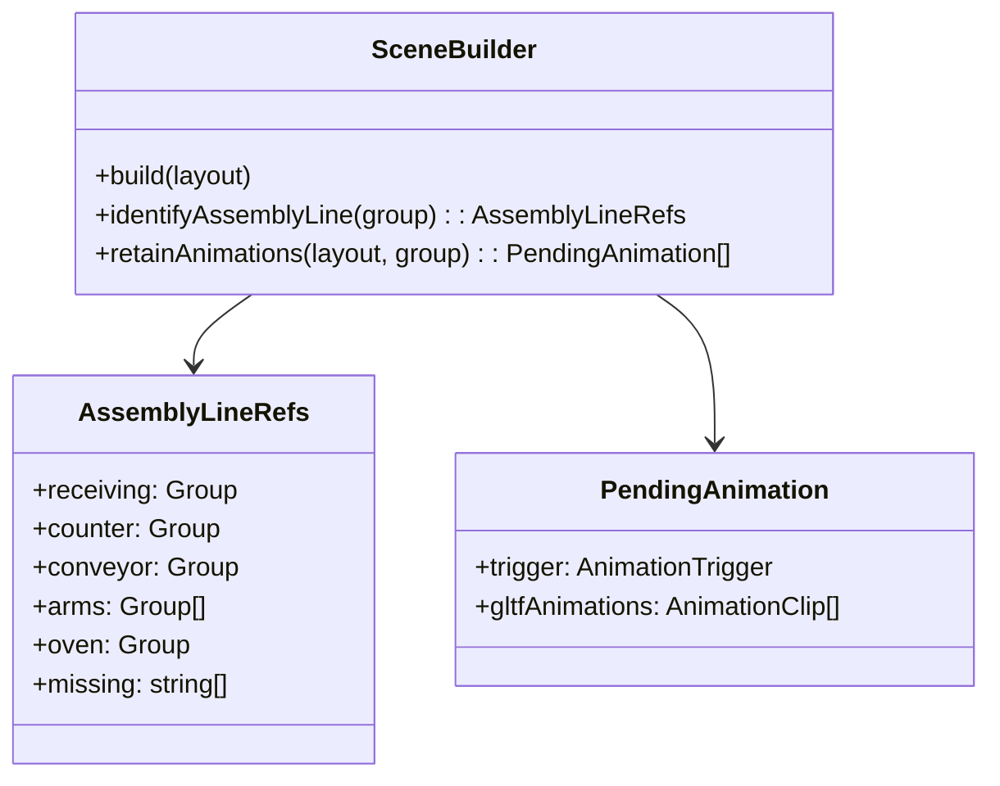

# VIS03 — Automated Pizza Assembly Line Representation

## 1. Requirements Engineering

### 1.1. User Story Description

As a LaPizza Manager, I want to see an automated pizza assembly line on one kitchen wall, so that I can inspect its spatial arrangement.

### 1.2. Customer Specifications and Clarifications

#### From the specification document
> Extracted from *PART IV — Sprint 2 — User Stories* (VIS03, pp. 14–15) and the illustrative *Figure 1* (p. 14) plus *PART II — System Specification* (§II.3.3.2).

- **Large counter with receiving platform on the left** for preformed crusts supplied by an overhead system.
- **Traditional wood-fired oven on the right**, connected to the receiving platform by an integrated **conveyor belt**.
- **Several articulated robotic arms** along the line to represent ingredient deposition as pizzas advance.
- **Models may be procedural or imported**; if imported, URLs must be retrieved from the back end as JSON.
- **Sprint 3 readiness:** "keep in mind that the dispenser, conveyor belt, and robotic arms will be animated in Sprint 3" — the Sprint 2 pipeline must prepare for this without re-authoring assets.

#### From `kitchen-layout-example.json`, `kitchen-schema.json`, `3d-assets-guide.md`, ADR-014

- **Reference layout** implements exactly the required arrangement: `receiving-platform` (`x=0.75`), `counter-main` (`x=3.5`), `conveyor-main` (`x=4.0, y=1.1`), `arm-pizza-01` (`x=5.5`), `dispenser-cheese` (`x=5.5, y=2.5`), `oven-main` (`x=8.5, z=4.0`, rotated -π/2 around Y).
- **Categories** (`counter`, `receiving_platform`, `oven`, `conveyor`, `robot_arm`, `dispenser`) are the semantic identifiers the viewer must use to query the assembly line — not a hard-coded list of `id`s.
- **Animation readiness (guide §8):** GLB must export animation tracks. Naming convention `equipmentId_actionName`. The layout's `animationTriggers[]` reference `targetEquipmentId` (not clip name); the mapping from `targetEquipmentId` → clip name is the renderer's responsibility (guide §8.2).
- **`animationTriggers`** is declared (minItems not required; defaults `[]`); Sprint 2 does not play them but must not reject them.
- **Draco disabled** in Sprint 2 (guide §5.3) — the loader is plain `GLTFLoader`, not a Draco-decorated one.

### 1.3. Acceptance Criteria (expanded, testable)

#### AC1 — Required assembly-line elements present in the scene
- AC1.1 The active layout must contain at least one equipment item of each **required category**: `receiving_platform`, `counter`, `conveyor`, `robot_arm`, `oven`. The reference layout has all five.
- AC1.2 The viewer must render the assembly line **without any hard-coded `id` checks**. Identification is by `userData.category` (VIS02 AC3.3).
- AC1.3 **Acceptance visible in the demo:** the rendered scene shows a counter with a receiving platform on the left, a wood-fired oven on the right, and a conveyor connecting them. The `kitchen-layout-example.json` positions satisfy this spatially (X grows left→right; the oven is at `x=8.5`, the receiving platform at `x=0.75`).

#### AC2 — Articulated robotic arms along the line
- AC2.1 The layout may contain **any number ≥ 1** of `robot_arm` items. The viewer must not cap or assume a specific count.
- AC2.2 Each arm is rendered with its `position`, `rotation`, `scale` per VIS02 AC3.1.
- AC2.3 The reference layout uses one arm (`arm-pizza-01`). The demo may show additional arms (e.g., `arm-pizza-02`, `arm-pizza-03`) placed along the conveyor by extending the layout JSON — **without any code change**. This is a WEB06+VIS02 property, verified in VIS03 by demonstrating the extension.

#### AC3 — Dispenser and overhead delivery
- AC3.1 A `dispenser` category item (e.g., `dispenser-cheese`) is placed above the counter/arms (`y` higher than the arms) — visible in the reference layout (`y=2.5` vs arm `y=1.8`).
- AC3.2 The dispenser is rendered without parenting to the arm (decoupled in the scene graph; the arm and dispenser are siblings under `equipmentGroup`).

#### AC4 — Animation readiness (Sprint 3)
- AC4.1 The GLBs loaded for `conveyor`, `robot_arm`, and `dispenser` categories are loaded via `GLTFLoader` — animations are **retained** on the returned `gltf` object (`gltf.animations[]`).
- AC4.2 For every `animationTrigger` in the layout, the viewer resolves `targetEquipmentId` to a scene node via `userData.equipmentId`, and stores `{trigger, gltf, mixerCandidate}` in a `pendingAnimations` collection. It **does not** create or play a `THREE.AnimationMixer` in Sprint 2 — the data is retained for Sprint 3.
- AC4.3 If an `animationTrigger.targetEquipmentId` does not match any loaded `equipmentId` (should not happen because `KitchenConfigValidationService` checks referential integrity — ADR-011 §Consequences), the viewer logs a warning and skips the trigger.
- AC4.4 The loader must **not** discard `gltf.animations` even when unused — `THREE.AnimationClip` instances are the Sprint 3 starting point (guide §8.2).

#### AC5 — No re-authoring required for Sprint 3
- AC5.1 The Sprint 2 GLBs must export animation tracks per guide §5.2 (Animation → Animations: `true`; NLA Strips: `true`). This is verified by a repo check: `npx gltf-inspect <file>.glb` lists a non-empty `animations[]` for `conveyor_main.glb`, `arm_articulated.glb`, `dispenser_cheese.glb`.
- AC5.2 The naming convention `equipmentId_actionName` (guide §8.1) is documented in `frontend/public/assets/3d/sources/<model>.export.txt` for each animated asset.

#### AC6 — Failure modes
- AC6.1 A missing `conveyor`, `receiving_platform`, `counter`, `robot_arm`, or `oven` category item does not block rendering — the scene renders with what is present, and the `error` output reports `"assembly_line_incomplete: <missingCategories>"`. The US does not mandate rejection at the backend; the viewer surfaces the gap.
- AC6.2 A missing `animationTrigger` for an equipment item that has animation tracks is **not** an error — Sprint 2 does not play them.

### 1.4. Found out Dependencies

**Preceding:**
- VIS01 (module), VIS02 (scene builder, category tagging).
- `kitchen-layout-example.json` (reference layout, 6 items).
- 6 GLBs shipped under `frontend/public/assets/3d/models/`.

**Succeeding:**
- Sprint 3 animation (uses `pendingAnimations` and `gltf.animations` retained here).
- VIS06 (light folders are per-light, not per-assembly-item — orthogonal).

### 1.5. Input and Output Data

#### 1.5.1. Reference assembly line (from `kitchen-layout-example.json`, ordered by X)

| Order (X asc) | `id` | `category` | `position` | Notes |
|---|---|---|---|---|
| 1 | `receiving-platform` | `receiving_platform` | `[0.75, 0.9, 2.0]` | preformed crusts inlet, overhead delivery to the left |
| 2 | `counter-main` | `counter` | `[3.5, 0, 2.0]` | large preparation counter |
| 3 | `conveyor-main` | `conveyor` | `[4.0, 1.1, 2.0]` | integrated belt |
| 4 | `arm-pizza-01` | `robot_arm` | `[5.5, 1.8, 2.0]` | ingredient deposition |
| 5 | `dispenser-cheese` | `dispenser` | `[5.5, 2.5, 2.0]` | above the arm |
| 6 | `oven-main` | `oven` | `[8.5, 0, 4.0]`, rot `-1.5708` | wood-fired oven on the right |

#### 1.5.2. `animationTriggers[]` (from reference layout, Sprint 3 readiness)

```json
[
  { "id": "conveyor-belt-run",  "targetEquipmentId": "conveyor-main",  "action": "loop",  "loop": true,  "delay": 0.0 },
  { "id": "arm-pick-place",     "targetEquipmentId": "arm-pizza-01",   "action": "loop",  "loop": true,  "delay": 0.5 },
  { "id": "cheese-dispense",    "targetEquipmentId": "dispenser-cheese","action": "pulse","loop": false, "delay": 1.2 }
]
```

The viewer stores `pendingAnimations = [{ trigger, gltf: gltfFor(targetId), animations: gltf.animations }]`. Sprint 2 does not create a mixer.

#### 1.5.3. Persistence

Same `kitchen_configurations.json_content`. No mutation.

### 1.6. System Sequence Diagrams (SSD)

#### 1.6.1. Assembly-line identification and render order

```mermaid
sequenceDiagram
autonumber
title VIS03 - Identify assembly line by category
    participant Cmp as KitchenViewerComponent
    participant Builder as SceneBuilder
    participant Scene as THREE.Scene
    participant Item as EquipmentGroup (per item)

    Cmp->>Builder: build(layout)
    Builder->>Scene: add(floor)
    Builder->>Scene: add(equipmentGroup)
    loop for each item in layout.equipment
        Builder->>Item: new Group; userData = { equipmentId, category }
        Builder->>Item: add(gltf.scene)
        Builder->>Item: apply position/rotation/scale
        Builder->>Scene: equipmentGroup.add(Item)
    end
    Builder->>Builder: identifyAssemblyLine(equipmentGroup)
    Builder->>Scene: query userData.category in {receiving_platform, counter, conveyor, robot_arm, oven}
    alt all required categories present
        Builder-->>Cmp: assemblyLine = { receiving, counter, conveyor, arms[], oven }
    else missing categories
        Builder-->>Cmp: assemblyLine = { …, missing: [...] }
        Cmp->>Cmp: emit error("assembly_line_incomplete: " + missing.join(","))
    end
```

#### 1.6.2. Sprint 3 readiness — retain animations, defer playback

```mermaid
sequenceDiagram
autonumber
title VIS03 - Animation readiness (Sprint 2 collects, Sprint 3 plays)
    participant Cmp as KitchenViewerComponent
    participant Assets as AssetService
    participant Layout as KitchenLayout
    participant Scene as THREE.Scene

    Note over Cmp: after all GLBs loaded (VIS02 loop)
    loop for each trigger in layout.animationTriggers
        Cmp->>Scene: find node with userData.equipmentId == trigger.targetEquipmentId
        alt node found
            Scene-->>Cmp: node; node.animations (from gltf.animations)
            Cmp->>Cmp: pendingAnimations.push({ trigger, gltfAnimations: node.animations })
        else node missing (defensive)
            Cmp->>Cmp: log warning "unknown targetEquipmentId"
        end
    end
    Note over Cmp: Sprint 2: no AnimationMixer, no clipAction().play()
    Note over Cmp: Sprint 3: for each pending, clip = AnimationClip.findByName(gltf.animations, `${equipmentId}_${actionName}`); mixer.clipAction(clip).play()
```

#### 1.6.3. Extending the layout with a second arm (WEB06 + VIS02 + VIS03 acceptance)



### 1.7. Other Relevant Remarks

#### 1.7.1. Component architecture



`AssemblyLineRefs` is not consumed by the renderer in Sprint 2 (no logic depends on it); it is retained for Sprint 3 (scheduling / animation triggers) and used by the debug overlay in the demo to prove the categories were identified.

#### 1.7.2. Error/status matrix

| Condition | Source | UI |
|---|---|---|
| All required categories present | layout | normal render |
| One required category missing | layout | render + `error("assembly_line_incomplete: <cats>")` |
| `animationTrigger.targetEquipmentId` unknown | layout | console warning; no UI error (referential check happens server-side) |
| GLB for `conveyor` / `robot_arm` / `dispenser` has no animations | asset check | `error("animation_readiness_missing: <id>")` surfaced on the demo overlay (Sprint 3 would need re-export) |

#### 1.7.3. Verification

- **Unit:** `identifyAssemblyLine` returns the correct `arms[]` when 1 or 3 arms are present; reports `missing` when e.g. `oven` is removed.
- **Unit:** `retainAnimations` returns `pendingAnimations.length === layout.animationTriggers.length` when targets exist; skips unknown targets with a warning.
- **Asset gate:** repo check that `gltf.animations.length > 0` for `conveyor_main.glb`, `arm_articulated.glb`, `dispenser_cheese.glb` (uses `npx gltf-inspect`).
- **Demo:** open the reference layout → identify the 5 required categories visually; extend with a second arm via WEB06 → reload → second arm appears; remove the `oven` item via WEB06 → reload → `assembly_line_incomplete: oven` surfaced.