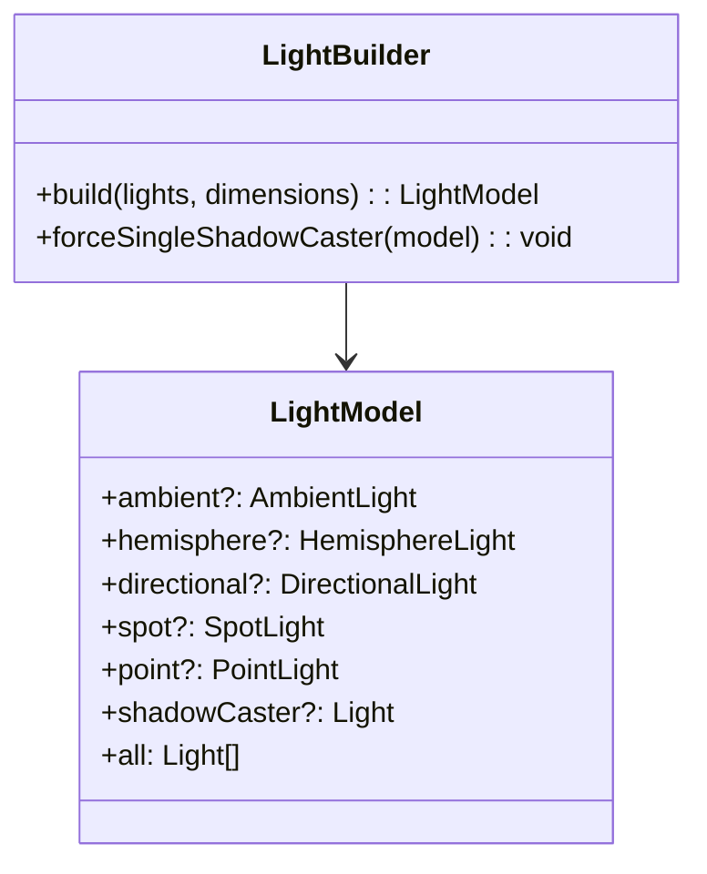

# VIS05 — Scene Lighting

## 1. Requirements Engineering

### 1.1. User Story Description

As a LaPizza Manager, I want appropriate scene lighting, so that objects are visible, realistically rendered, and easy to interpret under different viewing conditions.

### 1.2. Customer Specifications and Clarifications

#### From the specification document
> Extracted from *PART IV — Sprint 2 — User Stories* (VIS05, p. 15).

- Include **at least ambient light and one spotlight** to ensure visibility of all 3D objects.
- Lighting enhances depth perception and object contours **without overexposure or excessive darkness**.
- Use **shadows** without significant performance degradation.
- Lighting setup **works consistently across zoom levels and camera angles**.

#### From `kitchen-schema.json`, `kitchen-layout-example.json`, `3d-assets-guide.md`, KB §53–§54

- **`lights[]` is required** (minItems 1); the schema allows `ambient`, `hemisphere`, `directional`, `point`, `spot`.
- **Reference layout** (from `kitchen-layout-example.json`):
  - `ambient` — `#ffffff`, intensity `0.35`.
  - `directional` — `#ffffff`, intensity `0.9`, `castShadow: true`, positioned at `[10,8,6]`, target `[4,0,2]`.
  - `spot` — `#ffeeaa`, intensity `1.2`, positioned at `[4,3.2,4]`, target `[4,0,2]`, `angle: 0.5236` (≈ 30°), `penumbra: 0.3`, `decay: 1.5`, `distance: 15`, `castShadow: false`.
  - `point` — `#ff8844`, intensity `1.0`, positioned at `[8.5,1.5,4]`, `decay: 2`, `distance: 4` (warm oven glow).
- **Shadow rules (KB §54.2–§54.3; guide §6):** three-level activation (renderer, light, mesh); **≤ 1 shadow-casting light** to keep the `N+1` re-render budget; shadow map size ≤ 1024²; `DirectionalLight` uses an orthographic shadow camera; `SpotLight` uses a perspective shadow camera; `PointLight` (6 cube cameras) is the most expensive — reference layout disables `castShadow` on it.
- **`AmbientLight`/`HemisphereLight` never cast shadows** (KB §53.2).
- **KB §53.3:** "Never leave the scene in absolute black" — the ambient light exists precisely to avoid that.
- **KB §54.4:** `SunLight` (cascaded shadow maps) is an alternative for large outdoor scenes — **not applicable** here (kitchen is interior).

### 1.3. Acceptance Criteria (expanded, testable)

#### AC1 — Minimum lighting set
- AC1.1 The active layout contains at least one `ambient` or `hemisphere` light **and** at least one `spot` light. The reference layout satisfies both (`ambient` + `spot`).
- AC1.2 The renderer's `scene.background` is non-black; if a `map`/`envMap` is used as background, its brightness is checked (see AC4) so the scene is never "dark because the background is dark".
- AC1.3 Every light defined in `lights[]` is instantiated — no light is silently ignored. The `LightBuilder` maps the schema `type` to `THREE.{Ambient, Hemisphere, Directional, Point, Spot}Light`.

#### AC2 — Correct light parameters from the schema
- AC2.1 For each light, `color` (`#rrggbb`) → `new THREE.Color(hex)`; `intensity` → `light.intensity`.
- AC2.2 `position` and `target` (when present) → `light.position.set(...)` and `light.target.position.set(...)` **followed by** `light.target.updateMatrixWorld()` and `scene.add(light.target)` for `Directional`/`Spot` lights.
- AC2.3 `SpotLight`: `angle` (radians, ≤ π/2 = 1.5708), `penumbra` (0..1), `decay` (≥ 0), `distance` (≥ 0) applied to the Three.js `SpotLight`.
- AC2.4 `PointLight`: `distance`, `decay` applied.
- AC2.5 `HemisphereLight`: `skyColor`, `groundColor`, `intensity`.

#### AC3 — Shadows: minimum viable, within budget
- AC3.1 `renderer.shadowMap.enabled = true`; `renderer.shadowMap.type = THREE.PCFSoftShadowMap` (soft shadows).
- AC3.2 The renderer **at most one** light with `castShadow = true` (guide §6, KB §54.1). If the layout declares more, `LightBuilder` keeps the **first** shadow-casting light and forces `castShadow = false` on the rest, logging a warning. This is a design choice to keep the `N+1` re-render budget (see §1.7.2).
- AC3.3 Shadow-casting `DirectionalLight`: orthographic shadow camera `left/right/top/bottom` sized to the scene bounds (`dimensions.x × dimensions.z` × 1.2 for margin); `near = 0.1`; `far = max(x,y,z) × 4`; `mapSize = 1024 × 1024`.
- AC3.4 Shadow-casting `SpotLight`: perspective shadow camera; `near`, `far` set from `distance`; `mapSize = 1024 × 1024`.
- AC3.5 For every loaded equipment mesh: `castShadow = true` and `receiveShadow = true` by default. The floor mesh: `castShadow = false` (its shadow would be under itself), `receiveShadow = true`. This is decided by `category`: `counter`/`oven`/`conveyor`/`robot_arm`/`dispenser`/`receiving_platform` cast + receive; the floor receives only.
- AC3.6 Shadow map size caps at 1024² (guide §6). Any layout declaring a larger size is overruled by the builder and a warning is logged.
- AC3.7 `light.shadow.bias = -0.0005` (Peter-panning vs. shadow acne trade-off; documented for the reference layout). Overridable per-light via a reserved extension if needed (not implemented in baseline).

#### AC4 — Exposure and visual quality
- AC4.1 `renderer.toneMapping = THREE.ACESFilmicToneMapping`; `renderer.toneMappingExposure = 1.0`. This prevents overexposure when a spot hits a bright surface and prevents black crush in shadows.
- AC4.2 The scene is **never fully black**: after load, a debug check (`renderer.readRenderTargetPixels` on a small probe at the scene centre, or a `scene.getObjectByName('floor')` lit check) is not required by the AC, but the design guarantees it via the presence of `ambient`/`hemisphere` in AC1.1.
- AC4.3 No overexposed highlights visible in the demo screenshots at default camera + default lighting — verified visually and (optionally) by a `readPixels` sanity check in a dev spec.
- AC4.4 Lighting is **independent of camera** for `Ambient`/`Hemisphere`/`Directional`/`Spot`/`Point` (which is all that the schema allows). The AC "works consistently across zoom levels and camera angles" is trivially satisfied because the lights are fixed in world space — with the caveat that `PointLight` attenuation and `SpotLight` cone are checked against the initial camera (VIS07) and remain readable when the user pans/orbits/zooms. This is verified in VIS07's demo.

#### AC5 — No significant performance degradation from shadows
- AC5.1 `renderer.info.render.calls` on the reference layout remains ≤ 40 (guide §6).
- AC5.2 Frame time on the reference machine at 1080p with 1 shadow-casting light: ≤ 33 ms (30 fps).
- AC5.3 If a layout declares more than one shadow-casting light (schema-permitted), the builder drops extras with a warning (AC3.2) — this enforces the budget even if the JSON author is careless.

#### AC6 — Point light (oven glow)
- AC6.1 The reference layout's `point` light (oven glow) is instantiated with `castShadow = false` (it is expensive: 6 cube cameras).
- AC6.2 If a layout declares `castShadow: true` on a `PointLight`, the builder forces `castShadow = false` and logs a warning ("PointLight shadows are disabled to preserve the performance budget; see guide §6").

### 1.4. Found out Dependencies

**Preceding:**
- VIS01, VIS02 (scene, dimensions, equipment loaded).
- `3d-assets-guide.md` §6 (budget), KB §53–§54.

**Succeeding:**
- VIS06 (light controls operate on the `LightBuilder` model).
- VIS07 (camera moves; lighting must look consistent).

### 1.5. Input and Output Data

#### 1.5.1. `lights[]` reference (from `kitchen-layout-example.json`)

| # | Type | Colour | Intensity | Position / Target | Cast shadow | Extra |
|---|---|---|---|---|---|---|
| 1 | `ambient` | `#ffffff` | 0.35 | — | — | — |
| 2 | `directional` | `#ffffff` | 0.9 | pos `[10,8,6]`, target `[4,0,2]` | **true** | ortho shadow camera |
| 3 | `spot` | `#ffeeaa` | 1.2 | pos `[4,3.2,4]`, target `[4,0,2]` | false | `angle 0.5236`, `penumbra 0.3`, `decay 1.5`, `distance 15` |
| 4 | `point` | `#ff8844` | 1.0 | pos `[8.5,1.5,4]` | false | `decay 2`, `distance 4` |

#### 1.5.2. Scene-level renderer settings

| Setting | Value | Source |
|---|---|---|
| `renderer.shadowMap.enabled` | `true` | KB §54.2 |
| `renderer.shadowMap.type` | `PCFSoftShadowMap` | KB §54.2 |
| `renderer.toneMapping` | `ACESFilmicToneMapping` | KB §53.3 (avoid overexposure) |
| `renderer.toneMappingExposure` | `1.0` | KB §53.3 |
| `renderer.outputColorSpace` | `SRGBColorSpace` (default) | Three.js r152+ |
| `renderer.setPixelRatio(Math.min(devicePixelRatio, 2))` | — | KB §50.5 (perf) |

#### 1.5.3. Persistence

Same `kitchen_configurations.json_content`. No mutation.

### 1.6. System Sequence Diagrams (SSD)

#### 1.6.1. Build lights and shadow cameras

```mermaid
sequenceDiagram
autonumber
title VIS05 - Build lights from layout
    participant Cmp as KitchenViewerComponent
    participant LB as LightBuilder
    participant Scene as THREE.Scene
    participant Renderer as WebGLRenderer

    Cmp->>LB: build(layout.lights, layout.dimensions)
    LB->>Renderer: shadowMap.enabled = true
    LB->>Renderer: shadowMap.type = PCFSoftShadowMap
    LB->>Renderer: toneMapping = ACESFilmic; exposure = 1.0
    loop for each lightDef in lights
        alt type == ambient
            LB->>Scene: add(new AmbientLight(color, intensity))
        else type == hemisphere
            LB->>Scene: add(new HemisphereLight(sky, ground, intensity))
        else type == directional
            LB->>Scene: light = new DirectionalLight(color, intensity)
            LB->>Scene: light.position.set(...); light.target.position.set(...); scene.add(target)
            alt castShadow && no shadow-caster yet
                LB->>LB: light.castShadow = true; configureOrthoShadowCamera(light, dimensions); mapSize=1024
                LB->>LB: shadowCaster = light
            else castShadow && shadowCaster already set
                LB->>LB: force castShadow=false; log warning
            end
            LB->>Scene: add(light)
        else type == spot
            LB->>Scene: light = new SpotLight(color, intensity, distance, angle, penumbra, decay)
            LB->>Scene: light.position.set(...); light.target.position.set(...)
            alt castShadow && no shadow-caster yet
                LB->>LB: light.castShadow = true; configurePerspectiveShadowCamera; mapSize=1024
            else castShadow && shadowCaster already set
                LB->>LB: force castShadow=false
            end
            LB->>Scene: add(light)
        else type == point
            LB->>Scene: light = new PointLight(color, intensity, distance, decay)
            LB->>Scene: light.position.set(...)
            Note over LB: castShadow is forced false regardless of JSON (guide §6 / KB §54.3)
            LB->>Scene: add(light)
        end
    end
    LB-->>Cmp: LightModel (per-light references, for VIS06)
```

#### 1.6.2. Per-mesh shadow flags by category

```mermaid
sequenceDiagram
autonumber
title VIS05 - Apply shadow flags per mesh
    participant Builder as SceneBuilder
    participant Scene as THREE.Scene

    Builder->>Scene: scene.traverse(mesh => {
        if mesh.isMesh and mesh.userData.category != 'floor':
            mesh.castShadow = true
            mesh.receiveShadow = true
        if mesh.userData.category == 'floor':
            mesh.castShadow = false
            mesh.receiveShadow = true
    })
```

### 1.7. Other Relevant Remarks

#### 1.7.1. Component architecture



`LightModel` is the interface between VIS05 and VIS06: VIS06 iterates `model.all` and creates a lil-gui folder per light. The model is retained on the component; it is the single source of truth for light controls (VIS06).

#### 1.7.2. Decision record — one shadow-casting light maximum

The schema permits `castShadow: true` on any `DirectionalLight`/`SpotLight`/`PointLight`. `3d-assets-guide.md` §6 and KB §54.1 both warn that each shadow-casting light adds an extra scene render per frame. To keep the Sprint 2 demo at 30 fps on a mid-range laptop, `LightBuilder` enforces **≤ 1** shadow-casting light, keeping the first one declared and forcing the rest to `castShadow = false` with a logged warning.

**Alternatives considered:**
- *Honour every declared `castShadow: true`*: rejected — a careless layout could drop the demo to 10 fps.
- *Return 422 from the backend when > 1 shadow-caster*: rejected — it would couple a rendering performance concern to the domain validator (ADR-011 keeps `json_content` opaque to the backend). The builder's rule is a **viewer-side** safety net, which is the correct layer.
- *Warn only, still render all shadows*: rejected — the budget is not optional.

#### 1.7.3. Error/status matrix

| Condition | Source | UI |
|---|---|---|
| `lights[]` has `ambient` + `spot` | layout | normal render |
| `lights[]` has `spot` but no `ambient`/`hemisphere` | layout | render, but the "never black" rule is not guaranteed — the builder adds a defensive `AmbientLight` with intensity `0.05` and logs a warning (design choice: guarantee AC4.2 even when the layout omits it). |
| > 1 shadow-caster declared | layout | extras forced to `castShadow = false`, warning |
| `PointLight` with `castShadow: true` | layout | forced `castShadow = false`, warning |
| Shadow-casting light without position | schema violation | rejected by Ajv before the builder runs |
| Spot `angle > π/2` | schema violation | rejected by Ajv |
| Total shadows cost > budget | perf check | dev warning; reviewer asks for downsizing |

#### 1.7.4. Verification

- **Unit:** `LightBuilder.build` — 5 cases (ambient-only + defensive spot, directional+spot with two castShadow true → second forced false, point castShadow true → forced false, spot parameters applied, `angle > π/2` rejected upstream). Assert `renderer.shadowMap.enabled === true` after build.
- **Unit (defensive ambient):** feed a layout with only `spot` → assert an `AmbientLight` with intensity `0.05` was added and a warning was emitted.
- **Integration:** after loading the reference layout, assert `renderer.info.render.calls` ≤ 40 with shadows enabled; take a screenshot to compare visual quality (overexposed highlights → fail visual review).
- **Performance:** measure frame time in dev spec; assert ≤ 33 ms.
- **Demo:** default camera → scene readable; toggle the one shadow-caster via VIS06 → shadows disappear/reappear; remove the `ambient` light via a modified layout → the builder's defensive ambient prevents black, and the warning shows in the console.