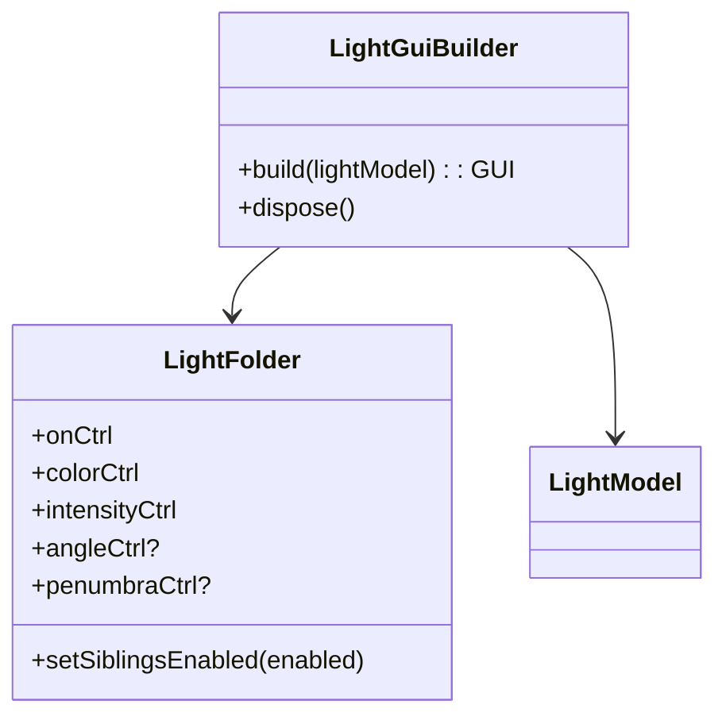

# VIS06 — Interactive Light Controls

## 1. Requirements Engineering

> **Applicability:** this US (and all its acceptance criteria) applies only to teams with **four or more members**. Team 3DJ-05 has 4 members (KB §2.3), so VIS06 is **in scope**.

### 1.1. User Story Description

As a LaPizza Manager, I want to switch light sources on and off and control their colour and intensity, so that I can adjust the scene lighting.

### 1.2. Customer Specifications and Clarifications

#### From the specification document
> Extracted from *PART IV — Sprint 2 — User Stories* (VIS06, pp. 15–16).

- **GUI organised into one folder per light source.**
- **On/off via checkbox.**
- **Colour picker** for colour selection, **slider** for intensity (within reasonable limits).
- For **spotlights**: sliders (within reasonable limits) for **cutoff angle** and **penumbra**.
- When a light is **off**, **disable** its colour, intensity, and applicable cutoff-angle and penumbra controls.

#### From `3d-assets-guide.md`, KB §56, Three.js addons

- **Recommendation (spec):** use **lil-gui**, bundled with the Three.js package (`three/addons/libs/lil-gui.module.min.js`).
- **KB §56.1:** structure one folder per light; `.listen()` for two-way sync when values change outside the GUI; `gui.addColor` requires `.onChange()` (lil-gui does not natively bind to `THREE.Color`).
- **KB §56.5:** disabled controls when a light is off — use `gui.disable()` at the folder level, or per-controller `.disable()`.
- **Reference layout** has 4 lights (`ambient`, `directional`, `spot`, `point`). Each gets its own folder.
- **lil-gui toggle behaviour:** for a boolean `on` property, `gui.add(params, 'on').onChange(v => light.visible = v)`.

### 1.3. Acceptance Criteria (expanded, testable)

#### AC1 — One folder per light source
- AC1.1 For each light in `LightModel.all`, the viewer creates a **separate** lil-gui `GUI` (or a folder of a single `GUI`) with a title identifying the light. Titles are human-readable and include the light type, e.g. `Ambient (ambient)`, `Directional (sun)`, `Spot (worklight)`, `Point (oven glow)`. If a `name` is present in the layout's light object (schema does not currently allow it — reserved extension), it takes precedence; otherwise the title is derived from `type` + index.
- AC1.2 No light is missing a folder. Asserted by counting `gui.folders.length === LightModel.all.length`.
- AC1.3 Folders are expanded by default so the reviewer sees the controls without interaction.

#### AC2 — On/off checkbox
- AC2.1 Each folder contains a boolean `On` control bound to `light.visible`.
- AC2.2 Toggling `On` off sets `light.visible = false` → the light no longer contributes to the scene (Three.js semantics). Toggling on restores it.
- AC2.3 Shadows from the light, if any, are also removed when `visible = false` (Three.js automatically skips invisible lights in the shadow pass).
- AC2.4 For the shadow-casting light, toggling off removes its shadow; toggling on restores it. Verified visually.

#### AC3 — Colour and intensity
- AC3.1 Each folder contains a **colour picker** for `light.color` (via `gui.addColor(params, 'color').onChange(v => light.color.set(v))`).
- AC3.2 Each folder contains an **intensity slider** with range `[0, 10]`, step `0.01` (schema allows intensity ∈ [0, 10], guide §1.5.2). The initial value is the layout's `intensity`.
- AC3.3 For `AmbientLight` and `HemisphereLight` (no position), only colour (and for hemisphere: `skyColor` + `groundColor` + `intensity`) are shown.
- AC3.4 Changes take effect **immediately** (no apply button); lil-gui's `onChange` is synchronous with the next render frame.

#### AC4 — Spotlight-specific controls
- AC4.1 For `SpotLight` folders, add:
  - **Cutoff angle** slider: range `[0.01, 1.5708]` radians (schema max π/2), step `0.01`; initial = layout `angle`.
  - **Penumbra** slider: range `[0, 1]`, step `0.01`; initial = layout `penumbra`.
- AC4.2 The angle slider is **clamped** at π/2 (schema upper bound) — no value above 1.5708 can be set even if lil-gui's input is manually typed (guard via `.onChange` and `Math.min(v, Math.PI/2)`).
- AC4.3 Changing angle/penumbra updates the shadow-casting camera's projection if the spot is the shadow-caster (Three.js `SpotLight.shadow.camera.fov = radiansToDegrees(angle * 2)` — handled by Three.js automatically since r152; the viewer must only call `light.shadow.camera.updateProjectionMatrix()` for safety).

#### AC5 — Disable controls when light is off
- AC5.1 When `light.visible === false`, the folder's colour, intensity, and (for spot) angle and penumbra controllers are **disabled** (`.disable()`). The `On` checkbox remains enabled so the user can re-enable.
- AC5.2 When `light.visible === true`, the controllers are re-enabled (`.enable()`).
- AC5.3 The disabling is applied via `.onChange(v => { setEnabled(v); })` on the `On` controller, keeping a stable reference to all sibling controllers in the same folder.

#### AC6 — lil-gui lifecycle
- AC6.1 The `GUI` instance is created in `ngAfterViewInit` (or after the light model is built) and **destroyed** in `ngOnDestroy` via `gui.destroy()`.
- AC6.2 No lil-gui DOM element remains in the document after navigation away from `/kitchen-viewer` (asserted in a DOM spec).
- AC6.3 The lil-gui panel is anchored top-right of the canvas (lil-gui default), with `gui.title('Luzes')` (i18n key, re-rendered on language change per WEB02 AC2.4).

#### AC7 — No regression of other controls
- AC7.1 The lil-gui panel does not intercept pointer events on the canvas outside its bounding box; camera controls (VIS07) work when the pointer is over the scene.
- AC7.2 Opening/closing folders does not trigger scene rebuilds or re-fetch of the layout.

### 1.4. Found out Dependencies

**Preceding:**
- VIS05 (LightModel), VIS01 (component lifecycle).
- Three.js addons (lil-gui).

**Succeeding:**
- None directly; VIS06 is a leaf feature.

### 1.5. Input and Output Data

#### 1.5.1. GUI structure (per light)

```
GUI "Luzes"
├── Folder "Ambient"
│   ├── On          [checkbox]         (always enabled)
│   ├── Colour      [colour picker]    (disabled when Off)
│   └── Intensity   [slider 0..10]     (disabled when Off)
├── Folder "Directional (sun)"         ← shadow-caster
│   ├── On          [checkbox]
│   ├── Colour      [colour picker]
│   └── Intensity   [slider]
├── Folder "Spot (worklight)"
│   ├── On          [checkbox]
│   ├── Colour      [colour picker]
│   ├── Intensity   [slider]
│   ├── Cutoff angle [slider 0.01..1.5708]
│   └── Penumbra     [slider 0..1]
└── Folder "Point (oven glow)"
    ├── On          [checkbox]
    ├── Colour      [colour picker]
    └── Intensity   [slider]
```

#### 1.5.2. Per-light params object (illustrative)

```ts
interface LightGuiParams {
  on: boolean;
  color: string;          // '#rrggbb'
  intensity: number;
  // spot only:
  angle?: number;         // radians
  penumbra?: number;      // 0..1
  // hemisphere only:
  skyColor?: string;
  groundColor?: string;
}
```

### 1.6. System Sequence Diagrams (SSD)

#### 1.6.1. Build the GUI from the LightModel

```mermaid
sequenceDiagram
autonumber
title VIS06 - Build lil-gui folders
    participant Cmp as KitchenViewerComponent
    participant LB as LightBuilder
    participant GUI as lil-gui
    participant Folder as Folder (per light)

    Cmp->>LB: build(...)
    LB-->>Cmp: LightModel { all[], shadowCaster }
    Cmp->>GUI: new GUI({ title: 'Luzes', autoPlace: true })
    loop for each light in LightModel.all
        Cmp->>GUI: gui.addFolder(titleFor(light))
        Folder->>Folder: add(params, 'on').onChange(v => light.visible = v).onChange(toggleSiblings)
        Folder->>Folder: addColor(params, 'color').onChange(v => light.color.set(v))
        Folder->>Folder: add(params, 'intensity', 0, 10, 0.01).onChange(v => light.intensity = v)
        opt light.isSpotLight
            Folder->>Folder: add(params, 'angle', 0.01, Math.PI/2, 0.01).onChange(v => { light.angle = Math.min(v, Math.PI/2); light.shadow.camera.updateProjectionMatrix?.(); })
            Folder->>Folder: add(params, 'penumbra', 0, 1, 0.01).onChange(v => light.penumbra = v)
        end
        Folder->>Folder: open()
    end
```

#### 1.6.2. Toggle Off disables siblings

```mermaid
sequenceDiagram
autonumber
title VIS06 - Toggle Off disables sibling controls
    actor User
    participant GUI as lil-gui
    participant Folder as Folder "Spot (worklight)"
    participant Light as THREE.SpotLight

    User->>Folder: uncheck "On"
    Folder->>Light: light.visible = false
    Folder->>Folder: colorCtrl.disable()
    Folder->>Folder: intensityCtrl.disable()
    Folder->>Folder: angleCtrl.disable()
    Folder->>Folder: penumbraCtrl.disable()
    Note over Light: shadow from this light disappears next frame
    User->>Folder: re-check "On"
    Folder->>Light: light.visible = true
    Folder->>Folder: colorCtrl.enable(); intensityCtrl.enable(); angleCtrl.enable(); penumbraCtrl.enable()
    Note over Light: shadow returns
```

### 1.7. Other Relevant Remarks

#### 1.7.1. Component architecture



`LightGuiBuilder` is a `Pure Fabrication` (GRASP §4.1) — a UI helper that does not belong to any domain concept. It is instantiated by the viewer component and destroyed with it.

#### 1.7.2. Decision record — lil-gui vs. custom HTML

The spec's recommendation is lil-gui; the alternative is a hand-rolled HTML panel. **lil-gui is chosen** because:
- It is bundled with Three.js, no extra dependency.
- It supports folders, colour pickers, sliders with ranges/steps, `.disable()`, `.listen()` — all needed by the ACs.
- It handles keyboard accessibility out of the box (arrow keys on sliders).
- The Sprint 2 grading rubric explicitly names lil-gui.

**Alternatives considered:**
- *Angular Material sliders/checkboxes*: rejected — would duplicate the functionality, add bundle weight, and violate the "3D canvas does not drive Angular CD" rule (KB §33.3).
- *dat.gui*: rejected — superseded by lil-gui (KB §56.1).

#### 1.7.3. Error/status matrix

| Condition | Source | UI |
|---|---|---|
| All lights built | LightModel | one folder per light, all expanded |
| A light is off | user toggle | siblings disabled, On remains enabled |
| User sets angle to π/2 + ε | user input | clamped to π/2 |
| Language switch (WEB02 AC4) | shell | folder titles re-rendered via i18n |
| Route change away | ngOnDestroy | `gui.destroy()` |

#### 1.7.4. Verification

- **Unit:** `LightGuiBuilder.build` creates exactly `LightModel.all.length` folders; each folder has an `On` controller, a colour controller, and an intensity controller; spot folders have angle + penumbra.
- **Unit:** toggling `On` off calls `.disable()` on colour/intensity/angle/penumbra; toggling on calls `.enable()`.
- **Unit:** angle controller clamps at `Math.PI/2`.
- **Integration (DOM):** after `ngOnDestroy`, no `div.lil-gui` remains in the document.
- **Accessibility (optional):** keyboard focus reaches all controls; the On checkbox is reachable via Tab.
- **Demo:** open the viewer → see 4 folders; uncheck "Spot (worklight)" → colour/intensity/angle/penumbra greyed; re-check → re-enabled; drag the spot's intensity to `0` → scene darkens near the spot; drag the "oven glow" (point) intensity up → warm glow visible; drag the directional intensity to `0` → shadows disappear (they depend on the light's `visible`/intensity); take screenshots for the SGRAI report.