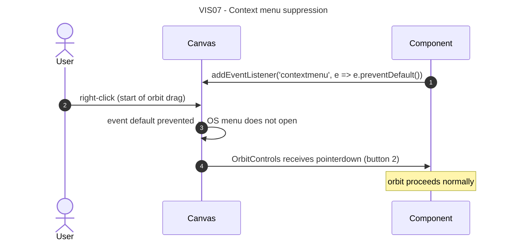
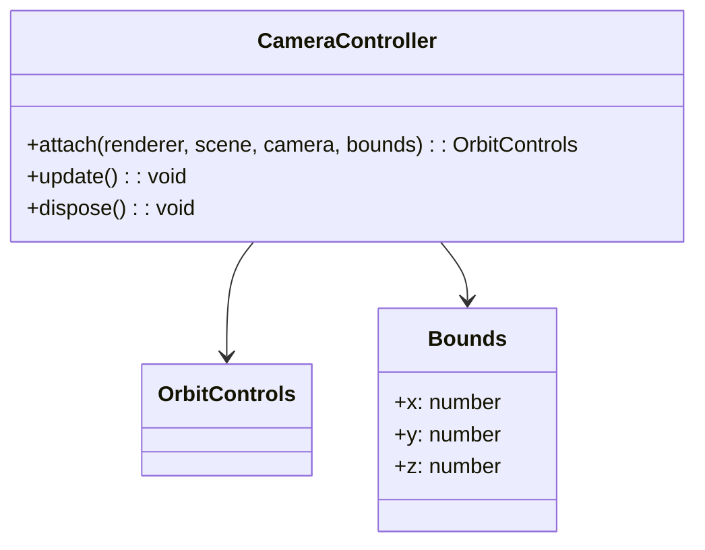

# VIS07 — Perspective Camera Interaction

## 1. Requirements Engineering

### 1.1. User Story Description

As a LaPizza Manager, I want to control a perspective camera with the mouse, so that I can explore the scene and inspect objects from different angles.

### 1.2. Customer Specifications and Clarifications

#### From the specification document
> Extracted from *PART IV — Sprint 2 — User Stories* (VIS07, p. 16).

- **Initial camera target coincides with the centre of the kitchen floor.**
- **Left-click-and-drag pans** the camera within reasonable limits.
- **Right-click-and-drag orbits** around the current target within reasonable limits.
- **Mouse wheel dollies in and out** within reasonable limits.
- **Movement is responsive and smooth, without jitter or excessive sensitivity.**

#### From `kitchen-schema.json`, `kitchen-layout-example.json`, KB §50.4, §51.6

- **Centre of the floor** from `dimensions`: `(dimensions.x / 2, 0, dimensions.z / 2)`. For the reference layout: `(5.0, 0, 4.0)`.
- **Perspective camera** (KB §50.5): `PerspectiveCamera(fov, aspect, near, far)`. `near = 0.1`, `far = max(dimensions.x, dimensions.y, dimensions.z) × 4`. Initial `fov = 50°`.
- **Three.js right-handed system** (KB §50.4): `+X` right, `+Y` up, `+Z` toward observer. Initial camera should be placed **above and behind** the target with `y > 0` and `z > target.z` so the floor is visible from a natural angle.
- **OrbitControls** is the canonical Three.js addon (KB §56 does not cover this, but §50.5 and standard practice do). Its **default** mouse mapping is `LEFT: ROTATE`, `RIGHT: PAN`; the AC **reverses** this (`LEFT: PAN`, `RIGHT: ROTATE`). The mapping must be overridden.

### 1.3. Acceptance Criteria (expanded, testable)

#### AC1 — Initial camera target at the floor centre
- AC1.1 On mount, `controls.target` is set to `new THREE.Vector3(dimensions.x / 2, 0, dimensions.z / 2)`. For the reference layout: `(5.0, 0, 4.0)`.
- AC1.2 The camera's initial position is `target + offset`, where `offset = (0, dimensions.y * 1.5, -dimensions.z * 0.8)` — i.e., elevated and pulled back on `+Z` (toward the viewer, per right-handed convention), so the whole kitchen is visible.
- AC1.3 `camera.lookAt(target)` is called after positioning; `controls.target` is also set so subsequent orbit keeps the target.
- AC1.4 The camera is a `PerspectiveCamera` — not orthographic — as mandated by the US title.

#### AC2 — Left-drag pans
- AC2.1 `OrbitControls.mouseButtons = { LEFT: THREE.MOUSE.PAN, MIDDLE: THREE.MOUSE.DOLLY, RIGHT: THREE.MOUSE.ROTATE }` (remapped from the Three.js default).
- AC2.2 Pan is limited to the scene bounds: `controls.maxTargetRadius = max(dimensions.x, dimensions.z) × 0.6` — the target cannot be panned outside a reasonable neighbourhood of the kitchen. (Three.js `OrbitControls` has `maxTargetRadius` since r152.)
- AC2.3 Panning does **not** rotate the camera; the orbit is preserved.
- AC2.4 Pan sensitivity (OrbitControls `panSpeed = 0.8`) is calibrated so that a full 1000 px drag moves the target by ≈ `dimensions.x / 2`.

#### AC3 — Right-drag orbits around the current target
- AC3.1 `controls.mouseButtons.RIGHT = THREE.MOUSE.ROTATE`.
- AC3.2 Orbit rotates around `controls.target` (the current pan target), not around the world origin.
- AC3.3 Vertical orbit is clamped to `[0, π/2 - 0.05]` (above the floor, below the zenith) — prevents the camera from going upside-down or under the floor. Implemented via `controls.minPolarAngle = 0` and `controls.maxPolarAngle = Math.PI / 2 - 0.05`.
- AC3.4 Orbit sensitivity (OrbitControls `rotateSpeed = 0.8`) — same calibration as pan; the AC "no excessive sensitivity" is verified by the demo (a full-window drag should not spin the view more than ~180°).
- AC3.5 The browser context menu is suppressed on right-click over the canvas (`canvas.addEventListener('contextmenu', e => e.preventDefault())`), otherwise right-drag would trigger the OS menu and cancel the orbit.

#### AC4 — Mouse wheel dollies
- AC4.1 `controls.enableZoom = true`; wheel adjusts `camera.position` along the vector `target → camera` (dolly), not FOV (Three.js `OrbitControls` defaults to dolly, `zoomToCursor = false`).
- AC4.2 Dolly range: `controls.minDistance = 1.5`; `controls.maxDistance = max(dimensions.x, dimensions.y, dimensions.z) × 2`. Prevents entering the floor or leaving the scene bounds.
- AC4.3 Wheel sensitivity (OrbitControls `zoomSpeed = 1.0`) — one notch ≈ 10% distance change. Verified in the demo.

#### AC5 — Smooth, no jitter, no excessive sensitivity
- AC5.1 `controls.enableDamping = true`; `controls.dampingFactor = 0.08`. The render loop calls `controls.update()` **every frame** (required for damping) — this is inside the existing `renderer.setAnimationLoop` callback.
- AC5.2 No frame-rate-dependent jitter: `controls.update()` uses the delta between frames automatically; no manual `dt` scaling is needed.
- AC5.3 The initial frame after mount is stable (no "jump" caused by target being set after the first render). `controls.update()` is called once before the first `renderer.render`.
- AC5.4 `camera.near = 0.1`; `camera.far = max(dimensions.x, dimensions.y, dimensions.z) × 4` — avoids z-fighting when zoomed close and clipping when zoomed far.

#### AC6 — Dispose on route change
- AC6.1 `controls.dispose()` is called in `ngOnDestroy`. Event listeners (`contextmenu`, `wheel`, `pointer*`) are removed.
- AC6.2 No listener leak: navigating away and back produces no duplicated controls (verified by counting `pointerdown` listeners on the canvas before/after a round-trip).

### 1.4. Found out Dependencies

**Preceding:**
- VIS01 (canvas, renderer, render loop), VIS02 (`dimensions` available).

**Succeeding:**
- None directly; VIS07 is a leaf feature.

### 1.5. Input and Output Data

#### 1.5.1. Camera setup (reference layout)

| Parameter | Value | Source |
|---|---|---|
| `fov` | `50` | KB §50.5 |
| `aspect` | `canvas.clientWidth / canvas.clientHeight` | runtime |
| `near` | `0.1` | KB §50.5 |
| `far` | `max(10, 3.5, 8) × 4 = 40` | `dimensions` |
| Initial `position` | `(5.0, 5.25, 4.0 - 6.4) = (5.0, 5.25, -2.4)` | `target + offset` |
| `controls.target` | `(5.0, 0, 4.0)` | `dimensions` centre |
| `controls.minDistance` | `1.5` | reasonable limits |
| `controls.maxDistance` | `max(10, 3.5, 8) × 2 = 20` | `dimensions` |
| `controls.maxPolarAngle` | `π/2 - 0.05 ≈ 1.5208` | prevent under-floor |
| `controls.minPolarAngle` | `0` | prevent upside-down |
| `controls.maxTargetRadius` | `max(10, 8) × 0.6 = 6.0` | reasonable pan limit |
| `controls.enableDamping` | `true` | AC5 |
| `controls.dampingFactor` | `0.08` | AC5 |
| `controls.panSpeed` | `0.8` | AC2 |
| `controls.rotateSpeed` | `0.8` | AC3 |
| `controls.zoomSpeed` | `1.0` | AC4 |
| `controls.mouseButtons` | `{ LEFT: PAN, MIDDLE: DOLLY, RIGHT: ROTATE }` | AC2/AC3 (remapped) |

#### 1.5.2. Persistence

None. Camera state is not persisted across sessions — not required by the ACs, and the "initial target = floor centre" would be violated if it were.

### 1.6. System Sequence Diagrams (SSD)

#### 1.6.1. Initial setup

```mermaid
sequenceDiagram
autonumber
title VIS07 - Camera initial setup
    participant Cmp as KitchenViewerComponent
    participant Cam as PerspectiveCamera
    participant Ctrl as OrbitControls
    participant Renderer as WebGLRenderer
    participant Layout as KitchenLayout

    Cmp->>Layout: getActive() → dimensions
    Cmp->>Cam: new PerspectiveCamera(50, aspect, 0.1, far)
    Cmp->>Cam: position.set(target.x, target.y + 1.5*dim.y, target.z - 0.8*dim.z)
    Cmp->>Cam: lookAt(target)
    Cmp->>Ctrl: new OrbitControls(Cam, canvas)
    Ctrl->>Ctrl: target.set(dim.x/2, 0, dim.z/2)
    Ctrl->>Ctrl: mouseButtons = { LEFT:PAN, MIDDLE:DOLLY, RIGHT:ROTATE }
    Ctrl->>Ctrl: minDistance = 1.5; maxDistance = 2 * max(dim)
    Ctrl->>Ctrl: minPolarAngle = 0; maxPolarAngle = π/2 - 0.05
    Ctrl->>Ctrl: maxTargetRadius = 0.6 * max(dim.x, dim.z)
    Ctrl->>Ctrl: enableDamping = true; dampingFactor = 0.08
    Ctrl->>Ctrl: panSpeed = rotateSpeed = 0.8; zoomSpeed = 1.0
    Ctrl->>Ctrl: update()  // settle before first render
    Cmp->>Renderer: render(scene, camera)
```

#### 1.6.2. Left-drag pan / right-drag orbit / wheel dolly

```mermaid
sequenceDiagram
autonumber
title VIS07 - User interaction
    actor User
    participant Canvas
    participant Ctrl as OrbitControls
    participant Cam as PerspectiveCamera
    participant Renderer as WebGLRenderer

    User->>Canvas: pointerdown (button 0 = LEFT) + drag
    Canvas->>Ctrl: handler → pan
    Ctrl->>Ctrl: translate target by delta (scaled by panSpeed), clamp maxTargetRadius
    Ctrl->>Cam: position offset by same delta; lookAt(target)
    Note over Ctrl: damping lerps toward the target position on each update()

    User->>Canvas: pointerdown (button 2 = RIGHT) + drag
    Canvas->>Ctrl: handler → rotate
    Ctrl->>Ctrl: spherical coordinates update; clamp polar ∈ [0, π/2-0.05]
    Ctrl->>Cam: position = target + sphericalRadius * dir(θ, φ)

    User->>Canvas: wheel
    Canvas->>Ctrl: handler → dolly
    Ctrl->>Ctrl: radius *= 1 ± zoomSpeed*delta; clamp ∈ [minDistance, maxDistance]
    Ctrl->>Cam: position = target + radius * dir(current θ, φ)

    loop each animation frame
        Renderer->>Ctrl: update()
        Ctrl->>Cam: apply damping
        Renderer->>Renderer: render(scene, camera)
    end
```

#### 1.6.3. Right-click context-menu suppression



### 1.7. Other Relevant Remarks

#### 1.7.1. Component architecture



`CameraController` is a `Pure Fabrication` that owns the `OrbitControls` instance and all camera-related constraints, keeping the component thin.

#### 1.7.2. Decision record — OrbitControls vs. hand-rolled handlers

**Decision:** use Three.js `OrbitControls` (addon), with `mouseButtons` remapped to the US's mapping (`LEFT: PAN`, `RIGHT: ROTATE`).

**Rationale:**
- The AC list (pan, orbit, dolly, damping, reasonable limits) is exactly `OrbitControls`' feature set.
- The addon is bundled with Three.js (no extra dependency).
- It has well-tested pointer/touch handling, inertia, and clamping.
- Hand-rolling the spherical-coordinate math and pointer capture adds risk for zero functional gain.

**Alternatives considered:**
- *Hand-rolled handlers*: rejected — reimplements `OrbitControls` for no benefit, and risks the "smooth, no jitter" AC.
- *`PointerLockControls`*: rejected — locks the pointer to the centre, which conflicts with the "pan to inspect" workflow (the Manager needs to move the target to a specific piece of equipment).
- *`TrackballControls`*: rejected — orbits around the world origin without a defined `target`, which violates AC3.2 ("orbit around the current target").

**Consequence:** the `mouseButtons` override is mandatory; without it, LEFT would rotate and RIGHT would pan, violating AC2/AC3.

#### 1.7.3. Error/status matrix

| Condition | Source | UI |
|---|---|---|
| WebGL2 unavailable | VIS01 AC5.2 | no camera controller created |
| Dimensions not yet loaded | VIS02 | camera controller initialised but inactive; `controls.enabled = false` until dimensions arrive |
| Canvas resized | window resize | `camera.aspect` updated; `camera.updateProjectionMatrix()`; `renderer.setSize(...)` |
| Route change | ngOnDestroy | `controls.dispose()`; listeners removed |

#### 1.7.4. Verification

- **Unit:** `CameraController.attach` sets `controls.target` to `(x/2, 0, z/2)` for a given bounds; asserts `mouseButtons.LEFT === THREE.MOUSE.PAN` and `mouseButtons.RIGHT === THREE.MOUSE.ROTATE`; asserts polar clamp and distance clamps.
- **Unit:** initial `camera.position` is `target + (0, 1.5*y, -0.8*z)`.
- **Unit:** `controls.update()` is called once before the first render — no first-frame jump.
- **Integration (Angular TestBed + mocked renderer):** `ngOnDestroy` calls `controls.dispose()` exactly once; re-navigating to the route instantiates a fresh controller (no duplicate listeners).
- **E2E (Playwright, if available):** perform a left-drag, a right-drag, and a wheel scroll; assert the camera target/position changed as expected and no context menu appeared.
- **Demo:** open viewer → initial view shows the whole kitchen centred on the floor (target at `(5,0,4)`); left-drag moves the view to focus on the oven; right-drag orbits around the current target (the oven stays in frame); wheel zooms in to read a dispenser label; wheel out to see the whole kitchen; no context menu on right-click; no jitter.