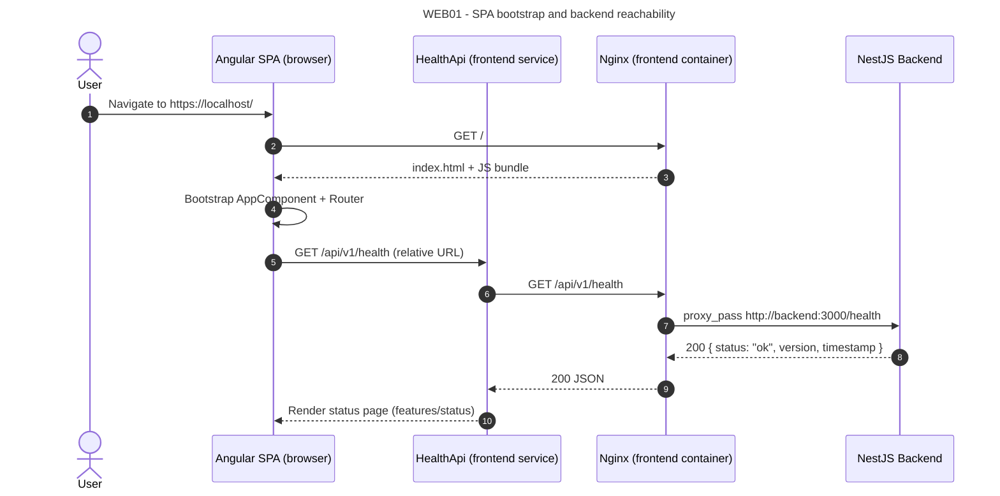
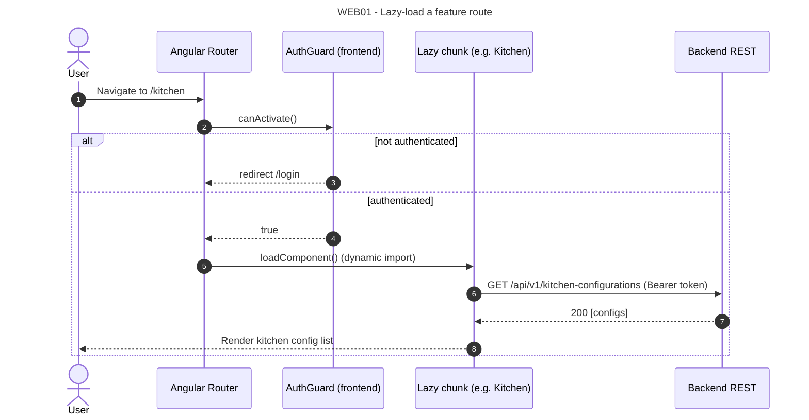
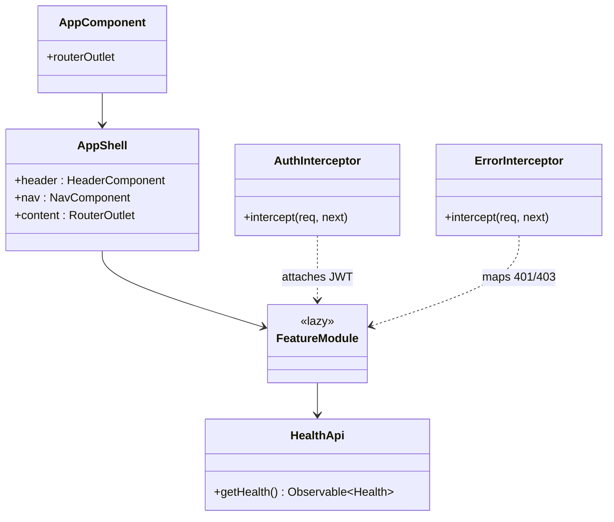
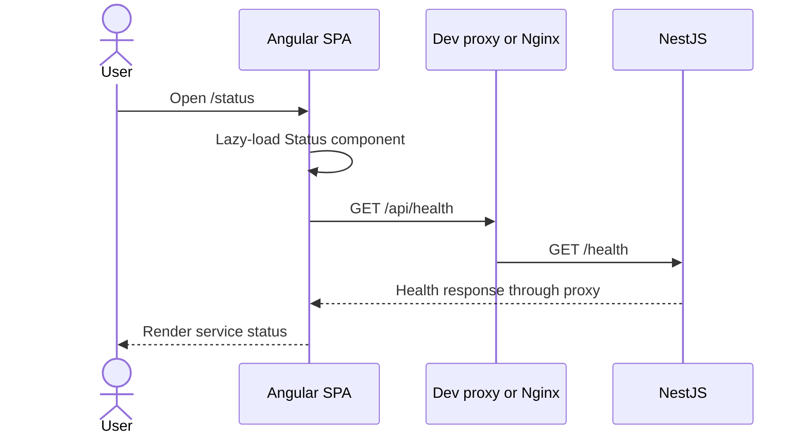

# WEB01 — SPA Setup and Integration

> **Documentation scope (2026-11-06):** Section 1 preserves the original requirements and proposed design baseline. Section 2 records the implementation inspected in this repository and takes precedence for current paths, roles, flows and completion claims. Differences are documented as remaining work or implementation departures, not as changes to the original specification.

## 1. Requirements Engineering

### 1.1. User Story Description
As a Project Manager, I want a single-page web application integrated with the existing back end, so that users can access the LaPrizza services through one interface.

### 1.2. Customer Specifications and Clarifications

#### From the specification document
> Requirements extracted directly from *PART IV – Sprint 2 – User Stories* (WEB01, p. 3) and *PART II – System Specification* (§II.3.2 Web Application, p. 11).

- **Framework & structure:** SPA must use an appropriate framework (ADR-009: **Angular 22**, standalone components, zoneless, strict TypeScript) and be organised so that functionality can be maintained and extended independently.
- **Backend integration:** Business information must be obtained from and maintained through the corresponding back-end services (REST API at `/api/v1`), using **consistent business identifiers** (SKU, category name, email, username, etc.) across the system — never UUIDs in relationships (KB §3.4, §16.2).
- **Reproducible install:** The application must be reproducibly installed, configured, and executed from the common project repository (see KB §33.1, §39).
- **3D viewer & AI services:** Integration of the 3D viewer (VIS) and AI services (AI) must preserve the common navigation, authentication, and visual identity.
- **Environment configuration:** Documented per-environment; **sensitive credentials must not be included in publicly accessible application files** (no secrets in `src/environments/*`; use build-time injection / runtime config endpoint).

#### From project clarifications and existing technical documentation
- **Framework decision (ADR-009):** Angular accepted; React previously mentioned in `04-principles-and-guidelines.md` §8 is **superseded**. Angular standalone components, `HttpClient` with interceptors, typed reactive forms, route guards, lazy-loaded feature routes.
- **Repository layout:** `frontend/` already exists with `nginx.conf` single-file reverse proxy (§39.3) and `proxy.conf.json` for `ng serve`.
- **Backend base path:** NestJS currently bootstraps without the `/api/v1` global prefix in the inspected archive; the published OpenAPI declares `/api/v1`. The SPA must consume whatever base URL is configured via environment (`apiBaseUrl`), not hard-coded strings.
- **Token handling:** JWT attached via `HttpInterceptor`; 401 → redirect to login; 403 → role-aware message (see AA04, AA05).
- **Configuration file:** `src/app/core/api/health-api.ts` already exists as the first API consumer (health check). New feature services should live under `src/app/features/<feature>/`.

### 1.3. Acceptance Criteria

- **AC1 — Single integrated interface:** The SPA must provide one integrated interface for all roles (Guest, Customer, Employee, Manager) rather than separate applications.
- **AC2 — Maintainable structure:** The application must use an appropriate framework and be organised by business capability so that functionality can be maintained and extended independently (standalone components + feature folders + lazy routes).
- **AC3 — Backend as source of truth:** All business information must be obtained from and maintained through the back-end REST services; the SPA must not keep a parallel authoritative copy of business data.
- **AC4 — Consistent identifiers:** The SPA must use the same business identifiers (SKU, category name, username, email, configuration name, forecast name, scenario name) that the backend uses in URIs and payloads.
- **AC5 — Reproducible setup:** The SPA must be installable and runnable from the repository with documented commands (`npm ci`, `npm run start`, or Docker Compose per §36/§39).
- **AC6 — Preserved identity across modules:** Integration of the 3D viewer and AI pages must reuse the SPA shell (layout, navigation, auth guard, interceptors) — not embed an isolated iframe/app.
- **AC7 — Environment configuration:** Environment-specific configuration (API base URL, OIDC issuer, feature flags) must be documented and injected without embedding secrets in the bundle.

### 1.4. Found out Dependencies

- **Preceding:** ARC01/ARC02/ARC03 (Sprint 1 architecture + OpenAPI contract), ADR-009 (Angular), ADR-005 (REST base path `/api/v1`), BCK01–BCK11 endpoints available.
- **Succeeding:** WEB02–WEB07 all depend on WEB01 (shell, HTTP layer, interceptors, routing skeleton). VIS01 depends on WEB01 (component host). AA01/AA02 depend on WEB01 (login page host).

### 1.5. Input and Output Data

**Inputs (build-time / runtime):**
- `apiBaseUrl` (string) — backend base URL.
- `oidcIssuerUrl`, `oidcClientId` — OIDC configuration (AA02).
- Feature flags (optional): `enable3dViewer`, `enableAIPlanning`.

**Outputs:**
- Angular workspace under `frontend/` with standalone app, router configured, `HttpClient` + interceptors registered, feature folders `features/{auth, catalogue, products, categories, allergens, pizza-sizes, component-types, size-configs, stock, predefined-pizzas, customers, kitchen, ai-planning, status}`.
- `environment.ts` / `environment.prod.ts` (no secrets), `proxy.conf.json`, `Dockerfile` (multi-stage), `nginx.conf`.

### 1.6. System Sequence Diagram (SSD)

#### 1.6.1. SPA Bootstrap & Health Check



#### 1.6.2. Feature Route Lazy Load



### 1.7. Other Relevant Remarks

- **Class/Component diagram (frontend):** The Angular architecture is a component tree, not a UML domain class diagram. The diagram below shows the SPA shell and its integration with backend services.



- **Do not** use `environment.ts` for secrets; only public configuration. Backend secrets live in `.env`/Compose.
- **Reference OpenAPI** (`docs/api/openapi.yaml` v2.0.0) as the single source for endpoint shapes; generate typed clients or hand-write services consistently.
- **Dev workflow:** `ng serve --proxy-config proxy.conf.json` forwards `/api` to `http://localhost:3000`; production uses `nginx.conf` (§39.3).

## 2. Current Implementation — 2026-11-06

### 2.1. Delivered architecture

One Angular 22 SPA serves the LaPrizza customer storefront and the Forno staff backoffice. It uses standalone components, strict TypeScript, zoneless change detection, Signals/computed state, RxJS, `HttpClient`, and lazy `loadComponent` routes. The application registers one shared `authInterceptor`, ngx-translate with English/European Portuguese JSON catalogs, and an application initializer for the persisted/browser language preference.

The implemented source layout is:

```text
frontend/src/app/
├── app.config.ts / app.routes.ts
├── frontoffice/          # customer pages, API/cart/profile services, UI and styles
├── backoffice/           # staff pages, API services, guards, UI and styles
└── shared_components/    # shared authentication, API models, errors, lookups and UI
```

There is no implemented `features/` hierarchy or separate `ErrorInterceptor`. Forms currently use `FormsModule` and template-driven bindings rather than the proposed typed reactive forms.

### 2.2. Integration and setup

| Concern | Implemented behavior |
|---|---|
| Browser API prefix | Relative `/api/...` URLs in API services |
| Development proxy | `proxy.conf.json` forwards to `http://127.0.0.1:3000` and strips `/api` |
| Production proxy | Nginx forwards `/api/` to `http://backend:3000/`, stripping the prefix |
| Browser deep links | Nginx `try_files` falls back to `index.html` |
| Health check | `/status` uses `HealthApi.getHealth()` → `/api/health` |
| Authentication | Shared `Auth` service and bearer interceptor; details in AA01/AA04 |
| Identifiers | Services encode endpoint identifiers such as SKU, username and resource name; size-configuration updates use the identifier returned by the API |
| Packaging | Multi-stage Node 24 / Nginx Dockerfile; HTTPS configuration requires mounted certificates |

Run from the repository root:

```sh
npm --prefix frontend ci
npm --prefix frontend start -- --proxy-config proxy.conf.json
npm --prefix frontend run build
```

`npm --prefix frontend run dev` starts HTTPS development using `certs/site.crt`, `certs/site.key`, and the proxy configuration. Plain `npm start` does not enable the API proxy automatically. Backend services must also be running for real API integration.



### 2.3. Coverage and remaining work

Core SPA setup, routed layouts, API services and proxy packaging are implemented. The earlier `/api/v1` examples describe the contract/design baseline; they are not the browser URLs used by this frontend. A runtime `apiBaseUrl`, OIDC configuration, feature-flag service, and environment-specific configuration injection are not implemented. The kitchen route is a placeholder; AI pages and an integrated 3D viewer remain pending. The local cart is an order draft, and business reads/writes use backend services.

**Source:** [application providers](../../../frontend/src/app/app.config.ts), [root routes](../../../frontend/src/app/app.routes.ts), [package scripts](../../../frontend/package.json), [development proxy](../../../frontend/proxy.conf.json), [Nginx configuration](../../../frontend/nginx.conf), [Dockerfile](../../../frontend/Dockerfile).

**Existing verification:** [backoffice suite](../../../frontend/e2e/backoffice/backoffice.spec.ts) and [storefront suite](../../../frontend/e2e/frontoffice/storefront.spec.ts) exercise routed pages and mocked API integration. These browser tests do not establish live-backend or deployed-proxy correctness.
