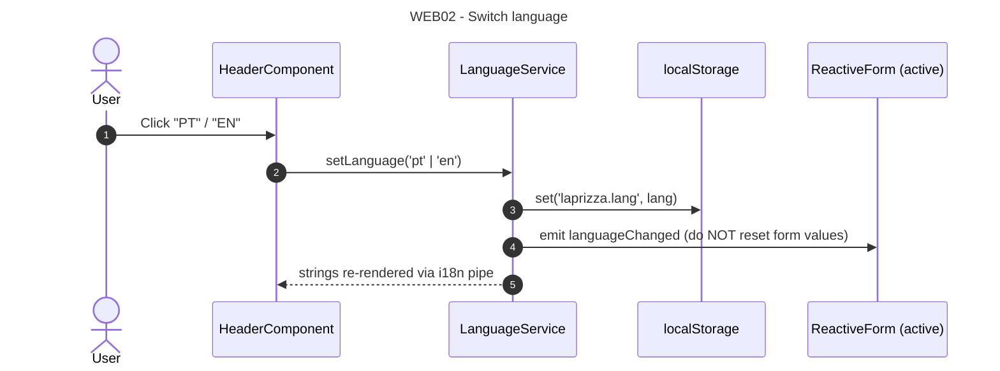
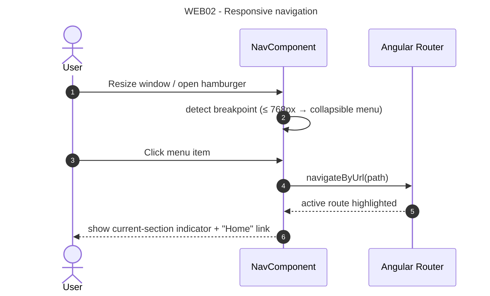

# WEB02 — Consistent Layout and Navigation

> **Documentation scope (2026-11-06):** Section 1 preserves the original requirements and proposed design baseline. Section 2 records the implementation inspected in this repository and takes precedence for current paths, roles, flows and completion claims. Differences are documented as remaining work or implementation departures, not as changes to the original specification.

## 1. Requirements Engineering

### 1.1. User Story Description
As a System User, I want a consistent layout and navigation structure, so that the available features are easy to find.

### 1.2. Customer Specifications and Clarifications

#### From the specification document
> Extracted from *PART IV – Sprint 2 – User Stories* (WEB02, p. 4).

- **Shell content:** Restaurant name and logo, primary navigation area, main content area.
- **Persistent identification:** Restaurant identification and primary navigation must remain visible and accessible during use.
- **Visual consistency:** Menus, forms, buttons, and messages must follow consistent visual and interaction conventions.
- **i18n:** Interface must support **English and Portuguese**; selected language must remain consistent during navigation (persisted — localStorage, cookie, or profile per clarification #22).
- **Responsive:** Layout must adapt to different screen sizes, prioritising desktop, without hiding essential information or actions.
- **Accessibility:** Forms and navigation usable with keyboard; relevant controls have clear labels.
- **Orientation:** Users must identify their current section and return to an appropriate starting page.

#### From project clarifications (`docs/domain/client-questions.md` — Clarification #22)
- No mandatory logo (a text wordmark is acceptable).
- UI strings translated; business data **not** translated, except allergen names localised.
- Language preference persists.
- **Form state preserved** on language change (do not lose typed values).

### 1.3. Acceptance Criteria

- **AC1 — Shell:** Common layout contains restaurant name (and optional logo), primary nav area, main content area.
- **AC2 — Persistence:** Name + primary nav remain visible/accessible while navigating.
- **AC3 — Consistency:** Menus, forms, buttons, messages use a consistent design system (Angular Material or a shared SCSS design token set).
- **AC4 — i18n EN/PT:** UI strings rendered in both languages; selected language persists across navigation (localStorage + optional profile sync).
- **AC5 — Form state preservation:** Changing language must not discard form inputs.
- **AC6 — Responsive:** Layout adapts to desktop and smaller viewports without hiding essential information or actions.
- **AC7 — Accessibility:** Keyboard navigation and clear labels on controls.
- **AC8 — Orientation:** Current section is visually identifiable; a "home" link returns to role-appropriate starting page.

### 1.4. Found out Dependencies

- **Preceding:** WEB01 (Angular shell).
- **Succeeding:** WEB03 (role-based nav consumes this shell), WEB04 (feedback messages rendered in this shell).

### 1.5. Input and Output Data

**Inputs:**
- `language` preference (`en` | `pt`) — localStorage key `laprizza.lang` (and optional `users.language_preference`).
- Translation catalogs `assets/i18n/en.json`, `assets/i18n/pt.json`.

**Outputs:**
- Shell component rendered with header, nav, content outlet.
- Persisted language preference.

### 1.6. System Sequence Diagram (SSD)

#### 1.6.1. Language Switch

#### 1.6.2. Responsive Navigation

### 1.7. Other Relevant Remarks

- **Design tokens** (colors, spacing, typography) shared in `styles.scss` and consumed by all feature components — do not introduce per-feature palettes.
- **i18n library:** `@ngx-translate/core` is the recommended choice for runtime switching (Angular i18n built-in is build-time only and does not support runtime preservation of form state easily).
- **Allergen names** are business data; translate only if a canonical translation table exists (`allergens.name_en`, `name_pt` or a seed lookup). Otherwise display the canonical name.

## 2. Current Implementation — 2026-11-06

### 2.1. Layout and navigation

The SPA has two routed layouts: the LaPrizza storefront for public/customer pages and the Forno backoffice for staff. Both provide brand identification, navigation, a main router outlet, account actions and sign-out through the shared authentication service.

| Area | Delivered behavior |
|---|---|
| Storefront | Shared brand/header, menu and order navigation, cart count, account/sign-in actions and footer |
| Backoffice | Role-filtered sidebar, active-route indicators, current-page label, staff profile and workspace navigation |
| Compact navigation | Backoffice switches at `max-width: 1100px`; compact rail supports hover/focus tooltips and expanded labels |
| Keyboard behavior | Skip-to-content actions, labeled controls, Escape dismissal, focus on menu opening and optional focus restoration on close |
| Shared UI | Icons and modal; backoffice table, pagination, panel, badge, tabs, page header and feedback components |
| Styles | Shared base styles plus separate frontoffice/backoffice SCSS styles and tokens imported by `styles.scss` |

Opening the expanded backoffice navigation moves focus to its close control. Selecting routes, resizing, and Escape dismissal are handled by the layout. Navigation supports small screens and touch interaction; the implemented design is a compact rail with expansion rather than the earlier generic hamburger-only proposal.

### 2.2. Acceptance coverage

| Criteria | Current status |
|---|---|
| AC1–AC3: shell, persistent navigation, consistency | Implemented through the two layouts and reusable UI/styles |
| AC4: English/Portuguese switching and persistence | Implemented with ngx-translate, `en` / `pt-PT` catalogs and `laprizza.lang` localStorage preference |
| AC5: preserve forms during language changes | Runtime switching updates text without rebuilding active forms or navigating |
| AC6: responsive layouts | Implemented; viewport checks exist in browser suites |
| AC7: keyboard access and labels | Controls, skip links, tooltip/focus behavior implemented; no claim of a complete accessibility audit |
| AC8: orientation and starting pages | Active links/current-page labels and role-specific backoffice landing pages implemented |

The shared `Language` service and `pt | en` switcher support English and European Portuguese across routes and shared dialogs. Startup uses a valid saved preference, a supported browser language, then English. The JSON catalogs in `frontend/public/i18n/` share keys, and English is the fallback. Choices are saved only after successful loading; load failures retain the current language and support retry. Switching updates `<html lang>`, route titles, dates and currency formatting while preserving form values. Business data is displayed using names supplied by the API. See [language maintenance notes](../../../frontend/public/i18n/README.md).

### 2.3. Source and verification

**Source:** [storefront layout](../../../frontend/src/app/frontoffice/shared_components/storefront-layout/storefront-layout.ts), [backoffice layout](../../../frontend/src/app/backoffice/shared_components/layout/backoffice.ts), [global style imports](../../../frontend/src/styles.scss), [shared modal](../../../frontend/src/app/shared_components/ui/modal/modal.ts).

**Existing verification:** [backoffice suite](../../../frontend/e2e/backoffice/backoffice.spec.ts) covers compact sidebar tooltips, expansion, touch navigation and responsive routes; [storefront suite](../../../frontend/e2e/frontoffice/storefront.spec.ts) covers customer pages and dialogs at multiple viewport widths. [Language browser tests](../../../frontend/e2e/i18n.spec.ts) cover runtime switching, form preservation, saved/browser preferences, titles, locale formatting, retry and responsive controls.
